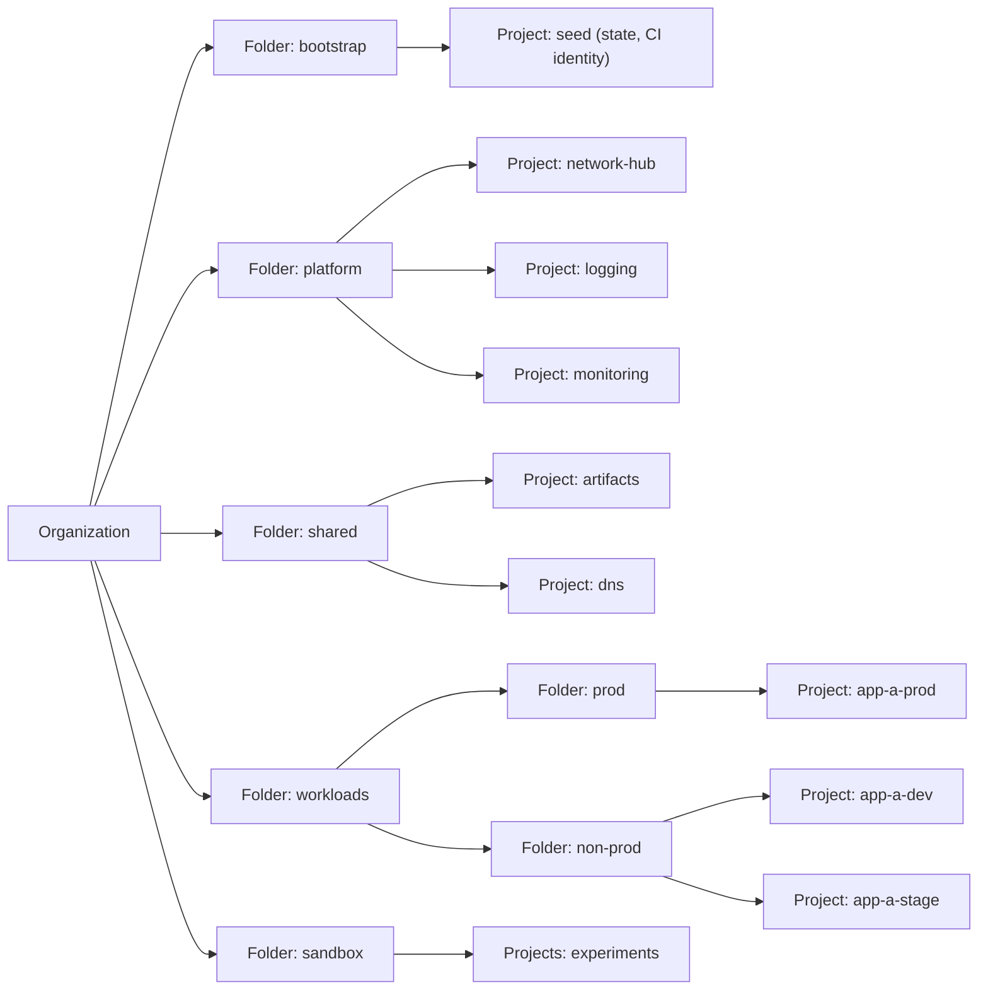

This note describes a target resource hierarchy for a GCP organization: folders, projects, the bootstrap project that holds Terraform state and the CI identity, and a project factory that creates every new project the same way. It is written for senior DevOps engineers who set up or inherit an organization. It does not cover how dev, stage and prod are separated (see [[architecture/environment-separation-on-gcp]]), the detail of IAM roles and groups (see [[architecture/iam-groups-and-ci-workload-identity-federation]]) or the policy constraints themselves (see [[compliance/gcp-organization-policy-guardrails]]).

> [!info] Scope and sources
> Written against the GCP resource hierarchy (organization, folders, projects) and the Google Terraform provider, based on the Google Cloud resource hierarchy and Terraform provider documentation at cloud.google.com and registry.terraform.io. Folder names and layout are the author's opinion, not a Google standard.

> [!note] Not verified
> The claims below were written from documentation knowledge and were not checked against a running system or the current docs: the default service account and default network behaviour of new projects and which organization policy constraints block them; the `deletion_policy` attribute of `google_project` and its default in the current provider; the names of Google's landing-zone blueprints. Check them before relying on them.

## Goals

A landing zone is the set of decisions you make once so that every later project starts safe and consistent. The goals of this design:

- Blast radius is a project. A mistake, a quota exhaustion or a leaked credential in one project does not reach another.
- IAM, policy and billing are inherited from a folder, so a new project is compliant on creation without manual steps.
- Everything is created from code. Nobody creates a production project in the console.
- The identity that runs Terraform is known, small in number and cannot be used by a person day to day.
- Org-level resources (log sinks, billing link, organization policies) have one owner and one place in the repository.

## The hierarchy

The organization is the root. Folders group projects by purpose and by the policy and IAM they share. A project is the unit of resource ownership, API enablement, quota, billing link and, in practice, blast radius.



What each folder is for:

- `bootstrap`: the seed project only. Few people have access. It is the one place that is created by hand, once.
- `platform`: projects that run organization-wide infrastructure: the network hub, central logging, central monitoring.
- `shared`: projects used by many workloads that are neither network nor observability, for example a registry project or a tooling DNS zone.
- `workloads/prod` and `workloads/non-prod`: application projects. The split exists so that policy and IAM for production can be stricter than for everything else. See [[architecture/environment-separation-on-gcp]] for why.
- `sandbox`: disposable projects with relaxed policy, a budget limit and no connectivity to production networks.

Folder names are opinion. What matters is that the split follows a difference in policy or access, not the org chart. A folder per team breaks the first time a team is renamed or merged.

### Naming convention

Pick a convention once and encode it in the project factory. Project IDs are global and cannot be changed after creation, so a bad name stays.

```text
organization
├── bootstrap
│   └── acme-seed
├── platform
│   ├── acme-net-hub
│   ├── acme-logging
│   └── acme-monitoring
├── shared
│   ├── acme-artifacts
│   └── acme-dns
├── workloads
│   ├── prod
│   │   └── acme-billing-prod
│   └── non-prod
│       ├── acme-billing-dev
│       └── acme-billing-stage
└── sandbox
    └── acme-sbx-jdoe-01
```

The pattern is `<org-prefix>-<workload>-<environment>`. The environment is a stable part of the name; put the owning team and cost centre in labels, not in the name, because labels can change and names cannot.

## Bootstrap project and seed identity

Terraform cannot create the project that stores its own state, so one project is created by hand, then described in code and imported.

The bootstrap (seed) project holds:

- The Cloud Storage bucket for Terraform state, with versioning on and uniform bucket-level access. Layout of state across the repository is covered in [[patterns/terraform-module-and-state-layout]].
- The service account (or Workload Identity Federation pool) that CI uses to run Terraform at organization scope. The federation setup is in [[architecture/iam-groups-and-ci-workload-identity-federation]].
- Only the APIs that Terraform needs: Resource Manager, Service Usage, IAM, IAM Credentials, Security Token Service (both needed for keyless Workload Identity Federation), Cloud Billing, Cloud Storage.

Rules for the seed identity:

- It is granted roles at the organization or folder level that let it create folders and projects and link billing, and nothing else. Do not give it `roles/owner` on the organization.
- No human uses it. People get their own access through groups.
- Split it when you can: one identity for the project factory (folders, projects, billing link) and a separate one for organization policy and org-level IAM, because the second is far more dangerous. See [[compliance/gcp-organization-policy-guardrails]].
- It has no service account key. CI authenticates by federation.

## Org-level resources and where they live

Some resources are attached to the organization or a folder rather than a project. Keep them in their own Terraform root module, with their own state, applied by a restricted pipeline:

- Aggregated log sinks (organization or folder level, with children included) that route audit logs to a bucket in the logging project.
- The billing account link for each project, and billing budgets with alerts. See [[architecture/finops-cost-allocation-and-guardrails]].
- Organization policies.
- Organization-level IAM bindings, which should be few and only for groups.

## Project factory with Terraform

A project factory is a Terraform module that every project uses. Teams request a project by adding a block of variables to a repository and opening a merge request; the module creates the project with the same settings every time.

```hcl title="modules/project-factory/main.tf"
terraform {
  required_version = ">= 1.6"

  required_providers {
    google = {
      source  = "hashicorp/google"
      version = "~> 6.0" # change: pin to the provider version you have tested
    }
  }
}

variable "parent_folder_id" {
  type        = string
  description = "Folder that will contain the project, as the numeric folder ID."
}

variable "project_id" {
  type        = string
  description = "Globally unique project ID. Cannot be changed later."
}

variable "project_name" {
  type        = string
  description = "Display name of the project."
}

variable "billing_account" {
  type        = string
  description = "Billing account ID, for example 000000-AAAAAA-BBBBBB."
}

variable "labels" {
  type        = map(string)
  description = "Labels: at least team, cost_center and environment."

  validation {
    condition     = alltrue([for k in ["team", "cost_center", "environment"] : contains(keys(var.labels), k)])
    error_message = "labels must contain team, cost_center and environment."
  }
}

variable "activate_apis" {
  type        = list(string)
  description = "APIs to enable in the project."
  default = [
    "compute.googleapis.com",
    "container.googleapis.com",
    "logging.googleapis.com",
    "monitoring.googleapis.com",
    "secretmanager.googleapis.com",
  ]
}

resource "google_project" "this" {
  name                = var.project_name
  project_id          = var.project_id
  folder_id           = "folders/${var.parent_folder_id}"
  billing_account     = var.billing_account
  labels              = var.labels
  auto_create_network = false # no default VPC; networks come from the network hub

  # Protects against an accidental terraform destroy of a production project.
  # The attribute and its default depend on the provider version: check the docs.
  deletion_policy = "PREVENT"
}

resource "google_project_service" "api" {
  for_each = toset(var.activate_apis)

  project                    = google_project.this.project_id
  service                    = each.value
  disable_on_destroy         = false
  disable_dependent_services = false
}

output "project_id" {
  value = google_project.this.project_id
}

output "project_number" {
  value = google_project.this.number
}
```

Folders live in a separate module or root, created before projects:

```hcl title="live/org/folders.tf"
variable "org_id" {
  type        = string
  description = "Organization ID, numeric."
}

resource "google_folder" "workloads" {
  display_name = "workloads"
  parent       = "organizations/${var.org_id}"
}

resource "google_folder" "prod" {
  display_name = "prod"
  parent       = google_folder.workloads.name
}

resource "google_folder" "non_prod" {
  display_name = "non-prod"
  parent       = google_folder.workloads.name
}

output "prod_folder_id" {
  value = google_folder.prod.folder_id
}

output "non_prod_folder_id" {
  value = google_folder.non_prod.folder_id
}
```

Keep the list of enabled APIs short. Every enabled API is a surface that someone has to monitor, and a project that only needs Compute and GKE should not have BigQuery on.

## Defaults to remove in every new project

New projects have historically come with defaults that are convenient and unsafe. The project factory and the organization policies together should remove them:

- The default VPC with permissive firewall rules. The factory sets `auto_create_network = false`. An organization policy that skips default network creation backs it up.
- The default Compute Engine service account, which in many setups has a broad role on the project. Prefer an organization policy that stops it getting that role, and use dedicated service accounts per workload. See [[architecture/iam-groups-and-ci-workload-identity-federation]].
- Service account key creation, blocked by organization policy.
- External IPs on VMs, blocked by organization policy.
- Owner granted to whoever created the project. Projects are created by the pipeline, and the creating identity is usually granted Owner on the new project (not verified, check). The factory must remove that binding (for example with an authoritative project IAM policy or a follow-up removal), or the seed identity's Owner on every project must be accepted as a known risk.

How each default behaves today depends on when the organization was created and on which constraints are enforced, so test it: create a project in the sandbox folder with your factory and list what it contains.

## Trade-offs: few large projects or many small ones

| Concern          | Few large projects                                  | Many small projects                              |
| ---------------- | --------------------------------------------------- | ------------------------------------------------ |
| Blast radius     | A mistake or a leaked credential reaches everything | Contained to the project                         |
| IAM              | Needs fine-grained bindings inside the project      | Coarse roles at folder level are enough          |
| Quota            | Teams compete for one quota                         | Each project has its own, but many need raising  |
| Billing          | Needs labels to split cost                          | Cost per project is visible without labels       |
| Networking       | Simple, one VPC                                     | Needs Shared VPC or peering                      |
| Operational cost | Less to manage                                      | Needs the project factory and automation to cope |
| Audit            | Hard to say who can touch what                      | Easy to answer from the folder and project IAM   |

The common working answer is one project per workload per environment, with shared networking in a hub. Going finer than that (a project per microservice) is rarely worth it unless teams need hard isolation.

## Adopting it in an existing organization

You rarely start from an empty organization. Move in small, reversible steps:

1. Inventory what exists. List the tree and the projects without a folder (see the commands below).
2. Create the folders and the seed project. Put the Terraform state in the new bucket.
3. Turn on the organization policies in dry-run or at a sandbox folder first. See [[compliance/gcp-organization-policy-guardrails]].
4. Move existing projects into folders, one folder at a time, starting with non-prod. Moving a project changes the policy and IAM it inherits, so check the effective policy before and after.
5. Import existing projects into Terraform only when you are ready to manage them. Unmanaged projects in the right folder are better than a rushed import.
6. Make the project factory the only way to create projects, then remove project creation rights from people.

List the tree to check where you are:

```bash
set -euo pipefail

ORG_ID="123456789012"  # change: your numeric organization ID
FOLDER_ID="345678901234"  # change: a folder ID to inspect

# Top-level folders under the organization
gcloud resource-manager folders list --organization="${ORG_ID}" \
  --format="table(name, displayName)"

# Subfolders of one folder
gcloud resource-manager folders list --folder="${FOLDER_ID}" \
  --format="table(name, displayName)"

# Projects directly in that folder
gcloud projects list --filter="parent.id=${FOLDER_ID}" \
  --format="table(projectId, name, labels.team, labels.environment)"

# Projects that sit directly under the organization, outside any folder
gcloud projects list --filter="parent.type=organization AND parent.id=${ORG_ID}" \
  --format="table(projectId, name)"
```

## Pitfalls

- Creating the bootstrap project and then leaving it with broad human access. It controls everything else; treat it as the most sensitive project.
- One Terraform state for the whole organization. A plan then takes long, a lock blocks everyone and one mistake touches all. Split by folder or by layer.
- Folders that mirror the org chart. Re-orgs then force project moves and IAM rewrites.
- Putting production and non-production in the same folder, so that stricter production policy cannot be applied by inheritance.
- Choosing project IDs that contain team or people names that later change. Project IDs cannot be changed.
- Deleting a project in a hurry. A deleted project is only scheduled for deletion and may be recoverable for a period; that period and the reuse of project IDs are documented by Google, so read them before relying on either.
- Forgetting billing: a project with no billing link cannot use most services, and a project linked to the wrong account bills the wrong team.
- Granting roles on the organization to individuals "temporarily". Use groups and a reviewed change.

## Related

- [[patterns/terraform-module-and-state-layout]]: how to split Terraform modules and state, which the project factory and the org-level root rely on.
- [[architecture/environment-separation-on-gcp]]: how the workload folders and projects map to dev, stage and prod.
- [[architecture/iam-groups-and-ci-workload-identity-federation]]: the groups and keyless CI identity that sit on top of this hierarchy.
- [[compliance/gcp-organization-policy-guardrails]]: the preventive controls attached to the organization and folders.
- [[architecture/finops-cost-allocation-and-guardrails]]: labels, budgets and billing structure that depend on the project layout.
