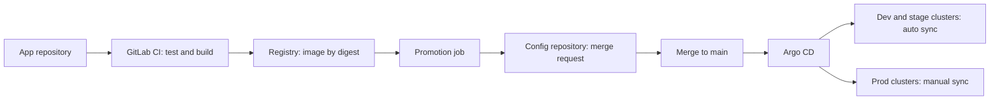

This note covers how to organise the repositories behind an Argo CD based GitOps setup and how a change moves from a build to production. It is for senior DevOps engineers who already run, or are about to run, Argo CD on GKE. The choice of Argo CD itself is recorded in [[adr/0001-gitops-with-argocd]] and is not argued again here. Debugging a stuck sync is in [[runbooks/argocd-sync-failure-and-drift]], and the canary mechanics that sit on top of promotion are in [[patterns/progressive-delivery-argo-rollouts]].

> [!info] Scope and sources
> Written against Argo CD ApplicationSet and Kustomize as described in the official documentation at [argo-cd.readthedocs.io](https://argo-cd.readthedocs.io/en/stable/) and GitLab CI as described at [docs.gitlab.com](https://docs.gitlab.com/). Examples assume GitLab as the Git host and registry-independent image digests.

> [!note] Not verified
> The claims below were written from documentation knowledge and were not checked against a running system or the current docs: current ApplicationSet generator names and fields, Argo CD Image Updater status and write-back modes, and the GitLab push option names. Check them before relying on them.

## Goals

- Git is the only way a change reaches a cluster. Every deployed state has a commit.
- A promotion is a reviewable diff that names the exact image digest, not a mutable tag.
- Environments differ in a small, visible overlay, not in forked copies of manifests.
- Non-production deploys automatically; production needs a human decision that leaves a record.
- Rollback is a revert commit that goes through the same path as any change.

## Flow



The application repository builds and pushes the image. It never talks to a cluster. A separate job changes the config repository, and Argo CD pulls from there. Image storage and promotion between registry repositories is covered in [[patterns/artifact-promotion-artifactory]].

## Repository options

| Option                              | Strengths                                                               | Weaknesses                                                         | Fits                                               |
| ----------------------------------- | ----------------------------------------------------------------------- | ------------------------------------------------------------------ | -------------------------------------------------- |
| One config monorepo                 | One place to search; atomic cross-app changes; one set of rules         | Busy history; broad write access unless CODEOWNERS is strict       | One platform team or a few teams; default choice   |
| Repo per environment                | Hard access split (prod repo has fewer writers); clean prod audit trail | Changes are copied between repos; drift between them is easy       | Strict separation of duties on production          |
| Repo per team                       | Teams own their config; small blast radius                              | Platform-wide changes touch many repos; uneven conventions         | Many autonomous teams with strong platform tooling |
| Config inside each application repo | Code and config change in one commit                                    | Promotion and permissions are tangled with application development | Small systems; avoid as the platform grows         |

Start with one config monorepo with environment directories and protected `main`. Use CODEOWNERS on `overlays/prod` so production changes need an approver from the right group. Move to a repo per environment only if an auditor or a separation-of-duties requirement forces the access split; the control reasoning belongs to the compliance notes, not to this one.

## Recommended layout

Base manifests live once per application. Each environment is a thin overlay that sets the image digest, replica counts and environment-specific values. Cluster-level add-ons are kept separately from applications.

```text title="gitops-config/"
gitops-config/
├── applicationsets/
│   ├── apps-nonprod.yaml
│   └── apps-prod.yaml
├── apps/
│   └── payments/
│       ├── base/
│       │   ├── deployment.yaml
│       │   ├── service.yaml
│       │   └── kustomization.yaml
│       └── overlays/
│           ├── dev/
│           │   └── kustomization.yaml
│           ├── stage/
│           │   └── kustomization.yaml
│           └── prod/
│               └── kustomization.yaml
├── platform/
│   ├── projects/
│   │   ├── nonprod.yaml
│   │   └── prod.yaml
│   └── addons/
└── CODEOWNERS
```

A prod overlay pins the image by digest:

```yaml title="apps/payments/overlays/prod/kustomization.yaml"
apiVersion: kustomize.config.k8s.io/v1beta1
kind: Kustomization
resources:
  - ../../base
images:
  - name: europe-docker.pkg.dev/my-project/apps/payments # change: your image repository
    digest: sha256:0000000000000000000000000000000000000000000000000000000000000000 # replaced by the promotion job
replicas:
  - name: payments
    count: 6
```

Helm is a valid alternative to Kustomize here; the trade-offs are in [[tools/helm-vs-kustomize]]. With Helm, the same pattern applies with a values file per environment holding the image digest.

## Generating Applications with ApplicationSet

Writing one Application per app and environment by hand does not scale. An ApplicationSet creates them from the directory structure. Non-production and production are separate ApplicationSets so that their sync policies and AppProjects cannot be mixed up by a template edit.

```yaml title="applicationsets/apps-nonprod.yaml"
apiVersion: argoproj.io/v1alpha1
kind: ApplicationSet
metadata:
  name: apps-nonprod
  namespace: argocd
spec:
  goTemplate: true
  goTemplateOptions: ["missingkey=error"]
  generators:
    - matrix:
        generators:
          - list:
              elements:
                - env: dev
                  cluster: gke-dev-europe-west1
                - env: stage
                  cluster: gke-stage-europe-west1
          - git:
              repoURL: https://gitlab.example.com/platform/gitops-config.git # change: your config repository
              revision: main
              directories:
                - path: "apps/*/overlays/{{ .env }}"
  template:
    metadata:
      name: "{{ index .path.segments 1 }}-{{ .env }}"
    spec:
      project: nonprod
      source:
        repoURL: https://gitlab.example.com/platform/gitops-config.git # change: your config repository
        targetRevision: main
        path: "{{ .path.path }}"
      destination:
        name: "{{ .cluster }}"
        namespace: "{{ index .path.segments 1 }}-{{ .env }}"
      syncPolicy:
        automated:
          prune: true
          selfHeal: true
        syncOptions:
          - CreateNamespace=false
```

The production ApplicationSet has no `automated` block, so each sync is a deliberate action. It uses a different AppProject that limits which repositories, clusters and namespaces it may touch.

```yaml title="applicationsets/apps-prod.yaml"
apiVersion: argoproj.io/v1alpha1
kind: ApplicationSet
metadata:
  name: apps-prod
  namespace: argocd
spec:
  goTemplate: true
  goTemplateOptions: ["missingkey=error"]
  syncPolicy:
    preserveResourcesOnDeletion: true # deleting the ApplicationSet must not delete live prod resources; check the field in your Argo CD version
  generators:
    - matrix:
        generators:
          - list:
              elements:
                - cluster: gke-prod-europe-west1
                - cluster: gke-prod-europe-west4
          - git:
              repoURL: https://gitlab.example.com/platform/gitops-config.git # change: your config repository
              revision: main
              directories:
                - path: apps/*/overlays/prod
  template:
    metadata:
      name: "{{ index .path.segments 1 }}-prod-{{ .cluster }}"
    spec:
      project: prod
      source:
        repoURL: https://gitlab.example.com/platform/gitops-config.git # change: your config repository
        targetRevision: main
        path: "{{ .path.path }}"
      destination:
        name: "{{ .cluster }}"
        namespace: "{{ index .path.segments 1 }}"
      syncPolicy:
        syncOptions:
          - CreateNamespace=false
```

Namespaces are created by the tenancy bundle described in [[architecture/gke-platform-topology-and-tenancy]], not by sync, so a typo in a path cannot create a new namespace. A cluster generator, which reads clusters registered in Argo CD, can replace the list generator once the cluster set changes often; confirm the current generator names and fields in the documentation, including whether a generator parameter such as `.env` may be used inside the path of the Git generator in a matrix.

Production with manual sync still shows drift. Pair it with an alert on `OutOfSync` so that a merged but unsynced change does not wait unnoticed.

## Promotion job

Promotion changes one line in the production overlay and asks for review. The job below runs in the application repository after the image is built and pushed, as a manual step on the default branch. It needs `IMAGE_DIGEST` from the build job and a project access token for the config repository with the minimum scopes and role needed to push a branch and open a merge request, stored as a masked, protected CI/CD variable available only on protected branches.

```yaml title=".gitlab-ci.yml"
promote-prod:
  stage: promote
  image: alpine:3.20 # pinned tag; pin by digest in your own pipeline
  needs:
    - job: build-image
      artifacts: true # provides IMAGE_DIGEST through a dotenv report
  rules:
    - if: $CI_COMMIT_BRANCH == $CI_DEFAULT_BRANCH
      when: manual
  variables:
    CONFIG_REPO: gitlab.example.com/platform/gitops-config.git # change: your config repository
    APP_NAME: payments # change: the application directory name
    IMAGE_REPO: europe-docker.pkg.dev/my-project/apps/payments # change: your image repository
    GIT_STRATEGY: none
  before_script:
    # The yq package name and the tool it provides should be checked for your Alpine release.
    - apk add --no-cache git yq
  script:
    - set -eu
    - BRANCH="promote/${APP_NAME}-${CI_COMMIT_SHORT_SHA}"
    - git clone --depth 1 "https://oauth2:${CONFIG_REPO_TOKEN}@${CONFIG_REPO}" config
    - cd config
    - git checkout -b "${BRANCH}"
    - OVERLAY="apps/${APP_NAME}/overlays/prod/kustomization.yaml"
    - export IMAGE_DIGEST IMAGE_REPO
    - yq -i '(.images[] | select(.name == strenv(IMAGE_REPO)) | .digest) = strenv(IMAGE_DIGEST)' "${OVERLAY}"
    - git -c user.name="gitlab-ci" -c user.email="ci@example.com" commit -am "promote ${APP_NAME} to ${IMAGE_DIGEST}"
    - >
      git push origin "${BRANCH}"
      -o merge_request.create
      -o merge_request.target=main
      -o merge_request.title="Promote ${APP_NAME} to prod (${CI_COMMIT_SHORT_SHA})"
      -o merge_request.remove_source_branch
```

Notes on this job:

- The token is in the clone URL, so it ends up in the clone's Git config. The runner is ephemeral and the variable is masked, but do not print the URL or keep the working directory as an artifact.
- The digest comes from the registry response at push time, not from a tag lookup later. A tag lookup can return a different image than the one that was tested.
- The merge request is the approval point. CODEOWNERS and merge request approval rules on `overlays/prod` decide who may approve; the pipeline author should not be the only approver where separation of duties applies.
- Non-production can skip the merge request: a similar job pushes the dev digest directly to a bot-writable path, or an image updater does it. Argo CD Image Updater can write the new image back to Git or to Argo CD parameters; its maturity and write-back modes were not verified, so check before depending on it. Whichever you choose, keep the write-back as a commit in Git so the history is complete.

After the merge, Argo CD shows the production Applications `OutOfSync`. Sync them from the UI, the CLI or a pipeline step run by an authorised person.

## Rollback by revert

Rollback is a commit. Reverting the promotion commit restores the previous digest, and Argo CD sees it as an ordinary change. Do not use `argocd app rollback` for this: it diverges from Git, and Argo CD refuses a rollback on an Application with automated sync enabled.

```bash
set -euo pipefail

CONFIG_REPO_URL="https://gitlab.example.com/platform/gitops-config.git"  # change: your config repository
BAD_SHA="abc1234"                                                         # change: the promotion commit to undo
APP="payments-prod-gke-prod-europe-west1"                                 # change: the Argo CD application name

git clone "${CONFIG_REPO_URL}" gitops-config
cd gitops-config
git checkout -b "revert/${BAD_SHA}"
git revert --no-edit "${BAD_SHA}"
git push origin "revert/${BAD_SHA}"
# Open the merge request, get it approved and merged, then:

argocd app get "${APP}" --refresh
argocd app sync "${APP}"
argocd app wait "${APP}" --health --timeout 300
```

During an incident the merge request still applies, but agree in advance who may approve an emergency revert so it does not wait for working hours. For Helm releases that are not managed through Argo CD see [[runbooks/helm-release-rollback]].

## Permissions and secrets

- Developers write to application repositories. Only the promotion token and the platform team write to the config repository, and production overlays require code owner approval.
- Use separate AppProjects for non-production and production, with allowed source repositories, destination clusters and namespaces, and a deny list for cluster-scoped resources that tenants should not create.
- Do not store secrets in the config repository. Reference them with an operator that reads from Secret Manager; see [[patterns/external-secrets-with-secret-manager]].
- Scope the promotion token to the config repository only and give it an expiry. Rotate it on the schedule in [[runbooks/leaked-credential-rotation]].
- Argo CD itself needs read access to the config repository and cluster credentials. Prefer a read-only deploy key or token for the repository.

## Pitfalls

- **Promoting tags.** A tag can move. Promote digests, and let a human-readable tag live in a label or in the merge request title.
- **Environment drift inside overlays.** If prod overlays accumulate patches that dev never has, dev stops predicting prod. Review overlay size regularly.
- **Auto-sync with prune in production.** A bad path or a deleted directory prunes live resources. Keep production manual until there is a strong reason.
- **Deleting or renaming the production ApplicationSet.** Without `preserveResourcesOnDeletion`, the generated Applications are deleted and, through their finalizer, so are the live production resources. Set it (field to check in your version) and review ApplicationSet deletions as platform changes.
- **One giant ApplicationSet.** A template change affects every app. Split by environment class and review changes to it as platform changes.
- **Directory generator picks up stray directories.** A scratch overlay under `apps/*/overlays/` becomes an Application. Restrict the glob and protect the layout with CODEOWNERS.
- **Promotion not tied to tests.** The manual promotion button should only exist after the build and the test stages passed on the same commit.
- **Image updater and promotion job both writing.** Two writers for the same field cause conflicts. Pick one per environment.

## Adopt incrementally

1. Move manifests for one application into `apps/<name>/base` and overlays, and create its Applications by hand to confirm the structure.
2. Replace hand-written Applications with the non-production ApplicationSet.
3. Add the promotion job for production with a merge request and CODEOWNERS approval.
4. Add the production ApplicationSet with manual sync, then an alert on `OutOfSync`.
5. Add progressive delivery for the services that need it ([[patterns/progressive-delivery-argo-rollouts]]).

## Related

- [[adr/0001-gitops-with-argocd]]: why Argo CD is the deployment tool this layout serves.
- [[runbooks/argocd-sync-failure-and-drift]]: what to do when an Application will not sync or drifts.
- [[tools/helm-vs-kustomize]]: choosing the templating layer for the base and overlays.
- [[patterns/artifact-promotion-artifactory]]: promoting the image itself between repositories before the config change.
- [[patterns/progressive-delivery-argo-rollouts]]: canary and analysis on top of this promotion flow.
- [[architecture/gke-platform-topology-and-tenancy]]: the clusters and namespaces the Applications deploy to.
