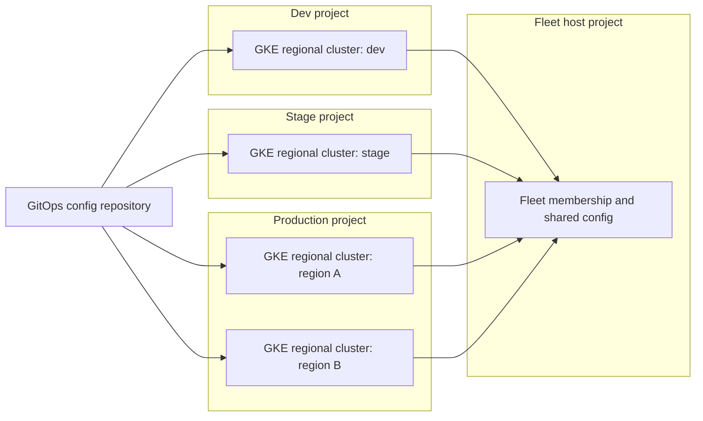

This note describes a target topology for a GKE platform: how many clusters to run, where the control plane lives, how to split node pools, how to isolate teams inside a cluster, and what a fleet adds. It is written for senior DevOps engineers who have to defend the layout to their own team and to finance. It does not cover project and VPC layout ([[architecture/environment-separation-on-gcp]]), the mechanics of rolling a cluster upgrade ([[runbooks/gke-cluster-upgrade]]) or autoscaler tuning ([[patterns/kubernetes-autoscaling]]).

> [!info] Scope and sources
> Written against GKE Standard and Autopilot as described in the official GKE documentation at [cloud.google.com/kubernetes-engine/docs](https://cloud.google.com/kubernetes-engine/docs) and the Kubernetes documentation at [kubernetes.io](https://kubernetes.io/docs/). Terraform examples use the `google` provider.

> [!note] Not verified
> The claims below were written from documentation knowledge and were not checked against a running system or the current docs: fleet rules (one fleet per project, host-project requirements), Autopilot feature parity and pricing model, the spot VM preemption notice period, and the Terraform attribute names for fleet registration. Check them before relying on them.

## Decision drivers

Pick the topology from these constraints, in this order:

1. **Blast radius.** What breaks if a cluster upgrade, a bad admission webhook, a CRD change or a runaway controller goes wrong? A cluster is the unit that fails together.
2. **Isolation requirements.** Regulated data, different trust levels between teams or hard network separation push toward separate clusters. Ordinary team separation rarely does.
3. **Operating load.** Every cluster needs upgrades, add-ons, policy, observability and on-call attention. Ten clusters are not ten times the work only if everything is built from one module.
4. **Cost.** Each cluster carries a control-plane fee model (check the current pricing), system workloads, and idle headroom. Many small clusters waste more headroom than a few large ones.
5. **Upgrade cadence.** Separate non-production and production clusters let you run a version in non-production first. This is the strongest argument for at least two clusters.

## Topology options

| Option                            | Isolation                                                    | Cost                                          | Ops load                                     | Upgrade blast radius                           |
| --------------------------------- | ------------------------------------------------------------ | --------------------------------------------- | -------------------------------------------- | ---------------------------------------------- |
| One shared cluster for everything | Namespace only; production shares a control plane with tests | Lowest; shared headroom                       | Lowest; one cluster to run                   | Everything at once; no safe place to try first |
| One cluster per environment       | Strong between environments; namespace within each           | Moderate; a few clusters with shared headroom | Moderate; same module, different inputs      | One environment; production lags non-prod      |
| One cluster per team              | Strong between teams                                         | High; headroom and add-ons repeated per team  | High; many clusters, drift risk              | One team; many upgrades to schedule            |
| Cluster per team and environment  | Strongest                                                    | Highest                                       | Highest; needs a fleet and strong automation | Smallest, but the most upgrades                |

Start with one cluster per environment (dev, stage, production), each in its own project as in [[architecture/environment-separation-on-gcp]], per region, and split further only when a driver above forces it. Moving a team out of a shared cluster later is easy if tenancy was built with namespaces and Workload Identity from the start; merging many clusters back together is hard.

### Regional or zonal control plane

Use a **regional** cluster for production. A regional control plane is replicated across zones, so control-plane upgrades and zone failures do not make the API unavailable for workloads that need to scale or reschedule. Nodes are spread across the zones you list. A **zonal** cluster is cheaper and acceptable for short-lived or test clusters where an API outage during an upgrade does not matter. Zonal control-plane upgrades make the API unavailable for a short time; check the documentation for the current behaviour.

### Autopilot or Standard

| Concern                                                               | Autopilot                                    | Standard                                              |
| --------------------------------------------------------------------- | -------------------------------------------- | ----------------------------------------------------- |
| Node management                                                       | Google manages nodes and pools               | You define node pools, machine types and upgrades     |
| Billing model                                                         | Mostly per Pod resource requests             | Per node, whether or not Pods fill it                 |
| Security baseline                                                     | Hardened defaults enforced                   | You apply the baseline yourself                       |
| Special hardware, DaemonSets with host access, custom kernel settings | Restricted or limited; check current support | Full control                                          |
| Bin-packing waste                                                     | Not yours; requests are what you pay for     | Yours; requests that are too high leave idle capacity |

Autopilot is a good default for teams that want to run applications and not nodes, provided the workloads fit its restrictions. Choose Standard when you need privileged node agents, unusual machine shapes, GPUs or settings Autopilot does not allow. Feature parity and the exact pricing model change over time, so confirm both before deciding.

## Recommended starting topology

A fleet host project holds fleet-level configuration. Workload clusters live in environment projects. Each environment (dev, stage, production) is its own cluster in its own project, repeated per region only when latency or resilience requires it.



Rules of thumb for this layout:

- Non-production runs the next Kubernetes minor version first, and the release channel lets you stage this (for example Regular for production, Rapid or Regular with an earlier maintenance window for non-production). Check which channels and versions are currently offered.
- Production clusters get a maintenance window and, where needed, maintenance exclusions aligned with [[standards/production-change-checklist]].
- One cluster module in Terraform builds all of them; only inputs differ. Layout of the Terraform code is in [[patterns/terraform-module-and-state-layout]].

## Cluster definition

A private, regional cluster with Workload Identity Federation, a release channel and the default node pool removed. Network, subnet and secondary range names are values to change; the private cluster and egress design is in [[architecture/private-gke-and-controlled-egress]] and is not repeated here.

```hcl title="modules/gke-cluster/main.tf"
variable "project_id" {
  type        = string
  description = "Project that owns the cluster."
}

variable "region" {
  type        = string
  description = "Region of the regional control plane."
}

variable "cluster_name" {
  type = string
}

variable "network" {
  type        = string
  description = "Self link or name of the VPC network."
}

variable "subnetwork" {
  type        = string
  description = "Self link or name of the subnetwork."
}

variable "pods_range_name" {
  type        = string
  description = "Name of the secondary range for Pods."
}

variable "services_range_name" {
  type        = string
  description = "Name of the secondary range for Services."
}

variable "fleet_project_id" {
  type        = string
  description = "Fleet host project ID."
}

resource "google_container_cluster" "this" {
  project  = var.project_id
  name     = var.cluster_name
  location = var.region

  network    = var.network
  subnetwork = var.subnetwork

  # Manage node pools as separate resources.
  remove_default_node_pool = true
  initial_node_count       = 1

  release_channel {
    channel = "REGULAR"
  }

  workload_identity_config {
    workload_pool = "${var.project_id}.svc.id.goog"
  }

  ip_allocation_policy {
    cluster_secondary_range_name  = var.pods_range_name
    services_secondary_range_name = var.services_range_name
  }

  private_cluster_config {
    enable_private_nodes    = true
    enable_private_endpoint = false
  }

  master_authorized_networks_config {
    cidr_blocks {
      cidr_block   = "203.0.113.0/24" # change: your admin or CI egress range
      display_name = "ci-and-admin"
    }
  }

  # Attribute names for fleet registration were not verified.
  fleet {
    project = var.fleet_project_id
  }

  maintenance_policy {
    recurring_window {
      start_time = "2026-01-03T01:00:00Z"
      end_time   = "2026-01-03T07:00:00Z"
      # GKE enforces a minimum availability per rolling 32 days (documented as
      # 48 hours); two 6 h weekly windows give about 52 h. Check the current docs.
      recurrence = "FREQ=WEEKLY;BYDAY=SA,SU"
    }
  }

  deletion_protection = true
}
```

## Node pools

Keep the number of pools small and give each a reason to exist. The node pool examples below omit `oauth_scopes`; check the provider documentation for the scopes a custom node service account needs and grant access through IAM roles on that account.

| Pool    | Purpose                                                          | Notes                                                                                            |
| ------- | ---------------------------------------------------------------- | ------------------------------------------------------------------------------------------------ |
| system  | Cluster add-ons, ingress controllers, GitOps controllers, policy | Small, on-demand, tainted so tenant Pods stay off it. At least one node per zone for production. |
| general | Ordinary stateless and stateful tenant workloads                 | On-demand, autoscaled, the default target.                                                       |
| spot    | Batch, CI runners, tolerant stateless workers                    | Spot VMs can be reclaimed at short notice; only for work that survives it.                       |
| special | GPUs, high memory, local SSD, Windows                            | Tainted so only Pods that need it land there.                                                    |

```hcl title="modules/gke-cluster/node-pools.tf"
variable "service_account_email" {
  type        = string
  description = "Least-privilege node service account, not the default Compute Engine one."
}

resource "google_container_node_pool" "general" {
  project  = var.project_id
  name     = "general"
  location = var.region
  cluster  = google_container_cluster.this.name

  autoscaling {
    min_node_count  = 1 # per zone for a regional cluster
    max_node_count  = 5
    location_policy = "BALANCED"
  }

  management {
    auto_repair  = true
    auto_upgrade = true
  }

  upgrade_settings {
    max_surge       = 1
    max_unavailable = 0
  }

  node_config {
    machine_type    = "e2-standard-4" # change: size to your workloads
    service_account = var.service_account_email

    labels = {
      pool = "general"
    }

    workload_metadata_config {
      mode = "GKE_METADATA"
    }

    shielded_instance_config {
      enable_secure_boot          = true
      enable_integrity_monitoring = true
    }
  }
}

resource "google_container_node_pool" "spot" {
  project  = var.project_id
  name     = "spot"
  location = var.region
  cluster  = google_container_cluster.this.name

  autoscaling {
    min_node_count  = 0
    max_node_count  = 10
    location_policy = "ANY"
  }

  management {
    auto_repair  = true
    auto_upgrade = true
  }

  node_config {
    machine_type    = "e2-standard-4" # change: size to your workloads
    spot            = true
    service_account = var.service_account_email

    labels = {
      pool = "spot"
    }

    taint {
      key    = "workload-class"
      value  = "spot"
      effect = "NO_SCHEDULE"
    }

    workload_metadata_config {
      mode = "GKE_METADATA"
    }

    shielded_instance_config {
      enable_secure_boot          = true
      enable_integrity_monitoring = true
    }
  }
}
```

A workload opts into the spot pool with a node selector and a toleration. Without both, the taint keeps it out and the selector keeps it from landing on general nodes by accident. Spread replicas across zones and give the Deployment a PodDisruptionBudget, because a reclaimed node takes its Pods with it.

```yaml title="apps/batch-worker/deployment.yaml"
apiVersion: apps/v1
kind: Deployment
metadata:
  name: batch-worker
  namespace: team-a
spec:
  replicas: 3
  selector:
    matchLabels:
      app: batch-worker
  template:
    metadata:
      labels:
        app: batch-worker
    spec:
      securityContext: # required by the restricted Pod Security level of the namespace
        runAsNonRoot: true
        seccompProfile:
          type: RuntimeDefault
      nodeSelector:
        pool: spot
      tolerations:
        - key: workload-class
          operator: Equal
          value: spot
          effect: NoSchedule
      terminationGracePeriodSeconds: 15 # check the current Spot graceful-termination period for non-system Pods
      topologySpreadConstraints:
        - maxSkew: 1
          topologyKey: topology.kubernetes.io/zone
          whenUnsatisfiable: ScheduleAnyway
          labelSelector:
            matchLabels:
              app: batch-worker
      containers:
        - name: worker
          image: europe-docker.pkg.dev/my-project/apps/batch-worker:1.4.2 # change: pin by tag or digest
          securityContext:
            allowPrivilegeEscalation: false
            readOnlyRootFilesystem: true
            capabilities:
              drop: ["ALL"]
          resources:
            requests:
              cpu: 250m
              memory: 256Mi
            limits:
              memory: 256Mi
```

Spot VMs give a short termination notice, so keep `terminationGracePeriodSeconds` below it and make work idempotent. The notice length is not verified here; check the Compute Engine documentation. Requests and limits are covered in [[patterns/kubernetes-resource-requests-and-limits]].

## Namespace tenancy kit

Namespaces are the default tenancy boundary. They are a soft boundary: they share a kernel, nodes and a control plane. They are enough for teams that trust each other at the level of an engineering organisation, as long as each namespace gets the same kit, applied from Git, not by hand.

```yaml title="tenants/team-a/namespace-bundle.yaml"
apiVersion: v1
kind: Namespace
metadata:
  name: team-a
  labels:
    team: team-a
    pod-security.kubernetes.io/enforce: restricted
    pod-security.kubernetes.io/enforce-version: latest
    pod-security.kubernetes.io/warn: restricted
    pod-security.kubernetes.io/audit: restricted
---
apiVersion: v1
kind: ResourceQuota
metadata:
  name: team-a-quota
  namespace: team-a
spec:
  hard:
    requests.cpu: "20"
    requests.memory: 40Gi
    limits.memory: 60Gi
    pods: "200"
    persistentvolumeclaims: "20"
    services.loadbalancers: "0"
---
apiVersion: v1
kind: LimitRange
metadata:
  name: team-a-defaults
  namespace: team-a
spec:
  limits:
    - type: Container
      defaultRequest:
        cpu: 100m
        memory: 128Mi
      default:
        memory: 256Mi
---
apiVersion: rbac.authorization.k8s.io/v1
kind: RoleBinding
metadata:
  name: team-a-edit
  namespace: team-a
subjects:
  - kind: Group
    name: gke-team-a@example.com # change: a Google Group set up for Google Groups for RBAC
    apiGroup: rbac.authorization.k8s.io
roleRef:
  kind: ClusterRole
  name: edit
  apiGroup: rbac.authorization.k8s.io
---
apiVersion: networking.k8s.io/v1
kind: NetworkPolicy
metadata:
  name: default-deny-ingress
  namespace: team-a
spec:
  podSelector: {}
  policyTypes:
    - Ingress
```

What each object does:

- **Namespace labels** set Pod Security Admission levels; see [[patterns/pod-security-admission]].
- **ResourceQuota** caps total consumption, so one team cannot starve the others. Setting `services.loadbalancers` to `0` stops tenants from creating load balancers that bypass your ingress layer; change it if your tenants legitimately need them.
- **LimitRange** gives Pods without requests a default, which both the scheduler and the quota need.
- **RoleBinding** to a group, not to individual users. Bind to the built-in `edit` ClusterRole or a role you define; avoid `cluster-admin` for tenants.
- **NetworkPolicy** starts with default deny and tenants add what they need; see [[patterns/kubernetes-network-policies]]. Network policy enforcement must be enabled on the cluster for this object to have any effect.

Namespaces do not isolate cluster-scoped resources. CRDs, admission webhooks, ClusterRoles and node-level settings are shared, so a tenant that can create them can affect everyone. Keep those under platform ownership.

When namespaces are not enough: workloads that run untrusted code, different compliance scopes, or tenants who need their own CRD versions or cluster-wide controllers. Use a separate cluster, and separate node pools with taints only as a middle step that still shares the control plane.

## Fleets

A fleet groups clusters so you can manage them together: shared identity pool, multi-cluster features, and a single place to list memberships. Registering a cluster is cheap, and it keeps options open for multi-cluster ingress, service mesh and config sync later. Check what is currently available and what each feature costs; the rules about how many fleets a project may have and which project must host them were not verified.

```bash
set -euo pipefail

FLEET_PROJECT_ID="my-fleet-host"  # change: your fleet host project ID

gcloud container fleet memberships list --project "${FLEET_PROJECT_ID}"
```

Treat fleet membership as part of the cluster module so every cluster registers the same way. Do not turn on multi-cluster features until you have a concrete need; each one adds components to every member cluster.

## Pitfalls

- **One shared cluster with no non-production twin.** The first Kubernetes minor upgrade then happens on production.
- **Too many clusters, built by hand.** Drift in add-on versions, policies and RBAC shows up as incident causes. If you cannot build a cluster from one module in minutes, do not add another.
- **Default node service account.** The default Compute Engine service account is broad. Use a dedicated least-privilege node service account and Workload Identity for Pods ([[patterns/gke-workload-identity]]).
- **No taint on the system pool.** Tenant Pods fill it and starve ingress and GitOps controllers.
- **Spot for stateful or singleton workloads.** A reclaimed node means data loss or downtime.
- **Quota without LimitRange.** Pods without requests are rejected by a compute quota. Add defaults.
- **Treating namespaces as a hard boundary.** They are not one. Say so in your tenancy policy and list what requires its own cluster.
- **Surge settings that do not fit quota.** Node upgrades with surge need spare project quota and IP addresses; check them before an upgrade.

## Adopt incrementally

1. Put the cluster and node pool definitions into one Terraform module and rebuild an existing cluster from it in a scratch project.
2. Separate production and non-production, and move the release channel and maintenance window into module inputs.
3. Add the namespace bundle to the GitOps repository for every tenant, and enforce Pod Security `warn` first, then `enforce`.
4. Register clusters in a fleet and keep multi-cluster features off until a use case exists.
5. Add the spot pool only for workloads that have been tested against node loss.

## Related

- [[architecture/environment-separation-on-gcp]]: project and network layout that these clusters sit in.
- [[runbooks/gke-cluster-upgrade]]: how to upgrade the clusters this topology creates.
- [[patterns/kubernetes-resource-requests-and-limits]]: requests, limits and how quotas use them.
- [[patterns/pod-security-admission]]: the Pod Security labels in the namespace bundle.
- [[patterns/kubernetes-network-policies]]: the policies a tenant namespace needs after default deny.
- [[patterns/kubernetes-autoscaling]]: tuning the autoscalers for the node pools above.
