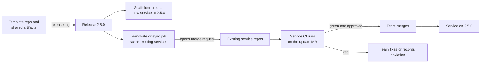

A golden path template creates a new service with the pipeline, chart, container baseline and policy checks already wired. The hard part is not the first scaffold, it is the second year: keeping hundreds of created services current without forcing breaking changes on teams. This note covers what a template contains, how to version it, how updates reach existing services, and how to handle deviations. It leaves the portal and catalog to [[architecture/internal-developer-platform-architecture]], chart conventions to [[patterns/helm-chart-conventions]], and pipeline layout to [[patterns/gitlab-ci-pipeline-structure]].

> [!info] Scope and sources
> Written against GitLab CI/CD components and includes, Backstage software templates and Renovate as general designs. Syntax and features change; the documentation listed under Sources is authoritative.

> [!note] Not verified
> Nothing here was run. Check before relying on it: the current CI/CD components syntax and input declarations in GitLab, whether `include: component:` is available in your edition and version, Renovate manager names for GitLab includes and Helm dependencies, and the Backstage template action names.

## Goals

- A new service reaches a first deploy with zero pipeline authoring.
- Security and operational controls are part of the template, so they cannot be forgotten.
- Improvements to the template reach existing services as reviewable merge requests, not as surprises.
- Teams can deviate when they must, and the deviation is visible.

## What a template contains

| Part                   | Content                                                                                      | Versioned how                            |
| ---------------------- | -------------------------------------------------------------------------------------------- | ---------------------------------------- |
| Repository skeleton    | Source layout, README, ownership file, `catalog-info.yaml`, license and lint config          | Template release                         |
| CI definition          | A small `.gitlab-ci.yml` that includes shared components pinned to a tag                     | Component release tag                    |
| Helm chart             | A thin chart that depends on a shared library chart, see [[patterns/helm-chart-conventions]] | Library chart version                    |
| Dockerfile baseline    | A hardened base, see [[patterns/dockerfile-hardening]]                                       | Base image digest, updated by automation |
| Policy gates           | Manifest and image checks, see [[patterns/conftest-policy-gate-for-manifests]]               | Policy bundle version                    |
| Observability defaults | Metrics port, probes, log format, dashboard stub                                             | Part of the library chart                |
| Catalog file           | Component with owner, lifecycle and links                                                    | Template release                         |

Keep the generated repository small. Most logic lives in versioned shared artifacts (CI components, the library chart, the policy bundle) that the service references, not in files copied into every repository. Copied files drift. Referenced, versioned artifacts update with a one-line version bump.

## Versioning and channels

Use semantic versioning for every shared artifact and for the template itself:

- **Patch:** a bug fix or a base image bump with no behaviour change.
- **Minor:** a new optional capability or a new default that does not break existing services.
- **Major:** anything that can break a service build or deploy. Major releases ship with a migration note and an automated change where possible.

Services pin to tags. No service tracks a branch like `main`, because then a template change breaks every pipeline at once. A pin to a tag means an update is a deliberate merge request.

Each generated service records the template it came from and its version, in a file the update automation can read:

```yaml title=".platform/template.yaml"
template: service-go
version: 2.4.0
created: 2026-10-19
deviations: []
```

Optionally publish channels, for example `stable` and `candidate`. Platform-owned canary services consume the candidate channel, so a bad release is found on services the platform team owns before it reaches others.

## The pipeline reference

A generated `.gitlab-ci.yml` is a few lines of includes and inputs. Components are referenced by path and pinned version:

```yaml title=".gitlab-ci.yml"
include:
  - component: gitlab.example.com/platform/ci-components/build-image@2.4.0
    inputs:
      image_name: payments-api
  - component: gitlab.example.com/platform/ci-components/policy-gate@2.4.0
  - component: gitlab.example.com/platform/ci-components/deploy-config-bump@2.4.0
    inputs:
      environment: dev

stages: [build, test, policy, publish, deploy]
```

When components are not available in your edition or you prefer plain includes, pin a project include to a tag:

```yaml title=".gitlab-ci.yml (project include)"
include:
  - project: platform/ci-templates
    ref: v2.4.0
    file:
      - /templates/build-image.yml
      - /templates/policy-gate.yml
```

Check the current CI/CD components and includes documentation for the exact syntax, the version format and how inputs are declared. Never use `ref: main` in a generated service.

## Keeping created services current



Two mechanisms work, and they combine:

1. **Dependency bots.** Configure Renovate to update the pinned component or include tag and the library chart version. Each update is a merge request in the service repository, run by the service's own CI. This handles the referenced artifacts, with no custom code. See [[patterns/automated-dependency-updates]].
2. **A template-sync job.** For files that must be copied (the skeleton, linter config), a scheduled job compares each service's recorded template version with the latest and opens a merge request with the diff. Keep copied files to a minimum so this job stays small.

Rollout practice:

- Update platform canary services first.
- Group updates by release; do not open dozens of unrelated merge requests per service.
- Auto-merge patch updates when the service pipeline is green; require a human for minor and major.
- Track how many services run each version in a dashboard. A long tail on an old major is a risk and a support cost.

A renovate fragment for the GitLab component and a Helm dependency (check the current Renovate docs for manager names and options). Project includes (`include: project` with a `ref`) are handled by the `gitlabci-include` manager; components by `gitlabci`:

```json title="renovate.json"
{
  "$schema": "https://docs.renovatebot.com/renovate-schema.json",
  "extends": ["config:recommended"],
  "gitlabci": { "enabled": true },
  "helmv3": { "enabled": true },
  "packageRules": [
    {
      "matchPackageNames": ["/platform\\/ci-components\\//", "/platform-lib/"],
      "groupName": "platform golden path",
      "automerge": false
    },
    {
      "matchUpdateTypes": ["patch"],
      "matchPackageNames": ["/platform\\/ci-components\\//", "/platform-lib/"],
      "automerge": true
    }
  ]
}
```

## Escape hatches and deviations

Some services cannot follow the path: a different language, an unusual build, a regulatory constraint. Allow it, with rules:

- Deviate by overriding a documented extension point (an input, a values key, an extra job), not by deleting the include.
- Record each deviation in `.platform/template.yaml` with the reason, an owner and a review date.
- The platform reports deviations per service. A deviation that many teams need becomes a template feature.
- Mandatory controls (policy gates, signing, owner in the catalog) are not deviation points. If one cannot apply, use the waiver process in [[compliance/policy-exception-and-waiver-process]].

## Ownership and deprecation

- The template has an owning team, a backlog, a support channel and its own CI.
- Every template has a lifecycle: current, supported, deprecated, retired. State how long a deprecated major receives security fixes.
- Retire a template by freezing it, announcing a date, and opening migration merge requests for the remaining services.
- Release notes follow [[patterns/release-versioning-and-changelog-automation]]. Breaking changes are listed first, with a copy-pasteable fix.

## Failure modes

| Failure                   | Effect                                                         | Mitigation                                                                           |
| ------------------------- | -------------------------------------------------------------- | ------------------------------------------------------------------------------------ |
| Forks that drift          | Services copy and edit the pipeline until updates do not apply | Reference instead of copy; report deviations; fail CI on a removed include           |
| Breaking template release | Many pipelines turn red after an update merge                  | Pin by tag, canary services, major versions need opt-in                              |
| Forced upgrades           | Teams resent the platform and stop trusting updates            | Auto-merge only patches, give time for majors, ship migration MRs                    |
| A template bug            | Every new service inherits it                                  | Template's own CI scaffolds and builds a sample, canary release                      |
| Stale base images         | Known vulnerabilities in created services                      | Digest pinning with automated bumps, see [[standards/vulnerability-management-slas]] |
| Hidden template coupling  | A service works only because of an unpinned remote file        | Pin everything, including images and scripts fetched in jobs                         |

## Pitfalls

- Generating a repository and then never updating it.
- Putting logic in the skeleton rather than in versioned shared artifacts.
- Using floating tags (`latest`, `main`) in the generated CI.
- Making major upgrades the default path for all services on the same day.
- Not testing the template: a broken template is discovered by the first customer.

## Verify

The template has its own CI that scaffolds a sample service and runs the real pipeline steps against it:

```bash title="scripts/test-template.sh"
#!/usr/bin/env bash
set -euo pipefail

WORK="$(mktemp -d)"
trap 'rm -rf "$WORK"' EXIT

# 1. Render the template with sample parameters
./scripts/render-template.sh \
  --name sample-service \
  --owner group:default/platform-team \
  --out "$WORK/sample-service"

REPO_ROOT="$(pwd)"
cd "$WORK/sample-service"

# 2. Static checks on the generated output
test -f catalog-info.yaml
test -f .platform/template.yaml
if grep -R --line-number -E 'ref: *(main|master)|:latest' .gitlab-ci.yml; then
  echo "floating ref in generated CI" >&2
  exit 1
fi

# 3. The generated chart renders and passes policy
helm dependency build ./chart
helm template sample ./chart > rendered.yaml
conftest test rendered.yaml --policy "$REPO_ROOT/policy"

# 4. The container builds
docker build -t sample-service:test .
```

Run the same script on each release candidate and on a schedule, so base image or dependency changes that break the template surface before a team hits them.

## Adopt incrementally

1. Extract the common pipeline from your two or three most similar services into one versioned component or include.
2. Move them to the pinned reference and set up update automation.
3. Build the library chart and move one service to it.
4. Add the scaffolder so a new service starts from the template.
5. Add deviation tracking and the version dashboard.
6. Add a candidate channel and platform canary services.

## Sources

- GitLab CI/CD components: https://docs.gitlab.com/ci/components/
- GitLab CI/CD `include`: https://docs.gitlab.com/ci/yaml/includes/
- Backstage software templates: https://backstage.io/docs/features/software-templates/
- Renovate documentation: https://docs.renovatebot.com/

Check the current docs for syntax and supported versions.

## Related

- [[architecture/internal-developer-platform-architecture]]
- [[patterns/helm-chart-conventions]]
- [[patterns/gitlab-ci-pipeline-structure]]
- [[patterns/automated-dependency-updates]]
- [[patterns/conftest-policy-gate-for-manifests]]
- [[patterns/dockerfile-hardening]]
- [[patterns/release-versioning-and-changelog-automation]]
- [[0013-versioned-central-ci-templates]]
- [[0040-golden-base-images-owned-by-platform]]
