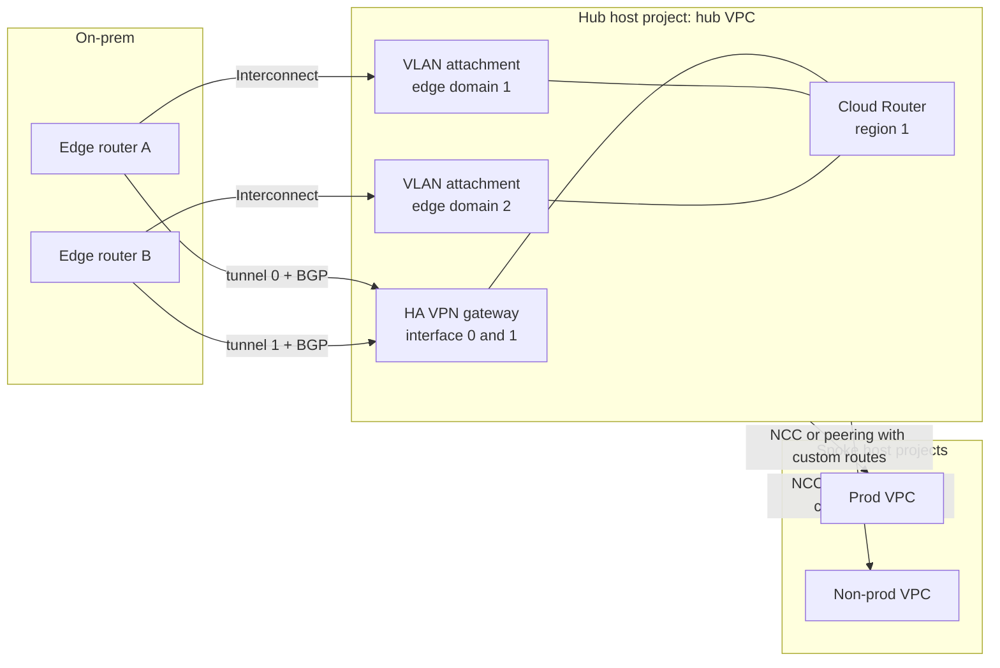

This note describes how to connect an on-prem network (or another cloud) to a GCP hub VPC so that the link survives the loss of any single tunnel, attachment, router or edge device, and so that routing stays predictable when it does. It is written for senior engineers who own the hub in [[architecture/shared-vpc-hub-and-spoke]] and have to choose between HA VPN and Cloud Interconnect, plan BGP once and prove failover works. Diagnosing a broken link is in [[runbooks/hybrid-connectivity-bgp-troubleshooting]], DNS across the link in [[architecture/cloud-dns-hybrid-and-multi-project]], and MTU and TLS symptoms in [[runbooks/network-troubleshooting-dns-mtu-tls-load-balancers]].

> [!info] Scope and sources
> Flags, enum values and defaults for `gcloud` were read from the gcloud reference text (`gcloud compute routers`, `vpn-gateways`, `external-vpn-gateways`, `vpn-tunnels`, `interconnects attachments`, `networks`). Product behaviour, SLAs, quotas and topology requirements were not checked against the current documentation; the pages under Sources are authoritative. Nothing here was run against a live link.

> [!note] Not verified
> Check these before relying on them:
>
> - The Cloud Interconnect topologies behind the 99.9% and 99.99% SLAs (how many connections, metros, edge availability domains, VLAN attachments and Cloud Routers). Any SLA figure for Partner or Dedicated Interconnect.
> - The exact HA VPN SLA wording: the topology page describes 99.99% on the Google Cloud side for an HA VPN gateway with two tunnels to one or two peer gateways, but read the English page for the conditions.
> - Whether `--advertised-route-priority` is sent to the peer as the BGP MED, and the Google-managed default value used when it is not set.
> - The Cloud Router ASN required for Partner Interconnect (16550 as usually documented; the gcloud `--asn` help describes only the private-ASN rule).
> - Whether the peer ASN must be private: the `--peer-asn` help says a 16-bit or 32-bit private ASN (RFC 6996), the API field text does not.
> - Whether the `ALL_SUBNETS` advertisement group includes subnets of peered VPCs: the CLI help and the API text disagree. Test with `routers get-status`.
> - HA VPN tunnel MTU and the encapsulation overhead, ECMP across tunnels and attachments, graceful restart, the BFD timers actually supported and whether BFD applies to HA VPN.
> - Per-tunnel bandwidth and packet rate, tunnels per gateway, BGP sessions per Cloud Router, learned and advertised route limits, and Network Connectivity Center limits.
> - Cloud Monitoring metric names for tunnels, BGP sessions and attachments.
> - The Terraform `google` provider argument names in the sketch below.

## Goals

- No single point of failure between on-prem and the hub: two of everything (on-prem routers, tunnels or attachments, Cloud Router interfaces, edge domains).
- Deterministic routing: you can say which path traffic takes today and which it takes after a failure, without reading BGP tables at 3 a.m.
- Encryption where policy requires it, without giving up bandwidth you paid for.
- Route hygiene: GCP advertises only the aggregates it owns, and accepts only the prefixes on-prem should send.
- Observable: a broken session or a missing prefix pages someone before an application team notices.

## Options

| Option                   | What it is                                                                                      | Encryption                                      | Lead time and cost drivers                                       | Fits                                                                |
| ------------------------ | ----------------------------------------------------------------------------------------------- | ----------------------------------------------- | ---------------------------------------------------------------- | ------------------------------------------------------------------- |
| HA VPN                   | Regional IPsec gateway with two interfaces, tunnels over the internet, BGP through Cloud Router | IPsec, always                                   | Minutes to create; egress and tunnel charges                     | First link, low to moderate bandwidth, backup path for Interconnect |
| Partner Interconnect     | VLAN attachments through a service provider that already connects to Google                     | None on the attachment; add it at another layer | Depends on the provider; attachment bandwidth set by the partner | No presence in a Google colocation facility                         |
| Dedicated Interconnect   | Your own physical links in a colocation facility, VLAN attachments on top                       | None by default; MACsec exists as a feature     | Weeks (cross-connects, LOA); port and attachment charges         | High, steady bandwidth, presence in a supported facility            |
| HA VPN over Interconnect | HA VPN gateways whose tunnels run over encrypted-only VLAN attachments                          | IPsec over the private link                     | Both of the above                                                | Policy requires encryption in transit over the private link         |

Bandwidth options in the `gcloud compute interconnects attachments dedicated create --bandwidth` help range from `50m` to `400g`; Dedicated link types in the API are 10G, 100G and 400G per link. Throughput limits for HA VPN, and prices for all options, must come from the current documentation, not from this table.

Start with HA VPN unless you already know you need Interconnect. It is the fastest way to a working, redundant design, and it stays useful as the backup path when Interconnect arrives.

## Topology



Design rules:

- **Two on-prem devices.** HA VPN with two tunnels to one on-prem router still loses the link when that router reboots. Terminate interface 0 and interface 1 on different devices.
- **Match HA VPN interfaces to peer interfaces.** The topology page describes one tunnel from each HA VPN interface to the matching peer interface; a four-tunnel full mesh is not required for the Google-side SLA, although a peer vendor may recommend it.
- **External VPN gateway redundancy follows the interface count.** `gcloud compute external-vpn-gateways create --interfaces` takes one, two or four interfaces and infers `SINGLE_IP_INTERNALLY_REDUNDANT`, `TWO_IPS_REDUNDANCY` or `FOUR_IPS_REDUNDANCY`.
- **Interconnect attachments in pairs, one per edge availability domain.** The Partner attachment help says Google schedules maintenance in only one availability domain of a metro at a time, and the API text recommends one attachment per domain. That guarantee does not extend across metros, which is why the highest SLA tier spans two metros: read the production-level overview for the exact requirement.
- **Hybrid lives in the hub only.** Spokes reach on-prem through the hub, never with their own tunnels, so there is one place to filter and observe. How routes reach the spokes (VPC peering with custom route export and import, or Network Connectivity Center) is decided in [[architecture/shared-vpc-hub-and-spoke]]. For NCC, `gcloud network-connectivity spokes linked-vpn-tunnels create` and `linked-interconnect-attachments create` attach hybrid links to a hub; check the route-exchange semantics in the current docs.

## Redundancy and SLA

Google publishes topologies that qualify for its HA VPN and Interconnect SLAs. Treat the SLA as a floor for the Google side, not as the availability of your link: your routers, circuits and provider are part of the path. Two practical consequences:

- Build the documented topology first, then add what your side needs (diverse circuits, diverse power, two providers for Partner Interconnect).
- An Interconnect design without an HA VPN backup is a single-technology design. A common pattern is Interconnect as the primary path and HA VPN as the lower-preference backup, with BGP priorities deciding which wins.

Map the link to the tier you chose in [[architecture/disaster-recovery-tiers-rpo-rto]]: a tier that promises regional failover also needs hybrid connectivity in the DR region.

## BGP design

Plan BGP before the first tunnel exists.

- **ASNs.** The Cloud Router ASN must be a 16-bit or 32-bit private ASN (RFC 6996: 64512 to 65534, or 4200000000 to 4294967294), except for a Cloud Router used with Partner Interconnect, which Google documents as needing ASN 16550 (check the Partner Interconnect VLAN attachment docs). It is fixed for the router, and all tunnels on a router share it. Use one ASN per Cloud Router role and region, record them in the IP and ASN plan next to [[learn/ip-addressing-and-subnets|the address plan]], and never reuse an on-prem ASN.
- **BGP session addresses.** Peer addresses are link-local IPv4 from 169.254.0.0/16 (or ULA IPv6 from fdff:1::/64). Allocate /30 blocks from a register, so two tunnels never collide.
- **Advertisements.** Use `--advertisement-mode=CUSTOM` and advertise environment aggregates (the /12 per spoke in the IP plan) plus the ranges on-prem must reach, such as Private Service Connect endpoints. Default mode advertises subnets, which leaks every new subnet automatically and hides intent.
- **What you accept.** Filter on the on-prem side, and on Cloud Router with import policies where your design uses them (`gcloud compute routers add-route-policy` and `add-bgp-peer --import-policies`). Never accept a default route from on-prem unless all egress is meant to go through on-prem.
- **Active-passive vs active-active.** `--advertised-route-priority` (0 to 65535; lower wins among equal-length prefixes) sets the preference of the routes Cloud Router sends; `--custom-learned-route-priority` (default 100) sets the priority of routes learned from a peer. For active-passive, give the backup path a higher (worse) value on both sides. For active-active, keep values equal and confirm the result with `list-bgp-routes`; whether traffic is balanced across equal paths depends on ECMP behaviour you must check.
- **Timers and BFD.** Keepalive is 20 to 60 seconds (default 20), with a hold time of three times the keepalive. BFD can be enabled per peer (`--bfd-session-initialization-mode`, min intervals defaulting to 1000 ms). Faster detection means faster failover and more flapping on a lossy path; tune on a test link first.
- **MD5.** `--md5-authentication-key` exists if your security policy requires it; store the key in Secret Manager.

### Dynamic routing mode

`gcloud compute networks update --bgp-routing-mode=regional|global` controls reach. Regional (the default) means a Cloud Router advertises and programs routes only for its own region. Global lets routes learned in one region serve VMs and GKE nodes in every region, which is what a multi-region hub usually needs; it also means a second-region workload can silently depend on a first-region link. The `--bgp-best-path-selection-mode` setting (LEGACY by default, or STANDARD) changes how MED and inter-region cost affect the choice; read the router overview before changing it on a live network.

## MTU and DNS

- Keep MTU consistent end to end. The VPC network MTU is 1300 to 8896 bytes (default 1460); VLAN attachments take 1440, 1460, 1500 or 8896 (default 1440). HA VPN adds IPsec overhead, so the effective MTU through a tunnel is lower than the VPC MTU; check the documented value and clamp TCP MSS on the on-prem side. Symptoms and fixes are in [[runbooks/network-troubleshooting-dns-mtu-tls-load-balancers]].
- DNS forwarding in both directions runs over this link. If the link is down, on-prem names stop resolving in GCP; see [[architecture/cloud-dns-hybrid-and-multi-project]].

## Terraform sketch

The sketch shows one HA VPN gateway, an external gateway with two interfaces, a Cloud Router with custom advertisements, and one of the two tunnels with its interface and peer. Repeat the tunnel, interface and peer for interface 1. Argument names follow the `google` provider as commonly documented; check them against the provider docs for your pinned version.

```hcl title="hybrid/ha-vpn.tf"
variable "project_id" {
  type    = string
  default = "net-hub-host" # change: hub host project
}

variable "region" {
  type    = string
  default = "europe-west1" # change: hub region
}

variable "network" {
  type    = string
  default = "hub" # change: hub VPC name
}

data "google_secret_manager_secret_version" "psk0" {
  project = var.project_id
  secret  = "vpn-onprem-a-psk" # change: secret holding the pre-shared key
}

resource "google_compute_ha_vpn_gateway" "hub" {
  project = var.project_id
  region  = var.region
  name    = "hub-ha-vpn"
  network = var.network
}

resource "google_compute_external_vpn_gateway" "onprem" {
  project         = var.project_id
  name            = "onprem-edge"
  redundancy_type = "TWO_IPS_REDUNDANCY"

  interface {
    id         = 0
    ip_address = "203.0.113.10" # change: public IP of edge router A
  }

  interface {
    id         = 1
    ip_address = "203.0.113.11" # change: public IP of edge router B
  }
}

resource "google_compute_router" "hub" {
  project = var.project_id
  region  = var.region
  name    = "hub-cr-vpn"
  network = var.network

  bgp {
    asn               = 64514 # change: from your ASN plan
    advertise_mode    = "CUSTOM"
    advertised_groups = [] # explicit ranges only

    advertised_ip_ranges {
      range       = "10.16.0.0/12" # change: prod aggregate from the IP plan
      description = "prod spoke aggregate"
    }

    advertised_ip_ranges {
      range       = "10.32.0.0/12" # change: non-prod aggregate
      description = "non-prod spoke aggregate"
    }
  }
}

resource "google_compute_vpn_tunnel" "t0" {
  project                         = var.project_id
  region                          = var.region
  name                            = "hub-to-onprem-a"
  vpn_gateway                     = google_compute_ha_vpn_gateway.hub.id
  vpn_gateway_interface           = 0
  peer_external_gateway           = google_compute_external_vpn_gateway.onprem.id
  peer_external_gateway_interface = 0
  router                          = google_compute_router.hub.id
  ike_version                     = 2
  shared_secret                   = data.google_secret_manager_secret_version.psk0.secret_data
}

resource "google_compute_router_interface" "if0" {
  project    = var.project_id
  region     = var.region
  name       = "if-onprem-a"
  router     = google_compute_router.hub.name
  ip_range   = "169.254.10.1/30" # change: from the link-local register
  vpn_tunnel = google_compute_vpn_tunnel.t0.name
}

resource "google_compute_router_peer" "p0" {
  project                   = var.project_id
  region                    = var.region
  name                      = "peer-onprem-a"
  router                    = google_compute_router.hub.name
  interface                 = google_compute_router_interface.if0.name
  peer_ip_address           = "169.254.10.2"
  peer_asn                  = 65010 # change: on-prem ASN
  advertised_route_priority = 100   # backup path: use a higher value
}
```

> [!warning] The pre-shared key ends up in Terraform state
> Reading the key from Secret Manager keeps it out of Git, but the provider still stores `shared_secret` in state. Keep hybrid resources in their own state with restricted read access ([[patterns/terraform-module-and-state-layout]]), and never pass the key as a literal on a `gcloud --shared-secret` command line that lands in shell history.

## Monitoring

Alert on:

- Any BGP peer whose `status` is not `UP` for longer than the hold time, per peer, not per router.
- A VPN tunnel whose `status` is not `ESTABLISHED`.
- A VLAN attachment whose `operationalStatus` is not `OS_ACTIVE`.
- A drop in `numLearnedRoutes` on a peer compared with the last known good value: a session can be up while on-prem stopped sending a prefix.
- Asymmetry: one of two redundant paths carrying all the traffic for longer than a maintenance window. That is the state in which the next failure is an outage.

Pick the router, VPN and attachment metrics from the Metrics Explorer list for your project; metric names are not reproduced here. Route the alerts to the network on-call rotation, with a link to [[runbooks/hybrid-connectivity-bgp-troubleshooting]] in the alert text.

## Failure modes and drills

| Failure                                      | Expected behaviour                                           | What breaks the expectation                                              |
| -------------------------------------------- | ------------------------------------------------------------ | ------------------------------------------------------------------------ |
| One tunnel or on-prem router down            | BGP on the other tunnel carries all traffic                  | Both tunnels terminate on one device; backup path never tested           |
| One edge availability domain in maintenance  | Attachment in the other domain carries traffic               | Both attachments in the same domain                                      |
| Interconnect fully down                      | HA VPN backup takes over with lower bandwidth                | VPN not sized for the load; priorities wrong, so VPN was never preferred |
| Cloud Router region failure                  | Other region's link serves traffic if routing mode is global | Regional mode; no link in the DR region                                  |
| Route leak from on-prem (e.g. default route) | Filters drop it                                              | No import filtering; Google egress silently shifts to on-prem            |

Drill once per quarter in a change window, starting with non-prod:

1. Record the baseline: `get-status` for every router, learned and advertised routes, and current traffic per path.
2. Disable one peer with `gcloud compute routers update-bgp-peer ROUTER --peer-name=PEER --no-enabled`. The help says this terminates the session and removes its routing information, which makes it a controlled way to simulate a failure.
3. Measure how long traffic takes to move (synthetic probes from on-prem to an internal load balancer and back), and check that nothing else changed.
4. Re-enable with `--enabled`, confirm the baseline is restored, and record the convergence time against your DR tier.

> [!warning] Drill one path at a time
> Disabling a peer on a link whose redundant partner is already degraded is an outage, not a drill. Check that every other path is `UP` immediately before step 2.

## Pitfalls

- **Overlapping RFC 1918 ranges.** An overlap with on-prem cannot be routed around cleanly. Check every range against the register before it is advertised.
- **Advertising `0.0.0.0/0` by accident** in either direction, or accepting it from on-prem: all internet-bound traffic from GCP then hairpins through on-prem. See [[architecture/private-gke-and-controlled-egress]] for how egress is meant to work.
- **Asymmetric routing.** Traffic leaves through the VPN and returns over Interconnect, and a stateful on-prem firewall drops it. Set priorities on both sides, not only on Cloud Router.
- **A single on-prem router behind two tunnels.** Looks redundant in the console, is not.
- **Partner attachments left disabled.** Partner attachments are created with admin state disabled; enable them after the partner completes provisioning.
- **Forgetting firewall rules.** BGP up and routes present does not mean traffic flows; VPC firewall policies still apply ([[learn/load-balancers-firewalls-and-network-troubleshooting]]).
- **Google APIs over the link.** On-prem access to Google APIs through Private Service Connect or private access needs its ranges advertised and DNS set up; design it with [[architecture/zero-trust-access-iap-and-vpc-service-controls]] in mind.

## Verify

```bash title="verify-hybrid.sh"
#!/usr/bin/env bash
set -euo pipefail

PROJECT="net-hub-host"        # change: hub host project
REGION="europe-west1"         # change: hub region
ROUTER="hub-cr-vpn"           # change: Cloud Router name
PEER="peer-onprem-a"          # change: BGP peer name
TUNNEL="hub-to-onprem-a"      # change: tunnel name
ATTACHMENT="hub-ic-ead1"      # change: VLAN attachment name, if you use Interconnect

# BGP sessions: expect status UP and a learned route count you recognise for every peer
gcloud compute routers get-status "$ROUTER" --project "$PROJECT" --region "$REGION" \
  --format="table(result.bgpPeerStatus[].name,result.bgpPeerStatus[].status,result.bgpPeerStatus[].numLearnedRoutes)"

# Routes advertised to and learned from one peer, after policy evaluation
gcloud compute routers list-bgp-routes "$ROUTER" --project "$PROJECT" --region "$REGION" \
  --peer="$PEER" --address-family=IPV4 --route-direction=OUTBOUND
gcloud compute routers list-bgp-routes "$ROUTER" --project "$PROJECT" --region "$REGION" \
  --peer="$PEER" --address-family=IPV4 --route-direction=INBOUND

# Tunnel state: expect ESTABLISHED
gcloud compute vpn-tunnels describe "$TUNNEL" --project "$PROJECT" --region "$REGION" \
  --format="value(status,detailedStatus)"

# Interconnect attachment: expect state ACTIVE and operationalStatus OS_ACTIVE
gcloud compute interconnects attachments describe "$ATTACHMENT" --project "$PROJECT" --region "$REGION" \
  --format="value(state,operationalStatus,type)"
```

Expected: every peer `UP`, outbound routes are exactly the aggregates you meant to advertise, inbound routes are exactly the on-prem prefixes you expect, the tunnel is `ESTABLISHED`, and the attachment is `ACTIVE`. The output shape of `get-status` may differ by gcloud version; check the raw output with `--format=yaml` if a column is empty.

## Adopt incrementally

1. Write the ASN plan and the link-local /30 register next to the IP plan.
2. Build HA VPN to two on-prem routers in non-prod, with custom advertisements and import filtering. Run the first drill.
3. Add monitoring and the alerts above, and test that a disabled peer pages someone.
4. Repeat for prod; add a second region if your DR tier requires it, and decide the dynamic routing mode.
5. Add Interconnect when bandwidth or latency requires it, keep HA VPN as the backup with worse priority, and drill the switchover.
6. If policy requires encryption over Interconnect, plan HA VPN over Interconnect from the start: its attachments must be created with `--encryption=IPSEC`, which cannot be changed later.

## Sources

Official documentation this note was not checked against; verify there:

- [HA VPN topologies](https://cloud.google.com/network-connectivity/docs/vpn/concepts/topologies)
- [Cloud Interconnect overview](https://cloud.google.com/network-connectivity/docs/interconnect/concepts/overview)
- [Production-level Interconnect topologies](https://cloud.google.com/network-connectivity/docs/interconnect/tutorials/production-level-overview)
- [Cloud Router overview](https://cloud.google.com/network-connectivity/docs/router/concepts/overview)
- [Custom route advertisements](https://cloud.google.com/network-connectivity/docs/router/how-to/advertising-overview)
- [HA VPN over Cloud Interconnect](https://cloud.google.com/network-connectivity/docs/interconnect/concepts/ha-vpn-interconnect)
- [RFC 6996: Autonomous System reservation for private use](https://www.rfc-editor.org/rfc/rfc6996)
- The gcloud reference for `gcloud compute routers`, `gcloud compute vpn-tunnels` and `gcloud compute interconnects attachments`.

## Related

- [[architecture/shared-vpc-hub-and-spoke]]: the hub this link terminates in and how spokes receive routes.
- [[adr/0025-shared-vpc-host-project-no-default-networks]]: why networks live in host projects.
- [[architecture/cloud-dns-hybrid-and-multi-project]]: DNS forwarding over the link.
- [[runbooks/hybrid-connectivity-bgp-troubleshooting]]: layer-by-layer diagnosis when the link breaks.
- [[runbooks/network-troubleshooting-dns-mtu-tls-load-balancers]]: MTU, DNS and TLS symptoms.
- [[architecture/private-gke-and-controlled-egress]]: egress design that must not be bypassed by a leaked default route.
- [[architecture/disaster-recovery-tiers-rpo-rto]]: the tier that decides whether you need links in two regions.
- [[architecture/zero-trust-access-iap-and-vpc-service-controls]]: access to Google APIs and perimeters from on-prem.
