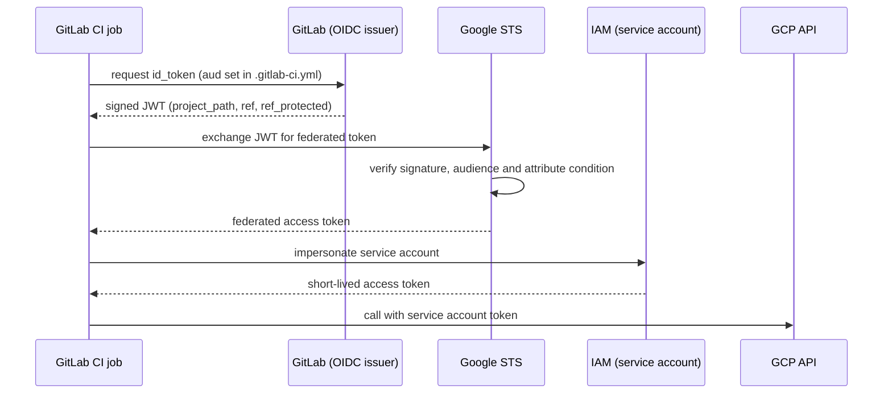

This note describes an IAM design for GCP in two parts: how people get access (groups only, role bundles at folder level, predefined roles) and how CI gets access (one service account per workload and pipeline stage, reached through Workload Identity Federation so no job holds a service account key). It is written for senior DevOps engineers. It leaves pod identity to [[patterns/gke-workload-identity]] and the periodic review of who has access to [[compliance/access-reviews-gcp-and-gke]].

> [!info] Scope and sources
> Written against Cloud IAM, Workload Identity Federation and GitLab CI OIDC `id_tokens`, based on the Google Cloud IAM and Workload Identity Federation documentation and the GitLab CI documentation at docs.gitlab.com. Examples use gitlab.com as the issuer; self-managed GitLab uses its own issuer URL.

> [!note] Not verified
> The claims below were written from documentation knowledge and were not checked against a running system or the current docs: the exact GitLab OIDC claim names (`project_path`, `ref_protected`, `namespace_path`); the `gcloud iam workload-identity-pools create-cred-config` flags for a file-based OIDC token source; the name and configuration of the Jenkins OIDC plugin. Check them before relying on them.

## Principles

- Humans get access through groups, never directly. A role bound to a person cannot be reviewed or removed at scale.
- Bind roles at the folder level where you can, so a new project in the folder inherits them. Bind at project level only for an exception.
- Prefer predefined roles. Use a custom role only when no predefined role is close, and give it an owner and a review date.
- Never grant basic roles (`roles/owner`, `roles/editor`, `roles/viewer`) to groups or service accounts, except a read-only viewer in a sandbox. They carry thousands of permissions.
- One service account per workload and, for pipelines, one per stage. A plan account that can only read cannot be abused to change anything.
- No service account keys. Authenticate by federation (CI) or by workload identity (pods).
- Everything is in Terraform and reviewed through merge requests, so the IAM policy in Git is the policy in GCP.

## Human access through groups

Create groups in your identity provider (Cloud Identity or Google Workspace) and bind roles to those groups. The group is the access request; membership is managed by the owning team and reviewed on a schedule.

| Group                          | Scope                            | Roles (predefined)                                                             |
| ------------------------------ | -------------------------------- | ------------------------------------------------------------------------------ |
| `gcp-org-admins`               | Organization                     | `roles/resourcemanager.organizationAdmin` (few members, break-glass)           |
| `gcp-network-admins`           | Platform folder                  | `roles/compute.networkAdmin`                                                   |
| `gcp-security-reviewers`       | Organization                     | `roles/iam.securityReviewer`, `roles/logging.viewer`                           |
| `gcp-platform-engineers`       | Platform folder, non-prod folder | `roles/container.admin`, `roles/compute.viewer`                                |
| `gcp-developers-nonprod`       | Non-prod workloads folder        | `roles/container.developer`, `roles/logging.viewer`, `roles/monitoring.viewer` |
| `gcp-developers-prod-readonly` | Prod workloads folder            | `roles/container.viewer`, `roles/logging.viewer`, `roles/monitoring.viewer`    |
| `gcp-oncall-prod`              | Prod workloads folder            | `roles/container.developer`, plus an elevation path described below            |
| `gcp-billing-viewers`          | Billing account                  | `roles/billing.viewer`                                                         |

Group and role names here are examples; map them to your organization. Points to keep:

- Production write access is narrower than non-production. People who deploy to stage do not automatically deploy to prod; production changes go through the pipeline.
- For on-call elevation, use time-limited, logged elevation rather than permanent membership: a just-in-time group membership or an IAM condition on time. How you implement it depends on your identity provider, so treat the table as the target, not as a recipe.
- Keep the number of admin groups small and their membership named. The "everyone is an admin" project is the project that leaks.

Bind a role to a group in Terraform at folder level:

```hcl title="iam/folders.tf"
variable "non_prod_folder_id" {
  type        = string
  description = "Numeric ID of the non-prod workloads folder."
}

resource "google_folder_iam_member" "developers_nonprod" {
  for_each = toset([
    "roles/container.developer",
    "roles/logging.viewer",
    "roles/monitoring.viewer",
  ])

  folder = "folders/${var.non_prod_folder_id}"
  role   = each.value
  member = "group:gcp-developers-nonprod@example.com" # change: your group address
}
```

Use `_member` (additive) resources for groups, not `_iam_policy` or `_iam_binding` on shared folders, unless Terraform is the only writer; the authoritative forms silently remove bindings you did not list.

## Service accounts per pipeline

A pipeline needs at least two identities, and for sensitive environments more:

| Service account  | Used by                        | Roles                                                                                                                                                   |
| ---------------- | ------------------------------ | ------------------------------------------------------------------------------------------------------------------------------------------------------- |
| `tf-plan-<env>`  | Merge request pipelines        | Read-only: `roles/viewer` on the target project is too broad; use the predefined viewer roles of the services you manage, plus read on the state bucket |
| `tf-apply-<env>` | Protected branch pipeline only | The roles needed to create the resources of that environment, nothing more                                                                              |
| `deploy-<env>`   | Deploy stage                   | `roles/container.developer` on the environment cluster, `roles/artifactregistry.reader` where used                                                      |
| `build`          | Build stage                    | Write on the artifact registry only                                                                                                                     |

Two things matter more than the exact roles. First, the plan account cannot change anything, so a merge request from a branch cannot alter infrastructure even if its pipeline is compromised. Second, only the pipeline on a protected branch or tag can impersonate the apply account; this is enforced in the federation condition below, not in a CI variable.

The state bucket needs the plan account to read and the apply account to write. Grant bucket-level roles, not project-level storage roles.

## Federation for GitLab CI

Workload Identity Federation lets an external identity (here, a GitLab job) exchange a short-lived OIDC token for short-lived GCP credentials. GitLab signs a JWT for each job; Google's Security Token Service verifies it against GitLab's published keys, checks the provider's attribute condition and returns a token that can impersonate a service account.



### Pool and provider

```hcl title="iam/workload-identity.tf"
variable "project_id" {
  type        = string
  description = "Project that hosts the workload identity pool (the seed or a CI project)."
}

variable "gitlab_group_path" {
  type        = string
  description = "GitLab group (namespace) allowed to authenticate, for example my-group."
}

variable "gitlab_project_path" {
  type        = string
  description = "Full path of the GitLab project allowed to impersonate the account, for example my-group/infra."
}

resource "google_iam_workload_identity_pool" "ci" {
  project                   = var.project_id
  workload_identity_pool_id = "gitlab-ci"
  display_name              = "GitLab CI"
  description               = "Keyless access for GitLab CI jobs"
}

resource "google_iam_workload_identity_pool_provider" "gitlab" {
  project                            = var.project_id
  workload_identity_pool_id          = google_iam_workload_identity_pool.ci.workload_identity_pool_id
  workload_identity_pool_provider_id = "gitlab-oidc"
  display_name                       = "GitLab OIDC"

  attribute_mapping = {
    "google.subject"         = "assertion.sub"
    "attribute.project_path" = "assertion.project_path"
    "attribute.ref"          = "assertion.ref"
    "attribute.ref_protected" = "assertion.ref_protected"
  }

  # Only jobs of one group, and only on protected refs, get a token at all.
  attribute_condition = "assertion.namespace_path == '${var.gitlab_group_path}' && assertion.ref_protected == 'true'"

  oidc {
    issuer_uri        = "https://gitlab.com" # change for self-managed GitLab
    allowed_audiences = ["gcp-wif-my-org"]   # change: must equal the aud in .gitlab-ci.yml
  }
}

resource "google_service_account" "tf_apply_prod" {
  project      = var.project_id
  account_id   = "tf-apply-prod"
  display_name = "Terraform apply for prod"
}

data "google_project" "this" {
  project_id = var.project_id
}

# Only jobs of this one GitLab project may impersonate the account.
resource "google_service_account_iam_member" "tf_apply_prod_wif" {
  service_account_id = google_service_account.tf_apply_prod.name
  role               = "roles/iam.workloadIdentityUser"
  member             = "principalSet://iam.googleapis.com/projects/${data.google_project.this.number}/locations/global/workloadIdentityPools/${google_iam_workload_identity_pool.ci.workload_identity_pool_id}/attribute.project_path/${var.gitlab_project_path}"
}
```

The attribute condition is the real security boundary. Without it, any GitLab project in the world could present a valid token to your provider. The condition above limits the namespace and requires a protected ref. The `principalSet` binding then narrows to one project. Use both.

### The CI job

```yaml title=".gitlab-ci.yml"
stages:
  - plan
  - apply

variables:
  GCP_PROJECT_NUMBER: "123456789012" # change: number of the project hosting the pool
  GCP_WIF_POOL: "gitlab-ci"
  GCP_WIF_PROVIDER: "gitlab-oidc"
  GCP_SERVICE_ACCOUNT: "tf-apply-prod@my-project.iam.gserviceaccount.com" # change

.gcp-auth:
  id_tokens:
    GCP_ID_TOKEN:
      aud: "gcp-wif-my-org" # must match allowed_audiences in the provider
  before_script:
    - umask 077
    - echo "${GCP_ID_TOKEN}" > "${CI_BUILDS_DIR}/gcp_id_token.jwt"
    - >
      gcloud iam workload-identity-pools create-cred-config
      "projects/${GCP_PROJECT_NUMBER}/locations/global/workloadIdentityPools/${GCP_WIF_POOL}/providers/${GCP_WIF_PROVIDER}"
      --service-account="${GCP_SERVICE_ACCOUNT}"
      --credential-source-file="${CI_BUILDS_DIR}/gcp_id_token.jwt"
      --credential-source-type=text
      --output-file="${CI_BUILDS_DIR}/gcp_cred.json"
    - gcloud auth login --cred-file="${CI_BUILDS_DIR}/gcp_cred.json" --quiet
  after_script:
    - rm -f "${CI_BUILDS_DIR}/gcp_id_token.jwt" "${CI_BUILDS_DIR}/gcp_cred.json"

terraform-apply:
  stage: apply
  extends: .gcp-auth
  image:
    name: hashicorp/terraform:1.9.8 # change: pin the tag you tested, or use a digest
    entrypoint: [""]
  rules:
    - if: $CI_COMMIT_BRANCH == $CI_DEFAULT_BRANCH
  script:
    - terraform init -input=false
    - terraform apply -input=false -auto-approve
```

That image does not contain `gcloud`. In practice use your own pinned runner image that has both `gcloud` and `terraform`; the sample shows the authentication shape, not the image. Notes:

- The token is a secret for its lifetime. Write it with `umask 077`, delete it in `after_script` and never print it.
- `id_tokens` is per job. Jobs that do not need cloud access do not get a token.
- For Terraform you can instead export `GOOGLE_APPLICATION_CREDENTIALS` pointing at the credential file; the provider then uses the federated credentials directly. Check the provider docs for the current behaviour.
- Pipeline structure and where this authentication belongs is covered in [[patterns/gitlab-ci-pipeline-structure]].

## Federation for Jenkins

Jenkins can use the same pool, but it needs an OIDC token issuer: a Jenkins plugin that issues signed ID tokens per build, or a sidecar that does. Google's STS must be able to fetch the issuer's public keys, so the issuer URL has to be reachable from Google (or you upload the JWKS to the provider). Many Jenkins controllers are private, which makes this the harder case.

Design points that hold whatever the plugin:

- The pool provider gets its own provider ID (for example `jenkins-oidc`), with an `issuer_uri` for your Jenkins and an attribute mapping from the claims the plugin emits (job path, branch or tag).
- The attribute condition restricts to specific job folders and to the protected branch, as in GitLab. Do not trust a claim that a developer can set from a Jenkinsfile on an unreviewed branch.
- If the controller runs on GKE, an alternative with no OIDC plugin is to run build agents as pods with Workload Identity, so each agent has its Kubernetes service account mapped to a Google service account. See [[patterns/gke-workload-identity]].
- Agents that run on VMs can use the VM's attached service account, with the narrow-role rule above.

The plugin name, claims and setup depend on the Jenkins version and on which plugin you pick; check the plugin documentation before building. Controller and agent hardening is covered in [[patterns/jenkins-controller-and-agent-hardening]], and the shared library side of pipelines in [[patterns/jenkins-shared-libraries]].

## Privilege escalation traps

Several single bindings quietly give someone every permission of another identity:

- `roles/iam.serviceAccountTokenCreator` on a project or folder: the holder can mint tokens for any service account in scope, including the most powerful one. Bind it on a single service account only.
- `roles/iam.serviceAccountUser` on a project: the holder can attach any service account in the project to a VM or a function, then use it. Bind per service account.
- `roles/iam.serviceAccountKeyAdmin` or key creation permissions: allow creating a key for any account. Block key creation by organization policy (see [[compliance/gcp-organization-policy-guardrails]]).
- `roles/owner` or `roles/editor` on the default Compute Engine service account: any workload that runs as it has broad project access. Do not use the default account; create dedicated ones, and prevent the broad grant by policy.
- `roles/resourcemanager.projectIamAdmin` and similar setIamPolicy permissions: whoever holds them can grant themselves anything. Treat them as admin.
- Attribute conditions that trust a branch name. A branch called `main` can exist in any fork or unprotected clone. Require `ref_protected == 'true'`, or check the token's project and ref type, not just a name.
- A `principalSet` for a whole pool (no attribute segment). That lets every identity in the pool impersonate the account.

## Verify

Audit who holds powerful roles, and check for service account keys:

```bash
set -euo pipefail

PROJECT_ID="my-project"  # change: the project to audit
SA_EMAIL="tf-apply-prod@my-project.iam.gserviceaccount.com"  # change: a service account

# Members with basic owner or editor roles on the project
gcloud projects get-iam-policy "${PROJECT_ID}" \
  --flatten="bindings[].members" \
  --filter="bindings.role:(roles/owner OR roles/editor)" \
  --format="table(bindings.role, bindings.members)"

# Who can impersonate or mint tokens for service accounts
gcloud projects get-iam-policy "${PROJECT_ID}" \
  --flatten="bindings[].members" \
  --filter="bindings.role:(roles/iam.serviceAccountTokenCreator OR roles/iam.serviceAccountUser)" \
  --format="table(bindings.role, bindings.members)"

# User-managed keys on a service account (the expected result is an empty list)
gcloud iam service-accounts keys list \
  --iam-account="${SA_EMAIL}" \
  --managed-by=user

# Who may impersonate this service account through the pool
gcloud iam service-accounts get-iam-policy "${SA_EMAIL}" \
  --format="yaml(bindings)"
```

For federation, run a job on an unprotected branch and one on the protected branch. The first must fail at token exchange because of the attribute condition; the second must authenticate and show the service account as the active identity with `gcloud auth list`.

If a leaked credential is suspected, follow [[runbooks/leaked-credential-rotation]].

## Pitfalls

- Basic roles bound to groups "to unblock people". They are almost never removed afterward.
- Using a service account key in a CI variable because federation "was taking too long". Keys do not expire by default and are copied into logs and laptops.
- One apply account shared by all environments. A compromise of the dev pipeline then reaches prod. One account per environment, with a prod condition limited to the protected branch.
- Forgetting that `google_service_account_iam_member` with a wide `principalSet` is as wide as the pool.
- Granting `roles/iam.workloadIdentityUser` on the project instead of on the service account.
- Letting the plan job run the same identity as apply, so merge request pipelines can change infrastructure.
- No cleanup of the credential file in a shared or persistent runner.

## Related

- [[patterns/gke-workload-identity]]: how pods use the same idea inside the cluster.
- [[runbooks/leaked-credential-rotation]]: what to do when a token or key may have leaked.
- [[patterns/gitlab-ci-pipeline-structure]]: where authentication and the plan and apply stages sit in a pipeline.
- [[patterns/jenkins-shared-libraries]]: sharing pipeline code, including the cloud authentication step, across Jenkins jobs.
- [[compliance/access-reviews-gcp-and-gke]]: the periodic review that keeps the group memberships honest.
