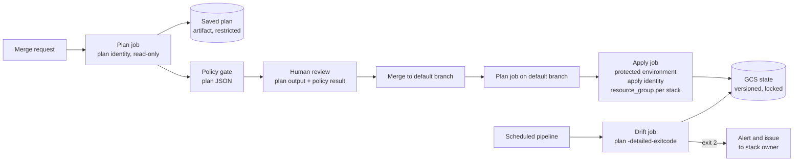

This note describes the delivery system around Terraform: which stacks exist and in what order they apply, which identity each pipeline job uses, how a reviewed plan becomes the applied change, how drift is found and triaged, and what happens when someone has to bypass the pipeline. The pieces are decided elsewhere: Terraform for GCP in [[adr/0030-terraform-manages-gcp-infrastructure]], state in GCS in [[adr/0032-terraform-state-in-gcs-per-environment]], plain root modules in [[adr/0033-plain-root-modules-no-terragrunt]], the policy gate and CI-only apply in [[adr/0035-terraform-plan-policy-gate-and-ci-only-apply]], and keyless CI in [[adr/0026-keyless-ci-auth-with-workload-identity-federation]]. Module and state layout is in [[patterns/terraform-module-and-state-layout]].

> [!info] Scope and sources
> The Google Cloud side (Workload Identity Federation providers, attribute mappings, credential configuration) was read from the gcloud reference text. The Terraform CLI, the GCS backend and GitLab CI keywords were not checked against their current documentation while writing; the pages under Sources are authoritative. The pipeline is a sketch that follows the documented keywords: validate it with the GitLab CI Lint tool before use. Nothing here was run.

> [!note] Not verified
> Check these before relying on them:
>
> - Terraform: `plan -detailed-exitcode` exit codes (0 no changes, 1 error, 2 changes), `-refresh-only`, `-out` and `apply PLANFILE`, `-lock=false`, `-parallelism` and its default, and that applying a saved plan fails when the state has changed since the plan.
> - The GCS backend: locking through a lock object, the recommendation to enable object versioning, and which backend options your Terraform version supports.
> - GitLab: `resource_group` and its `process_mode` values, variable expansion in `rules:changes` paths (a generated child pipeline can write literal paths instead), protected environments and deployment approvals, `id_tokens` with `aud`, `artifacts:access`, scheduled pipelines and the claims GitLab puts in its ID token (`project_path`, `ref_protected`, `environment`).
> - The Jenkins plugin names mentioned below.
> - Provider and Google API rate limits.

## Goals

- Every change to infrastructure goes through a merge request, a plan, a policy gate and a human review, and the change applied is exactly the change reviewed.
- No human and no pipeline holds more access than its stack needs; no long-lived keys exist.
- Applies to one stack never run concurrently, and stacks apply in dependency order.
- Drift is found within a day, owned by a team, and resolved deliberately.
- Emergency changes are possible, logged and reconciled with code afterwards.

## Components



## Stack inventory and order

A stack is one root module with one state. Keep an inventory file in the infrastructure repository that the pipeline reads: stack path, owner group, environment, apply identity and the stacks it depends on.

```yaml title="stacks.yaml"
# Example inventory. The pipeline generates jobs from it; humans review changes to it.
stacks:
  - path: org/policies
    owner: platform-security
    env: org
    depends_on: []
  - path: network/hub
    owner: platform-network
    env: shared
    depends_on: [org/policies]
  - path: network/prod-spoke
    owner: platform-network
    env: prod
    depends_on: [network/hub]
  - path: gke/prod-europe-west1
    owner: platform-runtime
    env: prod
    depends_on: [network/prod-spoke]
  - path: data/orders-prod
    owner: team-orders
    env: prod
    depends_on: [network/prod-spoke]
```

Rules:

- Foundations (organisation policy, folders, IAM, networks) are separate stacks from workloads, so a team's database change cannot touch the hub. The hierarchy they create is in [[architecture/gcp-resource-hierarchy-and-landing-zone]].
- A merge request that touches several stacks applies them in `depends_on` order, one stack per job. Changes that span a dependency in both directions (for example a network change that a GKE change needs first) go in two merge requests.
- Shared modules are versioned and pinned per stack ([[patterns/terraform-module-versioning]], [[standards/terraform-module-standard]]), so a module change rolls out stack by stack instead of everywhere at once.

## Identities

Each stack has two Google service accounts, reached through Workload Identity Federation from the CI job's OIDC token, as in [[architecture/iam-groups-and-ci-workload-identity-federation]]:

| Identity           | Used by                         | Access                                                        | Federation condition (example)                                 |
| ------------------ | ------------------------------- | ------------------------------------------------------------- | -------------------------------------------------------------- |
| `tf-plan-<stack>`  | Plan and drift jobs, any branch | Read the stack's resources and read its state prefix          | Project path matches the infrastructure repository             |
| `tf-apply-<stack>` | Apply job only                  | Change the stack's resources, read and write its state prefix | Project path matches and the ref is protected (default branch) |

Why two: merge request pipelines run code from unreviewed branches. A plan identity that can only read cannot be abused to change anything, while the apply identity is only reachable from protected refs and protected environments. One "god" service account for every stack turns any pipeline compromise into an organisation compromise.

The WIF provider maps the OIDC `sub` to `google.subject` and custom claims to `attribute.NAME` (up to 50 custom attributes, mapping expressions in CEL). The bindings use `principalSet://iam.googleapis.com/projects/PROJECT_NUMBER/locations/global/workloadIdentityPools/POOL/attribute.NAME/VALUE`. Which claims GitLab emits, and their exact names, are listed in the GitLab docs; check them before you write the attribute condition.

## Plan and apply flow

1. **Merge request pipeline.** For each changed stack, the plan job runs `terraform plan -out=plan.tfplan`, exports `terraform show -json` for the policy gate ([[patterns/terraform-plan-policy-checks]]) and a text rendering for reviewers. Tests run before it ([[patterns/terraform-testing]]).
2. **Review.** A reviewer from the stack's owner group reads the plan output, not only the diff. Deletions and replacements of stateful resources need a second reviewer. An LLM summary can help a reviewer read a large plan ([[ai/llm-assisted-terraform-plan-review]]) but does not replace the review.
3. **Merge.** The default-branch pipeline plans again against the current state and saves the plan as an artifact.
4. **Apply.** A manual job in a protected environment, deployable only by the stack's owner group, applies the saved plan file with the apply identity. `resource_group` serialises applies per stack.
5. **Evidence.** The plan, the approval, the apply log and the commit are linked by the pipeline ID, which is what [[compliance/change-management-controls-and-pipeline-evidence]] needs.

Applying the saved plan rather than re-planning in the apply job is the point: the change applied is the change someone looked at. If the state changed in between, Terraform should refuse the stale plan; re-run the plan job and review again.

> [!warning] Plan files and plan output can contain secrets
> A saved plan holds the full planned values, including sensitive ones. Restrict who can download artifacts (check `artifacts:access` in your GitLab version), keep `expire_in` short, never publish the plan text to merge request comments for public projects, and keep secrets out of Terraform where you can ([[architecture/secrets-architecture-gcp-and-gke]]).

## Pipeline

```yaml title=".gitlab-ci.yml"
# Sketch for one stack; generate one set of jobs per stack from stacks.yaml
# (for example with a child pipeline). Validate with CI Lint before use.
stages: [plan, apply, drift]

variables:
  STACK: "network/prod-spoke" # change: generated per stack
  STACK_ID: "network-prod-spoke" # change: generated per stack
  TF_IN_AUTOMATION: "true"
  GCP_PROJECT_NUMBER: "123456789012" # change: project that hosts the WIF pool
  GCP_WIF_POOL: "gitlab" # change
  GCP_WIF_PROVIDER: "gitlab-com" # change
  SA_DOMAIN: "infra-ci.iam.gserviceaccount.com" # change: project of the stack SAs

default:
  image: registry.example.com/platform/terraform-gcloud:1.0.0 # change: your pinned image with terraform and gcloud

.gcp-auth:
  id_tokens:
    GCP_ID_TOKEN:
      aud: "https://iam.googleapis.com/projects/${GCP_PROJECT_NUMBER}/locations/global/workloadIdentityPools/${GCP_WIF_POOL}/providers/${GCP_WIF_PROVIDER}" # must match the provider's allowed audiences
  before_script:
    - umask 077
    - export CRED_DIR="${CI_BUILDS_DIR}/${CI_JOB_ID}"
    - mkdir -p "${CRED_DIR}"
    - printf '%s' "${GCP_ID_TOKEN}" > "${CRED_DIR}/token.jwt"
    - >
      gcloud iam workload-identity-pools create-cred-config
      "projects/${GCP_PROJECT_NUMBER}/locations/global/workloadIdentityPools/${GCP_WIF_POOL}/providers/${GCP_WIF_PROVIDER}"
      --service-account="${TF_SA}@${SA_DOMAIN}"
      --credential-source-file="${CRED_DIR}/token.jwt"
      --credential-source-type=text
      --output-file="${CRED_DIR}/cred.json"
    - export GOOGLE_APPLICATION_CREDENTIALS="${CRED_DIR}/cred.json"
    - cd "${STACK}"
    - terraform init -input=false
  after_script:
    - rm -rf "${CI_BUILDS_DIR}/${CI_JOB_ID}"

plan:
  extends: .gcp-auth
  stage: plan
  variables:
    TF_SA: "tf-plan-${STACK_ID}"
  rules:
    - if: $CI_PIPELINE_SOURCE == "merge_request_event"
      changes: ["${STACK}/**/*"]
    - if: $CI_COMMIT_BRANCH == $CI_DEFAULT_BRANCH && $CI_PIPELINE_SOURCE == "push"
      changes: ["${STACK}/**/*"]
  script:
    - terraform plan -input=false -lock=false -out=plan.tfplan
    - terraform show -json plan.tfplan > plan.json
    - terraform show -no-color plan.tfplan > plan.txt
  artifacts:
    paths: ["${STACK}/plan.tfplan", "${STACK}/plan.json", "${STACK}/plan.txt"]
    expire_in: 3 days

apply:
  extends: .gcp-auth
  stage: apply
  variables:
    TF_SA: "tf-apply-${STACK_ID}"
  needs: ["plan"]
  resource_group: "terraform-${STACK_ID}"
  environment:
    name: "infra/${STACK_ID}" # protect this environment: owner group only, approval required
    action: start
  rules:
    - if: $CI_COMMIT_BRANCH == $CI_DEFAULT_BRANCH && $CI_PIPELINE_SOURCE == "push"
      changes: ["${STACK}/**/*"]
      when: manual
  script:
    - terraform apply -input=false plan.tfplan

drift:
  extends: .gcp-auth
  stage: drift
  variables:
    TF_SA: "tf-plan-${STACK_ID}"
  rules:
    - if: $CI_PIPELINE_SOURCE == "schedule"
  script:
    - rc=0
    - terraform plan -input=false -lock=false -detailed-exitcode -no-color > drift.txt || rc=$?
    - |
      case "$rc" in
        0) echo "No drift in ${STACK}" ;;
        2) echo "Drift in ${STACK}; see drift.txt"; exit 1 ;;
        *) echo "Plan failed in ${STACK} (exit ${rc})"; exit "$rc" ;;
      esac
  artifacts:
    when: always
    paths: ["${STACK}/drift.txt"]
    expire_in: 7 days
```

Notes on the sketch:

- The drift job fails on drift on purpose, so the scheduled pipeline turns red and the pipeline-failure notification reaches the stack owner. Wire that notification to the owner's channel, or add a step that opens an issue.
- `-lock=false` on plan and drift stops read-only jobs from blocking an apply; never use it on `apply`.
- Protect the `infra/*` environments and the default branch, and require approval from the owner group. Without that, `when: manual` only means "anyone with Developer access can click".
- Jenkins does the same with a declarative pipeline: a plan stage that archives the plan file, an `input` step limited to the owner group, an apply stage that applies the archived file, and a lock per stack (the Lockable Resources plugin is the common choice; check its current name and syntax). OIDC federation from Jenkins needs a plugin; see [[architecture/ci-platform-gitlab-runners-and-jenkins-agents-on-gke]].

## Drift detection and triage

Run the drift job daily per stack, and more often for foundations. When it reports drift, the owner decides within a set time (for example two working days):

| Drift cause                                        | Action                                                                     |
| -------------------------------------------------- | -------------------------------------------------------------------------- |
| Unwanted manual change                             | Revert: run the normal pipeline, which applies the code's version          |
| Wanted change made by hand (incident, break-glass) | Codify: change the code to match, plan shows no change, merge              |
| Resource created outside Terraform                 | Import it into the right stack, or delete it if nobody owns it             |
| Provider or API default changed                    | Pin or set the value explicitly in code                                    |
| Another stack or a controller manages the field    | Use `lifecycle { ignore_changes = [...] }` with a comment naming the owner |

`terraform plan -refresh-only` shows what reality changed without proposing changes to infrastructure, which helps triage. Do not run `apply -refresh-only` to make drift disappear: it writes the unwanted change into state as truth ([[runbooks/terraform-state-recovery]]).

## State

- One GCS bucket per environment ([[adr/0032-terraform-state-in-gcs-per-environment]]), object versioning on, a prefix per stack, and uniform bucket-level access.
- Plan identities read the stack's prefix; apply identities read and write it. Grant per prefix with IAM conditions where you can, or use one bucket per trust boundary.
- Locking is done by the GCS backend; a stuck lock is handled with the recovery runbook, not with `force-unlock` from a laptop.
- Restore procedures for corrupted or lost state are in [[runbooks/terraform-state-recovery]].

## Break-glass

When the pipeline cannot run (CI down during an incident, a broken provider), an engineer elevates through [[compliance/privileged-access-just-in-time-gcp-gke]], makes the smallest change, records it in the incident, and the next drift run forces the codify-or-revert decision. Break-glass never uses the stack's apply service account from a laptop; impersonation of pipeline identities by humans is blocked by IAM.

## Scaling

- Many small stacks plan faster and fail smaller than one large stack. Split when a plan takes more than a few minutes or touches more than one owner.
- Terraform's `-parallelism` limits concurrent operations per run; Google API quotas apply per project and per method. If drift jobs for many stacks hit quota errors, stagger the schedules rather than raising parallelism. Check current quotas for the APIs involved.
- If the generated pipeline becomes hard to maintain, compare it with a dedicated orchestrator ([[tools/atlantis-vs-spacelift-vs-hcp-terraform]]) before writing more glue.

## Failure modes

| Failure                                   | Effect                                       | Mitigation                                                                   |
| ----------------------------------------- | -------------------------------------------- | ---------------------------------------------------------------------------- |
| Two applies on one stack                  | Lock contention or interleaved changes       | `resource_group` per stack, plus backend locking                             |
| Stale plan applied                        | Changes based on an old view of state        | Apply only the saved plan; Terraform rejects stale plans; re-plan on failure |
| Plan identity can write                   | MR pipeline from a branch changes production | Read-only plan SA, apply SA bound to protected refs only                     |
| Drift job silently broken                 | Drift accumulates unseen                     | Alert when the scheduled pipeline has not succeeded for two days             |
| Laptop apply                              | Unreviewed change, local state, no evidence  | No human holds apply roles; org policy and IAM deny where possible           |
| Module upgrade applied everywhere at once | One bug breaks every stack                   | Pinned versions, upgrade stack by stack, non-prod first                      |

## Pitfalls

- Re-planning in the apply job and applying whatever comes out.
- Plan artifacts readable by everyone with access to the project.
- One CI variable with a service account key "until WIF is ready".
- Drift jobs that run with the apply identity.
- Treating `ignore_changes` as a fix rather than as a documented ownership boundary.
- Approvals that any developer can give.

## Verify

```bash title="verify-delivery.sh"
#!/usr/bin/env bash
set -euo pipefail

PROJECT="infra-ci"                    # change: project that holds the stack service accounts
POOL_PROJECT_NUMBER="123456789012"    # change
STATE_BUCKET="example-tfstate-prod"   # change
STACK_ID="network-prod-spoke"         # change

# Who can impersonate the apply SA: expect only the principalSet for protected refs
gcloud iam service-accounts get-iam-policy "tf-apply-${STACK_ID}@${PROJECT}.iam.gserviceaccount.com" \
  --project "$PROJECT" --format=json

# Provider attribute mapping and condition
gcloud iam workload-identity-pools providers describe gitlab-com \
  --workload-identity-pool=gitlab --location=global --project "$POOL_PROJECT_NUMBER" \
  --format="yaml(attributeMapping,attributeCondition)"

# State bucket: expect versioning enabled and uniform bucket-level access
gcloud storage buckets describe "gs://${STATE_BUCKET}" \
  --format="yaml(versioning_enabled,uniform_bucket_level_access)"
```

Then prove the controls: open a merge request that changes a stack and confirm the plan job cannot apply (it has no write roles), confirm the apply job waits for approval in the protected environment, and change a label by hand in a sandbox stack to confirm the next drift run turns red. The `gcloud storage buckets describe` field names can differ by version; check the YAML output.

## Adopt incrementally

1. Inventory stacks and owners; move CI to WIF with one plan and one apply identity per stack.
2. Switch apply jobs to saved plans and protected environments; remove apply roles from humans.
3. Add the policy gate in warn mode, then enforce ([[patterns/terraform-plan-policy-checks]]).
4. Add scheduled drift jobs for foundations, then for every stack, with an owner per alert.
5. Document break-glass and run it once in a game day.

## Sources

Official documentation this note was not checked against; verify there:

- [terraform plan command](https://developer.hashicorp.com/terraform/cli/commands/plan)
- [GCS backend](https://developer.hashicorp.com/terraform/language/backend/gcs)
- [GitLab resource groups](https://docs.gitlab.com/ci/resource_groups/)
- [GitLab protected environments](https://docs.gitlab.com/ci/environments/protected_environments/)
- [GitLab and Google Cloud with OIDC](https://docs.gitlab.com/ci/cloud_services/google_cloud/)
- [Workload Identity Federation with deployment pipelines](https://cloud.google.com/iam/docs/workload-identity-federation-with-deployment-pipelines)
- The gcloud reference for `gcloud iam workload-identity-pools providers create-oidc` and `create-cred-config`.

## Related

- [[patterns/terraform-module-and-state-layout]]
- [[patterns/terraform-plan-policy-checks]]
- [[patterns/terraform-testing]]
- [[adr/0035-terraform-plan-policy-gate-and-ci-only-apply]]
- [[architecture/policy-guardrail-layers-org-to-admission]]
- [[compliance/change-management-controls-and-pipeline-evidence]]
- [[runbooks/terraform-state-recovery]]
- [[tools/atlantis-vs-spacelift-vs-hcp-terraform]]
