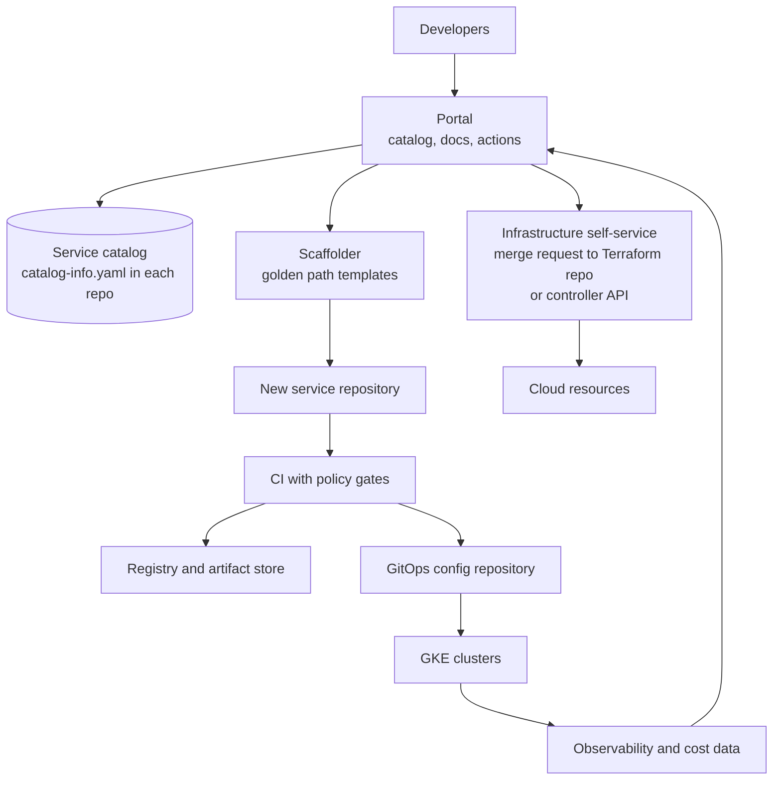

This note describes how to structure an internal developer platform (IDP): the layers, the service catalog and its ownership model, self-service for infrastructure, how to run the platform as a product, and how to keep guardrails useful rather than obstructive. It leaves the template mechanics to [[architecture/golden-path-templates-architecture]], the repository layout of delivery to [[architecture/gitops-repo-topology-and-promotion]], and the cluster side to [[architecture/gke-platform-topology-and-tenancy]].

> [!info] Scope and sources
> Written against the CNCF platforms white paper and the Backstage documentation as general references. Backstage is one portal option, not a requirement. Project status and features change; check the current documentation.

> [!note] Not verified
> Nothing here was run. Check before relying on it: Backstage's current CNCF project status and maturity level, the current `catalog-info.yaml` descriptor fields and kinds, and the behaviour of any catalog provider you choose.

## Problem and goals

Without a platform, every team builds its own pipeline, chooses its own cluster settings and learns the same lessons separately. The symptoms are long time to first deploy, inconsistent controls, and a small infrastructure team answering the same questions.

Goals:

- **Lower cognitive load.** A developer should deploy a service without learning every tool underneath.
- **Short time to first deploy.** From request to a running service in a non-production environment in hours, not weeks.
- **Consistent controls.** Security, observability and cost tagging come with the paved road instead of being added by review.
- **Visible ownership.** For any running thing, the answer to "who owns this?" takes seconds.

Non-goals: hiding everything, or forcing every team onto one stack. A platform that cannot be bypassed in a justified case will be bypassed unofficially.

## Layers



| Layer                       | Responsibility                                                                  | Typical implementation                                           |
| --------------------------- | ------------------------------------------------------------------------------- | ---------------------------------------------------------------- |
| Portal                      | One place to find services, docs, owners, runbooks and run self-service actions | Backstage, or a thinner custom UI over the catalog               |
| Catalog                     | Entities and their relationships, with an owner for each                        | Descriptor files in each repository, ingested by the portal      |
| Scaffolder                  | Create a new service from a versioned template                                  | Portal templates calling the Git provider API                    |
| Delivery                    | Build, test, promote and deploy                                                 | CI plus GitOps, see [[tools/argocd-vs-flux]]                     |
| Infrastructure self-service | Databases, buckets, queues, namespaces on request                               | Terraform modules via merge request, or an API-driven controller |
| Feedback                    | Show deploy status, SLOs, cost and vulnerabilities per service                  | Portal plugins over existing tools                               |

The portal is the thinnest layer and the easiest to over-invest in. The value is in the catalog data, the templates and the self-service paths behind it. A portal that only displays things is a dashboard, not a platform.

## Catalog and ownership model

Every service, library, API, resource and system is an entity with exactly one owner. Owners are groups, never individuals: people leave and change teams, groups persist.

The source of truth is a descriptor file in each repository, versioned with the code. A sample using Backstage's descriptor format, with example names:

```yaml title="catalog-info.yaml"
apiVersion: backstage.io/v1alpha1
kind: Component
metadata:
  name: payments-api
  description: Public API for card payments
  annotations:
    example.com/runbook: https://wiki.example.com/runbooks/payments-api
    example.com/slo-dashboard: https://grafana.example.com/d/payments-api
  tags:
    - go
    - tier-1
spec:
  type: service
  lifecycle: production
  owner: group:default/payments-team
  system: payments
  dependsOn:
    - resource:default/payments-db
  providesApis:
    - payments-v1
```

Rules:

- `owner` is required and must resolve to a real group in the identity source. Synchronise groups from the identity provider rather than typing names.
- `lifecycle` has a small fixed vocabulary (experimental, production, deprecated). Deprecated entities have an end date.
- Links to runbooks, dashboards and the on-call schedule are mandatory for production services. The production readiness review in [[standards/production-readiness-review]] can use the catalog entry as its checklist anchor.
- Relationships (`dependsOn`, `providesApis`) are kept short and accurate. Incomplete graphs are worse than none because they are trusted.

A CI check keeps the catalog honest. This job fails when the descriptor is missing or has no owner:

```yaml title=".gitlab-ci.yml (job fragment)"
catalog-check:
  stage: test
  image: python:0.0.0-slim@sha256:0000000000000000000000000000000000000000000000000000000000000000 # placeholder: pin the real version and digest
  before_script:
    - pip install --no-cache-dir pyyaml # pin the version (or use a prebuilt tools image) in real use
  rules:
    - if: $CI_PIPELINE_SOURCE == "merge_request_event"
  script:
    - test -f catalog-info.yaml || { echo "catalog-info.yaml is missing"; exit 1; }
    - |
      python - <<'PY'
      import sys, yaml
      doc = yaml.safe_load(open("catalog-info.yaml"))
      spec = doc.get("spec", {})
      owner = spec.get("owner", "")
      if not owner:
          print("spec.owner is missing"); sys.exit(1)
      if not owner.startswith("group:"):
          print("spec.owner must be a group, e.g. group:default/payments-team"); sys.exit(1)
      if spec.get("lifecycle") not in {"experimental", "production", "deprecated"}:
          print("spec.lifecycle must be experimental, production or deprecated"); sys.exit(1)
      print("catalog-info.yaml OK")
      PY
```

The example installs PyYAML in `before_script` because the stock Python image does not include it. In real use, pin the image and the library version, or bake both into your own tools image. Check the current Backstage descriptor documentation for kinds and fields.

## Self-service infrastructure

Developers need databases, buckets and namespaces without opening tickets. There are two common models.

| Model                                   | How it works                                                        | Strengths                                             | Costs                                                        |
| --------------------------------------- | ------------------------------------------------------------------- | ----------------------------------------------------- | ------------------------------------------------------------ |
| Merge request to a Terraform repository | A portal action or template opens an MR adding a module call        | Reviewable, auditable, uses existing Terraform skills | Slower, plan and apply pipeline needed, state layout matters |
| API-driven controller                   | A custom resource or API request is reconciled into cloud resources | Fast, declarative, fits GitOps                        | A new control plane to run, upgrade and secure               |

Start with the merge request model. It reuses [[patterns/terraform-module-and-state-layout]] and the policy gates in [[patterns/terraform-plan-policy-checks]], so a request for a public bucket or an oversized instance fails in the plan, not in review. Offer a small catalogue of vetted modules (database, bucket, topic, namespace) with safe defaults and few inputs. Move to a controller when volume or latency makes merge requests the bottleneck, and accept the operational cost.

Whichever model: the result must be reflected in the catalog (the resource entity with the same owner), and every resource must carry ownership and cost labels, as in [[architecture/finops-cost-allocation-and-guardrails]].

## Platform as a product

A platform team that behaves like a ticket queue has failed regardless of tooling. Treat developers as customers:

- **A roadmap** built from interviews and usage data, with things you will not build.
- **Service levels for the platform itself.** The CI system, the portal and the deploy path each get an SLO and an on-call rota. If the platform is down, every team is down.
- **Adoption metrics.** Share of services on the golden path, time to first deploy, change failure rate, lead time, and developer satisfaction from a short regular survey. Use them to prioritise, not to rank teams.
- **Documentation and support.** A channel, office hours, and docs located next to the code. Support load is a signal about product gaps.
- **Deprecation policy.** Old paths have owners, dates and migration help.

## Build or buy

| Choice                             | Fits when                                                | Watch for                                     |
| ---------------------------------- | -------------------------------------------------------- | --------------------------------------------- |
| Open source portal framework       | You have platform engineers and want control and plugins | Ongoing upgrade and plugin maintenance effort |
| Commercial portal                  | You want a faster start and less custom code             | Licence cost, data model limits, lock-in      |
| Thin custom layer over Git         | Small organisation, few services                         | It grows; keep it to catalog and links        |
| No portal, only templates and docs | Under about a few dozen services, one or two teams       | Ownership data lives in people's heads        |

Backstage is one open source option under the CNCF; check its current project status and maturity on the CNCF site before you rely on it, and avoid pinning plugin versions in architecture documents because they change quickly. Whatever you choose, keep the catalog data in your repositories so you can switch portals.

## Guardrails on the paved road

Decide per control whether it is mandatory or a default:

- **Mandatory, enforced by the pipeline or the cluster:** an owner in the catalog, image scanning and signing, no privileged containers, resource requests, required labels, production approvals. See [[patterns/conftest-policy-gate-for-manifests]].
- **Defaults that can be overridden with a recorded reason:** language and framework, instance size, autoscaling settings, log level.
- **Optional:** tooling choices inside the team's own repository.

An override is data: record it in the repository, link it from the catalog entry, and review it at least yearly. The goal is that leaving the paved road is possible but visible.

## Failure modes

| Failure                         | Symptom                                         | Mitigation                                                                     |
| ------------------------------- | ----------------------------------------------- | ------------------------------------------------------------------------------ |
| Catalog drift                   | Entities that no longer exist, missing services | Descriptor in the repo, CI check, scan for deployed services without an entity |
| Stale owners                    | Group deleted or empty, pages go nowhere        | Sync groups from the identity provider, alert on empty owners                  |
| A portal that only shows things | Developers still raise tickets for every change | Invest in actions: scaffold, request, rollback, scale                          |
| Platform team as a ticket queue | Long waits, workarounds                         | Self-service paths, product management, limit bespoke requests                 |
| Forced adoption without value   | Teams comply on paper and bypass in practice    | Make the paved road the fastest path, not just the mandated one                |
| Platform outage                 | Nobody can deploy                               | SLO, on-call, a documented break-glass deploy path                             |

## Pitfalls

- Building the portal first and the paved road later.
- Recording individuals as owners.
- Letting every team add its own descriptor fields and annotations until nothing is queryable.
- Self-service that bypasses cost and security labels.
- Measuring platform success by features shipped instead of outcomes for developers.

## Adopt incrementally

1. Start with the catalog: descriptor files, owners as groups, a CI check, and a basic listing. This alone answers the ownership question.
2. Add one golden path template for the most common service type, see [[architecture/golden-path-templates-architecture]].
3. Add two or three self-service infrastructure modules through merge requests.
4. Add feedback: deploy status, SLO and cost per service.
5. Publish platform SLOs and adoption metrics and start a roadmap.
6. Consider a controller or a commercial portal only after the first five show real limits.

## Sources

- Backstage overview: https://backstage.io/docs/overview/what-is-backstage
- Backstage descriptor format: https://backstage.io/docs/features/software-catalog/descriptor-format
- Backstage on the CNCF site: https://www.cncf.io/projects/backstage/
- CNCF platforms white paper: https://tag-app-delivery.cncf.io/whitepapers/platforms/

Check the current docs for project status and descriptor fields.

## Related

- [[architecture/golden-path-templates-architecture]]
- [[architecture/gitops-repo-topology-and-promotion]]
- [[architecture/gke-platform-topology-and-tenancy]]
- [[patterns/terraform-module-and-state-layout]]
- [[patterns/terraform-plan-policy-checks]]
- [[tools/argocd-vs-flux]]
- [[standards/production-readiness-review]]
