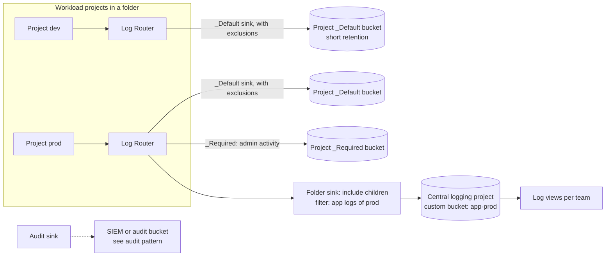

This note describes how logs flow from GKE workloads into Cloud Logging, how the Log Router sends them to the right buckets and projects, and how to control retention, access and cost. It leaves the signal pipeline and collector design to [[architecture/observability-pipeline-opentelemetry]], log format to [[standards/structured-logging-conventions]], and audit log and SIEM routing to [[patterns/gcp-audit-logs-siem]].

> [!info] Scope and sources
> Written against Cloud Logging and GKE logging as general designs. Retention rules, quotas, default buckets and GKE logging options change; the documentation listed under Sources is authoritative.

> [!note] Not verified
> Nothing here was run. Check before relying on it: the current retention behaviour of the `_Required` and `_Default` buckets, the `gcloud logging` flags, writer identity handling for sinks to buckets in other projects, quota and rate limits, and the GKE logging configuration options for your version.

## Goals

- Every useful log line is findable by the team that owns it, within the time they need.
- Sensitive logs are separated and restricted by data class, not mixed into one bucket.
- Retention is explicit per class, not whatever the default happens to be.
- Cost is predictable and attributable to teams.
- Losing a sink or changing a permission does not silently drop logs.

## Collection

- **System and workload logging on GKE.** GKE can collect container stdout and stderr and system component logs into Cloud Logging. Enable the scopes you need (system, workload) at the cluster level, and check the current GKE logging documentation for the options and what they include.
- **Structured JSON on stdout.** The application writes one JSON object per line to stdout, with fields following [[standards/structured-logging-conventions]] (severity, message, trace id, service). Cloud Logging parses JSON payloads into structured entries, so filters and log-based metrics work on fields instead of regular expressions. Do not write log files inside containers.
- **Severity and trace correlation.** Use the field names Cloud Logging recognises for severity and trace, so entries link to traces. Check the current docs for the special field names.
- **OpenTelemetry Collector for logs** only when another backend needs the same logs (a SIEM, a third-party platform), or when you need processing before storage. For GKE-to-Cloud-Logging alone, the built-in agent is simpler, and a second collection path doubles cost and failure modes.
- **Keep secrets and personal data out at the source.** Redaction after collection is too late. See the rules for logs in [[compliance/pci-dss-and-gdpr-for-devops-logs-and-data]].

## Routing

The Log Router receives every entry in a project and evaluates sinks. Each sink has a filter and a destination: a log bucket, a BigQuery dataset, a Pub/Sub topic or a Cloud Storage bucket. Sinks at the folder or organisation level, with children included, collect from many projects.



Practices:

- **Sinks per environment folder to a central logging project.** A central project gives one place to apply retention, access and cost control, and keeps workload project owners from deleting evidence. Create one aggregated sink per environment folder with children included.
- **Exclusion filters** on the `_Default` sink drop low-value, high-volume logs (load balancer health checks, noisy debug) before they are stored. Exclusions do not affect other sinks, so excluded logs can still be routed elsewhere if needed. Be careful: logs excluded from storage are gone and cannot be recovered.
- **Log-based metrics** are computed from the stream, independent of storage. Use them for SLIs instead of storing everything for a query later.
- **Audit logs and security routing** are covered in [[patterns/gcp-audit-logs-siem]]. Do not duplicate that sink design here.

Creating an aggregated sink on a folder, with the writer identity grant. The folder ID, project and bucket are placeholders:

```bash title="create-folder-sink.sh"
#!/usr/bin/env bash
set -euo pipefail

FOLDER_ID="123456789012"
CENTRAL_PROJECT="example-logging"
BUCKET="app-prod"
LOCATION="europe-west1"

# Destination bucket in the central project
gcloud logging buckets create "$BUCKET" \
  --project "$CENTRAL_PROJECT" --location "$LOCATION" \
  --retention-days 30 \
  --description "Production application logs"

# Aggregated sink on the folder, including all child projects
gcloud logging sinks create app-prod-to-central \
  "logging.googleapis.com/projects/${CENTRAL_PROJECT}/locations/${LOCATION}/buckets/${BUCKET}" \
  --folder "$FOLDER_ID" --include-children \
  --log-filter 'resource.type="k8s_container" AND severity>=INFO'

# The sink has a unique writer identity. Grant it write access on the central project.
WRITER=$(gcloud logging sinks describe app-prod-to-central \
  --folder "$FOLDER_ID" --format='value(writerIdentity)')

gcloud projects add-iam-policy-binding "$CENTRAL_PROJECT" \
  --member "$WRITER" \
  --role roles/logging.bucketWriter
```

Without the writer grant, the sink exists but delivers nothing, and the failure is easy to miss. Always verify delivery after creating a sink.

## Buckets and retention

Cloud Logging has built-in buckets and custom buckets:

| Bucket         | Purpose                                                             | Notes                                                                    |
| -------------- | ------------------------------------------------------------------- | ------------------------------------------------------------------------ |
| `_Required`    | Admin Activity audit logs and similar logs that Google always keeps | Fixed behaviour; cannot be changed. Check the docs for current retention |
| `_Default`     | Everything else that no sink excludes                               | Retention is configurable; the default may be short, check the docs      |
| Custom buckets | Logs you route by data class, team or compliance need               | Set retention, location and access per bucket                            |

Design by data class, not by team:

- **Operational application logs:** short retention, such as a few weeks, enough for debugging.
- **Security and audit logs:** retention set by policy, sent to the audit design.
- **Sensitive logs** (anything that could contain personal or payment data): a restricted bucket with a tight view, a defined retention and, where policy requires, a customer-managed key. Prefer not to log such data at all.
- **Long retention** costs storage. Use it only where a rule requires it, and prefer exporting aggregates.

Changing retention on a bucket:

```bash title="set-retention.sh"
#!/usr/bin/env bash
set -euo pipefail

# 30 is a placeholder: use the value your data class policy defines.
gcloud logging buckets update app-prod \
  --project example-logging --location europe-west1 \
  --retention-days 30
```

Check the current Cloud Logging docs for the rules on shortening retention, location immutability and locked buckets, since some changes cannot be undone. If you lock retention, the lock is permanent.

## Access

- **Log views** let you grant a team access to a subset of a bucket (for example `resource.labels.namespace_name="team-a"`) without giving them the whole bucket. Create one view per team, and grant the log viewer role on the view, not on the project.
- **IAM on the central project** is limited to the platform team and the security team. Application teams read through views.
- **Restricted bucket for sensitive logs** with a separate group and an access log of who queried it.
- Separate **writers** (sinks, agents) from **readers** and from **administrators** who can change retention or delete buckets. The ability to shorten retention is the ability to destroy evidence.

## Analytics

For ad hoc analysis across large volumes, enable Log Analytics on a bucket and query it with SQL, or link a BigQuery dataset. Treat this as an addition to troubleshooting in the console, not a replacement for log-based metrics and alerts. Keep long-term archives and SIEM exports in the audit design instead of making application buckets serve those needs.

## Cost controls

Logging cost follows ingestion volume first, then retention, then analytics usage. Check the current pricing page rather than relying on remembered numbers.

- **Exclusions** for known noise, reviewed regularly.
- **Sampling** of verbose, low-value logs at the application or the collector (for example log 1 in N successful health requests). Never sample errors.
- **Severity discipline.** Debug logging is off in production by default and enabled temporarily by configuration.
- **Per-team ingest dashboards.** Use a log-based metric or the usage metrics by namespace label to show each team its volume, and tie it to [[architecture/finops-cost-allocation-and-guardrails]].
- **Fix the source.** A single crash-looping pod can produce more volume than a hundred healthy ones. Alert on a sudden rise in ingest per namespace.

## Failure modes

| Failure                        | Effect                                                | Mitigation                                                                  |
| ------------------------------ | ----------------------------------------------------- | --------------------------------------------------------------------------- |
| Quota or rate limits           | Entries are dropped or delayed under heavy write load | Reduce volume at the source, sampling, review the quotas page before launch |
| Sink loses its permission      | Logs stop arriving at the destination silently        | Alert on sink errors, test delivery after IAM changes, manage IAM in code   |
| Over-aggressive exclusion      | The log needed in an incident was never stored        | Review exclusions, keep error logs, test with a real incident scenario      |
| Secrets or PII in logs         | Sensitive data stored and readable by many            | Source-level redaction, scanning, restricted bucket, retention limits       |
| Retention shortened by mistake | Data deleted after the new period                     | Restrict who can change retention, review in code                           |
| Agent overload on a node       | Missing logs from a busy node                         | Resource limits for the logging agent, monitor agent metrics                |

## Pitfalls

- Leaving everything in `_Default` and calling that an architecture.
- Creating a sink and not granting its writer identity.
- Using one bucket for logs with different sensitivity and retention.
- Logging request bodies, tokens or full URLs with query strings.
- Giving every developer project-wide log viewer instead of per-team views.
- Treating exclusion filters as access control. They are cost control.

## Verify

```bash title="verify-logging.sh"
#!/usr/bin/env bash
set -euo pipefail

FOLDER_ID="123456789012"
CENTRAL_PROJECT="example-logging"

# Sink exists with the intended filter, and has no error
gcloud logging sinks describe app-prod-to-central --folder "$FOLDER_ID"

# Bucket retention is what policy says
gcloud logging buckets describe app-prod \
  --project "$CENTRAL_PROJECT" --location europe-west1 \
  --format='value(retentionDays)'

# Entries from a workload project actually arrive in the central bucket
gcloud logging read 'resource.type="k8s_container"' \
  --project "$CENTRAL_PROJECT" --bucket app-prod --location europe-west1 \
  --view _AllLogs --limit 5 --freshness 15m

# A team view limits what the team can see
gcloud logging views list --bucket app-prod \
  --project "$CENTRAL_PROJECT" --location europe-west1
```

Also write a test log line from a pod with a unique marker and confirm it appears in the central bucket and nowhere it should not.

## Adopt incrementally

1. Standardise structured JSON on stdout for one service and confirm the fields parse.
2. Add exclusions for the biggest noise sources after measuring them.
3. Create the central logging project, a custom bucket and one folder sink, and verify delivery.
4. Add per-team log views and remove broad viewer roles.
5. Add data class buckets and retention per class.
6. Add ingest dashboards, alerts on sink errors, and a regular exclusion review.

## Sources

- Log routing overview: https://cloud.google.com/logging/docs/routing/overview
- Log buckets: https://cloud.google.com/logging/docs/buckets
- Exclusion filters: https://cloud.google.com/logging/docs/exclusions
- Logging quotas and limits: https://cloud.google.com/logging/quotas
- About GKE logs: https://cloud.google.com/kubernetes-engine/docs/concepts/about-logs

Check the current docs for retention rules, quotas and flags.

## Related

- [[architecture/observability-pipeline-opentelemetry]]
- [[standards/structured-logging-conventions]]
- [[patterns/gcp-audit-logs-siem]]
- [[compliance/pci-dss-and-gdpr-for-devops-logs-and-data]]
- [[architecture/finops-cost-allocation-and-guardrails]]
- [[architecture/gcp-resource-hierarchy-and-landing-zone]]
- [[architecture/multi-tenant-prometheus-architecture]]
