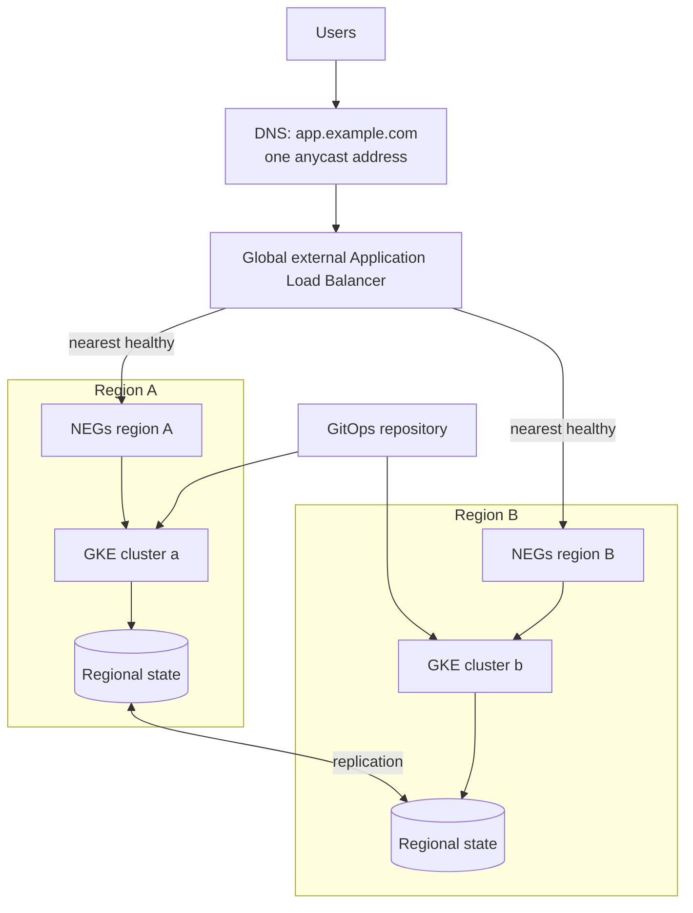

This note describes how to run a service from two or more GKE regions at the same time: how traffic is steered, where state lives, how deploys roll out without taking every region down at once, and how to rehearse failure. It is not a tier selection guide. Choosing between backup and restore, warm standby and active-active belongs to [[architecture/disaster-recovery-tiers-rpo-rto]], and cluster layout to [[architecture/gke-platform-topology-and-tenancy]].

> [!info] Scope and sources
> Written against the Google Cloud global external Application Load Balancer, GKE, Argo CD ApplicationSets and Spanner as general designs. Multi-cluster features are still evolving; read the current GKE documentation.

> [!note] Not verified
> Nothing here was run. Check before relying on it: the current status and requirements of multi-cluster Gateway and multi-cluster Services, supported backend types and balancing modes of the load balancer, Spanner configuration names, and ApplicationSet generator syntax.

## Goals and non-goals

Goals:

- Serve users from the nearest healthy region and keep serving when one region fails.
- Remove failover as a manual, high-stress event for stateless tiers.
- Roll out changes one region at a time so a bad change has a limited blast radius.

Non-goals:

- This does not make a service automatically correct under partial failure. The application must tolerate retries, duplicate requests and stale reads.
- It is not cheaper than active-passive. You pay for running capacity in every region all the time.
- It does not replace backups. A corrupted write replicates to every region.

## Decision drivers

Active-active is worth its cost only when one of these is true:

- **Availability target.** The target cannot be met with a single region plus a rehearsed failover. Do the arithmetic from your own measured recovery time.
- **Latency.** Users are spread across continents and round trips to one region are too slow.
- **Failover time.** Even a rehearsed active-passive failover takes longer than the business accepts.
- **Write locality.** Decide where writes happen. This is the hardest driver and it decides the data design below.
- **Cost of running double.** Each region must be sized for the share of load it carries after a failure. Be explicit about whether you accept degraded service during a region loss.

## Topology options

| Option                                             | How it works                                                                                         | Strengths                                | Costs                                                        |
| -------------------------------------------------- | ---------------------------------------------------------------------------------------------------- | ---------------------------------------- | ------------------------------------------------------------ |
| Independent clusters behind a global load balancer | One cluster per region; NEGs from each are backends of one global external Application Load Balancer | Simple, loosely coupled, well understood | You manage backend wiring and config parity yourself         |
| Fleet with multi-cluster Gateway                   | A config cluster defines a Gateway and routes that span clusters                                     | Declarative, fewer hand-made backends    | Newer, extra concepts, check current status and requirements |

Start with independent clusters. Their failure domains are cleanly separate: a bad control plane upgrade in one region does not touch the other. Consider the fleet approach once you have many services and want routing as code across clusters, after checking the current GKE docs for the status of multi-cluster Gateway and multi-cluster Services.



## Traffic steering and health checks

- **One entry point.** A global load balancer exposes one anycast address, so there is no DNS failover delay to wait out. Users are sent to the closest backend with capacity.
- **Health checks decide failover.** The check must reflect real readiness: the application path and its critical dependencies, not just that a port is open. A check that is too shallow keeps sending traffic to a broken region. A check that is too deep, for example failing on any optional dependency, makes a minor problem drain a whole region.
- **Capacity and overflow.** Configure backend capacity so the load balancer spills traffic to the other region before pods are overloaded, and so that spill during a failover is expected rather than a surprise. Check the current Load Balancing docs for balancing modes.
- **Connection draining and timeouts.** Set draining so in-flight requests finish when a backend is removed.
- **Cloudflare or another edge in front.** The path from the edge to this load balancer is covered in [[architecture/edge-and-ingress-cloudflare-gclb-gateway-api]].

The global load balancer is itself a shared failure domain. A bad URL map, certificate or Cloud Armor policy change applies to every region at once. Treat load balancer configuration as the highest-risk change in the system: manage it in code, review it, and roll it out through a staging load balancer first.

## State

Stateless first. Every piece of state in a request path multiplies complexity.

- **Sessions.** Prefer signed, stateless tokens, or a regional session store where losing a session on failover is acceptable (the user logs in again).
- **Caches.** Regional caches that can be rebuilt. Never let correctness depend on a cache.
- **Queues and jobs.** Decide per queue: regional (work stays in its region and a failed region's backlog waits or is replayed) or global. Make consumers idempotent.
- **Databases.** There are three honest designs:
  1. **One writer region, read replicas elsewhere.** Writes go to the primary region, even from users near the other region. Simple and common. Failover of the writer is a database promotion, a DR event handled as in [[architecture/disaster-recovery-tiers-rpo-rto]] (data layer choices; do not duplicate that here). It is active-active for reads and stateless compute only.
  2. **Partition by tenant or user.** Each partition has a home region. Routing must send a request to the home region, and a region loss still needs a plan for its partitions.
  3. **A globally consistent store**, such as Spanner with a multi-region configuration. It supports writes from several regions with strong consistency, at the price of write latency (writes commit through the configuration's leader region, so writes from far regions pay that round trip) and a different data model and cost profile. Check the instance configuration docs for the available configurations.

Be honest in design review about which of the three you chose. "Active-active" with a single writer is a valid design, but the failure drill for the writer region is a database promotion, not a load balancer drain.

## Deploys and drift

Two regions means two places for configuration to diverge. Controls:

- **One source of truth.** A GitOps repository with a base and a small per-region overlay, as in [[architecture/gitops-repo-topology-and-promotion]]. Region differences are limited to names, replica counts and capacity.
- **ApplicationSet per region.** Generate one Argo CD Application per cluster from a list or cluster generator, so adding a region is a change to a list.
- **Staggered rollout.** Promote to region A, wait for bake time and health signals, then region B. Do not sync every region at once. Use progressive delivery inside each cluster, see [[patterns/progressive-delivery-argo-rollouts]].
- **Parity checks.** A scheduled job compares the running image digests, ConfigMap hashes and key policy objects between regions and alerts on differences that are not explained by the overlay.
- **Schema changes.** Use expand and contract migrations, so both versions of the application can run against the schema while regions are on different releases.

```yaml title="applicationset-regions.yaml"
apiVersion: argoproj.io/v1alpha1
kind: ApplicationSet
metadata:
  name: payments-api
  namespace: argocd
spec:
  generators:
    - list:
        elements:
          - region: europe-west1
            cluster: gke-prod-ew1
            wave: "1"
          - region: us-central1
            cluster: gke-prod-uc1
            wave: "2"
  template:
    metadata:
      name: "payments-api-{{region}}"
      annotations:
        example.com/rollout-wave: "{{wave}}"
    spec:
      project: payments
      source:
        repoURL: https://git.example.com/platform/deploy-config.git
        targetRevision: main
        path: "apps/payments-api/overlays/{{region}}"
      destination:
        name: "{{cluster}}"
        namespace: payments
      syncPolicy:
        automated:
          prune: true
          selfHeal: true
```

Waves are only an annotation here. Enforce ordering with ApplicationSet progressive syncs (the `RollingSync` strategy; check its current maturity), a promotion pipeline that bumps one region's overlay at a time, or a rollout controller. Sync waves only order resources within one Application, not across the Applications an ApplicationSet creates. Check the current ApplicationSet docs for generator and progressive sync options.

## Capacity

- Decide the failover capacity policy and write it down:
  - **Full N+1:** each region can carry 100% of peak. Safest, most expensive.
  - **Degraded mode:** each region carries a share and sheds non-critical features or traffic when the other is down.
- Autoscaling is not instant. Cluster autoscaler and node provisioning take time, so keep headroom or pre-provisioned nodes for the load that arrives at failover.
- Check quotas in every region, including addresses, CPUs and load balancer resources. A region that cannot scale up because of quota is not a failover target.
- Dependencies need the same capacity: databases, caches, and Artifactory or registries for image pulls.

## Failure modes

| Failure                     | What happens                                                       | Mitigation                                                                         |
| --------------------------- | ------------------------------------------------------------------ | ---------------------------------------------------------------------------------- |
| Regional outage             | Health checks fail, load balancer shifts all traffic to the others | Capacity policy, rehearsed drain, state design that survives the loss              |
| Bad deploy in one region    | One region returns errors or is slow                               | Staggered rollout, automatic rollback, drain that region                           |
| Global configuration error  | Load balancer or edge config breaks every region at once           | Staging load balancer, review, staged changes, fast rollback from Git              |
| Split brain on writes       | Two regions accept conflicting writes                              | Single writer, partitioning, or a consistent store; never multi-master by accident |
| Dependency asymmetry        | A region depends on a service that exists in only one region       | Dependency map, per-region dependency checks in readiness                          |
| Retry storm during failover | Surviving region is overwhelmed by retries                         | Client backoff and jitter, load shedding, rate limits                              |

## Drills

A drill that has not been run is a hypothesis. Run these in a pre-production environment first, then in production with a stated blast radius:

1. **Drain one region's backends** and confirm the other region serves all traffic within the target time, with error rate and latency inside the agreed bounds.
2. **Restore the region** and confirm traffic rebalances without a spike.
3. **Break a deploy in one region** on purpose and confirm the rollout halts and the other region is untouched.
4. **Simulate loss of the writer region** and time the database promotion and application reconfiguration.

Follow the structure in [[runbooks/game-day-chaos-gke]].

## Pitfalls

- Counting two regions as double the availability when both depend on one global control (the load balancer, DNS, the CI system, one identity provider).
- Shallow health checks that never fail, or deep ones that fail for the wrong reason.
- Leaving a region idle for months, so its cluster drifts, its quotas expire and its certificates lapse.
- Forgetting data egress cost between regions.
- Assuming clocks, IDs and ordering are consistent across regions.
- Treating the second region as a place to try risky changes. It is production.

## Verify

Use an explicit `--context` for every command, so you never act on the wrong cluster.

```bash title="verify-multi-region.sh"
#!/usr/bin/env bash
set -euo pipefail

CTX_A="gke_example-prod_europe-west1_gke-prod-ew1"
CTX_B="gke_example-prod_us-central1_gke-prod-uc1"

for ctx in "$CTX_A" "$CTX_B"; do
  echo "== $ctx =="
  kubectl --context "$ctx" -n payments get deploy payments-api \
    -o jsonpath='{.spec.template.spec.containers[0].image}{"\n"}'
  kubectl --context "$ctx" -n payments get pods -l app=payments-api
done

# Both regions serve the same release (image references must match; they
# should be digests, see the supply chain note)
if ! diff \
  <(kubectl --context "$CTX_A" -n payments get deploy payments-api -o jsonpath='{.spec.template.spec.containers[0].image}') \
  <(kubectl --context "$CTX_B" -n payments get deploy payments-api -o jsonpath='{.spec.template.spec.containers[0].image}'); then
  echo "image mismatch between regions" >&2
  exit 1
fi
echo "images match"

# Backend health as the load balancer sees it
gcloud compute backend-services get-health payments-api-global --global
```

## Adopt incrementally

1. Make the service stateless where possible and fix its health endpoints.
2. Build the second cluster from the same Terraform and GitOps code, serving no traffic.
3. Add it as a backend with a small traffic share and watch error rates.
4. Raise it to a full share and run the drain drill.
5. Add region-aware rollout and parity checks.
6. Only then consider multi-writer data designs, if the latency or availability drivers truly demand it.

## Sources

- Global external Application Load Balancer: https://cloud.google.com/load-balancing/docs/https
- GKE multi-cluster Gateways: https://cloud.google.com/kubernetes-engine/docs/concepts/multi-cluster-gateways
- Spanner instance configurations: https://cloud.google.com/spanner/docs/instance-configurations
- Argo CD ApplicationSet: https://argo-cd.readthedocs.io/en/stable/operator-manual/applicationset/

Check the current docs; multi-cluster features and their requirements change.

## Related

- [[architecture/disaster-recovery-tiers-rpo-rto]]
- [[architecture/gke-platform-topology-and-tenancy]]
- [[architecture/gitops-repo-topology-and-promotion]]
- [[architecture/edge-and-ingress-cloudflare-gclb-gateway-api]]
- [[runbooks/game-day-chaos-gke]]
- [[patterns/progressive-delivery-argo-rollouts]]
- [[0028-primary-and-dr-regions-per-environment]]
- [[0001-gitops-with-argocd]]
