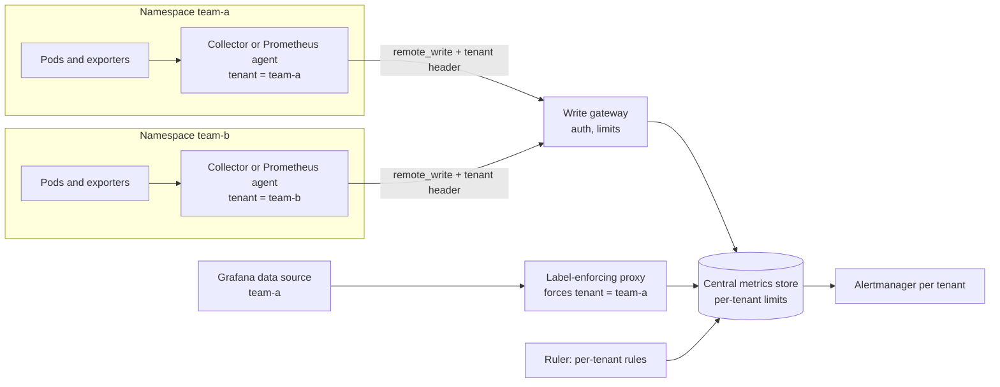

This note describes how to offer Prometheus metrics to many teams on shared GKE infrastructure: how tenant identity is set on the write path, how queries are isolated, how limits protect everyone from one team, and which storage options fit. It leaves the collector and signal pipeline to [[architecture/observability-pipeline-opentelemetry]], the choice between self-managed and Google's offering to [[tools/prometheus-vs-cloud-monitoring]], and alert design to [[patterns/slo-burn-rate-alerting]].

> [!info] Scope and sources
> Written against Prometheus, Thanos, Grafana Mimir, Google Cloud Managed Service for Prometheus and prom-label-proxy as general designs. Limit names, defaults and project status change; check the documentation listed under Sources.

> [!note] Not verified
> Nothing here was run. Check before relying on it: the tenant header name and its configuration in your backend, the current limit names and defaults, whether prom-label-proxy is still maintained and how it handles your query types, and the multi-tenancy model of Managed Service for Prometheus.

## Decision drivers

- **Number of tenants and their size.** A handful of teams with modest volume is a different problem from hundreds of services with high cardinality.
- **Series volume and cardinality.** Cost and stability scale with active series, not with data points. One team can hurt all the others by adding a high-cardinality label.
- **Query isolation.** Must one team be technically unable to read another team's metrics, or is separation by convention enough? Regulated data often needs the first.
- **Retention.** Short for debugging, long for capacity planning and SLO reporting.
- **Who runs it.** A platform team that can operate a distributed storage system, or a managed service that removes that work at a different cost.

## Options

| Option                         | Model                                                                     | Strengths                                           | Costs and risks                                                      |
| ------------------------------ | ------------------------------------------------------------------------- | --------------------------------------------------- | -------------------------------------------------------------------- |
| Federation                     | A central Prometheus scrapes selected series from team Prometheus servers | Simple, no new components                           | Does not scale, loses detail, no real tenant isolation               |
| Thanos                         | Sidecar or receiver, object storage, global query                         | Long-term storage, familiar Prometheus semantics    | Several components; tenancy needs careful configuration              |
| Mimir                          | Horizontally scalable store with native multi-tenancy via a tenant ID     | Per-tenant limits and isolation built in            | A larger system to operate and size                                  |
| Managed Service for Prometheus | Google-managed collection and global storage                              | No storage to run; integrates with Cloud Monitoring | Pricing model by samples, isolation by project and IAM, less control |

There is no universal winner. Federation is acceptable for two or three teams. When teams need hard isolation and per-tenant limits on your own infrastructure, a store with native tenancy is the cleaner fit. When you would rather not operate storage, a managed service is the right trade; [[0042-managed-prometheus-for-application-metrics]] chose Managed Service for Prometheus for application metrics. Do not quote prices from memory; check the current pricing page for the managed option and model the sample volume.

## Architecture



## Tenant identity on the write path

A tenant is the unit of ownership, isolation and limits. Choose it deliberately: one tenant per team or product usually works. One tenant per namespace is finer but multiplies limits and dashboards. Whatever you pick, apply it consistently.

Rules:

- The **collector sets the tenant**, not the application. The application cannot choose its tenant, so a compromised or careless pod cannot write into another tenant.
- Tenant identity comes from where the data was scraped (namespace and the team label enforced by admission policy), then the collector attaches it.
- Remote write carries the tenant in a header, for example `X-Scope-OrgID` in Mimir-style backends. The write gateway authenticates the collector and rejects a tenant header that does not match the credentials.
- Add external labels such as `cluster` and `team` for operators, but do not rely on labels alone for isolation, since they can be overwritten or omitted.

A remote write fragment with a tenant header (the header name and auth options depend on your backend, so check its docs):

```yaml title="prometheus-agent.yaml (fragment)"
global:
  external_labels:
    cluster: gke-prod-ew1
remote_write:
  - url: https://metrics-write.example.com/api/v1/push
    headers:
      X-Scope-OrgID: team-a
    basic_auth:
      username: team-a-writer
      password_file: /etc/prometheus/secrets/write-password
    queue_config:
      max_samples_per_send: 2000
      capacity: 10000
    write_relabel_configs:
      # Drop series the team does not need to ship
      - source_labels: [__name__]
        regex: "go_gc_.*"
        action: drop
```

The credential comes from a mounted secret delivered as in [[architecture/secrets-architecture-gcp-and-gke]]. Each collector instance has its own credential, which is bound to exactly one tenant at the gateway.

## Query path isolation

Reading is where isolation usually fails. If a team can send an arbitrary query to the store, they can read others' data unless the store itself enforces the tenant.

- With native multi-tenancy, the query frontend takes the tenant from the header. Place a proxy in front that sets the header from the authenticated identity, never from the client request.
- With a store that has no tenant concept at query time, use a label-enforcing proxy such as prom-label-proxy, which injects a mandatory label matcher (for example `team="team-a"`) into every query. It must be the only route to the query endpoint: block direct access with network policy, see [[patterns/kubernetes-network-policies]]. Check the project's current status and how it handles every API endpoint you expose, including series, labels and metadata endpoints.
- Create one Grafana data source per tenant, pointing at that tenant's proxy path, and restrict data source permissions by team. Do not give teams admin on Grafana, because an admin can edit data sources.
- Test isolation: a query against another tenant's metric name must return nothing.

## Per-tenant limits and the cardinality budget

A shared store needs limits so one team cannot exhaust it:

- Active series per tenant.
- Ingestion rate and burst per tenant.
- Maximum series returned or samples scanned per query, and query timeouts.
- Label count, label value length and metric name length.

Limit names and defaults vary by product and version, so they are not quoted here; check the current documentation of your backend. Treat the limit as a **cardinality budget** that you allocate to teams, and track usage. The design of the signal pipeline and how to drop and relabel at the collector is in [[architecture/observability-pipeline-opentelemetry]].

Alert on limit use before it bites: warn at a stated percentage of the series budget, and alert when ingestion is being rejected. Tie budget overuse to cost conversations using [[architecture/finops-cost-allocation-and-guardrails]]. The common causes of cardinality growth are unbounded labels such as user ID, request path with IDs, pod name on short-lived jobs, and error messages in labels.

## Rules and alerts per tenant

- Each tenant keeps recording and alerting rules in its own repository path. A ruler evaluates them against that tenant's data only, and routes alerts to that tenant's Alertmanager configuration.
- Validate in CI before merge:

```yaml title=".gitlab-ci.yml (job fragment)"
rules-check:
  stage: test
  image:
    name: prom/prometheus:0.0.0@sha256:0000000000000000000000000000000000000000000000000000000000000000 # placeholder: pin the real version and digest
    entrypoint: [""]
  rules:
    - if: $CI_PIPELINE_SOURCE == "merge_request_event"
  script:
    - promtool check rules rules/*.yaml
    - promtool test rules tests/*.yaml
```

Pin the image by digest in real use. Rules should use shared SLO building blocks, see [[patterns/slo-burn-rate-alerting]], so teams get consistent alerts without copying expressions. Reject rules that select across tenants or without a selective matcher, since expensive queries hurt the shared store.

## Retention tiers

- **Hot:** raw samples for days to weeks for debugging.
- **Downsampled or aggregated:** recording rules or compaction for months, for capacity and SLO reporting.
- **Long-term:** only aggregated SLO series for the compliance period.

Define retention per tenant class, not per team request. Longer retention multiplies storage and query cost, and it is easy to grant and hard to take back.

## Failure modes

| Failure                                | Effect                                                                               | Mitigation                                                                             |
| -------------------------------------- | ------------------------------------------------------------------------------------ | -------------------------------------------------------------------------------------- |
| Noisy neighbour                        | One tenant's cardinality or query load slows or breaks others                        | Per-tenant limits, query limits, budget alerts, relabel drops at the collector         |
| Query proxy outage                     | Dashboards and tenant queries fail; alerting is unaffected if rules run in the store | Two replicas, health checks, separate path for the ruler                               |
| Ingester out of memory                 | Writes rejected or delayed, possible data gap                                        | Active series limits, memory headroom, autoscaling, WAL replay time known              |
| Dropped tenant header                  | Data written to a default tenant or rejected                                         | Gateway rejects a missing tenant, test through every hop, alert on default tenant data |
| A collector holds the wrong credential | Writes land in another team's tenant                                                 | Credential-to-tenant binding at the gateway, unique credentials                        |
| Alertmanager misrouting                | A team gets no pages, or the wrong team does                                         | Per-tenant routing config, a synthetic always-firing alert for each tenant             |

## Pitfalls

- Relying on a `team` label that applications can set themselves.
- Giving Grafana editors the ability to change data source URLs.
- Allowing direct access to the store's query endpoint from developer machines.
- Using one tenant for everything and then trying to bolt on cost allocation.
- Ignoring the cost of remote write: network, collector memory and the store.
- Shipping every metric by default instead of an allowlist of what the team uses.

## Verify

```bash title="verify-tenancy.sh"
#!/usr/bin/env bash
set -euo pipefail

READ="https://metrics-read.example.com"

# 1. A tenant can read its own data (expect series)
curl -sS -G "$READ/team-a/api/v1/query" \
  --data-urlencode 'query=count(up{team="team-a"})'

# 2. The same proxy path must not return another tenant's data
#    (expect an empty result or a 400 rejection, never team-b series)
curl -sS -G "$READ/team-a/api/v1/query" \
  --data-urlencode 'query=count(up{team="team-b"})'

# 3. Forging the tenant header from the client must be ignored or rejected
curl -sS -G "$READ/team-a/api/v1/query" \
  -H 'X-Scope-OrgID: team-b' \
  --data-urlencode 'query=count(up)'

# 4. Rules validate
promtool check rules rules/*.yaml
```

Run these as an automated check after every change to the proxy, gateway or Grafana configuration. Also exercise limits in a test tenant: push beyond the series budget and confirm rejection and the alert.

## Adopt incrementally

1. Decide the tenant model and name the owner of each tenant.
2. Put collectors in front of team Prometheus servers with tenant-aware remote write, keeping the existing setup in place.
3. Add the write gateway and per-tenant limits.
4. Add the query proxy and per-tenant Grafana data sources, then close direct access.
5. Move rules and alerts into per-tenant repositories with CI validation.
6. Add budget dashboards and retention tiers.

## Sources

- Prometheus remote write configuration: https://prometheus.io/docs/prometheus/latest/configuration/configuration/#remote_write
- Prometheus federation: https://prometheus.io/docs/prometheus/latest/federation/
- Grafana Mimir: https://grafana.com/docs/mimir/latest/
- Thanos: https://thanos.io/
- Google Cloud Managed Service for Prometheus: https://cloud.google.com/stackdriver/docs/managed-prometheus
- prom-label-proxy: https://github.com/prometheus-community/prom-label-proxy

Check the current docs for limit names, defaults and project status.

## Related

- [[architecture/observability-pipeline-opentelemetry]]
- [[tools/prometheus-vs-cloud-monitoring]]
- [[architecture/gke-platform-topology-and-tenancy]]
- [[patterns/slo-burn-rate-alerting]]
- [[architecture/finops-cost-allocation-and-guardrails]]
- [[architecture/logging-architecture-gke-and-cloud-logging]]
- [[0042-managed-prometheus-for-application-metrics]]
