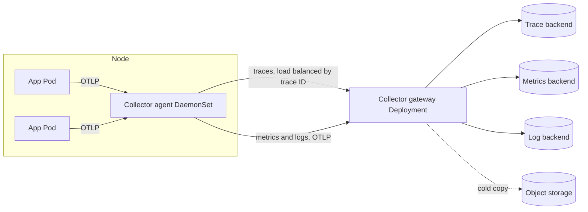

This note describes a target design for sending metrics, logs and traces from services on GKE through OpenTelemetry Collectors to one or more backends. It is written for senior DevOps engineers who own the platform and need to size, sample and pay for telemetry. It leaves the log schema to [[standards/structured-logging-conventions]], alerting maths to [[patterns/slo-burn-rate-alerting]], and mesh-generated telemetry to [[tools/service-mesh-on-gke]].

> [!info] Scope and sources
> Written against the OpenTelemetry Collector and Collector Contrib distributions as documented on opentelemetry.io, and the GKE and Cloud Monitoring documentation on cloud.google.com. The design is backend-neutral. Component names are those in the Contrib distribution.

> [!note] Not verified
> The claims below were written from documentation knowledge and were not checked against a running system or the current docs: processor and exporter names and stability levels in the current Collector release, `loadbalancing` exporter settings, the `tail_sampling` option names, the `transform` processor statement syntax, the names of the Collector's own metrics, and Google Cloud exporter names. Check them before relying on them.

## Goals

- One instrumentation standard (OpenTelemetry SDKs and OTLP) so a backend change does not mean re-instrumenting services.
- Keep telemetry cost proportional to value: sample traces, drop useless attributes, bound metric cardinality, and tier retention.
- Never let the telemetry pipeline take down workloads or lose error traces during an incident.
- Make the pipeline operable: it has its own limits, dashboards and alerts.

## Architecture

Applications send OTLP to a local agent. Agents add Kubernetes metadata, protect themselves with a memory limit, and forward to a gateway. The gateway is the only tier that talks to backends, which keeps credentials, egress rules and sampling decisions in one place.



### Why two tiers

- The agent is cheap and local: it absorbs bursts, enriches data with Pod, namespace and node attributes, and survives a short gateway outage.
- The gateway can scale horizontally and holds the expensive, stateful work: tail sampling, attribute filtering and fan-out to several backends.
- Applications only know one address (the node-local agent), so backend moves are a gateway change.

## Agent tier

Run the agent as a DaemonSet. Applications reach it through the node IP (using the downward API) or a Service with `internalTrafficPolicy: Local`. Keep the agent configuration small. Its job is enrichment, protection and forwarding.

```yaml title="otel-agent.yaml"
receivers:
  otlp:
    protocols:
      grpc:
        endpoint: 0.0.0.0:4317
      http:
        endpoint: 0.0.0.0:4318

processors:
  memory_limiter:
    check_interval: 1s
    limit_mib: 400
    spike_limit_mib: 100
  k8sattributes:
    # Watch only Pods on this node. Set K8S_NODE_NAME from spec.nodeName
    # with the downward API in the DaemonSet.
    filter:
      node_from_env_var: K8S_NODE_NAME
    extract:
      metadata:
        - k8s.namespace.name
        - k8s.pod.name
        - k8s.deployment.name
        - k8s.node.name
  batch: {}

exporters:
  # Traces: every span of one trace must reach the same gateway Pod,
  # otherwise tail sampling sees partial traces.
  loadbalancing:
    routing_key: traceID
    protocol:
      otlp:
        tls:
          ca_file: /certs/ca.crt # change: CA that signed the gateway certificate
          # Pod IPs from the headless Service are dialled, so name the certificate subject.
          server_name_override: otel-gateway.observability.svc
    resolver:
      dns:
        hostname: otel-gateway-headless.observability.svc.cluster.local # change: your gateway headless Service
        port: 4317
  # Metrics and logs: any gateway Pod will do.
  otlp/gateway:
    endpoint: otel-gateway.observability.svc.cluster.local:4317 # change: your gateway Service
    tls:
      ca_file: /certs/ca.crt # change: CA that signed the gateway certificate
      server_name_override: otel-gateway.observability.svc

service:
  pipelines:
    traces:
      receivers: [otlp]
      processors: [memory_limiter, k8sattributes, batch]
      exporters: [loadbalancing]
    metrics:
      receivers: [otlp]
      processors: [memory_limiter, k8sattributes, batch]
      exporters: [otlp/gateway]
    logs:
      receivers: [otlp]
      processors: [memory_limiter, k8sattributes, batch]
      exporters: [otlp/gateway]
```

The `k8sattributes` processor needs RBAC to read Pods and namespaces; give the agent a ServiceAccount with a narrow ClusterRole, not cluster-admin. Container stdout logs can be collected with a `filelog` receiver on the agent, but if you already ship stdout to Cloud Logging, do not collect it twice.

## Gateway tier

The gateway receives OTLP from agents, applies sampling and attribute controls, and exports to backends. Order matters: `memory_limiter` first, `batch` last.

```yaml title="otel-gateway.yaml"
receivers:
  otlp:
    protocols:
      grpc:
        endpoint: 0.0.0.0:4317
        tls:
          cert_file: /certs/tls.crt # from a Secret, for example issued by cert-manager
          key_file: /certs/tls.key

extensions:
  health_check:
    endpoint: 0.0.0.0:13133

processors:
  memory_limiter:
    check_interval: 1s
    limit_mib: 1500 # about 75 percent of the container memory limit
    spike_limit_mib: 300
  # Drop attributes that explode cardinality or carry data you must not store.
  attributes/drop_noise:
    actions:
      - key: http.request.header.x-request-id
        action: delete
      - key: enduser.id
        action: delete
  transform/metric_labels:
    error_mode: ignore
    metric_statements:
      - context: datapoint
        statements:
          - delete_key(attributes, "http.url")
  tail_sampling:
    decision_wait: 10s
    num_traces: 50000
    expected_new_traces_per_sec: 1000
    policies:
      - name: keep-errors
        type: status_code
        status_code:
          status_codes: [ERROR]
      - name: keep-slow
        type: latency
        latency:
          threshold_ms: 1000
      - name: baseline
        type: probabilistic
        probabilistic:
          sampling_percentage: 5
  batch:
    send_batch_size: 8192
    timeout: 5s

exporters:
  otlp/traces:
    endpoint: tempo.example.com:4317 # change: your trace backend OTLP endpoint
    tls:
      insecure: false
  otlp/metrics:
    endpoint: metrics.example.com:4317 # change: your metrics backend OTLP endpoint
    tls:
      insecure: false
  otlp/logs:
    endpoint: logs.example.com:4317 # change: your log backend OTLP endpoint
    tls:
      insecure: false

service:
  extensions: [health_check]
  pipelines:
    traces:
      receivers: [otlp]
      processors: [memory_limiter, attributes/drop_noise, tail_sampling, batch]
      exporters: [otlp/traces]
    metrics:
      receivers: [otlp]
      processors: [memory_limiter, transform/metric_labels, batch]
      exporters: [otlp/metrics]
    logs:
      receivers: [otlp]
      processors: [memory_limiter, attributes/drop_noise, batch]
      exporters: [otlp/logs]
```

Deploy it with explicit requests and limits (see [[patterns/kubernetes-resource-requests-and-limits]]). Tail sampling holds traces in memory for `decision_wait`, so memory scales with trace rate and trace size, not just span rate.

```yaml title="otel-gateway-deployment.yaml"
apiVersion: v1
kind: Service
metadata:
  name: otel-gateway-headless
  namespace: observability
spec:
  clusterIP: None
  selector:
    app: otel-gateway
  ports:
    - name: otlp-grpc
      port: 4317
      targetPort: 4317
---
apiVersion: v1
kind: Service
metadata:
  name: otel-gateway
  namespace: observability
spec:
  selector:
    app: otel-gateway
  ports:
    - name: otlp-grpc
      port: 4317
      targetPort: 4317
---
apiVersion: apps/v1
kind: Deployment
metadata:
  name: otel-gateway
  namespace: observability
spec:
  replicas: 3
  selector:
    matchLabels:
      app: otel-gateway
  template:
    metadata:
      labels:
        app: otel-gateway
    spec:
      containers:
        - name: collector
          # change: pin a released Contrib tag or, better, an image digest
          image: otel/opentelemetry-collector-contrib:REPLACE_WITH_PINNED_TAG
          args: ["--config=/conf/otel-gateway.yaml"]
          ports:
            - containerPort: 4317
              name: otlp-grpc
            - containerPort: 13133
              name: health
          readinessProbe:
            httpGet:
              path: /
              port: 13133
          resources:
            requests:
              cpu: 500m
              memory: 1Gi
            limits:
              memory: 2Gi
          securityContext:
            runAsNonRoot: true
            allowPrivilegeEscalation: false
            readOnlyRootFilesystem: true
            capabilities:
              drop: ["ALL"]
          volumeMounts:
            - name: config
              mountPath: /conf
            - name: tls
              mountPath: /certs
              readOnly: true
      volumes:
        - name: config
          configMap:
            name: otel-gateway-config # change: the key inside must be otel-gateway.yaml
        - name: tls
          secret:
            secretName: otel-gateway-tls # change: Secret with tls.crt and tls.key
```

The agent DaemonSet mounts the CA certificate at `/certs/ca.crt` the same way. If mesh mTLS already secures this traffic, you can instead set `insecure: true` on the agent exporters and restrict access with a NetworkPolicy, but keep that choice consistent with the TLS pitfall below.

The CPU and memory numbers are starting points. Measure under real load and adjust.

## Sampling

### Head sampling

The decision is made when the trace starts, in the SDK (for example a parent-based ratio sampler). It is cheap and needs no state, but it cannot know whether the trace will turn out to be an error or slow.

### Tail sampling

The decision is made after the trace is complete, at the gateway. You can keep all errors, all slow traces and a small baseline. The cost is memory, latency (`decision_wait`) and one hard requirement: all spans of a trace must arrive at the same gateway Pod. That is why the agent uses the `loadbalancing` exporter with `routing_key: traceID` and the gateway exposes a headless Service.

### Practical combination

- SDK: sample nothing out (or a high ratio) so the gateway can decide, unless volume is too high for the gateway.
- Gateway: keep errors and slow traces, plus a small probabilistic baseline.
- Treat a gateway restart as a sampling event: traces in flight are decided on partial data or lost.

## Cardinality and cost controls

- Attributes: delete identifiers with unbounded values (request IDs, user IDs, full URLs with query strings) before export.
- Metrics: a label with unbounded values multiplies time series. Review new labels in code review; drop at the gateway as a safety net, not as a plan.
- Spans: limit span events and attribute sizes in the SDK where supported.
- Logs: do not export debug logs from production by default; exclude health-check noise (see [[standards/structured-logging-conventions]]).
- Budget: track series count, spans per second and log bytes per service, and publish them to teams, because cost allocation drives behaviour.

## Retention tiers

| Tier | Typical content                    | Retention (starting point) | Storage                       | Why                                   |
| ---- | ---------------------------------- | -------------------------- | ----------------------------- | ------------------------------------- |
| Hot  | Metrics at full resolution, traces | Days to a few weeks        | Metrics and trace backend     | Incident response and debugging       |
| Warm | Downsampled metrics, error traces  | Weeks to months            | Backend long-term tier        | SLO reporting and trend analysis      |
| Cold | Raw or aggregated exports, logs    | As long as policy requires | Object storage with lifecycle | Investigations and audit, rarely read |

Retention periods are a business and, for some data, a legal decision. Take them from your data classification, not from this table.

## Backends

The gateway decouples collection from storage. Choose backends per signal.

| Option                                        | Strength                          | Cost to you                              |
| --------------------------------------------- | --------------------------------- | ---------------------------------------- |
| Managed Google Cloud observability            | No storage to run, IAM integrated | Per-volume pricing, query model limits   |
| Self-hosted Prometheus-compatible and tracing | Control, predictable unit cost    | You run, scale, upgrade and back it up   |
| Third-party SaaS                              | Features, less operations         | Per-volume pricing, data leaves your org |

The managed versus self-hosted metrics decision is covered in [[tools/prometheus-vs-cloud-monitoring]]. For Google-managed ingestion, check the current documentation for the supported OTLP endpoint and exporter, rather than copying names from older guides.

## Pitfalls

- Tail sampling without trace-ID-aware routing: sampled traces are missing spans and look broken.
- Gateway with no `memory_limiter`: a traffic spike causes an OOM kill and the loss of all in-flight traces.
- `memory_limiter` set above the container limit: the Pod is killed before the limiter acts.
- A single gateway Pod: every restart is a sampling and delivery gap.
- Collecting stdout logs twice (platform agent plus Collector): double cost.
- Unpinned `latest` image: a Collector upgrade silently renames or removes components.
- Telemetry pipeline not monitored: you find out during the incident that traces stopped an hour earlier.
- Exporting without TLS between tiers because "it is inside the cluster".

## Adopt incrementally

1. Start with traces only, agent plus a single gateway, no sampling beyond a low baseline.
2. Add metrics through the gateway and remove per-service exporters.
3. Turn on tail sampling once the routing exporter works; compare trace counts before and after.
4. Add cardinality controls driven by the cost report.
5. Add logs last, after the schema in [[standards/structured-logging-conventions]] is in place.
6. Add alerts on the pipeline itself.

## Verify

```bash
set -euo pipefail

NAMESPACE="observability"  # change: namespace of the collectors
DEPLOY="otel-gateway"      # change: gateway Deployment name

# Collector logs: look for refused data, export errors and config warnings.
kubectl -n "$NAMESPACE" logs "deploy/$DEPLOY" --tail=100

# Collector self-metrics (port 8888 is the default; confirm for your version).
kubectl -n "$NAMESPACE" port-forward "deploy/$DEPLOY" 8888:8888 &
PF_PID=$!
trap 'kill $PF_PID' EXIT
sleep 2
curl -s http://127.0.0.1:8888/metrics | grep -E 'otelcol_(receiver_accepted|processor_refused|exporter_send_failed)' || true
```

Healthy output shows accepted spans increasing and refused or failed counters at or near zero. Then send a test trace from a service, find it in the backend, and confirm that an error trace is kept and a normal fast trace is sampled at roughly the baseline rate.

## Related

- [[tools/prometheus-vs-cloud-monitoring]]: managed versus self-hosted metrics backends.
- [[standards/structured-logging-conventions]]: the log schema and trace correlation fields.
- [[patterns/slo-burn-rate-alerting]]: alerts built on the metrics this pipeline carries.
- [[tools/service-mesh-on-gke]]: mesh telemetry as another source feeding the pipeline.
- [[patterns/kubernetes-resource-requests-and-limits]]: sizing the collectors safely.
