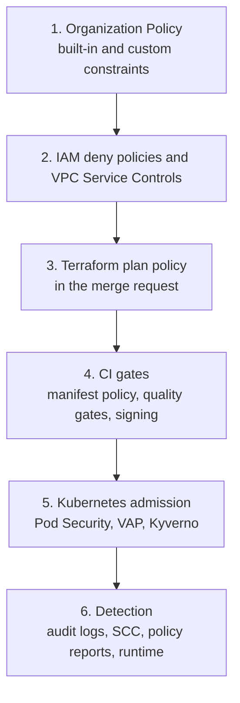

Guardrails on a GCP and GKE platform live in many places: organisation policy, IAM, Terraform plan checks, CI gates, Kubernetes admission and runtime detection. Each layer is documented in its own note; this one is the map. It says which layer should prevent a rule, which layer backs it up, which layer detects what slipped through, and how exceptions and bypass paths are handled across all of them. It is for the platform and security engineers who own policy as code. Rollout mechanics are in [[runbooks/policy-rollout-audit-to-enforce]] and exceptions in [[compliance/policy-exception-and-waiver-process]].

> [!info] Scope and sources
> Organization Policy, custom constraints and IAM deny commands and fields were read from the gcloud reference text and the Org Policy API descriptions. Kubernetes admission (Pod Security admission, ValidatingAdmissionPolicy), Kyverno and Gatekeeper were not checked against their current documentation; this note follows the stance of [[adr/0022-admission-policy-pod-security-vap-and-kyverno]]. The layer placement is design guidance, not product fact. Nothing here was run.

> [!note] Not verified
> Check these before relying on them:
>
> - Organization Policy inheritance and merge rules, propagation delay after a change, tag-conditional policies, and how managed constraints differ from legacy ones.
> - How dry-run (`dryRunSpec`) violations are reported and how to query them.
> - The constraint names for CMEK enforcement (commonly `gcp.restrictNonCmekServices` and `gcp.restrictCmekCryptoKeyProjects`) and whether any managed constraint blocks firewall rules open to `0.0.0.0/0`. Read the constraints list page.
> - IAM deny semantics (deny evaluated before allow, exception principals, the list of permissions that deny supports) and whether the attachment point accepts a project ID as well as a number.
> - ValidatingAdmissionPolicy API version and `validationActions`, Pod Security admission labels and exemption options on GKE, webhook `failurePolicy` defaults, Kyverno's `validationFailureAction` vs per-rule `failureAction` in your version, and the PolicyReport resource names.
> - GKE Policy Controller availability and GKE Autopilot's own admission restrictions.

## Problem

Without a map, the same rule ends up enforced in three places with three different exception lists, or in none because each team assumed another layer had it. Typical symptoms:

- A Terraform plan check blocks public IPs, but the console and `gcloud` do not, so the rule holds only for people who use the pipeline.
- An admission policy blocks privileged pods, but its webhook fails open during an upgrade and nobody notices.
- An exception granted in one layer is forgotten in the next, so the "approved" change still fails, and someone disables the policy to ship.

## Layer model



| Layer                    | Enforced by                     | Bypassable by                           | Sees                                          | Notes                                                                                                                                        |
| ------------------------ | ------------------------------- | --------------------------------------- | --------------------------------------------- | -------------------------------------------------------------------------------------------------------------------------------------------- |
| 1. Organization Policy   | Google Cloud APIs, every caller | Org policy admins only                  | The resource at create or update time         | [[compliance/gcp-organization-policy-guardrails]]; boundaries by folder per [[adr/0024-gcp-folders-by-policy-boundary]]                      |
| 2. IAM deny, VPC-SC      | Google Cloud APIs, every caller | Deny policy admins, perimeter admins    | The principal and permission or the perimeter | [[architecture/zero-trust-access-iap-and-vpc-service-controls]]                                                                              |
| 3. Terraform plan policy | The pipeline                    | Anyone who applies outside the pipeline | The whole planned change, with context        | [[patterns/terraform-plan-policy-checks]], [[adr/0035-terraform-plan-policy-gate-and-ci-only-apply]]                                         |
| 4. CI gates              | The pipeline                    | Anyone who deploys outside the pipeline | Source, manifests, images, test results       | [[patterns/conftest-policy-gate-for-manifests]], [[patterns/sonarqube-quality-gates]], [[patterns/image-signing-and-admission-verification]] |
| 5. Admission             | The cluster API server          | Cluster admins; fail-open webhooks      | The object at admission time                  | [[patterns/pod-security-admission]], [[adr/0022-admission-policy-pod-security-vap-and-kyverno]], [[tools/gatekeeper-vs-kyverno]]             |
| 6. Detection             | Logs and scanners               | Log tampering, disabled logging         | What actually happened                        | [[architecture/threat-detection-and-response-gcp-gke]]                                                                                       |

## Placement rules

1. **Prevent at the earliest layer that has the full context.** A rule about one resource field ("no external IP on VMs") has all its context at layer 1. A rule that needs to compare resources or read intent ("every bucket in this change has an owner label matching the project") needs layer 3.
2. **Back up at the last layer nobody can route around.** Layers 3 and 4 only see changes that go through the pipeline. For any rule whose violation is serious, add a backstop at layer 1, 2 or 5, which every caller passes through.
3. **Detect at layer 6 for everything that matters,** including rules you believe are prevented. Detection tells you when prevention was bypassed, excepted or broken.
4. **Give early feedback where it is cheap.** A plan or CI check that fails in the merge request with a clear message saves a round trip, even when layer 1 would also block the change at apply time.
5. **One owner and one source per rule.** The rule's definition, owner and exceptions live in one place (the rule register below); each layer implements it from there.

## Examples

| Rule                                 | Prevent                                                                                           | Backstop                                                      | Detect                                                  |
| ------------------------------------ | ------------------------------------------------------------------------------------------------- | ------------------------------------------------------------- | ------------------------------------------------------- |
| No external IPs on VMs               | Org policy `compute.vmExternalIpAccess`                                                           | Plan policy for a clear MR message                            | Asset inventory or SCC finding                          |
| No public Cloud SQL                  | Org policy `sql.restrictPublicIp`, `sql.restrictAuthorizedNetworks`                               | Plan policy                                                   | SCC finding                                             |
| No service account keys              | Org policy `iam.disableServiceAccountKeyCreation`, `iam.disableServiceAccountKeyUpload`           | IAM deny on key creation for most principals (check support)  | Audit log detection on key creation                     |
| No default service account grants    | Org policy `iam.automaticIamGrantsForDefaultServiceAccounts`                                      | Plan policy rejecting the default compute SA on nodes and VMs | Audit log on IAM grants to default SAs                  |
| No firewall rule open to `0.0.0.0/0` | Custom constraint on `compute.googleapis.com/Firewall` (check support) or plan policy             | Hierarchical firewall policy deny                             | Audit log detection on firewall changes                 |
| CMEK on data services                | CMEK org policy constraints (check names)                                                         | Plan policy on `kms_key_name` fields                          | Asset inventory query                                   |
| No privileged pods                   | Pod Security admission `restricted` on app namespaces                                             | CI manifest policy for an early message                       | Kyverno policy reports in audit mode, runtime detection |
| Only signed images                   | Kyverno `verifyImages` at admission ([[adr/0038-kyverno-verifies-image-signatures-at-admission]]) | Signing step in CI                                            | Admission audit results, image inventory                |
| Default-deny network policy          | Kyverno generate rule ([[adr/0020-default-deny-network-policies]])                                | CI check that the namespace manifest has it                   | Report of namespaces without the policy                 |
| Code quality and coverage            | SonarQube quality gate in CI                                                                      | Protected branches require the gate                           | Gate history per project                                |

Constraint names in the first column are the full form `constraints/NAME` in the API; `gcloud org-policies` takes them without the prefix.

## Rollout: audit, warn, enforce

Every new rule goes through the same three steps at every layer, so teams see it coming:

| Layer               | Audit                                    | Warn                                 | Enforce              |
| ------------------- | ---------------------------------------- | ------------------------------------ | -------------------- |
| Organization Policy | `dryRunSpec` (audit-only policy)         | Announce and list violating projects | `spec` with the rule |
| Terraform plan      | Policy runs, result reported, job passes | Job passes with a visible warning    | Job fails            |
| CI manifest checks  | Report only                              | Warn in the MR                       | Fail the pipeline    |
| VAP                 | `validationActions: [Audit]`             | `[Warn, Audit]`                      | `[Deny]`             |
| Pod Security        | `audit` label                            | `warn` label                         | `enforce` label      |
| Kyverno             | Audit mode, read policy reports          | Audit mode plus notifications        | Enforce              |

Move a rule to enforce only when its audit results are zero or each remaining violation has an exception. The procedure is [[runbooks/policy-rollout-audit-to-enforce]].

## Exceptions

- One register for all layers: rule, scope (project, folder, namespace, resource), reason, owner, approver and expiry date. The process is [[compliance/policy-exception-and-waiver-process]].
- Each layer implements the exception in its own way (a conditional org policy rule or a policy on a child folder, an exclusion list in the plan policy, a namespace label or a policy exception resource in Kyverno), generated from the register where possible.
- Expired exceptions fail the CI job that renders them, so they cannot silently live on.

## Testing policy as code

- Unit tests for each plan and manifest policy with a passing and a failing fixture ([[patterns/terraform-plan-policy-checks]], [[patterns/conftest-policy-gate-for-manifests]]).
- Kyverno policies tested with its CLI against fixtures in CI; VAP tested in a disposable cluster.
- Org policies and custom constraints tested in a sandbox folder before the organisation, with a create that must fail and one that must succeed.
- Every rule in the register has a test reference. A rule without a test is a hope.

## Bypass paths

| Bypass                                                | Which layers it skips     | Control                                                                                        |
| ----------------------------------------------------- | ------------------------- | ---------------------------------------------------------------------------------------------- |
| Console or `gcloud` changes                           | 3, 4                      | Layer 1 and 2 backstops; no human holds write roles in production; detection                   |
| Break-glass service accounts                          | 3, 4, sometimes 2         | Just-in-time access, every use alerts, codify or revert afterwards                             |
| Org policy admins changing the policy                 | 1                         | Few admins, policies in Terraform, alert on policy changes in audit logs                       |
| Admission webhook failing open                        | 5 (webhook-based engines) | `failurePolicy` chosen deliberately, engine HA, alert on webhook errors and policy report gaps |
| Webhook certificate expiry                            | 5                         | Certificate monitoring and the runbook [[runbooks/admission-webhook-certificate-expiry]]       |
| Excluded namespaces (`kube-system`, the engine's own) | 5                         | Keep exclusions minimal, restrict who can create pods there                                    |

> [!warning] Fail-closed vs fail-open webhooks
> A webhook with `failurePolicy: Fail` blocks every matching request when the policy engine is down, which can stop deployments and even cluster upgrades. `Ignore` keeps the cluster working and silently skips the policy. Choose per policy: fail closed for the few rules that must never be skipped (image signatures in production), fail open with detection for the rest, and always exclude the engine's own namespace to avoid a deadlock. Built-in mechanisms (Pod Security admission, VAP) do not depend on a webhook.

## Measuring

- Coverage: for each rule in the register, which layers implement it, and whether its backstop exists.
- Violations in audit mode per rule and per team, trending down before enforcement.
- Exceptions: count, age and how many are past expiry.
- Bypass events: break-glass uses, policy changes, webhook failures.

## Pitfalls

- Enforcing in CI only, then discovering the console path in an incident review.
- An org policy enforced at the organisation with no tested dry-run, breaking a forgotten pipeline.
- Different exception lists per layer, kept by hand.
- Policy messages that say "denied" without the rule, the reason and the exception link.
- Treating detection findings as the security team's work instead of the resource owner's.

## Verify

```bash title="verify-guardrails.sh"
#!/usr/bin/env bash
set -euo pipefail

ORG_ID="123456789012"           # change: organisation ID
PROJECT="team-a-prod"           # change: a production project
PROJECT_NUMBER="210987654321"   # change: its project number

# Org policies set on the project, including unset constraints for comparison
gcloud org-policies list --project="$PROJECT" --show-unset

# The effective policy for one constraint, after inheritance
gcloud org-policies describe compute.vmExternalIpAccess --project="$PROJECT" --effective

# Custom constraints defined at the organisation
gcloud org-policies list-custom-constraints --organization="$ORG_ID"

# IAM deny policies attached to the project
gcloud iam policies list \
  --attachment-point="cloudresourcemanager.googleapis.com/projects/${PROJECT_NUMBER}" \
  --kind=denypolicies
```

```bash title="verify-admission.sh"
#!/usr/bin/env bash
set -euo pipefail

NAMESPACE="team-a"   # change: an application namespace

# Pod Security labels on the namespace: expect enforce, audit and warn set to restricted
kubectl get namespace "$NAMESPACE" --show-labels

# Built-in admission policies and their bindings (resource names depend on the installed API versions)
kubectl get validatingadmissionpolicies
kubectl get validatingadmissionpolicybindings

# Webhooks and their failure policies
kubectl get validatingwebhookconfigurations \
  -o 'custom-columns=NAME:.metadata.name,FAILURE:.webhooks[*].failurePolicy'

# Kyverno results in audit mode
kubectl get policyreports -A
kubectl get clusterpolicyreports
```

Then test each layer with a change that must fail: a Terraform change adding an external IP (plan policy fails), the same through `gcloud` in a sandbox project (org policy refuses it), and a privileged pod in an application namespace (admission rejects it). Expected: each fails with a message naming the rule.

## Adopt incrementally

1. Write the rule register with the rules you already enforce somewhere, and fill in the layer columns honestly.
2. Add layer 1 backstops for the rules that are pipeline-only today, in dry-run first.
3. Put Pod Security admission on every application namespace, `warn` and `audit` before `enforce`.
4. Generate exceptions from the register for at least one layer.
5. Add detection for each rule whose violation would be serious, and review coverage quarterly.

## Sources

Official documentation this note was not checked against; verify there:

- [Organization Policy overview](https://cloud.google.com/resource-manager/docs/organization-policy/overview)
- [Custom constraints](https://cloud.google.com/resource-manager/docs/organization-policy/creating-managing-custom-constraints)
- [Organization policy constraints list](https://cloud.google.com/resource-manager/docs/organization-policy/org-policy-constraints)
- [IAM deny policies](https://cloud.google.com/iam/docs/deny-overview)
- [ValidatingAdmissionPolicy](https://kubernetes.io/docs/reference/access-authn-authz/validating-admission-policy/)
- [Pod Security admission](https://kubernetes.io/docs/concepts/security/pod-security-admission/)
- [Kyverno documentation](https://kyverno.io/docs/)

## Related

- [[compliance/gcp-organization-policy-guardrails]]
- [[patterns/terraform-plan-policy-checks]]
- [[patterns/conftest-policy-gate-for-manifests]]
- [[patterns/image-signing-and-admission-verification]]
- [[patterns/pod-security-admission]]
- [[runbooks/policy-rollout-audit-to-enforce]]
- [[compliance/policy-exception-and-waiver-process]]
- [[architecture/infrastructure-delivery-terraform-pipelines-and-drift]]
