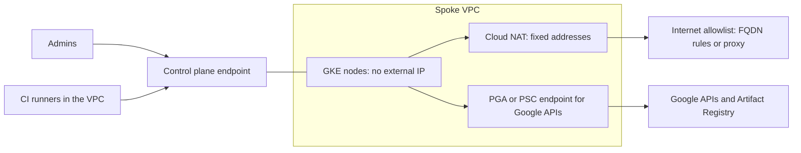

This note covers how to run GKE clusters whose nodes have no public IP addresses, how admins and CI reach the control plane, and how to let workloads call out only to destinations you approved. It is written for senior DevOps engineers. Traffic rules inside the cluster stay in [[patterns/kubernetes-network-policies]]; subnet and address planning is in [[architecture/shared-vpc-hub-and-spoke]]; identity-based access to admin endpoints is in [[architecture/zero-trust-access-iap-and-vpc-service-controls]].

> [!info] Scope and sources
> Written against the GKE private cluster, Cloud NAT, Private Google Access and Private Service Connect documentation on cloud.google.com, as understood in October 2026. Terraform examples use the `google` provider.

> [!note] Not verified
> The claims below were written from documentation knowledge and were not checked against a running system or the current docs: whether GKE's newer DNS-based control-plane endpoint changes the recommended setup, the availability of FQDN firewall objects and Secure Web Proxy, Cloud NAT port-allocation defaults, and the exact gcloud flag names. Check them before relying on them.

## Threats and goals

- A compromised Pod must not be able to reach arbitrary internet hosts to exfiltrate data or download tools.
- Nodes must not be reachable from the internet, so a vulnerable node agent is not an entry point.
- The Kubernetes API must be reachable only from known networks or identities.
- Image pulls and Google API calls must keep working without opening general egress.
- Outbound traffic must leave from known, stable addresses so partners can allowlist them.

## Design



Three paths leave the nodes. Google APIs and Artifact Registry go through Private Google Access (PGA) or a Private Service Connect (PSC) endpoint and never touch the internet. Everything else goes through Cloud NAT and is filtered by an allowlist. The control plane is a fourth path, in the other direction.

## Creating the cluster

The gcloud form is quick to read; the Terraform form is what you commit. Flags and defaults change, so confirm them with `gcloud container clusters create --help`.

```bash
set -euo pipefail

PROJECT_ID="team-a-prod"                         # change: service project ID
HOST_PROJECT="net-prod-host"                     # change: Shared VPC host project
REGION="europe-west1"                            # change: your region
CLUSTER="prod-1"                                 # change: cluster name
NETWORK="projects/${HOST_PROJECT}/global/networks/prod"          # change: your VPC
SUBNET="projects/${HOST_PROJECT}/regions/${REGION}/subnetworks/gke-prod-europe-west1"  # change
MASTER_CIDR="172.16.0.32/28"                     # change: unused /28 from the IP plan
ADMIN_CIDR="203.0.113.0/24"                      # change: office or VPN range (documentation range)

gcloud container clusters create "$CLUSTER" \
  --project "$PROJECT_ID" \
  --region "$REGION" \
  --network "$NETWORK" \
  --subnetwork "$SUBNET" \
  --cluster-secondary-range-name pods \
  --services-secondary-range-name services \
  --enable-ip-alias \
  --enable-private-nodes \
  --master-ipv4-cidr "$MASTER_CIDR" \
  --enable-master-authorized-networks \
  --master-authorized-networks "$ADMIN_CIDR" \
  --workload-pool "${PROJECT_ID}.svc.id.goog" \
  --enable-shielded-nodes
```

```hcl title="gke/cluster.tf"
resource "google_container_cluster" "prod" {
  project  = "team-a-prod" # change: service project ID
  name     = "prod-1"
  location = "europe-west1" # change: your region

  network    = "projects/net-prod-host/global/networks/prod" # change
  subnetwork = "projects/net-prod-host/regions/europe-west1/subnetworks/gke-prod-europe-west1" # change

  remove_default_node_pool = true
  initial_node_count       = 1
  deletion_protection      = true

  ip_allocation_policy {
    cluster_secondary_range_name  = "pods"
    services_secondary_range_name = "services"
  }

  private_cluster_config {
    enable_private_nodes    = true
    enable_private_endpoint = false # true: no public endpoint at all, see the next section
    master_ipv4_cidr_block  = "172.16.0.32/28" # change: unused /28 from the IP plan
  }

  master_authorized_networks_config {
    cidr_blocks {
      cidr_block   = "203.0.113.0/24" # change: office or VPN range
      display_name = "office-vpn"
    }
  }

  workload_identity_config {
    workload_pool = "team-a-prod.svc.id.goog" # change: PROJECT_ID.svc.id.goog
  }
}
```

## Reaching the control plane from CI

You have three realistic options, and the right one depends on where your runners live.

| Option                                        | How it works                                                 | Trade-off                                                                  |
| --------------------------------------------- | ------------------------------------------------------------ | -------------------------------------------------------------------------- |
| Runner inside the VPC (or a peered network)   | Runner talks to the private endpoint directly                | Best control; you operate the runners ([[patterns/gitlab-runners-on-gke]]) |
| Public endpoint with authorised networks      | Runner NAT addresses are on the authorised list              | Simple; the endpoint is still on the internet, protected by the allowlist  |
| IAP tunnel or bastion to the private endpoint | CI opens a tunnel through IAP to a small proxy VM in the VPC | Extra moving part; works from SaaS runners                                 |

With `enable_private_endpoint = true` the public endpoint disappears. That is the strongest setting, and it breaks SaaS-hosted runners, any laptop outside the VPN and some third-party tools. Prefer GitOps ([[adr/0001-gitops-with-argocd]]): the cluster pulls from Git, so CI never needs Kubernetes API access.

## Cloud NAT

Cloud NAT gives private nodes outbound access through addresses you control. Reserve static addresses if partners must allowlist you.

```hcl title="gke/nat.tf"
resource "google_compute_address" "nat" {
  count   = 2
  project = "net-prod-host" # change: host project
  name    = "nat-prod-europe-west1-${count.index}"
  region  = "europe-west1" # change: your region
}

resource "google_compute_router" "prod" {
  project = "net-prod-host" # change: host project
  name    = "router-prod-europe-west1"
  region  = "europe-west1" # change: your region
  network = "projects/net-prod-host/global/networks/prod" # change
}

resource "google_compute_router_nat" "prod" {
  project = "net-prod-host" # change: host project
  name    = "nat-prod-europe-west1"
  router  = google_compute_router.prod.name
  region  = google_compute_router.prod.region

  nat_ip_allocate_option = "MANUAL_ONLY"
  nat_ips                = google_compute_address.nat[*].self_link

  source_subnetwork_ip_ranges_to_nat = "LIST_OF_SUBNETWORKS"

  subnetwork {
    name                    = "projects/net-prod-host/regions/europe-west1/subnetworks/gke-prod-europe-west1" # change
    source_ip_ranges_to_nat = ["ALL_IP_RANGES"]
  }

  min_ports_per_vm                    = 256
  enable_endpoint_independent_mapping = false

  log_config {
    enable = true
    filter = "ERRORS_ONLY"
  }
}
```

Keep NAT logging on at least for errors: it is the only way to see port exhaustion and dropped connections. Port allocation defaults and the effect of dynamic port allocation are version-dependent; read the current Cloud NAT port documentation before tuning `min_ports_per_vm`.

## Google APIs without public egress

Nodes with private IPs reach Google APIs when the subnet has `private_ip_google_access = true` (set in [[architecture/shared-vpc-hub-and-spoke]]). That covers Artifact Registry, Cloud Logging and Cloud Monitoring. For tighter control, point API traffic at a Google-provided virtual IP range instead of the default endpoints:

- `private.googleapis.com` resolves to a range that serves most Google APIs. Use it when you need private routing but also use APIs that are not covered by VPC Service Controls.
- `restricted.googleapis.com` resolves to a range that serves only APIs supported by VPC Service Controls. Use it together with the perimeters in [[architecture/zero-trust-access-iap-and-vpc-service-controls]].

You make traffic use these ranges with a private DNS zone, described in [[architecture/cloud-dns-hybrid-and-multi-project]]. Private Service Connect endpoints for Google APIs are an alternative that gives the API an address in your own range; check the current PSC documentation for supported bundles and DNS setup.

## Egress allowlist options

| Concern         | Cloud NAT only                   | VPC firewall with FQDN rules                        | Secure Web Proxy or own proxy            |
| --------------- | -------------------------------- | --------------------------------------------------- | ---------------------------------------- |
| What it filters | Nothing; it translates addresses | Egress by destination name, per network or policy   | HTTP(S) by host, URL pattern or identity |
| Layer           | 3 and 4                          | 3 and 4 with name resolution                        | 7                                        |
| Effort          | Low                              | Medium; names must be maintained                    | High; certificates, routing, capacity    |
| Visibility      | Connection logs                  | Firewall logs                                       | Request logs with host and path          |
| Good for        | Stable source addresses          | Deny-by-default with a short list of known services | Strict control, audit of what Pods call  |
| Availability    | Generally available              | Check current docs                                  | Check current docs                       |

A practical sequence: start with an egress deny rule at low priority and an allow rule for the node range to the PGA/PSC addresses and the NAT-bound internet, run with logging, build the allowlist from what the logs show, then switch the broad allow to a list. For HTTP(S) allowlisting by hostname, put a proxy in the hub and set `HTTPS_PROXY` through your Helm values ([[patterns/helm-chart-conventions]]).

## Verify

```bash
set -euo pipefail

PROJECT_ID="team-a-prod"   # change: service project ID
CLUSTER="prod-1"           # change: cluster name

# Nodes must have no external address: the output should be empty.
gcloud compute instances list \
  --project "$PROJECT_ID" \
  --filter "name~^gke-${CLUSTER}" \
  --format "value(name,networkInterfaces[].accessConfigs[].natIP)" \
  | awk 'NF > 1'

# Control plane settings.
gcloud container clusters describe "$CLUSTER" \
  --project "$PROJECT_ID" --region europe-west1 \
  --format "yaml(privateClusterConfig,masterAuthorizedNetworksConfig)"

# Egress from a Pod leaves from a NAT address. Image is an example: pin by digest in real use.
kubectl run egress-check --rm -it --restart=Never \
  --image=curlimages/curl:8.10.1 -- curl -sS https://ifconfig.me
```

Expected: the first command prints nothing, the second shows `enablePrivateNodes: true`, and the third prints one of your reserved NAT addresses. Once the allowlist is enforced, the same Pod must fail to reach a host that is not on it.

## Pitfalls

- **Private endpoint breaking SaaS runners.** Hosted CI runners have no route to a private endpoint. Move deploys to GitOps, use runners in the VPC, or keep a public endpoint with authorised networks.
- **Image pulls failing.** Without PGA or a PSC endpoint, nodes cannot reach Artifact Registry, and Pods stay in `ImagePullBackOff`. Third-party registries (Docker Hub, Quay) need NAT and an allowlist entry, or a mirror in Artifactory ([[patterns/artifact-promotion-artifactory]]).
- **NAT port exhaustion.** Many connections to the same destination from few nodes can use up ports; symptoms are random timeouts and NAT error logs. Add NAT addresses, raise minimum ports, or reduce connection churn.
- **Overlapping control-plane CIDR.** The `/28` for the control plane must not overlap any range you route. Reserve it in the IP plan.
- **Authorised networks drift.** CI NAT addresses or VPN ranges change and nobody updates the list. Manage it in Terraform and review it during cluster upgrades ([[runbooks/gke-cluster-upgrade]]).

## Adopt it incrementally

1. Enable PGA on all subnets and NAT with logging; do not filter yet.
2. Make new clusters private-node by default; existing clusters usually need to be recreated, because private nodes are a creation-time choice in many cases (check current docs).
3. Restrict the control plane with authorised networks.
4. Turn on egress logging, build the allowlist, then enforce it namespace by namespace.
5. Add the proxy or FQDN rules last, once you know what workloads call.

## Related

- [[architecture/shared-vpc-hub-and-spoke]]: the VPC, subnets and ranges these clusters use.
- [[architecture/zero-trust-access-iap-and-vpc-service-controls]]: who may reach admin endpoints and where API data may flow.
- [[patterns/gitlab-runners-on-gke]]: runners that can reach a private control plane.
- [[patterns/kubernetes-network-policies]]: egress rules inside the cluster.
- [[runbooks/gke-cluster-upgrade]]: upgrades with private nodes and authorised networks.
- [[runbooks/network-troubleshooting-dns-mtu-tls-load-balancers]]: debugging when traffic does not flow.
