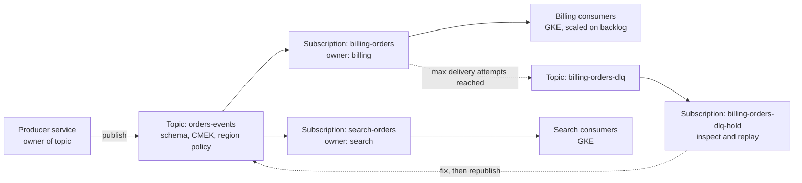

This note describes how to run asynchronous messaging on Pub/Sub for services on GKE: who owns topics and subscriptions, what delivery guarantees you actually get, how to make consumers safe under redelivery, how retries and dead-letter topics work, how to replay, how to scale consumers on backlog, and what to alert on. It is for platform and service engineers who are about to put a queue between two services and want the failure behaviour designed rather than discovered. Synchronous call patterns (timeouts, retries, load shedding) are in [[patterns/timeouts-retries-load-shedding]], and pod autoscaling in general in [[patterns/kubernetes-autoscaling]].

> [!info] Scope and sources
> Flags, field ranges and defaults for subscriptions, dead-letter and retry policies, snapshots and seek were read from the gcloud reference text and the Pub/Sub v1 API field descriptions. Monitoring metric names, the GKE external-metrics tutorial, KEDA scaler details (the `gcp-pubsub` deprecation is recorded in [[tools/keda-vs-hpa-external-metrics]]), quotas and prices were not checked against the current documentation; the pages under Sources are authoritative. Nothing here was run.

> [!note] Not verified
> Check these before relying on them:
>
> - That delivery is at-least-once by default. The API text implies it (retries, redelivery, dead letters may repeat) but the statement was not read on the subscription overview page.
> - The scope of exactly-once delivery: which subscription types, regional requirements and client library versions it needs.
> - Ordering: per-key throughput, what happens to later messages for a key after a failure, and whether regional endpoints are required.
> - The extra role the Pub/Sub service agent needs on the source subscription for dead lettering (commonly `roles/pubsub.subscriber`), and the role names for publish and subscribe (commonly `roles/pubsub.publisher` and `roles/pubsub.subscriber`).
> - Cloud Monitoring metric names (commonly `subscription/oldest_unacked_message_age`, `subscription/num_undelivered_messages`, `subscription/dead_letter_message_count`).
> - The HPA external metric name and selector in the GKE tutorial, and the KEDA scaler parameters and authentication (see [[tools/keda-vs-hpa-external-metrics]]).
> - Snapshot expiry, seek granularity, maximum message and attribute sizes, publish batch limits, quotas and prices.
> - Push endpoint requirements and push backoff behaviour; BigQuery and Cloud Storage subscription failure handling.
> - Multi-region behaviour: that Pub/Sub is served globally, how consumers in several regions share a subscription, and failover between regions.
> - Terraform `google` provider argument names in the sketch, including the empty `ttl` meaning "never expire".

## When to use async messaging

Use a topic when the producer must not wait for the consumer: work that can happen later (emails, indexing, exports), fan-out to several independent consumers, absorbing bursts larger than the consumer can handle, or decoupling deploys and outages between teams.

Do not use it when the caller needs the result to continue, when strict global ordering across all messages is required, or when you only want a retry around a synchronous call. A queue adds a second place for state, new failure modes (duplicates, poison messages, backlog) and harder debugging.

## Topology



- **One topic per event type, owned by the producer.** The producer owns the schema, the retention and who may publish.
- **One subscription per consuming service, owned by the consumer.** Each consumer gets every message independently; one slow consumer does not delay another. Never share a subscription between two different services: they would split the messages between them.
- **A dead-letter topic per subscription,** owned by the consumer, with its own hold subscription. A dead-letter topic with no subscription loses messages: the API text warns that messages published to a topic with no subscriptions are lost.

## Ownership, projects and IAM

- Topics live in the producer's project, subscriptions in the consumer's project. Cross-project is normal: `gcloud pubsub subscriptions create --topic=TOPIC --topic-project=PRODUCER_PROJECT`.
- Environments never share topics ([[architecture/environment-separation-on-gcp]]); a non-production consumer subscribing to a production topic is a data leak.
- Grant publish on the topic to the producer's Google service account and subscribe on the subscription to the consumer's, reached from pods through [[patterns/gke-workload-identity]]. Grant at the topic or subscription, not on the project.
- For dead lettering, the Pub/Sub service agent of the subscription's project (`service-PROJECT_NUMBER@gcp-sa-pubsub.iam.gserviceaccount.com`) must be able to publish to the dead-letter topic; check the handling-failures page for the second permission it needs on the subscription.

## Delivery semantics and idempotency

- Treat delivery as **at least once**: a message can arrive more than once, for example after an ack deadline expires, a consumer crashes before acking, or a retry is triggered.
- **Exactly-once delivery** (`--enable-exactly-once-delivery`) guarantees, per the API text, that a message is not resent before its ack deadline expires and that an acknowledged message is not resent. It does not remove duplicates the publisher created: a message published twice has two `message_id` values. Application idempotency is still required.
- **Ordering keys.** With `--enable-message-ordering` on the subscription and an `orderingKey` set by the publisher, messages with the same key are delivered in the order Pub/Sub received them. All messages in one publish request must share a key. Use a narrow key (an order ID, not a tenant ID) so one slow key does not hold back unrelated work, and accept that ordering lowers throughput.

Idempotent consumer patterns, cheapest first:

1. **Natural idempotency.** "Set status to SHIPPED" is safe to repeat; "add 10 to the balance" is not. Design events as states or facts with versions.
2. **Dedupe on a business key.** Store the event ID (a producer-generated ID in an attribute, not only `message_id`) with a unique constraint in the same transaction as the effect.
3. **Version check.** Apply an update only if the event's version is newer than the stored one; this also handles reordering without ordering keys.

Ack only after the effect is durable. Acking first and processing second turns every crash into data loss.

## Subscription types

| Type                 | How it works                                                                                       | Use for                                                  |
| -------------------- | -------------------------------------------------------------------------------------------------- | -------------------------------------------------------- |
| Pull (StreamingPull) | Consumers open streams and ack messages; the default type                                          | GKE consumers; full control of flow and acks             |
| Push                 | Pub/Sub sends HTTPS requests to an endpoint, with an OIDC token from `--push-auth-service-account` | Serverless consumers; the endpoint must verify the token |
| BigQuery             | Writes messages to a table (`--bigquery-table`)                                                    | Analytics sinks without a consumer service               |
| Cloud Storage        | Writes batches of messages to a bucket (`--cloud-storage-bucket`)                                  | Archives and batch exports                               |

For GKE, prefer pull with the client library's flow control, so a pod takes only what it can process.

## Retries and dead letters

| Setting                                  | gcloud flag                                          | Range and default (API text)                                                 |
| ---------------------------------------- | ---------------------------------------------------- | ---------------------------------------------------------------------------- |
| Ack deadline                             | `--ack-deadline`                                     | 10 to 600 seconds; 10 seconds if unset                                       |
| Retry backoff                            | `--min-retry-delay`, `--max-retry-delay`             | 0 to 600 seconds each; defaults 10 and 600 seconds; exponential, best effort |
| Max delivery attempts before dead letter | `--max-delivery-attempts` with `--dead-letter-topic` | 5 to 100; default 5                                                          |
| Backlog retention                        | `--message-retention-duration`                       | 10 minutes to 31 days; default 7 days                                        |
| Subscription expiry when idle            | `--expiration-period`                                | Default 31 days, minimum 1 day; `never` disables expiry                      |

How they interact:

- The ack deadline is the time a consumer has before Pub/Sub may redeliver. Client libraries can extend it while a message is being processed; for long work, extend explicitly or split the work.
- A nack is a deadline modification to 0. Each nack or expired deadline counts as a delivery attempt; after `max-delivery-attempts`, the message goes to the dead-letter topic, best effort (the same message may be dead-lettered more than once).
- Without a retry policy, a nacked message can come back almost immediately (check the handling-failures page), which turns one poison message into a hot loop. Always set a retry policy on subscriptions that nack.
- Set an idle expiry of `never` on production subscriptions: a subscription that expires during a long outage of the consumer silently stops receiving messages.

> [!warning] A dead-letter topic is only as good as its permissions and its subscription
> If the service agent cannot publish to the dead-letter topic, or the topic has no subscription, failed messages are not preserved. Test dead lettering in each environment with a deliberately bad message.

## Schemas and versioning

Attach a schema to the topic (`--schema` with `--message-encoding=json|binary`, and a revision range with `--first-revision-id` and `--last-revision-id`) so publishers cannot send malformed messages. Evolve messages the way you evolve database schemas ([[patterns/postgres-expand-contract-migrations]]): add optional fields first, upgrade consumers, then start publishing them; never remove or repurpose a field consumers still read. Use message attributes for routing data (`--message-filter` applies to attributes only), and keep the payload for the event.

Topic encryption with a customer-managed key (`--topic-encryption-key`) and region pinning (`--message-storage-policy-allowed-regions`) are set on the topic; see [[patterns/cloud-kms-key-management]].

## Backlog autoscaling

Scale consumers on work waiting, not on CPU: a consumer blocked on a slow database has low CPU and a growing backlog.

- **HPA on an external metric** through a Cloud Monitoring metrics adapter, as in the GKE autoscaling-metrics tutorial, targeting undelivered messages per pod.
- **KEDA** with the `prometheus` scaler against Managed Service for Prometheus, querying the subscription backlog; it can scale to zero. KEDA's own `gcp-pubsub` scaler is deprecated, so do not adopt it for new work. [[tools/keda-vs-hpa-external-metrics]] compares the two options and gives manifests for both.

Keep `minReplicaCount` above zero for latency-sensitive consumers and use zero only for batch-like work. Bound `maxReplicaCount` by what the downstream can take: scaling consumers to clear a backlog can exhaust database connections ([[architecture/cloud-sql-postgres-platform-architecture]]). Pair scaling with a PodDisruptionBudget and graceful shutdown that stops pulling, finishes in-flight messages and then exits ([[patterns/pod-disruption-budgets-for-stateless-services]], [[patterns/zero-downtime-deployments-kubernetes]]).

## Replay

- **Seek to a time.** `gcloud pubsub subscriptions seek SUB --time=TIME` marks messages published before the time as acknowledged and retained messages published after it as unacknowledged. Seeking back over acked messages needs `--retain-acked-messages` on the subscription or message retention on the topic, within the retention window.
- **Snapshots.** `gcloud pubsub snapshots create SNAP --subscription=SUB` captures the unacked backlog and later messages; take one before deploying a risky consumer change, and `seek --snapshot=SNAP` to reprocess if the change mishandled messages.
- **Dead-letter replay.** Fix the cause, then republish messages from the hold subscription to the original topic with a small tool that preserves attributes and the event ID. Replay depends on idempotent consumers.

Replay is also a recovery tool for data bugs; record the retention you rely on in the DR plan ([[architecture/disaster-recovery-tiers-rpo-rto]]).

## Observability

Alert on, per subscription:

- **Oldest unacked message age** above the business tolerance: the best single signal that consumers are stuck. Define an SLO on it ([[patterns/slo-burn-rate-alerting]]).
- **Undelivered messages** growing for longer than the autoscaler needs to react.
- **Dead-lettered messages** above zero in production, routed to the consumer's owner.
- Publish errors on the producer side.

Propagate trace context in message attributes so a trace continues from producer to consumer ([[architecture/observability-pipeline-opentelemetry]]). Pick the metric names from the Pub/Sub monitoring page.

## Multi-region

Pub/Sub is commonly described as a global service; message storage can be pinned to regions with a storage policy. Consumers in two regions can pull from the same subscription, which spreads work but does not give regional isolation. For active-active designs ([[architecture/multi-region-gke-active-active]]), decide whether each region has its own subscription (each processes everything: needs idempotent, region-aware effects) or shares one (work is split). Ordering and exactly-once behaviour across regions must be checked in the docs.

## Terraform sketch

Argument names follow the `google` provider as commonly documented; check them against the provider docs for your pinned version.

```hcl title="pubsub/billing.tf"
data "google_project" "consumer" {
  project_id = "team-billing-prod" # change: consumer project
}

resource "google_pubsub_topic" "billing_dlq" {
  project = data.google_project.consumer.project_id
  name    = "billing-orders-dlq"
}

resource "google_pubsub_subscription" "billing_dlq_hold" {
  project                    = data.google_project.consumer.project_id
  name                       = "billing-orders-dlq-hold"
  topic                      = google_pubsub_topic.billing_dlq.id
  message_retention_duration = "604800s" # 7 days
  expiration_policy {
    ttl = "" # never expire
  }
}

resource "google_pubsub_subscription" "billing_orders" {
  project              = data.google_project.consumer.project_id
  name                 = "billing-orders"
  topic                = "projects/team-orders-prod/topics/orders-events" # change: producer topic
  ack_deadline_seconds = 60

  expiration_policy {
    ttl = "" # never expire
  }

  retry_policy {
    minimum_backoff = "10s"
    maximum_backoff = "600s"
  }

  dead_letter_policy {
    dead_letter_topic     = google_pubsub_topic.billing_dlq.id
    max_delivery_attempts = 10
  }
}

locals {
  pubsub_agent = "serviceAccount:service-${data.google_project.consumer.number}@gcp-sa-pubsub.iam.gserviceaccount.com"
}

resource "google_pubsub_topic_iam_member" "dlq_publish" {
  project = google_pubsub_topic.billing_dlq.project
  topic   = google_pubsub_topic.billing_dlq.name
  role    = "roles/pubsub.publisher"
  member  = local.pubsub_agent
}

resource "google_pubsub_subscription_iam_member" "agent_subscribe" {
  project      = google_pubsub_subscription.billing_orders.project
  subscription = google_pubsub_subscription.billing_orders.name
  role         = "roles/pubsub.subscriber" # check the handling-failures page
  member       = local.pubsub_agent
}

resource "google_pubsub_subscription_iam_member" "consumer" {
  project      = google_pubsub_subscription.billing_orders.project
  subscription = google_pubsub_subscription.billing_orders.name
  role         = "roles/pubsub.subscriber"
  member       = "serviceAccount:billing-consumer@team-billing-prod.iam.gserviceaccount.com" # change
}
```

## Failure modes

| Failure                             | Effect                                                         | Mitigation                                                                   |
| ----------------------------------- | -------------------------------------------------------------- | ---------------------------------------------------------------------------- |
| Poison message                      | Redelivered until dead-lettered; hot loop without retry policy | Retry policy, dead-letter topic, alert on dead letters                       |
| Ack before processing               | Crash loses the message                                        | Ack after the effect is durable                                              |
| Processing longer than the deadline | Duplicate processing in parallel                               | Extend deadlines, bound work per message, idempotency                        |
| Redelivery storm after an outage    | Backlog floods consumers and downstreams                       | Bounded autoscaling, flow control, load shedding downstream                  |
| Subscription expired                | Messages silently not delivered to that consumer               | `expiration_policy` never; alert on missing subscriptions in Terraform drift |
| Dead-letter permissions missing     | Failed messages not preserved                                  | Grant the service agent; test with a bad message                             |
| Duplicate publishes                 | Duplicate effects                                              | Producer event IDs, consumer dedupe                                          |

## Pitfalls

- Two services sharing one subscription, each getting half of the messages.
- Using `gcloud pubsub subscriptions pull --auto-ack` on a production subscription to "have a look", acknowledging real messages.
- Large payloads in messages instead of a reference to an object in Cloud Storage; check the size limit on the quotas page.
- Unbounded consumer autoscaling that moves the bottleneck to the database.
- Relying on ordering keys for correctness across keys.

## Verify

```bash title="verify-pubsub.sh"
#!/usr/bin/env bash
set -euo pipefail

PROJECT="team-billing-sandbox"       # change: a NON-production project
TOPIC="orders-events-test"           # change
SUB="billing-orders-test"            # change
DLQ_SUB="billing-orders-test-dlq-hold" # change

# Configuration: expect deadLetterPolicy, retryPolicy and no expiration
gcloud pubsub subscriptions describe "$SUB" --project "$PROJECT" \
  --format="yaml(ackDeadlineSeconds,deadLetterPolicy,retryPolicy,expirationPolicy,messageRetentionDuration)"

# Round trip in a sandbox: publish, then pull with ack
gcloud pubsub topics publish "$TOPIC" --project "$PROJECT" \
  --message='{"orderId":"test-1"}' --attribute=event_id=test-1
gcloud pubsub subscriptions pull "$SUB" --project "$PROJECT" --auto-ack --limit=5
```

Then test dead lettering in the sandbox: publish a message the consumer is coded to reject, let it be nacked until the attempt limit, and confirm it arrives on the hold subscription (`gcloud pubsub subscriptions pull "$DLQ_SUB" --limit=5` without `--auto-ack`). Expected: the message appears with its attributes, and the dead-letter alert fires. `pull` may return fewer messages than are available; that is normal.

## Adopt incrementally

1. Start with one producer and one consumer, pull subscription, retry policy, dead-letter topic with a hold subscription, and an alert on oldest unacked age.
2. Make the consumer idempotent and test it by replaying the same messages twice.
3. Add a topic schema and an event ID convention.
4. Add backlog-based autoscaling with a bounded maximum.
5. Write the replay procedure (snapshot before risky deploys, dead-letter republish) and rehearse it.

## Sources

Official documentation this note was not checked against; verify there:

- [Subscriptions overview](https://cloud.google.com/pubsub/docs/subscription-overview)
- [Exactly-once delivery](https://cloud.google.com/pubsub/docs/exactly-once-delivery)
- [Ordering messages](https://cloud.google.com/pubsub/docs/ordering)
- [Handling message failures](https://cloud.google.com/pubsub/docs/handling-failures)
- [Replay and seek](https://cloud.google.com/pubsub/docs/replay-overview)
- [Filtering messages](https://cloud.google.com/pubsub/docs/filtering)
- [Monitoring Pub/Sub](https://cloud.google.com/pubsub/docs/monitoring)
- [Pub/Sub quotas and limits](https://cloud.google.com/pubsub/quotas)
- [GKE autoscaling on metrics](https://cloud.google.com/kubernetes-engine/docs/tutorials/autoscaling-metrics)
- [KEDA Google Cloud Pub/Sub scaler (deprecated)](https://keda.sh/docs/latest/scalers/gcp-pub-sub/)
- The gcloud reference for `gcloud pubsub subscriptions create`, `seek` and `gcloud pubsub snapshots create`.

## Related

- [[patterns/timeouts-retries-load-shedding]]
- [[patterns/kubernetes-autoscaling]]
- [[tools/keda-vs-hpa-external-metrics]]
- [[patterns/gke-workload-identity]]
- [[patterns/slo-burn-rate-alerting]]
- [[architecture/observability-pipeline-opentelemetry]]
- [[architecture/multi-region-gke-active-active]]
- [[architecture/cloud-sql-postgres-platform-architecture]]
