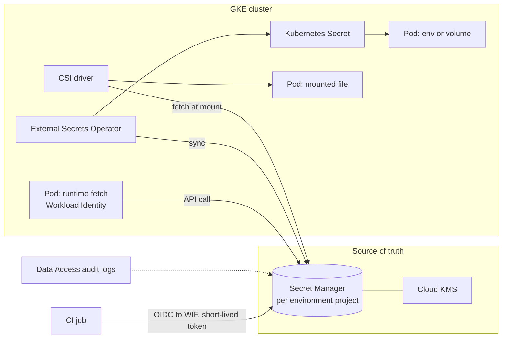

This note describes the whole life of a secret on GCP and GKE: which credentials should not exist at all, where the remaining ones are stored, how workloads and CI receive them, how they rotate and how access is audited. It leaves the External Secrets Operator setup to [[patterns/external-secrets-with-secret-manager]], Workload Identity mechanics to [[patterns/gke-workload-identity]], key management to [[patterns/cloud-kms-key-management]], and incident handling to [[runbooks/leaked-credential-rotation]].

> [!info] Scope and sources
> Written against Secret Manager, Cloud KMS, GKE Workload Identity, the External Secrets Operator and the Secrets Store CSI driver as general designs. Product names and add-ons change; the documentation listed under Sources is authoritative.

> [!note] Not verified
> Nothing here was run. Check before relying on it: the names and current status of the GKE Secret Manager add-on and the CSI provider option, supported rotation features in Secret Manager, how application-layer secrets encryption is configured on your GKE version, and which audit log types are enabled by default.

## Goals

- Remove credentials that should not exist, instead of protecting them.
- One source of truth per secret, with an owner and a rotation policy.
- Delivery that survives a provider blip and does not leak into logs, images or Git.
- Rotation that is routine and fast, and revocation that works under pressure.
- Evidence of who read what.

## Classify first

Before choosing a store, sort credentials into three groups.

| Class                     | Examples                                                                                                  | Strategy                                                                                                                                         |
| ------------------------- | --------------------------------------------------------------------------------------------------------- | ------------------------------------------------------------------------------------------------------------------------------------------------ |
| Should not exist          | Service account JSON keys, long-lived CI tokens for cloud access, shared admin passwords                  | Replace with Workload Identity (pods) and Workload Identity Federation (CI), see [[architecture/iam-groups-and-ci-workload-identity-federation]] |
| Identity-based, no secret | Calling Google APIs, Cloud SQL via IAM authentication, Artifact Registry                                  | Use the workload's identity and IAM; nothing to store                                                                                            |
| Real secrets              | Third-party API keys, database passwords where IAM auth is unavailable, signing material, webhook secrets | Store in Secret Manager, deliver at runtime, rotate                                                                                              |

The first row is the biggest win. Every service account key you delete is a secret that cannot leak. Block key creation with an organisation policy once the migration is done.

## Source of truth

- **Secret Manager** holds application secrets. Create secrets in the project of the environment that uses them, so a development principal cannot read production values. Name them predictably, for example `payments-api-db-password`, and label them with owner, environment and rotation period.
- **Cloud KMS** holds keys used for encryption, signing and envelope encryption; see [[patterns/cloud-kms-key-management]]. Secret Manager can use customer-managed keys where policy requires it. KMS stores keys, Secret Manager stores values; do not use one as the other.
- **IAM on secrets.** Grant `secretAccessor` on individual secrets to the workload's identity, not on the project. Administrative roles go to a small group, and administrators who can change a secret should not be the same principals as the workloads that read it.
- **When Vault or OpenBao is justified.** Consider an external secrets engine when you need dynamic, short-lived credentials generated per request (database users, cloud tokens), a multi-cloud or on-premises source, or advanced policy and leasing. It adds a stateful, security-critical service to run, upgrade and recover. For a GCP-only estate, Secret Manager plus identity-based access covers most needs. Check the current licence and support terms of whichever product you evaluate.

## Delivery models



| Model                                   | How it works                                                       | Strengths                                                       | Costs and risks                                                         |
| --------------------------------------- | ------------------------------------------------------------------ | --------------------------------------------------------------- | ----------------------------------------------------------------------- |
| Runtime fetch through Workload Identity | The application calls the Secret Manager API with its own identity | No copy in the cluster; always current; precise audit           | Code change, startup dependency on the API, needs caching and retries   |
| External Secrets Operator sync          | An operator copies a secret into a Kubernetes Secret on a schedule | No application change; works with any Helm chart                | Value stored in etcd; refresh delay; operator is a high-value component |
| CSI driver mount                        | The secret is fetched when the pod starts and mounted as a file    | Value stays out of etcd unless sync is enabled; file-based apps | Pod start depends on the provider; rotation needs reload or restart     |

Guidance:

- Prefer runtime fetch for services you own and can change, with a short in-memory cache and a retry with backoff.
- Use ESO for third-party software that only reads Kubernetes Secrets or environment variables. Accept that the value exists in etcd, and reduce the exposure with application-layer secrets encryption using a key you control in Cloud KMS, tight RBAC on `secrets`, and no `get`/`list` on secrets for developers.
- Use the CSI approach when a file mount fits and you want to avoid the etcd copy.
- Whatever the model, mount as files rather than environment variables when you can: environment variables leak through crash dumps, `/proc`, child processes and debug endpoints.

Outage behaviour differs, and you should decide it deliberately:

- Runtime fetch with a cache keeps running through a brief outage; a fresh pod without a cache cannot start.
- ESO keeps the last synced Kubernetes Secret, so running and new pods continue until the secret changes.
- CSI needs the provider at pod start, so a provider outage blocks new pods.

## CI access

CI is the most common place long-lived secrets pile up.

- **First choice: no secret.** Exchange the job's OIDC token for short-lived Google credentials through WIF, with an attribute condition on project, ref and protection status. The job then reads Secret Manager with a scoped service account.
- **Last resort: protected, masked variables** on protected branches only, for third-party tokens that cannot use federation. Give each its own expiry and owner.
- Never print secrets, never write them to artifacts or caches, and keep zone separation from [[architecture/ci-platform-gitlab-runners-and-jenkins-agents-on-gke]].
- Add secret scanning to pre-commit and CI, see [[patterns/secret-scanning-pre-commit-and-ci]].

## Rotation and revocation

- **Use versions.** Secret Manager keeps versions. Applications read `latest` or a pinned version; decide per secret. `latest` is easy but a bad new version breaks everything at once, so test rotations in a lower environment first.
- **Dual-version rollover** for secrets the other side validates:
  1. Create the new credential at the provider, so both old and new work.
  2. Add the new value as a new secret version.
  3. Roll the workloads so they pick it up, and confirm via logs and metrics that none use the old one.
  4. Disable the old version (reversible) and watch for errors.
  5. Revoke the old credential at the provider and later destroy the old version.
- **Rotation notifications.** Secret Manager can publish events on a schedule through Pub/Sub; a small function or job can rotate and update the version. Check the current docs for how rotation schedules and notifications work.
- **Revocation under pressure.** Know in advance, per secret, how to revoke at the provider, how long a leaked value stays valid, and who can do it. The procedure is in [[runbooks/leaked-credential-rotation]].
- Prefer short-lived tokens over rotation wherever the provider supports them.

## Audit and detection

- **Data Access audit logs** for Secret Manager record who accessed a secret version. They may not be enabled by default, and they increase log volume, so enable them for Secret Manager and Cloud KMS deliberately and route them with the audit pattern in [[patterns/gcp-audit-logs-siem]].
- Alert on unusual principals reading production secrets, reads outside the workload's usual identity, version destroy or disable actions, and IAM changes on secrets.
- Scan repositories, images and CI logs for committed secrets.
- Review who holds access periodically, with groups rather than individuals.

## Failure modes

| Failure                               | Effect                                                     | Mitigation                                                                        |
| ------------------------------------- | ---------------------------------------------------------- | --------------------------------------------------------------------------------- |
| Secret Manager unavailable            | Runtime fetch fails for fresh pods, CSI blocks new pods    | In-memory cache, ESO for critical paths, retry and backoff, alerts                |
| Stale cache after rotation            | Old value used and rejected by the provider                | Cache TTL shorter than the rotation overlap, reload signal, dual-version rollover |
| A deleted or destroyed version        | Pods cannot start, rollback to an older version impossible | Disable before destroy, restrict destroy permission, retain a recovery period     |
| Over-broad `secretAccessor`           | One compromised workload reads every secret                | Per-secret bindings, one identity per workload                                    |
| Secret copied into etcd and backed up | The backup contains plaintext values                       | Encrypt secrets at the application layer, protect and encrypt backups             |
| Secret in logs or crash dump          | Leak outside the store                                     | Redaction, no env var secrets, log review, scanning                               |

## Pitfalls

- Treating a Kubernetes Secret as encrypted because it is base64-encoded. It is not.
- One shared identity for every pod in a namespace, so per-secret IAM means nothing.
- Rotating the secret in the store without rolling the workloads.
- Granting developers `secretmanager.admin` in production "for debugging".
- Using `latest` for a value whose bad rotation would take down a critical path without a rollback plan.
- Forgetting build-time secrets that end up in image layers. Use build secrets that are not persisted.

## Verify

```bash title="verify-secrets.sh"
#!/usr/bin/env bash
set -euo pipefail

PROJECT="example-prod"
SECRET="payments-api-db-password"

# Versions and their states: expect one enabled, older ones disabled or destroyed
gcloud secrets versions list "$SECRET" --project "$PROJECT"

# Who may read this secret (expect only the workload's service account)
gcloud secrets get-iam-policy "$SECRET" --project "$PROJECT"

# No user-managed service account keys should exist
gcloud iam service-accounts list --project "$PROJECT" --format='value(email)' \
  | while read -r sa; do
      gcloud iam service-accounts keys list --iam-account "$sa" \
        --managed-by user --format='value(name)' | sed "s|^|$sa: |"
    done

# Recent accesses (requires Data Access logs to be enabled)
gcloud logging read \
  'protoPayload.serviceName="secretmanager.googleapis.com"
   AND protoPayload.methodName:"AccessSecretVersion"' \
  --project "$PROJECT" --limit 20 --freshness 1d
```

Then rehearse a rotation in a lower environment end to end, including the rollback.

## Adopt incrementally

1. Inventory credentials and classify them. Delete service account keys with an owner and an alternative.
2. Move CI cloud access to WIF.
3. Put the remaining secrets in Secret Manager, one project per environment, per-secret IAM.
4. Pick one delivery model per workload class and document it.
5. Enable application-layer secrets encryption and Data Access logs for Secret Manager.
6. Add rotation schedules and a tested rollover for the highest-risk secrets.

## Sources

- Secret Manager: https://cloud.google.com/secret-manager/docs
- Encrypting Secrets at the application layer in GKE: https://cloud.google.com/kubernetes-engine/docs/how-to/encrypting-secrets
- Secrets Store CSI driver: https://secrets-store-csi-driver.sigs.k8s.io/
- External Secrets Operator: https://external-secrets.io/latest/
- Cloud Audit Logs: https://cloud.google.com/logging/docs/audit

Check the current docs, especially for the GKE-specific Secret Manager add-on and CSI options.

## Related

- [[patterns/external-secrets-with-secret-manager]]
- [[patterns/gke-workload-identity]]
- [[patterns/cloud-kms-key-management]]
- [[patterns/secret-scanning-pre-commit-and-ci]]
- [[runbooks/leaked-credential-rotation]]
- [[architecture/iam-groups-and-ci-workload-identity-federation]]
- [[patterns/gcp-audit-logs-siem]]
