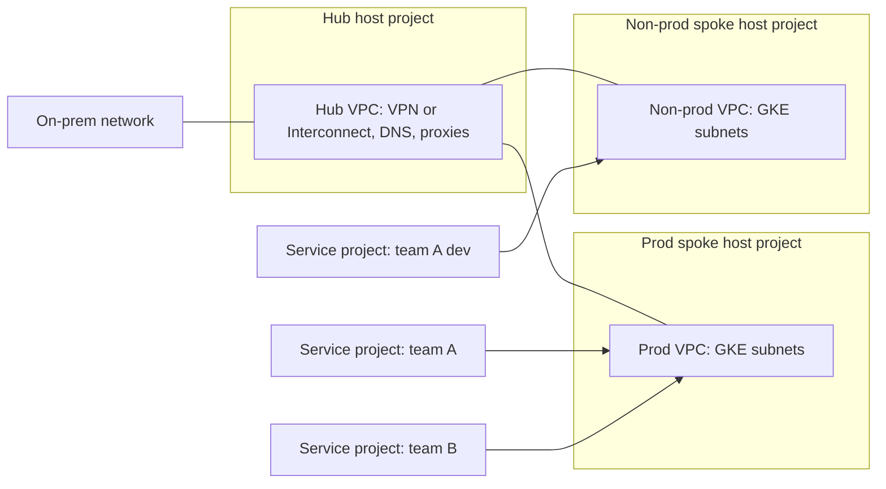

This note describes a network layout for a platform team that runs several GKE environments on GCP: Shared VPC host projects owned by the platform team, a hub for shared services and hybrid connectivity, and one spoke per environment. It is written for senior DevOps engineers who have to plan address space once and live with it for years. Folder and project structure is in [[architecture/gcp-resource-hierarchy-and-landing-zone]], cluster egress is in [[architecture/private-gke-and-controlled-egress]], and DNS is in [[architecture/cloud-dns-hybrid-and-multi-project]].

> [!info] Scope and sources
> Written against the Shared VPC, VPC Network Peering, Network Connectivity Center and firewall policy documentation on cloud.google.com, as understood in October 2026. Terraform examples use the `google` provider resource names. Nothing here was run against a live organisation.

> [!note] Not verified
> The claims below were written from documentation knowledge and were not checked against a running system or the current docs: peering and Network Connectivity Center limits, the feature set of hierarchical firewall policies, and the exact role name of the GKE host service agent. Check them before relying on them.

## Goals

- Network ownership sits with the platform team; application teams get subnets, not networks.
- One address plan that never overlaps with on-prem, other clouds or acquired companies.
- Production and non-production are separate failure and blast-radius domains.
- Shared services (DNS, hybrid links, proxies, CI runners) are reachable from every spoke without each spoke owning a copy.
- Firewall rules that must always hold are set above the project level, so a project owner cannot remove them.

## Topology

The hub holds hybrid connectivity and shared services. Each environment is a spoke with its own Shared VPC host project. Service projects (one per team or workload) attach to the spoke of their environment.



Spokes do not talk to each other directly. If prod and non-prod must exchange traffic, it goes through an explicit shared service in the hub, which gives you one place to inspect and filter it.

## Host and service projects

A host project owns the VPC; service projects attach to it and place resources (GKE nodes, VMs, internal load balancers) in subnets the host project shares. Grant access per subnet, not per host project, so a team can only use its own ranges.

```hcl title="shared-vpc/main.tf"
variable "host_project_id" {
  type        = string
  description = "Prod spoke host project ID"
  default     = "net-prod-host" # change: your host project ID
}

variable "service_project_id" {
  type        = string
  description = "Service project that attaches to the host"
  default     = "team-a-prod" # change: your service project ID
}

resource "google_compute_shared_vpc_host_project" "host" {
  project = var.host_project_id
}

resource "google_compute_shared_vpc_service_project" "service" {
  host_project    = google_compute_shared_vpc_host_project.host.project
  service_project = var.service_project_id
}
```

Enabling Shared VPC needs the Compute Shared VPC Admin role, normally granted at the folder that contains the host and service projects. Keep that role with the platform team.

## IP address plan

Decide the plan before the first subnet exists. All ranges below are RFC 1918 examples; replace them with ranges you have checked against on-prem, partners and any company you might acquire.

| Range (example) | Purpose                     | Size | Notes                                                                       |
| --------------- | --------------------------- | ---- | --------------------------------------------------------------------------- |
| 10.0.0.0/16     | Hub: hybrid, DNS, proxies   | /16  | Change: stays small; few VMs, many reserved ranges.                         |
| 10.16.0.0/12    | Prod spoke aggregate        | /12  | Change: reserve the aggregate even if you use a fraction.                   |
| 10.32.0.0/12    | Non-prod spoke aggregate    | /12  | Change: same size as prod so environments can be rebuilt in either.         |
| 10.16.0.0/20    | Prod GKE nodes, region 1    | /20  | Nodes only; one subnet per cluster.                                         |
| 10.20.0.0/14    | Prod GKE pods, region 1     | /14  | Secondary range; pod count times nodes decides the size.                    |
| 10.24.0.0/20    | Prod GKE services, region 1 | /20  | Secondary range; services are cheap, but do not make it too small.          |
| 172.16.0.0/28   | GKE control-plane peering   | /28  | One /28 per private cluster; must not overlap anything (see the next note). |
| 192.168.0.0/16  | Left unused on purpose      | /16  | Often claimed by home networks and VPN clients.                             |

Rules that save pain later:

- Give every environment a contiguous aggregate, so one route or firewall rule covers it.
- Carve pod and service ranges from a block that is never advertised to on-prem, if your design allows it. Pods rarely need to be reachable from on-prem by IP.
- Write the plan in version control and make Terraform read ranges from it, so a human cannot invent a subnet.

## GKE subnets with secondary ranges

A VPC-native GKE cluster takes node IPs from the subnet's primary range and pod and service IPs from named secondary ranges. A /14 for pods is generous on purpose: each node reserves a block of pod addresses, so the range runs out well before the node count suggests.

```hcl title="shared-vpc/subnets.tf"
variable "network_self_link" {
  type        = string
  description = "Self link of the prod spoke VPC"
  default     = "projects/net-prod-host/global/networks/prod" # change: your VPC
}

resource "google_compute_subnetwork" "gke_region1" {
  project                  = var.host_project_id
  name                     = "gke-prod-europe-west1"
  region                   = "europe-west1" # change: your region
  network                  = var.network_self_link
  ip_cidr_range            = "10.16.0.0/20" # change: node range from the IP plan
  private_ip_google_access = true

  secondary_ip_range {
    range_name    = "pods"
    ip_cidr_range = "10.20.0.0/14" # change: pod range from the IP plan
  }

  secondary_ip_range {
    range_name    = "services"
    ip_cidr_range = "10.24.0.0/20" # change: service range from the IP plan
  }

  log_config {
    aggregation_interval = "INTERVAL_10_MIN"
    flow_sampling        = 0.5
    metadata             = "INCLUDE_ALL_METADATA"
  }
}

# Let the team's service project use this one subnet and nothing else.
resource "google_compute_subnetwork_iam_member" "team_a_network_user" {
  project    = var.host_project_id
  region     = google_compute_subnetwork.gke_region1.region
  subnetwork = google_compute_subnetwork.gke_region1.name
  role       = "roles/compute.networkUser"
  member     = "group:team-a-platform@example.com" # change: your group
}
```

The principals that create the cluster and the service agents of the service project also need `roles/compute.networkUser` on the subnet. In addition, the GKE service agent of the service project needs the Host Service Agent User role on the host project (the role is commonly documented as `roles/container.hostServiceAgentUser`; confirm the name and the service agent address in the current GKE Shared VPC guide).

```hcl title="shared-vpc/gke-agent.tf"
variable "service_project_number" {
  type        = string
  description = "Project number of the service project"
  default     = "123456789012" # change: your service project number
}

resource "google_project_iam_member" "gke_host_agent" {
  project = var.host_project_id
  role    = "roles/container.hostServiceAgentUser"
  member  = "serviceAccount:service-${var.service_project_number}@container-engine-robot.iam.gserviceaccount.com"
}

resource "google_compute_subnetwork_iam_member" "gke_agent_network_user" {
  project    = var.host_project_id
  region     = google_compute_subnetwork.gke_region1.region
  subnetwork = google_compute_subnetwork.gke_region1.name
  role       = "roles/compute.networkUser"
  member     = "serviceAccount:service-${var.service_project_number}@container-engine-robot.iam.gserviceaccount.com"
}
```

## Hierarchical firewall policies

A firewall policy attached to an organisation or folder is evaluated before project-level VPC firewall rules. Use it for rules that must hold everywhere: allow IAP and health checks, deny known-bad ranges, delegate everything else to the project with `goto_next`.

```hcl title="shared-vpc/firewall-policy.tf"
variable "folder_id" {
  type        = string
  description = "Folder that holds all spoke host projects"
  default     = "folders/123456789012" # change: your folder
}

resource "google_compute_firewall_policy" "baseline" {
  parent      = var.folder_id
  short_name  = "baseline"
  description = "Rules every project in the folder inherits"
}

resource "google_compute_firewall_policy_rule" "allow_iap_ssh_rdp" {
  firewall_policy = google_compute_firewall_policy.baseline.name
  priority        = 1000
  direction       = "INGRESS"
  action          = "allow"
  description     = "IAP TCP forwarding for SSH and RDP"
  enable_logging  = true

  match {
    src_ip_ranges = ["35.235.240.0/20"] # IAP range: confirm in current docs

    layer4_configs {
      ip_protocol = "tcp"
      ports       = ["22", "3389"]
    }
  }
}

resource "google_compute_firewall_policy_rule" "delegate_rest" {
  firewall_policy = google_compute_firewall_policy.baseline.name
  priority        = 2147483000
  direction       = "INGRESS"
  action          = "goto_next"
  description     = "Everything else is decided by project firewall rules"

  match {
    src_ip_ranges = ["0.0.0.0/0"]

    layer4_configs {
      ip_protocol = "all"
    }
  }
}

resource "google_compute_firewall_policy_association" "folder" {
  name              = "baseline-on-spokes"
  attachment_target = var.folder_id
  firewall_policy   = google_compute_firewall_policy.baseline.name
}
```

Keep the folder-level policy short and boring. Rules that depend on a workload belong in the service project's own firewall rules or in [[patterns/kubernetes-network-policies]].

## Peering or Network Connectivity Center

The hub-to-spoke link can be VPC Network Peering or Network Connectivity Center (NCC) with VPC spokes. The choice is mostly about transitivity and route control.

| Concern                      | VPC Network Peering                                  | Network Connectivity Center                                 |
| ---------------------------- | ---------------------------------------------------- | ----------------------------------------------------------- |
| Transitive routing           | No; spoke A cannot reach spoke B through the hub     | Designed for hub routing between spokes; check current docs |
| Hybrid routes to spokes      | Needs custom route export and import on each peering | Managed by the hub; check what is propagated                |
| Overlapping ranges           | Not allowed between peered networks                  | Not allowed between connected VPC spokes                    |
| Operational weight           | Low; simple and old                                  | Higher; one more service to learn and monitor               |
| Limits on peerings or spokes | Per-network limits apply; check current quotas       | Per-hub limits apply; check current quotas                  |
| Typical fit                  | Few spokes, hybrid to the hub only                   | Many spokes, on-prem needs to reach every spoke             |

Start with peering if you have two or three spokes and only on-prem needs to reach them. Move to NCC when the number of spokes or the transitive-routing workarounds start to cost more than the extra service.

## Pitfalls

- **Pod CIDR exhaustion.** Pod ranges fill up faster than node counts suggest because each node reserves a block. Size for the maximum node count of the autoscaler, with a margin, and write the arithmetic in the IP plan.
- **Overlaps with on-prem and acquisitions.** An overlap cannot be fixed by configuration, only by renumbering. Check every new range against a central register before creating a subnet.
- **Peering is not transitive.** A spoke peered to the hub cannot reach another spoke, and on-prem routes reach a spoke only if you export and import custom routes on the peering.
- **Missing GKE service agent role.** Cluster creation in a service project fails with permission errors on the subnet if the GKE service agent lacks the Host Service Agent User role on the host project or `compute.networkUser` on the subnet.
- **Subnet-level grants forgotten.** Granting `compute.networkUser` on the whole host project lets every team use every subnet. Grant per subnet.
- **Firewall policy surprises.** A hierarchical `deny` cannot be overridden by a project owner, which is the point, but it also blocks the platform team's own debugging. Document the rules and where they live.

## Verify

```bash
set -euo pipefail

HOST_PROJECT="net-prod-host"      # change: your host project ID
SERVICE_PROJECT="team-a-prod"     # change: your service project ID
REGION="europe-west1"             # change: your region

# Which projects are attached to the host?
gcloud compute shared-vpc associated-projects list "$HOST_PROJECT"

# Which subnets can the service project use?
gcloud compute networks subnets list-usable \
  --project "$HOST_PROJECT" \
  --filter "region:$REGION" \
  --format "table(subnetwork,ipCidrRange,secondaryIpRanges[].rangeName)"

# Which firewall policies apply to the host project?
gcloud compute networks get-effective-firewalls prod \
  --project "$HOST_PROJECT" \
  --format "yaml(firewallPolicys[].shortName)"
```

Expected: the service project appears in the first list, the node subnet with `pods` and `services` ranges appears in the second, and the `baseline` policy appears in the third. Flag names can change between gcloud releases; check `--help` if a command fails.

## Adopt it incrementally

1. Write the IP plan and the central range register first. This costs nothing and prevents the one mistake you cannot undo.
2. Create the spoke host project and VPC for non-prod, attach one service project, and build a cluster there.
3. Add the folder-level firewall policy with logging, watch it for a week, then add the deny rules.
4. Add the hub and the hybrid link; connect the non-prod spoke first.
5. Move production last, using the same Terraform modules ([[patterns/terraform-module-and-state-layout]]).

## Related

- [[architecture/gcp-resource-hierarchy-and-landing-zone]]: the folder and project structure these networks live in.
- [[architecture/private-gke-and-controlled-egress]]: private clusters, NAT and egress allowlists on top of these subnets.
- [[architecture/cloud-dns-hybrid-and-multi-project]]: DNS across the hub and the spokes.
- [[patterns/kubernetes-network-policies]]: in-cluster traffic rules that complement the VPC firewall.
- [[runbooks/network-troubleshooting-dns-mtu-tls-load-balancers]]: what to do when traffic does not flow.
- [[patterns/terraform-module-and-state-layout]]: how to split the Terraform in this note across states.
