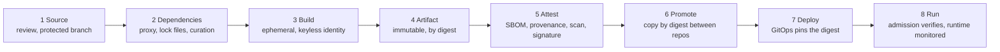

This note is the map of the software supply chain from a commit to a running pod. It names the stages, the control and the evidence at each stage, and the gaps that appear between stages. It is an index that ties the detailed notes together and deliberately does not repeat them: provenance is in [[compliance/slsa-build-provenance]], SBOMs in [[compliance/sbom-generation-and-storage]], signing and admission in [[patterns/image-signing-and-admission-verification]], and promotion in [[patterns/artifact-promotion-artifactory]].

> [!info] Scope and sources
> Written against SLSA, Sigstore Cosign, Binary Authorization, CycloneDX and SPDX as general references. Specification versions, track names and tool flags change; check slsa.dev and the tool documentation.

> [!note] Not verified
> Nothing here was run. Check before relying on it: the current SLSA version and its track names, the `cosign verify-attestation` flags and predicate type names, how your registry and cluster verify attestations, and the policy language of your admission controller.

## Threats and goals

The chain is attacked at every link. Representative threats:

- A malicious or compromised dependency is pulled into a build.
- A build is tampered with, or uses a stolen credential.
- An artifact is replaced after build and before deploy.
- An unreviewed or hotfix change reaches production outside the normal path.
- A vulnerable component stays deployed because nobody knew it was inside.

Goals: every running artifact can be traced to a reviewed commit and a trusted build, and the cluster refuses what cannot be traced. "Verifiable" means a machine checks it at deploy time, not that a document says so.

## Stage model



| Stage        | Control                                                                | Evidence produced                                 | Detailed note                                                                    |
| ------------ | ---------------------------------------------------------------------- | ------------------------------------------------- | -------------------------------------------------------------------------------- |
| Source       | Protected branches, required review, limited force-push                | Merge request approvals, branch protection config | [[architecture/gitops-repo-topology-and-promotion]]                              |
| Dependencies | One path through the artifact proxy, lock files, automated updates     | Resolution logs, dependency list                  | [[architecture/artifact-management-architecture-artifactory-ha]]                 |
| Build        | Ephemeral runners, no stored cloud keys, pinned build images           | Build logs, workload identity audit trail         | [[architecture/iam-groups-and-ci-workload-identity-federation]]                  |
| Artifact     | Immutable tags in production repositories, digest identity             | Digest, repository audit log                      | [[standards/artifact-retention-policy]]                                          |
| Attest       | SBOM, provenance, vulnerability scan, signature attached to the digest | Attestations in the registry                      | [[compliance/sbom-generation-and-storage]], [[compliance/slsa-build-provenance]] |
| Promote      | Copy the same digest from stage to stage; gates between                | Promotion record, gate results                    | [[patterns/artifact-promotion-artifactory]]                                      |
| Deploy       | Config repository pins the digest; reviewed change                     | Git history of the config repository              | [[architecture/gitops-repo-topology-and-promotion]]                              |
| Run          | Admission verifies signature and attestations; runtime monitoring      | Admission decisions, audit logs                   | [[patterns/image-signing-and-admission-verification]]                            |

## Source controls

- Protect the default and release branches: required review by someone other than the author, required passing checks, no direct pushes, no force-push.
- Signed commits are optional. They prove who authored a commit, but they do not replace review, and key management for them costs effort. Add them when your threat model includes impersonation of committers.
- Keep CI definitions under the same review as code. A change to the pipeline is a change to the trust root.

## Dependencies

- Resolve everything through the artifact proxy, and close direct paths to public registries.
- Pin through lock files and verify checksums.
- Keep dependencies current with automation so security fixes are small, regular changes, see [[patterns/automated-dependency-updates]].
- Consider a delay or curation step for new package versions, so a freshly published malicious version is not consumed within minutes.

## Build identity

- Builds run on ephemeral runners in the trusted zone described in [[architecture/ci-platform-gitlab-runners-and-jenkins-agents-on-gke]].
- The build authenticates with short-lived OIDC credentials, never a stored key. The identity is constrained by project, branch and protection status.
- The build is hermetic where practical: inputs are declared, versions are pinned, and the network is limited to the artifact proxy.

## Attestations

Attestations are signed statements about an artifact, attached to its digest:

- **SBOM** (CycloneDX or SPDX) lists what is inside.
- **Provenance** states which source, which builder and which build steps produced it.
- **Scan results** state what was known about it at a point in time.

Bind them to the image digest, not to a tag, since a tag can move. Keep them in the same registry next to the image, or in a store that is addressable by digest. A signature on an image without an attestation tells you who signed, not what is inside. SLSA versions and track names change, so check slsa.dev for the current levels before you cite one in a policy.

A verification example. The flags and the predicate type name must be checked against the current Cosign documentation before use:

```bash title="verify-attestation.sh"
#!/usr/bin/env bash
set -euo pipefail

IMAGE="registry.example.com/docker-prod-local/payments-api"
DIGEST="sha256:0000000000000000000000000000000000000000000000000000000000000000"  # replace with the real digest

# Keyless verification: identity and issuer are what you expect, not any signer.
# Flag names and predicate type values: check the current Cosign docs.
cosign verify-attestation \
  --type slsaprovenance \
  --certificate-identity-regexp '^https://gitlab\.example\.com/platform/payments-api//\.gitlab-ci\.yml@refs/heads/main$' \
  --certificate-oidc-issuer https://gitlab.example.com \
  "${IMAGE}@${DIGEST}"
```

The example verifies by digest and pins the signer's identity and issuer. Accepting "any valid signature" defeats the purpose.

## Promotion by digest

Promote by digest, never by tag. A tag is a movable label. If staging tested `payments-api:1.8.0` and production later resolves `1.8.0`, production may run different bytes. Promotion copies the artifact from one repository to the next and records the digest, as in [[patterns/artifact-promotion-artifactory]]. The deploy configuration then pins `image@sha256:...`. Tags remain for humans; machines use digests.

Attestations travel with the digest. Check that your promotion copies them, or re-verify against the source repository before the copy.

## Deploy-time verification

The cluster is the last place to say no.

- **Admission.** An admission controller or Binary Authorization checks the signature and the required attestations before a pod is created. The setup and policy are in [[patterns/image-signing-and-admission-verification]] and the comparison of engines in [[tools/gatekeeper-vs-kyverno]].
- **Deploy pins.** Config repository changes are reviewed, and automation never writes a tag.
- **Break-glass.** Define how an emergency deployment works (for example a time-boxed exception) before you need it.

## Vulnerability SLA and waivers

Vulnerabilities are expected. The control is how fast they are fixed or consciously accepted:

- Set response times by severity and exposure in [[standards/vulnerability-management-slas]].
- Re-scan stored artifacts regularly, not only at build time, because new vulnerabilities are found in old images.
- Exceptions are recorded, time-boxed and owned, following [[compliance/policy-exception-and-waiver-process]].
- Use the SBOM to answer "where is this component running?" within minutes.

## Failure modes

| Failure                             | Effect                                                                 | Mitigation                                                                                 |
| ----------------------------------- | ---------------------------------------------------------------------- | ------------------------------------------------------------------------------------------ |
| Unsigned hotfix                     | Admission rejects the emergency fix                                    | Break-glass path with expiry and review, practised in advance                              |
| Signing service outage              | New builds cannot be signed or verified                                | Verification caches, documented fallback, monitor the signing dependency                   |
| Rollback to an older image          | An image signed before a key rotation or policy change fails admission | Keep old verification keys or identities valid for the retention window, re-sign if needed |
| Attestation not copied on promotion | Production admission fails or silently skips                           | Test promotion end to end, fail closed in production                                       |
| Verification accepts any signer     | A stolen identity passes                                               | Pin identity and issuer, restrict the signing identity to protected builds                 |
| Policy in audit mode forever        | Violations are logged and ignored                                      | Set a date to enforce, alert on violations                                                 |

## Pitfalls

- Doing everything at build time and nothing at deploy time.
- Signing the tag instead of the digest.
- Generating SBOMs that nobody can query.
- Treating a scan result as permanent.
- Letting each team choose its own verification, so the weakest policy sets the bar.
- Counting controls instead of testing them. Try to deploy an unsigned image and see whether it is refused.

## Verify

Test the chain as an attacker would:

```bash title="chain-checks.sh"
#!/usr/bin/env bash
set -euo pipefail

CTX="gke_example-prod_europe-west1_gke-prod-ew1"

# 1. An unsigned image is refused in the production namespace (expect a denial)
kubectl --context "$CTX" -n payments run unsigned-test \
  --image=registry.example.com/docker-dev-local/unsigned-test:1 --restart=Never \
  --dry-run=server -o yaml || echo "denied as expected"

# 2. Every running image is pinned by digest
kubectl --context "$CTX" get pods -A \
  -o jsonpath='{range .items[*].status.containerStatuses[*]}{.imageID}{"\n"}{end}' \
  | grep -v '@sha256:' || echo "all images carry a digest"

# 3. Attestations verify for a deployed image (see verify-attestation.sh)
```

Also run a quarterly exercise: pick a random production pod and trace it back to the commit, the review and the build, using only stored evidence.

## Adopt incrementally

1. Pin by digest in deploy configuration and close direct registry access.
2. Generate and store SBOMs, and make them searchable.
3. Add keyless signing and provenance in the trusted build.
4. Run admission in audit mode, fix what it reports, then enforce in production.
5. Add re-scanning, SLAs and waivers.
6. Add curation for new dependency versions and practise break-glass.

## Sources

- SLSA specification: https://slsa.dev/spec/
- Sigstore Cosign: https://docs.sigstore.dev/cosign/
- Binary Authorization: https://cloud.google.com/binary-authorization/docs
- CycloneDX: https://cyclonedx.org/
- SPDX: https://spdx.dev/

Check the current docs for versions, tracks and flags.

## Related

- [[compliance/slsa-build-provenance]]
- [[compliance/sbom-generation-and-storage]]
- [[patterns/image-signing-and-admission-verification]]
- [[patterns/artifact-promotion-artifactory]]
- [[standards/vulnerability-management-slas]]
- [[compliance/policy-exception-and-waiver-process]]
- [[architecture/iam-groups-and-ci-workload-identity-federation]]
- [[architecture/gitops-repo-topology-and-promotion]]
- [[architecture/artifact-management-architecture-artifactory-ha]]
