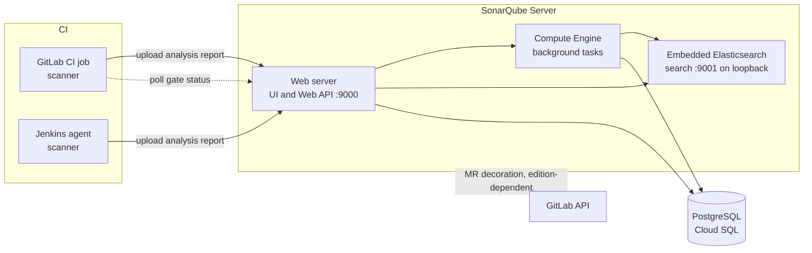

This note describes SonarQube as a platform service that every merge request depends on: its components, how editions change the architecture, where to host it, the database and host requirements, how scanners in GitLab CI and Jenkins connect to it, where throughput runs out, how it is accessed, upgraded and recovered. It is the platform counterpart of [[architecture/artifact-management-architecture-artifactory-ha]]. How the quality gate is configured is in [[patterns/sonarqube-quality-gates]], the decision that the gate blocks merges is [[adr/0016-sonarqube-new-code-gate-blocks-merge]], upgrades are in [[runbooks/sonarqube-upgrade-and-db-migration]], and a first scan is taught in [[learn/sonarqube-basics-first-scan-and-triage]].

> [!info] Scope and sources
> Written against SonarSource's public repositories, read on 2026-10-21: the SonarQube Helm chart README and values, the Docker image documentation, the server's default `sonar.properties`, and the Web API source. docs.sonarsource.com could not be opened. Chart facts are version-bound; check the chart README for your chart version.

> [!note] Not verified
> Nothing here was run. Check before relying on it: which edition includes branch and merge request analysis, merge request decoration, SSO and Data Center (HA) deployment; Compute Engine worker counts by edition; supported PostgreSQL versions and database requirements; Elasticsearch heap and disk guidance and whether indexes rebuild after a database restore; the scanner parameters `sonar.qualitygate.wait`, `sonar.qualitygate.timeout` and `sonar.token`; the Jenkins plugin steps and webhook setup; scanner image names; token types and expiry; the LTA release cadence; and whether `/api/monitoring/metrics` needs the passcode.

## Goals

- **Gate merges reliably.** The gate verdict arrives within the scanner's timeout for normal load, and an outage has a documented path ([[adr/0016-sonarqube-new-code-gate-blocks-merge]]).
- **The server is never the bottleneck.** Scanners run in CI; the server's background queue is sized and watched.
- **Recoverable.** A lost instance is rebuilt from code plus a database backup.
- **Upgradable.** Regular upgrades on a known path, rehearsed on a copy.

## Components



A server is three processes: the **web server** (UI and Web API, port 9000 by default), the **Compute Engine** that processes uploaded analysis reports as background tasks, and an **embedded Elasticsearch** for search (port 9001, bound to loopback by default and never to be exposed). All durable state lives in the **database**; the Elasticsearch indexes and plugins live on the data and extensions volumes.

The scanner does the heavy work in CI: it analyses the code and uploads a report. The server then queues the report as a Compute Engine task, and the quality gate result exists only after that task finishes. A CI job that waits for the gate is therefore waiting on the server's queue, which is why queue depth is the key capacity signal.

## Editions and what they change

SonarSource names the product line SonarQube Community Build (free, LGPL-3.0), SonarQube Server (commercial editions) and SonarQube Cloud (SaaS). The source repository says the commercial editions add more languages, branch and pull request analysis, software composition analysis, deeper security analysis and enterprise reporting. Image tags name the editions `community`, `developer`, `enterprise`, and `datacenter-app` with `datacenter-search`.

Architecturally:

- **Community Build** lacks the branch and pull request analysis that the source README attributes to the commercial editions, which the merge request gate in [[adr/0016-sonarqube-new-code-gate-blocks-merge]] relies on; check the current feature matrix before choosing it for a merge gate.
- **Developer and Enterprise** run as one server (one pod or VM). Availability is that of one instance plus a fast restore.
- **Data Center** splits application and search nodes for HA and needs its own chart (`sonarqube-dce`); the standard chart does not support it. Its node counts, load balancer and licence terms are not covered here.

Licences and seat or lines-of-code counting change; manage them with [[management/devops-vendor-and-licence-management]], and compare tools with [[tools/sonarqube-vs-semgrep-vs-codeql]].

## Hosting options

| Option                     | Fits                                                     | You operate                                       | Watch out for                                                      |
| -------------------------- | -------------------------------------------------------- | ------------------------------------------------- | ------------------------------------------------------------------ |
| VM (Compute Engine)        | Teams without GKE operations, or strict host tuning      | OS, sysctls, JVM, upgrades, backups of volumes    | Snowflake hosts; automate with images and config management        |
| GKE with the official chart| Platforms already on GKE; declarative upgrades           | Chart values, node sysctls, PVC, probes           | Privileged init container by default; one replica per database     |
| SonarQube Cloud (SaaS)     | No appetite to operate it; code may leave your network   | Organisation settings, tokens, CI integration     | Data residency, network access to CI, cost model                   |

One rule applies everywhere: **one instance per database schema**, and volumes are never shared between instances.

## Database

- **External PostgreSQL**, on Cloud SQL per [[adr/0027-cloud-sql-for-production-postgres]] and [[architecture/cloud-sql-postgres-platform-architecture]]. The embedded H2 database is for tests only, and the chart no longer bundles PostgreSQL (removed in chart 2026.1.0).
- **Connection URL** form: `jdbc:postgresql://<host>/sonarqube?currentSchema=<schema>` (default schema `public`). Size the pool (`sonar.jdbc.maxActive`, example value 60 in the default config, which recommends about 1.2 times the HTTP pool size) and check it against the database's connection limit.
- **Private connectivity only**: private IP or the Cloud SQL Auth Proxy as a sidecar; the password in a Kubernetes Secret synced from Secret Manager, never in values files.
- **Backups and PITR** as in [[architecture/backup-architecture-gke-cloud-sql-gcs]]. The database is the system of record; everything else is rebuildable.

Check the SonarQube requirements page for supported PostgreSQL versions, encoding and collation before creating the database.

## Host requirements for Elasticsearch

The embedded Elasticsearch needs kernel settings beyond common defaults. The Docker image documentation gives `vm.max_map_count=524288`, `fs.file-max=131072`, open files 131072 and processes 8192; the chart's README notes the kernel default `vm.max_map_count` is usually 65530, which is too low.

The chart sets these with a privileged `initSysctl` init container by default, which a namespace enforcing the restricted Pod Security level will reject. The chart README recommends disabling `initSysctl` and `initFs` in production and setting sysctls at node level, as in [[patterns/kubernetes-node-sysctls]]. Run SonarQube on a dedicated node pool with those settings.

```yaml title="sonarqube/values-prod.yaml"
# Check every key against the README of your chart version
edition: developer # or community.enabled: true for the Community Build
jdbcOverwrite:
  enabled: true
  jdbcUrl: "jdbc:postgresql://10.20.0.5:5432/sonarqube" # change: Cloud SQL private IP
  jdbcUsername: sonarqube
  jdbcSecretName: sonarqube-db         # synced from Secret Manager
  jdbcSecretPasswordKey: password
monitoringPasscodeSecretName: sonarqube-monitoring
monitoringPasscodeSecretKey: passcode   # without a passcode the pod never becomes ready
initSysctl:
  enabled: false                        # sysctls set on the dedicated node pool instead
initFs:
  enabled: false
persistence:
  enabled: true                         # default is false: data lost when the pod is recreated
  size: 50Gi                            # example; size from your index growth
nodeSelector:
  workload: sonarqube                   # change: your dedicated node pool label
```

The chart's default resources request 400m CPU and 4096M memory with a 10240M memory limit; treat those as a floor and size from measured heap use. Ingress is off by default and the chart recommends Gateway API through `httproute.enabled`; route through the internal edge described below.

## CI integration

Both CI systems call the scanner with a project-scoped token and wait for the gate.

```yaml title="templates/sonarqube.gitlab-ci.yml (component sketch)"
sonarqube-check:
  stage: test
  image: $SONAR_SCANNER_IMAGE # set at group level: the scanner image mirrored through Artifactory, pinned by digest
  variables:
    SONAR_USER_HOME: "${CI_PROJECT_DIR}/.sonar"
    GIT_DEPTH: "0" # full history for new-code detection
  cache:
    key: sonar-${CI_PROJECT_ID}
    paths: [.sonar/cache]
  timeout: 20 minutes
  rules:
    - if: $CI_PIPELINE_SOURCE == "merge_request_event"
    - if: $CI_COMMIT_BRANCH == $CI_DEFAULT_BRANCH
  script:
    # SONAR_HOST_URL and SONAR_TOKEN come from masked CI/CD variables; never inline
    - sonar-scanner
      -Dsonar.projectKey="${CI_PROJECT_PATH_SLUG}"
      -Dsonar.qualitygate.wait=true
      -Dsonar.qualitygate.timeout=300
```

- **Ship it as a CI component or include** owned by the platform team ([[patterns/gitlab-ci-components-and-includes]]), so the timeout, cache and image are set once. For Jenkins, wrap the same call in a shared library step that binds the token from the credentials store ([[patterns/jenkins-shared-libraries]]); check the SonarQube Jenkins integration docs for the plugin steps and webhook setup.
- **Tokens.** One analysis token per project, stored as a masked variable or in Secret Manager, with an expiry and an owner. Fork merge request pipelines do not receive the parent's variables, and pipelines a member runs for a fork in the parent project do, so the rule from [[architecture/ephemeral-preview-environments-on-gke]] applies: never run untrusted merge requests in the parent project with real tokens. The CI side of trust zones is in [[architecture/ci-platform-gitlab-runners-and-jenkins-agents-on-gke]].
- **Images and plugins through Artifactory.** Scanner images and the scanner's downloaded analysers come through the remote repositories in [[patterns/artifactory-remote-repo-caching-for-ci]], so CI does not depend on vendor download hosts.
- **Gate parameters.** `sonar.qualitygate.wait` and `sonar.qualitygate.timeout` are the names the existing notes use and are not verified here; check the scanner documentation for the names, default and unit in your version.

## Throughput

- **The Compute Engine queue is the bottleneck.** Every analysis, including every merge request push, becomes a background task. When pending tasks pile up, gate waits time out and merges block.
- **Watch the queue**: `api/ce/activity_status` returns `pending`, `inProgress` and `failing` counts. Alert when `pending` stays above your normal peak for longer than your gate timeout (thresholds from your own data).
- **More workers** are an edition-dependent setting; check the docs before planning on them. Scaling the web tier does not help.
- **Reduce work**: analyse merge requests and the default branch only, not every branch push; split very large monorepos into module-scoped projects; exclude generated and vendored code.
- **Heap**: the web, Compute Engine and search processes have separate heap settings (`sonar.web.javaOpts`, `sonar.ce.javaOpts`, `sonar.search.javaOpts`); size them from measurement and keep the pod memory limit above their sum plus overhead.

## Access

- **Behind the internal edge.** Reach the UI and API over the internal network or through IAP for people ([[architecture/zero-trust-access-iap-and-vpc-service-controls]]). CI runners reach it on the private network.
- **SSO and groups**: federate users and map groups to permissions; which SSO protocols your edition supports is not verified here. Keep one break-glass administrator in the secret store, and change the default admin password at installation.
- **System passcode** (`sonar.web.systemPasscode`, sent as the `X-Sonar-Passcode` header) is for monitoring and probes only; store it as a Secret and rotate it like any credential.

## Upgrades

Images are published per version and as LTA tags (`<version>-lta-<edition>`). Pick either the LTA line or regular updates and plan the cadence; check SonarSource's release policy for the support window. After a version change the server may report `DB_MIGRATION_NEEDED` and wait for the database migration; follow [[runbooks/sonarqube-upgrade-and-db-migration]], with a database backup taken immediately before.

## Disaster recovery

- **What to back up**: the database (Cloud SQL backups and PITR) and the configuration (chart values, quality gates and profiles as code). Plugins come back with the image and values.
- **Rebuild**: restore the database to a new instance, deploy the same chart version with an empty data volume, and let the server rebuild its search indexes; check the docs for whether a restored database alone is sufficient and how long reindexing takes for your size.
- **RPO and RTO**: RPO is the database's; RTO is deployment plus reindexing. Rehearse the restore on a copy, which also gives a realistic reindex time.
- **During an outage**, the gate fails closed per [[adr/0016-sonarqube-new-code-gate-blocks-merge]]: maintainers may rerun, and a proven outage allows a documented, time-boxed bypass for specific merge requests. Implementing that bypass (for example a protected CI variable that turns the gate job into `allow_failure`, settable only by the platform on-call) is a design recommendation, not a SonarQube feature.

## Failure modes

| Failure                                  | Symptom                                          | Mitigation                                                           |
| ---------------------------------------- | ------------------------------------------------ | -------------------------------------------------------------------- |
| Compute Engine backlog                   | Gate waits time out, merges blocked              | Queue alert, fewer analyses, module split; outage path from ADR 0016 |
| Database outage or failover              | Server unhealthy, uploads fail                   | Cloud SQL HA, CI retry of the job, health alert                      |
| Elasticsearch disk full or watermarks    | Server stuck in `STARTING` or search errors      | Volume headroom alert; check the docs for watermark behaviour        |
| `vm.max_map_count` too low on a new node | Elasticsearch fails to start                     | Dedicated node pool with sysctls; node startup check                 |
| Pending database migration after upgrade | Status `DB_MIGRATION_NEEDED`                      | Upgrade runbook; backup first                                         |
| Token leaked from CI                     | Analyses pushed or results read by an attacker   | Project-scoped tokens with expiry; rotation; no tokens in fork runs  |
| Passcode missing in the chart            | Pod never becomes ready                          | Passcode Secret in values; check probes                              |

## Pitfalls

- Running with `persistence.enabled: false` (the chart default) in production and losing indexes and plugins on every reschedule.
- Running two servers against one schema to "add capacity".
- Using a global administrator token in CI.
- Leaving the privileged `initSysctl` container on in a namespace that should be restricted.
- Treating the gate timeout as a tuning knob for a queue problem.

## Verify

```bash title="verify-sonarqube.sh"
#!/usr/bin/env bash
set -euo pipefail
SONAR_URL="https://sonarqube.example.com" # change
# SONAR_PASSCODE and SONAR_TOKEN come from the environment (secret store); never inline them
: "${SONAR_PASSCODE:?set from the secret store}"
: "${SONAR_TOKEN:?set from the secret store}"

# 1. Status: expect "UP" (STARTING, DOWN, RESTARTING, DB_MIGRATION_NEEDED, DB_MIGRATION_RUNNING otherwise)
curl -fsS "$SONAR_URL/api/system/status" | jq -r '.status'

# 2. Health: expect GREEN (YELLOW needs attention, RED is not operational); needs the passcode or an admin
curl -fsS -H "X-Sonar-Passcode: $SONAR_PASSCODE" "$SONAR_URL/api/system/health" | jq -r '.health'

# 3. Liveness as Kubernetes would see it: expect HTTP 204
curl -s -o /dev/null -w '%{http_code}\n' -H "X-Sonar-Passcode: $SONAR_PASSCODE" "$SONAR_URL/api/system/liveness"

# 4. Compute Engine queue: pending, inProgress, failing (needs Administer System)
#    Basic auth with the token as user name is the common form; check the Web API docs
curl -fsS -u "${SONAR_TOKEN}:" "$SONAR_URL/api/ce/activity_status" | jq '{pending, inProgress, failing}'

# 5. Oldest pending tasks, to see how long the queue has been waiting
curl -fsS -u "${SONAR_TOKEN}:" "$SONAR_URL/api/ce/activity?status=PENDING" | jq '.tasks[:5]'
```

The JSON field names in the `jq` filters are assumptions; check the response of your version before scripting alerts on them. Also confirm `/opt/sonarqube/data` sits on a persistent volume, the node has the sysctls, and the database connection uses the private address.

## Adopt incrementally

1. Move the database to Cloud SQL with private connectivity and backups; enable persistence.
2. Put the instance behind the internal edge with SSO; change and vault the admin credential.
3. Move to a dedicated node pool with node-level sysctls; disable the privileged init containers.
4. Publish one CI component and one Jenkins library step with project tokens, the gate wait and a timeout.
5. Add monitoring: status, health, queue depth, disk; route alerts as in [[architecture/alerting-and-paging-pipeline]].
6. Rehearse an upgrade and a restore on a copy; write down the reindex time and the outage path.

## Sources

- SonarQube Server documentation (architecture, requirements, editions, Helm chart, Data Center): https://docs.sonarsource.com/sonarqube-server/latest/
- GitLab integration: https://docs.sonarsource.com/sonarqube-server/latest/analyzing-source-code/ci-integration/gitlab-integration/
- Jenkins integration: https://docs.sonarsource.com/sonarqube-server/latest/analyzing-source-code/ci-integration/jenkins-integration/
- SonarQube Helm chart (README and values): https://github.com/SonarSource/helm-chart-sonarqube
- SonarQube Docker image documentation: https://hub.docker.com/_/sonarqube
- SonarQube Community Build source (default `sonar.properties`, Web API): https://github.com/SonarSource/sonarqube

## Related

- [[patterns/sonarqube-quality-gates]]
- [[adr/0016-sonarqube-new-code-gate-blocks-merge]]
- [[runbooks/sonarqube-upgrade-and-db-migration]]
- [[learn/sonarqube-basics-first-scan-and-triage]]
- [[tools/sonarqube-vs-semgrep-vs-codeql]]
- [[management/devops-vendor-and-licence-management]]
- [[architecture/ci-platform-gitlab-runners-and-jenkins-agents-on-gke]]
- [[architecture/artifact-management-architecture-artifactory-ha]]
- [[adr/0027-cloud-sql-for-production-postgres]]
- [[architecture/cloud-sql-postgres-platform-architecture]]
- [[architecture/backup-architecture-gke-cloud-sql-gcs]]
- [[patterns/gitlab-ci-components-and-includes]]
- [[patterns/jenkins-shared-libraries]]
- [[patterns/artifactory-remote-repo-caching-for-ci]]
- [[patterns/kubernetes-node-sysctls]]
- [[architecture/zero-trust-access-iap-and-vpc-service-controls]]
