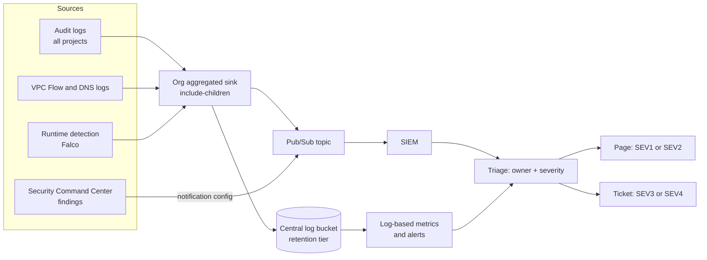

This note describes the detection side of platform security on GCP and GKE: which signals exist, how findings travel from a source to a human who owns the affected resource, which detections to start with, what may be automated, and how to keep evidence intact. It is the system around the pieces other notes cover: log collection and SIEM feeds in [[patterns/gcp-audit-logs-siem]], central sinks and retention in [[adr/0044-central-log-sinks-and-retention-tiers]] and [[architecture/logging-architecture-gke-and-cloud-logging]], containment in [[runbooks/compromised-cloud-cluster-containment]] and credential leaks in [[runbooks/leaked-credential-rotation]]. What to protect against is decided in [[standards/platform-threat-modelling]].

> [!info] Scope and sources
> Flags and API values for `gcloud logging sinks`, `gcloud scc`, `gcloud compute networks subnets` and `gcloud container clusters` were read from the gcloud reference text. Product behaviour, Security Command Center tiers, default log settings, prices and Falco were not checked against the current documentation; the pages under Sources are authoritative. The automation and triage guidance is design advice, not product fact. Nothing here was run.

> [!note] Not verified
> Check these before relying on them:
>
> - Which audit log types are on by default and which are free: Admin Activity and System Event logs are commonly documented as always on, Data Access logs as off by default except for some services. Retention of the `_Required` and `_Default` buckets.
> - Security Command Center tiers (Standard, Premium, Enterprise), which built-in detectors each includes (Event Threat Detection, Container Threat Detection, Security Health Analytics, VM Threat Detection, Web Security Scanner, Rapid Vulnerability Detection), and their prices.
> - GKE security posture: which features `--security-posture=standard|enterprise` and `--workload-vulnerability-scanning` enable, version requirements and cost.
> - The exact `protoPayload.methodName` values and field paths in the starter queries: `CreateServiceAccountKey`, `SetIamPolicy` with `serviceData.policyDelta`, `v1.compute.firewalls.insert` and `patch` with `request.sourceRanges`, `io.k8s.core.v1.pods.exec.create`, and `auditConfigDeltas`. Copy a real event from a sandbox before alerting on any of them.
> - Whether GKE writes Data Access logs for the Kubernetes API by default, and exactly which denials Policy Denied audit logs record.
> - Falco installation on GKE (driver options, Autopilot restrictions), rule syntax and output channels.
> - Cloud Monitoring log-based alert behaviour and limits.

## Goals and threat scenarios

- Every high-risk change or behaviour produces a signal within minutes, reaches the owning team, and has a written first response.
- The detection pipeline itself is monitored: a silent sink is a security incident waiting to be discovered late.
- Automation contains damage only where it is safe; humans decide anything that can cause an outage or destroy evidence.

Start from the scenarios in the threat model. The usual top five for a GCP and GKE platform:

1. A leaked credential (service account key, CI token, user session) used from outside.
2. Privilege escalation through IAM: a new owner binding, a new key on a privileged service account, a custom role edit.
3. Exposure by misconfiguration: a firewall rule open to the internet, a public bucket, a public Cloud SQL IP.
4. A compromised container: unexpected shell, crypto-mining, outbound connections to unknown hosts.
5. Defence evasion: audit config changed, a log sink deleted, an organisation policy relaxed.

## Signal sources

| Source                                     | What it shows                                                        | Notes                                                                                                                                                              |
| ------------------------------------------ | -------------------------------------------------------------------- | ------------------------------------------------------------------------------------------------------------------------------------------------------------------ |
| Admin Activity audit logs                  | Configuration changes: IAM, firewall, clusters, keys                 | The backbone of most detections                                                                                                                                    |
| Data Access audit logs                     | Reads and data writes: secret access, IAM policy reads, object reads | Types `ADMIN_READ`, `DATA_READ`, `DATA_WRITE`, set per service in `auditConfigs`; enable where the risk justifies the volume                                       |
| Policy Denied audit logs                   | Requests blocked by VPC Service Controls or policy                   | Repeated denials from one principal are a probe signal                                                                                                             |
| GKE audit logs (`k8s.io`)                  | Kubernetes API calls: exec, secrets, RBAC changes                    | See the logging architecture note for what is collected                                                                                                            |
| VPC Flow Logs                              | Connections per subnet, sampled                                      | Per subnet; gcloud defaults are a 5-second interval, 0.5 sampling and no metadata. Volume and cost grow fast                                                       |
| Cloud DNS query logs                       | Names resolved by workloads                                          | Enabled by a DNS policy with `--enable-logging`; good for command-and-control and exfiltration lookups                                                             |
| Security Command Center                    | Findings: threats, vulnerabilities, misconfigurations, posture       | Finding classes include `THREAT`, `VULNERABILITY`, `MISCONFIGURATION`; detectors depend on tier                                                                    |
| GKE security posture                       | Workload configuration and vulnerability findings                    | `--security-posture` and `--workload-vulnerability-scanning` on the cluster                                                                                        |
| Runtime detection (Falco, Tetragon or SCC) | Process, file and network behaviour inside containers                | Falco and Tetragon are self-managed; SCC Container Threat Detection is managed but tier-dependent. Compared in [[tools/falco-vs-tetragon-vs-gke-threat-detection]] |
| Image and dependency findings              | Known vulnerabilities in what runs                                   | Fed by the supply chain ([[architecture/software-supply-chain-end-to-end]]) and handled under [[standards/vulnerability-management-slas]]                          |

## Pipeline



- **Organisation sink.** `gcloud logging sinks create --organization=ORG --include-children` exports matching logs from every project below it. Without `--include-children`, an organisation or folder sink exports only the parent's own logs. The sink's writer identity must be granted write access on any destination outside Cloud Logging (or in another project); until then, exports fail.
- **SCC to Pub/Sub.** `gcloud scc notifications create ID --pubsub-topic=projects/P/topics/T --filter='state="ACTIVE"' --organization=ORG --location=global` streams findings to the same topic as the logs, so the SIEM sees one feed.
- **Two consumers.** Log-based metrics and Cloud Monitoring alerts give fast, cheap, platform-owned detections for the critical few; the SIEM correlates across sources and holds history. Do not make the pager depend on only one of them for the top scenarios.
- Retention follows [[adr/0044-central-log-sinks-and-retention-tiers]]; a locked log bucket cannot have its retention changed and can only be deleted when empty, which is what you want for audit evidence ([[compliance/audit-evidence-collection-and-retention]]).

## Starter detections

Each query below is a starting point in the Logging query language. Confirm the method name and field path on a real event from a sandbox project before you alert on it.

```text title="Service account key created or uploaded"
protoPayload.serviceName="iam.googleapis.com"
protoPayload.methodName:("CreateServiceAccountKey" OR "UploadServiceAccountKey")
```

```text title="Owner or editor granted on a project, folder or organisation"
protoPayload.methodName:"SetIamPolicy"
protoPayload.serviceData.policyDelta.bindingDeltas.action="ADD"
protoPayload.serviceData.policyDelta.bindingDeltas.role:("roles/owner" OR "roles/editor")
```

```text title="Firewall rule opened to the internet"
resource.type="gce_firewall_rule"
protoPayload.methodName:("firewalls.insert" OR "firewalls.patch" OR "firewalls.update")
protoPayload.request.sourceRanges:"0.0.0.0/0"
```

```text title="Interactive exec into a production pod"
resource.type="k8s_cluster"
resource.labels.cluster_name=~"-prod-"
protoPayload.methodName="io.k8s.core.v1.pods.exec.create"
```

```text title="Audit logging configuration removed"
protoPayload.methodName:"SetIamPolicy"
protoPayload.serviceData.policyDelta.auditConfigDeltas.action="REMOVE"
```

```text title="Log sink or bucket changed (pipeline tampering)"
protoPayload.serviceName="logging.googleapis.com"
protoPayload.methodName:("DeleteSink" OR "UpdateSink" OR "DeleteBucket" OR "UpdateBucket")
```

Turn a query into an alert with a log-based metric and an alerting policy, both in Terraform:

```bash title="create-detection-metric.sh"
#!/usr/bin/env bash
set -euo pipefail

PROJECT="sec-logging-prod"   # change: project that holds the central log bucket
METRIC="sa_key_created"

gcloud logging metrics create "$METRIC" --project "$PROJECT" \
  --description="Service account key created or uploaded" \
  --log-filter='protoPayload.serviceName="iam.googleapis.com" AND protoPayload.methodName:("CreateServiceAccountKey" OR "UploadServiceAccountKey")'
```

Pair this with the `iam.disableServiceAccountKeyCreation` constraint: prevention first, detection as the backstop ([[architecture/policy-guardrail-layers-org-to-admission]]).

## Routing and severity

A finding without an owner is noise. Route by the resource, not by the detector:

- **Owner lookup.** Derive the owner from the project's labels and folder ([[architecture/gcp-resource-hierarchy-and-landing-zone]]) or the namespace's labels in GKE ([[architecture/gke-platform-topology-and-tenancy]]). The SIEM or a small router enriches each finding with `owner_team` before it creates a ticket or page.
- **Severity mapping.** Map detector severity to the incident scale in [[adr/0050-incident-severity-levels-and-roles]]. A starting point:

| Signal                                                          | Initial severity                                        | Route                                                        |
| --------------------------------------------------------------- | ------------------------------------------------------- | ------------------------------------------------------------ |
| SCC `THREAT` finding with `CRITICAL` or `HIGH` severity in prod | SEV2, page                                              | Security on-call and owning team                             |
| Owner grant or key creation by an unexpected principal          | SEV2, page                                              | Security on-call                                             |
| Audit config removed, sink deleted                              | SEV2, page                                              | Security on-call                                             |
| Firewall open to the internet in prod                           | SEV3, ticket (page if unexplained after an hour)        | Owning team, security in copy                                |
| Exec into a prod pod                                            | SEV4 by default, SEV2 if no matching change or incident | Owning team                                                  |
| `VULNERABILITY` and `MISCONFIGURATION` findings                 | Ticket with SLA                                         | Owning team, per [[standards/vulnerability-management-slas]] |

Every alert carries a runbook link and the owner, as [[standards/alert-and-runbook-standard]] requires. Mute known-benign patterns with SCC mute configs or SIEM suppressions that expire, never with an open-ended exclusion.

## First response

The first 15 minutes for a security alert, before the full process in [[runbooks/incident-response]]:

1. Acknowledge, declare an incident if the alert is plausibly real, and name an incident commander.
2. Identify the principal, the resource and the time window from the log entry.
3. Check for a matching change ticket or a known pipeline identity ([[compliance/change-management-controls-and-pipeline-evidence]]).
4. Preserve evidence (below) before changing anything that would destroy it.
5. Contain with the smallest reversible action, then follow [[runbooks/compromised-cloud-cluster-containment]] or [[runbooks/leaked-credential-rotation]].

| Action                                                           | Automate?              | Why                                                                    |
| ---------------------------------------------------------------- | ---------------------- | ---------------------------------------------------------------------- |
| Enrich, deduplicate, open ticket, page                           | Yes                    | No effect on production                                                |
| Disable a newly created service account key                      | Yes, with notification | Reversible (`keys disable`), and the key should not exist under policy |
| Revert a firewall rule open to `0.0.0.0/0` in a non-prod project | Yes, with notification | Reversible; non-prod                                                   |
| Cordon a node, isolate a pod with a NetworkPolicy                | Human decides          | Can cause an outage; keeps evidence if done right                      |
| Delete a pod, node, VM or key                                    | Never automatic        | Destroys evidence and may be irreversible                              |
| Disable a user or service account                                | Human decides          | Can stop production workloads                                          |

## Evidence preservation

- Snapshot disks of affected VMs and nodes before deletion; keep the node out of autoscaling by cordoning it rather than draining.
- Export the relevant log entries to the locked evidence bucket with the incident ID, so retention changes elsewhere cannot remove them.
- Capture traffic only with a clear scope and approval ([[runbooks/kubernetes-packet-capture]]).
- Record every action and its time in the incident timeline. Chain of custody matters if the incident becomes a legal matter.

## Tuning and detection as code

- Keep detections in a repository: query, owner, severity, runbook link, test case and last test date. Review them like code.
- Test each detection once a quarter by generating the event in a sandbox project and checking that the alert reached a human. An untested detection is an assumption.
- Track false positives per detection. A rule that pages for nothing more than twice a month gets tuned or downgraded, or people will stop reading it.

## Failure modes

| Failure                                  | Effect                                     | Mitigation                                                                           |
| ---------------------------------------- | ------------------------------------------ | ------------------------------------------------------------------------------------ |
| Sink writer identity loses access        | Exports fail silently, the SIEM goes quiet | Alert on sink errors and on "no events from source X for N minutes" in the SIEM      |
| Data Access logs never enabled           | Secret reads and data access invisible     | Enable deliberately for sensitive services; verify with a test read                  |
| A new project outside the sink's folder  | Its logs never reach the SIEM              | Organisation-level sink with include-children; landing zone puts projects in folders |
| Cost spike from flow or Data Access logs | Pressure to switch logging off entirely    | Sampling, exclusions with an owner, retention tiers                                  |
| Alert fatigue                            | Real alerts ignored                        | Owner routing, severity discipline, quarterly tuning                                 |
| Automation deletes evidence              | No root cause, no legal record             | No destructive automation; snapshots first                                           |

## Pitfalls

- Detecting what prevention should have blocked, and never adding the prevention.
- One shared "security" channel that receives everything and belongs to nobody.
- Copying method names from a blog post without checking a real event.
- Forgetting that a detection pipeline is production: it needs monitoring, owners and change control.
- Treating SCC findings as tickets for the security team instead of the resource owner.

## Verify

```bash title="verify-detection.sh"
#!/usr/bin/env bash
set -euo pipefail

ORG_ID="123456789012"          # change: organisation ID
SANDBOX="sec-sandbox-dev"      # change: sandbox project for test events

# Aggregated sinks at the organisation: expect the security sink with includeChildren true
gcloud logging sinks list --organization="$ORG_ID" \
  --format="table(name,destination,includeChildren,writerIdentity)"

# SCC notification configs exporting findings
gcloud scc notifications list --organization="$ORG_ID" --location=global

# Active findings at the organisation (first page)
gcloud scc findings list "$ORG_ID" --filter='state="ACTIVE"' --limit=20

# Generate a harmless test event: create and delete a test service account in the sandbox
SA="detect-test-$(date +%s)"
gcloud iam service-accounts create "$SA" --project "$SANDBOX"
gcloud iam service-accounts delete "${SA}@${SANDBOX}.iam.gserviceaccount.com" --project "$SANDBOX" --quiet
```

Expected: the sink exists with `includeChildren` set, the notification config points at the security topic, and the test events appear in the SIEM within minutes. For a full test of the key-creation detection, use a sandbox where the key constraint is relaxed under an exception, create and immediately delete a key, and confirm the page reaches the on-call engineer. `gcloud scc notifications list` flags may differ by version; check `--help`.

## Adopt incrementally

1. Organisation sink with include-children to a locked bucket and the SIEM; alert on sink failures.
2. The six starter detections as log-based alerts, each with an owner, runbook and quarterly test.
3. SCC findings exported to the same feed and routed by owner.
4. Data Access logs for secrets, KMS and IAM; flow and DNS logs on production subnets.
5. Runtime detection on production clusters, starting in alert-only mode.
6. Safe automation for the reversible actions in the table, one at a time.

## Sources

Official documentation this note was not checked against; verify there:

- [Cloud Audit Logs](https://cloud.google.com/logging/docs/audit)
- [Logging query language](https://cloud.google.com/logging/docs/view/logging-query-language)
- [Security Command Center overview](https://cloud.google.com/security-command-center/docs/concepts-security-command-center-overview)
- [GKE security posture dashboard](https://cloud.google.com/kubernetes-engine/docs/concepts/about-security-posture-dashboard)
- [VPC Flow Logs](https://cloud.google.com/vpc/docs/flow-logs)
- [Falco documentation](https://falco.org/docs/)
- The gcloud reference for `gcloud logging sinks create`, `gcloud scc notifications create` and `gcloud compute networks subnets update`.

## Related

- [[patterns/gcp-audit-logs-siem]]
- [[runbooks/incident-response]]
- [[runbooks/compromised-cloud-cluster-containment]]
- [[runbooks/leaked-credential-rotation]]
- [[architecture/zero-trust-access-iap-and-vpc-service-controls]]
- [[architecture/iam-groups-and-ci-workload-identity-federation]]
- [[architecture/policy-guardrail-layers-org-to-admission]]
- [[tools/falco-vs-tetragon-vs-gke-threat-detection]]
