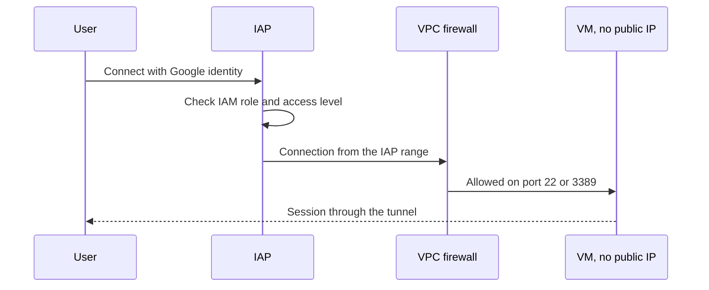

This note describes how to replace bastion hosts and broad VPN access on GCP with Identity-Aware Proxy (IAP), and how to limit data exfiltration from Google APIs with VPC Service Controls (VPC-SC). It is written for senior DevOps engineers. The two products answer different questions: IAP controls who connects to a resource, VPC-SC controls where data from Google APIs may flow. Private clusters are in [[architecture/private-gke-and-controlled-egress]], and identities for CI are in [[architecture/iam-groups-and-ci-workload-identity-federation]].

> [!info] Scope and sources
> Written against the IAP, Access Context Manager and VPC Service Controls documentation on cloud.google.com, as understood in October 2026. Terraform examples use the `google` provider.

> [!note] Not verified
> The claims below were written from documentation knowledge and were not checked against a running system or the current docs: the IAP TCP forwarding source range (commonly documented as `35.235.240.0/20`; confirm it), the list of services that VPC Service Controls supports, and the dry-run field names. Check them before relying on them.

## Why move off bastions

- A bastion is a long-lived VM with a public address, SSH keys that nobody rotates, and a shell that sees the whole network.
- A VPN gives a laptop a route to a whole network, so one stolen laptop is one stolen network.
- IAP authenticates each connection with the user's Google identity and IAM, logs it, and exposes only the port and instance you allowed. No public IP is needed on the target.
- Access decisions can include device and network context, and can be reviewed like any other IAM binding ([[compliance/access-reviews-gcp-and-gke]]).

## IAP for SSH and RDP



The firewall must allow the IAP source range to the target port; without that rule the tunnel opens but the connection times out.

```hcl title="iap/firewall.tf"
resource "google_compute_firewall" "allow_iap_admin_ports" {
  project   = "net-prod-host" # change: host project
  name      = "allow-iap-ssh-rdp"
  network   = "projects/net-prod-host/global/networks/prod" # change: your VPC
  direction = "INGRESS"
  priority  = 1000

  source_ranges = ["35.235.240.0/20"] # IAP range: confirm in current docs

  allow {
    protocol = "tcp"
    ports    = ["22", "3389"]
  }

  target_tags = ["iap-admin"]

  log_config {
    metadata = "INCLUDE_ALL_METADATA"
  }
}

resource "google_iap_tunnel_instance_iam_member" "ops_tunnel" {
  project  = "team-a-prod" # change: project of the VM
  zone     = "europe-west1-b" # change: zone of the VM
  instance = "ops-vm-1" # change: instance name
  role     = "roles/iap.tunnelResourceAccessor"
  member   = "group:ops-oncall@example.com" # change: your group
}
```

Grant `roles/iap.tunnelResourceAccessor` to groups, scoped to instances or projects, not to individuals and not to the whole organisation. Pair it with OS Login so that SSH access follows IAM too.

```bash
set -euo pipefail

PROJECT_ID="team-a-prod"   # change: project of the VM
ZONE="europe-west1-b"      # change: zone of the VM
INSTANCE="ops-vm-1"        # change: instance name

# SSH through IAP, no public IP needed.
gcloud compute ssh "$INSTANCE" \
  --project "$PROJECT_ID" --zone "$ZONE" \
  --tunnel-through-iap

# Forward a port, e.g. a private database admin port, to localhost.
gcloud compute start-iap-tunnel "$INSTANCE" 5432 \
  --project "$PROJECT_ID" --zone "$ZONE" \
  --local-host-port localhost:5432
```

The same tunnel can reach a small proxy VM in front of a private GKE control plane, which is how CI or an engineer reaches a private endpoint without a VPN.

## IAP for web apps

For internal web tools (dashboards, Argo CD, admin consoles) put IAP in front of a load balancer. Users sign in with their Google identity, and the backend receives a signed header you can verify. Grant `roles/iap.httpsResourceAccessor` on the backend service to a group. This replaces VPN-only access to internal tools and gives per-application access control. Verify the signed header in the application if it can be reached any other way than through the load balancer.

## Access levels

Access Context Manager lets you define conditions such as source IP ranges, device attributes and identities, and use them as access levels in IAP and VPC-SC.

```hcl title="iap/access-level.tf"
variable "access_policy_id" {
  type        = string
  description = "Numeric ID of the organisation access policy"
  default     = "123456789" # change: your access policy ID
}

resource "google_access_context_manager_access_level" "corp_network" {
  parent = "accessPolicies/${var.access_policy_id}"
  name   = "accessPolicies/${var.access_policy_id}/accessLevels/corp_network"
  title  = "corp_network"

  basic {
    conditions {
      ip_subnetworks = ["203.0.113.0/24"] # change: office or VPN egress range
    }
  }
}
```

Device-based conditions (managed device, disk encryption, OS version) work only when the device reports that information to Google, typically through Endpoint Verification or a management agent. If your fleet does not report it, a device-based level denies everyone, so test with a pilot group before enforcing.

## VPC Service Controls perimeters

A perimeter is a boundary around projects and services. Inside it, projects can use the restricted APIs freely. A request that crosses the boundary (from outside to inside, or inside to a project outside) is denied unless an ingress or egress rule allows it. This limits what a stolen credential can read from a bucket or dataset, and stops copying data to a project the attacker controls.

IAP and VPC-SC compose: IAP gets the right person to the right VM, and VPC-SC makes sure that VM's service account cannot copy data out through Google APIs.

```hcl title="vpcsc/perimeter.tf"
resource "google_access_context_manager_service_perimeter" "prod" {
  parent = "accessPolicies/${var.access_policy_id}"
  name   = "accessPolicies/${var.access_policy_id}/servicePerimeters/prod"
  title  = "prod"

  perimeter_type            = "PERIMETER_TYPE_REGULAR"
  use_explicit_dry_run_spec = true

  # Dry-run configuration: violations are logged, not enforced.
  spec {
    resources = ["projects/111111111111"] # change: project NUMBER, not ID

    restricted_services = [
      "storage.googleapis.com",
      "bigquery.googleapis.com",
      "artifactregistry.googleapis.com",
    ]

    vpc_accessible_services {
      enable_restriction = true
      allowed_services   = ["RESTRICTED-SERVICES"]
    }

    # CI ingress example: only the CI build service account, coming from the CI project,
    # may write to Artifact Registry in this perimeter. Values to change: the account and both project numbers.
    ingress_policies {
      ingress_from {
        identities = ["serviceAccount:ci-build@ci-project.iam.gserviceaccount.com"] # change

        sources {
          resource = "projects/222222222222" # change: CI project number
        }
      }

      ingress_to {
        resources = ["projects/111111111111"] # change: project inside the perimeter

        operations {
          service_name = "artifactregistry.googleapis.com"

          # Placeholder method, not verified as the image upload method. Replace it with the
          # upload/write methods your dry-run violation log shows, and check the names in the current docs.
          method_selectors {
            method = "google.devtools.artifactregistry.v1.ArtifactRegistry.CreateRepository"
          }
        }
      }
    }
  }

  lifecycle {
    ignore_changes = [status]
  }
}
```

The `status` block (the enforced configuration) is ignored here on purpose, so promoting from dry run to enforcement is a deliberate second change. Field names and the supported-services list change over time; check the current Terraform provider and VPC-SC documentation.

## Dry-run first

Never enforce a perimeter you have not watched. The sequence:

1. Create the perimeter with only the dry-run spec set.
2. Wait at least one full business cycle (a week, including month-end jobs and releases) and read the violation logs in Cloud Logging.
3. For each violation, decide: fix the caller, or add an ingress or egress rule with the narrowest identity and method.
4. Copy the dry-run spec to the enforced configuration, first for a non-production perimeter.
5. Keep an emergency path: a break-glass identity in an access level, and the exact command to remove a project from the perimeter, written down before enforcement.

## CI and VPC-SC

CI is where perimeters bite first. Runners and build services outside the perimeter cannot push to a registry or bucket inside it. Options:

- Run runners inside the perimeter's projects and networks ([[patterns/gitlab-runners-on-gke]]).
- Add an ingress rule allowing the CI service account (federated, no keys) from the runner network's access level, scoped to the registry or bucket and the methods it needs.
- Keep build artifacts in a project inside the perimeter and let only the CI identity write to it.

Cloud Build and similar managed services run from Google-managed networks, so they need explicit rules or must run in a private pool. Write the rule per service and test with dry run before enforcement.

## Pitfalls

- **IAP range missing from the firewall.** The tunnel starts and then the connection hangs. Check the rule, the target tags and the VM's network.
- **VPC-SC blocking registry pulls and builds from outside.** Image pulls by nodes inside the perimeter are fine, but pulls from a laptop, a SaaS runner or another project fail with a perimeter violation. Look for `VPC_SERVICE_CONTROLS` in the audit log.
- **Device-based access levels clients do not report.** Everyone is denied, including the people who must fix it. Keep a break-glass level and test with a small group.
- **Too many resources in one perimeter.** One large perimeter hides problems and needs endless exceptions. Prefer a perimeter per environment, and bridge with narrow rules.
- **Treating IAP as network security.** IAP does not stop a compromised VM from calling Google APIs; that is the job of VPC-SC and least-privilege service accounts.
- **Unreviewed rules.** Ingress and egress rules accumulate. Review them with the same cadence as IAM.

## Verify

```bash
set -euo pipefail

PROJECT_ID="team-a-prod"   # change: your project ID
POLICY_ID="123456789"      # change: access policy ID

PROJECT_NUMBER="123456789012"  # change: number of the project
ZONE="europe-west1-b"
INSTANCE="ops-vm-1"

# Who can tunnel to the instance? The tunnel policy is on the IAP resource,
# not the Compute Engine instance policy. Endpoint not verified; check the IAP API reference.
curl -sS -X POST \
  -H "Authorization: Bearer $(gcloud auth print-access-token)" \
  -H "Content-Type: application/json" -d '{}' \
  "https://iap.googleapis.com/v1/projects/${PROJECT_NUMBER}/iap_tunnel/zones/${ZONE}/instances/${INSTANCE}:getIamPolicy"

# For project-level grants instead:
gcloud projects get-iam-policy "$PROJECT_ID" \
  --flatten="bindings[].members" \
  --filter="bindings.role:roles/iap.tunnelResourceAccessor" \
  --format="table(bindings.role, bindings.members)"

# What does the perimeter look like, enforced and dry run?
gcloud access-context-manager perimeters describe prod \
  --policy "$POLICY_ID" \
  --format "yaml(title,spec,status)"

# Dry-run violations from the last day.
gcloud logging read \
  'protoPayload.metadata.@type="type.googleapis.com/google.cloud.audit.VpcServiceControlAuditMetadata" AND protoPayload.metadata.dryRun=true' \
  --project "$PROJECT_ID" --freshness 1d --limit 20 \
  --format "value(protoPayload.authenticationInfo.principalEmail,protoPayload.serviceName)"
```

Expected: the group appears with `roles/iap.tunnelResourceAccessor` on the instance, the perimeter shows your `spec` and an empty or older `status`, and the log query shows who would have been blocked. The log filter field names are from documentation memory; adjust them to what your audit logs actually contain.

## Rollback

- IAP: remove the IAM binding and the firewall rule. The VM keeps running; only access changes. Keep a documented alternative (OS Login with a temporary public path) for the first weeks.
- VPC-SC: move a project out of the perimeter, or switch the perimeter back to dry run, using the break-glass identity. Perimeter changes can take minutes to propagate, so do not rely on them in the middle of an incident ([[runbooks/incident-response]]).

## Related

- [[architecture/private-gke-and-controlled-egress]]: private clusters and the network side of keeping traffic inside.
- [[architecture/iam-groups-and-ci-workload-identity-federation]]: the groups and federated CI identities used in the bindings above.
- [[compliance/access-reviews-gcp-and-gke]]: reviewing IAP and perimeter access on a schedule.
- [[runbooks/incident-response]]: using break-glass access during an incident.
