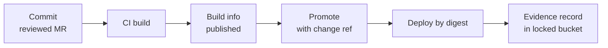

This note covers Artifactory as an audit trail: which records it keeps, how to make them useful as evidence, and how to answer "where did this artifact come from?" years later. The pipeline itself (repositories, promotion stages) is in [[patterns/artifact-promotion-artifactory]]; here only the evidence fields and their verification are covered.

> [!warning] Not legal or audit advice
> This is general engineering guidance. Your auditor, assessor or legal counsel decides what satisfies a control or a legal obligation; check control numbers and wording against the current edition of the framework.

> [!info] Not checked against a running system
> JFrog CLI subcommand names and flags vary by CLI and Artifactory version, and some features depend on edition. The commands are illustrative; check the current JFrog documentation.

## What Artifactory can prove and what it cannot

It can show what was stored, when, under which checksum, which build produced it, which commit that build recorded, and who promoted it. It cannot prove the build was hermetic or that the build info is truthful, because the CI job writes that information. Proving the build environment is the job of provenance attestations; see [[compliance/slsa-build-provenance]]. Think of Artifactory records as a well-indexed claim by CI, cross-checked against Git and the approval system.

## The digest is the identity

A tag names an artifact; a digest identifies it. Artifactory stores SHA-256 (and others) checksums for files, and container images have a manifest digest. Evidence records and deployments should carry the digest:

- A Docker tag like `1.4.2` can be overwritten or retagged. `sha256:...` cannot refer to different content.
- Deploy by digest, and record the digest in the deploy record. Admission-time verification is in [[patterns/image-signing-and-admission-verification]].

## Publishing build info from CI

Build info is a JSON document tying a build name and number to its artifacts, dependencies, environment and VCS revision. Publish it from CI so it carries the commit and the CI URL.

```yaml title=".gitlab-ci.yml"
variables:
  JF_URL: "https://artifactory.example.com" # change: your Artifactory URL
  BUILD_NAME: "${CI_PROJECT_PATH_SLUG}"
  BUILD_NUMBER: "${CI_PIPELINE_ID}"

publish-build-info:
  stage: publish
  image: releases-docker.jfrog.io/jfrog/jfrog-cli-v2-jf:X.Y.Z@sha256:0000000000000000000000000000000000000000000000000000000000000000 # change: pinned version and digest
  rules:
    - if: $CI_COMMIT_BRANCH == $CI_DEFAULT_BRANCH
  script:
    # Subcommand names and flags differ by CLI version: check "jf rt --help".
    - jf rt upload "dist/*" example-generic-local/${CI_PROJECT_NAME}/${CI_COMMIT_SHA}/ --build-name="${BUILD_NAME}" --build-number="${BUILD_NUMBER}"
    - jf rt build-collect-env "${BUILD_NAME}" "${BUILD_NUMBER}"
    - jf rt build-add-git "${BUILD_NAME}" "${BUILD_NUMBER}"
    - jf rt build-publish "${BUILD_NAME}" "${BUILD_NUMBER}"
```

Authenticate with a short-lived or narrowly scoped token for this pipeline, supplied as a masked CI variable. Do not give every pipeline an admin token.

## Promotion records

Promotion moves a build's artifacts to the next repository and records who, when and why. Record the change reference as a property so a search can find it.

```bash title="scripts/promote-with-evidence.sh"
set -euo pipefail

BUILD_NAME="example-org-api"          # change: build name
BUILD_NUMBER="1042"                   # change: build number
TARGET_REPO="example-docker-prod-local" # change: target repository
CHANGE_REF="CHG-1234"                 # change: your change ticket

# Check the exact flags in the current JFrog CLI docs before use.
jf rt build-promote "${BUILD_NAME}" "${BUILD_NUMBER}" "${TARGET_REPO}" \
  --status="promoted-to-prod" --comment="Approved under ${CHANGE_REF}"

jf rt set-props "${TARGET_REPO}/example-org/api/*" \
  "promoted.by=${GITLAB_USER_LOGIN:-unknown};promoted.at=$(date -u +%Y-%m-%dT%H:%M:%SZ);change.ref=${CHANGE_REF}"
```

Restrict the permission to promote to a dedicated identity and to the environment approvers' pipeline. If any developer token can promote, the record says nothing about approval.

## Linking attestations and SBOMs

Store the SBOM and the provenance attestation next to the artifact, or reference them by the artifact digest, so one lookup returns all three ([[compliance/sbom-generation-and-storage]]). Newer Artifactory versions have an evidence feature for attaching signed attestations to artifacts and builds. Check the current docs and your edition before relying on it, and keep a plain-file fallback.

## Keeping the chain intact



The chain breaks when someone removes a link:

- Cleanup and retention must not delete build info or promoted artifacts needed for the audit period; align with [[standards/artifact-retention-policy]] and [[legal-hold-for-logs-and-artifacts]].
- Make production repositories not allow overwrite or delete for normal users.
- Export build info JSON to the evidence bucket on promotion, so the record survives an Artifactory migration or accidental deletion.

## Build retention and exporting build info

Build info has its own lifecycle, separate from artifact retention. Old builds can be discarded by a build-retention setting or a cleanup job, and the artifacts they describe can outlive the record that explains them. Set the retention for builds that reach production to at least the audit and legal retention period, and keep the discard rules for everything else.

```bash title="scripts/build-retention-and-export.sh"
set -euo pipefail

BUILD_NAME="${BUILD_NAME:?set the build name}"
BUILD_NUMBER="${BUILD_NUMBER:?set the build number}"
EVIDENCE_BUCKET="gs://example-org-evidence" # change: locked evidence bucket

# Discard old non-production builds only; check "jf rt build-discard --help" for flags in your CLI version.
jf rt build-discard "${BUILD_NAME}" --max-days=90 --exclude-builds="${BUILD_NUMBER}"

# Export the build info JSON for the promoted build to the evidence bucket.
jf rt curl -XGET "/api/build/${BUILD_NAME}/${BUILD_NUMBER}" > "buildinfo-${BUILD_NAME}-${BUILD_NUMBER}.json"
gcloud storage cp "buildinfo-${BUILD_NAME}-${BUILD_NUMBER}.json" \
  "${EVIDENCE_BUCKET}/buildinfo/$(date -u +%Y/%m)/"
```

Two checks make this real. First, run the trace script below against an artifact from the oldest period you must cover and confirm the build info still resolves. Second, confirm the evidence bucket copy matches the live record by comparing checksums, because the export is what survives a migration or an accidental deletion. A legal hold ([[legal-hold-for-logs-and-artifacts]]) overrides any discard rule, so make the discard job skip held builds.

## Verifying an artifact years later

Start from the digest recorded in the deploy record, then walk back.

```bash title="scripts/trace-artifact.sh"
set -euo pipefail

SHA256="0123456789abcdef0123456789abcdef0123456789abcdef0123456789abcdef" # change: digest from the deploy record

# 1. Find the file by checksum with AQL, including its build properties.
cat > query.aql <<AQL
items.find({"sha256":"${SHA256}"}).include("repo","path","name","created","property.key","property.value")
AQL
jf rt curl -XPOST /api/search/aql -H "Content-Type: text/plain" -d @query.aql > aql-result.json

# 2. Read the build name and number from the properties of the first result.
BUILD_NAME="$(jq -r '.results[0].properties[] | select(.key=="build.name") | .value' aql-result.json)"
BUILD_NUMBER="$(jq -r '.results[0].properties[] | select(.key=="build.number") | .value' aql-result.json)"
: "${BUILD_NAME:?no build.name property on the artifact}" "${BUILD_NUMBER:?no build.number property}"

# 3. Fetch the build info.
jf rt curl -XGET "/api/build/${BUILD_NAME}/${BUILD_NUMBER}" > buildinfo.json

# 4. Walk to the commit and the CI run.
jq -r '.buildInfo | {started, url, vcs: .vcs[0].revision, vcsUrl: .vcs[0].url}' buildinfo.json
```

Then take the commit from `vcs`, find its merge request in Git, and read the approvals. If any link is missing, you have found a gap to record, not a detail to skip.

## Pitfalls

- **Overwrite allowed.** The same path can hold different content over time; rely on the checksum.
- **Retagging.** A moved tag silently changes what "1.4.2" means.
- **Build info deleted by a build-retention setting.** Check build retention separately from artifact retention.
- **Shared admin tokens.** Records then name the token, not a person or pipeline.
- **Trusting properties as proof.** Properties can be edited by anyone with permission; protect that permission and export copies.

## Related

- [[patterns/artifact-promotion-artifactory]]: repositories and the promotion pipeline.
- [[compliance/slsa-build-provenance]]: attestations about how the build ran.
- [[compliance/sbom-generation-and-storage]]: inventory of components.
- [[standards/artifact-retention-policy]]: retention rules this must not conflict with.
- [[patterns/image-signing-and-admission-verification]]: verifying digests at deploy time.
- [[legal-hold-for-logs-and-artifacts]]: protecting artifacts from cleanup.

## Sources

- JFrog, [JFrog CLI documentation](https://docs.jfrog-applications.jfrog.io/): build integration and promotion commands.
- JFrog, [Artifactory documentation](https://jfrog.com/help/r/jfrog-artifactory-documentation): build info, AQL and properties pages.
- SLSA, [specification](https://slsa.dev/spec/).
