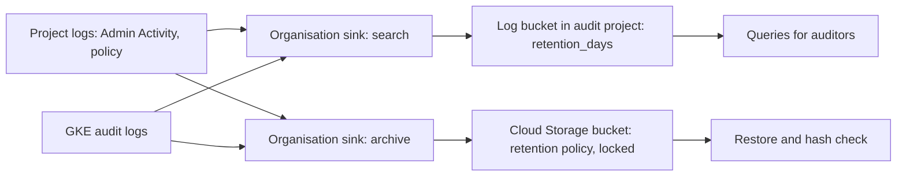

This note is for senior DevOps engineers who must keep delivery and cloud evidence long enough for an audit, keep it trustworthy, and find it again in an afternoon. It covers sources, retention, a central log bucket plus a locked archive, and a periodic collection procedure. What the evidence should show for each change is in [[compliance/change-management-controls-and-pipeline-evidence]]; personal data in logs is in [[compliance/pci-dss-and-gdpr-for-devops-logs-and-data]]; backups are in [[architecture/backup-architecture-gke-cloud-sql-gcs]].

> [!warning] Not legal or audit advice
> This is general engineering guidance. Your auditor, assessor or legal counsel decides what satisfies a control or a legal obligation; check control numbers and wording against the current edition of the framework.

> [!info] Scope and sources
> Written for Google Cloud (Cloud Audit Logs, Cloud Logging, Cloud Storage), GKE, GitLab CI and Jenkins. Based on the Cloud Logging, Cloud Storage retention policy, GKE audit logging and GitLab artifacts documentation. Retention targets in the tables are examples; your policy sets the real numbers.

> [!note] Not verified
> The claims below were written from documentation knowledge and were not checked against a running system or the current docs: default retention for each Cloud Audit Log type and log bucket, GitLab artifact and Jenkins build discarder defaults, the Terraform resource and argument names, and how far the GKE control-plane audit policy can be configured (it is managed by Google). Check them before relying on them.

## Principles

- **Keep evidence of the control, not everything.** Decide per control what proves it, and keep that. Hoarding logs costs money and widens the personal data you hold.
- **Evidence leaves the system that produced it.** A record that can be deleted by the people it describes is weak. Copy it to a store they cannot edit.
- **Write once, read many.** Use retention policies and locks so records cannot be shortened or deleted early, and use a separate project with few writers.
- **Make retrieval a tested procedure.** If nobody has ever pulled a quarter of evidence, the first attempt will be during the audit.
- **Record the retention decision.** Each source has an owner, a target period and the reason for it.

## Sources and retention

Defaults change; the column "default to check" is a prompt to look them up, not a statement of the current value.

| Source                           | What it proves                                        | Default retention to check                         | Target retention (example)       | Storage                                 |
| -------------------------------- | ----------------------------------------------------- | -------------------------------------------------- | -------------------------------- | --------------------------------------- |
| Git history, MR approvals        | Who changed what, who reviewed                        | Kept while the project exists                      | Life of the project plus archive | GitLab, plus a periodic export          |
| CI job logs and artifacts        | Tests ran, evidence records, scan results             | Artifact expiry per project and instance           | Evidence records: full period    | GitLab artifacts, then evidence bucket  |
| Jenkins build records            | Build result, approver on `input`, console log        | Build discarder settings per job                   | Same as CI evidence              | Jenkins, plus archived artifacts to GCS |
| Argo CD history                  | What was synced, when, from which revision            | Limited history per application                    | Copy at deploy time              | Evidence bucket                         |
| Kubernetes audit logs (GKE)      | Who called the Kubernetes API and what they did       | Per Cloud Logging bucket                           | Audit period plus margin         | Central log bucket, archive in GCS      |
| Cloud Audit Logs: Admin Activity | Who changed cloud resources (IAM, clusters, networks) | Per log type and bucket                            | Audit period plus margin         | Central log bucket, archive in GCS      |
| Cloud Audit Logs: Data Access    | Who read or wrote data when enabled                   | Often shorter and off by default for many services | Only where a control needs it    | Central log bucket, archive in GCS      |
| IAM policy and group exports     | Who had access on a date                              | Not retained as history by default                 | Snapshot at each review          | Evidence bucket                         |

Set the period from the shortest of your obligations (contract, framework, law) that your counsel and auditor confirm, not from the storage default.

## Central log bucket and locked archive

Send audit logs from all projects to one place with a sink at organisation (or folder) level. Use two destinations: a Cloud Logging bucket with a fixed retention for searching, and a Cloud Storage bucket with a retention policy as the durable archive.



The Terraform below creates both in a dedicated audit project. Resource and argument names are written from documentation knowledge; run `terraform validate` and review the plan.

```hcl title="audit/main.tf"
variable "org_id" {
  type        = string
  description = "Organisation ID that owns the audit sinks."
}

variable "audit_project_id" {
  type        = string
  description = "Dedicated project that stores audit logs; few people have write access."
}

variable "region" {
  type    = string
  default = "europe-west1" # change: region that meets your data residency needs
}

resource "google_logging_project_bucket_config" "audit" {
  project        = var.audit_project_id
  location       = var.region
  bucket_id      = "audit-central"
  retention_days = 400 # change: audit period plus margin, per your policy
  description    = "Central audit logs for search"
  # locked = true makes retention permanent; see the warning below before enabling.
  locked = false
}

resource "google_logging_organization_sink" "audit_search" {
  name             = "audit-to-log-bucket"
  org_id           = var.org_id
  include_children = true
  destination      = "logging.googleapis.com/projects/${var.audit_project_id}/locations/${var.region}/buckets/${google_logging_project_bucket_config.audit.bucket_id}"
  filter           = "LOG_ID(\"cloudaudit.googleapis.com/activity\") OR LOG_ID(\"cloudaudit.googleapis.com/policy\") OR LOG_ID(\"cloudaudit.googleapis.com/system_event\")"
}

resource "google_project_iam_member" "sink_writes_logs" {
  project = var.audit_project_id
  role    = "roles/logging.bucketWriter"
  member  = google_logging_organization_sink.audit_search.writer_identity
}

resource "google_storage_bucket" "audit_archive" {
  name                        = "example-audit-archive-${var.audit_project_id}" # change: globally unique name
  project                     = var.audit_project_id
  location                    = var.region
  uniform_bucket_level_access = true
  public_access_prevention    = "enforced"

  # No versioning block: Object Versioning cannot be combined with a retention policy.
  # The retention policy is what protects the records from overwrite and delete.
  retention_policy {
    retention_period = 63072000 # seconds; two years here, change per your policy
    is_locked        = false    # see the warning below before setting true
  }
}

resource "google_logging_organization_sink" "audit_archive" {
  name             = "audit-to-archive"
  org_id           = var.org_id
  include_children = true
  destination      = "storage.googleapis.com/${google_storage_bucket.audit_archive.name}"
  filter           = "LOG_ID(\"cloudaudit.googleapis.com/activity\") OR LOG_ID(\"cloudaudit.googleapis.com/policy\") OR LOG_ID(\"cloudaudit.googleapis.com/system_event\")"
}

resource "google_storage_bucket_iam_member" "sink_writes_archive" {
  bucket = google_storage_bucket.audit_archive.name
  role   = "roles/storage.objectCreator"
  member = google_logging_organization_sink.audit_archive.writer_identity
}
```

> [!danger] Locking cannot be undone
> A locked Cloud Storage retention policy cannot be shortened or removed, and a locked log bucket cannot be unlocked or have its retention reduced. Objects and logs stay, and keep costing money, for the full period, and even deleting the project may not remove them early. Try everything with `is_locked = false` and `locked = false`, check the retention period twice in review, and lock only with a recorded decision from the person who owns the policy.

Grant read access to the audit project narrowly (a group for auditors with viewer roles, reviewed per [[compliance/access-reviews-gcp-and-gke]]) and give nobody delete rights on the archive bucket. Sink exclusion filters are a way to save cost; add them deliberately and record them, because they are also a way to lose evidence.

## Kubernetes audit logging on GKE

On GKE, Admin Activity audit entries for the Kubernetes API are written to Cloud Logging by default. Data Access entries (reads and non-admin writes) are a separate setting, and the control-plane audit policy itself is managed by Google, so you cannot tune it per verb the way you can on a self-managed cluster. Both points are not verified here; check the GKE audit logging documentation for your version.

If a control needs Data Access entries, enable them with an IAM audit config, and estimate the volume first, because they can be large. The audit config below for `container.googleapis.com` covers the GKE API (cluster and node pool operations), not the Kubernetes API (`k8s.io`). Kubernetes API audit entries are controlled differently on GKE; this is not verified, so check the GKE audit logging documentation.

```hcl title="audit/gke-data-access.tf"
resource "google_project_iam_audit_config" "gke" {
  project = var.workload_project_id # change: the project that hosts the clusters
  service = "container.googleapis.com" # GKE management API, not the Kubernetes API (k8s.io)

  audit_log_config {
    log_type = "DATA_WRITE"
  }

  audit_log_config {
    log_type = "DATA_READ"
  }
}
```

Declare `workload_project_id` as a string variable like the others. Start with one non-production project, look at the volume and the cost for a week, then decide for production.

## CI artifacts

Separate small, high-value evidence from large, low-value logs. Evidence records get a long expiry and are copied to the archive; test reports and build output get a short one.

```yaml title=".gitlab-ci.yml"
test:
  stage: test
  script:
    - make test
  artifacts:
    when: always
    paths:
      - reports/
    # Verbose output: keep briefly. The pass or fail result is kept in the pipeline record.
    expire_in: 4 weeks

record-evidence:
  stage: deploy
  rules:
    - if: $CI_COMMIT_BRANCH == $CI_DEFAULT_BRANCH
  script:
    - ./ci/write-evidence.sh > evidence.json
  artifacts:
    paths:
      - evidence.json
    # change: match the evidence retention policy
    expire_in: 104 weeks
```

Instance and group settings can cap or override artifact expiry, and the "keep latest artifacts" setting changes what is deleted (both not verified); check them in the admin area. Treat GitLab as a working store: a scheduled job or the deploy job should also copy `evidence.json` to the archive bucket using workload identity federation, not a long-lived key.

For Jenkins, set a build discarder on every job that deploys, and archive the evidence file as a build artifact. Discarder defaults depend on the instance configuration, so set it explicitly.

```groovy title="Jenkinsfile"
pipeline {
  agent any
  options {
    // change: keep enough builds or days to cover the evidence period
    buildDiscarder(logRotator(daysToKeepStr: '400', artifactDaysToKeepStr: '400'))
  }
  stages {
    stage('Record evidence') {
      steps {
        sh './ci/write-evidence.sh > evidence.json'
        archiveArtifacts artifacts: 'evidence.json', fingerprint: true
      }
    }
  }
}
```

## Retrieving evidence for a period

Do this once per quarter, as a drill, not only when asked. Record who ran it and the output hashes.

### 1. Fix the period and scope

Agree the start, the end (exclusive), the environments and the systems in scope with the auditor in writing.

### 2. Export Admin Activity entries for the clusters

```bash
set -euo pipefail

AUDIT_PROJECT="my-audit-project"   # change: project that holds the central log bucket
LOG_LOCATION="europe-west1"        # change: location of the log bucket
LOG_BUCKET="audit-central"         # change: log bucket ID
CLUSTER_NAME="prod-gke-1"          # change: cluster to export
PERIOD_START="2026-07-01T00:00:00Z" # change: inclusive
PERIOD_END="2026-10-01T00:00:00Z"   # change: exclusive
OUT_FILE="gke-admin-activity-${CLUSTER_NAME}.json"

gcloud logging read \
  "log_id(\"cloudaudit.googleapis.com/activity\") AND resource.type=\"k8s_cluster\" AND resource.labels.cluster_name=\"${CLUSTER_NAME}\" AND timestamp>=\"${PERIOD_START}\" AND timestamp<\"${PERIOD_END}\"" \
  --project="${AUDIT_PROJECT}" \
  --bucket="${LOG_BUCKET}" \
  --location="${LOG_LOCATION}" \
  --view="_AllLogs" \
  --order="asc" \
  --format=json > "${OUT_FILE}"

sha256sum "${OUT_FILE}" | tee "${OUT_FILE}.sha256"
```

### 3. Export CI and deploy records

Collect `evidence.json` files for the period from the archive bucket, and the Argo CD history export. Name the files with the commit SHA and the date.

### 4. Build a manifest

List every file, its SHA-256 hash, its source and the time of export. Store the manifest next to the files and keep a copy of its hash somewhere a different team controls. That is what makes the set tamper-evident after the fact.

### 5. Verify retention settings

Capture the settings as part of the evidence, because they prove the logs could not be shortened.

```bash
set -euo pipefail

AUDIT_PROJECT="my-audit-project"    # change: project that holds the audit resources
LOG_LOCATION="europe-west1"         # change: location of the log bucket
LOG_BUCKET="audit-central"          # change: log bucket ID
ARCHIVE_BUCKET="example-audit-archive-my-audit-project" # change: archive bucket name

# Retention and lock state of the log bucket.
gcloud logging buckets describe "${LOG_BUCKET}" \
  --project="${AUDIT_PROJECT}" \
  --location="${LOG_LOCATION}" \
  --format="yaml(name,retentionDays,locked)"

# Retention policy of the archive bucket; look for the period and whether it is locked.
gcloud storage buckets describe "gs://${ARCHIVE_BUCKET}" --format=json
```

### 6. Hand over

Give the auditor read access to the evidence set, or a copy, through the channel you agreed, and keep a record of what was shared. Do not mail personal data in clear text.

## Pitfalls

- **Cost.** Data Access logs and long retention in Cloud Logging can be expensive. Use the cheaper archive for the long tail and a shorter search window in the log bucket.
- **Personal data.** Audit logs contain user emails, IP addresses and sometimes request content. Know your lawful basis and deletion obligations before choosing long retention; see [[compliance/pci-dss-and-gdpr-for-devops-logs-and-data]].
- **Irreversible locks.** A mistake in a locked retention period lasts for that period. Review it as you would a database migration.
- **Sink gaps.** A new project or folder outside the sink's scope is not collected. Test the sink with a change in a new project, and alert when the sink errors.
- **Same-admin problem.** If the people audited administer the audit project, the archive is weaker than it looks. Separate the roles.
- **Untested restore.** An archive you have never read back may be unreadable or incomplete. The quarterly drill covers this.
- **Clock and time zone.** Query in UTC and say so in the evidence.

## Related

- [[compliance/change-management-controls-and-pipeline-evidence]]: what the per-change evidence record contains.
- [[compliance/pci-dss-and-gdpr-for-devops-logs-and-data]]: personal data and retention limits for logs.
- [[architecture/backup-architecture-gke-cloud-sql-gcs]]: backup design that shares the retention and lock concerns.
- [[runbooks/incident-response]]: where audit logs are used during an incident.
- [[compliance/access-reviews-gcp-and-gke]]: reviewing who can read or write the evidence stores.
