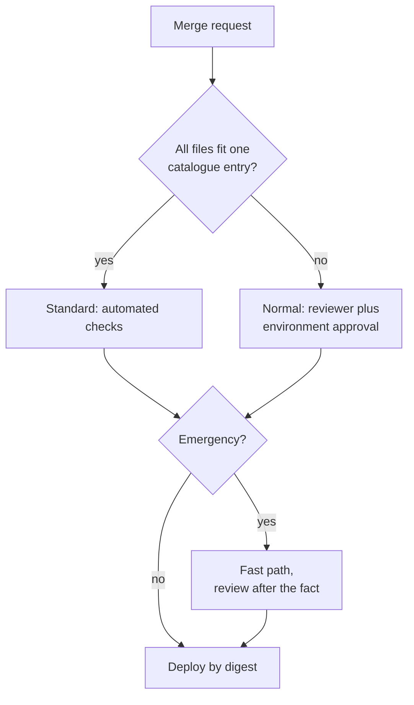

A weekly change advisory board (CAB) was designed for slow, large releases. With many small deploys a day it becomes a queue. This pattern keeps what the board gave the organisation, which is authorisation, risk awareness and evidence, and moves it into tiers, pre-approved changes and merge-request approvals.

> [!warning] Not legal or audit advice
> This is general engineering guidance. Your auditor, assessor or legal counsel decides what satisfies a control or a legal obligation; check control numbers and wording against the current edition of the framework.

> [!info] Not checked against a running system
> GitLab feature availability depends on tier and edition (protected environments, deployment approvals, multiple approval rules). The pipeline snippets are illustrative; check the current docs.

## What a CAB is for and what it costs in flow

A board does three things: it authorises risky changes, it spreads awareness across teams, and it leaves a record. It costs waiting time, batching (people hold changes for the meeting) and shallow review (twenty changes in thirty minutes). Research from the DORA programme has reported that heavyweight external approval processes do not improve stability and are associated with slower delivery. I am recalling this from the programme's published reports, so read the current report on [dora.dev](https://dora.dev/) before quoting it to anyone.

The goal is not to remove oversight. It is to apply human attention where risk is, and to make everything else pass automated checks that leave evidence.

## Change types

ITIL 4 change enablement uses standard, normal and emergency changes; check the exact wording in the current guidance. A practical set of criteria:

| Type      | Criteria                                                            | Authorisation                                        |
| --------- | ------------------------------------------------------------------- | ---------------------------------------------------- |
| Standard  | Low risk, repeatable, well understood, bounded by a catalogue entry | Pre-approved; automated checks only                  |
| Normal    | Anything not in the catalogue                                       | Merge-request approval plus environment approval     |
| Emergency | Restores service or closes an active security issue                 | Fast path, reviewed after the fact within a set time |

## Pre-approved standard changes defined in code

A standard change is pre-approved because its shape is bounded and its checks are automatic. Define the catalogue in Git, change it by merge request with security and platform owners, and keep its history.

```yaml title="change-catalogue.yaml"
standard_changes:
  - id: base-image-patch-rebuild
    description: Rebuild an image on the same base tag to pick up patch updates.
    allowed_paths: ["services/*/Dockerfile", "services/*/image.lock"]
    bounds: "No change to ports, users or entrypoint"
    required_checks: ["unit-tests", "image-scan", "smoke-test"]
    owner: platform-lead
  - id: helm-values-within-bounds
    description: Adjust replicas and resource requests inside agreed ranges.
    allowed_paths: ["deploy/*/values-*.yaml"]
    bounds: "replicas 2-20, memory request <= 2Gi"
    required_checks: ["helm-lint", "policy-check"]
    owner: platform-lead
  - id: renovate-patch-update
    description: Patch-level dependency updates from the update bot.
    allowed_paths: ["package-lock.json", "go.sum", "requirements.txt"]
    bounds: "Patch version only"
    required_checks: ["unit-tests", "dependency-scan"]
    owner: security-lead
```

A type is added after a trial period with no failures. It is revoked, by merge request, after an incident that it caused; the incident record links to the revocation. See [[patterns/automated-dependency-updates]] for the update bot side.

## Normal changes

Normal changes are authorised asynchronously where the work already happens:

- A merge request with required approvals and CODEOWNERS for sensitive paths.
- A protected production environment with deployment approvals, so a named approver clicks before the deploy runs.
- Optionally an extra approver for high-risk paths, such as IAM, networking or cluster configuration.

The settings are in [[compliance/separation-of-duties-in-deployments]]. This note adds the classification, shown below.

## Classifying a merge request in CI

A job compares the changed paths to the catalogue and decides whether the change is standard. If it is not, it demands the extra approval.

```yaml title=".gitlab-ci.yml"
classify-change:
  stage: .pre
  image: python:3.12-slim # pin a digest in real use
  rules:
    - if: $CI_PIPELINE_SOURCE == "merge_request_event"
  script:
    - pip install --quiet pyyaml
    - git fetch origin "${CI_MERGE_REQUEST_TARGET_BRANCH_NAME}" --depth=50
    - git diff --name-only "origin/${CI_MERGE_REQUEST_TARGET_BRANCH_NAME}...HEAD" > changed.txt
    - python scripts/classify_change.py change-catalogue.yaml changed.txt | tee change-class.txt
  artifacts:
    paths: [change-class.txt]
```

```python title="scripts/classify_change.py"
import fnmatch
import sys

import yaml

catalogue = yaml.safe_load(open(sys.argv[1], encoding="utf-8"))["standard_changes"]
changed = [l.strip() for l in open(sys.argv[2], encoding="utf-8") if l.strip()]

def matches(entry, path):
    return any(fnmatch.fnmatch(path, pat) for pat in entry["allowed_paths"])

# A change is standard only if every changed file fits ONE catalogue entry.
for entry in catalogue:
    if changed and all(matches(entry, p) for p in changed):
        print(f"standard:{entry['id']}")
        break
else:
    print("normal")
    sys.exit(0)
```

Use the output to set an approval rule (for example through the approvals API or a required-approval group) for `normal`. Be careful: a classifier that a developer can edit in the same merge request is not a control. Keep the script and the catalogue in a protected repository or under CODEOWNERS that the author cannot satisfy alone.



## What still needs a human board or meeting

Keep a small human forum for what automation cannot judge:

- Overriding a change freeze ([[standards/change-freezes-and-maintenance-windows]]).
- Major cluster or platform upgrades.
- Irreversible data migrations.
- Changes with customer-facing downtime or cross-team impact.

It meets when needed, not weekly, and its decision is recorded on the change.

## Evidence the CAB used to ask for

| What the CAB asked     | Where it is now                                    |
| ---------------------- | -------------------------------------------------- |
| Description and reason | Merge request description and linked ticket        |
| Risk assessment        | Change class, catalogue entry or reviewer note     |
| Test results           | Pipeline results and artifacts                     |
| Rollback plan          | Required section in the MR template, or Git revert |
| Approval               | MR approvals and deployment approval records       |
| Schedule               | Deploy time from the pipeline, freeze check        |

The per-deploy record is described in [[compliance/change-management-controls-and-pipeline-evidence]], and the SOC 2 view in [[soc2-for-ci-cd-controls]]. The operational checklist stays in [[standards/production-change-checklist]].

## Metrics

Measure whether the new model is safer, not just faster: change failure rate and lead time per tier, number of emergency changes, and the share of changes that are standard. If the standard tier has a worse failure rate than normal, the catalogue is too generous. See [[management/dora-metrics]].

## Rolling it out alongside an existing CAB

1. **Shadow period.** Run the classifier and approvals while the CAB continues, and compare decisions.
2. **Reduced scope.** The CAB stops seeing standard changes, then normal low-risk ones.
3. **Review.** After a quarter, look at failures by tier with the CAB and auditor, and adjust.

Tell the auditor early. They test the control as described; a clear before and after helps.

## Mistakes

- A catalogue so broad that everything is standard.
- The classifier editable by the author of the change.
- Treating "emergency" as a way to skip review forever; require the after-the-fact review.
- No revocation path after an incident.
- Assuming a GitLab feature exists on your tier; check before designing around it.

## Related

- [[standards/production-change-checklist]]: operational checks per change.
- [[standards/change-freezes-and-maintenance-windows]]: freezes and overrides.
- [[compliance/separation-of-duties-in-deployments]]: approval settings.
- [[compliance/change-management-controls-and-pipeline-evidence]]: the evidence record.
- [[patterns/automated-dependency-updates]]: a typical standard change.
- [[management/dora-metrics]]: measuring delivery and stability.
- [[soc2-for-ci-cd-controls]]: auditor's view of the same controls.

## Sources

- DORA research programme: [dora.dev](https://dora.dev/).
- GitLab, [Code owners](https://docs.gitlab.com/ee/user/project/codeowners/).
- GitLab, [Merge request approvals](https://docs.gitlab.com/ee/user/project/merge_requests/approvals/).
- GitLab, [Deployment approvals](https://docs.gitlab.com/ee/ci/environments/deployment_approvals.html).
- Renovate, [Configuration options](https://docs.renovatebot.com/configuration-options/).
- PeopleCert, ITIL 4 change enablement practice guidance (cited without a link; check the current edition).
