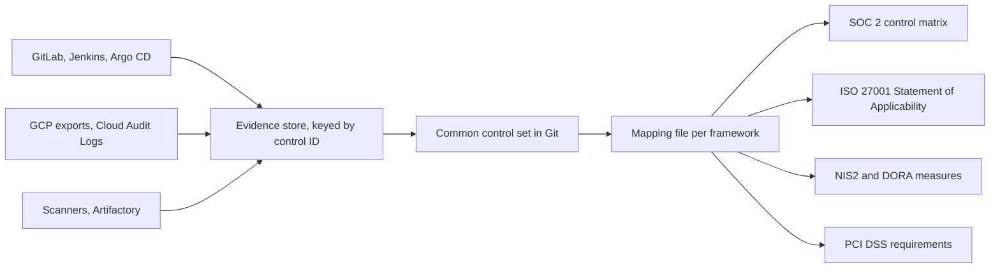

A platform team that sits under SOC 2 and ISO 27001, and soon NIS2 or DORA, is asked the same questions four times in four vocabularies. This guide shows how to keep one set of platform controls with stable IDs, map that set to every framework in a separate file, and collect each piece of evidence once. It is for the senior engineer who owns the platform side of audits, not for the compliance lead who owns the scope of each certification or report.

> [!warning] Not legal or audit advice
> This is general engineering guidance. Your auditor, assessor or legal counsel decides what satisfies a control or a legal obligation; check control numbers and wording against the current edition of the framework.

> [!info] Not checked against a running system
> The framework references in this note are copied from the framework notes on this site, which themselves ask you to confirm numbering against the standard text. These were not checked for this note: the ISO/IEC 27001:2022 Annex A control count and numbering, the current Trust Services Criteria revision, the current PCI DSS version and its requirement numbering, the versions and licence terms of NIST CSF 2.0 and the CSA Cloud Controls Matrix, and what Google Cloud Compliance Reports Manager gives you access to. The Python script and the sample YAML were run locally against each other; nothing else was run.

## Short answer

- Write each platform control once, as a YAML record in Git, with a stable ID that is never reused: objective, owner (a role), frequency, evidence sources, a test procedure and a status.
- Keep the framework mapping in a separate file keyed by control ID. A new framework edition changes the mapping file, not the control IDs, the evidence pipeline or the dashboards.
- Prefer evidence that a system produces on its own (deploy records, exports, scan reports) over evidence a person assembles.
- Lint the control set in CI: no control without an owner, an evidence source and a test; no mapping to an unknown control or framework.
- Mark what Google Cloud operates for you as inherited, and keep the provider's report next to your own evidence, instead of writing controls for it.

## Why evidence per framework duplicates work

Each framework note on this site maps evidence on its own: [[compliance/soc2-for-ci-cd-controls]], [[compliance/iso-27001-annex-a-for-platform-teams]], [[compliance/nis2-basics-for-engineering-teams]], [[compliance/dora-eu-operational-resilience-for-engineers]] and [[compliance/pci-dss-and-gdpr-for-devops-logs-and-data]]. Read side by side, most of their rows are the same activity:

- "Changes are authorised and tested" (SOC 2), "change management" (ISO 27001), and the change parts of DORA's ICT risk management all point at the same merge request approvals and deploy records.
- "Logical access is reviewed" (SOC 2), "access rights" (ISO 27001) and "HR security and access control" (NIS2) all want the same quarterly access review and leaver records.
- "Backups and restore tests" appear in ISO 27001, NIS2 business continuity and DORA resilience testing.

Without a common set, the same export is pulled three times by three people, stored in three folders, and described three ways. When one auditor asks why the numbers differ between two reports, nobody can answer quickly. With a common set, the export is pulled once by a scheduled job, stored once under the control ID, and each framework's evidence index points at the same object.



## Control record schema

Keep the control set in its own repository or in a `controls/` directory of the platform repository, with merge request approval by the platform lead and the security lead. One YAML file holds the controls, another holds the mappings.

| Field           | Required                      | Meaning                                                                                                                    |
| --------------- | ----------------------------- | -------------------------------------------------------------------------------------------------------------------------- |
| `id`            | yes                           | `PLT-<AREA>-<NN>`, for example `PLT-CHG-01`. Never renumbered and never reused, even after the control is retired.         |
| `title`         | yes                           | One line, phrased as the state you want ("production changes are approved before deploy").                                 |
| `objective`     | yes                           | What risk the control reduces, in two or three sentences.                                                                  |
| `owner`         | yes                           | A role or team slug (`platform-lead`), never a person. People change; the role stays.                                      |
| `frequency`     | yes                           | `per-change`, `continuous`, `daily`, `weekly`, `monthly`, `quarterly` or `yearly`.                                         |
| `status`        | yes                           | `active` or `retired`. Retire, do not delete, so old reports still resolve their IDs.                                      |
| `evidence`      | yes                           | A list of sources: what system produces it, where it is stored, and whether it is produced without a person (`automated`). |
| `manual_reason` | when no evidence is automated | Why this control cannot produce automated evidence yet.                                                                    |
| `test`          | yes                           | How an internal or external auditor tests the control: the population, the sample and what each sample must show.          |

```yaml title="controls/controls.yaml"
controls:
  - id: PLT-CHG-01
    title: Production changes are approved before deploy
    objective: >
      Every change that reaches production went through a merge request that someone
      other than the author approved before the deploy started.
    owner: engineering-manager
    frequency: per-change
    status: active
    evidence:
      - source: GitLab merge request approvals API, written to a deploy record by the deploy job
        location: gs://example-evidence-archive/change/
        automated: true
      - source: Protected branch and approval rule settings export
        location: gs://example-evidence-archive/settings/
        automated: true
    test: >
      Take the full list of production deploys for the period from the deploy records.
      For each sampled deploy, open the merge request, confirm at least one approval by
      a user other than the author, and confirm the approval time is before the deploy time.

  - id: PLT-ACC-03
    title: Leaver credentials are revoked within the agreed time
    objective: >
      A person who leaves loses access to every platform tool, including tokens and keys
      that the identity provider does not control.
    owner: security-lead
    frequency: per-change
    status: active
    evidence:
      - source: Offboarding evidence record per leaver, one timestamp per system
        location: gs://example-evidence-archive/leavers/
        automated: false
      - source: HR leaver list compared with the identity provider export
        location: gs://example-evidence-archive/access-review/
        automated: true
    test: >
      From the HR leaver list for the period, sample leavers. For each, confirm an
      offboarding record exists, every system has a revocation timestamp, and the last
      timestamp is within the agreed time after the leaving date.

  - id: PLT-LOG-01
    title: Admin activity on the platform is logged and retained
    objective: >
      Administrative changes to GCP, GKE, GitLab and Jenkins are logged centrally,
      protected from the people they record, and kept for the retention period.
    owner: platform-lead
    frequency: continuous
    status: active
    evidence:
      - source: Organisation log sink and locked archive bucket configuration export
        location: gs://example-evidence-archive/logging/
        automated: true
    test: >
      Export the sink and bucket configuration. Pick a known admin change from the period
      and retrieve its log entry from the archive.
```

The mapping file names the framework edition each reference belongs to. That line is what you change when a framework is revised.

```yaml title="controls/mappings.yaml"
frameworks:
  iso27001-2022:
    edition: "ISO/IEC 27001:2022 Annex A (check numbering against the standard text)"
    refs:
      PLT-CHG-01: ["8.32"]
      PLT-ACC-03: ["5.18"]
      PLT-LOG-01: ["8.15"]
  soc2-tsc:
    edition: "AICPA Trust Services Criteria, the version your report uses"
    refs:
      PLT-CHG-01: ["change management family"]
      PLT-ACC-03: ["logical and physical access family"]
      PLT-LOG-01: ["system operations family"]
  nis2-art21:
    edition: "Directive (EU) 2022/2555 Article 21(2), plus the national transposition"
    refs:
      PLT-ACC-03: ["HR security, access control, asset management"]
      PLT-LOG-01: ["incident handling"]
```

Replace the SOC 2 family names with the criterion numbers your auditor uses once you have read the current AICPA text, as [[compliance/soc2-for-ci-cd-controls]] recommends.

## Example platform controls

These ten controls cover most of what a platform team is asked for. The reference columns reuse the mappings already given in the framework notes on this site; a dash means that note does not map the control, not that no clause applies. Every reference is a pointer to check against the current edition, not a citation.

| ID         | Control                                               | Owner               | Main evidence source                                    | ISO 27001:2022 (check) | SOC 2 family (check)        | NIS2 Art. 21(2) area (check)                            | DORA area (check)                       |
| ---------- | ----------------------------------------------------- | ------------------- | ------------------------------------------------------- | ---------------------- | --------------------------- | ------------------------------------------------------- | --------------------------------------- |
| PLT-CHG-01 | Production changes are approved before deploy         | engineering-manager | Deploy records with MR approvals                        | 8.32                   | Change management           | -                                                       | ICT risk management                     |
| PLT-CHG-02 | Author, approver and deployer are not the same person | engineering-manager | Approval rules export, deploy records                   | -                      | Change management           | -                                                       | ICT risk management                     |
| PLT-ACC-01 | Access is reviewed quarterly                          | platform-lead       | Access review record and raw IAM and RBAC exports       | 5.15, 5.18, 8.2        | Logical and physical access | HR security, access control, asset management           | ICT risk management                     |
| PLT-ACC-03 | Leaver credentials are revoked within the agreed time | security-lead       | Offboarding evidence record per leaver                  | 5.18                   | Logical and physical access | HR security, access control, asset management           | ICT risk management                     |
| PLT-VUL-01 | Vulnerabilities are fixed within the agreed SLA       | security-lead       | Scan reports, exception register                        | 8.8                    | System operations           | Secure acquisition, development, vulnerability handling | ICT risk management                     |
| PLT-LOG-01 | Admin activity is logged and retained                 | platform-lead       | Sink and locked bucket configuration, sample retrievals | 8.15, 8.16             | System operations           | Incident handling                                       | Incident management and reporting       |
| PLT-BCK-01 | Backups are restored on a schedule                    | sre-lead            | Restore drill records                                   | 8.13                   | -                           | Business continuity, backup, crisis management          | Backup and recovery, resilience testing |
| PLT-CRY-01 | Data is encrypted at rest and in transit              | security-lead       | KMS key inventory, TLS policy exports                   | 8.24                   | -                           | Cryptography and encryption                             | ICT risk management                     |
| PLT-CFG-01 | Hosts and clusters follow a configuration baseline    | platform-lead       | Terraform in Git, drift reports, CIS benchmark results  | 8.9                    | -                           | -                                                       | ICT risk management                     |
| PLT-INC-01 | Incidents are detected, handled and recorded          | sre-lead            | Incident records, on-call and alert configuration       | -                      | System operations           | Incident handling                                       | Incident management and reporting       |

Where each control's mechanics are described:

- Change approval and separation of duties: [[compliance/change-management-controls-and-pipeline-evidence]] and [[compliance/separation-of-duties-in-deployments]]. To stop a project from removing required jobs, see [[compliance/gitlab-compliance-frameworks-and-security-policies]].
- Access review and leavers: [[compliance/access-reviews-gcp-and-gke]] and [[compliance/leaver-credential-revocation-devops-tools]].
- Vulnerability SLA: [[standards/vulnerability-management-slas]] and [[compliance/vulnerability-exception-register]].
- Logging: [[compliance/audit-evidence-collection-and-retention]] and [[adr/0044-central-log-sinks-and-retention-tiers]]. Changes made outside the pipeline: [[compliance/out-of-band-change-detection-gcp-gke]].
- Backup restore: [[adr/0051-backups-proven-by-quarterly-restore-drills]] and [[architecture/backup-architecture-gke-cloud-sql-gcs]].
- Encryption: [[compliance/encryption-at-rest-and-in-transit-evidence-gcp]].
- Configuration baseline: [[compliance/cis-benchmarks-with-kube-bench]], [[patterns/linux-host-hardening-with-chef-and-inspec]] and the continuous checks in [[compliance/continuous-control-monitoring-gcp-and-gke]].
- Incident response: [[runbooks/incident-response]] and [[adr/0050-incident-severity-levels-and-roles]].

PCI DSS has no column because [[compliance/pci-dss-and-gdpr-for-devops-logs-and-data]] deliberately does not give requirement numbers. If you are in PCI scope, add a `pci-dss-4` block to the mapping file after reading the current version in the PCI SSC document library, and limit it to the systems in the cardholder data environment.

## Generating the mapping

The script below reads both files, lints them, and prints the mapping as CSV for the compliance lead's spreadsheet or as a Markdown table for the repository. It uses the Python standard library plus PyYAML, and only `yaml.safe_load`, never `yaml.load`. Pin PyYAML in a hashed requirements file; no version is recommended here.

```python title="controls/ccf.py"
#!/usr/bin/env python3
"""Lint a common control set and render its framework mapping.

Usage:
  python3 ccf.py lint controls.yaml mappings.yaml
  python3 ccf.py csv  controls.yaml mappings.yaml > mapping.csv
  python3 ccf.py md   controls.yaml mappings.yaml > mapping.md
Exit codes: 0 ok, 1 lint errors, 2 bad usage or unreadable input.
"""
import csv
import re
import sys

import yaml  # PyYAML; only safe_load is used

ID_RE = re.compile(r"^PLT-[A-Z]{2,4}-\d{2}$")
OWNER_RE = re.compile(r"^[a-z][a-z0-9-]+$")  # a role or team slug, never a person or an email
FREQUENCIES = {"per-change", "daily", "weekly", "monthly", "quarterly", "yearly", "continuous"}
STATUSES = {"active", "retired"}
FRAMEWORKS = {"soc2-tsc", "iso27001-2022", "pci-dss-4", "nis2-art21", "dora"}
MAX_REFS_PER_FRAMEWORK = 4  # more than this usually means the control claims too much


def load(path):
    try:
        with open(path, encoding="utf-8") as fh:
            return yaml.safe_load(fh) or {}
    except (OSError, yaml.YAMLError) as exc:
        sys.exit(f"ccf: cannot read {path}: {exc}")


def lint(controls, mappings):
    errors = []
    seen = {}
    for c in controls:
        cid = str(c.get("id", ""))
        where = cid or "<control without id>"
        if not ID_RE.match(cid):
            errors.append(f"{where}: id must match {ID_RE.pattern}")
        if cid in seen:
            errors.append(f"{cid}: duplicate id (ids are never reused)")
        seen[cid] = c
        for field in ("title", "objective", "owner", "frequency", "status", "test"):
            if not str(c.get(field) or "").strip():
                errors.append(f"{where}: missing {field}")
        if c.get("owner") and not OWNER_RE.match(str(c["owner"])):
            errors.append(f"{where}: owner must be a role slug, not a person or an email")
        if c.get("frequency") and c["frequency"] not in FREQUENCIES:
            errors.append(f"{where}: unknown frequency {c['frequency']!r}")
        if c.get("status") and c["status"] not in STATUSES:
            errors.append(f"{where}: unknown status {c['status']!r}")
        evidence = c.get("evidence") or []
        if not evidence:
            errors.append(f"{where}: no evidence source")
        for i, ev in enumerate(evidence):
            for field in ("source", "location"):
                if not str(ev.get(field) or "").strip():
                    errors.append(f"{where}: evidence[{i}] missing {field}")
            if not isinstance(ev.get("automated"), bool):
                errors.append(f"{where}: evidence[{i}].automated must be true or false")
        if evidence and not any(ev.get("automated") is True for ev in evidence):
            if not str(c.get("manual_reason") or "").strip():
                errors.append(f"{where}: no automated evidence and no manual_reason")

    mapped = set()
    for fw, body in (mappings.get("frameworks") or {}).items():
        if fw not in FRAMEWORKS:
            errors.append(f"mappings: unknown framework key {fw!r}")
            continue
        for cid, refs in (body.get("refs") or {}).items():
            if cid not in seen:
                errors.append(f"mappings.{fw}: unknown control {cid}")
                continue
            if seen[cid].get("status") == "retired":
                errors.append(f"mappings.{fw}: {cid} is retired and must not be mapped")
            if not refs:
                errors.append(f"mappings.{fw}.{cid}: empty reference list")
            elif len(refs) > MAX_REFS_PER_FRAMEWORK:
                errors.append(f"mappings.{fw}.{cid}: {len(refs)} refs, split the control")
            mapped.add(cid)
    for cid, c in seen.items():
        if c.get("status") == "active" and cid not in mapped:
            errors.append(f"{cid}: active but mapped to no framework")
    return errors


def rows(controls, mappings):
    fws = sorted((mappings.get("frameworks") or {}).keys())
    header = ["id", "title", "owner", "frequency"] + fws
    out = []
    for c in sorted(controls, key=lambda c: c["id"]):
        if c.get("status") != "active":
            continue
        row = [c["id"], c["title"], c["owner"], c["frequency"]]
        for fw in fws:
            refs = (mappings["frameworks"][fw].get("refs") or {}).get(c["id"], [])
            row.append("; ".join(str(r) for r in refs))
        out.append(row)
    return header, out


def main(argv):
    if len(argv) != 4 or argv[1] not in {"lint", "csv", "md"}:
        print(__doc__, file=sys.stderr)
        return 2
    controls = load(argv[2]).get("controls") or []
    mappings = load(argv[3])
    errors = lint(controls, mappings)
    if argv[1] == "lint" or errors:
        for e in errors:
            print(f"ERROR {e}", file=sys.stderr)
        if not errors:
            print(f"ccf: {len(controls)} controls OK")
        return 1 if errors else 0
    header, body = rows(controls, mappings)
    if argv[1] == "csv":
        writer = csv.writer(sys.stdout)
        writer.writerow(header)
        writer.writerows(body)
    else:
        print("| " + " | ".join(header) + " |")
        print("|" + "|".join(" --- " for _ in header) + "|")
        for r in body:
            print("| " + " | ".join(cell.replace("|", "\\|") for cell in r) + " |")
    return 0


if __name__ == "__main__":
    sys.exit(main(sys.argv))
```

Run against the two sample files above, it prints:

```text title="Lint output"
$ python3 controls/ccf.py lint controls/controls.yaml controls/mappings.yaml
ccf: 3 controls OK

$ python3 controls/ccf.py csv controls/controls.yaml controls/mappings.yaml
id,title,owner,frequency,iso27001-2022,nis2-art21,soc2-tsc
PLT-ACC-03,Leaver credentials are revoked within the agreed time,security-lead,per-change,5.18,"HR security, access control, asset management",logical and physical access family
PLT-CHG-01,Production changes are approved before deploy,engineering-manager,per-change,8.32,,change management family
PLT-LOG-01,Admin activity on the platform is logged and retained,platform-lead,continuous,8.15,incident handling,system operations family
```

A broken record fails with one line per problem and exit code 1, for example:

```text title="Lint output for a broken record"
ERROR PLT-CHG-01: missing test
ERROR PLT-CHG-01: owner must be a role slug, not a person or an email
ERROR PLT-CHG-01: no automated evidence and no manual_reason
ERROR mappings: unknown framework key 'hipaa'
ERROR mappings.iso27001-2022: unknown control PLT-XYZ-99
```

## Lint in CI

Run the lint on every merge request to the control set, and publish the Markdown table as an artifact so reviewers see the effect of a mapping change. Protect the `controls/` path with CODEOWNERS so the security lead approves changes to mappings.

```yaml title=".gitlab-ci.yml"
control-set-lint:
  stage: test
  image: python:3.12-slim # change: your pinned and mirrored Python image
  script:
    - pip install --no-cache-dir --require-hashes -r controls/requirements.txt
    - python3 controls/ccf.py lint controls/controls.yaml controls/mappings.yaml
    - python3 controls/ccf.py md controls/controls.yaml controls/mappings.yaml > mapping.md
  artifacts:
    paths:
      - mapping.md
    expire_in: 30 days
```

`controls/requirements.txt` pins PyYAML with its hash. Generate it with your usual lock tool; do not hand-write hashes.

Validation: change one control's `owner` to an email address in a test branch and confirm the job fails with the owner error; restore it and confirm the job passes.

## Inherited controls on Google Cloud

Under the shared responsibility model, Google operates the physical data centres, the hardware and the underlying service infrastructure, and you are responsible for configuration, identity, data and workloads. Check the current Google Cloud shared responsibility documentation for the exact split per service. Your control set reflects that split:

- Add a record per inherited area with `owner: platform-lead`, `frequency: yearly`, and evidence that points to the provider's current report (for example its SOC 2 report or ISO certificate) downloaded from Google Cloud Compliance Reports Manager, plus your review of that report. Which reports you can download depends on your account and agreement; check the Compliance Reports Manager page.
- Read the complementary user entity controls in the provider's report: they are controls the provider expects you to run. Each one should map to a control in your set; a CUEC with no matching control is a gap.
- Do not copy the provider's controls into your set as if you operated them. An auditor tests what you claim to operate.

Security Command Center findings carry a `compliances` field with a standard, a version and a list of IDs per finding. That is a ready, machine-readable link from a detective finding to framework references; [[compliance/continuous-control-monitoring-gcp-and-gke]] shows how to collect those findings.

## Framework revisions without renumbering

Frameworks change on their own schedule. ISO/IEC 27001 moved from the 2013 to the 2022 Annex A, which merged and renumbered controls, and PCI DSS moved to v4.x, which added requirements and phased some of them in after the publication date (check the current version and its dates). A control set with stable IDs absorbs this:

1. Add a new framework key for the new edition (`iso27001-2022` next to `iso27001-2013`) and fill it in a merge request reviewed by the compliance lead.
2. Run both mappings side by side while certificates or reports on the old edition are still valid. The control IDs, evidence jobs and storage paths do not change.
3. When the old edition is no longer used, remove its block from the mapping file. Do not touch the controls.
4. If the new edition introduces a requirement nothing covers, add a new control with the next free ID. Never repurpose a retired ID.

For the dates of each transition, ask your certification body or assessor; this note does not state them.

## Public crosswalks

Two published frameworks are often used as a hub between others: NIST Cybersecurity Framework 2.0 and the Cloud Security Alliance Cloud Controls Matrix. Both publish mappings to other standards. They can save time when you first fill a mapping file, but:

- Check the licence and terms of use before copying their content into your repository, and record which version of the mapping you used.
- A published crosswalk maps framework to framework. It does not know your controls, so you still decide which of your controls satisfies each line.
- Use them as a second opinion on your own mapping, not as its source.

## Pitfalls

- **Mapping by keyword.** "Logging" in two frameworks may mean different things: one asks for retention, another for monitoring and response. Read the requirement text before mapping, and record who mapped it and when in the merge request.
- **One control claiming too much.** A control mapped to many clauses in one framework is usually several controls with different owners and tests. The lint flags more than four references per framework; split the control rather than raising the limit.
- **A control with no test procedure.** If nobody can say how to test it, nobody can show it worked. The test field is required for that reason.
- **Person-owned evidence.** Evidence that lives in someone's spreadsheet leaves with them. The lint rejects personal owners; reviewers should also reject evidence locations that are personal drives.
- **Renumbering for neatness.** Old reports, tickets and waivers refer to IDs. Renumbering breaks every one of those references.
- **Exceptions outside the control set.** Waivers should name the control ID they waive; see [[compliance/policy-exception-and-waiver-process]].
- **Ignoring threats.** A control set built only from frameworks misses risks specific to your platform. Feed it from [[standards/platform-threat-modelling]] as well.

## Related

- [[compliance/soc2-for-ci-cd-controls]]: the SOC 2 control matrix this set feeds.
- [[compliance/iso-27001-annex-a-for-platform-teams]]: Statement of Applicability entries from engineering.
- [[compliance/nis2-basics-for-engineering-teams]] and [[compliance/dora-eu-operational-resilience-for-engineers]]: EU obligations mapped to platform controls.
- [[compliance/pci-dss-and-gdpr-for-devops-logs-and-data]]: card and personal data in tooling.
- [[compliance/audit-evidence-collection-and-retention]]: where the evidence is stored.
- [[compliance/continuous-control-monitoring-gcp-and-gke]]: automated evidence for configuration controls.
- [[compliance/vendor-soc2-report-review-for-devops-saas]]: reviewing the SOC 2 reports of the SaaS tools these controls depend on.

## Sources

- ISO, [ISO/IEC 27001](https://www.iso.org/standard/27001): the standard and its Annex A.
- AICPA and CIMA, [aicpa-cima.com](https://www.aicpa-cima.com): the Trust Services Criteria; search for the current published version.
- PCI Security Standards Council, [Document library](https://www.pcisecuritystandards.org/document_library/): the current PCI DSS version.
- NIST, [Cybersecurity Framework](https://www.nist.gov/cyberframework): CSF 2.0 and its informative references.
- Cloud Security Alliance, [Cloud Controls Matrix](https://cloudsecurityalliance.org/research/cloud-controls-matrix).
- Google Cloud, [Compliance Reports Manager](https://cloud.google.com/security/compliance/compliance-reports-manager).
- Google Cloud, [Security Health Analytics concepts](https://cloud.google.com/security-command-center/docs/concepts-security-health-analytics): findings and their compliance mappings.
