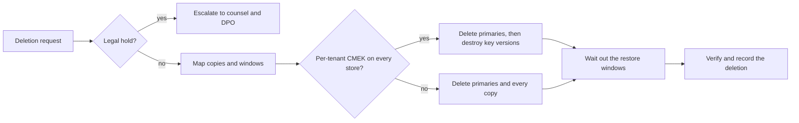

"Delete the customer's data" sounds like one command. On GCP it is a set of copies with different lifetimes: soft-deleted objects, noncurrent versions, BigQuery time travel, database backups and transaction logs, log buckets, Backup for GKE, Pub/Sub retention, disk snapshots, images and CI artifacts. This pattern shows how to map those copies, delete or crypto-shred them, and produce evidence that says when the data is actually gone. Logging and privacy limits in general are in [[compliance/pci-dss-and-gdpr-for-devops-logs-and-data|PCI DSS and GDPR for DevOps]]; keys in general are in [[patterns/cloud-kms-key-management|Cloud KMS key management]].

> [!warning] Not legal or audit advice
> This is general engineering guidance. Your auditor, assessor or legal counsel decides what satisfies a control or a legal obligation; check control numbers and wording against the current edition of the framework.

> [!info] Not checked against a running system
> Nothing here was run. Command flags were checked against the installed `gcloud` and `bq` help text, and defaults against Google's API definitions, on 2026-10-21. **Not verified**: the GCS soft delete behaviour for early purge and deleted buckets, the BigQuery fail-safe period, how long Cloud SQL backups survive instance deletion, how fast each service fails after a CMEK key version is destroyed, the exact audit-log method names, Artifactory deletion semantics, and the GDPR article wording. Each is marked again where it appears.

## Short answer

1. **Check legal holds first.** A hold overrides deletion ([[compliance/legal-hold-for-logs-and-artifacts|legal hold]]).
2. **Map every copy** of the data and the window in which each copy can still be recovered after you delete the primary. The answer to "when is it gone?" is the end of the longest window, not the time you ran the command.
3. **Pick a method per store**: delete and let copies age out, delete every copy explicitly, or **crypto-shred** by destroying the customer-managed key that encrypts all of them.
4. **Record evidence**: the commands, the audit-log entries, the windows and the date on which the last copy expires, in a deletion record.

Crypto-shredding is the strongest option when it was designed in from the start: a per-tenant Cloud KMS key used as CMEK on every store that holds that tenant's data. Destroying the key versions makes the ciphertext unreadable everywhere at once, including backups. It does nothing for data encrypted with Google-managed keys or copied out of those stores.

## Where copies live

Every duration below is a setting or a documented default you must check for your own resources. "Check" means it was not confirmed for this note.

| Store                        | Copy that survives a delete                                  | How long (verify for your resources)                                                                                                                                                       |
| ---------------------------- | ------------------------------------------------------------ | ------------------------------------------------------------------------------------------------------------------------------------------------------------------------------------------ |
| Cloud Storage                | Soft-deleted objects                                         | Bucket soft delete duration. Terraform documents a default of 7 days, a range of 7 to 90 days, and 0 to disable                                                                             |
| Cloud Storage                | Noncurrent object versions (versioning on)                   | Until deleted explicitly or by a lifecycle rule (check your lifecycle rules)                                                                                                               |
| BigQuery                     | Time travel                                                   | Dataset `max_time_travel_hours`: 48 to 168 hours, default 168                                                                                                                              |
| BigQuery                     | Fail-safe after time travel                                  | Believed to be 7 days, recoverable only through Google support (check)                                                                                                                     |
| Cloud SQL                    | Automated backups                                            | `--retained-backups-count`: 1 to 365; default 7 (Enterprise) or 15 (Enterprise Plus)                                                                                                       |
| Cloud SQL                    | Point-in-time recovery logs                                  | `--retained-transaction-log-days`: 1 to 35 with PITR on; Enterprise default and maximum 7, Enterprise Plus default 14, maximum 35                                                           |
| Cloud SQL                    | Backups after instance deletion, on-demand and final backups | Check the current Cloud SQL backup docs                                                                                                                                                    |
| Cloud Logging                | Entries in log buckets                                       | Bucket `retention_days`, minimum 1 day; 30 days if set to 0 at creation. A locked bucket's retention cannot be changed                                                                     |
| Cloud Logging                | Exports from sinks (GCS, BigQuery, Pub/Sub)                  | The destination's own retention                                                                                                                                                            |
| Backup for GKE               | Backups of cluster state and volumes                          | Plan `backup_retain_days` 0 to 365 (0 means no automatic deletion); `backup_delete_lock_days` 0 to 90 blocks deletion; a locked policy cannot be changed                                    |
| Pub/Sub                      | Retained messages                                            | `message_retention_duration` 10 minutes to 31 days; subscription default 7 days; acknowledged messages only with `--retain-acked-messages`                                                  |
| Compute Engine               | Disk snapshots and images                                    | Until deleted, or by snapshot schedule retention                                                                                                                                           |
| Artifactory                  | Trash can, replicas, remote caches                            | Check the current JFrog documentation for trash can and garbage collection                                                                                                                 |
| CI (GitLab, Jenkins)         | Job artifacts, logs, caches, runner disks                    | Per-project expiry settings ([[standards/artifact-retention-policy\|artifact retention policy]])                                                                                           |
| Everything else              | Spreadsheets, tickets, laptops, support cases, data shared with vendors | Not covered by any GCP control; list them explicitly                                                                                                                              |

Sources for the confirmed values: `gcloud` and `bq` help text, Terraform provider documentation and Google's API definitions, read on 2026-10-21. Google also publishes a whitepaper on how it deletes data from its own infrastructure after you delete it; read it for the provider-side part of the story, because that part is outside your control and your evidence.



## Check holds and conflicting retention first

Before anything is deleted:

- Search the hold register for the tenant, system and time range. If a hold applies, stop and escalate; do not resolve the conflict in a pipeline.
- Check for locked retention: a locked GCS retention policy or a locked log bucket prevents deletion before the period ends, by design. Data under a locked policy is only deletable by waiting, or by crypto-shredding if it is CMEK-encrypted with a key you control.
- Check the Backup for GKE plan for `backup_delete_lock_days`: locked backups cannot be deleted early.

Record what you found. "Held, escalated" and "locked until 2027-03-01" are legitimate outcomes of a deletion request.

## Method 1: delete every copy

Use this when the data is not under its own key. The order matters: stop new copies first, then delete the primary, then the copies.

```bash title="scripts/delete-tenant-gcs.sh"
set -euo pipefail

BUCKET="gs://example-prod-1-tenant-data"   # change: bucket holding the tenant's objects
PREFIX="tenants/t-0042/"                   # change: the tenant's prefix

# 1. What is there now, including noncurrent versions (check flags with --help).
gcloud storage ls --all-versions --long "${BUCKET}/${PREFIX}**" > before.txt
wc -l before.txt

# 2. Soft delete settings of the bucket: this is how long deleted objects stay restorable.
#    The output field name is indicative; check it in the full describe output.
gcloud storage buckets describe "${BUCKET}" --format="yaml(soft_delete_policy)"

# 3. Delete live and noncurrent versions under the prefix.
gcloud storage rm --all-versions "${BUCKET}/${PREFIX}**"

# 4. The objects are now soft-deleted, not gone. List them:
gcloud storage objects list "${BUCKET}/${PREFIX}**" --soft-deleted > soft-deleted.txt
wc -l soft-deleted.txt
```

> [!danger] Deleting all versions removes your undo
> `gcloud storage rm --all-versions` deletes noncurrent versions as well. After that, the only way back is soft delete, for as long as the bucket's soft delete duration lasts, and only if soft delete was on. Run it on the exact prefix agreed in the request, and keep `before.txt` with the record.

The objects become unrecoverable when the soft delete duration ends. Whether soft-deleted objects can be purged before that, and with which permission, was not verified; check the soft delete documentation. Clearing soft delete on the bucket (`--clear-soft-delete`) does not affect objects already in the soft-deleted state, according to the `gcloud` help, so it does not shorten an existing window.

BigQuery: shorten time travel on datasets that hold personal data before you need it, then delete.

```bash title="scripts/delete-tenant-bigquery.sh"
set -euo pipefail

PROJECT="example-prod-1"          # change
DATASET="analytics"               # change
TABLE="events_t0042"              # change: a per-tenant table, if your design has one

# Time travel is set per dataset: 48 to 168 hours, default 168.
bq update --max_time_travel_hours=48 "${PROJECT}:${DATASET}"

# Row-level deletion in a shared table:
bq query --use_legacy_sql=false \
  "DELETE FROM \`${PROJECT}.${DATASET}.events\` WHERE tenant_id = 't-0042'"

# Or remove a whole per-tenant table (-f skips the prompt; check with: bq help rm).
bq rm -f -t "${PROJECT}:${DATASET}.${TABLE}"
```

Deleted rows and tables stay recoverable through time travel for the dataset's window, and then through fail-safe (check the period and access). The deletion record should give the date after both windows.

Cloud SQL: you cannot delete rows from a backup. Rows deleted from the live database age out of backups when the oldest backup taken before the delete expires, and out of PITR logs when the transaction log retention passes. If that is too slow, the options are deleting specific backups (which also removes everyone else's data from them, so weigh the recovery risk) or crypto-shredding.

```bash title="scripts/cloudsql-retention.sh"
set -euo pipefail

INSTANCE="example-prod-1-pg"   # change

gcloud sql instances describe "${INSTANCE}" \
  --format="yaml(settings.backupConfiguration)"
gcloud sql backups list --instance="${INSTANCE}"
# Deleting a backup is irreversible:
# gcloud sql backups delete BACKUP_ID --instance="${INSTANCE}"
```

Cloud Logging: there is no per-entry delete in the Logging API surface we read; check the current docs. `gcloud logging logs delete LOG_NAME` deletes all entries of a log, and only in the global `_Default` bucket; the API notes that entries written shortly before the call might not be deleted, and the log reappears when new entries arrive. For other buckets, entries leave only when bucket retention expires. That is the main reason to keep personal data out of long-retention log buckets in the first place ([[adr/0044-central-log-sinks-and-retention-tiers|ADR-0044]]).

Artifactory and CI: delete the artifacts and builds, then follow the platform's own trash can and garbage collection behaviour (check the current JFrog docs) before you call it deleted. CI artifacts, job logs and caches expire by project settings; delete them explicitly for the affected pipelines, and do not forget runner caches and disks.

## Method 2: crypto-shredding with per-tenant keys

Crypto-shredding means that every copy of a tenant's data is encrypted with a key only that tenant uses, and deletion is the destruction of that key. Copies in soft delete, versions, time travel and backups become unreadable together, because they are all ciphertext under the same key.

It only works if it is designed in:

- **One key per tenant** (or per data set you may need to shred) in Cloud KMS, used as CMEK on every store that holds the tenant's data. Which services support CMEK, and how, is per service; see [[compliance/encryption-at-rest-and-in-transit-evidence-gcp|encryption at rest evidence]] and [[patterns/cloud-kms-key-management#CMEK per service|CMEK per service]].
- **No copies outside the key**: logs, exports, analytics extracts, debug dumps and data in third-party tools must not hold the tenant's data in plaintext, or must be covered separately.
- **The scheduled-destruction duration is set at key creation.** Google's API definition says `destroy_scheduled_duration` is immutable and defaults to 30 days if not set at creation. Choose it per key when you create it; you cannot change it later.
- **Imported key material**: a destroyed version can be re-enabled if it is eligible for reimport and the original material is imported again. If you import keys, destroying your own copy of the material is part of the shred.

> [!warning] The `gcloud` help disagrees with the API
> The installed `gcloud kms keys versions destroy --help` says versions are destroyed "in 24 hours". The KMS API definition and the Terraform documentation say the delay is the key's `destroy_scheduled_duration`, 30 days by default. Read the real value for your key with `gcloud kms keys describe` instead of trusting either text.

Creating a tenant key with an explicit destruction delay:

```bash title="scripts/create-tenant-key.sh"
set -euo pipefail

KMS_PROJECT="example-kms-prod"      # change: the KMS project for this environment
LOCATION="europe-west1"             # change: must match the resources it protects
KEYRING="tenants"                   # change
TENANT="t-0042"                     # change

gcloud kms keys create "tenant-${TENANT}" \
  --project="${KMS_PROJECT}" --location="${LOCATION}" --keyring="${KEYRING}" \
  --purpose=encryption \
  --destroy-scheduled-duration=7d \
  --labels="tenant=${TENANT}"
# 7d is an example: pick the window that balances accidental-loss recovery
# against how fast you must prove deletion, and confirm the allowed range.
```

In Terraform, set the same field and protect the key resource:

```hcl title="kms-tenant-keys.tf"
resource "google_kms_crypto_key" "tenant" {
  for_each = toset(var.tenants)                 # change: tenant IDs

  name                       = "tenant-${each.key}"
  key_ring                   = google_kms_key_ring.tenants.id
  purpose                    = "ENCRYPT_DECRYPT"
  destroy_scheduled_duration = "604800s"        # 7 days; immutable after creation
  labels                     = { tenant = each.key }

  lifecycle {
    prevent_destroy = true
  }
}
```

> [!warning] `terraform destroy` starts a shred
> The Terraform provider documents that destroying a `google_kms_crypto_key` resource removes it from state and deletes all its key versions, which makes the key unusable; the key object itself stays in the project, because Cloud KMS keys cannot be deleted. The versions are scheduled for destruction and can be restored only until the key's `destroy_scheduled_duration` ends; after that, everything the key protected is unrecoverable. That is why every tenant key carries `prevent_destroy = true`: a plan that removes a key is a deletion, not a state change. Run the shred on purpose with the script below, and check the version states with `gcloud kms keys versions list` after any plan that touched a key.

The shred itself, after holds are cleared and primaries are deleted:

```bash title="scripts/shred-tenant.sh"
set -euo pipefail

KMS_PROJECT="example-kms-prod"   # change
LOCATION="europe-west1"          # change
KEYRING="tenants"                # change
KEY="tenant-t-0042"              # change

# 1. Confirm the key's destruction delay and its versions.
gcloud kms keys describe "${KEY}" --project="${KMS_PROJECT}" \
  --location="${LOCATION}" --keyring="${KEYRING}" \
  --format="yaml(name,destroyScheduledDuration,primary.name)"
gcloud kms keys versions list --key="${KEY}" --project="${KMS_PROJECT}" \
  --location="${LOCATION}" --keyring="${KEYRING}" \
  --format="table(name.basename(),state,createTime)"

# 2. Disable every version first and watch for errors (reversible with "enable").
for V in $(gcloud kms keys versions list --key="${KEY}" --project="${KMS_PROJECT}" \
    --location="${LOCATION}" --keyring="${KEYRING}" \
    --filter="state=ENABLED" --format="value(name.basename())"); do
  gcloud kms keys versions disable "${V}" --key="${KEY}" --project="${KMS_PROJECT}" \
    --location="${LOCATION}" --keyring="${KEYRING}"
done

# 3. After the observation period: schedule destruction of every enabled or disabled version.
# for V in $(gcloud kms keys versions list --key="${KEY}" --project="${KMS_PROJECT}" \
#     --location="${LOCATION}" --keyring="${KEYRING}" \
#     --filter="state=DISABLED OR state=ENABLED" --format="value(name.basename())"); do
#   gcloud kms keys versions destroy "${V}" --key="${KEY}" --project="${KMS_PROJECT}" \
#     --location="${LOCATION}" --keyring="${KEYRING}"
# done
```

> [!danger] After the scheduled period, the data is unrecoverable
> Destroying a version moves it to `DESTROY_SCHEDULED` with a `destroy_time` of now plus the key's duration. When that time passes, the key material is irrevocably destroyed and every backup, snapshot, version and replica encrypted with it is unreadable, by you and by Google. Only versions in the Enabled or Disabled state can be scheduled. Make step 3 a reviewed change with a second approver ([[patterns/cloud-kms-key-management#Disable and destroy with a scheduled duration|disable and destroy]]).

How quickly each service stops serving data after its key version is disabled or destroyed depends on the service and was not verified here; check each service's CMEK documentation.

## Rollback windows

Every step has a window in which it can be undone. Write the window into the deletion record, and do not issue a "deleted" statement until the last one has closed.

| Step                                    | Undo                                                                                 | Window                                                    |
| --------------------------------------- | ------------------------------------------------------------------------------------ | --------------------------------------------------------- |
| GCS object delete                       | `gcloud storage restore gs://BUCKET/OBJECT[#GENERATION]`                             | The bucket's soft delete duration                         |
| GCS bucket delete                       | `gcloud storage restore gs://BUCKET#GENERATION` (the `gcloud` help shows bucket restore) | Check the soft delete docs for deleted buckets            |
| BigQuery row or table delete            | Time travel, then fail-safe through support (check)                                  | `max_time_travel_hours`, then fail-safe                   |
| KMS version disable                     | `gcloud kms keys versions enable`                                                    | Any time                                                  |
| KMS version destroy                     | `gcloud kms keys versions restore`, then `enable` (restore leaves it Disabled)        | Until `destroy_time`                                      |
| Cloud SQL backup delete, snapshot delete | None                                                                                | None                                                      |
| Log entries (`gcloud logging logs delete`) | None                                                                              | None                                                      |

```bash title="scripts/undo-shred.sh"
set -euo pipefail

KMS_PROJECT="example-kms-prod"; LOCATION="europe-west1"   # change
KEYRING="tenants"; KEY="tenant-t-0042"; VERSION="1"        # change

gcloud kms keys versions restore "${VERSION}" --key="${KEY}" --project="${KMS_PROJECT}" \
  --location="${LOCATION}" --keyring="${KEYRING}"
gcloud kms keys versions enable "${VERSION}" --key="${KEY}" --project="${KMS_PROJECT}" \
  --location="${LOCATION}" --keyring="${KEYRING}"   # check the command with --help
```

## Verify and collect evidence

Verification has two parts: the data is not reachable now, and the audit trail shows who deleted what, when.

```bash title="scripts/verify-deletion.sh"
set -euo pipefail

BUCKET="gs://example-prod-1-tenant-data"; PREFIX="tenants/t-0042/"   # change
KMS_PROJECT="example-kms-prod"; LOCATION="europe-west1"             # change
KEYRING="tenants"; KEY="tenant-t-0042"                               # change
LOG_PROJECT="example-kms-prod"                                       # change: project with the KMS audit logs

# No live or noncurrent objects left (expect no output).
gcloud storage ls --all-versions "${BUCKET}/${PREFIX}**" || true

# Every key version scheduled or destroyed, with its destroy time.
gcloud kms keys versions list --key="${KEY}" --project="${KMS_PROJECT}" \
  --location="${LOCATION}" --keyring="${KEYRING}" \
  --format="table(name.basename(),state,destroyTime,destroyEventTime)"

# Admin Activity audit entries for the destroy calls. The method name filter is
# illustrative: validate it against a real entry in your project.
gcloud logging read \
  'protoPayload.serviceName="cloudkms.googleapis.com" AND protoPayload.methodName:"DestroyCryptoKeyVersion"' \
  --project="${LOG_PROJECT}" --freshness=30d \
  --format="table(timestamp,protoPayload.authenticationInfo.principalEmail,protoPayload.resourceName)"
```

Object deletions in Cloud Storage are recorded in Data Access audit logs, which are not enabled by default for most services; check whether yours are on for the evidence bucket's project before you rely on them. The `gcloud storage rm` output and the before and after listings are the fallback evidence. Ship the audit entries through your central sink ([[patterns/gcp-audit-logs-siem|audit logs to the SIEM]]).

## The deletion record

Keep one record per request in the evidence store ([[compliance/audit-evidence-collection-and-retention|audit evidence collection]]). It must not contain the personal data it is about: use a request ID and a tenant ID.

```yaml title="deletions/DEL-2026-0042.yaml"
id: DEL-2026-0042
request_ref: "privacy-request-2026-117"     # change: ID in the privacy team's system
subject: "tenant t-0042"                    # an identifier, not personal data
legal_hold_check: { checked_at: 2026-10-21, result: "no active hold" }
method: crypto-shred                        # delete | crypto-shred | both
stores:
  - store: "gs://example-prod-1-tenant-data/tenants/t-0042/"
    action: "rm --all-versions"
    executed_at: 2026-10-21T10:05:00Z
    unrecoverable_after: 2026-10-28         # change: soft delete duration from the bucket
  - store: "BigQuery example-prod-1:analytics"
    action: "DELETE rows; time travel 48h"
    executed_at: 2026-10-21T10:20:00Z
    unrecoverable_after: "2026-10-23 plus fail-safe (check)"
  - store: "Cloud SQL example-prod-1-pg backups and PITR logs"
    action: "rows deleted; ages out of backups"
    unrecoverable_after: 2026-11-05         # change: oldest backup expiry from settings
  - store: "KMS key tenant-t-0042 versions 1-3"
    action: "destroy scheduled"
    executed_at: 2026-10-21T11:00:00Z
    unrecoverable_after: 2026-10-28         # change: destroy_time from the version list
not_covered:
  - "Support tickets in the vendor helpdesk: deleted by support team, ref SUP-881"
evidence:
  - "before.txt, soft-deleted.txt, KMS version list, audit log export"
executed_by: platform-oncall
approved_by: data-protection-lead
fully_deleted_on: 2026-11-05                 # the latest unrecoverable_after above
```

## Pitfalls

- **Saying "deleted" on the day of the command.** The honest date is when the last window closes.
- **Shredding a key that also protects other tenants.** A shared key cannot be shredded for one tenant. Design per-tenant keys, and do not reuse them.
- **Data that never used the key.** Logs, exports, extracts in a data warehouse, error-tracker payloads, CI artifacts and test copies made from production. Inventory them with the data classification ([[compliance/data-classification-tags-gcp-and-kubernetes|data classification tags]]).
- **Backups restored over a deletion.** Restoring a database from a backup taken before a deletion brings the data back. Keep a list of completed deletions and re-apply it after any restore.
- **Forgetting replicas and DR copies.** Cross-region replicas, DR projects and backup vaults are copies ([[architecture/backup-architecture-gke-cloud-sql-gcs|backup architecture]]).
- **Treating a Terraform removal as harmless.** Removing a `google_kms_crypto_key` from code removes it from state and schedules every version for destruction, so the plan shreds the tenant's data once the window ends. For buckets and other resources the effect depends on the resource; read the plan and check what the API actually did.
- **Locked retention you forgot about.** A locked log bucket or GCS retention policy wins over any request.
- **A `global` key location or bucket that does not match the data's region.** Keys and data locations must match the service's rules; check before you design per-tenant keys.

## Decommissioning a whole product

Decommissioning a service ([[management/decommissioning-platform-services|decommissioning platform services]]) is deletion at scale: the same map, the same windows, and usually a mix of archive and deletion. Agree what is archived (with its own retention and owner) and what is destroyed, then run this pattern per store. Artifact retention and cleanup policies ([[adr/0006-artifact-retention-by-cleanup-policies|ADR-0006]]) take care of the routine; a decommissioning needs an explicit run.

## Related

- [[compliance/pci-dss-and-gdpr-for-devops-logs-and-data]]: where personal data leaks into logs and backups.
- [[compliance/legal-hold-for-logs-and-artifacts]]: holds that override deletion.
- [[compliance/encryption-at-rest-and-in-transit-evidence-gcp]]: CMEK coverage per service.
- [[patterns/cloud-kms-key-management]]: key hierarchy, disable and destroy, org policy for destruction delays.
- [[architecture/backup-architecture-gke-cloud-sql-gcs]]: where backups live.
- [[standards/artifact-retention-policy]] and [[adr/0006-artifact-retention-by-cleanup-policies]]: routine cleanup.
- [[adr/0044-central-log-sinks-and-retention-tiers]]: log retention tiers.
- [[management/decommissioning-platform-services]]: retiring a service.
- [[compliance/data-classification-tags-gcp-and-kubernetes]]: finding where each data class lives.
- [[compliance/audit-evidence-collection-and-retention]]: storing the deletion record.

## Sources

- Google Cloud, [Destroy and restore key versions](https://cloud.google.com/kms/docs/destroy-restore).
- Google Cloud, [Soft delete](https://cloud.google.com/storage/docs/soft-delete) and [Object versioning](https://cloud.google.com/storage/docs/object-versioning).
- Google Cloud, [BigQuery time travel and fail-safe](https://cloud.google.com/bigquery/docs/time-travel).
- Google Cloud, [Cloud SQL backups](https://cloud.google.com/sql/docs/postgres/backup-recovery/backups).
- Google Cloud, [Log buckets](https://cloud.google.com/logging/docs/buckets).
- Google Cloud, [Backup for GKE concepts](https://cloud.google.com/kubernetes-engine/docs/add-on/backup-for-gke/concepts/backup-for-gke).
- Google Cloud, [Data deletion on Google Cloud](https://cloud.google.com/docs/security/deletion).
- HashiCorp, [google_kms_crypto_key](https://registry.terraform.io/providers/hashicorp/google/latest/docs/resources/kms_crypto_key) and [google_storage_bucket](https://registry.terraform.io/providers/hashicorp/google/latest/docs/resources/storage_bucket).
- EUR-Lex, [Regulation (EU) 2016/679 (GDPR)](https://eur-lex.europa.eu/eli/reg/2016/679/oj): Article 17 sets the right to erasure; check the current text and its exceptions with counsel.
