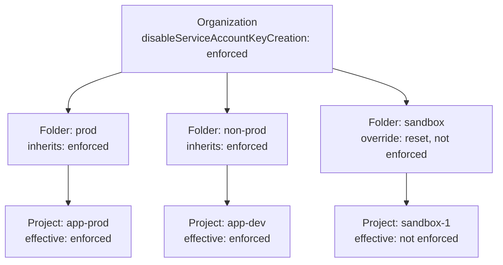

This note shows how to manage GCP organization policy constraints as code: a baseline set at the organization, overrides at folder or project level, custom constraints for settings the built-in ones do not cover, a dry-run rollout and a recorded way to grant exceptions. It is written for senior DevOps engineers. It covers preventive controls on GCP resources only; in-cluster policy is in [[patterns/pod-security-admission]] and [[tools/gatekeeper-vs-kyverno]], and checks on a Terraform plan before apply are in [[patterns/terraform-plan-policy-checks]].

> [!warning] Not legal or audit advice
> This is general engineering guidance. Your auditor, assessor or legal counsel decides what satisfies a control or a legal obligation; check control numbers and wording against the current edition of the framework.

> [!info] Scope and sources
> Written against the Organization Policy Service and the `google_org_policy_policy` and `google_org_policy_custom_constraint` resources of the Google Terraform provider, based on the Google Cloud Organization Policy and Terraform provider documentation. Constraint names are the ones commonly documented; check the current list before use.

> [!note] Not verified
> The claims below were written from documentation knowledge and were not checked against a running system or the current docs: dry-run support for organization policies and its Terraform field name (`dry_run_spec`); which resource types custom constraints support and the CEL field names for them; value group names such as `in:eu-locations`; the exact name format expected by `google_org_policy_custom_constraint`. Check them before relying on them.

## Why preventive controls at the organization level

A review, a scanner or an alert tells you after the fact that something unsafe exists. An organization policy stops the API call. That makes it the cheapest control for a short list of settings that are almost never legitimate: service account keys, public IPs on VMs, resources in the wrong region, access for outside identities.

It works well when:

- the rule is simple and has few valid exceptions;
- you can express the exception as "this folder or project is different";
- you want the control to apply to every tool and every person, not only to the pipeline.

It works badly for rules that depend on context, which belong in CI checks or admission policy. Keep the organization policy list short and boring.

## Baseline constraints

A starting set, to adapt and test in your own organization:

| Constraint                                     | What it blocks                                        | Typical exception                                     |
| ---------------------------------------------- | ----------------------------------------------------- | ----------------------------------------------------- |
| `iam.disableServiceAccountKeyCreation`         | Creating user-managed service account keys            | A legacy integration that cannot federate, time-boxed |
| `iam.disableServiceAccountCreation` (optional) | Creating service accounts outside the project factory | The project that holds factory-created accounts       |
| `compute.vmExternalIpAccess`                   | VM instances with external IP addresses               | A legacy appliance VM pending replacement, time-boxed |
| `gcp.resourceLocations`                        | Creating resources outside approved regions           | Global or multi-region services, see pitfalls         |
| `iam.allowedPolicyMemberDomains`               | Granting IAM to identities outside your organization  | A partner domain for one shared project               |
| `compute.skipDefaultNetworkCreation`           | Creating the default network in new projects          | A sandbox that needs a quick network                  |
| `compute.requireOsLogin`                       | SSH access through metadata keys instead of OS Login  | None expected                                         |
| `storage.uniformBucketLevelAccess`             | Buckets with object ACLs                              | A legacy bucket pending migration                     |
| `storage.publicAccessPrevention`               | Public buckets                                        | A project that hosts public static assets             |
| `sql.restrictPublicIp`                         | Cloud SQL instances with public IPs                   | None expected                                         |

Not every organization needs every row. A constraint that you cannot explain to a developer in one sentence is not ready.

## Managing policies in Terraform

Use `google_org_policy_policy` for every constraint. Keep one file per scope (organization, folder) in a dedicated root module with its own state, applied by a restricted pipeline. See [[patterns/terraform-module-and-state-layout]].

```hcl title="org-policy/organization.tf"
variable "org_id" {
  type        = string
  description = "Numeric organization ID."
}

variable "allowed_customer_ids" {
  type        = list(string)
  description = "Cloud Identity or Workspace customer IDs allowed in IAM policies, for example C0xxxxxxx."
}

# Boolean constraint: enforce it.
resource "google_org_policy_policy" "disable_sa_key_creation" {
  name   = "organizations/${var.org_id}/policies/iam.disableServiceAccountKeyCreation"
  parent = "organizations/${var.org_id}"

  spec {
    rules {
      enforce = "TRUE"
    }
  }
}

# List constraint: deny all external IPs on VMs.
resource "google_org_policy_policy" "vm_external_ip" {
  name   = "organizations/${var.org_id}/policies/compute.vmExternalIpAccess"
  parent = "organizations/${var.org_id}"

  spec {
    rules {
      deny_all = "TRUE"
    }
  }
}

# List constraint: only allow resources in EU locations (example: change to your regions).
resource "google_org_policy_policy" "resource_locations" {
  name   = "organizations/${var.org_id}/policies/gcp.resourceLocations"
  parent = "organizations/${var.org_id}"

  spec {
    rules {
      values {
        allowed_values = ["in:eu-locations"] # change: your approved location groups or regions
      }
    }
  }
}

# List constraint: only identities from your own customer IDs in IAM policies.
resource "google_org_policy_policy" "allowed_member_domains" {
  name   = "organizations/${var.org_id}/policies/iam.allowedPolicyMemberDomains"
  parent = "organizations/${var.org_id}"

  spec {
    rules {
      values {
        allowed_values = var.allowed_customer_ids
      }
    }
  }
}
```

The `allowedPolicyMemberDomains` constraint takes customer IDs, not domain names. Look yours up in the admin console or by command before applying, because a wrong value blocks every new IAM grant.

The Terraform identity for this root needs the organization policy administrator role (`roles/orgpolicy.policyAdmin`). Give it to a separate pipeline identity from the one that creates projects, and protect that pipeline's branch. See [[architecture/iam-groups-and-ci-workload-identity-federation]].

## Inheritance and overrides

Policies set at the organization are inherited by folders and projects. A folder or project can override, usually by resetting to the default, by inheriting from the parent and adding to it (for list constraints), or by replacing the rules. The effective policy of a resource is the result of merging up the tree. See [[architecture/gcp-resource-hierarchy-and-landing-zone]] for the folder layout.



An override for a sandbox folder that resets one constraint:

```hcl title="org-policy/folder-sandbox.tf"
variable "sandbox_folder_id" {
  type        = string
  description = "Numeric ID of the sandbox folder."
}

# Exception: sandbox projects may create service account keys.
# Owner: platform team. Review by: 2027-03-31 (change the date when you copy this).
resource "google_org_policy_policy" "sandbox_sa_keys" {
  name   = "folders/${var.sandbox_folder_id}/policies/iam.disableServiceAccountKeyCreation"
  parent = "folders/${var.sandbox_folder_id}"

  spec {
    reset = true
  }
}
```

Keep overrides in Git next to the baseline, with the owner and a review date in a comment. An override that nobody can explain a year later is a hole.

## Custom constraints

Built-in constraints cover common settings. When you need a rule on a field they do not expose, a custom constraint expresses it in CEL and applies to supported resource types, through the same policy mechanism. The example below requires GKE clusters to have private nodes.

```hcl title="org-policy/custom-gke-private-nodes.tf"
resource "google_org_policy_custom_constraint" "gke_private_nodes" {
  name         = "custom.gkeRequirePrivateNodes"
  parent       = "organizations/${var.org_id}"
  display_name = "GKE clusters must use private nodes"
  description  = "New GKE clusters must set enablePrivateNodes so nodes have no public IPs."

  action_type    = "ALLOW"
  condition      = "resource.privateClusterConfig.enablePrivateNodes == true"
  method_types   = ["CREATE"]
  resource_types = ["container.googleapis.com/Cluster"]
}

resource "google_org_policy_policy" "gke_private_nodes" {
  name   = "organizations/${var.org_id}/policies/custom.gkeRequirePrivateNodes"
  parent = "organizations/${var.org_id}"

  spec {
    rules {
      enforce = "TRUE"
    }
  }

  depends_on = [google_org_policy_custom_constraint.gke_private_nodes]
}
```

A custom constraint does nothing until a policy enforces it, which is the second resource. The `ALLOW` action with a condition means "allow creation only when the condition is true". The private-cluster design this supports is in [[architecture/private-gke-and-controlled-egress]].

Custom constraints support a limited set of resource types and fields, and a wrong field name fails at create time. Start from the documented example for the service, and test each constraint in a sandbox folder before the organization.

## Rolling out with dry-run

Enforcing a new constraint at the organization can break pipelines you have forgotten. Where the Organization Policy Service offers a dry-run mode, use it: it evaluates the policy and logs violations in audit logs without blocking. A policy can carry both an enforced spec and a dry-run spec.

```hcl title="org-policy/dry-run-example.tf"
# Dry-run only: logs violations, blocks nothing.
resource "google_org_policy_policy" "storage_public_access_prevention" {
  name   = "organizations/${var.org_id}/policies/storage.publicAccessPrevention"
  parent = "organizations/${var.org_id}"

  dry_run_spec {
    rules {
      enforce = "TRUE"
    }
  }
}
```

The steps:

1. Create the policy with only `dry_run_spec`. Apply it.
2. Wait at least one full release cycle and one full week of batch jobs, then query the audit logs for violations of the constraint.
3. Fix or except each violating project.
4. Move the same rule from `dry_run_spec` to `spec`, and apply again.
5. Watch pipeline failures and support tickets for a week.

Where dry-run is not available for a constraint, apply the policy first to a non-production folder, then to production, and keep the rollout in the same merge request history. A general procedure for moving a rule from audit to enforcement is in [[runbooks/policy-rollout-audit-to-enforce]].

## Exceptions

An exception is a policy override with an owner, a reason and an end date, recorded in Git:

- The override is a Terraform resource at the narrowest scope (a project, not a folder; a folder, not the organization).
- A comment or a label states who owns it, why, the ticket and the review date.
- A merge request approved by the security reviewers group is the only way to add one. The pipeline that applies organization policy is protected, so a person cannot override by hand.
- A scheduled job or a calendar item lists overrides past their review date and opens an issue for each.
- Removing an override is a normal change and should be as easy as adding it.

Keep the exception list short enough to read in one sitting. If it grows, the baseline constraint is wrong for your organization, or the sandbox folder is doing too much.

## Pitfalls

- Blast radius. An organization-level policy applies to every project in the tree, including ones nobody remembers. Dry-run or apply to a folder first.
- Applying before importing. Policies that already exist in the console and are not imported make the first apply fail with an already-exists error, or you overwrite settings you did not review. Import what exists, or list it with `gcloud org-policies list` and match it in code first.
- Using the deprecated `google_organization_policy` resource. Use `google_org_policy_policy`, which supports the current API, dry-run and custom constraints; check the provider documentation for the status of the old resources.
- Giving the Terraform service account `roles/orgpolicy.policyAdmin` in the same pipeline that creates ordinary projects. Whoever controls that pipeline can switch off any guardrail.
- `gcp.resourceLocations` breaking global or multi-region services. Some services and resources have no region or use a multi-region, and a location policy can block them. Test each service you use in a sandbox before you enforce.
- Treating organization policy as the only control. It checks API calls to GCP; it knows nothing about your Kubernetes objects or your Terraform intent.
- Constraints that block your own pipeline: for example a customer ID list that omits the identity domain of your CI service accounts.

## Verify

```bash
set -euo pipefail

ORG_ID="123456789012"  # change: your numeric organization ID
PROJECT_ID="my-project"  # change: a project to inspect
CONSTRAINT="iam.disableServiceAccountKeyCreation"

# Policies set directly on the organization
gcloud org-policies list --organization="${ORG_ID}"

# The policy as set on the organization for one constraint
gcloud org-policies describe "${CONSTRAINT}" --organization="${ORG_ID}"

# The effective policy for a project, after inheritance and overrides
gcloud org-policies describe "${CONSTRAINT}" --project="${PROJECT_ID}" --effective

# Custom constraints defined in the organization
gcloud org-policies list-custom-constraints --organization="${ORG_ID}"
```

Then try the forbidden action in a throwaway project in a non-exempt folder. Creating a service account key should fail with a message that names the constraint. If it succeeds, check the effective policy first, then the inheritance chain.

## Rollback

- A single constraint: set `enforce = "FALSE"` (or remove the rule) in Terraform, open a merge request and apply. For an emergency, an authorised administrator can delete the policy on the resource: `gcloud org-policies delete iam.disableServiceAccountKeyCreation --organization="${ORG_ID}"`. Record the manual change in Git afterward so state and reality agree.
- A custom constraint: delete the enforcing policy first, then the constraint. A constraint that is still referenced by a policy cannot be removed cleanly.
- A bad rollout: revert the merge request and re-apply. Because policies are Terraform resources, the previous commit is the previous state.

## Related

- [[architecture/gcp-resource-hierarchy-and-landing-zone]]: the folders and projects that policies attach to.
- [[architecture/iam-groups-and-ci-workload-identity-federation]]: the identity design that these constraints back up, such as blocking service account keys.
- [[patterns/terraform-module-and-state-layout]]: how to organise the root module and state for organization-level resources.
- [[patterns/terraform-plan-policy-checks]]: checking the same intent earlier, on the plan, before apply.
- [[patterns/pod-security-admission]]: the equivalent preventive control inside a Kubernetes cluster.
- [[runbooks/policy-rollout-audit-to-enforce]]: a general procedure for moving a policy from audit to enforcement.
