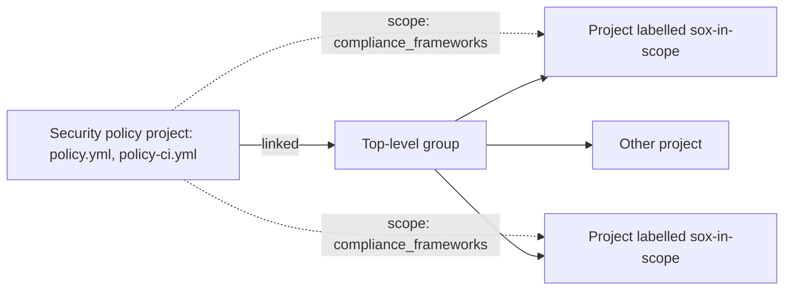

Every project maintainer owns their `.gitlab-ci.yml`. A central template pulled in with `include:` makes the right jobs easy to adopt, but a maintainer can delete the include, override a job or add a rule that skips it, and the next audit sample shows a production change with no secret scan. This note shows how GitLab's group-level security policies and compliance frameworks close that gap, so that the separation of duties in [[compliance/separation-of-duties-in-deployments]] also covers the pipeline definition itself.

> [!warning] Not legal or audit advice
> This is general engineering guidance. Your auditor, assessor or legal counsel decides what satisfies a control or a legal obligation; check control numbers and wording against the current edition of the framework.

> [!info] Not checked against a running system
> Written against the GitLab documentation source for security policies, compliance frameworks, the compliance center and the audit events API, read on 2026-10-21. That source describes GitLab 19.x; on an older or self-managed version the schema can differ, so open the documentation for your version (the docs site has a version selector). Nothing was run against a GitLab instance.
>
> Not checked for this note: what Premium or Free tiers can use instead of security policies, the API or GraphQL operations for linking and unlinking a security policy project, which audit event types record policy, framework and CI/CD setting changes, how long GitLab keeps audit events, how to export compliance center reports, and the status of the newer configurable compliance requirements and controls. Each is marked again where it appears.

## The problem and the short answer

A required job is only a control if the people it controls cannot remove it. In GitLab terms: the job definition and the decision to run it must live outside the project, in a place only the security or platform owners can change, and GitLab must merge it into every pipeline.

- **Pipeline execution policies** inject required jobs (secret detection, SBOM, evidence export) into every pipeline of the projects in scope. With the `inject_policy` strategy, the project's own configuration cannot override them.
- **Scan execution policies** run GitLab's own security scanners on chosen branches or on a schedule, with almost no configuration.
- **Merge request approval policies** require an approval from a named group when a scan finds critical issues, and can block force pushes and unprotecting branches.
- **Compliance frameworks** are labels on projects. Policies can be scoped to a label, so "everything labelled `sox-in-scope`" gets the stricter set.
- The policies live in a separate **security policy project** that only a small group can merge to, and they are linked to the top-level group.

All security policy types need GitLab Ultimate. Compliance frameworks and the compliance center are available in Premium and Ultimate.

## Options compared

| Option                           | What it enforces                                                     | Can a project maintainer bypass it?                                                                              | Tier (check for your version) |
| -------------------------------- | -------------------------------------------------------------------- | ---------------------------------------------------------------------------------------------------------------- | ----------------------------- |
| Central `include:` of a template | Nothing; it makes the right jobs easy to adopt                       | Yes: remove the include, override the job, change its rules                                                      | All                           |
| Compliance pipelines             | A pipeline that replaces the project's pipeline                      | Not directly, but deprecated; do not adopt                                                                       | Ultimate                      |
| Pipeline execution policy        | Arbitrary jobs from a central CI file, in every pipeline in scope    | Not with `inject_policy`: project configuration cannot override policy jobs; `skip ci` is ignored unless allowed | Ultimate                      |
| Scan execution policy            | GitLab scanners on chosen branches or a schedule                     | No; a project without CI configuration still gets the scans                                                      | Ultimate                      |
| Merge request approval policy    | Extra approvals when findings exceed a threshold; branch protections | No, unless the policy is in `warn` mode, which allows a merge with a recorded reason                             | Ultimate                      |
| Compliance framework label       | Nothing by itself; it scopes policies and reports                    | Applying and removing labels needs a high role; check who has it                                                 | Premium, Ultimate             |

Compliance pipelines were deprecated in GitLab 17.3 in favour of pipeline execution policies. Their documentation names the planned removal as 19.0 in one place and 20.0 in another, so check the deprecations page for your version. Do not enable a pipeline execution policy on a project that still uses a compliance pipeline: the compliance pipeline replaces the project pipeline while the policy is applied to the original project pipeline, which gives duplicated jobs or missing checks. Migrate first.

For tiers below Ultimate, keep the central include and a CODEOWNERS rule on `.gitlab-ci.yml` as in [[adr/0013-versioned-central-ci-templates]] and [[patterns/gitlab-ci-components-and-includes]]. That is a review control, not enforcement; record it as such in your control matrix. What else lower tiers offer is not verified here.

## The security policy project

Policies are YAML in `.gitlab/security-policies/policy.yml` of a dedicated project. Creating the first policy at group level from the UI creates that project for you under the top-level group. Treat it as the most sensitive repository you have after the infrastructure code:

- Membership: the security lead and two or three platform engineers. By default Owners and Maintainers of the policy project can create, edit and delete policies, and Developers can propose changes but not merge them.
- Protect the default branch, require approval from the security group, and turn on the approval policy settings in this note for the policy project itself.
- Keep the CI files that pipeline execution policies include (for example `policy-ci.yml`) in this project or in a project with the same protections. Anyone who can change that file can change what runs in every pipeline.

Linking: a user with the Owner role (or a custom role with the permission to manage the link) opens the top-level group, then **Secure > Policies > Edit Policy Project**, selects the policy project and saves. Linking at the top-level group applies the policies to every subgroup and project below it, narrowed by each policy's `policy_scope`. API or GraphQL routes for linking exist in recent versions, but their names were not verified; check the GraphQL reference if you want to script it.



## Pipeline execution policy: inject a required job

This policy injects an evidence and secret-scanning job into every pipeline of projects with the compliance framework whose ID is 2. The schema follows the pipeline execution policy reference; the project path, file name and IDs are examples.

```yaml title=".gitlab/security-policies/policy.yml"
pipeline_execution_policy:
  - name: Required security and evidence jobs
    description: Injects secret detection and the deploy evidence export into every pipeline.
    enabled: true
    pipeline_config_strategy: inject_policy
    content:
      include:
        - project: example-org/security/security-policies
          file: policy-ci.yml
          ref: main
    policy_scope:
      compliance_frameworks:
        - id: 2
    suffix: on_conflict
    skip_ci:
      allowed: false
    variables_override:
      allowed: false
```

```yaml title="policy-ci.yml (in the security policy project)"
policy::secret-detection:
  stage: .pipeline-policy-pre
  image: registry.example.com/security/secret-scanner:pinned # change: your pinned scanner image
  script:
    - secret-scan --fail-on-findings . # change: your scanner's command

policy::deploy-evidence:
  stage: .pipeline-policy-post
  image: registry.example.com/platform/evidence-exporter:pinned # change: your exporter image
  rules:
    - if: $CI_COMMIT_BRANCH == $CI_DEFAULT_BRANCH
  script:
    - export-deploy-evidence # change: writes the deploy record to the evidence bucket
```

How it behaves, from the reference:

- `pipeline_config_strategy: inject_policy` adds the policy jobs to the project's pipeline without replacing it, and the project's configuration cannot override them. `override_project_ci` instead ignores the project's configuration (which can be included from the policy). `inject_ci` is deprecated; use `inject_policy`.
- A security policy project holds at most five pipeline execution policies. Any after the first five are not applied.
- Jobs in the reserved stages `.pipeline-policy-pre` (before `.pre`) and `.pipeline-policy-post` (after `.post`) always run. Jobs in other stages may be ignored depending on the project's stages, so put required checks in the reserved stages.
- In current versions, if `.pipeline-policy-pre` fails or all its jobs are skipped, all later jobs are skipped, including jobs with `needs: []` or `when: always`. The reference says earlier versions let such jobs run anyway; check the behaviour on your version.
- `suffix: on_conflict` (the default) renames policy jobs whose names collide with project jobs; `never` fails the pipeline on a collision instead.
- `skip_ci` and `no_pipeline` default to ignoring `[skip ci]` for policy jobs; allow it only for a named allowlist of users, if at all.
- `variables_override.allowed: false` stops project variables from changing policy job behaviour. The reference's guidance for security-critical policies is to lock this, avoid `changes:` rules on critical jobs and use `.pipeline-policy-pre`.
- Policy jobs have no visible marker in the pipeline view, so give them a unique prefix such as `policy::`.
- Users who trigger a pipeline need read access to the included CI file, or pipelines do not start. The "Pipeline execution policies" setting in the policy project's general settings grants that access to the projects in scope. Renaming or deleting the included file can stop pipelines in every project in scope.
- The policy applies even to a project with no `.gitlab-ci.yml`.

## Scan execution policy: GitLab scanners everywhere

When the required checks are GitLab's own scanners, a scan execution policy is quicker to set up than a pipeline execution policy, but not customisable beyond the scanner's settings.

```yaml title=".gitlab/security-policies/policy.yml (continued)"
scan_execution_policy:
  - name: Secret detection and SAST on the default branch
    description: Runs on every pipeline for the default branch of in-scope projects.
    enabled: true
    rules:
      - type: pipeline
        branch_type: default
    actions:
      - scan: secret_detection
      - scan: sast
    policy_scope:
      compliance_frameworks:
        - id: 2
  - name: Weekly dependency scan
    description: Scheduled dependency scanning, even for projects nobody pushes to.
    enabled: true
    rules:
      - type: schedule
        cadence: "0 3 * * 1"
        branch_type: default
    actions:
      - scan: dependency_scanning
    policy_scope:
      compliance_frameworks:
        - id: 2
```

Each rule sets either `branches` (wildcards allowed) or `branch_type` (`default`, `protected`, `all`, `target_default`, `target_protected`), not both. Action `scan:` values include `sast`, `sast_iac`, `dast`, `secret_detection`, `container_scanning` and `dependency_scanning`; an action can also set runner `tags` and `variables`. For merge request pipelines the reference asks for the `AST_ENABLE_MR_PIPELINES: "true"` variable.

## Merge request approval policy: security approval on critical findings

This policy requires one approval from the security reviewers group when a scan finds a critical vulnerability on a merge request to a protected branch, and blocks force pushes and unprotecting branches in scope.

```yaml title=".gitlab/security-policies/policy.yml (continued)"
approval_policy:
  - name: Security approval for critical findings
    description: Critical findings from any scanner need a security reviewer.
    enabled: true
    enforcement_type: enforce
    policy_scope:
      compliance_frameworks:
        - id: 2
    rules:
      - type: scan_finding
        scanners:
          - sast
          - secret_detection
          - dependency_scanning
          - container_scanning
        vulnerabilities_allowed: 0
        severity_levels:
          - critical
        vulnerability_states: []
        branch_type: protected
    actions:
      - type: require_approval
        approvals_required: 1
        group_approvers:
          - example-org/security-reviewers
      - type: send_bot_message
        enabled: true
    approval_settings:
      block_branch_modification: true
      prevent_pushing_and_force_pushing: true
    fallback_behavior:
      fail: closed
```

Points from the reference:

- The key is `approval_policy`; older policy files used `scan_result_policy`.
- Group approvers must be direct members of the group to be eligible.
- `fallback_behavior.fail: closed` (the default) blocks the merge when the rule cannot be evaluated, for example because the scan job did not run. Keep it closed for regulated projects.
- The policy is evaluated from the scan jobs' report artifacts after the jobs finish, so it depends on the scans actually running: pair it with the scan or pipeline execution policy above.
- `enforcement_type: warn` lets a merge proceed with a warning and a bypass reason. Use it during rollout, then switch to `enforce`.
- Some `approval_settings` (such as `prevent_approval_by_author`) apply only to `any_merge_request` rules; check the settings table before relying on one.

A finding accepted through approval still needs an exception record if it stays open: see [[compliance/vulnerability-exception-register]] and [[standards/vulnerability-management-slas]].

## Compliance framework labels and policy scope

Compliance frameworks are created on the top-level group, and a project can have several (up to 20). Use them to say which projects carry which obligations (`sox-in-scope`, `pci-cde`, `production-service`), then scope policies to them.

> [!warning] An empty scope means everything
> In `policy_scope`, an empty list (`projects: {including: []}`, `groups: {including: []}` or `compliance_frameworks: []`) applies the policy to **all** projects, not to none. To switch a policy off, set `enabled: false`.

Scope keys are `compliance_frameworks` (a list of `{id: N}`), and `projects` and `groups` with `including` and `excluding` lists of `{id: N}`. A project moved out of its top-level group loses its frameworks, and with them every policy scoped by framework; watch for project transfers in the audit events. Recent versions add configurable compliance requirements and controls to frameworks; their status and schema on your version are not verified here.

## Evidence: audit events and the compliance center

The compliance center (Premium and Ultimate; Owner, Security Manager or administrator role) has the compliance status, violations, frameworks and projects reports. How to export them is not verified; screenshot or export what the UI allows at each evidence date.

For a durable record, export audit events through the API to the evidence bucket on a schedule. Group and project endpoints are `GET /groups/:id/audit_events` and `GET /projects/:id/audit_events`, filtered by `created_after` and `created_before` in ISO 8601 (`YYYY-MM-DDTHH:MM:SSZ`). The instance endpoint `GET /audit_events` is for administrators on self-managed and Dedicated, and limits each query to at most 30 days. Offset pagination is deprecated with removal planned; use keyset pagination (see the REST API pagination docs for the parameters).

```bash title="scripts/export-gitlab-audit-events.sh"
set -euo pipefail

GITLAB_URL="https://gitlab.example.com"  # change: your instance
GROUP_ID="42"                            # change: the top-level group ID
FROM="2026-10-01T00:00:00Z"              # change: start of the window (keep windows to 30 days or less)
TO="2026-10-21T00:00:00Z"                # change: end of the window
OUT="gitlab-audit-events-${GROUP_ID}-${FROM%%T*}-${TO%%T*}.json"
# GITLAB_TOKEN comes from the CI secret store, never a personal token. Its user needs the Owner role on the group:
# with Developer or Maintainer the API returns only that user's own events.

curl --fail --silent --show-error \
  --header "PRIVATE-TOKEN: ${GITLAB_TOKEN}" \
  "${GITLAB_URL}/api/v4/groups/${GROUP_ID}/audit_events?created_after=${FROM}&created_before=${TO}&per_page=100" \
  > "${OUT}"

jq 'length' "${OUT}"
```

This fetches only the first page; loop over pages using the pagination headers your version returns, then copy the files to the archive described in [[compliance/audit-evidence-collection-and-retention]]. Which event types record policy project links, policy edits, framework label changes and CI/CD setting changes is not verified, and neither is GitLab's own retention of audit events, so do not rely on GitLab alone for the audit period.

## Rollout

1. **Test group.** Create a top-level test group with two throwaway projects, link a copy of the policy project, and create the policies with `enabled: false`. The reference allows creating a policy disabled for testing.
2. **Pilot.** Enable the policies with `policy_scope.projects.including` set to a few volunteer projects. Run approval policies in `enforcement_type: warn`.
3. **Framework scope.** Label in-scope projects with the compliance framework, switch the scope from project IDs to the framework, and switch approval policies to `enforce`.
4. **All groups.** Link the policy project to every top-level group that holds production code. Announce the `policy::` job prefix and where to ask for help.

Keep each step's merge request in the policy project as the change record.

## Validation

In a test project in scope:

1. Push a branch whose `.gitlab-ci.yml` deletes or overrides every scan job, and a second branch that deletes `.gitlab-ci.yml` entirely. Expected: both pipelines still run `policy::secret-detection` in `.pipeline-policy-pre`.
2. Push a commit with `[skip ci]` in the message. Expected: policy jobs still run (unless the pusher is on the `skip_ci` allowlist).
3. Commit a test secret that the scanner detects, on a branch, and open a merge request to the default branch. Expected: the pre-stage job fails and later jobs are skipped; with a critical finding in a scanner report, the approval policy asks for the security group.
4. Try `git push --force` to the protected default branch. Expected: refused.
5. Remove the test secret from the branch history or delete the branch, and record the run.

## Troubleshooting

| Symptom                                                | Likely cause                                                                                     | Check                                                                                                |
| ------------------------------------------------------ | ------------------------------------------------------------------------------------------------ | ---------------------------------------------------------------------------------------------------- |
| Policy jobs do not appear                              | Policy project not linked at this level, policy `enabled: false`, project outside `policy_scope` | Secure > Policies on the project shows which policies apply                                          |
| A policy applies to projects it should not             | An empty list in `policy_scope`                                                                  | Replace with explicit IDs or a framework, or set `enabled: false`                                    |
| Pipelines no longer start                              | The triggering user cannot read the included policy CI file, or the file was renamed             | Enable the "Pipeline execution policies" access setting in the policy project; restore the file path |
| Pipeline fails on a job name                           | `suffix: never` and a project job with the same name                                             | Rename the policy job with a unique prefix, or use `on_conflict`                                     |
| "Cyclic dependencies detected when enforcing policies" | The project lists the same stages as the policy in a different order                             | Align the project's stage order with the policy's, or move policy jobs to the reserved stages        |
| All jobs skipped                                       | A `.pipeline-policy-pre` job failed or was skipped                                               | Read that job's log first                                                                            |
| Injected job stays pending                             | No runner matches the job's tags in that project                                                 | [[runbooks/gitlab-runner-jobs-stuck-pending]]                                                        |

## Rollback

- To stop one policy quickly, set `enabled: false` in `policy.yml` through a merge request in the policy project. Do not empty its scope; that applies it everywhere.
- To remove all policies from a group, unlink the policy project: **Secure > Policies > Edit Policy Project**, then the trash can icon next to the linked project. Pipelines return to the projects' own configuration.
- Record the rollback and its reason as a waiver ([[compliance/policy-exception-and-waiver-process]]), because for its duration the required jobs are not enforced.

## Jenkins equivalent

Jenkins has no group-level policy engine. The usual equivalent is a mandatory stage in a trusted shared library that every `Jenkinsfile` must call, with a check that fails builds that do not call it, and with the library loaded from a protected repository that project teams cannot change. [[patterns/jenkins-shared-libraries]] covers the mechanism. It is weaker than an injected policy because the project still owns the `Jenkinsfile`, so add the review controls from [[compliance/separation-of-duties-in-deployments]] and the audit trail in [[compliance/jenkins-audit-trail-and-configuration-evidence]].

## Related

- [[compliance/change-management-controls-and-pipeline-evidence]]: the deploy evidence the injected job exports.
- [[compliance/soc2-for-ci-cd-controls]]: the control matrix rows these policies support.
- [[standards/ci-pipeline-standard]]: what every pipeline must contain.
- [[patterns/secret-scanning-pre-commit-and-ci]]: secret scanning before and in CI.
- [[patterns/sonarqube-quality-gates]]: a second required gate that a policy job can call.
- [[compliance/common-control-framework-for-platform-teams]]: mapping these controls to frameworks.

## Sources

- GitLab, [Security policies](https://docs.gitlab.com/user/application_security/policies/): policy types, tiers, `policy_scope`.
- GitLab, [Pipeline execution policies](https://docs.gitlab.com/user/application_security/policies/pipeline_execution_policies/): schema, strategies, reserved stages.
- GitLab, [Scan execution policies](https://docs.gitlab.com/user/application_security/policies/scan_execution_policies/).
- GitLab, [Merge request approval policies](https://docs.gitlab.com/user/application_security/policies/merge_request_approval_policies/).
- GitLab, [Security policy projects](https://docs.gitlab.com/user/application_security/policies/enforcement/security_policy_projects/): creating, linking and unlinking.
- GitLab, [Compliance pipelines (deprecated)](https://docs.gitlab.com/user/group/compliance_pipelines/).
- GitLab, [Compliance frameworks](https://docs.gitlab.com/user/group/compliance_frameworks/).
- GitLab, [Compliance center](https://docs.gitlab.com/user/compliance/compliance_center/).
- GitLab, [Audit events API](https://docs.gitlab.com/api/audit_events/).
