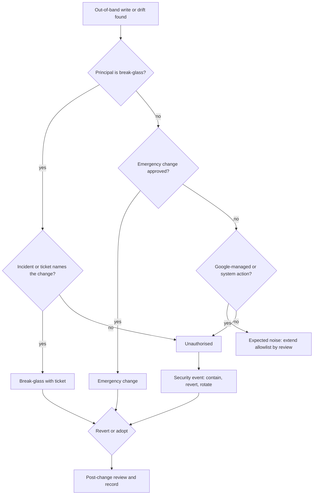

The change-management notes on this site assume that Git and CI are the only way to change production. Auditors test that assumption: "how do you know nobody changed production by hand?" This note builds the detective control that answers it. It watches the audit logs for writes by anyone outside the approved deployers, compares the real state with Git, classifies each finding, and keeps a weekly record. The preventive side, a CI-only apply and separation of duties, is in [[adr/0035-terraform-plan-policy-gate-and-ci-only-apply]] and [[compliance/separation-of-duties-in-deployments]].

> [!warning] Not legal or audit advice
> This is general engineering guidance. Your auditor, assessor or legal counsel decides what satisfies a control or a legal obligation; check control numbers and wording against the current edition of the framework.

> [!info] Not checked against a running system
> Written for Cloud Audit Logs on a GCP organisation with GKE clusters, Terraform applied from CI, and Argo CD with automated sync. Audit log field names were checked against Google's published `AuditLog` message definition, `gcloud logging read` and the Terraform resources against their reference text, and Argo CD behaviour against its documentation, on 2026-10-21. Nothing was run against a real project.
>
> Not checked for this note: that Admin Activity audit logs are always written and cannot be disabled, and the retention of the `_Required` log bucket; GKE audit method names, principal formats and user agents for `kubectl` and the console; the exact names of Google service agents; whether a log-match alert evaluates logs routed into a central log bucket from other projects; and how Argo CD records a self-heal sync in its history. Build the allowlist and the filters from your own log entries in a sandbox, as described under Validation.

## Short answer

Use two independent signals and reconcile them:

1. **Who wrote.** Every Admin Activity audit entry names the caller. Alert on writes whose caller is not in the approved-deployer allowlist: the CI identities, the Argo CD controller, platform system principals, Google service agents and break-glass accounts.
2. **What differs.** Terraform plans with `-detailed-exitcode` and Argo CD sync status show state that does not match Git, including changes made by an approved identity outside a normal run.

Each finding is then classified as break-glass with a ticket, an emergency change, or unauthorised, and is either reverted or adopted into code. A weekly report of findings and their outcomes goes to the evidence bucket.

## The approved-deployer allowlist

Keep the allowlist as a file in the platform repository, reviewed like code. Generate the log filters from it so the alert and the report always use the same list.

| Category              | Who                                                                                                  | How it appears in the audit log                                                                                                                            |
| --------------------- | ---------------------------------------------------------------------------------------------------- | ---------------------------------------------------------------------------------------------------------------------------------------------------------- |
| CI deployers          | The service accounts that Terraform and deploy jobs impersonate through workload identity federation | `principalEmail` of the service account, with the federated identity in `serviceAccountDelegationInfo`; or only a `principalSubject` for direct federation |
| GitOps controller     | The Argo CD application controller's Kubernetes service account                                      | A `system:serviceaccount:<namespace>:<name>` principal on the cluster's audit entries (format not verified)                                                |
| Kubernetes system     | Controllers inside the cluster                                                                       | Principals starting with `system:` (not verified)                                                                                                          |
| Google service agents | Google-managed identities that act for a service in your project                                     | Service agent email addresses; check the service agents page for the exact patterns                                                                        |
| Break-glass           | The named emergency accounts or group                                                                | Their own principals; every use is a finding to classify, never silently allowed                                                                           |

Facts from the `AuditLog` definition that shape the filters:

- `protoPayload.authenticationInfo.principalEmail` holds the caller's email. For callers authenticated through a third-party identity (workload identity federation without impersonation), `principalSubject` is populated instead.
- When a service account is impersonated, the chain of callers is in `authenticationInfo.serviceAccountDelegationInfo`, each with a `principalSubject` or a first-party `principalEmail`.
- The principal email is sometimes redacted for privacy reasons. An entry with no usable principal is itself a finding to look at, not something to drop.
- `authenticationInfo.serviceAccountKeyName` names the key used when a service account key authenticated the call. Any write that carries a key name means a long-lived key is in use; alert on it separately.
- `requestMetadata.callerSuppliedUserAgent` is supplied by the caller and is not authenticated. Use it only as a hint ("this looks like `kubectl` or `gcloud`"), never to decide whether a change was allowed.

Do not allow a whole domain such as every `gserviceaccount.com` address. A stolen service account key would then look exactly like a deployer. List each approved service account by name.

## Finding writes by unapproved principals

Admin Activity audit logs record calls that change configuration or metadata. Writes to data (object contents, table rows) are Data Access entries with a separate setting; this control is about configuration, so Admin Activity is the source. Check both statements against the audit logging page for the services you use.

The query below is the starting point for the report and the alert. Run it in Logs Explorer against the central log bucket that receives the organisation's audit logs (see [[adr/0044-central-log-sinks-and-retention-tiers]]).

```text title="Logging query: configuration writes outside the allowlist"
logName:"cloudaudit.googleapis.com%2Factivity"
NOT protoPayload.authenticationInfo.principalEmail="terraform-apply@example-ci.iam.gserviceaccount.com"
NOT protoPayload.authenticationInfo.principalEmail="deploy-prod@example-ci.iam.gserviceaccount.com"
NOT protoPayload.authenticationInfo.principalEmail="system:serviceaccount:argocd:argocd-application-controller"
NOT protoPayload.authenticationInfo.principalEmail=~"^system:"
NOT protoPayload.authenticationInfo.principalEmail=~"^service-[0-9]+@gcp-sa-"
```

Adjust before use:

- Replace the service account names with your own deployers. The Argo CD principal shown is the default install's controller name and is not verified; read it from a real entry.
- The service agent pattern is an example. Build the exclusions from the principals you actually observe over a few weeks in each project, and review every addition.
- Keep failed calls in the result. A denied write by someone outside the allowlist is an attempt, and it is worth seeing.
- The `^system:` line hides every Kubernetes service account, including a workload's own, which also makes the explicit Argo CD line redundant for now. Once you know the system principals in your clusters, replace the prefix with an explicit list (the Argo CD line then still applies), and keep a separate query for writes by `system:serviceaccount:` principals outside the namespaces you expect.

### GKE: human writes through the Kubernetes API

Kubernetes API calls on GKE are written to Cloud Logging as audit entries on the `k8s_cluster` resource. A change made with `kubectl edit` or from the console shows up there even if Argo CD reverts it seconds later. This query lists writes by principals that are neither Kubernetes system principals nor service accounts, which in practice means people:

```text title="Logging query: human writes to the Kubernetes API"
logName:"cloudaudit.googleapis.com%2Factivity"
resource.type="k8s_cluster"
NOT protoPayload.authenticationInfo.principalEmail=~"^system:"
NOT protoPayload.authenticationInfo.principalEmail=~"gserviceaccount[.]com$"
protoPayload.methodName=~"[.](create|update|patch|delete)$"
```

The method name pattern (`io.k8s.<group>.<version>.<resource>.<verb>`) and the principal formats are not verified; open a few entries from your own cluster and adjust. The user agent field shows whether the call came from `kubectl` or the console, but only as an unauthenticated hint.

### Reading entries from the command line

`gcloud logging read` defaults to `--freshness=1d`, so set the window explicitly for anything longer than a day.

```bash title="Read out-of-band writes from the audit logs"
set -euo pipefail

AUDIT_PROJECT="example-audit"   # change: project that owns the central log bucket
FILTER_FILE="oob-filter.txt"    # the first query above, saved to a file

gcloud logging read "$(cat "${FILTER_FILE}")" \
  --project="${AUDIT_PROJECT}" \
  --freshness=7d \
  --order=asc \
  --format=json > oob-entries.json

jq -r '.[] | [
    .timestamp,
    (.protoPayload.authenticationInfo.principalEmail
      // .protoPayload.authenticationInfo.principalSubject
      // "UNKNOWN"),
    .protoPayload.methodName,
    .protoPayload.resourceName,
    (.protoPayload.status.code // 0)
  ] | @tsv' oob-entries.json
```

If your logs are in a log bucket view rather than the project's default, add the bucket and view options that `gcloud logging read --help` lists for your SDK version.

## Alerting in Terraform

Two building blocks, both managed in the audit project:

- A **log-based metric** counts matching entries, labelled by principal, for dashboards and for the weekly trend.
- A **log-match alert policy** notifies on each matching entry. For an alert policy with a log-match condition, the provider requires `alert_strategy.notification_rate_limit`.

```hcl title="audit/out-of-band-changes.tf"
variable "audit_project_id" {
  type        = string
  description = "Project that owns the central log bucket and the alerting."
}

variable "notification_channel_ids" {
  type        = list(string)
  description = "Monitoring notification channels for the platform and security on-call."
}

locals {
  # The approved deployers. Keep this list in review; every entry widens what is ignored.
  approved_principals = [
    "terraform-apply@example-ci.iam.gserviceaccount.com",
    "deploy-prod@example-ci.iam.gserviceaccount.com",
    "system:serviceaccount:argocd:argocd-application-controller",
  ]

  oob_filter = join("\n", concat(
    ["logName:\"cloudaudit.googleapis.com%2Factivity\""],
    [for p in local.approved_principals : "NOT protoPayload.authenticationInfo.principalEmail=\"${p}\""],
    [
      "NOT protoPayload.authenticationInfo.principalEmail=~\"^system:\"",
      "NOT protoPayload.authenticationInfo.principalEmail=~\"^service-[0-9]+@gcp-sa-\"",
    ],
  ))
}

resource "google_logging_metric" "out_of_band_writes" {
  project = var.audit_project_id
  name    = "out_of_band_config_writes"
  filter  = local.oob_filter

  metric_descriptor {
    metric_kind = "DELTA"
    value_type  = "INT64"
    labels {
      key        = "principal"
      value_type = "STRING"
    }
  }

  label_extractors = {
    principal = "EXTRACT(protoPayload.authenticationInfo.principalEmail)"
  }
}

resource "google_monitoring_alert_policy" "out_of_band_writes" {
  project      = var.audit_project_id
  display_name = "Configuration write outside the pipeline"
  combiner     = "OR"

  conditions {
    display_name = "Admin Activity write by a principal outside the allowlist"
    condition_matched_log {
      filter = local.oob_filter
      label_extractors = {
        principal = "EXTRACT(protoPayload.authenticationInfo.principalEmail)"
        method    = "EXTRACT(protoPayload.methodName)"
        resource  = "EXTRACT(protoPayload.resourceName)"
      }
    }
  }

  alert_strategy {
    notification_rate_limit {
      period = "300s"
    }
  }

  notification_channels = var.notification_channel_ids

  documentation {
    content   = "A configuration write was made by a principal outside the approved deployers. Classify it with the out-of-band change runbook within one working day."
    mime_type = "text/markdown"
  }
}
```

Run `terraform validate` and review the plan; the `labels` block inside `metric_descriptor` and the `documentation` block were written from the provider reference and not applied here. Whether log-match conditions see entries routed into the audit project's log bucket from other projects is not verified: prove it with the validation step before you rely on the alert.

## The state signal: Terraform and Argo CD

Audit logs say who wrote. State comparison says whether production still matches Git, and catches cases the allowlist hides, for example a deployer identity used by hand from a laptop with a leaked credential.

- **Terraform.** The scheduled drift check in [[patterns/terraform-module-and-state-layout#Drift detection]] runs `terraform plan -detailed-exitcode`: exit code 0 means no changes, 1 an error, 2 changes present. Treat 2 as a finding and attach the plan. It only sees resources Terraform manages; resources created outside Terraform are invisible to it. Find those with Cloud Asset Inventory, as in [[compliance/continuous-control-monitoring-gcp-and-gke]], by comparing what exists with what state lists.
- **Argo CD.** With automated sync and `selfHeal: true`, Argo CD re-syncs an application that drifted from Git. The retry happens after the self-heal timeout, 5 seconds by default, set with `--self-heal-timeout-seconds` on the application controller. A `kubectl edit` is therefore reverted within seconds and leaves no trace in Git. The Kubernetes audit entry from the query above is then the only record of who made the change.

Argo CD's notification catalogue has no trigger for OutOfSync, so add a custom one if you want a message when drift appears:

```yaml title="argocd-notifications-cm (excerpt)"
apiVersion: v1
kind: ConfigMap
metadata:
  name: argocd-notifications-cm
  namespace: argocd
data:
  trigger.on-out-of-sync: |
    - when: app.status.sync.status == 'OutOfSync'
      oncePer: app.status.sync.revision
      send: [app-out-of-sync]
  template.app-out-of-sync: |
    message: |
      Application {{.app.metadata.name}} is OutOfSync with revision {{.app.status.sync.revision}}.
      Check the Kubernetes audit log for the change before the next sync hides it.
```

The trigger syntax follows the Argo CD notifications documentation; the template layout and the subscription annotation you add to applications are not verified, so check them against your Argo CD version. With self-heal on, the OutOfSync state may last only seconds, so the trigger can fire late, fire once for several edits, or miss an edit. Use it as a prompt to look, and the audit log as the record. Fields outside what the manifests in Git set, or listed in `ignoreDifferences`, never show as OutOfSync at all. [[runbooks/argocd-sync-failure-and-drift]] covers the operational side of drift.

## Classifying each finding

Every entry in the report gets exactly one class and an outcome. The classification is a human decision, recorded in the ticket.

| Class                     | Criteria                                                                                       | Action                                                                                                                           |
| ------------------------- | ---------------------------------------------------------------------------------------------- | -------------------------------------------------------------------------------------------------------------------------------- |
| Break-glass with a ticket | Made by a break-glass account, during an incident, and the incident or ticket names the change | Back-port the change to Git or revert it; link the incident; review in the post-incident review ([[runbooks/incident-response]]) |
| Emergency change          | Approved through the emergency change path before or immediately after the change              | Same as above; check the approval timestamp against the change timestamp                                                         |
| Expected noise            | A Google-managed or system action that is not yet in the allowlist                             | Add the principal to the allowlist through review, with the reason                                                               |
| Unauthorised              | None of the above                                                                              | Treat as a security event: who, how, with which credential; revert; rotate credentials if a key or token may be compromised      |



Revert or adopt:

- **Revert** when the change was wrong or not needed: run the pipeline (Terraform apply from CI, or an Argo CD sync) so Git wins. Do not undo a manual change by hand; that is another out-of-band change.
- **Adopt** when the change was right: put it in code through a normal merge request, with the finding's ticket in the description, and confirm the next drift check and sync are clean. For resources created outside Terraform, import them; [[runbooks/terraform-state-recovery]] covers state operations.

In both cases close the finding only when the post-change review is recorded: what happened, why the normal path was not used, and what changes so it does not happen again.

## Weekly reconciliation report

Once a week a scheduled pipeline produces the record an auditor samples:

1. Read the past seven days with the filter above (`--freshness=7d`, plus a day of overlap so nothing falls between runs).
2. Add the week's Terraform drift results and Argo CD drift notifications.
3. Join each entry with its finding ticket and class. Entries without a ticket are listed as open.
4. Write `oob-report.json` and a one-page summary (counts per class, open findings, time to classify) to `gs://example-evidence-archive/out-of-band/<week>/`, using the archive and retention described in [[compliance/audit-evidence-collection-and-retention]].

A week with zero findings still produces a report. "Nothing found, and here is the query and the window" is evidence; a missing week is a gap.

## Validation

Prove both signals in a sandbox project and cluster before relying on them.

1. Create a test identity that is not in the allowlist and give it a narrow write role in the sandbox project.
2. As that identity, make a harmless change, for example add a label to a bucket: `gcloud storage buckets update gs://example-oob-test --update-labels=oob-test=1`.
3. Find the entry in Logs Explorer. Note where the principal appears (`principalEmail`, `principalSubject` or the delegation chain) and confirm the query matches it.
4. Confirm the log-based metric counts it and the alert fires, both in the sandbox project and, if you route logs centrally, in the audit project.
5. In a sandbox cluster with an Argo CD application that has self-heal on, change a field that the manifests in Git set, for example `kubectl -n example-app scale deployment example-app --replicas=3` on a Deployment whose manifest sets `spec.replicas` to another value and has no HorizontalPodAutoscaler. Adding a label that Git does not set is not a valid test: a live-only field never shows as OutOfSync, so nothing is reverted. Confirm Argo CD reverts the change, and that the Kubernetes audit entry shows your principal.
6. Run the drift check on the sandbox Terraform root after a manual change and confirm exit code 2.
7. Remove the test identity's role and the bucket's test label, and record the run.

## Pitfalls

- **Service agent and autoscaler noise.** Google services, the cluster autoscaler, node auto-repair and GKE-managed upgrades write configuration constantly. Learn their principals from your own logs and allow them by name; do not drop whole classes of principal to make the noise stop.
- **Allowing the deployer by name and forgetting the key.** An approved service account used with a leaked key is still an approved principal. Alert on `serviceAccountKeyName` in write entries, and keep keys out of CI (see [[adr/0026-keyless-ci-auth-with-workload-identity-federation]]).
- **Trusting the user agent.** It is caller-supplied and unauthenticated.
- **Only looking at `principalEmail`.** Federated callers can appear only as `principalSubject`, and emails can be redacted. A filter that requires an email silently drops them.
- **Forgetting the default window.** `gcloud logging read` reads one day unless told otherwise.
- **Turning on Data Access logs for this.** Configuration writes are Admin Activity entries; Data Access logs add volume and cost without helping this control. Enable them only for controls that need reads or data writes.
- **Classifying without a record.** A finding closed in chat is not evidence. Each class needs the ticket link.

## Related

- [[compliance/change-management-controls-and-pipeline-evidence]]: the evidence for changes that did go through the pipeline.
- [[compliance/privileged-access-just-in-time-gcp-gke]]: time-bound elevated access, whose use shows up in this report.
- [[compliance/separation-of-duties-in-deployments]]: who may deploy at all.
- [[patterns/gcp-audit-logs-siem]]: routing audit logs to a SIEM for correlation.
- [[architecture/logging-architecture-gke-and-cloud-logging]]: where GKE logs go.
- [[adr/0001-gitops-with-argocd]]: why Argo CD owns cluster state.
- [[compliance/continuous-control-monitoring-gcp-and-gke]]: the state of configuration, as opposed to who changed it.

## Sources

- Google Cloud, [Cloud Audit Logs overview](https://cloud.google.com/logging/docs/audit): audit log types and the `AuditLog` fields.
- Google Cloud, [Routing and storage overview](https://cloud.google.com/logging/docs/routing/overview): log buckets, including `_Required`.
- Google Cloud, [GKE audit logging](https://cloud.google.com/kubernetes-engine/docs/how-to/audit-logging).
- Google Cloud, [Log-based metrics](https://cloud.google.com/logging/docs/logs-based-metrics).
- Google Cloud, [Logging query language](https://cloud.google.com/logging/docs/view/logging-query-language).
- Google Cloud, [Service agents](https://cloud.google.com/iam/docs/service-agents).
- HashiCorp, [google_logging_metric](https://registry.terraform.io/providers/hashicorp/google/latest/docs/resources/logging_metric) and [google_monitoring_alert_policy](https://registry.terraform.io/providers/hashicorp/google/latest/docs/resources/monitoring_alert_policy).
- HashiCorp, [terraform plan](https://developer.hashicorp.com/terraform/cli/commands/plan): `-detailed-exitcode`.
- Argo CD, [Automated sync policy](https://argo-cd.readthedocs.io/en/stable/user-guide/auto_sync/): self-heal and its timeout.
- Argo CD, [Notifications](https://argo-cd.readthedocs.io/en/stable/operator-manual/notifications/): triggers and the catalogue.
