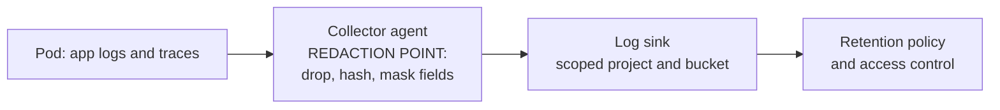

Logs, traces, CI output, crash dumps, backups and copied test data are where cardholder data and personal data most often end up outside the systems that were designed to hold them. This guide is for senior DevOps engineers who run that tooling. It covers how data gets in, how to stop it at the source, and how to set retention, and it leaves log structure to [[standards/structured-logging-conventions]] and evidence handling to [[compliance/audit-evidence-collection-and-retention]].

> [!warning] Not legal or audit advice
> This is general engineering guidance. Your auditor, assessor or legal counsel decides what satisfies a control or a legal obligation; check control numbers and wording against the current edition of the framework.

> [!info] Scope and sources
> Written for the Payment Card Industry Data Security Standard (PCI DSS) and the EU General Data Protection Regulation (GDPR), as they affect logging, monitoring, CI and data copies. Both are referred to only generally, as the idea that cardholder data must be protected and kept out of scope where possible, and as the GDPR principles of data minimisation, storage limitation and security of processing. No requirement numbers are cited.

> [!note] Not verified
> The claims below were written from documentation knowledge and were not checked against the current standards or any assessor: the PCI DSS version and requirement numbering, every retention figure (none are recommended here), and the names of the OpenTelemetry Collector processors and OTTL functions used in the example. Check them before relying on them.

## Where data leaks into tooling

Most of these paths are accidents, not designs. Find them before an assessor does.

| System                        | Data class                                      | Risk                                                             | Control                                                                 |
| ----------------------------- | ----------------------------------------------- | ---------------------------------------------------------------- | ----------------------------------------------------------------------- |
| Application logs              | Card numbers, emails, names, tokens in messages | Logs become in scope and are widely readable                     | Do not log request bodies; redact at the source and in the pipeline     |
| HTTP access logs              | Query strings with emails or tokens             | URLs are copied into logs, proxies and traces                    | Keep identifiers out of URLs; drop or hash query parameters             |
| Traces and span attributes    | Headers, SQL text, user IDs                     | Attributes carry values nobody reviewed                          | Allow-list attributes; delete authorisation headers                     |
| CI job logs                   | Secrets, test card numbers, customer data       | Logs are readable by every developer and kept for a long time    | Masked variables, output scanning, short artifact retention             |
| Crash dumps and core files    | Whole process memory                            | Contains anything the process held, including keys and card data | Disable core dumps for sensitive services; restrict and expire them     |
| Database and disk backups     | Complete data sets                              | Old backups outlive deletion requests                            | Encrypt, set retention, document how erasure applies to backups         |
| Test and stage data           | Production copies                               | A weaker environment holds real data                             | Synthetic or masked data only; no production restores to stage          |
| Error reporting and APM       | Stack traces with variables                     | Third-party processor receives the data                          | Scrub before send; check the processor agreement with counsel           |
| Debug sessions and shell logs | Anything typed or printed                       | Terminal recordings and shell history hold values                | Limit production access (see [[compliance/access-reviews-gcp-and-gke]]) |

## Redact at the source

The best place to remove data is where it is created, in the application or its logging library. The second best place is the first hop out of the Pod, before anything is written to disk or sent across a network. A redaction step late in the pipeline means the raw data already passed through disks, queues and agents that are now in scope.



Use the collector as a safety net, not as the only control. The configuration below masks long digit sequences in log bodies, deletes sensitive attributes and hashes identifiers (an unsalted hash of an email can be reversed with a dictionary, so it remains personal data; delete the field or use a keyed hash where that matters), using the OpenTelemetry Collector (see [[architecture/observability-pipeline-opentelemetry]] for the pipeline around it).

```yaml title="otel-collector/redaction.yaml"
receivers:
  otlp:
    protocols:
      grpc:
        endpoint: localhost:4317 # agent next to the app; for a gateway use the pod IP and add TLS as in the observability note, never plain 0.0.0.0

processors:
  memory_limiter:
    check_interval: 1s
    limit_mib: 400
  attributes/redact:
    actions:
      - key: http.request.header.authorization
        action: delete
      - key: http.request.header.cookie
        action: delete
      - key: user.email
        action: hash
      - key: enduser.id
        action: hash
  transform/mask_body:
    error_mode: ignore
    log_statements:
      - context: log
        statements:
          # Mask runs of 13 to 19 digits; a heuristic, it also hits order numbers
          - 'replace_pattern(body, "\\b[0-9]{13,19}\\b", "[REDACTED-PAN]")'
          # Mask email addresses
          - 'replace_pattern(body, "[A-Za-z0-9._%+-]+@[A-Za-z0-9.-]+\\.[A-Za-z]{2,}", "[REDACTED-EMAIL]")'
  batch: {}

exporters:
  otlp:
    endpoint: logging-backend.example.com:4317 # change: your log backend
    tls:
      insecure: false

service:
  pipelines:
    logs:
      receivers: [otlp]
      processors: [memory_limiter, attributes/redact, transform/mask_body, batch]
      exporters: [otlp]
    traces:
      receivers: [otlp]
      processors: [memory_limiter, attributes/redact, batch]
      exporters: [otlp]
```

Regular expressions miss formatted values (digits with spaces or dashes), values split across fields, and base64 or JSON-escaped content. Treat the pattern as a second line of defence, and fix the application that logs the value.

## Logging rules

- Do not log request or response bodies, headers with credentials, or full SQL statements with bound values. Log identifiers (an order ID), not content.
- Keep sensitive identifiers out of URLs and query strings. Use POST bodies or headers that are not logged.
- Define what a log field may contain in the logging convention and enforce it in code review: [[standards/structured-logging-conventions]].
- Separate audit logs (who did what, with which result) from application debug logs. Audit logs need integrity and longer retention; debug logs need short retention and tight access.
- Make the logging level a deliberate production setting. Debug logging turned on during an incident has a way of staying on.
- Keep time sources synchronised so logs from different systems can be correlated during an investigation.

## CI logs and masked variables

CI output is easy to forget because it feels temporary. It is kept, indexed, and readable by everyone with project access.

- Mark secrets as masked and protected variables in GitLab CI. Masking hides the value in job logs but does not stop a script from printing a transformed copy of it (base64, split strings), so do not rely on it alone.
- Do not run `set -x`, `env` or `printenv` in jobs that hold secrets.
- Set short expiry for job logs and artifacts. Keep the build metadata you need as evidence, and drop the rest.
- Scan job output and test fixtures for card-like numbers before they land in a repository or a shared log. The check below is a heuristic: it finds digit sequences of 13 to 19 digits and keeps those that pass the Luhn checksum, which cuts false positives but does not remove them. Order numbers and timestamps can pass by chance, and cards with unusual formatting can be missed.

```python title="scripts/pan_scan.py"
"""Heuristic scan for payment card numbers in text files or stdin.

Finds 13 to 19 digit sequences (digits may be separated by spaces or dashes),
keeps those that pass the Luhn check, prints file, line and the last four digits only.
Exit code 1 if anything is found, 0 otherwise. Standard library only.
"""
import re
import sys

CANDIDATE = re.compile(r"(?<![\d-])(?:\d[ -]?){12,18}\d(?![\d-])")


def luhn_ok(digits: str) -> bool:
    total = 0
    for index, char in enumerate(reversed(digits)):
        number = int(char)
        if index % 2 == 1:
            number *= 2
            if number > 9:
                number -= 9
        total += number
    return total % 10 == 0


def scan(name: str, stream) -> int:
    found = 0
    for line_no, line in enumerate(stream, start=1):
        for match in CANDIDATE.finditer(line):
            digits = re.sub(r"[ -]", "", match.group(0))
            if 13 <= len(digits) <= 19 and luhn_ok(digits):
                found += 1
                # Never print the full number
                print(f"{name}:{line_no}: possible card number ending {digits[-4:]}")
    return found


def main(paths: list[str]) -> int:
    total = 0
    if not paths:
        total += scan("<stdin>", sys.stdin)
    for path in paths:
        with open(path, "r", encoding="utf-8", errors="replace") as handle:
            total += scan(path, handle)
    return 1 if total else 0


if __name__ == "__main__":
    sys.exit(main(sys.argv[1:]))
```

```bash title="scripts/check-logs-for-pan.sh"
set -euo pipefail

LOG_DIR="build/logs"            # change: folder with sample logs or captured job output
SCANNER="scripts/pan_scan.py"   # the script above

# Cheap prefilter with grep (digit runs with optional space or dash separators),
# then the Luhn check on the matching files only; -Z/-0 keeps paths with spaces intact
{ grep -rlZE '([0-9][ -]?){12,18}[0-9]' "${LOG_DIR}" || true; } \
  | xargs -0 -r python3 "${SCANNER}"
```

Run it on sample logs from a test run in the pipeline, and fail the job on a hit. Review hits by hand at first, and keep a list of known false positives with a reason. A scan like this finds mistakes; it does not prove that no data is present.

## Test data

- Do not restore production backups into stage or developer projects. If a production-like data set is needed, generate synthetic data or mask it in a controlled pipeline inside the production boundary, and review the result.
- Use the test card numbers published by your payment provider, not real ones, in automated tests.
- Treat masked data as in scope until someone has shown that re-identification is not possible.
- Delete test environments that held copies, and their backups, when the test ends.

## Retention and erasure

Two ideas pull against each other. Audit and security logs should be kept long enough to investigate incidents and satisfy the assessor. Personal data should not be kept longer than needed, and people can ask for it to be erased. Decide the balance with counsel and the assessor, then write it down. This guide does not recommend retention figures.

- Set retention per log class, not one global value: audit logs, security logs, application logs, CI logs and traces each get their own period and owner.
- Keep personal data out of long-retention logs. If the long-lived audit log holds only user IDs, events and results, erasure requests are easier to handle.
- Immutable or locked storage conflicts with erasure. Locking a bucket cannot be undone, so lock only buckets that contain no personal data, or hold only pseudonymous identifiers that you can delink in another system.
- Backups: document how long they are kept and how deleted data ages out of them. Do not restore old backups into live systems without re-applying deletions.
- Define the retention in code so it is visible and reviewable.

```hcl title="modules/logging/main.tf"
variable "project_id" {
  type        = string
  description = "Scoped project that holds the logs for this data class"
}

variable "retention_days" {
  type        = number
  description = "Retention in days, agreed with counsel and the assessor for this log class"
}

variable "location" {
  type        = string
  description = "Region of the log bucket, chosen with data residency in mind"
  default     = "europe-west1" # change: your region
}

resource "google_logging_project_bucket_config" "app_logs" {
  project        = var.project_id
  location       = var.location
  bucket_id      = "app-logs"
  retention_days = var.retention_days
  description    = "Application logs, scoped project, redacted at the collector"

  # Do not set locked = true until counsel confirms no personal data is stored here
}
```

Restrict who can read the bucket with a dedicated role binding to a group, and include it in the quarterly review described in [[compliance/access-reviews-gcp-and-gke]]. Route only the logs that need this bucket into it with a sink filter, so a noisy service does not drag the whole project into scope.

## What to ask your assessor or DPO

Ask these early and keep the answers with the evidence.

- Which environments, projects and clusters are in scope, and what would take a project out of scope (segmentation evidence)?
- Is a pseudonymised or hashed identifier still personal data for our purposes, and do hashed values in logs count?
- What retention applies to each log class, and what justifies it?
- How should erasure requests apply to backups and to immutable logs?
- Do our observability and error-reporting vendors act as processors, and is the agreement in place?
- What evidence do you expect for log review and for the redaction control, and how often?

## Checklist

```text
[ ] Data flow diagram shows where card and personal data enter logs, traces, CI and backups
[ ] No request or response bodies, credentials or full SQL in application logs
[ ] Redaction at the source and a collector safety net; both tested with sample data
[ ] CI secrets masked and protected; no env dumps; job logs and artifacts expire
[ ] Card-number heuristic scan runs on sample logs and fails the job on a hit
[ ] No production data in stage or developer environments
[ ] Retention defined per log class, in code, with an owner
[ ] Locked or immutable storage used only where no personal data is present
[ ] Backup retention and erasure handling documented
[ ] Log and bucket access reviewed quarterly
[ ] Assessor and DPO questions answered and recorded
```

> [!note] Counsel and the assessor decide
> Numbers, patterns and design choices in this guide are starting points. Your qualified security assessor (QSA), auditor, data protection officer or counsel decides what satisfies PCI DSS, GDPR or any other obligation for your organisation.

## Related

- [[standards/structured-logging-conventions]]: which fields logs may contain and how they are named.
- [[compliance/audit-evidence-collection-and-retention]]: how evidence is stored and how long it is kept.
- [[architecture/observability-pipeline-opentelemetry]]: the pipeline where the redaction point sits.
- [[patterns/external-secrets-with-secret-manager]]: keeping secrets out of manifests, variables and logs.
- [[runbooks/leaked-credential-rotation]]: what to do when a secret or key reaches a log.
- [[compliance/access-reviews-gcp-and-gke]]: who can read the logs and buckets.
