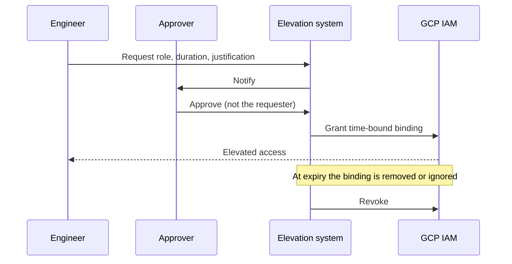

Standing administrator rights are the first thing an attacker hopes to find and the first thing an auditor questions. This pattern replaces them with elevation on request: a person asks, someone else approves, the grant lasts a fixed time, and the record is kept. It covers GCP IAM and GKE, and keeps break-glass as a rare, loud exception.

> [!warning] Not legal or audit advice
> This is general engineering guidance. Your auditor, assessor or legal counsel decides what satisfies a control or a legal obligation; check control numbers and wording against the current edition of the framework.

> [!info] Not checked against a running system
> Product status, flags, pricing and condition support change. The Privileged Access Manager commands in particular must be checked against the current docs before use.

## Short answer

No standing Owner, Editor, `roles/container.admin` or `cluster-admin` for people. Everyone works with least-privilege roles day to day, and elevates for a task, for a fixed time, with an approver who is not the requester. CI service accounts keep only what the pipeline needs; see [[architecture/iam-groups-and-ci-workload-identity-federation]].

## Inventory privileged roles

Find who has the powerful roles today. Do this before designing anything, because the number tells you how big the change is.

```bash title="scripts/privileged-inventory.sh"
set -euo pipefail

ORG_ID="123456789012"      # change: your organisation ID

# Basic and admin roles granted anywhere under the organisation.
gcloud asset search-all-iam-policies --scope="organizations/${ORG_ID}" \
  --query="policy:roles/owner OR policy:roles/editor OR policy:roles/container.admin" \
  --format="table(resource,policy.bindings.role,policy.bindings.members)"

# cluster-admin bindings in the current kube context.
kubectl get clusterrolebindings -o json \
  | jq -r '.items[] | select(.roleRef.name=="cluster-admin") | [.metadata.name, (.subjects // [] | map(.name) | join(","))] | @tsv'
```

Include CI deployer service accounts in the list. A service account with Owner on production is a standing privilege too, and it is the easiest one to forget; see [[compliance/access-reviews-gcp-and-gke]].

## Option A: Google Cloud Privileged Access Manager

Privileged Access Manager (PAM) is a Google Cloud service for time-bound elevation. As I understand it you define an entitlement (roles that can be granted, who may request, maximum duration, whether justification is required, who approves), users request a grant, approvers approve it, and the role is bound for the period and then removed automatically. Check the current product documentation for status, supported resource levels, the `gcloud pam` command surface and pricing before you commit.

```bash title="scripts/pam-request.sh"
set -euo pipefail

# Illustrative only: verify the command group and flags in the current PAM docs.
PROJECT_ID="example-prod"
LOCATION="global"
ENTITLEMENT="oncall-prod-admin"

gcloud pam entitlements list --project="${PROJECT_ID}" --location="${LOCATION}"
# A grant request names the entitlement, a duration and a justification:
# gcloud pam grants create ... (see the docs for current flags)
```

## Option B: time-bound IAM conditions in Terraform

Where PAM is not available or not enough, an IAM condition can make a binding expire. The binding is created for the task and expires on its own.

```hcl title="elevation.tf"
resource "google_project_iam_member" "oncall_elevated" {
  project = "example-prod"
  role    = "roles/container.admin"
  member  = "group:oncall-elevated@example.com"

  condition {
    title       = "elevation-2026-10-19"
    description = "Incident INC-2026-0042, approved by security-lead"
    expression  = "request.time < timestamp(\"2026-10-19T18:00:00Z\")"
  }
}
```

Limits to know:

- Conditions are not supported with every role or resource. In particular, check whether conditional bindings are accepted for basic roles; I believe they are not for some, so verify.
- An expired binding stops granting access but remains in the policy until you remove it. Clean up with a scheduled job or the next Terraform apply, or the policy fills with stale entries that confuse access reviews.
- The approval step is yours to build: a merge request approved by someone other than the requester is a reasonable one.

## GKE side

GKE has two layers: IAM roles that govern cluster management and, through predefined roles, some Kubernetes access, and Kubernetes RBAC inside the cluster. Keep them separate in your head:

- Bind Kubernetes RBAC to **Google Groups** (Google Groups for RBAC) so access follows group membership, not individual user bindings.
- Elevate by adding a person to an elevated group for a time, or by a time-bound IAM grant, never by handing out a long-lived kubeconfig with an admin token.
- If you must use temporary RoleBindings, label them with an expiry and let a job delete them:

```yaml title="rbac/temporary-binding.yaml"
apiVersion: rbac.authorization.k8s.io/v1
kind: RoleBinding
metadata:
  name: elevate-inc-2026-0042
  namespace: payments
  labels:
    expires-at: "2026-10-19T18-00-00Z" # a cleanup job reads this label
subjects:
  - kind: Group
    name: oncall-elevated@example.com
    apiGroup: rbac.authorization.k8s.io
roleRef:
  kind: ClusterRole
  name: edit
  apiGroup: rbac.authorization.k8s.io
```

Prefer a namespace-scoped role such as `edit` over `cluster-admin` whenever the task allows.

## Approvals and separation of duties

The requester must not approve their own request. If the approver is on the same team and the only other person on call, that can be impractical, so name an approver pool wider than the team. For the delivery pipeline the same principle is in [[compliance/separation-of-duties-in-deployments]].



## Break-glass

Some failures need access when the elevation system itself is down, for example when the identity provider is unavailable. Keep a sealed emergency account, alert on every use, and review each use within an agreed time. The account design and review are in [[compliance/access-reviews-gcp-and-gke]], and the credential handling after use in [[runbooks/leaked-credential-rotation]]. Treat each use as an exception under [[compliance/policy-exception-and-waiver-process]].

> [!warning] Never remove the last Owner or organisation admin
> Before you tighten roles, confirm that at least two working administrator paths remain (including break-glass), and test them. Removing the last administrator of an organisation or a project can lock you out in a way that needs Google support to fix.

## Evidence and alerting

Evidence is the audit log trail of grants and policy changes:

```bash title="scripts/elevation-evidence.sh"
set -euo pipefail

PROJECT_ID="example-prod"   # change

# IAM policy changes.
gcloud logging read \
  'protoPayload.methodName="SetIamPolicy" AND protoPayload.serviceData.policyDelta.bindingDeltas.role=("roles/owner" OR "roles/container.admin")' \
  --project="${PROJECT_ID}" --freshness=30d \
  --format="json(timestamp,protoPayload.authenticationInfo.principalEmail,protoPayload.resourceName)"

# PAM events (verify the service name in the current docs).
gcloud logging read 'protoPayload.serviceName="privilegedaccessmanager.googleapis.com"' \
  --project="${PROJECT_ID}" --freshness=30d --format=json
```

Turn the first filter into a log-based alert for any grant of an administrator role outside an approved window, and route it to the security channel. Field names in audit payloads can differ by service; confirm in a sample entry.

## Verify and rollback

Verify: list privileged roles again (the inventory script) and expect no standing human Owner, no `cluster-admin` for individuals, and each remaining exception with an owner. Request an elevation end to end and confirm it expires.

Rollback: keep the previous IAM policy (`gcloud projects get-iam-policy` output saved to Git, or Terraform state) before tightening. If people are locked out, restore from that file or revert the Terraform change, using break-glass access. Roll out per environment, starting with non-production, and keep break-glass working throughout.

## Related

- [[compliance/access-reviews-gcp-and-gke]]: periodic review of who holds what.
- [[compliance/separation-of-duties-in-deployments]]: approval independence in delivery.
- [[compliance/policy-exception-and-waiver-process]]: break-glass as a logged exception.
- [[architecture/iam-groups-and-ci-workload-identity-federation]]: group and CI identity design.
- [[patterns/gke-workload-identity]]: pod identities without keys.
- [[runbooks/leaked-credential-rotation]]: after emergency use.

## Sources

- Google Cloud, Privileged Access Manager overview: find the current page under [cloud.google.com/iam/docs](https://cloud.google.com/iam/docs).
- Google Cloud, [IAM Conditions overview](https://cloud.google.com/iam/docs/conditions-overview).
- Google Kubernetes Engine, [Google Groups for RBAC](https://cloud.google.com/kubernetes-engine/docs/how-to/google-groups-rbac).
- Google Kubernetes Engine, [Role-based access control](https://cloud.google.com/kubernetes-engine/docs/how-to/role-based-access-control).
- Google Cloud, IAM security best practices: find the current page under [cloud.google.com/iam/docs](https://cloud.google.com/iam/docs).
