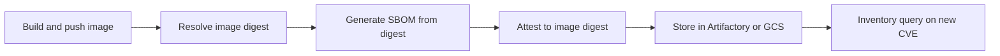

This note covers the full lifecycle of a software bill of materials (SBOM) for container images: generating it in GitLab CI and Jenkins, attaching it to the image digest, storing it with the artifact, and querying the stored set when a new vulnerability is published. It is written for senior DevOps engineers. It deliberately leaves image hardening to [[patterns/dockerfile-hardening]], signing policy to [[patterns/image-signing-and-admission-verification]], build provenance to [[compliance/slsa-build-provenance]] and licence decisions to [[compliance/open-source-license-compliance]].

> [!info] Scope and sources
> Written against the CycloneDX and SPDX specifications (see [cyclonedx.org](https://cyclonedx.org) and [spdx.dev](https://spdx.dev)), the Syft and Grype command line tools, and cosign from the Sigstore project ([sigstore.dev](https://sigstore.dev)). Storage examples use Artifactory and Google Cloud Storage. GitLab examples use `id_tokens` for keyless signing.

> [!warning] Not legal or audit advice
> This is general engineering guidance. Your auditor, assessor or legal counsel decides what satisfies a control or a legal obligation; check control numbers and wording against the current edition of the framework.

> [!note] Not verified
> The claims below were written from documentation knowledge and were not checked against a running system or the current docs: the current CycloneDX and SPDX spec versions, Syft output format names, cosign attest predicate type names, and Artifactory SBOM features. Check them before relying on them.

## What an SBOM is for

An SBOM is a machine-readable list of the components inside an artifact. On its own it prevents nothing. It earns its place in three situations:

- A new CVE lands and you need to answer "which of our running images contain this package, and at which version" in minutes, without rebuilding or rescanning everything.
- A customer, auditor or internal security team asks for the component list of a specific release.
- You want to enforce a licence policy on what actually ships (see [[compliance/open-source-license-compliance]]).

The unit that matters is the image digest, not the tag. Tags move, digests do not, so the SBOM is bound to `image@sha256:...` and stored under that key.

Two kinds of SBOM exist in practice. A source SBOM comes from lockfiles and manifests in the repository and shows what you declared. An image SBOM comes from scanning the built image and shows what is really inside, including OS packages and anything copied in by a Dockerfile. Generate the image SBOM for every release; add the source SBOM when you need to trace a package back to a lockfile entry.

## Formats

| Concern               | CycloneDX                                              | SPDX                                                     |
| --------------------- | ------------------------------------------------------ | -------------------------------------------------------- |
| Origin and focus      | Security and supply-chain use cases                    | Licence compliance first, broadened over time            |
| JSON shape            | `components[]` with `purl`, `version`, `licenses`      | `packages[]` with `SPDXID`, `versionInfo`, relationships |
| Vulnerability linking | Can carry VEX data in the same document                | Separate documents or extensions                         |
| Tooling in this stack | Syft, Grype, Dependency-Track, cosign attestation type | Syft, many licence tools, some customer questionnaires   |
| When to choose        | Default for internal CVE and licence queries           | When a customer or regulator asks for SPDX specifically  |

Pick one format as the internal source of truth and convert or regenerate the other on request. Generating both from the same scan is cheap, but storing two sets doubles the places that can disagree. The examples below use CycloneDX JSON as the stored format.

## Generating in CI

The flow is the same on every CI system: build, push, resolve the digest, generate from the digest, attest, store, and make the stored set queryable.



Generate the SBOM from the pushed digest, not from a local tag, so what you describe is exactly what the registry serves. Syft can read a registry image directly:

```bash
set -euo pipefail

IMAGE="europe-docker.pkg.dev/my-project/my-repo/my-app"  # change: your image repository
DIGEST="sha256:0000000000000000000000000000000000000000000000000000000000000000"  # change: digest from your build

syft "registry:${IMAGE}@${DIGEST}" -o cyclonedx-json=sbom.cdx.json
syft "registry:${IMAGE}@${DIGEST}" -o spdx-json=sbom.spdx.json

jq -r '.bomFormat, .specVersion, (.components | length)' sbom.cdx.json
```

The last line is a quick sanity check: it prints the format, the spec version actually produced, and the component count. An SBOM with zero or a handful of components for a real application image usually means the scan could not read the image.

### GitLab job

The build job publishes the digest as a dotenv report. The SBOM job reads it, generates the SBOM, attests it keylessly with the job's OIDC token, and keeps the file as an artifact. The `id_tokens` block with audience `sigstore` is what cosign uses for keyless signing; the identity rules are in [[patterns/image-signing-and-admission-verification]].

```yaml title=".gitlab-ci.yml"
stages:
  - build
  - sbom

variables:
  IMAGE_REPO: europe-docker.pkg.dev/my-project/my-repo/my-app # change: your image repository

build-image:
  stage: build
  image: gcr.io/kaniko-project/executor:debug # pin by digest in real use; check Kaniko's maintenance status (the upstream project has been archived) or use rootless BuildKit as in [[patterns/gitlab-runners-on-gke]]
  script:
    - /kaniko/executor --context "$CI_PROJECT_DIR" --destination "$IMAGE_REPO:$CI_COMMIT_SHORT_SHA" --digest-file digest.txt
    - echo "IMAGE_DIGEST=$(cat digest.txt)" > build.env
  artifacts:
    reports:
      dotenv: build.env

sbom:
  stage: sbom
  image: registry.example.com/ci-tools/supply-chain:1.0.0 # change: your internal image with syft, cosign and jq; pin by digest
  needs:
    - job: build-image
      artifacts: true
  id_tokens:
    SIGSTORE_ID_TOKEN:
      aud: sigstore
  script:
    - syft "registry:${IMAGE_REPO}@${IMAGE_DIGEST}" -o cyclonedx-json=sbom.cdx.json
    - cosign attest --yes --type cyclonedx --predicate sbom.cdx.json "${IMAGE_REPO}@${IMAGE_DIGEST}"
  artifacts:
    paths:
      - sbom.cdx.json
    expire_in: 30 days
```

The `cosign attest` call above uses the public Sigstore instance. Public Fulcio accepts only the OIDC issuers it is configured for (`https://gitlab.com` is one); a self-managed GitLab such as `gitlab.example.com` needs a private Sigstore deployment (Fulcio and Rekor, with `--fulcio-url` and `--rekor-url`) or a KMS key. Not verified: check the current Fulcio issuer list.

The artifact expiry here is only for convenience inside GitLab. The long-term copy goes to the store described below.

### Jenkins stage

Jenkins has no built-in OIDC token for keyless signing, so the stage attests with a Cloud KMS key. The agent authenticates through Workload Identity, so there is no key file and no stored credential.

```groovy title="Jenkinsfile"
pipeline {
  agent { label 'supply-chain' }
  environment {
    IMAGE_REPO = 'europe-docker.pkg.dev/my-project/my-repo/my-app' // change: your image repository
    KMS_KEY    = 'gcpkms://projects/my-project/locations/europe-west1/keyRings/ci/cryptoKeys/sbom-attest' // change: your KMS key path
  }
  stages {
    stage('SBOM') {
      steps {
        sh '''
          set -euo pipefail
          syft "registry:${IMAGE_REPO}@${IMAGE_DIGEST}" -o cyclonedx-json=sbom.cdx.json
          # --tlog-upload=false keeps the entry out of public Rekor, which cosign uses by default even with --key (flag name: check for your pinned cosign version)
          cosign attest --yes --tlog-upload=false --key "${KMS_KEY}" --type cyclonedx \
            --predicate sbom.cdx.json "${IMAGE_REPO}@${IMAGE_DIGEST}"
        '''
        archiveArtifacts artifacts: 'sbom.cdx.json', fingerprint: true
      }
    }
  }
}
```

Verifying such an attestation then needs `--insecure-ignore-tlog=true` (check the flag for your version). `IMAGE_DIGEST` comes from the earlier build stage. The shell block uses single-quoted Groovy strings on purpose so that Jenkins does not interpolate values into the script text.

## Attaching and storing

Attach the SBOM to the image so that it travels with the digest. A cosign attestation stores the SBOM as a signed in-toto statement next to the image in the registry. Anyone with pull access can fetch and verify it. An image can carry several attestations (provenance as well as the SBOM), so select by predicate type. The type URI below is not verified; check what your cosign version writes for `--type cyclonedx`:

```bash
set -euo pipefail

IMAGE="europe-docker.pkg.dev/my-project/my-repo/my-app"  # change: your image repository
DIGEST="sha256:0000000000000000000000000000000000000000000000000000000000000000"  # change: digest of the release

cosign download attestation "${IMAGE}@${DIGEST}" \
  | jq -c 'select(.payload | @base64d | fromjson | .predicateType == "https://cyclonedx.org/bom") | .payload | @base64d | fromjson | .predicate' > fetched-sbom.cdx.json
```

OCI referrers are an alternative to cosign attestations: attach the SBOM as an artifact that refers to the image digest, for example with `oras attach` (not verified; check the tool version and your registry's referrers support). A referrer is not signed unless you sign it separately, so keep the attestation as the tamper-evident copy.

The registry copy is not enough for inventory queries, because you cannot grep a registry. Also copy every SBOM to a store that you can search, keyed by image name and digest. Artifactory suits teams that already promote artifacts there (see [[patterns/artifact-promotion-artifactory]]); a GCS bucket with object versioning and a retention policy suits teams that want a simple, cheap archive.

```bash
set -euo pipefail

IMAGE_NAME="my-app"  # change: image name used in the storage path
DIGEST_HEX="0000000000000000000000000000000000000000000000000000000000000000"  # change: digest without the sha256: prefix

# Option 1: Artifactory generic repository (change: repo name)
jf rt upload sbom.cdx.json "sbom-local/${IMAGE_NAME}/${DIGEST_HEX}/sbom.cdx.json"

# Option 2: GCS bucket with versioning and a retention policy (change: bucket name)
gcloud storage cp sbom.cdx.json "gs://my-sbom-archive/${IMAGE_NAME}/${DIGEST_HEX}/sbom.cdx.json"
```

Keep the same path layout in both: `<image>/<digest>/sbom.cdx.json`. Set retention to at least the lifetime of the longest-lived deployed release, because "was this component ever in production" questions come months later. If your Artifactory edition offers built-in SBOM or Xray indexing, treat it as a convenience on top, not a replacement for your own copy.

## Answering "are we affected"

When a CVE lands, you need two answers: which stored SBOMs contain the package, and which of those digests are currently running. The first is a query over the store; the second is a list of deployed digests from the cluster.

Find a package across all stored SBOMs:

```bash
set -euo pipefail

PACKAGE="openssl"  # change: package name from the advisory
SBOM_DIR="sboms"   # change: local mirror of the SBOM store

gcloud storage rsync --recursive gs://my-sbom-archive "${SBOM_DIR}"  # change: bucket name

find "${SBOM_DIR}" -name 'sbom.cdx.json' -print0 \
  | xargs -0 jq -r --arg pkg "${PACKAGE}" \
      '.components[]? | select(.name == $pkg) | [input_filename, .name, .version] | @tsv'
```

Match on `purl` instead of `name` when the package name is common across ecosystems. Then intersect with what runs in the cluster:

```bash
kubectl get pods --all-namespaces \
  -o jsonpath='{range .items[*].status.containerStatuses[*]}{.imageID}{"\n"}{end}' | sort -u
```

To check a single SBOM against current vulnerability data without pulling the image again, scan the SBOM itself:

```bash
grype sbom:./sbom.cdx.json --fail-on high
```

This is fast enough to run nightly over the whole store, which turns the SBOM archive into a continuous inventory rather than a one-off report.

## Pitfalls

- **SBOM from a tag.** Tags move between generation and deployment. Always resolve to a digest first and key everything on it.
- **SBOM from the source tree only.** It misses OS packages and files added in the Dockerfile. Generate from the built image.
- **Stored but never queried.** An archive nobody has tested is a liability. Run the package query as a drill once per quarter with a package you know is present.
- **Unsigned copies.** An SBOM in a bucket can be edited. The attestation on the image is the tamper-evident copy; the bucket copy is the searchable one. Compare digests of both when it matters.
- **Format drift.** Syft and the specs change over time. Record the tool and spec version in the pipeline log, and test the jq query after upgrades.
- **Private data in public logs.** If you sign with the public Sigstore instance, signing metadata for private images is recorded in the public transparency log, with a keyless certificate or a KMS key (cosign uploads by default). Check this with your security team before enabling signing for private images, and disable the upload or use a private Sigstore deployment if needed.
- **Missing runtime context.** An SBOM says a vulnerable package is present, not that it is reachable. Treat the query result as a candidate list for triage.

## Verify

1. The SBOM is non-empty: `jq '.components | length' sbom.cdx.json` returns a plausible count.
2. The attestation is present and verifies against your CI identity: `cosign verify-attestation --type cyclonedx --certificate-identity-regexp '^https://gitlab\.example\.com/my-group/my-app//\.gitlab-ci\.yml@refs/heads/main$' --certificate-oidc-issuer https://gitlab.example.com IMAGE@DIGEST` (change the identity and issuer to match your GitLab).
3. The stored copy exists at `<image>/<digest>/sbom.cdx.json` and matches the attested predicate: `diff <(jq -S . sbom.cdx.json) <(jq -S . fetched-sbom.cdx.json)` prints nothing (compare with `jq -S`, because jq reformats the JSON, so byte identity does not hold).
4. The package query finds a known package in a known image.

## Rollback

Generating and storing an SBOM does not change running workloads, so rollback is removing the `sbom` job or stage. Delete stored files only if your retention policy allows it; deleting attestations from the registry is rarely needed and loses evidence.

## Related

- [[patterns/dockerfile-hardening]]: build the image so the SBOM lists a small, known set of packages.
- [[compliance/slsa-build-provenance]]: provenance says how the image was built; the SBOM says what is in it.
- [[patterns/image-signing-and-admission-verification]]: the signing identity policy that the attestation step relies on.
- [[patterns/artifact-promotion-artifactory]]: promote the SBOM together with the artifact between repositories.
- [[compliance/open-source-license-compliance]]: reads these SBOMs to enforce a licence policy.
