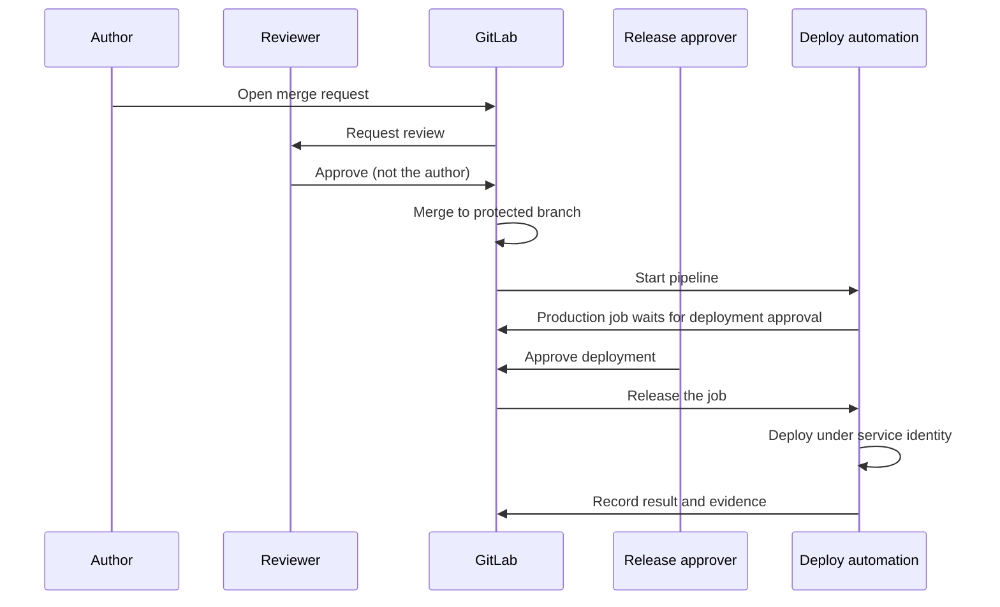

This standard is for senior DevOps engineers and engineering managers who must make sure that no single person can take a change from idea to production unobserved. It sets the rules, the roles and the technical enforcement in GitLab, Jenkins and Argo CD. It leaves the evidence side to [[compliance/change-management-controls-and-pipeline-evidence]] and review practice to [[standards/code-review]].

> [!warning] Not legal or audit advice
> This is general engineering guidance. Your auditor, assessor or legal counsel decides what satisfies a control or a legal obligation; check control numbers and wording against the current edition of the framework.

> [!info] Scope and sources
> Written for GitLab CI, Jenkins and Argo CD. Based on the GitLab documentation for protected branches, merge request approvals and protected environments, the Jenkins Pipeline `input` step documentation, and the Argo CD projects and RBAC documentation.

> [!note] Not verified
> The claims below were written from documentation knowledge and were not checked against a running system or the current docs: which GitLab tiers include deployment approvals and the prevent-author-approval setting, the exact names of those settings, the Jenkins `input` step parameters, and the Argo CD RBAC policy syntax. Check them before relying on them.

## Rules

- The author of a change does not approve it. At least one approver is a different person with the right to approve.
- The approver does not deploy by hand; the deploy runs as automation under a service identity after the approval is recorded, not under an individual's credentials.
- Developers cannot push to the default branch or to release branches; changes arrive by merge request.
- Production deploys happen from a protected branch or tag, through a protected environment.
- CI configuration, deployment manifests and approval rules are changed through the same reviewed path as code, with owners from outside the changing team where practical.
- Service accounts that can merge and deploy have no interactive login, a named owner and a recorded purpose, and cannot approve merge requests.
- Break-glass access exists, is logged, is time-boxed and is reviewed within a period you set and write down.
- Admin and bypass rights on the CI system are held by few people and are reviewed regularly (see [[compliance/access-reviews-gcp-and-gke]]).

## Roles and permitted actions

| Role               | Author a change | Review and approve | Merge          | Trigger production deploy | Change approval rules or CI settings |
| ------------------ | --------------- | ------------------ | -------------- | ------------------------- | ------------------------------------ |
| Developer          | Yes             | Yes, not own work  | No             | No                        | No                                   |
| Maintainer         | Yes             | Yes, not own work  | Yes            | No                        | No                                   |
| Release approver   | No              | Approves release   | No             | Approves the deployment   | No                                   |
| Pipeline identity  | No              | No                 | No             | Runs the deployment       | No                                   |
| Project owner      | Rarely          | Not own work       | Rarely         | No                        | Yes, reviewed                        |
| Break-glass holder | Emergency only  | After the fact     | Emergency only | Emergency only            | No                                   |

Adjust the roles to your organisation. The point is that no row has "Yes" in author, approve and deploy at once.

## Flow



## GitLab

Use three layers: who can change code, who can approve it, and who can deploy it.

- **Protected branches.** Set the default branch to "no one" for direct push and allow merge only for Maintainers. Disable force push. Protect release tags (for example `v*`) so only a named role can create them.
- **Approval rules.** Require at least one approval from a group other than the author, require approval again after new commits, and enable the settings that stop authors and committers from approving their own merge requests. The exact setting names and the tier that includes them are not verified; look in the project's merge request approval settings. Use CODEOWNERS for `.gitlab-ci.yml`, deployment manifests and policy files.
- **Protected environments.** Make `production` a protected environment, list who can deploy, and set a deployment approval rule so that the job waits for approvers who are not the person who started the pipeline. Whether this is available on your tier and how it is configured through the UI or API is not verified. Scope the production credentials (Argo CD token, cloud identity) to that environment so other jobs cannot read them.

```yaml title=".gitlab-ci.yml"
deploy-production:
  stage: deploy
  # change: image with the argocd CLI, pinned by tag or digest
  image: registry.example.com/ci/argocd-cli:PINNED_VERSION
  environment:
    name: production
    deployment_tier: production
  rules:
    - if: $CI_COMMIT_BRANCH == $CI_DEFAULT_BRANCH
  script:
    # ARGOCD_SERVER and ARGOCD_AUTH_TOKEN are CI variables scoped to the production environment.
    - argocd app sync shop-prod
    - argocd app wait shop-prod --health --timeout 300
```

```text
Protected environment "production" (Settings > CI/CD or Deploy > Environments; names not verified)
  Allowed to deploy:        group release-deployers (the pipeline's service identity runs as this)
  Required approvals:       1, from group release-approvers
  Approver may not be:      the user who triggered the pipeline or authored the merge request
```

The job is held until the approval is recorded, and the approval is a system record that the evidence job can read later.

## Jenkins

Jenkins has no built-in notion of a merge request author, so the control is built from the `input` step, folder or job permissions and the SCM.

```groovy title="Jenkinsfile"
pipeline {
  agent none
  options {
    timeout(time: 2, unit: 'HOURS')
    disableConcurrentBuilds()
  }
  stages {
    stage('Approve production deploy') {
      steps {
        timeout(time: 30, unit: 'MINUTES') {
          script {
            // submitter limits who can click; change: the Jenkins group or user IDs of your approvers
            env.APPROVER = input(
              message: 'Deploy this build to production?',
              ok: 'Deploy',
              submitter: 'release-approvers',
              submitterParameter: 'APPROVED_BY'
            )
          }
        }
      }
    }
    stage('Deploy') {
      agent { label 'deploy' }
      steps {
        sh './ci/deploy.sh production'
      }
    }
  }
}
```

Notes for this setup:

- `submitter` restricts who may approve; it does not stop the author from being a member of that group. Keep the approver group free of people who author changes to this service, or compare the approver ID with the commit author in the deploy stage and fail on a match (the mapping between Jenkins IDs and SCM identities is yours to define).
- The `input` step has a limited lifetime when wrapped in `timeout`; an abandoned build should abort, not wait forever.
- Restrict who can edit the Jenkinsfile on the protected branch and who can replay a build with a modified script, and keep the deploy credentials bound to a folder that only the release job can use. See [[patterns/jenkins-controller-and-agent-hardening]].

## Argo CD

In a GitOps flow, the merge to the deployment repository is the approval, and Argo CD applies it. Use an `AppProject` so that the roles are explicit, and keep humans from changing live state.

```yaml title="argocd/appproject-prod.yaml"
apiVersion: argoproj.io/v1alpha1
kind: AppProject
metadata:
  name: prod
  namespace: argocd
spec:
  description: Production applications; sync only through the deployer role
  sourceRepos:
    - https://gitlab.example.com/platform/deploy-manifests.git
  destinations:
    - server: https://kubernetes.default.svc
      namespace: shop
  clusterResourceWhitelist: []
  roles:
    - name: deployer
      description: May view and sync production applications; no repository or project changes
      policies:
        - p, proj:prod:deployer, applications, get, prod/*, allow
        - p, proj:prod:deployer, applications, sync, prod/*, allow
      groups:
        - release-deployers
```

The role has no `override`, `delete` or `update` permission and no access to repository credentials, so it cannot change what is deployed, only trigger a sync of what Git already approved. Write access to the manifests repository is governed by GitLab rules above. The policy syntax is not verified; check the Argo CD RBAC documentation for your version, and see [[adr/0001-gitops-with-argocd]].

## Service accounts that both merge and deploy

Bots such as dependency updaters, release tooling and promotion jobs are a common gap.

- A bot that opens merge requests must not also approve them. Require a human approval on its merge requests, or an approval rule that excludes service accounts.
- A bot that merges after approval is acceptable if the approval rules still apply to its merge, and its token is scoped to the one repository.
- If the same identity can write to the manifests repository and sync in Argo CD, one compromised credential covers the whole path. Split the tokens and scope each narrowly.
- Review the list of service accounts and their tokens on a schedule, and expire tokens.

## Break-glass

- Provide a break-glass role with elevated access, granted for a limited time through a logged request, not a shared password.
- Alert on its use to a channel the team watches and to the engineering manager.
- Require a review within a period you set and write down. The review confirms what was changed, links the incident (see [[runbooks/incident-response]]), reconciles the change into Git and closes the access.
- Test the procedure once or twice a year so it works when needed.

## Small teams

With two or three engineers, a second independent approver may not exist for every change. Compensate rather than skip.

- Approver from a neighbouring team, or the engineering manager for production-impacting changes (see [[management/delegation-and-ownership]]).
- Require a post-merge review of every change that had no independent approver, within a short, stated period, and record it.
- Make the pipeline stricter where people cannot be: mandatory automated tests, policy checks, protected environment and a full evidence record.
- Never let one person hold Maintainer, release approver and project owner without a written, reviewed exception.

Tell the auditor about the compensating control up front; do not wait to be asked.

## Checklist

```text
[ ] Default and release branches protected: no direct push, no force push
[ ] Merge requests need an approval from someone who is not the author
[ ] Approval is reset when new commits are pushed
[ ] CODEOWNERS covers CI config, deployment manifests and policy files
[ ] Production is a protected environment with a deployment approval rule
[ ] Production credentials are scoped to that environment
[ ] Deploys run under a service identity, not an engineer's token
[ ] Jenkins input steps limit submitters and have a timeout
[ ] Argo CD AppProject roles are listed and have no override or delete rights
[ ] Bots cannot approve their own merge requests
[ ] Break-glass is logged, time-boxed and reviewed within the agreed period
[ ] Compensating control documented for any small-team exception
[ ] Settings exported and stored as evidence at each review
```

## Related

- [[compliance/change-management-controls-and-pipeline-evidence]]: the evidence these settings produce.
- [[standards/code-review]]: what an approval is supposed to mean.
- [[standards/production-change-checklist]]: operational steps around a production change.
- [[patterns/jenkins-controller-and-agent-hardening]]: securing the Jenkins side of the control.
- [[management/delegation-and-ownership]]: who owns approvals when the team is small.
