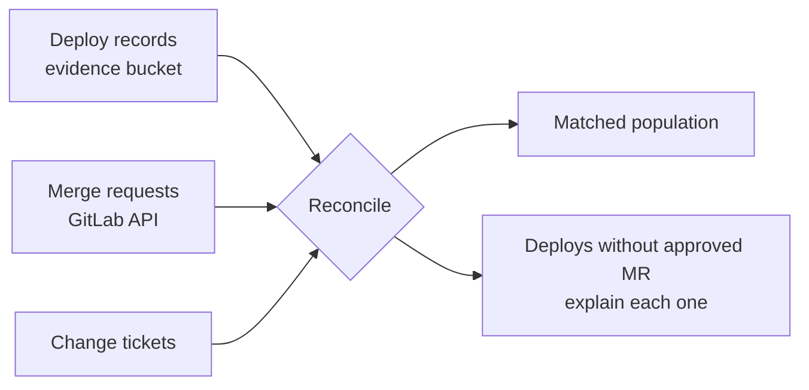

This note is for engineers who have to show a SOC 2 auditor how code reaches production. It maps the parts of the Trust Services Criteria that touch CI/CD to controls and evidence that GitLab CI, Jenkins and GCP already produce. It does not teach the whole of SOC 2: the report scope, the system description and the other criteria belong to your compliance lead.

> [!warning] Not legal or audit advice
> This is general engineering guidance. Your auditor, assessor or legal counsel decides what satisfies a control or a legal obligation; check control numbers and wording against the current edition of the framework.

> [!info] Not checked against a running system
> The commands and pipeline snippets are illustrative and were not run for this note. Flags, field names and feature availability change between versions and tiers, so check the current documentation before you copy anything.

## What SOC 2 is and is not

SOC 2 is an attestation report written by an independent CPA firm against the AICPA Trust Services Criteria. It is not a certification and there is no certificate to hold. Two consequences matter for engineers:

- Your organisation chooses and describes its own controls in the system description. The auditor tests whether those controls are designed and operated as described.
- The auditor decides the sampling method and the sample sizes. Do not promise a customer "we only need five samples". Build evidence for the whole population and let the auditor pick.

Security is the only mandatory category. Availability, confidentiality, processing integrity and privacy are added when the report scope includes them. Which ones you include is a business decision.

## Trust Services Criteria that touch CI/CD

The Common Criteria (the security category) are grouped into families. The ones a pipeline touches are, in plain words:

| Family                      | What it asks, in engineering terms                                           |
| --------------------------- | ---------------------------------------------------------------------------- |
| Logical and physical access | Who can reach code, pipelines, secrets and production, and how it is removed |
| System operations           | Monitoring, vulnerability detection, incident detection and response         |
| Change management           | Changes are authorised, tested and approved before they reach production     |
| Risk mitigation             | Vendors, business disruption and risk responses are managed                  |

Give the criterion numbers (the `CC` references) only after reading the current AICPA text. The criteria date from 2017 and the points of focus were revised in 2022; your auditor will cite the version their report uses. Put the numbers in your own control matrix, not in code comments.

## Mapping pipeline controls to criteria

A control matrix is the document the auditor will actually walk through. Keep one row per control, and make the evidence column point to something a person can open.

| Control                                      | Criteria family   | System           | Evidence source                                                      | Owner         | Frequency    |
| -------------------------------------------- | ----------------- | ---------------- | -------------------------------------------------------------------- | ------------- | ------------ |
| Production changes need an approved MR       | Change management | GitLab           | MR approval API, protected branch settings export                    | Eng manager   | Every deploy |
| Approver is not the author                   | Change management | GitLab           | Approval rules export, MR approvals                                  | Eng manager   | Every deploy |
| Production deploy needs environment approval | Change management | GitLab / Jenkins | Deployment approvals, Jenkins `input` records                        | Release owner | Every deploy |
| Pipeline config changes are reviewed         | Change management | Git              | CODEOWNERS file, MR history of `.gitlab-ci.yml`                      | Platform lead | Every change |
| CI credentials are individual or scoped      | Logical access    | GitLab, GCP      | Service account inventory, CI variable audit                         | Platform lead | Quarterly    |
| Leavers lose access within the agreed time   | Logical access    | IdP, GitLab, GCP | Access review record (see [[compliance/access-reviews-gcp-and-gke]]) | Security lead | Quarterly    |
| Vulnerabilities are scanned and tracked      | System operations | CI, Artifactory  | Scan reports, exception register                                     | Security lead | Every build  |
| Production changes are logged                | System operations | GCP, GKE         | Cloud Audit Logs retention config                                    | Platform lead | Continuous   |

Rows like these overlap with [[compliance/change-management-controls-and-pipeline-evidence]] and [[compliance/separation-of-duties-in-deployments]]. Do not duplicate the settings there; link to them in the control description and keep this matrix as the index.

## Type I versus Type II

- **Type I** reports on the design of controls at a single point in time. It answers "are the controls suitably designed on this date?".
- **Type II** reports on design and operating effectiveness over a period, commonly several months up to a year. It answers "did the controls work every day of that period?".

The practical rule: the evidence has to exist for every day of the period. Logs you start retaining halfway through cannot cover the days before. If the plan is a Type II period starting on a given date, turn on retention, evidence jobs and access reviews before that date, not at the start of fieldwork.

A first report is often a Type I, followed by a Type II once the controls have run for a while. That is a common route, not a rule; ask your auditor.

## Population and sampling

The auditor will ask for the population of changes in the period, then pick a sample from it. The population is every production deploy, not a list you curated. Build it from the system of record and reconcile it from two independent sources:



Any deploy that has no approved merge request is an exception to be explained (an emergency, a rollback, a pipeline bug), not something to quietly drop.

## Writing an evidence record per production deploy

Write one small, immutable JSON record per production deploy to a bucket with a locked retention policy. The storage design is in [[compliance/audit-evidence-collection-and-retention]]; this is only the producer side.

```yaml title=".gitlab-ci.yml"
variables:
  EVIDENCE_BUCKET: "gs://example-org-evidence" # change: your locked evidence bucket

record-deploy-evidence:
  stage: .post
  image: google/cloud-sdk:slim # pin a digest in real use
  rules:
    - if: $CI_COMMIT_BRANCH == $CI_DEFAULT_BRANCH && $CI_ENVIRONMENT_NAME == "production"
  environment:
    name: production
    action: prepare
  script:
    - |
      set -euo pipefail
      # Approvers come from the API with a read-only token, not from a variable the deploy job controls.
      APPROVERS=$(curl -sS --header "PRIVATE-TOKEN: ${EVIDENCE_READ_TOKEN}" \
        "${CI_API_V4_URL}/projects/${CI_PROJECT_ID}/merge_requests/${MR_IID}/approvals" \
        | jq -c '[.approved_by[].user.username]')
      jq -n \
        --arg mr "${MR_IID}" --argjson approvers "${APPROVERS}" \
        --arg pipeline "${CI_PIPELINE_ID}" --arg digest "${IMAGE_DIGEST}" \
        --arg env "production" --arg at "$(date -u +%Y-%m-%dT%H:%M:%SZ)" \
        '{mr_iid:$mr, approvers:$approvers, pipeline_id:$pipeline, image_digest:$digest, environment:$env, deployed_at_utc:$at}' \
        > "deploy-${CI_PIPELINE_ID}.json"
      gcloud storage cp "deploy-${CI_PIPELINE_ID}.json" \
        "${EVIDENCE_BUCKET}/deploys/$(date -u +%Y/%m)/deploy-${CI_PIPELINE_ID}.json"
```

Two points to check in your own setup. `MR_IID` and `IMAGE_DIGEST` must come from an earlier trusted job (for example through `dotenv` artifacts), not from user-editable variables. And the job's service account may write to the evidence prefix but not delete or overwrite, which a bucket retention policy enforces anyway.

## Reconciling deploys against approved merge requests

This `jq` check lists deploy records whose merge request has no approval. It assumes you downloaded the period's records to `deploys/` and exported the MR approvals as `approvals.json` (one object per MR with `iid` and `approved`).

```bash title="scripts/soc2-reconcile.sh"
set -euo pipefail

DEPLOYS_DIR="deploys"           # change: folder with the period's deploy records
APPROVALS="approvals.json"      # change: export of MR approval state, [{"iid":"12","approved":true}]

jq -s --slurpfile appr "${APPROVALS}" '
  ($appr[0] | map({(.iid|tostring): .approved}) | add) as $ok
  | map(select(($ok[.mr_iid] // false) | not))
  | map({mr_iid, pipeline_id, deployed_at_utc})
' "${DEPLOYS_DIR}"/*.json
```

An empty array is the goal. Every row that comes back needs an explanation attached to the record, such as an emergency change with its after-the-fact review. Keep the output of this run with the evidence, because it shows the reconciliation happened.

## A Jenkins equivalent

In Jenkins the approval is a Pipeline `input` step, and the proof is the build record. Restrict who may answer with `submitter`, and keep the build history for the audit period.

```groovy title="Jenkinsfile"
pipeline {
  agent any
  options { buildDiscarder(logRotator(numToKeepStr: '1000')) } // keep records for the audit period
  stages {
    stage('Approve production') {
      steps {
        input message: 'Deploy to production?',
              submitter: 'release-approvers',   // change: Jenkins group allowed to approve
              submitterParameter: 'APPROVED_BY'
      }
    }
    stage('Deploy') {
      steps {
        echo "Approved by ${env.APPROVED_BY}"
        // deploy by image digest here
      }
    }
  }
}
```

The weak spot in Jenkins is job configuration changed through the UI. Keep jobs as code in Git, review changes to the `Jenkinsfile` like any other change, and export the Jenkins audit log or configuration history if the plugin you use provides one.

## Common gaps

- **Shared CI credentials.** One service account token used by every pipeline hides who ran what. Scope tokens per project and rotate them.
- **Hotfixes merged without review.** Emergencies happen; the gap is when no one reviews them afterwards. Define the emergency path and its after-the-fact review.
- **Self-approval.** Check that "prevent approval by author" is on. See [[compliance/separation-of-duties-in-deployments]].
- **Log retention shorter than the period.** A 30-day log retention cannot support a six-month Type II period.
- **Hand-edited Jenkins jobs.** If production behaviour can change without a commit, the change control has a hole.
- **Pipeline config owned by the people it gates.** Put `.gitlab-ci.yml` and shared templates under CODEOWNERS with someone outside the product team.
- **Approvers without context.** An approval that takes eight seconds on a 4,000-line diff is a weak control. Say what reviewers must check.

## Working with the auditor

- Agree the in-scope systems and the system description early. A tool that is out of scope needs no evidence, but anything that can change production is probably in scope.
- Offer read-only access to GitLab, Cloud Logging and the evidence bucket instead of screenshots. Screenshots are hard to trust and hard to repeat.
- Expect a **bridge letter** (also called a gap letter) request: a statement from management covering the time between the end of the last report period and today. Prepare it with your compliance lead.
- Keep a list of exceptions with an owner and an outcome. Auditors accept an explained exception more readily than a missing one.
- Auditors decide sample sizes and what counts as sufficient evidence. Ask them, do not guess.

## Related

- [[compliance/change-management-controls-and-pipeline-evidence]]: the per-change record and the settings behind it.
- [[compliance/audit-evidence-collection-and-retention]]: where the records are stored and how long they live.
- [[compliance/separation-of-duties-in-deployments]]: the technical settings that make approvals meaningful.
- [[compliance/access-reviews-gcp-and-gke]]: the periodic access review evidence.
- [[iso-27001-annex-a-for-platform-teams]]: the same controls viewed through ISO 27001.
- [[change-advisory-in-continuous-delivery]]: replacing a change board with approvals that produce evidence.

## Sources

- AICPA and CIMA, SOC 2 overview and Trust Services Criteria: search for "SOC 2 Trust Services Criteria" on [aicpa-cima.com](https://www.aicpa-cima.com/) and use the current published version.
- GitLab, [merge request approvals](https://docs.gitlab.com/ee/user/project/merge_requests/approvals/).
- GitLab, [deployment approvals](https://docs.gitlab.com/ee/ci/environments/deployment_approvals.html).
- Jenkins, [Pipeline input step](https://www.jenkins.io/doc/pipeline/steps/pipeline-input-step/).
