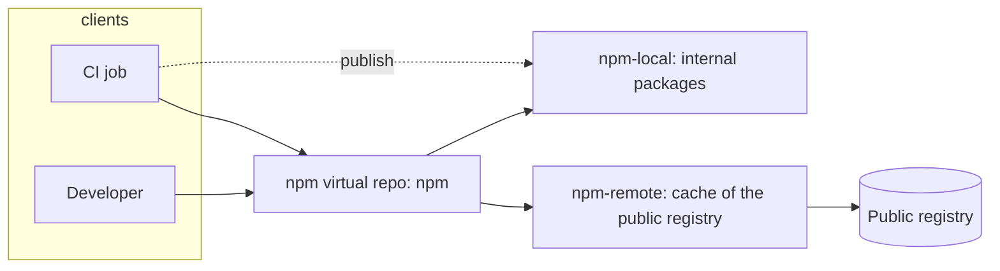

> [!info] Level: junior-middle | Time: about 4 h | You need: [[learn/building-and-shipping-images|Containers 03: Building and shipping images]] and [[learn/first-pipeline-gitlab-ci-and-jenkins|Delivery 02: Your first pipeline in GitLab CI and Jenkins]] | Lab: an Artifactory instance you are allowed to use. Check the current JFrog editions page for a free or trial option.

Pipelines produce things (images, packages, charts) and consume things (base images, libraries). Without a central place for both, every build downloads from the public internet, nobody can say what was shipped, and an upstream outage or a deleted package breaks your release. A **binary repository manager** is that place. This lesson teaches Artifactory's basic model, how Docker, npm and Helm clients talk to it, how to give CI the smallest possible access, and how to clean up without deleting a release. The team-scale topics (promotion between environments, OIDC for CI, remote caching) are in the patterns linked at the end.

> [!warning] Exercises are marked as not run
> The commands, settings names and screens follow the JFrog documentation and are not verified. Artifactory's UI, edition features, token types and CLI commands change between versions, so everything marked "check the current docs" must be checked against what you have. Output is illustrative, and every host name is an example (`example.com`).

## What you will learn

- What a binary repository manager gives you: one source of artifacts, an upstream cache, and provenance.
- How local, remote and virtual repositories differ, and how a virtual repository resolves a name (and how that goes wrong as dependency confusion).
- How to point Docker, npm and Helm at Artifactory without putting tokens in files.
- How to give a CI job a scoped, expiring token with the fewest permissions that work.
- How to lay out repositories for dev, staging and production, and set retention that never deletes promoted or released artifacts.

## What a repository manager is for

Three jobs, in order of how often people notice them:

1. **One source of artifacts.** Builds publish to and pull from your own URL, not from a dozen public registries. Developers and CI see the same files.
2. **An upstream cache (proxy).** The first request for `lodash@4.17.21` goes to the public registry; later requests are served from Artifactory. Builds are faster, survive an upstream outage, and a yanked or deleted upstream package still exists in your cache until you remove it.
3. **Provenance and control.** You can say who published what, when, from which build, and block or scan what comes in. That is the base for the supply-chain work in [[compliance/sbom-generation-and-storage]] and [[patterns/automated-dependency-updates]].

Artifactory supports many package types (Docker and OCI, npm, Maven, PyPI, Helm, Go, generic files and more). Which types, features and limits you get depend on the edition: check the current JFrog editions page.

## Local, remote and virtual repositories

Artifactory has three repository types you will use every day, and a fourth you should know exists.

| Type          | What it is                                                              | Typical use                                              |
| ------------- | ----------------------------------------------------------------------- | -------------------------------------------------------- |
| **Local**     | Stores artifacts you push.                                              | Your images, your packages, your charts.                 |
| **Remote**    | A caching proxy of an upstream (Docker Hub, npmjs, PyPI).               | Where dependencies come from.                            |
| **Virtual**   | One URL that aggregates local and remote repositories of the same type. | What developers and CI use to pull (and sometimes push). |
| **Federated** | Local repositories kept in sync across Artifactory instances.           | Multi-site setups; availability depends on edition.      |



The virtual repository is the single address in `.npmrc`, `pip.conf` or the Docker pull URL, so you can change what is behind it (add a second remote, move to a different upstream) without touching every project. Publishing normally goes to a **local** repository directly (or through the virtual one with a configured deployment target).

### Resolution order and dependency confusion

When a virtual repository holds several repositories, a request for a name is answered by the **first** repository in its list that has it; the order is configurable. That order is a security setting.

**Dependency confusion** is an attack on this lookup. Your company has an internal package `acme-billing` in `npm-local`. An attacker publishes a package with the same name and a higher version number to the public registry. If a client or the virtual repository asks both places and prefers the higher version, the attacker's package is installed in your build. The defences are layered:

- **Put local repositories before remote ones** in the virtual repository's resolution order, so an internal name is answered from local first.
- **Use include and exclude patterns** on repositories. For example, make the remote repository _exclude_ your internal scope (`@acme/**`, or the group path for Maven), and make the local repository _include only_ that scope. Then the remote repository cannot answer for a name that is yours, even if the attacker publishes it. The pattern syntax and where it is set (repository advanced settings) depend on the version; check the current docs.
- **Use scoped names** (npm `@acme/billing`) and register the scope to your registry.
- **Lock dependencies** with lockfiles and install from them (`npm ci`), so a version cannot move without a reviewed change.

Remote caching for CI builds is covered in [[patterns/artifactory-remote-repo-caching-for-ci]].

## Docker

Docker images are stored in a Docker (or OCI) repository. Clients reach it through an **access method** that Artifactory documents for Docker: the repository path in the URL, a subdomain per repository, or a port per repository (the names of these methods and which are available depend on the version and on your reverse proxy setup: check the current docs).

With the repository-path style, the image name includes the repository key:

```bash title="docker login, push and pull (repository path method)"
REGISTRY="artifactory.example.com"     # Change: your Artifactory host
REPO="docker-dev-local"                # Change: a Docker repository you may push to

printf '%s' "$ARTIFACTORY_TOKEN" | docker login "$REGISTRY" --username ci-lab --password-stdin

docker tag myapp:1.0.0 "${REGISTRY}/${REPO}/myapp:1.0.0"
docker push "${REGISTRY}/${REPO}/myapp:1.0.0"
docker pull "${REGISTRY}/${REPO}/myapp:1.0.0"
```

- **Always HTTPS.** A registry on plain HTTP sends the token and the layers in clear text, and Docker refuses it unless you mark it insecure. Terminate TLS with a valid certificate in front of Artifactory ([[learn/http-and-tls]]).
- **`--password-stdin`**, with the token in an environment variable or file that your CI keeps secret, so the token does not appear in the process list or shell history. See [[learn/building-and-shipping-images]] for the tagging and digest habits that go with pushing.
- With the subdomain or port method the image name loses the repository key (`docker-dev.artifactory.example.com/myapp:1.0.0`), and the virtual repository chooses the destination. Pick one method for the organisation and document it.
- Pull-through for Docker Hub is a Docker **remote** repository, which also avoids upstream rate limits for CI.

## npm

npm reads its registry and credentials from `.npmrc`. The key idea is that the _token is never in the file_: the file refers to an environment variable.

```ini title=".npmrc"
registry=https://artifactory.example.com/artifactory/api/npm/npm/
@acme:registry=https://artifactory.example.com/artifactory/api/npm/npm/
//artifactory.example.com/artifactory/api/npm/npm/:_authToken=${NPM_TOKEN}
always-auth=true
```

- `registry=` sends all installs through the **virtual** repository (here named `npm`; the URL layout `/artifactory/api/npm/<repo-key>/` is standard but check the current docs and your instance).
- `@acme:registry=` pins the scope `@acme` to your registry, which is part of the dependency-confusion defence.
- The `_authToken` line uses `${NPM_TOKEN}`, which npm expands from the environment at run time. CI provides the variable from a masked variable or a secret manager; the file is safe to commit. The option names and the behaviour of `always-auth` differ between npm versions: see the `.npmrc` documentation for your npm.
- Install in CI with `npm ci`, which installs exactly what `package-lock.json` says and fails if the lockfile and `package.json` disagree.

```bash title="install and publish"
export NPM_TOKEN="$(cat ~/.lab-artifactory-token)"   # lab only; in CI use a masked variable
npm ci
npm publish --registry https://artifactory.example.com/artifactory/api/npm/npm-local/
```

The registry URL for publishing points at the **local** repository (or at a virtual repository with a deployment target); a virtual repository without one refuses uploads.

## Helm

Helm charts live in a Helm repository in Artifactory. There are two styles, and which one you use depends on your Helm and Artifactory versions (check the current docs for OCI support in each).

| Style                    | How the client talks to it                                 | Notes                                                              |
| ------------------------ | ---------------------------------------------------------- | ------------------------------------------------------------------ |
| Classic chart repository | `helm repo add`, an `index.yaml` generated by Artifactory. | Works with every Helm 3 and later; upload by HTTP `PUT` or the UI. |
| OCI                      | `helm registry login`, `helm push`, `oci://` references.   | Uses a Docker-style registry path; needs OCI support in both.      |

```bash title="classic repository and OCI"
# classic
helm repo add acme https://artifactory.example.com/artifactory/api/helm/helm-virtual \
  --username ci-lab --pass-stdin < ~/.lab-artifactory-token
helm repo update
helm search repo acme/

# OCI
helm registry login artifactory.example.com --username ci-lab --password-stdin < ~/.lab-artifactory-token
helm push dist/web-0.2.0.tgz oci://artifactory.example.com/helm-oci-local
helm install web oci://artifactory.example.com/helm-oci-local/web --version 0.2.0
```

Authoring and packaging a chart is covered in [[learn/helm-chart-authoring-schema-dependencies-and-tests]]. Whichever style you choose, install **by version**, and treat a published version as immutable.

## Access: users, groups, permissions and tokens

Artifactory authorises with **permissions** attached to repositories. The concept is the same across versions, the names are not: a permission (sometimes called a permission target) says which repositories (or patterns in them) are covered, and which users and groups may do which actions (read, write/deploy, delete/overwrite, manage). Check the current docs for the names your version uses.

Rules that keep it safe:

1. **Groups, not people.** Give permissions to groups (`developers`, `ci-publishers`), and put users in groups.
2. **Separate read from write.** Most people and most jobs only need to _read_ (resolve) from the virtual repository. Only the pipeline's release job needs to _deploy_ to a local repository.
3. **Delete and overwrite are special.** Anyone who can overwrite a release can replace what was shipped. Give the permission to nobody, or to a tiny group, and prefer repository settings that block overwriting released versions.
4. **Anonymous access off.** An anonymous read means anyone who can reach the host can download your internal packages. Turn it off unless a repository is deliberately public.
5. **Scoped access tokens, with expiry.** Create tokens for CI as access tokens scoped to a user or group, restricted to the minimum permissions, with an expiration (days or hours for CI, never "never"). Avoid using an administrator's token, an API key tied to a person, or the user's password in CI. Token types, scopes and the way you create them (UI, REST, or the `jf` CLI) differ between versions; check the current docs.
6. **One token per purpose.** A token for pulling, a different one for publishing. A leaked pull token exposes reads; a leaked publish token lets someone ship code.

### Getting the token into CI

In GitLab CI, store the token as a **masked** and **protected** variable: masked keeps it out of job logs, and protected exposes it only to pipelines on protected branches and tags, so a merge request from a fork cannot read it (see the CI/CD variables documentation).

```yaml title=".gitlab-ci.yml (excerpt)"
publish-image:
  stage: package
  rules:
    - if: $CI_COMMIT_TAG
  script:
    - printf '%s' "$ARTIFACTORY_TOKEN" | docker login "$ARTIFACTORY_HOST" --username "$ARTIFACTORY_USER" --password-stdin
    - docker push "$ARTIFACTORY_HOST/docker-dev-local/myapp:$CI_COMMIT_TAG"
```

`ARTIFACTORY_TOKEN`, `ARTIFACTORY_HOST` and `ARTIFACTORY_USER` are CI/CD variables (the token masked and protected). **OIDC** is an option that removes the stored token: the CI job presents a short-lived signed identity token from GitLab, and Artifactory exchanges it for an access token. Whether and how your Artifactory version supports it, and what the mapping looks like, must be checked in the current docs; the pattern is in [[patterns/artifactory-access-tokens-and-oidc-for-ci]]. If a token leaks, rotate it using [[runbooks/leaked-credential-rotation]].

## Repository layout and promotion

A workable layout, using the same package type naming for every technology:

```text
docker-dev-local        # every CI build lands here
docker-staging-local    # promoted after tests pass
docker-prod-local       # promoted on release approval
docker-remote           # proxy of Docker Hub
docker                  # virtual: the three local repos plus the remote, for pulls
```

The same pattern repeats for npm, Helm and generic files. **Promotion** moves or copies the _same_ artifact from `dev` to `staging` to `prod`, with the same checksum, instead of rebuilding. That keeps "what we tested" equal to "what we shipped". Permissions get stricter as you go right: CI may write to `dev`, a promotion job to `staging`, and only the release process to `prod`. The mechanics (build info, the `jf` commands, gates) are in [[patterns/artifact-promotion-artifactory]]. The `jf` CLI commands and their names changed across major versions: check `jf --help` and the current docs before you copy a command from any page, including that pattern.

## Retention and cleanup

Repositories only grow. Left alone, disk fills, search slows and cost rises; cleaned carelessly, the cleanup deletes the image a running service needs or the release you must reproduce. The defaults for what to keep are set in [[standards/artifact-retention-policy]]; this lesson only covers the mechanics and the safe habits.

- **Different rules per repository.** `dev` is churn: keep the last N builds or X days. `staging` is shorter-lived than `prod`. `prod` and released versions are not deleted by a time-based rule.
- **Never delete what is deployed or released.** Before any cleanup, list what your clusters and registries actually run (image digests from the cluster), and exclude released tags and anything referenced by a build you must reproduce.
- **Use the platform's cleanup features, not a handwritten loop.** Artifactory offers cleanup policies and (in older or other setups) scripts through AQL and plugins. The feature names, their availability by edition, and their exact conditions (created, last downloaded, by property) differ between versions: check the current docs. A time-since-last-download rule is useful for dev; a **property** such as `release=true` set at promotion lets you protect promoted artifacts from any rule.
- **Dry-run first.** Preview what a policy would delete. Cleanup is not reversible unless you have a backup, and a restore from backup is slow.
- **Mind remote caches.** A remote repository's cache can be expired and re-fetched safely (it comes back from upstream), unlike a local one. A cache entry that no longer exists upstream is gone for good once deleted.
- **Garbage collection and trash.** Deleted binaries may stay on disk until a garbage collection run, and some versions keep a trash can; space is not freed the moment you delete. Check how your version behaves before you promise a disk target.

## Hands-on exercises

These exercises need an Artifactory instance you are allowed to use and a user who can create repositories. They are **not run**: treat all output as illustrative. Use `example.com` hosts only as placeholders for your own host. Do not use production repositories.

1. **Create three repositories.** In the UI create a local npm repository `lab-npm-local`, a remote npm repository `lab-npm-remote` pointing at the public npm registry, and a virtual repository `lab-npm` that contains both (local first).
   Expected: `lab-npm` lists `lab-npm-local` before `lab-npm-remote`.
   If you see something else: if the remote's URL field is empty or invalid, the virtual repository cannot be saved with it. Check the upstream URL and the instance's outbound access.

2. **Create a scoped token and a least-privilege permission.** Create a group `lab-readers`, a permission that gives the group _read_ on `lab-npm`, `lab-npm-local` and `lab-npm-remote`, and an access token for a user in that group with a 1 day expiry.
   Expected: the token is shown once. Save it to `~/.lab-artifactory-token` with mode 600.
   If you see something else: if you cannot create a token scoped to a group, your edition or role may not allow it; check the current docs. Do not fall back to an administrator token.

3. **Point npm at the virtual repository.** Write the `.npmrc` from the npm section in a new project directory and run:

   ```bash
   export NPM_TOKEN="$(cat ~/.lab-artifactory-token)"
   npm view left-pad version
   ```

   Expected: a version number returned through Artifactory; the remote repository now shows the cached package.
   If you see something else: a 401 means the token or the scope is wrong. A 404 for a public package means the remote repository cannot reach the upstream. A 403 means the permission does not cover the repository. Read the Artifactory request log.

4. **Prove the token is not in the file.**

   ```bash
   grep -n 'authToken' .npmrc
   git add .npmrc && git diff --cached | grep -c "$(cat ~/.lab-artifactory-token)" || true
   ```

   Expected: the line shows `${NPM_TOKEN}`, and the count is `0`.
   If you see something else: if the real token is in the diff, unstage it, rotate the token and fix the file.

5. **Try to publish with a read-only token.**

   ```bash
   npm publish --registry https://artifactory.example.com/artifactory/api/npm/lab-npm-local/
   ```

   Expected: a 403 refusal. This is the permission model working.
   If you see something else: if the publish succeeds, the token has deploy rights that it should not have; narrow the permission.

6. **Publish with a publisher token.** Create a group `lab-publishers` with _deploy_ on `lab-npm-local` only, and a short-lived token for it. Publish a package named `@lab/hello` version `1.0.0`.
   Expected: the package appears in `lab-npm-local` and resolves through `lab-npm`.
   If you see something else: if a second publish of `1.0.0` succeeds, overwrite is allowed; look for the repository setting that blocks overwriting released versions and the delete/overwrite permission.

7. **Demonstrate the dependency-confusion defence.** Edit the remote repository's excludes to include `@lab/**`, and the local repository's includes to `@lab/**`. Then request `@lab/hello` through the virtual repository.
   Expected: it is answered from `lab-npm-local`, and a request for another `@lab` package that does not exist locally returns 404 instead of asking the public registry.
   If you see something else: the pattern syntax (and whether it applies on the virtual or the member repository) varies by version; check the docs, and test with a non-existent name.

8. **Push a Docker image.** Create `lab-docker-local`, log in with `--password-stdin` using a publisher token, tag and push `alpine` as `lab-docker-local/hello:1.0.0` using the access method your instance documents.
   Expected: the image appears with its layers and a manifest.
   If you see something else: "http: server gave HTTP response to HTTPS client" means the proxy in front does not serve TLS on that name or port; fix the proxy, do not mark the registry insecure. A 401 on push means the token lacks deploy rights.

9. **Helm, both ways.** Create a Helm repository (and an OCI-capable Docker repository if your version supports it), then run `helm repo add` and `helm push` from the Helm section.
   Expected: `helm search repo` finds the chart, and `helm show chart` works for the OCI reference.
   If you see something else: if OCI push is not available, your Artifactory or Helm version may not support it; use the classic repository and note the version limits.

10. **Plan, don't run, a cleanup.** Write down, for `lab-docker-local`, the rule you would apply (keep 10 builds or 14 days) and the exclusion (anything with the property `release=true`). Use the UI's preview (or dry-run) of a cleanup policy if your version has one.
    Expected: a list of artifacts that would be deleted, none of them released.
    If you see something else: if the preview includes something you tagged as released, the exclusion is wrong; fix it before enabling the policy.

Clean up: delete the lab repositories, groups, permissions and tokens, and remove `~/.lab-artifactory-token`.

## Common mistakes

- **Putting the remote repository before local in a virtual one.** Why it bites: a public package with your internal name can win. Fix: local first, plus include/exclude patterns and scoped names.
- **A token in `.npmrc` or in a Dockerfile.** Why it bites: it lands in Git, in layers and in logs. Fix: `${NPM_TOKEN}` from the environment and `--password-stdin`; secret mounts for builds ([[learn/building-and-shipping-images]]).
- **Using an administrator token in CI.** Why it bites: one leaked job log gives full control. Fix: a scoped, expiring token per purpose.
- **Anonymous access left on.** Why it bites: internal packages are downloadable by anyone on the network. Fix: turn it off for internal repositories.
- **Allowing overwrite of released versions.** Why it bites: what you shipped can be replaced silently. Fix: block overwrite and restrict delete.
- **Rebuilding for each environment.** Why it bites: the thing you tested is not the thing you ship. Fix: build once, promote the same artifact.
- **Cleanup by age only.** Why it bites: a release older than the cutoff is deleted. Fix: protect released artifacts with a property and exclude what runs.
- **Skipping the preview of a cleanup.** Why it bites: deletion is not reversible. Fix: dry-run, then enable.
- **Using HTTP for the registry.** Why it bites: tokens and layers cross the network in clear text. Fix: HTTPS with a valid certificate.
- **Copying command names from an old page.** Why it bites: `jf` and UI names change. Fix: `--help` and the current docs.

## Check your understanding

1. What does a remote repository do, and what is the benefit for CI?
2. Explain dependency confusion in one example, and name two controls in Artifactory that reduce it.
3. Why does `.npmrc` contain `${NPM_TOKEN}` and not the token itself?
4. A pipeline needs to pull dependencies and push an image. How many tokens do you create, and why?
5. Why should a cleanup rule not be based on age alone?
6. What does promotion mean here, and why is it better than rebuilding for each environment?

> [!question]- Answers
>
> 1. It is a caching proxy of an upstream registry. CI builds are faster, survive an upstream outage, and a yanked or deleted upstream package stays available from the cache until removed.
> 2. An attacker publishes a public package with the name of your internal one and a higher version; a resolver that checks the public source installs it. Reduce it with local-before-remote order in the virtual repository and include/exclude patterns so the remote repository cannot answer for your names. Scoped names and lockfiles help too.
> 3. npm expands the variable at run time, so the file can be committed and reviewed while the secret stays in the CI secret store. A token in the file would be in Git history and in every clone.
> 4. Two: a read-only token for resolving and a deploy token for publishing, each scoped and with an expiry. A leaked pull token then cannot ship code.
> 5. An old artifact may be a release or be deployed. Rules should exclude released artifacts (by property or repository) and anything a cluster still runs, and be previewed first.
> 6. Promotion moves or copies the same artifact, with the same checksum, from dev to staging to prod. A rebuild could pick up different dependencies or base images, so the tested artifact would differ from the shipped one.

## Next steps

Next lesson: [[learn/sonarqube-basics-first-scan-and-triage|Delivery 09: SonarQube basics]], where the code your pipeline builds gets analysed. Previous lessons: [[learn/building-and-shipping-images|Containers 03]] for images and [[learn/first-pipeline-gitlab-ci-and-jenkins|Delivery 02]] for pipelines. For charts, see [[learn/helm-chart-authoring-schema-dependencies-and-tests|Kubernetes 08]].

To go deeper:

- [[patterns/artifact-promotion-artifactory]] for promoting builds between repositories.
- [[patterns/artifactory-access-tokens-and-oidc-for-ci]] for short-lived CI credentials.
- [[patterns/artifactory-remote-repo-caching-for-ci]] for remote repository caching in builds.
- [[standards/artifact-retention-policy]] for the retention periods and cleanup rules.
- [[compliance/sbom-generation-and-storage]] for storing SBOMs next to artifacts.
- [[learn/security-basics-for-devops]] for secrets and least privilege in general.

## Sources

- JFrog documentation, Artifactory (https://jfrog.com/help/r/jfrog-artifactory-documentation), for repository types and management, Docker, npm and Helm repositories, access tokens, permissions, include/exclude patterns and cleanup policies. The page paths and feature names are version-dependent.
- npm documentation, ".npmrc" (https://docs.npmjs.com/cli/v10/configuring-npm/npmrc), for `registry`, scoped registries, `_authToken` and environment variable expansion.
- Docker documentation, `docker login` (https://docs.docker.com/reference/cli/docker/login/), for `--password-stdin`.
- Helm documentation, "Use OCI-based registries" (https://helm.sh/docs/topics/registries/).
- GitLab documentation, "CI/CD variables" (https://docs.gitlab.com/ci/variables/), for masked and protected variables.
- Not verified: everything on this page was written without access to an Artifactory instance. Docker access method names, Helm OCI support per version, permission and token type names, cleanup policy names, `jf` command names, OIDC support, and edition availability must be checked in the current docs.
