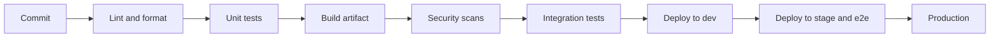
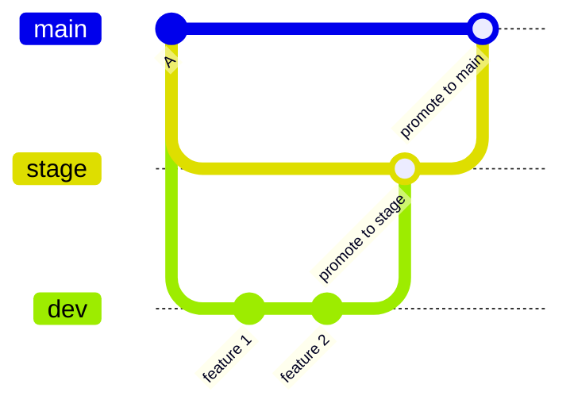

> [!info] Level: junior | Time: about 4 h | You need: [[learn/git-merge-rebase-and-undo|Git 02: Merge, rebase, conflicts and undoing mistakes]], [[learn/pull-requests-and-code-review|Git 03: Pull requests and code review]] and [[learn/safe-bash-scripts|Scripting 02: Safe Bash scripts]] | Lab: Option A, the Ubuntu LTS VM (or the container from Option B) from [[learn/lab-setup|Start 01: Set up your lab]]

Shipping software used to be an event. Someone froze the code, someone else built it on their own machine, a third person copied files to a server on Friday night, and everybody hoped. Continuous integration and continuous delivery are what happens when a team decides that this is too risky and too slow, and replaces the event with a routine.

This lesson gives you the vocabulary, the logic of a pipeline (what each stage must prove), and the branching strategies that go with it. You will build a tiny local pipeline in Bash, break it, and practise the merge discipline that keeps several environment branches honest. The next lesson builds a real pipeline in GitLab CI and Jenkins.

> [!note] What was run
> The commands in exercises 1, 2, 4 and 5 were run on Ubuntu 24.04.5 LTS with Git 2.43.0 and GNU bash 5.2.21 on 2026-10-17, in a throwaway directory with a local bare repository as the remote. Commit IDs, timings and paths in the sample output are illustrative: yours will differ. Exercises 3 and 6 are paper exercises. No real CI server was used.

## What you will learn

- The words people use about pipelines (pipeline, job, stage, runner, artifact, environment, release, deployment), and what each one means.
- The difference between continuous integration, continuous delivery and continuous deployment.
- What each pipeline stage must prove, why the fast checks come first, and the properties a good pipeline has.
- Where the tools you will meet fit: GitLab CI, Jenkins, Artifactory, Terraform and Argo CD or Spinnaker.
- Four branching strategies (trunk-based, GitHub flow, GitFlow, environment branches), when each fits, and how to match branches to pipelines.
- How to measure whether delivery is healthy, using the DORA four keys.

## The manual release

Here is the story that every team lives through once. It helps to read it as a list of failure points.

1. A developer finishes a feature on their laptop and tells the team in chat.
2. On release day, someone pulls `main` onto their own machine and builds it. Their machine has a different compiler version, and a tool installed globally that nobody remembers adding.
3. They run the tests "if there is time".
4. They copy the result to a server with `scp`, and edit a configuration file by hand because the server differs from the test server.
5. They restart the service and click around.
6. Something breaks. Nobody is sure which of the 40 changes in the release is guilty, and no one remembers exactly what was copied.

Each step hides a risk: the build is not reproducible, the tests are optional, the process lives in someone's head, a manual edit makes servers differ, and releases are big so a failure is hard to find. Automating the path from commit to production attacks all of these at once. You shrink the batch (small, frequent changes), make the build the same every time, run the checks on every change, and keep a record of what went where.

## Vocabulary

| Word               | Meaning                                                                                                                                 |
| ------------------ | --------------------------------------------------------------------------------------------------------------------------------------- |
| **Pipeline**       | The automated sequence that takes a change from a commit to a result (a build, a deployment). It is defined in code in your repository. |
| **Stage**          | A group of jobs that run at the same point in the pipeline, such as `build`, `test`, `deploy`. Stages run in order.                     |
| **Job**            | One unit of work in a stage, such as "run the unit tests". Jobs in the same stage may run in parallel.                                  |
| **Runner / agent** | The machine or container that executes jobs. GitLab calls it a runner; Jenkins calls it an agent (or node).                             |
| **Artifact**       | A file or image a job produces and a later job or a human uses: a binary, a container image, a test report.                             |
| **Environment**    | A place where the software runs: `dev`, `stage`, `production`. Each has its own configuration, data and access rules.                   |
| **Release**        | A named, versioned, immutable build that you may deploy, for example `1.4.2`.                                                           |
| **Deployment**     | The act of putting a release into an environment and making it serve traffic.                                                           |

Two of these are easy to confuse. A **release** is a thing (a version of the software). A **deployment** is an event (putting that version somewhere). You can deploy the same release to `stage` today and `production` tomorrow. If you have to rebuild the software for production, you did not deploy the same release, and what you tested is not what you shipped. This idea, build once and promote the same artifact, comes back in [[learn/environments-releases-and-rollbacks|the lesson on environments, releases and rollbacks]].

## Continuous integration

**Continuous integration (CI)** is the practice of merging every developer's work into a shared mainline frequently (at least daily), and verifying each merge with an automated build and test run. Martin Fowler's description of the practice is the classic source. The point is not the server. The point is that the team finds out within minutes that two changes do not fit together, instead of finding out in a painful "integration week" before a release.

CI has habits that matter more than the tool:

- **Everyone commits to the mainline often**, in small steps, so a conflict is small.
- **The build is automated and self-testing.** A person does not decide whether to run the tests.
- **A broken build is the team's top priority.** If the mainline is red, fixing it comes before new work, and nobody merges on top of red.
- **The build is fast.** Slow feedback gets ignored. A common target is a few minutes for the first checks (the source for the "ten minute build" idea is Fowler's article; treat it as a guideline, not a rule).

## Continuous delivery and continuous deployment

These two sound alike and are different:

| Practice                     | Meaning                                                                                                              |
| ---------------------------- | -------------------------------------------------------------------------------------------------------------------- |
| **Continuous delivery (CD)** | Every change that passes the pipeline is **ready** to release at any time. A human decides when to press the button. |
| **Continuous deployment**    | Every change that passes the pipeline is **released automatically**, with no human decision.                         |

Both need the same things: an automated path, good tests and a safe way to roll back. Continuous deployment also needs a high trust in the tests and in monitoring, because there is no person in the gap. Many teams do continuous delivery to production and continuous deployment to non-production environments. Neither is "more correct". Choose by risk, regulation (some changes need a recorded approval, see [[standards/production-change-checklist]]) and how quickly you can detect and undo a bad change.

The common abbreviation "CI/CD" hides this. When someone says "we do CD", ask which one.

## What a pipeline must prove

A pipeline is a series of questions, each answered by automation. The order matters: **cheap, fast checks first**, expensive, slow checks later. If the code does not compile, you should hear it in 30 seconds, not after a 20-minute test run.



| Stage                      | The question it answers                                        | Typical content                                                                           | Rough cost         |
| -------------------------- | -------------------------------------------------------------- | ----------------------------------------------------------------------------------------- | ------------------ |
| Lint and static checks     | Is the code well-formed and consistent?                        | Formatters, linters, YAML and shell checks, commit message rules                          | Seconds            |
| Unit tests                 | Does each part do what it says in isolation?                   | Fast tests with no network or database                                                    | Seconds to minutes |
| Build                      | Can we produce the thing we will deploy?                       | Compile, package, build a container image, tag it with the commit                         | Minutes            |
| Security scans             | Do we ship known vulnerabilities, secrets or licence problems? | Dependency scan, image scan, secret scan ([[patterns/secret-scanning-pre-commit-and-ci]]) | Minutes            |
| Integration tests          | Do the parts work together with real dependencies?             | A database or API in a container, contract tests                                          | Minutes            |
| Deploy to an environment   | Can we install it, and does it start and answer health checks? | Deploy, smoke test, check the readiness endpoint                                          | Minutes            |
| End-to-end and performance | Does the system work from the user's side, under load?         | A few critical journeys, not every path ([[patterns/load-and-performance-testing]])       | Minutes to hours   |
| Production release         | Is it safe to expose to users?                                 | Approval if required, gradual rollout, automatic checks                                   | Minutes            |

A pipeline that only has a "deploy" stage is a script, not a safety net. A pipeline that runs every slow test on every commit gets ignored. Split the work: run the fast set on every push and merge request, and the slow set on the integration branch or on a schedule.

### Properties of a good pipeline

- **Deterministic.** The same commit gives the same result. Pin dependencies and tool versions, and avoid depending on the time or on a remote service that changes.
- **Idempotent.** Running a step twice leaves the system in the same state as running it once. A deploy that fails halfway can be re-run.
- **Fast.** Cache dependencies, run jobs in parallel, shard slow tests ([[patterns/test-sharding-flaky-tests]]), and keep the first feedback within minutes.
- **Observable.** You can see which stage failed and why, how long each took, and how often it fails. A flaky test is a bug in the pipeline.
- **Reproducible from Git.** The pipeline definition, the scripts and the configuration are in the repository, reviewed like code. Rebuilding a release from a tag gives the same artifact.
- **Secure.** Secrets come from a secrets manager, never from the repository and never printed in logs. The pipeline has the least privilege it needs.

A good habit: put the real work in scripts you can run on your laptop (as in the first exercise), and let the CI tool just call them. Then "it passes on CI but fails here" becomes easy to debug, and you are not locked into one tool.

## Where the tools fit

You will meet these names. None of them is "the pipeline"; each does one job.

| Tool                                   | What it does in the picture                                                                                                                                                                                       |
| -------------------------------------- | ----------------------------------------------------------------------------------------------------------------------------------------------------------------------------------------------------------------- |
| **GitLab CI**                          | Runs the pipeline defined in `.gitlab-ci.yml`, next to the repository. See [[patterns/gitlab-ci-pipeline-structure]].                                                                                             |
| **Jenkins**                            | A self-hosted automation server. The pipeline is a `Jenkinsfile`; you manage the controller and agents. See [[patterns/jenkins-shared-libraries]] and [[tools/gitlab-ci-vs-jenkins]].                             |
| **Artifactory** (or Artifact Registry) | Stores built artifacts and images so they can be promoted from one environment to the next. See [[patterns/artifact-promotion-artifactory]].                                                                      |
| **Terraform**                          | Creates and changes the infrastructure the software runs on, from code. You meet it in [[learn/terraform-basics-on-gcp\|Terraform 01]].                                                                           |
| **Argo CD / Spinnaker**                | Deploy releases to environments. Argo CD watches a Git repository and makes the cluster match it (GitOps, see [[adr/0001-gitops-with-argocd]]); Spinnaker is a deployment orchestrator with pipelines of its own. |

The split to remember is **CI builds and tests; a deployment tool puts the result in an environment**. Some teams do both from one pipeline; others separate them so that a deployment can be re-run or rolled back without a new build.

## Branching strategies

A **branching strategy** is an agreement about where work happens, how it is combined, and which branch represents what. It has to fit the pipeline, and it shapes how often you integrate. There is no best strategy, only a fit for the release process and the team. Here are the four you will meet.

### Trunk-based development

Everyone commits to one branch (the **trunk**, usually `main`), either directly or through very short-lived branches that last hours or a day or two. The trunk is always releasable. Work that is not finished is hidden behind a **feature flag**: code that is deployed but switched off. Flags let you merge small steps early and decide about the release separately, and Fowler's article on feature toggles covers the kinds of flag and the cost of keeping them.

It fits teams that deploy often, have good automated tests and care most about fast integration. It asks for discipline: small changes, strong tests, and flags that are removed when done. A flag that stays forever becomes a hidden configuration matrix that nobody tests.

### GitHub flow

A lightweight model: `main` is always deployable; each change is a short branch; you open a pull request, review, merge and deploy. There are no long-lived branches except `main`. It is trunk-based development with a review step on every change. It fits most web services and small teams that release continuously. See [[learn/pull-requests-and-code-review|Git 03]] and [[standards/code-review]] for the review part.

### GitFlow

Vincent Driessen described this in 2010: a long-lived `develop` branch, `feature/*` branches off it, `release/*` branches to stabilise a version, `hotfix/*` branches off `main`, and merges between all of them. It fits software that ships **versioned releases** that customers install and that several versions are supported at once (a library, a desktop or embedded product). For a web service that deploys continuously, it adds merges and waiting with little benefit. The author added a note in 2020 to the original post saying the same: if you do continuous delivery, prefer a simpler flow. Read the note on the post itself, since the wording is his.

### Environment branches

Some teams give each environment a long-lived branch: `dev`, `stage`, `main` (production). A change lands on `dev`, is promoted to `stage` and then to `main` by a pull request with a **merge commit**. Each branch is "what is deployed in that environment", and a deployment tool such as Argo CD can watch each one.



This model gives clear stages and approvals, and it makes it easy to see what is where. It also has costs, and you must manage them:

- **Merge-forward discipline.** Changes flow in one direction: `dev` to `stage` to `main`. A fix made directly on `main` (a hotfix) must be merged **back** into `stage` and `dev` straight away, in that order. If you forget, the next promotion either reverts the hotfix or produces a conflict, and the fix silently disappears.
- **Drift.** The branches diverge when promotions are delayed. Measure it: the number of commits on `dev` that `stage` does not have is the **drift**. A drift of 10 commits means a promotion will carry 10 changes at once, which is the "big batch" problem again.
- **Same artifact, not same code.** Promoting a merge rebuilds from the branch. Build the artifact once and promote the _artifact_ where you can ([[patterns/artifact-promotion-artifactory]]); use the branch to decide _when_, not to rebuild.
- **Long-lived branches slow integration.** A change waits for each promotion. Keep promotions frequent and small. Look at [[architecture/gitops-repo-topology-and-promotion]] for how teams combine environment branches with GitOps.

### Matching branches to pipelines

| Event                                            | Pipeline should run                                                                                |
| ------------------------------------------------ | -------------------------------------------------------------------------------------------------- |
| Push to a feature branch / merge request         | Lint, unit tests, build, security scans. Fast. No deployment, or a short-lived review environment. |
| Merge to the integration branch (`dev` or trunk) | The above, plus integration tests, publish the artifact, deploy to dev.                            |
| Promotion to `stage`                             | Deploy the **same** artifact, run end-to-end and performance checks.                               |
| Promotion to `main` or a version tag             | Deploy the same artifact to production, with approval if required and a rollback plan.             |

Which strategy should you choose? Ask three questions:

1. **How often do you deploy?** Daily or more: trunk-based or GitHub flow. Per version, with several supported: GitFlow.
2. **Who must approve?** If a regulated environment needs a recorded approval, an environment branch or a protected deployment gives you a place for it.
3. **How good are your tests and your rollback?** The weaker they are, the more tempting long-lived branches are, and the more that is a sign to fix the tests.

## Measuring delivery: the DORA four keys

The DevOps Research and Assessment (DORA) programme studied what separates teams that deliver well. It found four measures that together describe both speed and stability:

| Key                                                                          | What it tells you                                            |
| ---------------------------------------------------------------------------- | ------------------------------------------------------------ |
| **Deployment frequency**                                                     | How often you release to production.                         |
| **Lead time for changes**                                                    | How long from a commit to running in production.             |
| **Change failure rate**                                                      | The share of deployments that cause a failure needing a fix. |
| **Failed deployment recovery time** (earlier called time to restore service) | How long it takes to recover from a failed deployment.       |

The first two measure throughput, the last two measure stability. The research finding that matters most is that they move together: teams that deploy small changes often also tend to have fewer failures and faster recoveries, not more. That is why small merges are the heart of this lesson. Do not use the numbers to compare or rank people; use them to find where your own flow is slow. See [[management/dora-metrics]].

> [!warning] Check before relying on this
> DORA has revised its measures and wording across its yearly reports (for example the name of the recovery measure, and the addition of further measures in later reports). Check dora.dev for the current definitions before you put them on a dashboard or in a goal.

## Hands-on exercises

1. **Write a local pipeline that stops at the first failure.** Create a small project with a test and a script that runs lint, test and build in order, with strict Bash settings from [[learn/safe-bash-scripts|Scripting 02]].

   ```bash
   mkdir -p ~/lab/ci-demo/app && cd ~/lab/ci-demo
   git init -q
   echo "1.0.0" > app/version.txt

   cat > app/test.sh <<'EOF'
   #!/usr/bin/env bash
   # A tiny "test suite": the version file must hold a semantic version.
   set -euo pipefail
   version="$(cat app/version.txt)"
   if [[ ! "$version" =~ ^[0-9]+\.[0-9]+\.[0-9]+$ ]]; then
     echo "FAIL: '$version' is not a version like 1.2.3" >&2
     exit 1
   fi
   echo "ok: version $version"
   EOF

   cat > ci-local.sh <<'EOF'
   #!/usr/bin/env bash
   # Run the same checks a pipeline would run, in order, stopping at the first failure.
   set -euo pipefail

   echo "== lint =="
   bash -n app/test.sh
   echo "lint ok"

   echo "== test =="
   bash app/test.sh

   echo "== build =="
   tar -czf app.tar.gz app
   echo "built app.tar.gz"
   EOF

   chmod +x ci-local.sh
   printf 'app.tar.gz\n' > .gitignore
   git add -A && git commit -q -m "Add app and local CI script"
   ./ci-local.sh; echo "exit code: $?"
   ```

   Expected:

   ```text
   == lint ==
   lint ok
   == test ==
   ok: version 1.0.0
   == build ==
   built app.tar.gz
   exit code: 0
   ```

   If you see something else: `git commit` asking who you are means you have not set `user.name` and `user.email` (see [[learn/git-mental-model-and-daily-workflow|Git 01]]). `Permission denied` on `./ci-local.sh` means the `chmod +x` was skipped.

2. **Break the build and time the feedback.** Make the test fail, run the pipeline, and look at the exit code and how long you waited.

   ```bash
   echo "one-point-oh" > app/version.txt
   time ./ci-local.sh; echo "exit code: $?"
   ```

   Expected, illustrative. The build stage never runs, because `set -e` stopped the script at the failing test, and the shell reports exit code 1:

   ```text
   == lint ==
   lint ok
   == test ==
   FAIL: 'one-point-oh' is not a version like 1.2.3

   real	0m0.011s
   user	0m0.008s
   sys	0m0.003s
   exit code: 1
   ```

   Then repair it and confirm the pipeline is green again:

   ```bash
   git restore app/version.txt
   ./ci-local.sh > /dev/null; echo "exit code: $?"
   ```

   Expected: `exit code: 0`.
   If you see something else: if the `== build ==` stage ran after the failure, the script does not have `set -e` (or `set -euo pipefail`) at the top. If the timing is much longer, something other than the script is slow (a cold disk cache the first time is normal). Real pipelines take minutes, not milliseconds, which is why order matters: what is cheap and likely to fail goes first.

3. **Map your team's release process and count the manual steps.** This is a paper exercise. Take the most recent release you took part in (or your team's, or an imagined one if you are new) and write every step from "code merged" to "users have it" in a table.

   ```text
   Step | Who | Manual or automated | Time | Can it fail silently?
   1. Merge pull request | Developer | Manual | 1 min | No
   2. ...
   ```

   Count the rows marked manual. Circle the ones that can fail silently or exist only in somebody's memory.
   Expected: a count, and a short list of risky steps. The usual first result is that the number of manual steps is higher than people said before they wrote them down, and that two or three of them are undocumented. Pick the worst one and write down how you would automate it.
   If you see something else: if you find no manual steps at all, check that you did not skip the approvals, the configuration edits and the "I just check the dashboard" steps, which are manual even when they are quick.

4. **Measure drift between environment branches.** Create a local bare repository as the remote, the three environment branches, and ten commits on `dev` that `stage` does not have.

   ```bash
   git init -q --bare ~/lab/ci-demo-remote.git
   git remote add origin ~/lab/ci-demo-remote.git
   git push -q -u origin main
   git branch stage
   git branch dev
   git push -q origin stage dev

   git switch -q dev
   for i in 1 2 3 4 5 6 7 8 9 10; do
     echo "change $i" >> app/changes.txt
     git add -A
     git commit -q -m "Change $i"
   done
   git push -q origin dev
   git fetch -q origin

   git merge-base --is-ancestor origin/stage origin/dev; echo "stage is in dev: exit $?"
   git merge-base --is-ancestor origin/dev origin/stage; echo "dev is in stage: exit $?"
   git rev-list --count origin/stage..origin/dev
   ```

   Expected:

   ```text
   stage is in dev: exit 0
   dev is in stage: exit 1
   10
   ```

   `git merge-base --is-ancestor A B` exits 0 when `A` is an ancestor of `B`, that is, when everything on `A` is also on `B`. So `stage` is fully contained in `dev` (nothing on `stage` is missing from `dev`, which is what you want before opening the `dev` to `stage` promotion), and `dev` is not contained in `stage` (there is something to promote). The count `A..B` lists commits that `B` has and `A` lacks: here the drift is **10**.
   If you see something else: if `git push -q -u origin main` complains there is no `main`, your default branch has another name (`git branch --show-current`). If the count is 0 on the last command, the commits were not created: check `git log --oneline -3 dev`. A drift of 10 would be a warning sign on a real team.

5. **Merge a hotfix back in order.** Make a fix directly on `main`, see that `dev` lacks it, then merge it forward in the right order: `main` into `stage`, then `stage` into `dev`.

   ```bash
   git switch -q main
   echo "hotfix" > app/hotfix.txt
   git add -A
   git commit -q -m "Hotfix: reject empty version"
   git push -q origin main
   git fetch -q origin

   git rev-list --count origin/dev..origin/main
   git merge-base --is-ancestor origin/main origin/dev; echo "main is in dev: exit $?"

   git switch -q stage
   git merge -q --no-ff origin/main -m "Merge main into stage"
   git push -q origin stage
   git switch -q dev
   git merge -q --no-ff origin/stage -m "Merge stage into dev"
   git push -q origin dev
   git fetch -q origin

   git merge-base --is-ancestor origin/main origin/dev; echo "main is in dev: exit $?"
   git rev-list --count origin/dev..origin/main
   git log --oneline --graph --decorate -n 6 origin/dev
   ```

   Expected, illustrative IDs:

   ```text
   1
   main is in dev: exit 1
   main is in dev: exit 0
   0
   *   4fdbbfd (HEAD -> dev, origin/dev) Merge stage into dev
   |\
   | *   0f8ed01 (origin/stage, stage) Merge main into stage
   | |\
   | | * 8d73bf8 (origin/main, main) Hotfix: reject empty version
   | |/
   * | d6d52bf Change 10
   * | 6bc2ed5 Change 9
   * | 8bf8a1c Change 8
   ```

   Before the back-merge, `dev` was missing one commit from `main`. After it, `main` is an ancestor of `dev` and the missing count is 0. The graph shows the hotfix entering `stage` and then `dev`, so the next normal promotion will not undo it.
   If you see something else: a merge conflict at the `stage` or `dev` step means the same lines were changed on two branches. Resolve it as in [[learn/git-merge-rebase-and-undo|Git 02]] and finish with `git commit`. If `git merge` opens an editor, you did not pass `-m`; save and close it.

6. **Write a one-page decision record for a six-person team that deploys daily.** This is a paper exercise. Pretend you advise a team of six engineers who run one web service and want to deploy several times a day. Write down which branching strategy they should use, why, and what you reject. Use this structure, and write your answer before you read the example.

   ```markdown title="decision-record.md"
   # Branching and release strategy for <team>

   ## Context

   Team size, how often we deploy, who approves, how good our tests and rollback are.

   ## Decision

   The strategy we choose, in one sentence.

   ## Why

   Three reasons that refer to the context above.

   ## Rejected options

   Each alternative and the reason it does not fit.

   ## Consequences

   What we must do to make this work, and what we accept.

   ## Review date

   When we will look at this again.
   ```

   An example answer in outline: _Decision:_ GitHub flow with short-lived branches, merge requests reviewed by one person, a fast CI run on every push, and feature flags for unfinished work. Production is deployed from `main` by the pipeline after the checks pass. _Why:_ six people can review quickly, daily deployment needs small changes, and the tests and rollback are good enough to trust. _Rejected:_ GitFlow (no versioned releases to support, extra merges), and environment branches (they delay integration and invite drift). _Consequences:_ flags must be removed when done, and a red `main` is fixed first. _Review:_ in three months, using lead time and change failure rate.
   Expected: a record of one page that names the trade-off. A good record would change if the context changed (for example, a regulated environment needing an approval step).
   If you see something else: if your answer says "it depends" with no choice, pick one and name the facts that would flip it.

When you finish, delete the throwaway directory: `rm -rf ~/lab/ci-demo ~/lab/ci-demo-remote.git`.

## Common mistakes

- **A pipeline that only runs on `main`.** Why it bites: problems are found after the merge, so the shared branch goes red and blocks everyone. Fix: run the fast checks on every push and merge request, and require them to pass before merging.
- **Ignoring flaky tests.** Why it bites: people re-run until green and stop trusting red, so a real failure is shrugged off. Fix: treat a flaky test as a bug, quarantine it with an owner and a deadline, and fix it ([[patterns/test-sharding-flaky-tests]]).
- **Secrets in logs or in the repository.** Why it bites: pipeline logs are readable by many people and are kept for a long time, so one printed token is a breach. Fix: take secrets from a secrets manager or masked variables, never `echo` them, and scan for them ([[patterns/secret-scanning-pre-commit-and-ci]]).
- **Undocumented manual steps.** Why it bites: the step lives in one person's memory, and the release fails when they are away. Fix: automate it, or write it into the pipeline or a runbook, and count manual steps as you did in exercise 3.
- **Rebuilding for each environment.** Why it bites: what you tested in `stage` is not what you ship. Fix: build once, tag the artifact with the commit, and promote the same artifact.
- **Hotfixes that are not merged back.** Why it bites: the next promotion removes the fix or conflicts with it. Fix: merge forward in order straight after the hotfix (exercise 5) and check with `git merge-base --is-ancestor`.
- **Long-lived branches and big promotions.** Why it bites: the bigger the batch, the harder it is to find the guilty change and the riskier the deploy. Fix: promote often, measure drift, and prefer small merges.
- **Treating the pipeline as a shell script nobody reviews.** Why it bites: it has access to production and secrets. Fix: review pipeline changes like code, with least privilege and protected branches.
- **Measuring people instead of the system.** Why it bites: people game the numbers, and trust drops. Fix: use DORA measures to find bottlenecks, and discuss them as a team.

## Check your understanding

1. What is the difference between continuous delivery and continuous deployment?
2. Why do teams prefer small, frequent merges to large, rare ones?
3. When is GitFlow more overhead than help?
4. A hotfix was committed directly on `main`. What does merging it back into `stage` and `dev` prevent?
5. A pipeline runs the 40-minute end-to-end suite first, then lint, then unit tests. What is wrong, and how would you change the order?
6. Your `dev` branch is 10 commits ahead of `stage`. What does that number mean, and what do you do about it?

> [!question]- Answers
>
> 1. In continuous delivery every change that passes the pipeline is ready to release, and a person decides when. In continuous deployment every change that passes is released automatically with no human step.
> 2. A small merge has a small chance of conflicting, is easy to review, is easy to test, and if it breaks something the cause is obvious and the revert is small. A large merge combines many changes, so a failure is hard to locate and the risk is higher. DORA research also links frequent small deployments with fewer failures and faster recovery.
> 3. When you deploy a web service continuously and do not support several released versions at once. The extra `develop` and `release` branches add merges and waiting without giving anything back. It fits software that ships versioned releases that customers install and that you support in parallel.
> 4. Without the back-merge, the fix exists only on `main`. The next promotion from `dev` to `stage` to `main` would not contain it, so the fix is lost or causes a conflict. Merging forward in order (`main` into `stage`, then `stage` into `dev`) keeps all branches containing it.
> 5. The slowest, most expensive check runs first, so a typo costs 40 minutes of feedback. Put the cheap checks first: lint, then unit tests, then build and security scans, then integration, and run the long end-to-end suite later, on the integration branch or before a release.
> 6. It is the drift: ten commits on `dev` that `stage` does not have, so the next promotion carries ten changes at once. Promote more often in smaller batches, and find out what is delaying promotions (a slow test run, a manual approval, or fear of the change).

## Next steps

Next lesson: [[learn/first-pipeline-gitlab-ci-and-jenkins|Delivery 02: Your first pipeline in GitLab CI and Jenkins]]. Previous lesson: [[learn/gke-for-beginners|GCP 04: GKE for beginners]].

To go deeper:

- [[management/dora-metrics]] explains the four keys and how to collect them without gaming.
- [[tools/gitlab-ci-vs-jenkins]] compares the two CI systems you will use next.
- [[patterns/gitlab-ci-pipeline-structure]] and [[patterns/artifact-promotion-artifactory]] show a production-grade pipeline layout and how to promote one artifact through environments.
- [[patterns/release-versioning-and-changelog-automation]] covers versions and tags, which you meet again in [[learn/environments-releases-and-rollbacks|the lesson on environments, releases and rollbacks]].
- [[architecture/gitops-repo-topology-and-promotion]] and [[adr/0001-gitops-with-argocd]] for deployment from Git.
- The whole path is mapped in [[learn/index|the learning path]].

## Sources

The exercises 1, 2, 4 and 5 were run on Ubuntu 24.04.5 LTS with Git 2.43.0 and GNU bash 5.2.21 on 2026-10-17. The rest of this lesson is explanation from the sources below and was not run. Pages change: check them for the version you use.

- Martin Fowler, "Continuous Integration" (https://martinfowler.com/articles/continuousIntegration.html).
- Jez Humble and Dave Farley, continuousdelivery.com (https://continuousdelivery.com/), including the definition of continuous delivery.
- Trunk Based Development site (https://trunkbaseddevelopment.com/).
- Pete Hodgson, "Feature Toggles (aka Feature Flags)", published on martinfowler.com (https://martinfowler.com/articles/feature-toggles.html).
- DORA, "DORA's software delivery metrics: the four keys" (https://dora.dev/guides/dora-metrics-four-keys/). Not verified: the current names and the set of measures; check the page.
- Vincent Driessen, "A successful Git branching model" (https://nvie.com/posts/a-successful-git-branching-model/), including the note he added in 2020. Not verified: the exact wording of the note.
- GitHub documentation, "GitHub flow" (https://docs.github.com/en/get-started/using-github/github-flow).
- Git documentation, `git merge-base` and `git rev-list` (https://git-scm.com/docs).
- GNU Bash manual, "The Set Builtin" for `set -e` and `pipefail` (https://www.gnu.org/software/bash/manual/).
