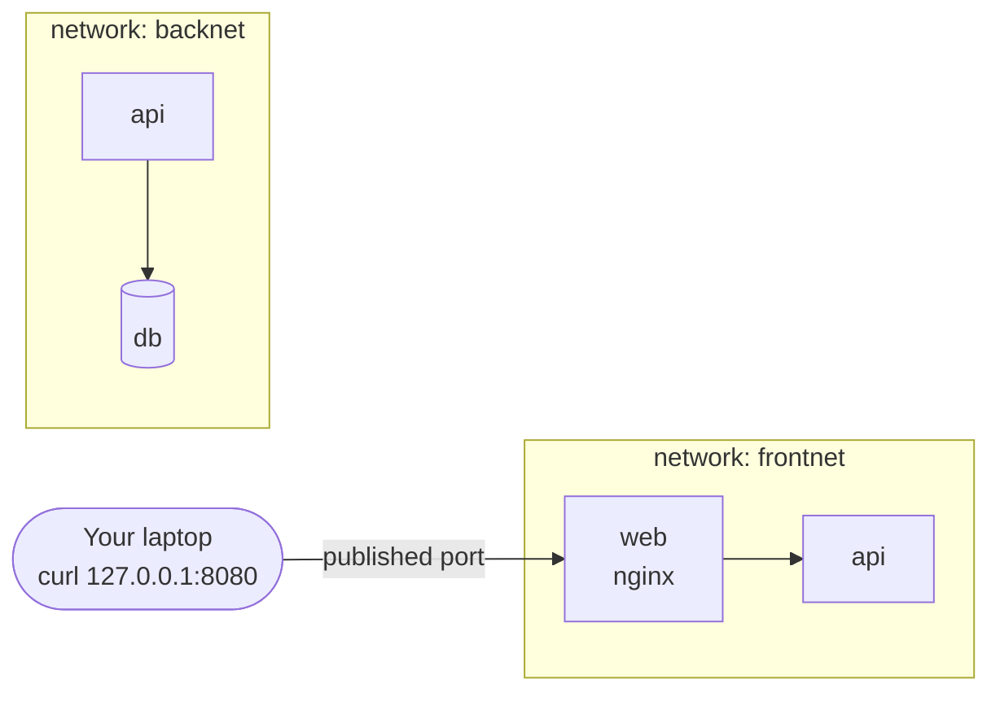

> [!info] Level: junior-middle | Time: about 7 h | You need: [[learn/running-and-debugging-containers|Containers 02: Running, inspecting and debugging containers]] and [[learn/building-and-shipping-images|Containers 03: Building and shipping images]] | Lab: Option A, the Ubuntu LTS VM from [[learn/lab-setup|Start 01: Set up your lab]], with Docker and the Compose plugin installed

A container on its own is a single process with a throwaway filesystem and no friends. Real systems are several processes that keep data and talk to each other: a web app, a database, a cache. This lesson answers three questions. Where does data live when the container is deleted? How does one container find another? How do you describe the whole group in one file so that a teammate can start it with one command? The answers are volumes, user-defined networks and Docker Compose. They are also the mental model you need for Kubernetes, where the same ideas come back as PersistentVolumes, Services and Deployments.

> [!note] Docker Desktop on macOS or Windows
> Docker Desktop runs the engine in a small Linux VM. Host paths and host network behaviour (`--network host`, bind-mount ownership, `127.0.0.1` binding) differ there. The exercises assume the Linux VM from the lab, where the engine runs directly.

## What you will learn

- Why a container's writable layer is temporary, and the three ways to keep or share data: named volumes, bind mounts and `tmpfs`.
- The lifecycle of a volume, how to back one up, and why a mismatch between the container's user ID and the owner of a directory gives `Permission denied`.
- The network drivers (`bridge`, `host`, `none`), why names do not resolve on the default bridge but do on a user-defined one, and how published ports work.
- How to troubleshoot container-to-container traffic with `docker network inspect`, `getent`, `nslookup` and `curl`.
- How to write a `compose.yaml` with services, networks, volumes, environment variables, healthchecks, `depends_on` conditions and profiles, and how to read the merged result with `docker compose config`.
- The daily Compose commands, and the one that deletes your data: `docker compose down -v`.

## The writable layer is temporary

You saw in [[learn/containers-under-the-hood|Containers 01]] that a container is an image (read-only layers) plus one thin **writable layer** on top. Everything the process writes goes into that layer: new files, edited files, a database's data directory. The layer lives exactly as long as the container. `docker stop` keeps it, so `docker start` finds your files again. `docker rm` deletes it.

That gives the first rule of containers with state: **the container is disposable, so the data must live somewhere else.** There are three places:

| Kind          | Where the data lives                                        | Typical use                                                          |
| ------------- | ----------------------------------------------------------- | -------------------------------------------------------------------- |
| Named volume  | A directory managed by Docker, outside any container        | Database files, uploads, anything the app owns and must keep         |
| Bind mount    | A path you choose on the host                               | Source code in development, config files, a folder you want to read  |
| `tmpfs` mount | RAM on the host (Linux only); gone when the container stops | Scratch space, secrets you do not want on disk, fast temporary files |

The writable layer is also slower than a volume for write-heavy work, because it goes through the storage driver (`overlay2` on most systems). A database in the writable layer is both slow and one `docker rm` from gone.

## Volumes, bind mounts and tmpfs

### Named volumes

A **named volume** is created and owned by Docker. You refer to it by name and Docker decides where the bytes sit (on Linux, under `/var/lib/docker/volumes/<name>/_data`; do not edit that path by hand).

```bash
docker volume create c4-data
docker run --rm -v c4-data:/data alpine:3.20 sh -c 'echo hi > /data/hello.txt'
docker run --rm -v c4-data:/data alpine:3.20 cat /data/hello.txt
```

```text
hi
```

_Illustrative._ The first container wrote the file and was removed (`--rm`). The second container is a different container, yet it reads the file, because both mounted the same volume. The syntax is `-v NAME:/path/in/container[:options]`.

If you mount an **empty** named volume over a directory that already has files in the image, Docker copies those files into the volume the first time. This is why `-v pgdata:/var/lib/postgresql/data` starts a database with its files in place and with the right owner. A volume that already holds data is never overwritten.

A volume used with `-v /data` (no name) is **anonymous**: Docker invents a random 64-character name. Anonymous volumes pile up quietly. They also appear when an image's Dockerfile has a `VOLUME` instruction and you do not name one. Name your volumes.

### Bind mounts

A **bind mount** makes a host path appear inside the container. Both sides see the same files at once.

```bash
mkdir -p ~/c4/site && echo '<h1>hello</h1>' > ~/c4/site/index.html
docker run --rm -v "$HOME/c4/site:/site:ro" alpine:3.20 cat /site/index.html
```

```text
<h1>hello</h1>
```

Three details:

- The host path must be **absolute** with `-v` (use `"$PWD/dir"` or `"$HOME/dir"`). A relative name such as `site:/site` is treated as a _named volume_ called `site`. That is a classic surprise.
- Add `:ro` to make the mount read-only. Anything the container only needs to read (config, static files, a certificate) should be `:ro`. A compromised or buggy process then cannot change it.
- With `-v`, a **missing host path is created for you, as an empty directory owned by root**. A typo in the path silently gives you an empty folder. The `--mount` form is stricter and fails instead:

```bash
docker run --rm --mount type=bind,source="$HOME/c4/site",target=/site,readonly alpine:3.20 ls /site
docker run --rm --mount type=bind,source="$HOME/c4/typo",target=/site alpine:3.20 ls /site; echo "exit=$?"
```

```text
index.html
docker: Error response from daemon: invalid mount config for type "bind": bind source path does not exist: /home/lab/c4/typo
exit=125
```

_Illustrative; the exact error wording and the exit code (125 is the usual code for a Docker error) can differ by version._

> [!warning] Check before relying on this
> On hosts that use SELinux (for example RHEL and Fedora), a bind mount may need the `:z` or `:Z` option before the container can read it. The behaviour depends on the host policy. Read the "Bind mounts" page of the Docker documentation for your version before using these options.

### tmpfs

A `tmpfs` mount is memory-backed. It is never written to disk, it is not shared between containers, and it vanishes when the container stops.

```bash
docker run --rm --tmpfs /scratch:rw,size=16m alpine:3.20 sh -c 'df -h /scratch | tail -n 1'
```

```text
tmpfs                    16.0M         0     16.0M   0% /scratch
```

_Illustrative._ It pairs well with `--read-only` (a read-only root filesystem): the app gets one small writable place and nothing else. See [[patterns/dockerfile-hardening]].

### Which one to use

- The app **owns** the data and must keep it: a **named volume**.
- You need to **see or edit** the files from the host (code, config): a **bind mount**, read-only if the container does not write.
- The data is **temporary or sensitive** and should never reach disk: **tmpfs**.

## The lifecycle of a volume

A volume is independent of containers. Deleting a container does not delete its named volumes. That is the point, and also the trap: unused volumes keep using disk until you remove them.

```bash
docker volume ls                       # list
docker volume inspect c4-data          # driver, mountpoint, labels
docker volume rm c4-data               # fails while a container (even a stopped one) uses it
docker volume prune                    # removes unused volumes (read the prompt)
docker system df -v                    # how much space volumes use
```

```text
DRIVER    VOLUME NAME
local     c4-data
```

_Illustrative._

> [!warning] Check before relying on this
> What `docker volume prune` removes changed between Docker versions: older releases removed all unused volumes, and newer ones remove only unused _anonymous_ volumes unless you add `--all`. Read the prompt it prints and `docker volume prune --help` on your engine before you confirm.

### Backing up a volume

You cannot "just copy the files" safely while a database runs, and you should not poke into `/var/lib/docker`. The portable way is a throwaway container that mounts the volume read-only next to a host folder and writes an archive:

```bash
docker run --rm -v c4-data:/data:ro -v "$PWD":/backup alpine:3.20 \
  tar czf /backup/c4-data.tgz -C /data .
tar tzf c4-data.tgz
```

```text
./
./hello.txt
```

_Illustrative._ For a real database prefer the database's own dump tool (`pg_dump`), which gives a consistent copy. A file-level archive of a running database can be corrupt. Restoring is the same command with `tar xzf` into an empty volume. A backup you have never restored is a guess.

## File ownership: UID and GID mismatches

Linux does not track file owners by name. It stores a **numeric user ID (UID) and group ID (GID)**. A process may write to a file if its numeric IDs match the permissions. Inside a container, `id` shows numbers that mean something only to the kernel. A container that runs as UID 10001 and a host directory owned by root with mode `755` do not match, so the write fails:

```text
touch: /out/a.txt: Permission denied
```

This is the most common bind-mount problem, and it appears the day you do the right thing and run as non-root (see [[patterns/dockerfile-hardening]]). The fixes, from most to least preferred:

1. **Make the directory owned by the container's user** (`sudo chown 10001:10001 ./out`). Simple and explicit.
2. **Run the container as your own user** for development: `--user "$(id -u):$(id -g)"`, or `user:` in Compose. Files then belong to you on the host.
3. **Use a named volume.** For a path that exists in the image, Docker copies the image's content and ownership into the new volume, so the image's own user can write to it.
4. **Fix the ownership at start-up** with an init step (an entrypoint that runs `chown` while still root, then drops privileges). Use only when 1 to 3 do not fit.

What not to do: `chmod -R 777` the directory, or run the container as root "to make it work". Both hide the problem and widen access.

> [!note] Rootless Docker and user namespace remapping
> With rootless Docker, or the engine's user-namespace remapping, container UIDs map to different host UIDs, so numbers you see on the host do not match the ones in the container. The rules above still hold; the arithmetic changes. Read the documentation for your setup before you rely on specific numbers.

## Container networks

When Docker starts, it creates networks. You can see them:

```bash
docker network ls
```

```text
NETWORK ID     NAME      DRIVER    SCOPE
a1b2c3d4e5f6   bridge    bridge    local
b2c3d4e5f6a1   host      host      local
c3d4e5f6a1b2   none      null      local
```

_Illustrative; the IDs differ on your machine._ The **driver** decides how a network behaves:

| Driver   | What it does                                                                                                                      |
| -------- | --------------------------------------------------------------------------------------------------------------------------------- |
| `bridge` | A private virtual switch on the host. Each container gets its own network namespace and an IP on a private subnet. The default.   |
| `host`   | The container shares the host's network namespace: no isolation, no address of its own, and `-p` does nothing. Linux engine only. |
| `none`   | The container has only a loopback interface. For jobs that must have no network.                                                  |

There are more (`overlay` for multi-host swarms, `macvlan`, `ipvlan`), and you will not need them in this path. For almost everything you build in a lab, the question is **which bridge**.

### The default bridge versus a user-defined bridge

The network called `bridge` is the **default bridge**. Every container that does not say otherwise joins it. It works, but it has no name resolution: containers can reach each other by IP address and by nothing else. IP addresses change every time a container is recreated, so this is useless in practice.

A **user-defined bridge** (you create it with `docker network create`) adds three things:

- **Automatic DNS.** Docker runs an embedded DNS server. Inside a container on a user-defined network, `/etc/resolv.conf` points at `127.0.0.11`, and that server answers with the IP of any container on the same network, by container name or by a `--network-alias`.
- **Isolation.** Containers on different user-defined networks cannot talk to each other unless one of them is connected to both.
- **Live attach and detach.** You can `docker network connect` and `disconnect` a running container.

Names that are not container names (for example `example.com`) are forwarded to the host's resolvers, so the container still reaches the outside world.



In the picture, `api` is attached to both networks (shown twice for clarity). `web` can reach `api`, and `api` can reach `db`, but `web` cannot reach `db` at all. That is network-level least privilege with no firewall rules to write.

### Publishing ports

A container on a bridge has a private address. Nothing outside the host can connect to it until you **publish** a port with `-p [host_ip:]host_port:container_port`. Docker then forwards traffic arriving at the host port to the container.

```bash
docker run -d --name c4-web --network appnet -p 127.0.0.1:8080:80 nginx:1.27-alpine
docker port c4-web
```

```text
80/tcp -> 127.0.0.1:8080
```

_Illustrative._ Remember the rules from [[learn/running-and-debugging-containers|Containers 02]]:

- `-p 8080:80` binds to **all** host interfaces. On a server that publishes the service to the network, and Docker's own firewall rules can bypass tools such as `ufw`. For anything private, bind to `127.0.0.1`.
- `EXPOSE` in a Dockerfile only documents a port. It publishes nothing.
- **Containers on the same user-defined network do not need published ports to talk to each other.** They connect straight to the container port (`http://c4-web:80`). Publish a port only for traffic that comes from outside: your browser, a load balancer. A database that only the app uses should not be published at all.

> [!warning] Check before relying on this
> How published ports interact with the host firewall (`ufw`, `firewalld`, `nftables`) depends on the Docker version and firewall backend. Test from a second machine before you decide a port is private. In examples, such a machine would use an address like `192.0.2.10`; never put real addresses in notes.

### Multiple networks

A container can join several networks, each with its own IP and its own DNS view. In Compose you list networks per service. With plain Docker:

```bash
docker network create backnet
docker network connect backnet c4-b
docker inspect c4-b --format '{{json .NetworkSettings.Networks}}' | jq -c 'keys'
```

```json
["appnet", "backnet"]
```

_Illustrative._ `jq` is covered in [[learn/text-and-data-tools|Linux 03]].

### Troubleshooting container networking

When container A cannot reach container B, go from the top down. Each step rules out a layer.

1. **Are they on the same user-defined network?** `docker network inspect NET` lists the containers and their IPs. Different networks means no route, by design.
2. **Does the name resolve?** From inside A: `getent hosts B` or `nslookup B`. Failing here is a DNS or network-membership problem. On the default bridge it always fails.
3. **Is something listening, on the right interface?** From inside A: `curl -sv http://B:PORT/` or `wget -qO- http://B:PORT/`. "Connection refused" means the name resolved and B's process is not listening on that port, or listens only on `127.0.0.1` inside B. "Timed out" suggests a firewall or a wrong network.
4. **Is it really the right port?** Use the **container** port (`80`), not the published host port (`8080`), between containers.
5. **Is B healthy?** `docker ps`, `docker logs B`, `docker inspect --format '{{.State.Health.Status}}' B`.

```bash
docker network inspect appnet --format '{{range .Containers}}{{.Name}} {{.IPv4Address}}{{"\n"}}{{end}}'
docker run --rm --network appnet alpine:3.20 getent hosts c4-b
docker run --rm --network appnet alpine:3.20 nslookup c4-b
```

```text
c4-b 172.18.0.3/16
c4-web 172.18.0.2/16
172.18.0.3        c4-b
Server:		127.0.0.11
Address:	127.0.0.11:53

Name:	c4-b
Address: 172.18.0.3
```

_Illustrative; the subnet is whatever Docker chose, and the `nslookup` layout differs between builds._

### `localhost` inside a container means that container

Every container has its own network namespace and its own loopback interface. `127.0.0.1` or `localhost` inside a container is **that container**, not the host and not another container. An app configured with `DB_HOST=localhost` will look for a database inside its own container and fail with "connection refused". Use the other container's name (`DB_HOST=db`) on a user-defined network. You will meet the same rule in Kubernetes, where containers in one Pod do share `localhost`, but separate Pods do not.

## Docker Compose: the whole stack in one file

Typing a long `docker run` for each of three containers, plus the network and the volume, does not scale. **Docker Compose** reads a YAML file that describes the **services** (containers), **networks** and **volumes** of an application and creates all of it with one command. It is the standard tool for local development and small single-host setups. It is not a production orchestrator; Kubernetes is the next stage.

Use the current form:

- The command is `docker compose` (a space; this is Compose v2, a plugin of the Docker CLI). The old `docker-compose` (hyphen) was a separate Python tool, "Compose v1", which is no longer maintained (verify the end date in Docker's announcement).
- The file is `compose.yaml` (preferred) or `compose.yml`. The older names `docker-compose.yaml` and `docker-compose.yml` still work.
- The top-level `version:` key is obsolete in the current Compose specification. Compose warns about it, so leave it out (verify for your version).

### Anatomy of a compose.yaml

This is the stack you will build in the exercises: a PostgreSQL database and a small client that connects to it. The password is **not** written in the file. It comes from a `.env` file that stays out of Git.

```yaml title="~/c4/shop/compose.yaml"
name: shop

# A reusable block (a YAML anchor). The "x-" prefix tells Compose to ignore it.
x-pg-client: &pg-client
  image: postgres:${POSTGRES_VERSION:-17}-alpine
  env_file:
    - app.env
  environment:
    PGHOST: db
    PGUSER: postgres
    PGDATABASE: shop
    PGPASSWORD: ${DB_PASSWORD:?set DB_PASSWORD in .env}
  networks:
    - backend

services:
  db:
    image: postgres:${POSTGRES_VERSION:-17}-alpine
    environment:
      POSTGRES_DB: shop
      POSTGRES_PASSWORD: ${DB_PASSWORD:?set DB_PASSWORD in .env}
    ports:
      - "127.0.0.1:${POSTGRES_PORT:-5432}:5432" # loopback only so you can try POSTGRES_PORT in E5; in a real stack the db publishes nothing
    volumes:
      - dbdata:/var/lib/postgresql/data
    healthcheck:
      test: ["CMD-SHELL", "pg_isready -h 127.0.0.1 -U postgres -d shop"]
      interval: 3s
      timeout: 3s
      retries: 10
      start_period: 10s
    networks:
      - backend

  app:
    <<: *pg-client
    command:
      - sh
      - -c
      - echo "$$APP_GREETING" && psql -tAc 'select 1' && echo db-reachable
    depends_on:
      - db

  dbshell:
    <<: *pg-client
    profiles:
      - debug
    depends_on:
      db:
        condition: service_healthy

networks:
  backend:

volumes:
  dbdata:
```

```text title="~/c4/shop/.env"
POSTGRES_VERSION=17
DB_PASSWORD=lab-only-change-me
```

```text title="~/c4/shop/app.env"
APP_GREETING=hello from app.env
```

> [!warning] Lab values only
> `lab-only-change-me` is a placeholder for a throwaway lab. Change it to a long random value for anything else (`openssl rand -base64 24`), keep `.env` out of Git (`echo .env >> .gitignore`), and never reuse a real credential here. Real deployments take secrets from a secret store, not from files next to the code (see [[patterns/external-secrets-with-secret-manager]] for the Kubernetes version of the idea).

> [!warning] Check before relying on this
> The tag `postgres:17-alpine` is an example, not a recommendation, and was not checked for existence on the day of writing. Confirm the current supported major versions on the image's page on Docker Hub. The data directory and the mount point of the image changed in a newer major version (verify on the image page for the tag you choose), so do not just raise the number and keep the same volume path.

Walk through it:

- **`name: shop`** sets the project name. Compose prefixes resources with it: the network is `shop_backend`, the volume `shop_dbdata`, the containers `shop-db-1` and `shop-app-1`.
- **`image` or `build`.** A service uses either an existing `image:` or `build:` (a path to a directory with a Dockerfile, or a map with `context`, `dockerfile` and `args`). With both, `image:` names the result of the build. `docker compose build` builds; `docker compose pull` pulls.
- **`environment` and `env_file`.** `environment:` sets variables inline (as a map or a list of `KEY=value`). `env_file:` loads `KEY=value` lines from a file into the _container_. Values in `environment:` win over the file. Use `env_file` for a block of settings and keep secrets out of files that are committed.
- **`volumes`.** `dbdata:/var/lib/postgresql/data` mounts the named volume `dbdata`, which is declared at the bottom. A bind mount is written `./site:/site:ro` (relative paths are allowed in Compose, relative to the file).
- **`networks`.** Services on the same network reach each other by **service name**. Here `app` connects to the host `db`. Without a `networks:` key, Compose creates one `default` network for the project and attaches every service to it.
- **`ports`.** `"127.0.0.1:${POSTGRES_PORT:-5432}:5432"` publishes the database only on the loopback interface. Always quote port mappings: unquoted `22:22` style values can be read by YAML as a number in base 60 for some values (the classic reason to quote).
- **`x-pg-client` and `<<: *pg-client`.** A YAML anchor and merge key, so two services share one block. Compose supports this and ignores top-level keys that start with `x-`.
- **`$$`** is a literal `$`. Compose replaces `${VAR}` itself before the container starts. To keep a `$` for the container's shell (`$$APP_GREETING`), double it.

### Variables: `.env`, the shell and defaults

Compose reads a file called `.env` next to `compose.yaml` and uses it to fill `${VARIABLE}` references **in the Compose file itself** (interpolation). That is separate from `env_file:`, which sets variables **inside the container**. The two are often confused:

| Mechanism              | Fills in                          | Example                                |
| ---------------------- | --------------------------------- | -------------------------------------- |
| `.env` file            | `${...}` inside `compose.yaml`    | `image: postgres:${POSTGRES_VERSION}`  |
| Shell environment      | Same, and it **wins** over `.env` | `POSTGRES_PORT=5433 docker compose up` |
| `env_file:` on service | The container's environment       | `env_file: [app.env]`                  |
| `environment:`         | The container's environment       | `PGUSER: postgres`                     |

Interpolation syntax:

- `${VAR}` is the value, or empty if unset (Compose warns).
- `${VAR:-default}` uses `default` when `VAR` is unset **or empty**.
- `${VAR:?message}` stops with `message` when `VAR` is unset or empty. Use it for values that must never be guessed, such as a password. It is why the stack above refuses to start without `DB_PASSWORD`.

### Startup order: "started" is not "ready"

By default, `depends_on: [db]` means only: **start `db` before `app`**. Compose waits for the db container to be _started_, which happens a moment after the process begins. It does not wait for PostgreSQL to finish creating its data directory and accept connections. An app that connects once at start-up loses that race, exits and (without a restart policy) stays down.

The fix is to tell Compose what "ready" means, using a **healthcheck** on the dependency and a `condition` on the dependant:

```yaml
services:
  db:
    healthcheck:
      test: ["CMD-SHELL", "pg_isready -h 127.0.0.1 -U postgres -d shop"]
      interval: 3s
      timeout: 3s
      retries: 10
      start_period: 10s
  app:
    depends_on:
      db:
        condition: service_healthy
```

The three conditions are `service_started` (the default), `service_healthy` (the healthcheck passes) and `service_completed_successfully` (the dependency ran and exited with 0, for one-off jobs such as a migration).

Note the `-h 127.0.0.1` in the check. On first start, the PostgreSQL image runs a temporary server while it initialises the database, and that server is started so that it accepts connections only on a Unix socket (not verified for every version). A `pg_isready` that uses the socket could report "ready" too early, and the app, connecting over TCP, would still be refused. Forcing TCP makes the check match what the app does. This detail is not verified for every image version.

Even with healthchecks, a well-built app also **retries** its connection with backoff. The database restarts on its own, in production too, and `depends_on` only helps at start-up.

### Profiles

A **profile** marks a service as optional. A service with `profiles:` is not started by a plain `docker compose up`; it starts only when you activate the profile. It is the standard place for debug tools, one-off jobs and test helpers.

```bash
docker compose config --services                    # db, app
docker compose --profile debug config --services    # db, app, dbshell
docker compose --profile debug run --rm dbshell     # start the tool on demand
```

### Overrides and `docker compose config`

If `compose.override.yaml` exists next to `compose.yaml`, `docker compose` reads and **merges** it automatically. This is where a developer puts local changes: another command, an extra environment variable, a bind mount of the source code. For other environments name the files with `-f`: `docker compose -f compose.yaml -f compose.prod.yaml up`. Later files win; maps are merged key by key, and lists such as `ports` are generally appended (check the "Merge" page for the field you care about).

The single most useful debugging command is:

```bash
docker compose config
```

It prints the **final** merged file with every variable filled in and the short syntax expanded. It does not start anything. It catches indentation errors, unset required variables and "why is the override not applied?" before they cost you an hour. Use `docker compose config --quiet` in a script or in CI to only check validity.

> [!warning] `config` prints secrets
> The output includes interpolated values, so `DB_PASSWORD` appears in plain text. Do not paste it into a ticket or a chat. Redact it first.

### The daily commands

| Command                                   | What it does                                                                                             |
| ----------------------------------------- | -------------------------------------------------------------------------------------------------------- |
| `docker compose up -d`                    | Create what is missing and start the stack in the background. Rebuilds nothing unless you add `--build`. |
| `docker compose ps`                       | List the project's containers and their state (`-a` includes exited ones).                               |
| `docker compose logs -f --tail 50 app`    | Follow one service's logs.                                                                               |
| `docker compose exec db psql -U postgres` | Run a command in a running service container.                                                            |
| `docker compose run --rm dbshell`         | Start a **new** one-off container for a service.                                                         |
| `docker compose build` / `pull`           | Build the images / download the images.                                                                  |
| `docker compose restart app`              | Restart one service.                                                                                     |
| `docker compose stop`                     | Stop the containers and keep them (and everything else).                                                 |
| `docker compose down`                     | Stop and **remove** containers and the project's networks. Volumes stay.                                 |
| `docker compose down -v`                  | Same, **and delete the named volumes the file declares**. Your data goes with them.                      |
| `docker compose config`                   | Print the merged, interpolated file.                                                                     |

> [!danger] `docker compose down -v` deletes your database
> `-v` (`--volumes`) removes the named volumes declared in the Compose file. For a stack with a database volume, that is the data. Muscle memory from a throwaway lab is how people lose a development database they cared about. Run plain `docker compose down` by default. Reserve `-v` for the moment you want a clean slate on purpose.

### `compose watch` (development loop)

For development, Compose can watch your source files and sync or rebuild automatically. A service gets a `develop.watch` block:

```yaml
services:
  api:
    build: ./api
    develop:
      watch:
        - action: sync
          path: ./api/src
          target: /app/src
        - action: rebuild
          path: ./api/package.json
```

Then `docker compose watch` (or `docker compose up --watch`) copies changed files into the running container (`sync`) or rebuilds the image and recreates the container (`rebuild`). It replaces the habit of bind-mounting the source tree, which causes the ownership problems described earlier.

> [!warning] Check before relying on this
> `develop.watch` and its actions (`sync`, `rebuild`, and other actions in newer releases) depend on the Compose version. Check `docker compose version` and the "Use Compose Watch" page for your release. Not exercised in this lesson.

## Hands-on exercises

You need the lab VM from [[learn/lab-setup|Start 01]] with Docker and the Compose plugin. Outputs are illustrative: IDs, addresses, dates and timings will differ. Commands that fail are expected to fail, and each tells you what a correct failure looks like.

1. **Set up.**

   ```bash
   mkdir -p ~/c4 && cd ~/c4
   docker version --format '{{.Server.Version}}'
   docker compose version
   ```

   Expected: two version lines (a server version, then `Docker Compose version v...`).
   If you see something else: `docker: 'compose' is not a docker command` means the Compose plugin is missing; follow the Docker installation page for your distribution. A permission error on the Docker socket means your user is not in the `docker` group yet (see [[learn/lab-setup|Start 01]]).

2. **The writable layer is temporary.**

   ```bash
   docker run --name c4-layer alpine:3.20 sh -c 'echo hi > /root/hello.txt'
   docker diff c4-layer
   docker rm c4-layer
   docker run --rm alpine:3.20 cat /root/hello.txt; echo "exit=$?"
   ```

   Expected: `docker diff` lists the new file (`A /root/hello.txt`, and a `C /root` line for the changed directory). After `docker rm`, the new container prints `cat: can't open '/root/hello.txt': No such file or directory` and `exit=1`.
   If you see something else: if the file exists in the new container, you used `docker start` on the old container instead of running a new one; check `docker ps -a`.

3. **A named volume survives `docker rm`.**

   ```bash
   docker volume create c4-data
   docker run --name c4-w1 -v c4-data:/data alpine:3.20 sh -c 'echo hi > /data/hello.txt'
   docker rm c4-w1
   docker run --rm -v c4-data:/data alpine:3.20 cat /data/hello.txt
   docker volume ls --filter name=c4-data
   ```

   Expected: `hi`, then a table with `local   c4-data`. The container that wrote the file is gone; the data is not.
   If you see something else: if `cat` reports no such file, the two runs used different volume names or you typed `-v c4-data` without `:/data` (that makes an anonymous volume). Check `docker volume ls`.

   Now back it up and read the archive:

   ```bash
   docker run --rm -v c4-data:/data:ro -v "$PWD":/backup alpine:3.20 tar czf /backup/c4-data.tgz -C /data .
   tar tzf c4-data.tgz
   ```

   Expected: a listing with `./` and `./hello.txt`.
   If you see something else: if the archive is missing, you ran the command from a directory you cannot write to; `cd ~/c4` and repeat.

4. **A read-only bind mount.**

   ```bash
   mkdir -p ~/c4/site && echo '<h1>hello</h1>' > ~/c4/site/index.html
   docker run --rm -v "$HOME/c4/site:/site:ro" alpine:3.20 sh -c 'cat /site/index.html; touch /site/new.txt'; echo "exit=$?"
   ls ~/c4/site
   ```

   Expected: `<h1>hello</h1>`, then `touch: /site/new.txt: Read-only file system`, then `exit=1`. `ls` shows only `index.html`.
   If you see something else: if `new.txt` was created, you left off `:ro` or placed it in the wrong spot (the option goes after the container path). If `touch` says `Permission denied` instead, the filesystem was not mounted read-only; recheck the flag.

5. **A permission error with a non-root container, then the fix.**

   ```bash
   mkdir -p ~/c4/out
   sudo chown root:root ~/c4/out && sudo chmod 755 ~/c4/out
   docker run --rm --user 10001:10001 -v "$HOME/c4/out:/out" alpine:3.20 sh -c 'id -u; touch /out/a.txt'; echo "exit=$?"
   ```

   Expected: `10001`, then `touch: /out/a.txt: Permission denied` and `exit=1`. The container's user (10001) does not match the owner (root) of the directory.
   If you see something else: if the file is created, the directory is writable by everyone or you ran as root; check `ls -ld ~/c4/out` for `drwxr-xr-x root root`.

   Fix it by making the directory belong to the container's user, then repeat:

   ```bash
   sudo chown 10001:10001 ~/c4/out
   docker run --rm --user 10001:10001 -v "$HOME/c4/out:/out" alpine:3.20 sh -c 'touch /out/a.txt && echo written'
   ls -ln ~/c4/out
   ```

   Expected: `written`, and `ls -ln` shows `a.txt` owned by `10001 10001`. On the host the file has numbers, not names, because no such user exists there.
   If you see something else: if it is still denied, check that you chowned the host directory, not a path inside the container.

6. **Names do not resolve on the default bridge, but do on a user-defined network.**

   ```bash
   docker run -d --name c4-a alpine:3.20 sleep 600
   docker run --rm alpine:3.20 ping -c 1 -W 2 c4-a; echo "exit=$?"
   ```

   Expected: `ping: bad address 'c4-a'` and a non-zero exit. Both containers are on the default bridge, which has no name resolution.
   If you see something else: if the ping works, your engine or Docker Desktop configuration resolves names on the default network; continue anyway, the next step is the supported way.

   Now create a network and try again:

   ```bash
   docker network create appnet
   docker run -d --name c4-b --network appnet alpine:3.20 sleep 600
   docker run --rm --network appnet alpine:3.20 ping -c 1 -W 2 c4-b
   docker run --rm --network appnet alpine:3.20 cat /etc/resolv.conf
   ```

   Expected: `1 packets transmitted, 1 packets received, 0% packet loss`, and a `resolv.conf` with `nameserver 127.0.0.11`.
   If you see something else: `bad address` again means the pinging container was not on `appnet`; check for `--network appnet` on _both_ the target and the client. If `resolv.conf` shows another nameserver, the container used the host network or an older network type; run `docker inspect c4-b --format '{{json .NetworkSettings.Networks}}' | jq -c 'keys'`.

7. **Publish a port on 127.0.0.1 only, and compare with all interfaces.**

   ```bash
   docker run -d --name c4-web --network appnet -p 127.0.0.1:8080:80 nginx:1.27-alpine
   docker run -d --name c4-open --network appnet -p 8081:80 nginx:1.27-alpine
   curl -sI http://127.0.0.1:8080 | head -n 1
   docker port c4-web
   docker port c4-open
   ```

   Expected: `HTTP/1.1 200 OK`, `80/tcp -> 127.0.0.1:8080`, and for the second one `80/tcp -> 0.0.0.0:8081` (plus an IPv6 line such as `[::]:8081` on many setups). The first is private to the VM; the second is open to anything that can reach the VM.
   If you see something else: `Bind for ... failed: port is already allocated` means another process holds the port; pick another or run `ss -ltn` to find it. The image tag `nginx:1.27-alpine` is an example and was not checked; use a current tag if the pull fails.

   Remove the open one now: `docker rm -f c4-open`.

8. **Inspect the network and attach a second one.**

   ```bash
   docker network inspect appnet --format '{{range .Containers}}{{.Name}} {{.IPv4Address}}{{"\n"}}{{end}}'
   docker network inspect appnet --format '{{(index .IPAM.Config 0).Subnet}}'
   docker network create backnet
   docker network connect backnet c4-b
   docker inspect c4-b --format '{{json .NetworkSettings.Networks}}' | jq -c 'keys'
   ```

   Expected: two lines with `c4-b` and `c4-web` and their addresses, a subnet such as `172.18.0.0/16` (whatever Docker chose), and `["appnet","backnet"]`.
   If you see something else: if `index .IPAM.Config 0` fails with "index out of range", the network has no IPAM config shown; run plain `docker network inspect appnet | less`. If `jq` is missing, install it (see [[learn/lab-setup|Start 01]]) or drop the pipe and read the JSON.

9. **`localhost` is the container itself.**

   ```bash
   docker run --rm --network appnet alpine:3.20 wget -qO- -T 3 http://127.0.0.1:80; echo "exit=$?"
   docker run --rm --network appnet alpine:3.20 wget -qO- -T 3 http://c4-web | head -n 4
   docker run --rm --network appnet alpine:3.20 getent hosts c4-web
   ```

   Expected: the first fails (`wget: can't connect to remote host (127.0.0.1): Connection refused`, `exit=1`), because nothing listens on port 80 inside the new Alpine container. The second prints the first four lines of the nginx welcome page (`<!DOCTYPE html>`, `<html>`, `<head>`, `<title>Welcome to nginx!</title>`). The third prints the address of `c4-web` next to its name.
   If you see something else: if the second fails with `bad address`, `c4-web` is not on `appnet` (check with exercise 8). If it times out, nginx is not running; look at `docker logs c4-web`.

10. **Compose E1: the project and a healthy database.** Create the project directory and the three files from the lesson (copy them exactly; set your own password in `.env`).

    ```bash
    mkdir -p ~/c4/shop && cd ~/c4/shop
    # create compose.yaml, .env and app.env as shown above, then:
    echo ".env" > .gitignore
    docker compose config --quiet && echo "config ok"
    docker compose up -d db
    sleep 12
    docker compose ps
    ```

    Expected: `config ok`, then a table with one container, `shop-db-1`, service `db`, and a status like `Up 14 seconds (healthy)` and the port `127.0.0.1:5432->5432/tcp`. While the check is still running you may see `(health: starting)`.
    If you see something else: an error `required variable DB_PASSWORD is missing a value: set DB_PASSWORD in .env` means `.env` is missing, in the wrong directory, or the value is empty; that is the `:?` guard working. A YAML error names a line number; check indentation (spaces only, no tabs). `(unhealthy)` after a minute: read `docker compose logs db`. The column names of `docker compose ps` can differ between Compose versions (not verified).

11. **Compose E2: see the start-up ordering bug, then fix it.** The `app` service has the plain `depends_on: [db]`. Start from an empty volume so the database has to initialise:

    ```bash
    docker compose down -v
    docker compose up -d
    sleep 15
    docker compose ps -a
    docker compose logs app
    ```

    Expected: `app` is `Exited (2)`, and its log shows the greeting, then something like `psql: error: connection to server at "db" (172.19.0.2), port 5432 failed: Connection refused`. Compose started `db` and then `app` at once; `db` was not ready. (The address is illustrative.)
    If you see something else: if `app` succeeded, the database initialised faster than the client started (rare with a fresh volume); run `docker compose down -v` and try again. A different error such as `password authentication failed` means the volume held an older password; `down -v` clears it.

    Now fix it. In `compose.yaml`, replace the `depends_on` of the `app` service with the long form:

    ```yaml
    depends_on:
      db:
        condition: service_healthy
    ```

    Then repeat the run:

    ```bash
    docker compose config --quiet && echo "config ok"
    docker compose down -v
    docker compose up -d
    docker compose logs app
    ```

    Expected: `up -d` takes several seconds longer, because Compose waits for `db` to be healthy before it starts `app`. The log of `app` shows `hello from app.env`, `1` and `db-reachable`. `docker compose ps -a` shows `app` as `Exited (0)` (it is a one-shot job) and `db` as `healthy`.
    If you see something else: if you still get a refused connection, the `depends_on` you edited belongs to a different service, or the indentation is off; `docker compose config` shows `condition: service_healthy` under `app` when it is right.

12. **Compose E3: a profile.**

    ```bash
    docker compose config --services
    docker compose --profile debug config --services
    docker compose --profile debug run --rm dbshell psql -tAc 'select current_database()'
    ```

    Expected: the first command lists `db` and `app` only (the order can vary); the second adds `dbshell`; the third prints `shop`. `dbshell` was not running before and does not stay running.
    If you see something else: if `dbshell` shows up without the flag, the `profiles:` key is missing or misplaced. If the third command waits and then fails, `db` is not healthy; check `docker compose ps`.

13. **Compose E4: an override, read through `config`.** Create `compose.override.yaml` next to `compose.yaml`:

    ```yaml title="~/c4/shop/compose.override.yaml"
    services:
      db:
        command: ["postgres", "-c", "log_statement=all"]
      app:
        environment:
          LOG_LEVEL: debug
    ```

    ```bash
    docker compose config | grep -E 'log_statement|LOG_LEVEL'
    docker compose -f compose.yaml config | grep -E 'log_statement|LOG_LEVEL' || echo "not present without the override"
    ```

    Expected: the first command prints two lines, `LOG_LEVEL: debug` and `- log_statement=all`. The second prints `not present without the override`, because `-f compose.yaml` names one file explicitly and the override is no longer picked up automatically.
    If you see something else: if nothing is printed in the first case, the file name is wrong; it must be exactly `compose.override.yaml` in the same directory.

14. **Compose E5: a variable with a default, rendered.**

    ```bash
    docker compose config | grep published
    POSTGRES_PORT=5433 docker compose config | grep published
    ```

    Expected: `published: "5432"` for the first and `published: "5433"` for the second. The `${POSTGRES_PORT:-5432}` default applies only when the variable is unset; a value in the shell wins.
    If you see something else: if both show 5433, `POSTGRES_PORT` is exported in your shell session (`env | grep POSTGRES_PORT`) or set in `.env`; unset it. The exact layout of the `ports` block in `config` output depends on the Compose version (not verified).

15. **Compose E6: `down` keeps the data, `down -v` deletes it.**

    ```bash
    docker compose up -d --wait db
    docker compose exec db psql -U postgres -d shop -c 'create table t(i int); insert into t values (1);'
    docker compose down
    docker volume ls --filter name=shop_dbdata
    docker compose up -d --wait db
    docker compose exec db psql -U postgres -d shop -tAc 'select count(*) from t'
    docker compose down -v
    docker volume ls --filter name=shop_dbdata
    docker compose up -d --wait db
    docker compose exec db psql -U postgres -d shop -tAc 'select count(*) from t'
    ```

    Expected: `CREATE TABLE` and `INSERT 0 1`; after `down`, the volume `shop_dbdata` is still listed, and the count is `1` once the stack is back; after `down -v` the volume list is empty, and the last query fails with `ERROR:  relation "t" does not exist`. One command kept your data and the other deleted it.
    If you see something else: `--wait` makes `up` wait until services are running or healthy; if your Compose version rejects the flag, run `up -d db` and `sleep 12` instead. If the count stays `1` after `down -v`, you have another volume with the same data; run `docker volume ls`.

16. **Clean up.**

    ```bash
    cd ~/c4/shop && docker compose --profile debug down -v
    docker rm -f c4-a c4-b c4-web c4-open 2>/dev/null
    docker network rm appnet backnet 2>/dev/null
    docker volume rm c4-data 2>/dev/null
    cd ~ && sudo rm -rf ~/c4
    docker ps -a --filter name=c4- --filter name=shop-
    ```

    Expected: the last command prints only the table header. `sudo` is needed because exercise 5 left a file owned by UID 10001.
    If you see something else: a network that will not delete is still used by a container; list with `docker network inspect NAME`, remove the container, and retry.

## Common mistakes

- **Keeping data in the container.** The writable layer disappears with `docker rm`. Mount a named volume at the data directory from the first run.
- **Using a relative name where you meant a path.** `-v site:/site` creates a volume called `site`; whether `-v ./site:/site` is accepted depends on the engine version (verify). Use `"$PWD/site"` or `--mount`.
- **Letting `-v` create the host directory.** A typo gives an empty, root-owned folder and no error. Use `--mount type=bind,...` in scripts so a missing path fails.
- **Fixing permission errors with `chmod 777` or by running as root.** It hides the UID mismatch and widens access. Match the owner to the container's user instead.
- **Expecting names to resolve on the default bridge.** They do not. Create a network and attach the containers to it.
- **Publishing everything.** `-p 8080:80` listens on all interfaces, and a database that only the app needs should have no `ports:` at all. Bind to `127.0.0.1` or publish nothing.
- **Pointing the app at `localhost`.** Inside a container that is the container itself. Use the service name.
- **Believing `depends_on` waits for readiness.** It waits for "started". Add a `healthcheck` and `condition: service_healthy`, and make the app retry.
- **Running `docker compose down -v` out of habit.** It deletes the named volumes. Use `down`.
- **Committing `.env`.** It holds secrets. Add it to `.gitignore` and commit a `.env.example` with fake values.
- **Pasting `docker compose config` output.** It includes the secrets from `.env` in plain text.
- **Writing `$VAR` for the container's shell.** Compose interpolates it first. Write `$$VAR` to pass a literal `$`.

## Check your understanding

1. A teammate asks whether to use a named volume or a bind mount for the PostgreSQL data directory, and for a folder of static config files. What do you answer for each, and why?
2. `docker compose up -d` returns, `docker compose ps` shows the database as `Up`, and yet the app fails with "connection refused". Why, and what are two changes that fix it?
3. An app in container `web` has `DB_HOST=localhost` and the database runs in container `db` on the same Compose project. Why does the connection fail, and what should the value be?
4. A container running as UID 10001 gets `Permission denied` writing to a bind-mounted directory. Name two fixes and one thing you should not do.
5. What is the difference between `.env` and `env_file:`? Which one decides the image tag in `image: postgres:${POSTGRES_VERSION}`?
6. What does each of these keep or delete: `docker compose stop`, `docker compose down`, `docker compose down -v`?

> [!question]- Answers
>
> 1. Database data: a **named volume**. Docker owns the location, it is not tied to a host path or host user, it is faster than the writable layer, and the image's ownership is copied in on first use. Config files you edit from the host: a **bind mount**, mounted **read-only** (`:ro`) because the container only needs to read them.
> 2. `depends_on` with the default condition only waits until the database container has _started_, not until PostgreSQL accepts connections. Fix 1: add a `healthcheck` to `db` and `depends_on: db: condition: service_healthy` to the app. Fix 2: make the app retry its connection with a delay. Doing both is best.
> 3. Inside the `web` container, `localhost` is the `web` container's own loopback interface, and nothing listens there. Use the service name, `DB_HOST=db`; both services are on the project's network and Docker's DNS resolves the name.
> 4. Fixes: `chown` the host directory to `10001:10001`; run the container as your own user (`--user "$(id -u):$(id -g)"`) in development; use a named volume; or fix ownership in an init step. Do not `chmod 777` the directory or switch the container to root.
> 5. `.env` provides values for `${...}` **inside the Compose file** (and the shell environment overrides it); `env_file:` loads variables **into the container**. `POSTGRES_VERSION` in the image tag comes from `.env` or the shell, never from `env_file:`.
> 6. `stop` stops the containers and keeps everything (containers, networks, volumes). `down` removes the containers and the project's networks but keeps the named volumes. `down -v` also deletes the named volumes the file declares, which means the data.

## Next steps

Next lesson: [[learn/kubernetes-architecture-and-kind|Kubernetes 01: Architecture, kind and the kubectl workflow]]. Previous lesson: [[learn/building-and-shipping-images|Containers 03: Building and shipping images]].

Once Stage 5 feels solid, build homelab project P2 (Compose, a reverse proxy and TLS from a local CA) from [[learn/lab-setup#The homelab ladder|the homelab ladder in Start 01]]. It needs this lesson and [[learn/http-and-tls|Networking 04: HTTP and TLS]].

To go deeper:

- [[patterns/dockerfile-hardening]] for non-root users, read-only root filesystems and `tmpfs`, which cause several of the permission errors above when done wrongly.
- [[learn/running-and-debugging-containers|Containers 02]] for the triage order when a container will not start.
- Kubernetes brings volumes, networks and start-up order back in new forms. Keep the questions "where does the data live?" and "how does it find the other part?" in mind in the next stage.
- The whole path is mapped in [[learn/index|the learning path]].

## Sources

- Docker documentation, "Storage" (volumes, bind mounts, tmpfs): <https://docs.docker.com/engine/storage/>. Not checked against a running engine for this page.
- Docker documentation, "Networking" (bridge networks, default bridge, user-defined bridge, published ports): <https://docs.docker.com/engine/network/>.
- Docker documentation, "Docker Compose" overview, "Interpolation", "Use profiles", "Control startup order", "Merge" and "Use Compose Watch": <https://docs.docker.com/compose/>.
- Compose Specification (file format, `depends_on` conditions, `healthcheck`, `develop`): <https://docs.docker.com/reference/compose-file/>.
- Docker CLI reference for `docker volume`, `docker network`, `docker run` and `docker compose`: <https://docs.docker.com/reference/cli/docker/>.
- PostgreSQL image on Docker Hub (environment variables, data directory, tags): <https://hub.docker.com/_/postgres>.
- The Compose file in this lesson was only checked with `docker compose config` on Docker Compose v5.6.0 (the rendered `ports`, `environment` and `command` output). The containers, volumes and networks were not run for this page, so the sample output of the other commands is illustrative and not verified.
