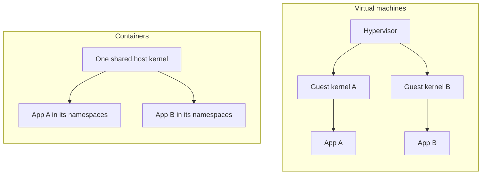
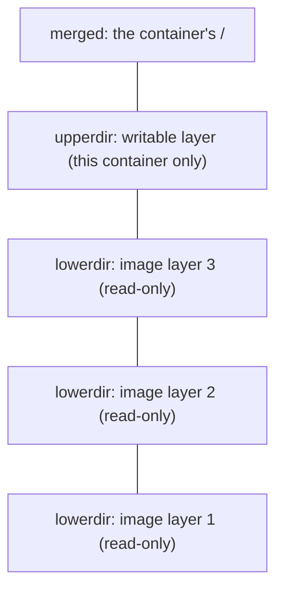

> [!info] Level: junior | Time: about 4 h | You need: [[learn/linux-processes-memory-and-disk|Linux 04: Processes, memory and disk]] | Lab: Option A, the Ubuntu LTS VM from [[learn/lab-setup|Start 01: Set up your lab]], with Docker installed (the container in Option B cannot run these exercises, because they need the host's namespaces and cgroups)

"It works on my machine" is the oldest problem in operations. The code ran on the developer's laptop, then failed on the server because a library was a different version, a config file was missing or another program held the same port. A container is the standard answer: package the program together with everything it needs, and run it in a boxed-in view of the machine. Most people learn the commands first and the idea later, which is why containers feel like magic until the first strange failure. This lesson goes the other way. You will see that a container is **an ordinary Linux process** with three kinds of kernel feature applied to it, and you will look at each one from the host.

> [!note] Docker Desktop on macOS or Windows
> Docker Desktop runs the Docker engine inside a small Linux virtual machine. Host paths such as `/proc` and `/sys/fs/cgroup`, and the PIDs you see in this lesson, belong to that VM, not to your laptop. The exercises assume a Linux host where the Docker engine runs directly, which is what the Ubuntu VM from the lab gives you.

## What you will learn

- Why a container is a process with limits and a private view, not a small virtual machine, and what that means for security.
- The seven main kinds of namespace and what each one hides, and how to create one by hand with `unshare`.
- How cgroups v2 limit CPU, memory and process count, and where to read the limits under `/sys/fs/cgroup`.
- What an image is: layers, a config, a manifest, a digest, and the OCI format that makes them portable.
- How `overlay2` stacks read-only layers under a writable one, why deleting a file does not shrink an image, and how to read the changes with `docker diff`.
- How to find a container's real process from the host, and three misconceptions to unlearn (a sandbox, a kernel inside, an ordinary PID 1).

## The problem containers solve

A program is more than its own code. It needs a language runtime, shared libraries, config files, certificates, a certain user, certain directories, a free port. Install two programs on one server and they can disagree: one wants Python 3.9 and the other 3.12, or both want port 8080.

There are three classic fixes, and each one costs something:

- **Install carefully by hand.** Slow, and nobody can reproduce the result. This is how "snowflake" servers are born.
- **One virtual machine per application.** Strong isolation, but every VM carries a full operating system: gigabytes of disk, a minute to boot, its own patching.
- **Run the program in an isolated environment on a shared kernel.** This is a container. It starts in about a second (usually less), costs megabytes, and the same package runs on a laptop, in CI and in production.

## Containers and virtual machines

A **virtual machine** emulates hardware. A hypervisor gives each VM virtual CPUs, memory and disks, and a full operating system with its **own kernel** boots on top. Two VMs on one host run two separate kernels.

A **container** shares the host's kernel. There is one kernel on the machine, and it separates processes from each other by giving them different views of the system. There is no second operating system to boot, which is why containers are small and fast. It is also why a container can only run programs built for the host's kernel (a Linux container needs a Linux kernel), and why the kernel is the main thing between a container and the host.



| Question           | Virtual machine                         | Container                                   |
| ------------------ | --------------------------------------- | ------------------------------------------- |
| Kernel             | Its own                                 | Shared with the host                        |
| Start time         | Tens of seconds to minutes (typical)    | Usually well under a few seconds            |
| Size               | Gigabytes (a whole operating system)    | Megabytes to a few hundred megabytes        |
| Isolation boundary | Hypervisor (a small, well-tested layer) | The kernel's system-call interface (larger) |
| Runs a foreign OS  | Yes                                     | No: same kernel family as the host          |
| Good for           | Strong separation, different kernels    | Packaging and running many services densely |

_Typical figures, not guarantees. They vary with the image and the host._

The "isolation boundary" row is the important one. You will come back to it in the misconceptions section.

## Namespaces: a private view

A **namespace** wraps one kind of system resource so that processes inside it see their own private copy. The kernel does not run anything extra; it keeps a separate table, and a process looks up its own. A process belongs to one namespace of each kind, and the links are visible in `/proc/<pid>/ns/`.

| Namespace | Flag for `unshare` | What it isolates                                     | What a container sees                            |
| --------- | ------------------ | ---------------------------------------------------- | ------------------------------------------------ |
| `pid`     | `--pid`            | Process IDs                                          | Its first process is PID 1; other processes gone |
| `net`     | `--net`            | Network interfaces, routes, ports, firewall rules    | Its own `eth0` and `lo`, its own port 80         |
| `mnt`     | `--mount`          | The mount table (the filesystem tree)                | Its own root filesystem, from the image          |
| `uts`     | `--uts`            | Hostname and domain name                             | Its own hostname (the container ID by default)   |
| `ipc`     | `--ipc`            | System V IPC and POSIX message queues, shared memory | Its own shared-memory segments                   |
| `user`    | `--user`           | User and group IDs                                   | A different mapping of UIDs (off by default)     |
| `cgroup`  | `--cgroup`         | The view of the cgroup tree                          | Its own cgroup as the root of `/sys/fs/cgroup`   |

A newer eighth kind, the `time` namespace (kernel 5.6 and later), gives separate clock offsets. Containers rarely use it. Read `man 7 namespaces` for the full list and the exact rules.

Namespaces change **what a process can see**, not **how much it can use**. A process in its own PID namespace still has the whole machine's CPU and memory available. Limits are a different feature, covered next.

> [!note] The user namespace is the odd one
> Docker does not turn on user namespace remapping by default. In the default setup, root inside a container (UID 0) is also UID 0 on the host, and only capabilities and other restrictions hold it back. Rootless mode and `userns-remap` change this; they are worth knowing about but are not the default.

### Making a namespace by hand

You do not need Docker to get a namespace. The `unshare` command from `util-linux` runs a program in new namespaces. This makes a PID namespace and mounts a fresh `/proc` so that `ps` shows the new view:

```bash
sudo unshare --pid --fork --mount-proc bash -c 'ps -o pid,ppid,comm'
```

```text
    PID    PPID COMMAND
      1       0 bash
      2       1 ps
```

_Illustrative._

`bash` is PID 1 in its own world and `ps` is PID 2. Everything else on the machine has disappeared from view. The `PPID` of `bash` is 0 because its parent lives in another namespace. `--fork` makes `unshare` fork before running the command, and a process that creates a PID namespace does not itself move into it. `--mount-proc` mounts a new `/proc`, because `ps` reads `/proc` and the old one would still list the host's processes.

That is the core of "a container has its own processes": a few system calls (`clone` and `unshare` with namespace flags). Docker, containerd and Kubernetes all call these same kernel features.

## cgroups: limits and accounting

**Control groups (cgroups)** limit and measure what a group of processes can use: CPU time, memory, number of processes, disk I/O. The kernel exposes them as a virtual filesystem, usually mounted at `/sys/fs/cgroup`. Every directory is a group, and files in it are the settings and counters.

There are two versions. **cgroup v1** has a separate hierarchy per resource (`/sys/fs/cgroup/memory/...`, `/sys/fs/cgroup/cpu/...`). **cgroup v2** has one unified tree, and is the default on current mainstream distributions. Check which one your host uses:

```bash
stat -fc %T /sys/fs/cgroup
```

```text
cgroup2fs
```

`cgroup2fs` means v2. `tmpfs` means v1 (a tmpfs holding one directory per v1 controller). This lesson uses v2 paths.

> [!warning] Check before relying on this
> File names and locations differ between cgroup v1 and v2, and between Docker's cgroup drivers (`systemd` or `cgroupfs`). The paths below are for a v2 host. On v1 the memory limit is `memory.limit_in_bytes` under `/sys/fs/cgroup/memory/docker/<id>/`. Always check `stat -fc %T /sys/fs/cgroup` and `docker info --format '{{.CgroupDriver}} {{.CgroupVersion}}'` first.

The v2 files you use most:

| File             | Meaning                                                        |
| ---------------- | -------------------------------------------------------------- |
| `memory.max`     | Hard memory limit in bytes, or `max` for none                  |
| `memory.current` | Memory in use right now                                        |
| `memory.events`  | Counters, including `oom_kill`                                 |
| `cpu.max`        | CPU quota and period, for example `50000 100000` is half a CPU |
| `pids.max`       | Maximum number of processes and threads                        |
| `cgroup.procs`   | PIDs that belong to this group                                 |

Docker turns its flags into these files: `--memory 64m` writes `memory.max`, `--cpus 0.5` writes `cpu.max`, `--pids-limit 100` writes `pids.max`. When a process goes over `memory.max` and the kernel cannot reclaim memory, the kernel's OOM killer ends a process in that group. That is what you saw as exit status 137 in [[learn/linux-processes-memory-and-disk|Linux 04]], and it is what Kubernetes reports as `OOMKilled`.

## Images: the packaged filesystem

A container starts from an **image**: a read-only package that holds the files a program needs (a minimal root filesystem, the runtime, your code) plus metadata about how to start it. Images follow the **OCI image specification** (Open Container Initiative), so Docker, containerd, Podman and Kubernetes all read the same format.

An image is made of a few pieces:

- **Layers.** Each layer is a compressed tar archive of file changes. A Dockerfile instruction that changes files creates one layer on top of the previous ones.
- **A config.** A JSON file with the entrypoint, command, environment variables, working directory, user, and the ordered list of layer IDs (the layer **diff IDs**, hashes of the uncompressed layers).
- **A manifest.** A JSON file that lists the config and the layers by digest.
- **An index (optional).** A list of manifests, one per platform (`linux/amd64`, `linux/arm64`). This is how one tag works on both an Intel server and an Arm laptop. You will use it in [[learn/building-and-shipping-images|Containers 03]].

Everything is addressed by **digest**: a `sha256` hash of the content. If the content changes by one byte, the digest changes. Two images that share a layer share the same digest for it, and Docker stores that layer once. A **tag** such as `alpine:3.20` is only a movable label that points to a digest. The digest is the identity.

```bash
docker pull alpine:3.20
docker image inspect alpine:3.20 --format '{{.Id}}'
docker image inspect alpine:3.20 --format '{{json .RootFS.Layers}}'
docker image inspect alpine:3.20 --format '{{json .RepoDigests}}'
```

```text
sha256:3c3a...e1f2
["sha256:a1b2...c3d4"]
["alpine@sha256:5e6f...7a8b"]
```

_Illustrative: the digests differ by tag, date and platform, and are shortened here. Tag `3.20` is an example; use a tag that exists when you read this._

> [!warning] Check before relying on this
> The exact output of `docker image inspect` and `docker history` depends on the engine's image store. Recent Docker installs may use the containerd image store instead of the classic one, which changes what `Id`, `RepoDigests` and `history` show (for example `<missing>` entries and which digest `Id` reports). The ideas are the same; compare your output with the description, not character by character.

## Layers and overlay2

How do layers become one filesystem? On Linux, Docker's default storage driver for the classic image store is `overlay2`, built on the kernel's **OverlayFS**. Overlay mounts several directories as one:

- **lowerdir**: the read-only image layers, stacked (several can be listed).
- **upperdir**: one writable directory, created for this container.
- **workdir**: scratch space OverlayFS needs next to the upperdir.
- **merged**: the combined view the container sees as its root `/`.



When a process reads a file, the kernel looks from the top down and returns the first match. When it **writes** to a file that exists only in a lower layer, the kernel first copies the whole file up into the upperdir, then changes the copy. This is **copy-on-write**. The lower layer is never touched, which is why 50 containers from one image share a single copy of it.

**Deleting** a file in a lower layer cannot remove it (that layer is read-only). Instead, OverlayFS writes a **whiteout** in the upperdir: a special character device with device number 0/0, named like the file. The merged view then hides the real file. The data is still in the lower layer and still counts toward the image size. A similar "opaque" marker on a directory hides everything below it.

This is the reason behind a rule you will use in [[learn/building-and-shipping-images|Containers 03]]: **deleting a file in a later layer does not shrink the image.** The delete is just one more layer on top. Exercise 7 shows it.

You can see the pieces for a running container. This works with the classic `overlay2` store; it may not with the containerd store (see the warning above):

```bash
docker run -d --name c1-show alpine:3.20 sleep 600
docker inspect c1-show --format '{{json .GraphDriver.Data}}' | jq
```

```json
{
  "LowerDir": "/var/lib/docker/overlay2/ab12...-init/diff:/var/lib/docker/overlay2/cd34.../diff",
  "MergedDir": "/var/lib/docker/overlay2/ab12.../merged",
  "UpperDir": "/var/lib/docker/overlay2/ab12.../diff",
  "WorkDir": "/var/lib/docker/overlay2/ab12.../work"
}
```

_Illustrative. The `-init` layer holds files Docker adds at start, such as `/etc/hosts`._

## What a container is, in one sentence

Now the parts fit together:

> A **container** is a process (or a few) started from an image, running with a **writable layer** on top of the image's layers, inside its own **namespaces**, limited by a **cgroup**, where the first process is **PID 1**.

There is no "container object" in the kernel. The kernel sees processes, with namespace memberships and a cgroup. "Container" is the name the tools give to that combination. A container-runtime stack (Docker CLI, `dockerd`, `containerd`, `runc`) prepares the pieces and then asks the kernel to start the process.

## Looking from the host

Because a container is a process, the host can see it. This is the skill that makes containers debuggable: you are not stuck inside a black box.

```bash
docker top c1-show
PID=$(docker inspect c1-show --format '{{.State.Pid}}')
echo "host PID: $PID"
ps -o pid,ppid,user,comm -p "$PID"
cat "/proc/$PID/cgroup"
ls -l "/proc/$PID/ns/"
```

```text
UID    PID    PPID   C  STIME  TTY  TIME      CMD
root   31842  31820  0  10:41  ?    00:00:00  sleep 600
host PID: 31842
    PID    PPID USER     COMMAND
  31842   31820 root     sleep 600
0::/system.slice/docker-6f1c...e9a2.scope
total 0
lrwxrwxrwx 1 root root 0 Oct 17 10:42 cgroup -> 'cgroup:[4026532401]'
lrwxrwxrwx 1 root root 0 Oct 17 10:42 ipc -> 'ipc:[4026532399]'
lrwxrwxrwx 1 root root 0 Oct 17 10:42 mnt -> 'mnt:[4026532397]'
lrwxrwxrwx 1 root root 0 Oct 17 10:42 net -> 'net:[4026532402]'
lrwxrwxrwx 1 root root 0 Oct 17 10:42 pid -> 'pid:[4026532400]'
lrwxrwxrwx 1 root root 0 Oct 17 10:42 time -> 'time:[4026531834]'
lrwxrwxrwx 1 root root 0 Oct 17 10:42 user -> 'user:[4026531837]'
lrwxrwxrwx 1 root root 0 Oct 17 10:42 uts -> 'uts:[4026532398]'
```

_Illustrative: PIDs, IDs and inode numbers differ on every machine and every run._

Read it carefully:

- Inside the container this process is PID 1. On the host it is PID `31842`. Same process, two numbers: that is the PID namespace.
- The parent (`31820`) is the `containerd-shim` process, not your shell.
- `/proc/<pid>/cgroup` shows the cgroup path. With the `systemd` driver it is a `docker-<id>.scope` under `system.slice`. With the `cgroupfs` driver it is `/docker/<id>`.
- Each `ns/` link holds an inode number. Two processes in the same namespace show the same number. The container's `mnt`, `net`, `pid`, `uts`, `ipc` and `cgroup` numbers differ from your shell's. The `user` namespace is the same as the host's, as noted earlier: Docker does not use a separate one by default.

More tools for the same job: `lsns` lists namespaces, and `sudo nsenter -t "$PID" -n ip addr` runs `ip addr` inside the container's network namespace using the host's tools. You will meet `nsenter` again in [[learn/running-and-debugging-containers|Containers 02]].

## Three misconceptions to unlearn

**1. "A container is a sandbox."** Not by default. A container is isolated by namespaces, restricted by Docker's default capabilities and seccomp profile (a filter on which system calls are allowed), and limited by cgroups. But every system call still goes to the **shared host kernel**. A kernel bug can let a process escape its container. Options such as `--privileged`, mounting the Docker socket, or `--pid=host` remove protections entirely. Treat a container as a useful boundary, not a strong one. If you run untrusted code, you add layers: a user namespace or rootless engine, a sandboxing runtime such as gVisor, or a microVM. See [[patterns/dockerfile-hardening]] for the practical defaults.

**2. "A container has its own kernel."** It does not. `uname -r` inside a container prints the **host's** kernel version, because it is the same kernel. This also means a container cannot load kernel modules for itself, and an image built for `amd64` does not run natively on an `arm64` host (an emulator can bridge this, slowly).

**3. "PID 1 is just another process."** In a PID namespace, the first process is PID 1 and the kernel treats it specially in two ways that matter:

- **Signals.** For PID 1 the kernel does not apply the default action of a signal. If the program has not installed a handler for `SIGTERM`, a `SIGTERM` sent from inside the namespace does nothing. Docker sends signals from outside the namespace, and the kernel still discards ones with no handler for PID 1, except `SIGKILL` and `SIGSTOP`. So a program that was written for "run as an ordinary process" can ignore `docker stop` and be killed only after the timeout.
- **Orphans.** Processes whose parent dies are re-parented to PID 1, and PID 1 is expected to collect their exit status (`wait`). A program not written for this leaves **zombies** behind. `docker run --init` puts a tiny init program (`tini`) in front to handle both.

Containers 02 shows the signal problem with a real `trap` and a real 10-second delay.

## Hands-on exercises

Run these in your Ubuntu VM with Docker (Linux host). Use `sudo` where shown. The names start with `c1-` so cleanup is easy.

> [!warning] Exercises 1 to 6 are not verified
> The commands and outputs below were written from the tools' documentation and not run on a machine for this page (no `verified` date). Output is illustrative: IDs, PIDs, sizes and inode numbers will differ. Read each "If you see something else" line before assuming something is broken.

1. **See a container's process from the host.**

   ```bash
   docker run -d --name c1-sleeper alpine:3.20 sleep 600
   docker exec c1-sleeper ps
   docker top c1-sleeper
   PID=$(docker inspect c1-sleeper --format '{{.State.Pid}}')
   ps -o pid,ppid,comm -p "$PID"
   ```

   Expected: `docker exec ... ps` lists `sleep 600` as PID 1 and the `ps` itself with a small PID. `docker top` and `ps -p` show the same process with a large PID (for example `31842`), and the parent is `containerd-shim`.
   If you see something else: if `docker: command not found` or "permission denied" on the socket, add yourself to the `docker` group or prefix `sudo`, as set up in the lab. If the host PID is small and the parent is `runc` or a different name, your engine uses another runtime layout; the point (a normal process with a different number) still holds. On Docker Desktop, the PID is the VM's.

2. **Create a PID namespace without Docker.**

   ```bash
   sudo unshare --pid --fork --mount-proc bash -c 'ps -o pid,ppid,comm; echo "I am PID $$"'
   ```

   Expected: `bash` is PID 1 with PPID 0, `ps` is a small PID, and the last line prints `I am PID 1`.
   If you see something else: if `ps` lists dozens of host processes, `--mount-proc` did not apply, so the host's `/proc` is still in use; check you passed it and ran as root. If `unshare: unshare failed: Operation not permitted`, you forgot `sudo`, or the environment forbids namespaces (some restricted containers and hardened VMs do).

3. **Compare namespace IDs.**

   ```bash
   PID=$(docker inspect c1-sleeper --format '{{.State.Pid}}')
   for ns in pid net mnt uts ipc cgroup user; do
     printf '%-7s host=%s container=%s\n' "$ns" \
       "$(readlink /proc/self/ns/$ns)" "$(sudo readlink /proc/$PID/ns/$ns)"
   done
   ```

   Expected: `pid`, `net`, `mnt`, `uts`, `ipc` and `cgroup` show **different** numbers for the host and the container. `user` shows the **same** number.
   If you see something else: if `user` differs, your engine runs rootless or has `userns-remap` on; that is a valid setup. If the `cgroup` numbers match, your engine may share the host cgroup namespace (this is a setting and can differ by engine version and configuration).

4. **Set and read a memory limit.**

   ```bash
   docker run -d --name c1-limited -m 64m alpine:3.20 sleep 600
   docker exec c1-limited cat /sys/fs/cgroup/memory.max
   ID=$(docker inspect c1-limited --format '{{.Id}}')
   cat "/sys/fs/cgroup/system.slice/docker-$ID.scope/memory.max"
   ```

   Expected: both print `67108864`, which is 64 x 1024 x 1024 bytes. The first command reads it from inside the container (its own cgroup is the root of what it sees), the second from the host.
   If you see something else: if the host `cat` says "No such file", your Docker uses the `cgroupfs` driver or cgroup v1. Check `docker info --format '{{.CgroupDriver}} {{.CgroupVersion}}'`. With `cgroupfs` on v2 the path is `/sys/fs/cgroup/docker/$ID/memory.max`. On v1 look for `memory.limit_in_bytes` under `/sys/fs/cgroup/memory/docker/$ID/`. If the container shows `max`, the limit was not applied.

5. **Look at layers and history.** Build a small image with three layers, then inspect it.

   ```bash
   mkdir -p ~/c1-layers && cd ~/c1-layers
   cat > Dockerfile <<'DOCKER'
   FROM alpine:3.20
   RUN echo one > /one.txt
   RUN echo two > /two.txt
   DOCKER
   docker build -t c1-layers:1 .
   docker image inspect c1-layers:1 --format '{{len .RootFS.Layers}} layers'
   docker image inspect c1-layers:1 --format '{{json .RootFS.Layers}}' | jq
   docker history c1-layers:1
   ```

   Expected: `3 layers` (the Alpine base layer plus one per `RUN`). `docker history` lists the two `RUN` steps with tiny sizes on top of the base, and each layer has a digest in the inspect output.
   If you see something else: if the layer count is not 3, the base image may itself have more layers, or the build merged steps; what matters is that each `RUN` that changes files adds one. If `docker history` shows `<missing>` for base layers, that is normal for images pulled from a registry. Dockerfile lines may not be indented in your file: with a heredoc the text must start at column 0 (remove the leading spaces if your editor added them).

6. **Read the writable layer with `docker diff`.**

   ```bash
   docker run --name c1-diff alpine:3.20 sh -c 'mkdir /data && echo hi > /data/new.txt && echo "# added" >> /etc/profile && rm /etc/issue'
   docker diff c1-diff
   ```

   Expected: lines starting with `A` (added), `C` (changed) and `D` (deleted), for example:

   ```text
   C /etc
   C /etc/profile
   D /etc/issue
   A /data
   A /data/new.txt
   ```

   If you see something else: the order and the extra `C` entries can differ. If `rm: can't remove '/etc/issue'`, that file is not in your base image; pick another file under `/etc` with `ls /etc`. If `docker diff` prints nothing, the command failed before changing anything; check `docker logs c1-diff`.

7. **Show that deleting does not shrink an image.** This uses `docker commit`, which snapshots a container's writable layer as a new image. It is a good teaching tool and a poor way to build real images.

   ```bash
   docker run --name c1-fat alpine:3.20 sh -c 'head -c 52428800 /dev/urandom > /big'
   docker commit c1-fat c1-demo:big
   docker run --name c1-slim c1-demo:big rm /big
   docker commit c1-slim c1-demo:deleted
   docker images --format '{{.Repository}}:{{.Tag}}\t{{.Size}}' | grep -E 'alpine|c1-demo'
   ```

   Expected: `c1-demo:big` is about 50 MB larger than `alpine:3.20`, and `c1-demo:deleted` is **just as large** (or very slightly larger), even though `/big` is gone from the filesystem. The random data does not compress, so the numbers stay honest.
   If you see something else: if `c1-demo:deleted` is much smaller, the engine's size column may show a compressed or shared figure (this happens with the containerd image store). Compare with `docker image inspect <image> --format '{{.Size}}'`, or run `docker system df -v`. If `head` is missing or the image is tiny, use `dd if=/dev/urandom of=/big bs=1M count=50`.

8. **Clean up.**

   ```bash
   docker rm -f c1-show c1-sleeper c1-limited c1-diff c1-fat c1-slim 2>/dev/null
   docker rmi c1-layers:1 c1-demo:big c1-demo:deleted 2>/dev/null
   rm -rf ~/c1-layers
   ```

   Expected: the names are echoed or nothing is printed. `docker ps -a` shows none of the `c1-` containers.
   If you see something else: if an image "is being used by stopped container", remove the containers first, then the images.

## Common mistakes

- **Thinking a container is a lightweight VM.** You then look for a kernel, an init system or SSH inside it, and are surprised by the shared kernel. Think "a process with a view and limits".
- **Assuming a container is secure by default.** Every container shares the host kernel, and a root process inside is root on the host without a user namespace. Run as a non-root user, drop capabilities and keep the host patched (see [[patterns/dockerfile-hardening]]).
- **Deleting a big file in a later layer and expecting a smaller image.** The file stays in the lower layer. Create, use and delete in the same `RUN`, or use a multi-stage build ([[learn/building-and-shipping-images|Containers 03]]).
- **Storing data in the container's writable layer.** It is removed with the container, is slower than a volume and grows without a limit. Keep state in volumes ([[learn/container-storage-networking-and-compose|Containers 04]]).
- **Using a tag as if it were an identity.** `latest` or `3.20` can point to different content tomorrow. Pin by digest when you need exactly the same bytes.
- **Ignoring PID 1.** A program that does not handle `SIGTERM` makes every `docker stop` wait ten seconds, and zombies pile up. Handle the signal, or use `--init`.
- **Reading cgroup paths for the wrong version.** Check `stat -fc %T /sys/fs/cgroup` before you look for `memory.max` or `memory.limit_in_bytes`.

## Check your understanding

1. `uname -r` prints the same kernel version on the host and inside a container. Why?
2. You delete a 500 MB file in the last step of a Dockerfile. Why is the image still 500 MB larger than it needs to be?
3. Which namespace gives a container its own network interfaces and ports, and which two files or commands show it from the host?
4. What is the difference between what a namespace does and what a cgroup does?
5. Why does PID 1 behave differently from other processes when it receives `SIGTERM`, and what is a simple fix in a container?
6. Two containers are started from the same image. What do they share, and what does each have of its own?

> [!question]- Answers
>
> 1. There is only one kernel. A container is a process on the host kernel with a separate view, so `uname` asks the same kernel. A container cannot run a different kernel, and kernel bugs affect both.
> 2. Layers are read-only. The delete is stored as a whiteout in a newer layer, and the 500 MB of data is still in the layer that added it. The fix is to avoid adding the file at all, or to add and remove it in the same `RUN`, or to copy only the result into a clean final stage.
> 3. The `net` namespace. From the host, `ls -l /proc/<pid>/ns/net` shows its inode, and `sudo nsenter -t <pid> -n ip addr` (or `ip -br addr`) shows the container's interfaces.
> 4. A namespace controls what a process can **see** (PIDs, network, mounts, hostname). A cgroup controls how much it can **use** (CPU, memory, process count) and counts the use. A container needs both.
> 5. The kernel does not apply the default action for a signal to PID 1 of a namespace, so a program without a `SIGTERM` handler ignores it until `SIGKILL` arrives after the timeout. Install a handler (graceful shutdown), run with `--init` (`tini`), or make the app `exec` itself as PID 1 so the handler is the app's. Containers 02 shows this in action.
> 6. They share the read-only image layers (stored once on disk) and the host kernel. Each has its own writable layer, namespaces, cgroup, PID 1 and network.

## Next steps

Next lesson: [[learn/running-and-debugging-containers|Containers 02: Running, inspecting and debugging containers]]. Previous lesson: [[learn/python-for-ops|Scripting 03: Python for ops]].

To go deeper:

- [[learn/linux-processes-memory-and-disk|Linux 04: Processes, memory and disk]] for the process, signal and OOM ideas this lesson builds on.
- [[patterns/dockerfile-hardening]] for non-root users, minimal images and runtime restrictions.
- [[patterns/kubernetes-resource-requests-and-limits]] for how Kubernetes turns requests and limits into the cgroup files you read here.
- The whole path is mapped in [[learn/index|the learning path]].

## Sources

- Docker documentation, "Docker overview" and "Storage drivers: OverlayFS" (https://docs.docker.com/get-started/docker-overview/, https://docs.docker.com/engine/storage/drivers/overlayfs-driver/). Not checked against a running engine for this page.
- Linux man-pages: `namespaces(7)`, `pid_namespaces(7)`, `cgroups(7)`, `unshare(1)`, `nsenter(1)` (https://man7.org/linux/man-pages/). Not run on a lab machine for this page.
- Linux kernel documentation: "Control Group v2" (https://docs.kernel.org/admin-guide/cgroup-v2.html) and "Overlay Filesystem" (https://docs.kernel.org/filesystems/overlayfs.html).
- Open Container Initiative, "Image Format Specification" (https://github.com/opencontainers/image-spec).
- Docker documentation, "Resource constraints" (https://docs.docker.com/engine/containers/resource_constraints/) for `--memory`, `--cpus` and `--pids-limit`. Image tags and the Docker version used (29.8.2 client is installed on the writing machine, but its daemon was not running) were not verified.
