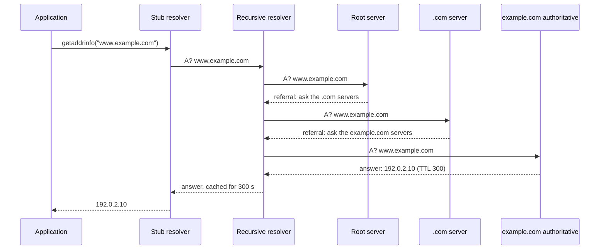

> [!info] Level: junior-middle | Time: about 4 h | You need: [[learn/ip-addressing-and-subnets|Networking 02: IP addressing and subnets]] | Lab: Option A, the Ubuntu LTS VM from [[learn/lab-setup|Start 01: Set up your lab]]

Almost every incident that starts with "the site is down" has a short DNS check in its first five minutes. Either the name does not resolve, or it resolves to the wrong place, or it resolves differently on two machines. This lesson shows what actually happens between `curl https://example.com` and the first packet to a web server, so that you can tell which step failed and why.

The commands below were not run for this lesson, so every output is illustrative. Addresses, TTLs and server names on your machine will differ. The names `example.com`, `lab.example.com` and the ranges `192.0.2.0/24`, `198.51.100.0/24` and `203.0.113.0/24` are reserved for documentation. Treat any address that `example.com` returns as a value that can change.

## What you will learn

- What DNS is, and the path a lookup takes from your program through the stub, recursive, root, TLD and authoritative servers.
- How a Linux host decides which resolver to ask: `getaddrinfo`, `nsswitch.conf`, `/etc/hosts`, `/etc/resolv.conf` and `systemd-resolved`.
- The record types you will meet daily (`A`, `AAAA`, `CNAME`, `MX`, `TXT`, `NS`, `SOA`, `PTR`, `SRV`) and why a `CNAME` cannot sit at the zone apex.
- How TTL, caching and negative caching decide when a change "goes live".
- How to read `dig` output: flags, `NOERROR`, `NXDOMAIN` and `SERVFAIL`.
- How search domains and `ndots` work, and why a Kubernetes pod sends several queries for one external name.

## DNS as a distributed database

The Domain Name System maps names to data. It is a database that no single machine holds. The name space is a tree, and each part of the tree is run by a different party.

```text
.                        <- the root (run by the root server operators)
└── com.                 <- a top-level domain, "TLD" (run by a registry)
    └── example.com.     <- a zone you or your provider control
        └── www.example.com.
```

A name is read from right to left. The trailing dot is the root and is usually left off when people type names, but it is part of the full name (the "fully qualified domain name", FQDN). The administrator of `example.com` publishes the data for that zone on **authoritative** servers. Those servers give the final answer for their zone. They do not look anything up for you.

Clients almost never ask authoritative servers directly. They ask a **recursive resolver**, which does the walking and keeps a cache. That is the key split to remember:

| Role                 | Job                                                                    | Example                                           |
| -------------------- | ---------------------------------------------------------------------- | ------------------------------------------------- |
| Stub resolver        | A small client in your OS. Asks one recursive resolver, caches little. | The code behind `getaddrinfo`; `systemd-resolved` |
| Recursive resolver   | Walks the tree for you and caches answers.                             | Your VPC resolver, your ISP, a public resolver    |
| Root and TLD servers | Point to the next level down. They do not hold your records.           | Root servers, the `.com` servers                  |
| Authoritative server | Holds the zone data and answers with the final data.                   | The servers listed in the zone's `NS` records     |

DNS uses UDP port 53 for most queries and TCP port 53 when an answer does not fit in a UDP message, when the server asks for it, and for zone transfers (RFC 1035, RFC 7766). A firewall that allows only UDP 53 will work for small answers and fail for large ones. That is a classic "works for some names only" fault. Keep it in mind for [[learn/load-balancers-firewalls-and-network-troubleshooting|Networking 05]].

## The full chain of one lookup

Here is what happens when a program asks for `www.example.com` and nothing is cached anywhere.



Step by step:

1. The application calls the C library function `getaddrinfo()`. Almost every program does, directly or through its language runtime. The library decides where to look (next section).
2. If DNS is used, the stub sends a query to the configured recursive resolver, with the "recursion desired" flag set.
3. The recursive resolver checks its cache. On a miss it asks a root server. The root does not know the answer. It returns a **referral**: the names and addresses of the servers for `com.`.
4. The resolver asks a `com.` server. That one also does not know, and refers the resolver to the servers listed as `NS` for `example.com.`.
5. The resolver asks one of those authoritative servers. This one answers with the record and a TTL.
6. The resolver caches the answer for the TTL and returns it. Every later query for the same name, from any client of that resolver, is answered from cache until the TTL runs out.

In practice the resolver already has the root and `.com` data cached, so most lookups need zero or one trip to an authoritative server. This is why DNS is fast and why it is also slow to change. You will use both facts in the TTL section.

## How a Linux host decides where to look

The path from your program to a resolver has several config files. When "it works with `dig` but not with my app" happens, the cause is nearly always here.

### getaddrinfo and nsswitch.conf

`getaddrinfo()` reads `/etc/nsswitch.conf` to learn which sources to use for host names and in which order.

```bash
grep '^hosts:' /etc/nsswitch.conf
```

```text
hosts:          files mdns4_minimal [NOTFOUND=return] dns
```

_Illustrative: the exact line depends on the distribution and the packages installed._

Read it left to right. `files` means `/etc/hosts` is consulted first. `dns` means the resolver in `/etc/resolv.conf`. The entry `[NOTFOUND=return]` after `mdns4_minimal` stops the search when a multicast DNS lookup says "not found", which is why `.local` names behave differently from other names. A name found in `/etc/hosts` never reaches DNS at all.

### /etc/hosts

A plain text file with one address and its names per line.

```text title="/etc/hosts"
127.0.0.1   localhost
192.0.2.10  app.lab.example.com app
```

It is useful for a lab and for quick tests. It is also a common trap, because it overrides DNS silently and on one machine only. You will see the effect in the exercises.

### /etc/resolv.conf and systemd-resolved

`/etc/resolv.conf` lists the recursive resolvers (`nameserver`), the `search` domains and `options`. On current Ubuntu it is usually managed by `systemd-resolved` and points to a local stub.

```bash
cat /etc/resolv.conf
ls -l /etc/resolv.conf
```

```text
nameserver 127.0.0.53
options edns0 trust-ad
search lab.internal
lrwxrwxrwx 1 root root 39 Oct 12 09:14 /etc/resolv.conf -> ../run/systemd/resolve/stub-resolv.conf
```

_Illustrative. Your search domain and link target will differ._

`127.0.0.53` is a small DNS stub that `systemd-resolved` runs on the loopback interface. Programs send queries to it, and it forwards them to the real upstream servers it learned from the network configuration (DHCP, netplan or cloud metadata), per network interface. You cannot read the real upstream servers in `/etc/resolv.conf`. Ask the service:

```bash
resolvectl status
```

```text
Global
         Protocols: -LLMNR -mDNS -DNSOverTLS DNSSEC=no/unsupported
  resolv.conf mode: stub

Link 2 (ens3)
    Current Scopes: DNS
         Protocols: +DefaultRoute -LLMNR -mDNS -DNSOverTLS DNSSEC=no/unsupported
Current DNS Server: 198.51.100.2
       DNS Servers: 198.51.100.2
        DNS Domain: lab.internal
```

_Illustrative. The addresses here come from a documentation range._

> [!warning] Check before relying on this
> Resolver defaults differ between distributions and versions. Ubuntu uses `systemd-resolved` with the stub on `127.0.0.53`. Other distributions may write `/etc/resolv.conf` with the real server addresses, use NetworkManager or `dnsmasq`, or use another layout. Not verified for your release: read `ls -l /etc/resolv.conf` and `resolvectl status` on your machine before you assume how it works.

### getent hosts and dig are different tools

This is the most useful fact in the lesson.

- `getent hosts NAME` calls the same lookup path that your applications use: `nsswitch.conf`, then `/etc/hosts`, then DNS. If `getent` finds it, `curl` and your app will find it too.
- `dig NAME` is a DNS client. It talks straight to a DNS server and **does not read `/etc/hosts` or `nsswitch.conf`**.

So if `dig` and `getent` disagree, the answer is not in DNS alone. Look at `/etc/hosts`, the search domains, or a different resolver for the application. The tools to use for each question:

| Question                                  | Tool                                         |
| ----------------------------------------- | -------------------------------------------- |
| What will my application see?             | `getent hosts NAME` (or `getent ahosts`)     |
| What does DNS say, and from which server? | `dig NAME`, `dig @SERVER NAME`               |
| What does the local resolver service say? | `resolvectl query NAME`, `resolvectl status` |
| Is `/etc/hosts` overriding the name?      | `grep NAME /etc/hosts`                       |

## Record types

Each name holds a set of **resource records**. The type tells you what kind of data the record carries.

| Type    | Holds                                  | Example data                                             | Notes                                                          |
| ------- | -------------------------------------- | -------------------------------------------------------- | -------------------------------------------------------------- |
| `A`     | An IPv4 address                        | `192.0.2.10`                                             | A name can have several `A` records.                           |
| `AAAA`  | An IPv6 address                        | `2001:db8::10`                                           | `2001:db8::/32` is the IPv6 documentation range.               |
| `CNAME` | An alias to another name               | `www.example.com. CNAME web.example.net.`                | The target name is then resolved as well.                      |
| `MX`    | A mail server, with a priority         | `10 mail.example.com.`                                   | Lower number is tried first.                                   |
| `TXT`   | Free text                              | `"v=spf1 include:_spf.example.com ~all"`                 | Used for SPF, domain verification and similar.                 |
| `NS`    | A name server for the zone             | `ns1.example.net.`                                       | Marks where the zone is delegated to.                          |
| `SOA`   | Zone metadata                          | Primary server, serial, timers, negative-cache time      | One per zone. Matters for caching of "no such name".           |
| `PTR`   | A name for an address (reverse lookup) | `10.2.0.192.in-addr.arpa. PTR app.example.com.`          | Lives under `in-addr.arpa` (IPv4) or `ip6.arpa` (IPv6).        |
| `SRV`   | Host and port for a service            | `_sip._tcp.example.com. SRV 10 60 5060 sip.example.com.` | Fields: priority, weight, port, target. Kubernetes uses these. |

### A CNAME cannot sit at the apex

A `CNAME` says "this name is really that other name". Per the DNS rules (RFC 1034, section 3.6.2) a name with a `CNAME` must have no other record types. The zone apex (`example.com.` itself) must hold `SOA` and `NS` records, so it cannot also be a `CNAME`. Many people hit this when they want `example.com` to point at a hosting provider's name instead of an IP.

The usual workarounds are provider features that behave like a `CNAME` at the apex while still publishing `A` and `AAAA` records. Cloudflare calls its version _CNAME flattening_: the provider resolves the target itself and returns plain address records to clients. Other DNS providers have similar "alias" records under their own names. This is a feature of the provider, not a standard record type, so check what your provider calls it. For how Cloudflare sits in front of a site in this vault, see [[patterns/cloudflare-cache-strategy]].

## TTL, caching and negative caching

Every record has a **TTL** (time to live) in seconds. A resolver may keep a copy for that long and must count it down. When the time runs out it asks again.

Consequences you can predict:

- A change is "live" only for resolvers whose cache has expired. Other resolvers keep serving the old data until their copy expires. This is what people call propagation, but nothing is being pushed. Caches simply expire at different times.
- The longest you can wait for the whole world to see a change is the old TTL, counted from the last time each resolver fetched it. If the old TTL is 24 hours, plan for 24 hours.
- Some clients and applications cache on their own, sometimes ignoring TTL (a JVM with a long cache setting, a connection pool that never reconnects). A correct DNS change can still look broken there until the process restarts.

**Negative caching** is the same idea for "that name does not exist" (`NXDOMAIN`) and "that name has no data of this type" (`NODATA`). RFC 2308 says the resolver caches the negative answer for the lower of the `SOA` record's own TTL and its `MINIMUM` field. The authoritative server includes the `SOA` record in the answer for that purpose.

> [!tip] Why this bites on new records
> You create `new.example.com`, test it before the record exists, and see `NXDOMAIN`. You then add the record. Your resolver still has the negative answer cached and keeps saying `NXDOMAIN` for the negative TTL. The record is fine. Wait it out, or query a different resolver to confirm.

### Planning a change

For a migration (a new load balancer address, a new provider), lower the TTL before the change, not at the moment of the change.

| Step | When                        | Action                                                                                    |
| ---- | --------------------------- | ----------------------------------------------------------------------------------------- |
| 1    | Days before                 | Note the current TTL. Lower it to something short such as 300 s.                          |
| 2    | After at least the old TTL  | Confirm resolvers now see the short TTL.                                                  |
| 3    | Change window               | Change the record. Verify against the authoritative servers first, then public resolvers. |
| 4    | After it is stable          | Raise the TTL again to reduce load and keep resolution fast.                              |
| 5    | Keep the old target running | Until the longest cache that might still hold the old answer has expired.                 |

Step 2 is the one people skip. If you lower the TTL one minute before you change the record, every cache that fetched the record ten minutes ago still holds it with the old long TTL.

## Reading dig output

`dig` is the standard tool for asking DNS a question. (On Ubuntu it comes from the `bind9-dnsutils` package, which older releases call `dnsutils`; verify the package name for your release.)

```bash
dig www.example.com A
```

```text
; <<>> DiG 9.18.x <<>> www.example.com A
;; global options: +cmd
;; Got answer:
;; ->>HEADER<<- opcode: QUERY, status: NOERROR, id: 41873
;; flags: qr rd ra; QUERY: 1, ANSWER: 1, AUTHORITY: 0, ADDITIONAL: 1

;; OPT PSEUDOSECTION:
; EDNS: version: 0, flags:; udp: 65494
;; QUESTION SECTION:
;www.example.com.		IN	A

;; ANSWER SECTION:
www.example.com.	300	IN	A	192.0.2.10

;; Query time: 23 msec
;; SERVER: 127.0.0.53#53(127.0.0.53) (UDP)
;; WHEN: Sat Oct 17 10:12:44 UTC 2026
;; MSG SIZE  rcvd: 60
```

_Illustrative. The address, TTL, id, version and timings are made up._

Read it in this order:

1. **`status:`** is the response code. `NOERROR` means the query worked. That includes the case where there is simply no data of that type. `NXDOMAIN` means the name does not exist. `SERVFAIL` means the server failed to get an answer. `REFUSED` means the server will not answer you.
2. **`flags:`** show properties of the response.

   | Flag | Meaning                                                                                                          |
   | ---- | ---------------------------------------------------------------------------------------------------------------- |
   | `qr` | This is a response (not a query).                                                                                |
   | `aa` | Authoritative answer. The server answering owns the zone. A recursive resolver's cached answer will not have it. |
   | `rd` | Recursion desired. The client asked the server to do the walking.                                                |
   | `ra` | Recursion available. The server offers recursion to you.                                                         |
   | `tc` | Truncated. The answer did not fit in UDP. Retry over TCP (`dig +tcp`).                                           |
   | `ad` | Authenticated data. A validating resolver checked DNSSEC signatures.                                             |

3. **The counts** (`ANSWER: 1, AUTHORITY: 0`) tell you which sections to read.
4. **`ANSWER SECTION`** has the data. The second column is the remaining TTL. Ask a caching resolver twice, a few seconds apart, and you see the number go down.
5. **`SERVER:`** shows which server really answered. With `systemd-resolved` it shows `127.0.0.53`, not the upstream. Use `dig @SERVER` to choose the server yourself.

### What SERVFAIL suggests

`SERVFAIL` is not "the name does not exist". It says the resolver tried and could not produce a trustworthy answer. Common causes:

- All authoritative servers for the zone are unreachable or time out, or the delegation points at servers that do not answer.
- A lame delegation: the parent's `NS` records name a server that is not actually authoritative for the zone.
- A DNSSEC validation failure, for example a signature that expired or a `DS` record at the parent that no longer matches the zone key. A validating resolver returns `SERVFAIL`, while a non-validating one returns the data.
- A broken `CNAME` chain or a loop.

A quick check is to repeat the query with checking disabled and see whether the answer comes back:

```bash
dig +cd www.example.com A @1.1.1.1
```

If it works with `+cd` and fails without, suspect DNSSEC. If it fails both ways, use `dig +trace` to see where the walk breaks.

### dig options worth knowing

| Command                   | What it does                                                                   |
| ------------------------- | ------------------------------------------------------------------------------ |
| `dig +short NAME`         | Only the data, one line per record. Good for scripts and quick checks.         |
| `dig NAME TYPE`           | Ask for a record type, for example `MX` or `TXT`.                              |
| `dig @SERVER NAME`        | Ask one specific server instead of the one in `resolv.conf`.                   |
| `dig +trace NAME`         | Do the recursive walk yourself, from the root, and show every referral.        |
| `dig +noall +answer NAME` | Show only the answer section, with TTLs.                                       |
| `dig -x ADDRESS`          | Reverse lookup (a `PTR` query).                                                |
| `dig +tcp NAME`           | Force TCP.                                                                     |
| `dig +search NAME`        | Apply the `search` list from `resolv.conf`. `dig` does not do this by default. |

## Search domains and ndots

You can type `ssh app` and reach `app.lab.internal` because of the `search` line in `resolv.conf`. The `ndots` option decides when the resolver tries the search domains first.

The rule: if the name has **fewer dots than `ndots`**, the resolver tries the search domains in order first, and the name as given last. If it has at least `ndots` dots, the name as given is tried first. The default `ndots` is 1.

With the default, `app` (0 dots) is tried as `app.lab.internal` first. `www.example.com` (2 dots) is tried as given. A name with a trailing dot, such as `www.example.com.`, is already fully qualified and skips the search list.

### Kubernetes service DNS

A pod's DNS is the same model with different settings. Kubernetes runs a cluster DNS service (CoreDNS in current clusters, though GKE can also offer kube-dns or Cloud DNS for the cluster; verify for your cluster) and writes a `resolv.conf` into each pod.

```text title="/etc/resolv.conf inside a pod in namespace shop"
search shop.svc.cluster.local svc.cluster.local cluster.local
nameserver 10.96.0.10
options ndots:5
```

_Illustrative: the nameserver is a cluster-internal service address and differs per cluster._

A Service named `api` in namespace `shop` gets the name `api.shop.svc.cluster.local`. Inside namespace `shop`, the short name `api` works because the first search domain completes it. From another namespace, use `api.shop`.

Now look at the cost. `ndots:5` means any name with fewer than 5 dots is tried against the search list first. For the external name `api.payments.example.com` (3 dots), the resolver sends queries like this, one after another (and both `A` and `AAAA` for each):

```text
api.payments.example.com.shop.svc.cluster.local   -> NXDOMAIN
api.payments.example.com.svc.cluster.local        -> NXDOMAIN
api.payments.example.com.cluster.local            -> NXDOMAIN
api.payments.example.com                          -> answer
```

Three wasted lookups per new name, which adds latency and load on cluster DNS. Fixes, from the least to the most invasive: write external names with a trailing dot in config, lower `ndots` for pods that mostly call external names with `dnsConfig.options`, or add a node-local DNS cache. See the [Kubernetes DNS documentation](https://kubernetes.io/docs/concepts/services-networking/dns-pod-service/) for the exact `dnsConfig` fields, and [[learn/kubernetes-services-and-ingress|Kubernetes 03: Services and ingress]] for how Services get these names.

> [!warning] Check before relying on this
> Not verified here: the default `ndots` value and search list written into pods, and which DNS add-ons your GKE cluster uses, depend on the Kubernetes and GKE versions. Run `kubectl exec POD -- cat /etc/resolv.conf` on your own cluster and read the real values.

### DNS on Google Cloud

On GCP, VMs and clusters in a VPC normally resolve names through a resolver provided by the network. Cloud DNS can hold private zones that only your VPC sees. This makes "split horizon" possible: the same name gives an internal address inside the VPC and a public one outside. If a name resolves one way on a laptop and another way on a VM, a private zone is a likely reason. Check the Cloud DNS and VPC DNS documentation for how private zones, forwarding and the metadata resolver work in your project (verify; the details change). You will meet this again in [[learn/gcp-vpc-compute-and-cloud-sql|GCP 03: VPC, Compute Engine and Cloud SQL]].

## Hands-on exercises

Run these in the lab VM. They only read DNS data, except exercise 6, which edits `/etc/hosts` and must be undone. You need outbound DNS access. Public names return values that change, so compare your output with the _shape_ shown, not the exact numbers.

First install the tools: `sudo apt install -y bind9-dnsutils`. (If the package name is not found on your release, try `dnsutils`.)

1. **Ask for an address.** Run `dig +short example.com A` and then `dig +short example.com AAAA`.
   Expected: one or more lines with an IPv4 address, then one or more lines with an IPv6 address. The values are not documented and can change at any time.
   If you see something else: empty output means the type has no records or the resolver failed. Run `dig example.com A` and read the `status:`. If `dig` is not found, install the package above.

2. **Read the whole answer.** Run `dig example.com A` and find the status, the flags, the counts and the TTL.
   Expected: `status: NOERROR`, flags `qr rd ra`, `ANSWER: 1` or more, an `ANSWER SECTION` with a TTL in the second column, and a `SERVER:` line. On Ubuntu the server is probably `127.0.0.53`.
   If you see something else: `status: SERVFAIL` means your resolver failed, so repeat with `dig @1.1.1.1 example.com A` to separate a local problem from a global one. Any public resolver you trust works in place of `1.1.1.1`.

3. **Watch the TTL count down.** Run `dig +noall +answer example.com A`, wait 10 seconds, then run it again.
   Expected: the TTL in the second column is lower the second time, by roughly the time you waited, as long as your resolver served the answer from cache.
   If you see something else: if the TTL is the same or higher, you hit a different cache in a pool of resolvers, or the answer was refreshed. Repeat twice quickly. This is normal for large public resolvers.

4. **Walk the tree with +trace.** Run `dig +trace example.com A`.
   Expected: several blocks. The first lists root servers (`a.root-servers.net.` through `m.root-servers.net.`). The next lists the `com.` servers. The next lists the `NS` servers of `example.com.`. The last shows the `A` answer with the label of the server that gave it. This needs UDP and TCP 53 to reach arbitrary servers.
   If you see something else: if it stops after the first block or times out, your network blocks outbound DNS to servers other than your resolver. That is common on corporate networks. Skip this exercise and read the sample output in this lesson.

5. **Compare the local resolver with a public one.** Run:

   ```bash
   resolvectl status | head -n 20
   dig +short example.com A
   dig +short example.com A @1.1.1.1
   ```

   Expected: `resolvectl` lists your upstream servers. Both `dig` commands print addresses from the same set. Differences are possible when a name has several addresses, or is geographically steered.
   If you see something else: if `resolvectl` is not found, the host does not use `systemd-resolved`; read `cat /etc/resolv.conf` instead. If the two commands return clearly unrelated addresses for a name you control, you may have split-horizon DNS or a stale cache. Compare the TTLs with `+noall +answer`.

6. **Make getent and dig disagree.** Add an entry to `/etc/hosts` for a name that does not exist in DNS, then query it two ways.

   ```bash
   echo "192.0.2.10 hosts-test.lab.example.com" | sudo tee -a /etc/hosts
   getent hosts hosts-test.lab.example.com
   dig +short hosts-test.lab.example.com A
   dig hosts-test.lab.example.com A | grep -E 'status|flags'
   ```

   Expected: `getent` prints `192.0.2.10      hosts-test.lab.example.com`. `dig +short` prints nothing. The last command shows `status: NXDOMAIN`. Your application (and `curl`) would use the `/etc/hosts` address, while `dig` shows what DNS says.
   If you see something else: if `getent` prints nothing, check `grep '^hosts:' /etc/nsswitch.conf` includes `files`. If `dig` prints an address, the name unexpectedly exists in DNS; pick another name.
   Clean up: `sudo sed -i '/hosts-test.lab.example.com/d' /etc/hosts`, then run `getent hosts hosts-test.lab.example.com` again and expect no output.

7. **Provoke an NXDOMAIN and read its SOA.** Query a name that does not exist and look at the authority section.

   ```bash
   dig nothing-here-lab-test.example.com A
   dig +noall +authority nothing-here-lab-test.example.com A
   ```

   Expected: `status: NXDOMAIN`, `ANSWER: 0` and `AUTHORITY: 1` or more. The authority section carries the `SOA` record of the parent zone. Its TTL is the longest time a resolver will remember "this name does not exist", together with the `MINIMUM` field of the `SOA` (RFC 2308).
   If you see something else: if you see `NOERROR` with no answer, that is `NODATA`, a different case (the name exists but not for this type). If the status is `NXDOMAIN` but no `SOA` line appears, the resolver may have filtered it; try `dig @1.1.1.1` with the same options.

8. **Ask for the other record types.** Run `dig +short example.com NS`, `dig +short example.com MX`, `dig +short example.com TXT` and `dig +noall +answer example.com SOA`.
   Expected: a list of name servers, possibly an `MX` line (a "null MX" `0 .` is valid for a domain that sends no mail), `TXT` strings, and one `SOA` line with the primary server, a contact, a serial and the timers.
   If you see something else: empty output for a type means no records of that type. That is a valid answer, not an error.

9. **Reverse lookup.** Run `dig -x 192.0.2.10` and read the `QUESTION SECTION`.
   Expected: the question is `10.2.0.192.in-addr.arpa.` with type `PTR`. The address is written backwards, because the name tree is read from right to left and addresses are most specific on the right. The status is most likely `NXDOMAIN`, since documentation addresses carry no reverse data.
   If you see something else: if a name comes back, someone published reverse data for that range. That is fine. The point is the shape of the query.

10. **See a search domain work.** Run `grep '^search' /etc/resolv.conf`. If there is a search domain, pick a short host name that exists in it and compare:

    ```bash
    SHORT=app   # change to a short name that exists in your search domain
    getent hosts "$SHORT"
    dig +short "$SHORT"
    dig +search +short "$SHORT"
    ```

    Expected: `getent` and `dig +search` complete the name and print its address. `dig` without `+search` queries the bare short name and prints nothing.
    If you see something else: if there is no `search` line, or the host does not exist, skip this exercise. You can see the same idea inside a pod in [[learn/kubernetes-services-and-ingress|Kubernetes 03: Services and ingress]].

## Common mistakes

- **Using `dig` to prove the application can resolve a name.** `dig` ignores `/etc/hosts`, `nsswitch.conf` and the application's own caching. Use `getent hosts` for "what will my app see" and `dig` for "what does DNS say".
- **Lowering the TTL at the moment of the change.** Caches filled earlier keep the old long TTL. Lower it at least one old TTL in advance, then change the record.
- **Calling an old TTL "propagation".** Nothing travels. Caches expire. If the old TTL was a day, one resolver can legitimately serve the old data for a day.
- **Putting a `CNAME` at the apex.** It conflicts with the `SOA` and `NS` records the apex must have. Use your provider's apex alias or flattening feature, or `A` and `AAAA` records.
- **Trusting `NXDOMAIN` right after creating a record.** The resolver may be holding a negative answer. Query the authoritative server directly with `dig @NS-NAME name` to see what is really published.
- **Editing `/etc/resolv.conf` by hand on a host where `systemd-resolved` manages it.** The change is overwritten at the next network event. Change the netplan or network manager config, or use `resolvectl`, instead.
- **Forgetting TCP 53.** A firewall that allows UDP only breaks large answers and zone transfers. Allow both.
- **Deleting a record that is still in use.** The record disappears from authoritative servers at once but remains in caches until its TTL expires, so things break in a patchy, delayed way that is hard to link to the change. Check what uses the name first.

## Check your understanding

1. You changed an `A` record twenty minutes ago and some users still reach the old server. What do you check first, and what do you tell them?
2. `dig app.lab.example.com` returns `NXDOMAIN`, but `curl http://app.lab.example.com` works on the same machine. How can both be true?
3. What does `SERVFAIL` suggest, and how does it differ from `NXDOMAIN`?
4. Why can a pod's lookup of `api.payments.example.com` send several queries, and what are two ways to reduce them?
5. Why can you not put a `CNAME` on `example.com` itself?
6. What does the `aa` flag in `dig` output tell you?

> [!question]- Answers
>
> 1. Check the TTL that the old record had. Resolvers (and some applications) can legally serve the old data until that TTL has passed since they fetched it. Confirm the authoritative servers already have the new value with `dig @NS-NAME name`. Tell users to wait or restart long-running clients. Next time, lower the TTL before the change.
> 2. `curl` uses the system lookup path (`getaddrinfo`), which reads `/etc/hosts` before DNS. The name is probably in `/etc/hosts`. `dig` talks only to DNS and ignores that file. Check with `getent hosts` and `grep app.lab.example.com /etc/hosts`.
> 3. `SERVFAIL` means the resolver could not obtain a valid answer: unreachable or lame authoritative servers, a DNSSEC validation failure or a broken chain. `NXDOMAIN` means the resolver did get an answer and the answer is that the name does not exist. Use `dig +trace` and `dig +cd` to separate the causes.
> 4. The name has fewer than 5 dots, so `ndots:5` makes the resolver try each search domain first, and each attempt returns `NXDOMAIN` before the real name is tried. Two fixes: write the name with a trailing dot, or lower `ndots` for the pod with `dnsConfig`. A node-local DNS cache also reduces the cost.
> 5. A name that has a `CNAME` cannot hold other record types, but the apex must hold `SOA` and `NS` records. Use `A` and `AAAA`, or a provider feature such as CNAME flattening or an alias record.
> 6. The server that answered is authoritative for the zone. A recursive resolver answering from cache does not set it. If you query a zone's `NS` server directly and `aa` is missing, that server may not really own the zone (a lame delegation).

## Next steps

Next lesson: [[learn/http-and-tls|Networking 04: HTTP and TLS]]. Previous lesson: [[learn/ip-addressing-and-subnets|Networking 02: IP addressing and subnets]].

For going deeper as a senior engineer:

- [[runbooks/network-troubleshooting-dns-mtu-tls-load-balancers]] for a symptom-first runbook that includes DNS failures on GKE.
- [[patterns/cloudflare-cache-strategy]] for how a proxy in front of the origin interacts with DNS and caching.
- [[runbooks/hybrid-connectivity-bgp-troubleshooting]] when DNS fails across a VPN or interconnect.
- The whole path is mapped in [[learn/index|the learning path]].

## Sources

- RFC 1034 and RFC 1035, Domain names: concepts and facilities, and implementation and specification (https://www.rfc-editor.org/rfc/rfc1034, https://www.rfc-editor.org/rfc/rfc1035).
- RFC 2181, Clarifications to the DNS specification (https://www.rfc-editor.org/rfc/rfc2181).
- RFC 2308, Negative caching of DNS queries (https://www.rfc-editor.org/rfc/rfc2308).
- RFC 7766, DNS transport over TCP (https://www.rfc-editor.org/rfc/rfc7766).
- BIND 9 documentation for `dig` (https://bind9.readthedocs.io/). Not run in this lab: the `dig` outputs here are illustrative and the BIND version is not stated.
- `man 5 nsswitch.conf`, `man 5 resolv.conf`, `man 1 getent` (Linux man-pages project, https://man7.org/linux/man-pages/).
- systemd-resolved and `resolvectl` documentation (https://www.freedesktop.org/software/systemd/man/latest/systemd-resolved.service.html). Check the behaviour against your distribution release.
- Kubernetes documentation, DNS for Services and Pods (https://kubernetes.io/docs/concepts/services-networking/dns-pod-service/). Check the defaults against your cluster version.
- Cloudflare documentation, CNAME flattening (https://developers.cloudflare.com/dns/cname-flattening/). Not verified against the current page.
