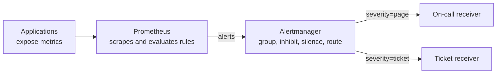

> [!info] Level: junior-middle | Time: about 4 h | You need: [[learn/observability-signals-and-dashboards|Observability 01: Signals and dashboards]] and [[learn/searching-logs|Observability 02: Searching logs]] | Lab: Lab A, the Ubuntu VM or container from [[learn/lab-setup|Start 01: Set up your lab]]

An alert is a message that asks a human to stop what they are doing. That is expensive, so the rule that creates it needs the same care as production code: it has to be correct, it has to be tested, and it has to say what to do next. This lesson builds one alert from scratch, proves it works with a unit test before it touches a real system, routes it with Alertmanager and attaches a runbook.

> [!info] What was run for this lesson
> The `promtool` and `amtool` commands, the rule file, the unit tests and the `git` commands in the exercises were run on Ubuntu 24.04.5 LTS with the distribution packages: `promtool` 2.45.3+ds and `amtool` 0.26.0+ds (Ubuntu package `prometheus` and `prometheus-alertmanager`). The terminal output you see for them is real output from that run, apart from the lines marked illustrative. Newer upstream releases may word messages differently. The Kubernetes parts (the `PrometheusRule` object, the kube-prometheus-stack chart) were **not** run and are marked where they appear.

## What you will learn

- How Prometheus evaluates an alerting rule, and what `pending`, `firing` and `resolved` mean.
- Why you alert on symptoms that users feel and not on causes such as "CPU is above 80%".
- How to write the error-ratio query (one sum divided by another sum), and how to choose the `for:` duration.
- How labels decide where an alert goes and annotations tell the human what to do.
- How Alertmanager groups, routes, inhibits and silences alerts, and how to test the routing tree with `amtool`.
- How to check a rule file with `promtool check rules`, unit-test it with `promtool test rules`, and run both in CI.
- How to roll an alert out safely: first as a ticket, then as a page.

## How an alert works

Two programs are involved, and they do different jobs.

- **Prometheus** evaluates alerting rules. Every `evaluation_interval` (often 1 minute) it runs the rule's PromQL expression. If the expression returns any series, each returned series becomes an alert. Prometheus decides **whether something is wrong**.
- **Alertmanager** receives the alerts Prometheus sends. It removes duplicates, groups related alerts into one message, applies silences, and routes each group to a receiver such as a paging service, a chat channel or a ticket system. Alertmanager decides **who hears about it and how**.



### The states of an alert

For every series the rule returns, Prometheus tracks the alert through these states.

| State      | Meaning                                                                                                              |
| ---------- | -------------------------------------------------------------------------------------------------------------------- |
| `inactive` | The expression returns nothing for this series. Nothing is happening.                                                |
| `pending`  | The expression is true, but it has not been true for the whole `for:` duration yet. No notification is sent.         |
| `firing`   | The expression has been true for at least `for:`. Prometheus sends the alert to Alertmanager on every evaluation.    |
| `resolved` | The expression stopped being true. Prometheus stops sending it, and Alertmanager marks it resolved and tells people. |

`resolved` is strictly a notion in Alertmanager (Prometheus itself only has inactive, pending and firing), but you will see all four words in dashboards and messages, and the lifecycle above is the one to remember. You can watch the states on a running Prometheus on its **Alerts** page, or query the built-in `ALERTS` series, for example `ALERTS{alertstate="pending"}`.

The `for:` clause is a **debounce**. A single bad minute then does not wake anyone; the problem has to persist. The price is delay: an alert with `for: 10m` fires at least ten minutes after the problem begins to be visible to the rule.

## Alert on symptoms, not causes

A **symptom** is what a user or a calling system experiences: errors, slowness, missing data. A **cause** is something inside your system that might produce a symptom: high CPU, a full queue, a restarted Pod.

Page a human for symptoms. A rule such as "CPU above 80% for 5 minutes" is a classic bad alert, for three reasons.

1. High CPU is often fine. A batch job, a cache warm-up or a well-sized service running hot does no harm, so the alert fires when nothing is wrong.
2. It is not enough. A service can fail completely with low CPU (a deadlock, a bad config, a dead dependency), and the CPU alert stays silent.
3. It does not tell the responder what users feel, so they cannot judge how urgent it is.

The Prometheus project's own alerting guidance says the same: keep alerting simple, alert on symptoms, and use causes to **debug** after you are already looking. Cause-level signals belong on a dashboard (see [[learn/observability-signals-and-dashboards|Observability 01]]) or in a low-urgency ticket alert, not in someone's pager.

A good first symptom alert is the **error ratio** of a user-facing API: the share of requests that fail. The same idea scales up to alerts built on service level objectives; read [[patterns/slo-burn-rate-alerting]] when you are ready for that.

## The query: a ratio of two sums

Assume your service exposes a counter `http_requests_total` with labels `service` and `status` (the HTTP status code). A counter only goes up, so you never alert on its raw value. You alert on its **rate**.

```promql
sum by (service) (rate(http_requests_total{service="payments", status=~"5.."}[5m]))
/
sum by (service) (rate(http_requests_total{service="payments"}[5m]))
> 0.05
```

Read it from the inside out.

- `http_requests_total{status=~"5.."}` selects the counters whose status matches the regular expression `5..`: any code from 500 to 599.
- `rate(...[5m])` turns each counter into "requests per second, averaged over the last 5 minutes". A counter that resets to zero (a restart) is handled by `rate`.
- `sum by (service) (...)` adds the per-Pod series together, keeping the `service` label. The top line is "errors per second", the bottom line is "all requests per second".
- Dividing one by the other gives the error ratio, a number from 0 to 1. Because both sides keep exactly the `service` label, they match one-to-one.
- `> 0.05` is a filter: the expression returns a series only while the ratio is above 5%. That is why an alert fires when the expression returns something.

> [!warning] Check before relying on this
> If a service gets no traffic at all, both sums are 0 or missing, the division gives `NaN` or no series, and the comparison is false. This rule therefore **cannot** tell you that traffic dropped to zero, which is itself a symptom (a dead load balancer, a broken DNS record). Cover that case with a separate alert or an external probe. Also, 5% and the 5-minute window are example numbers for a lab; choose yours from your SLO and traffic.

### Choosing the `for:` duration

| `for:` | Effect                                                                                | When it fits                                                   |
| ------ | ------------------------------------------------------------------------------------- | -------------------------------------------------------------- |
| `5m`   | Fast. Fewer false negatives, more flapping on short blips.                            | Very high traffic where a 5-minute error spike is already bad. |
| `10m`  | A common balance. A real outage is caught in about ten minutes.                       | A first page-level alert on an API.                            |
| `15m`  | Slow. Few false pages, but users are affected for a quarter of an hour before a page. | Noisy signals, or ticket-level alerts.                         |

There is no universal answer. Start long, watch the alert for a week, and shorten it when you are sure it is quiet. Remember that the real delay is the rate window **plus** `for:` plus the evaluation interval.

## Labels and annotations

An alert carries two kinds of metadata. They look alike and do different jobs.

- **Labels** identify the alert and drive routing. Alertmanager matches on them. Two alerts with the same label set are the same alert. Keep a small, stable set: `severity` (`page` or `ticket`), `team` (who owns it) and the `service` that comes from the query.
- **Annotations** are free text for humans. They can use templates, and they do not affect routing. Good ones are `summary` (one line), `description` (the numbers), `runbook_url` (what to do) and `dashboard` (where to look).

Annotations can use the alert's labels and value. `{{ $labels.service }}` inserts a label, `{{ $value }}` the query result, and `humanizePercentage` formats a ratio such as 0.1 as `10%`.

> [!note] Never put a changing value in a label
> A label value that changes every evaluation (such as `$value`) creates a new alert every time and breaks grouping. Put numbers in annotations only.

## The complete rule

```yaml title="rules.yml"
groups:
  - name: payments-api
    rules:
      - alert: ApiHighErrorRatio
        expr: |
          sum by (service) (rate(http_requests_total{service="payments", status=~"5.."}[5m]))
          /
          sum by (service) (rate(http_requests_total{service="payments"}[5m]))
          > 0.05
        for: 10m
        labels:
          severity: page # change to "ticket" for the first week; see the rollout section
          team: payments # change to the team that owns this service
        annotations:
          summary: "High 5xx ratio on {{ $labels.service }}"
          description: "{{ $labels.service }} has returned {{ $value | humanizePercentage }} 5xx responses over the last 5 minutes (threshold 5%)."
          runbook_url: "https://wiki.example.com/runbooks/api-high-error-ratio" # change to your real runbook
          dashboard: "https://grafana.example.com/d/payments-api/payments-api" # change to your real dashboard
```

The values to change are marked in the comments. `example.com` is a reserved documentation domain, so these links go nowhere on purpose: replace them before you use the rule.

## Alertmanager: routing, grouping, inhibition and silences

Alertmanager's configuration has three parts that matter on day one.

**The routing tree.** Every alert enters at the root route and is matched against child routes in order. The first child that matches wins (unless it sets `continue: true`). An alert that matches no child goes to the root's receiver, so always make the root a safe default.

**Grouping.** `group_by` lists the labels that define a group. Alerts that share those labels are sent as one notification. If twenty Pods of one service alert at the same time, you get one message, not twenty. Timers shape it: `group_wait` (how long to wait for more alerts before the first message), `group_interval` (how long before notifying about new alerts in an existing group) and `repeat_interval` (how long before re-sending an unchanged, still-firing group).

**Inhibition.** An inhibit rule mutes a target alert while a source alert is firing, when they share the listed labels. The standard use: while the page-level alert for a service is firing, mute that service's ticket-level alert of the same name, so the human gets one message.

**Silences.** A silence is a temporary mute created at runtime (in the Alertmanager web page or with `amtool`), matching alerts by label. A silence always has an **expiry** and should have a comment with the reason and your name. An indefinite mute is how real problems get buried.

```yaml title="alertmanager.yml"
global:
  resolve_timeout: 5m

route:
  receiver: team-ticket # the safe default for anything that does not match below
  group_by: [alertname, service]
  group_wait: 30s
  group_interval: 5m
  repeat_interval: 4h
  routes:
    - matchers:
        - severity = "page"
      receiver: oncall-page
    - matchers:
        - severity = "ticket"
      receiver: team-ticket

inhibit_rules:
  - source_matchers:
      - severity = "page"
    target_matchers:
      - severity = "ticket"
    equal: [alertname, service]

receivers:
  - name: oncall-page
    webhook_configs:
      - url: "https://alerts.example.com/hooks/oncall-page" # change to your paging integration
  - name: team-ticket
    webhook_configs:
      - url: "https://alerts.example.com/hooks/team-ticket" # change to your ticket integration
```

> [!warning] Check before relying on this
> The `matchers:` list syntax needs a reasonably recent Alertmanager (the tested version was 0.26.0). Older configs use `match:` and `match_re:`, which newer releases deprecate (verify for your version). A real receiver URL usually contains a secret token: do not commit it. Alertmanager can read it from a file (the `url_file` field, verify for your version) that comes from a secret store, as in [[patterns/external-secrets-with-secret-manager]].

## Testing rules before they run

A rule that is wrong in production fails in the worst way: silently, until the night it should have fired. Two `promtool` commands catch most mistakes before that.

- `promtool check rules FILE` parses the file: YAML structure, PromQL syntax and annotation templates. It does **not** check that the rule does the right thing.
- `promtool test rules TESTFILE` runs your rules against synthetic time series that you write, at times you choose, and compares the alerts that result with the ones you expect. This is a real test of the logic.

A test file has `input_series` (the fake data) and `alert_rule_test` entries (`eval_time`, the alert name and the alerts expected at that time). Series values use a compact syntax: `0+6x30` means "start at 0, add 6, repeat for 30 steps", which gives 31 samples (0, 6, 12, ... 180). With `interval: 1m`, a series that rises by 6 each minute is a counter growing at 6 per minute.

`exp_alerts` lists the alerts that must be **firing** at that time; pending alerts are not included. If you expect an alert, you must list its `exp_labels` and its `exp_annotations`, and `promtool` compares both exactly. If you expect none, write `exp_alerts: []`.

### Where rules live in Kubernetes

On a cluster that runs the Prometheus Operator (for example through the kube-prometheus-stack Helm chart), the same rules go into a `PrometheusRule` object, kept in Git and applied by your GitOps tool (see [[adr/0001-gitops-with-argocd]]):

```yaml title="payments-rules.yaml"
apiVersion: monitoring.coreos.com/v1
kind: PrometheusRule
metadata:
  name: payments-api
  namespace: monitoring
  labels:
    release: kube-prometheus-stack # change to the label your Prometheus selects rules by
spec:
  groups:
    - name: payments-api
      rules:
        - alert: ApiHighErrorRatio
          expr: |
            sum by (service) (rate(http_requests_total{service="payments", status=~"5.."}[5m]))
            /
            sum by (service) (rate(http_requests_total{service="payments"}[5m]))
            > 0.05
          for: 10m
          labels:
            severity: page
            team: payments
          annotations:
            summary: "High 5xx ratio on {{ $labels.service }}"
            description: "{{ $labels.service }} has returned {{ $value | humanizePercentage }} 5xx responses over the last 5 minutes (threshold 5%)."
            runbook_url: "https://wiki.example.com/runbooks/api-high-error-ratio"
            dashboard: "https://grafana.example.com/d/payments-api/payments-api"
```

> [!warning] Check before relying on this
> The `PrometheusRule` fields and, above all, the label that your Prometheus uses to select rules (here `release: kube-prometheus-stack`) depend on the chart version and its values (`ruleSelector`, `ruleSelectorNilUsesHelmValues`). This example was **not** applied to a cluster. Check the CRD and your chart's values before relying on it. The group content is the same as `rules.yml`, so the `promtool` tests apply: keep the rule text in one place and render it into both, or test the file that you ship. Managed offerings (Google Cloud Managed Service for Prometheus) use their own rule resources; see [[tools/prometheus-vs-cloud-monitoring]].

## Rolling out a new alert

New alerts are wrong more often than you expect. Ship them in this order.

1. **Write the test first.** Unit-test the rule (below) so you know what it is supposed to do.
2. **Ship it as a ticket.** Set `severity: ticket` so nobody is woken. Watch it for about a week of normal traffic.
3. **Read what it did.** Did it fire when nothing was wrong (too noisy: lengthen `for:` or raise the threshold)? Was there an incident it missed (too quiet)? Did the description give the responder what they needed?
4. **Promote it.** Change `severity` to `page`, in a pull request, with the test still passing.
5. **Review it again** after the first real page. Fix the runbook while the memory is fresh.

An alert that pages must be **actionable** (a human can do something now), **urgent** (it cannot wait until morning) and **real** (it fires for real problems). If an alert fails any of the three, make it a ticket or delete it. The cost of getting this wrong is described in [[management/on-call-health]].

## Anti-patterns

- **Alerting on causes** (CPU, memory, a Pod restart) instead of symptoms. See above.
- **Alerts with no runbook.** At 3 a.m. the responder should not have to guess what the alert means.
- **Too many alerts.** If people ignore the pager because most pages are noise, the one real page is ignored too (alert fatigue).
- **No `for:`, or a very short one**, so every blip pages.
- **Thresholds copied from the internet.** 5% fits some services and is absurd for others.
- **Never-ending silences.** A silence with no expiry or reason hides problems for months.
- **One alert for every possible failure.** Start with the few symptoms that matter (errors, latency, saturation of the thing users depend on, and being down), and add more only after an incident shows a gap.
- **Alerts that nobody owns.** Every alert needs a `team` label that maps to a real team.

## Hands-on exercises

> [!tip] Install the tools (Lab A)
> On Ubuntu: `sudo apt-get update && sudo apt-get install -y prometheus prometheus-alertmanager`. This installs `promtool` and `amtool`, but the distribution may ship an older version than the current upstream release. If you would rather have the latest, download the release archive from <https://prometheus.io/download/> and check its checksum. The package also starts a Prometheus and an Alertmanager service you do not need for these exercises: `sudo systemctl disable --now prometheus prometheus-alertmanager` stops them.

1. **Create the lab folder and the rule file.**

   ```bash
   mkdir -p ~/alert-lab && cd ~/alert-lab
   promtool --version | head -1
   amtool --version | head -1
   ```

   Expected (illustrative; your versions may differ):

   ```text
   promtool, version 2.45.3+ds (branch: debian/sid, revision: 2.45.3+ds-2ubuntu0.3)
   amtool, version 0.26.0+ds (branch: debian/sid, revision: 0.26.0+ds-1ubuntu0.3)
   ```

   If you see something else: `command not found` means the packages are not installed; run the install command in the callout above.

2. **Write `ApiHighErrorRatio` and check it.** Save the rule from "The complete rule" as `rules.yml` in `~/alert-lab`, then run:

   ```bash
   promtool check rules rules.yml
   ```

   Expected:

   ```text
   Checking rules.yml
     SUCCESS: 1 rules found
   ```

   If you see something else: a message such as `could not parse expression` points at a PromQL syntax error, with a line and column. Fix the line it names. A YAML error means the indentation is wrong; use spaces, never tabs. To see what a failure looks like, write a broken copy and check it:

   ```bash
   printf 'groups:\n  - name: x\n    rules:\n      - alert: A\n        expr: up ==\n        for: 5m\n' > broken.yml
   promtool check rules broken.yml; echo "exit code: $?"
   ```

   ```text
   Checking broken.yml
     FAILED:
   broken.yml: 5:15: group "x", rule 1, "A": could not parse expression: 1:6: parse error: unexpected end of input

   exit code: 1
   ```

   The non-zero exit code is what makes this useful in CI. Delete `broken.yml` afterwards.

3. **Write a unit test that expects the alert to fire.** The test feeds a steady 10% error ratio (6 errors and 54 successes every minute) for 30 minutes. With `for: 10m` the alert must be **firing** at `eval_time: 15m`, so the test must list it, with its labels and its rendered annotations. A test that expects `exp_alerts: []` at 15 minutes would be wrong, and `promtool` would say so. Save as `rules_test.yml`:

   ```yaml title="rules_test.yml"
   rule_files:
     - rules.yml

   evaluation_interval: 1m

   tests:
     - interval: 1m
       input_series:
         # 6 errors and 54 successes per minute: a steady 10% error ratio.
         - series: 'http_requests_total{service="payments", status="500"}'
           values: "0+6x30"
         - series: 'http_requests_total{service="payments", status="200"}'
           values: "0+54x30"
       alert_rule_test:
         - eval_time: 5m # the ratio is above 5%, but the 10 minute "for" is not served yet
           alertname: ApiHighErrorRatio
           exp_alerts: []
         - eval_time: 15m
           alertname: ApiHighErrorRatio
           exp_alerts:
             - exp_labels:
                 severity: page
                 team: payments
                 service: payments
               exp_annotations:
                 summary: "High 5xx ratio on payments"
                 description: "payments has returned 10% 5xx responses over the last 5 minutes (threshold 5%)."
                 runbook_url: "https://wiki.example.com/runbooks/api-high-error-ratio"
                 dashboard: "https://grafana.example.com/d/payments-api/payments-api"
   ```

   Run it:

   ```bash
   promtool test rules rules_test.yml
   ```

   Expected:

   ```text
   Unit Testing:  rules_test.yml
     SUCCESS
   ```

   If you see something else: a `FAILED` block prints `exp:` (what you wrote) and `got:` (what the rule produced) side by side. Compare the labels and annotations character by character. Note that `service: payments` is in `exp_labels` because `sum by (service)` keeps that label, while `alertname` is added for you. To see the comparison of annotations in action, change one word in the `description` of the test and run it again. You will get output like this (shortened), and the diff is the only difference between `exp` and `got`:

   ```text
   Unit Testing:  bad_test.yml
     FAILED:
       alertname: ApiHighErrorRatio, time: 15m,
           exp:[
               0:
                 Labels:{alertname="ApiHighErrorRatio", service="payments", severity="page", team="payments"}
                 Annotations:{dashboard="...", description="wrong", runbook_url="...", summary="High 5xx ratio on payments"}
               ],
           got:[
               0:
                 Labels:{alertname="ApiHighErrorRatio", service="payments", severity="page", team="payments"}
                 Annotations:{dashboard="...", description="payments has returned 10% 5xx responses over the last 5 minutes (threshold 5%).", runbook_url="...", summary="High 5xx ratio on payments"}
               ]
   ```

   Put the test back before the next step.

4. **Add a second test: no alert at 2%.** A test that only proves the alert fires cannot catch a rule that fires on everything. Add a second entry under `tests:` (a new `- interval: 1m` block) that feeds 1 error and 49 successes per minute, which is 2%. The command below appends it to the file and indents it by two spaces, so that it lines up with the first entry:

   ```bash
   sed 's/^/  /' >> rules_test.yml <<'EOF'
   - interval: 1m
     input_series:
       # 1 error and 49 successes per minute: a steady 2% error ratio.
       - series: 'http_requests_total{service="payments", status="500"}'
         values: "0+1x30"
       - series: 'http_requests_total{service="payments", status="200"}'
         values: "0+49x30"
     alert_rule_test:
       - eval_time: 15m
         alertname: ApiHighErrorRatio
         exp_alerts: []
   EOF
   ```

   Run the tests again:

   ```bash
   promtool test rules rules_test.yml
   ```

   Expected:

   ```text
   Unit Testing:  rules_test.yml
     SUCCESS
   ```

   If you see something else: if the second test fails with `got:` showing an alert, your threshold or division is wrong (for example you wrote `> 0.01`). Check the 2% case by hand: 1 / (1 + 49) = 0.02, below 0.05.

5. **Find the exact moment it fires.** The first sample of the rate window exists after one minute, so the ratio is above the threshold from about minute 1. The alert is pending for the `for:` duration of 10 minutes, so it should fire at minute 11. Check it with a temporary copy of the test (here `eval_time: 11m` expecting no alerts, which you should see fail):

   ```bash
   sed 's/eval_time: 5m.*/eval_time: 11m/' rules_test.yml > t11.yml
   promtool test rules t11.yml; echo "exit code: $?"
   ```

   Expected: a `FAILED` block whose `exp:[]` is empty and whose `got:` lists `ApiHighErrorRatio`. The same copy with `10m` passes. That is the `for:` delay, measured. Remove `t11.yml` afterwards.
   If you see something else: if it passes at 11m, the first sample window differs; try 10m and 12m to bracket it, then explain the difference to yourself in terms of the rate window and the evaluation interval.

6. **Test the routing tree with `amtool`.** Save the Alertmanager configuration from above as `alertmanager.yml`. Check it, show the tree and ask which receiver gets a given set of labels:

   ```bash
   amtool check-config alertmanager.yml
   amtool config routes show --config.file=alertmanager.yml
   amtool config routes test --config.file=alertmanager.yml severity=page team=payments
   amtool config routes test --config.file=alertmanager.yml severity=ticket
   amtool config routes test --config.file=alertmanager.yml severity=info
   ```

   Expected (the `Warning: --config.file flag overrides the --alertmanager.url.` line is printed to the terminal by this version of `amtool` before each routing command and is harmless; it is shown once here):

   ```text
   Checking 'alertmanager.yml'  SUCCESS
   Found:
    - global config
    - route
    - 1 inhibit rules
    - 2 receivers
    - 0 templates

   Routing tree:
   .
   └── default-route  receiver: team-ticket
       ├── {severity="page"}  receiver: oncall-page
       └── {severity="ticket"}  receiver: team-ticket

   oncall-page
   team-ticket
   team-ticket
   ```

   The last line shows the safe default at work: an alert with `severity=info` matches no child route and falls to the root receiver. To make the check fail a script when the answer is wrong, name the expected receiver:

   ```bash
   amtool config routes test --config.file=alertmanager.yml --verify.receivers=oncall-page severity=page team=payments; echo "exit code: $?"
   amtool config routes test --config.file=alertmanager.yml --verify.receivers=oncall-page severity=ticket; echo "exit code: $?"
   ```

   ```text
   oncall-page
   exit code: 0
   team-ticket
   WARNING: Expected receivers did not match resolved receivers.
   exit code: 1
   ```

   If you see something else: if the page alert goes to `team-ticket`, check the quoting in `matchers` (`severity = "page"` with straight double quotes) and the order of the routes.

7. **Run the checks in CI.** The same three commands go into the pipeline of the repository that holds the rules, so a broken rule cannot be merged. This is a GitLab CI job; the image tag is an example and must be set to a Prometheus release you have checked.

   ```yaml title=".gitlab-ci.yml"
   alert-rules:
     stage: test
     image:
       name: prom/prometheus:v2.45.3 # example tag, not verified: pin a release you have checked
       entrypoint: [""]
     script:
       - promtool check rules rules.yml
       - promtool test rules rules_test.yml
   ```

   Expected: the job succeeds and its log ends with the same `SUCCESS` lines you saw in your lab. Break the rule on a branch and the job must fail. The `amtool` check for the routing config is added the same way with an image that contains `amtool`.
   If you see something else: a failure with `exec: "sh": executable file not found` means the image has no shell; use an image that has one or install `promtool` in a job image you build. Whether your CI uses GitLab CI or Jenkins, the idea is the same: run the tests on every change (see [[learn/first-pipeline-gitlab-ci-and-jenkins|Delivery 02]]).

8. **Write a five-line runbook stub.** A runbook the alert links to should be short enough to read while half asleep. Create `runbook-api-high-error-ratio.md`:

   ```markdown
   # ApiHighErrorRatio

   1. Impact: some share of payments API calls return 5xx. Check the dashboard linked in the alert.
   2. Check the last deploy and change in the deploy history. If it is recent, roll it back.
   3. Check the dependencies (database, queue) and the Pod status: `kubectl get pods -n payments`.
   4. Mitigate first (rollback, scale out, disable the feature), find the cause afterwards.
   5. Escalate to the payments team lead after 15 minutes without progress, or at once if data may be lost.
   ```

   Expected: the file exists and each line is an action, not an explanation. Ask a colleague who did not write it whether they could follow it.
   If you see something else: a runbook that starts with theory is a design document. Move the theory out and keep only what to check, what to do and when to escalate. The longer pattern is in [[runbooks/incident-response]].

9. **Clean up.**

   ```bash
   rm -rf ~/alert-lab
   ```

   Expected: the folder is gone and no service is running (`systemctl is-active prometheus` prints `inactive` if you disabled it).
   If you see something else: if the service is still `active`, run the `systemctl disable --now` command from the install callout.

## Common mistakes

- **Alerting on a raw counter.** Why it bites: a counter only grows, so a threshold on it fires forever, or never. Fix: always wrap counters in `rate()` or `increase()`.
- **Dividing sums that do not match.** Why it bites: if the two sides have different labels, the division returns nothing and the alert silently never fires. Fix: aggregate both sides with the same `by (...)` and test with real label sets in a unit test.
- **A test that expects `[]` where the alert should fire.** Why it bites: with a steady 10% ratio for 15 minutes the alert is firing, so an empty list fails, and "fixing" the rule to match a wrong test removes the alert. Fix: write down by hand what should happen before you run the test, and list `exp_labels` and `exp_annotations` in full.
- **Forgetting the annotations in `exp_alerts`.** Why it bites: `promtool` compares annotations too, so a test that lists only labels fails. Fix: copy the rendered annotation text into the test.
- **Putting a value in a label.** Why it bites: every evaluation creates a new alert, so grouping, inhibition and silences stop working. Fix: put numbers in annotations.
- **Paging first, learning later.** Why it bites: a noisy new page costs sleep and trust. Fix: ship as a ticket, watch a week, then promote.
- **No expiry on a silence.** Why it bites: the problem is hidden long after it is fixed or when it comes back. Fix: always set an end time and a reason.
- **A `runbook_url` that is a 404.** Why it bites: the responder loses minutes at the worst time. Fix: check links in review, and keep the runbook next to the code if you can.

## Check your understanding

1. What does the `for:` clause protect against, and what does it cost?
2. Why should an alert carry a `runbook_url`?
3. Why ship a new alert as a ticket before it pages?
4. Why is "CPU above 80%" a poor paging alert, and what would you alert on instead?
5. In the unit test, why must the 10% test list the alert at `eval_time: 15m` and not `[]`, and what proves the rule does not fire on a healthy service?
6. What is the difference between a label and an annotation, and which one does Alertmanager route on?

> [!question]- Answers
>
> 1. It protects against short blips: the condition must hold for the whole duration before the alert fires, so a single bad minute does not wake anyone. The cost is delay: the alert cannot fire sooner than `for:` after the condition starts, and the rate window adds to that.
> 2. Because the person who receives the page may be new, tired or not the author. The runbook tells them what the alert means, what to check first and when to escalate, so the first minutes are not spent guessing.
> 3. New alerts are often wrong: too noisy, too quiet or missing information. A ticket costs nobody sleep, so you can watch it for about a week, fix the threshold and the text, and promote it to a page when it has proved itself.
> 4. High CPU is often harmless and says nothing about user impact, while a real failure can happen with low CPU. Alert on a symptom such as the error ratio or the latency that users see, and keep CPU on a dashboard for debugging.
> 5. With a steady 10% error ratio and `for: 10m`, the alert has been pending since about minute 1 and is firing from minute 11, so it is firing at minute 15. A test that expects `[]` there is wrong. The second test, at 2% (below the 5% threshold), expecting `[]`, proves the rule stays quiet when the service is healthy.
> 6. Labels identify the alert and are used for matching, grouping and routing. Annotations are text for humans (summary, description, links) and do not affect routing. Alertmanager routes on labels.

## Next steps

Next lesson: [[learn/troubleshooting-method|Incidents 01: A troubleshooting method]]. Previous lesson: [[learn/searching-logs|Observability 02: Searching logs]].

To go deeper:

- [[patterns/slo-burn-rate-alerting]] for alerts that follow your reliability target instead of a fixed threshold.
- [[management/on-call-health]] for what too many alerts do to the people carrying the pager.
- [[tools/prometheus-vs-cloud-monitoring]] for the choice between running Prometheus and using the managed Google Cloud service.
- [[runbooks/incident-response]] for what happens after the page arrives.
- AI assistants can explain a PromQL expression or suggest test cases. Treat the answers as drafts, run `promtool` on them, and never paste secrets or real internal configuration into a tool your organisation has not approved. The owner's AI skills catalogue is at [ai.szolotov.com](https://ai.szolotov.com).
- The whole path is mapped in [[learn/index|the learning path]].

Related: [ai.szolotov.com](https://ai.szolotov.com) (AI skills catalogue).

## Sources

- Prometheus documentation, "Alerting rules" (https://prometheus.io/docs/prometheus/latest/configuration/alerting_rules/) and "Unit testing for rules" (https://prometheus.io/docs/prometheus/latest/configuration/unit_testing_rules/).
- Prometheus documentation, "Alerting" best practices (https://prometheus.io/docs/practices/alerting/).
- Alertmanager documentation, "Configuration" (https://prometheus.io/docs/alerting/latest/configuration/) and the `amtool` README in the Alertmanager repository (https://github.com/prometheus/alertmanager).
- Google SRE Workbook, "Alerting on SLOs" (https://sre.google/workbook/alerting-on-slos/).
- Prometheus Operator documentation for the `PrometheusRule` resource (https://prometheus-operator.dev/) and the kube-prometheus-stack chart (https://github.com/prometheus-community/helm-charts).
- Run for this page: `promtool` 2.45.3+ds and `amtool` 0.26.0+ds on Ubuntu 24.04.5 LTS (distribution packages); the rule, both unit tests, the routing tests and the broken-file check gave the output shown.
- Not verified: the `PrometheusRule` fields and rule selector label for your chart version, the Alertmanager `url_file` field and the deprecation of `match:`/`match_re:` in your version, the upstream `prom/prometheus` image tag and its shell, behaviour of managed Prometheus rule resources, and the newest `promtool` wording.
