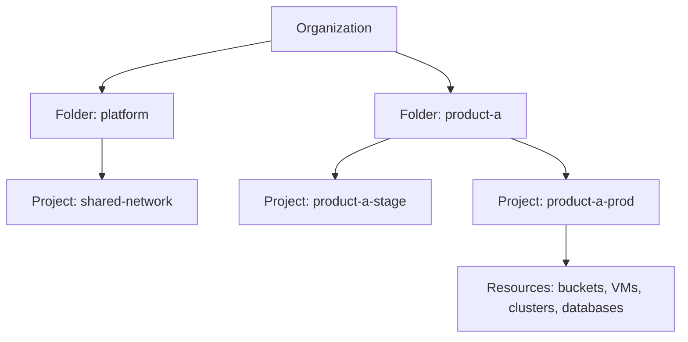

> [!info] Level: junior | Time: about 6 h | You need: [[learn/lab-setup|Start 01: Set up your lab]] (the GCP sandbox project, a billing account and the `gcloud` CLI) and [[learn/safe-bash-scripts|Scripting 02: Safe Bash: strict mode, traps and ShellCheck]] | Lab: Lab C, the GCP sandbox project from [[learn/lab-setup|Start 01: Set up your lab]]

Everything you build on Google Cloud lives inside a **project**, is reached through an **API**, is paid for through a **billing account**, and in practice is driven from the command line with **`gcloud`**. If you know those four things well, the rest of the platform is a long list of services that all work the same way.

This lesson teaches that frame. You will see how resources are organised, which settings you choose once and cannot change (a project ID, a bucket location), how `gcloud` decides who you are and which project you are in, and how to avoid the two classic beginner disasters: running a command against the wrong project, and finding a bill for something you forgot. The first real resource you create is a Cloud Storage bucket, locked down the way a production bucket should be.

> [!warning] Costs money
> This lesson creates a Cloud Storage bucket and a billing budget. A tiny bucket costs very little, but it is not free to leave around, and other lessons in this stage start things that are expensive. Every step that creates something prints its cleanup command next to it, and the last exercise removes everything. Prices change and differ by region, so this page quotes none: use the pricing pages in the sources and the cost reports in your own project.

## What you will learn

- How Google Cloud organises resources (organization, folders, projects), and the difference between a project's name, ID and number.
- What regions, zones and multi-regions are, and how to choose a location for latency, data residency and price.
- How `gcloud` handles identity (`auth login`, application-default credentials, service accounts), named configurations, output formatting and safe scripting.
- How to create a Cloud Storage bucket with uniform bucket-level access, public access prevention, versioning and a lifecycle rule, and how storage classes bill.
- How billing works: the billing account, cost reports, budgets (they alert, they do not cap), the catalogue of common cost traps and a weekly cost habit.

## How Google Cloud is organised

Google Cloud arranges everything in a tree, called the **resource hierarchy**.



| Level            | What it is                                                                                                                              |
| ---------------- | --------------------------------------------------------------------------------------------------------------------------------------- |
| **Organization** | The root, tied to a company's Cloud Identity or Google Workspace domain. Policies set here apply to everything below.                   |
| **Folder**       | An optional grouping of projects and other folders, used for teams or environments.                                                     |
| **Project**      | The basic unit: every resource belongs to exactly one project. A project has its own IAM policy, enabled APIs, quotas and billing link. |
| **Resource**     | A bucket, VM, cluster, database, and so on.                                                                                             |

Two rules make the tree useful. IAM policies and organization policies are **inherited downwards**: a permission granted on a folder applies to every project under it. And the project is the **blast-radius boundary**: if you put the lab in its own project, nothing you do there can break anything else, and you can delete it all in one command.

> [!note] Your lab project may have no parent
> An organization exists only if the account belongs to a Cloud Identity or Workspace domain. A project created from a personal Google account usually has no organization and no folder; it is a standalone project. Everything in this lesson works the same way, but the folder and organization features (and the policies in [[architecture/gcp-resource-hierarchy-and-landing-zone]]) need a real organization.

### Name, ID and number

A project has three identifiers, and mixing them up causes errors every week.

| Identifier         | Example (illustrative) | Rules                                                                                                                                                                                                                 |
| ------------------ | ---------------------- | --------------------------------------------------------------------------------------------------------------------------------------------------------------------------------------------------------------------- |
| **Name**           | `learning lab`         | A human label. Can be changed. Not unique.                                                                                                                                                                            |
| **Project ID**     | `lab-yourname-123456`  | Globally unique across all of Google Cloud. 6 to 30 characters: lowercase letters, digits and hyphens, starting with a letter. **Set once, cannot be changed.** Used in `--project` flags and in most resource names. |
| **Project number** | `123456789012`         | A number Google assigns. Unique and permanent. Appears in service account emails and in some policy and billing fields.                                                                                               |

Rule of thumb: people read the **name**, commands take the **ID**, and some systems (budgets, service agents) want the **number**. You can get one from the other with `gcloud projects describe`.

### APIs and quotas

Each Google Cloud service is an API that you **enable** per project. Compute Engine, Cloud Storage, GKE and Cloud SQL each have an API (`compute.googleapis.com`, `storage.googleapis.com`, and so on). Enabling an API is free; what you create with it is billed. If a command fails with `API [...] not enabled on project`, enable it:

```bash
gcloud services list --enabled --project="$PROJECT_ID"
gcloud services enable compute.googleapis.com --project="$PROJECT_ID"
```

**Quotas** are per-project limits on how much of a service you can use (for example the number of CPUs in a region, or how many requests per minute). They protect you from runaway usage and Google from abuse. A new project has low quotas. When a create command fails with `Quota ... exceeded`, you can request an increase in the console under IAM & Admin, Quotas. Treat a quota as a safety net you do not remove casually.

## Regions, zones and choosing a location

Google Cloud runs in physical locations.

| Term             | Meaning                                                                                                                                            | Example (illustrative)   |
| ---------------- | -------------------------------------------------------------------------------------------------------------------------------------------------- | ------------------------ |
| **Region**       | A geographic area with several data centres close together.                                                                                        | `europe-west1`           |
| **Zone**         | An isolated location inside a region. Resources like VMs live in one zone. A zone is the usual unit of failure.                                    | `europe-west1-b`         |
| **Multi-region** | A large area spanning several regions, offered by some services for higher availability and lower setup effort (Cloud Storage `EU`, `US`, `ASIA`). | `EU`                     |
| **Dual-region**  | A pair of specific regions, offered by Cloud Storage.                                                                                              | (see the locations page) |

Which resources are zonal, regional or global matters: a VM and a disk are zonal, a subnet is regional, a VPC network is global. When one zone has a problem, a zonal resource in it is affected and a regional service that spans zones can continue. You will use this in [[learn/gcp-vpc-compute-and-cloud-sql|GCP 03]] and [[learn/gke-for-beginners|GCP 04]].

**How to choose a location.** Ask these questions in this order:

1. **Data residency.** Do laws, contracts or your policy say where the data must stay? If yes, this decides it. (Which rules apply is a question for your legal and compliance people, not for this lesson.)
2. **Latency.** Place things near their users and near each other. Traffic between a service and its database in different regions is slower and costs money.
3. **Price.** Prices differ by region for compute, storage and network traffic. Check the pricing page before you choose, and do not assume the cheapest region is also close.
4. **Service availability.** Not every product or machine type is offered in every region.

A location is often **permanent**: you cannot change the location of a Cloud Storage bucket or a Cloud SQL instance after creation, you have to create a new one and copy the data. Choose on purpose. For the lab, use a single region close to you (these lessons use `europe-west1` in their examples) and keep every resource in the same one.

### Labels

A **label** is a key-value pair you attach to a resource, such as `env=lab` or `owner=yourname`. Labels do not change how a resource works. They do two jobs: they let you filter lists (`--filter="labels.env=lab"`) and, most importantly, they appear in billing data, so a cost report can show spend by label. Decide a small set of labels (environment, owner, purpose, team) and apply them to everything. A resource without an owner label is the one nobody dares delete. The way teams make this a rule is in [[architecture/finops-cost-allocation-and-guardrails]].

Label keys and values are limited to lowercase letters, digits, hyphens and underscores, and there is a maximum number per resource (check the labels documentation for the current limits). Labels are not the same as Resource Manager **tags**, which are a separate feature used for access policy; do not mix them up.

## The gcloud CLI

`gcloud` is the command-line tool for Google Cloud. You installed it in [[learn/lab-setup|Start 01]]. Check it and look at its state:

```bash
gcloud version
gcloud auth list
gcloud config list
```

`gcloud init` is the guided first-time setup (it logs you in and picks a project). After that you rarely need it. If you cannot open a browser on the machine (a remote VM, for example), `gcloud auth login --no-launch-browser` prints a URL and asks for a code instead. If you prefer not to install anything, Cloud Shell in the console gives you `gcloud` already signed in, in a temporary VM.

### Three kinds of identity

This is the part that confuses everybody once. There are several separate places where credentials live.

| What you run                            | What it authenticates                                                                                                          | Where it is used                                                                                                                           |
| --------------------------------------- | ------------------------------------------------------------------------------------------------------------------------------ | ------------------------------------------------------------------------------------------------------------------------------------------ |
| `gcloud auth login`                     | **You, for the `gcloud` command itself.**                                                                                      | Every `gcloud ...` command you type.                                                                                                       |
| `gcloud auth application-default login` | **You, for programs.** It writes a file of **Application Default Credentials** (ADC) that client libraries find automatically. | Terraform's Google provider, scripts using a Google client library, other tools. On Linux and macOS the file is under `~/.config/gcloud/`. |
| A **service account**                   | **A non-human identity**, for code and automation.                                                                             | CI jobs, Pods, VMs. See [[learn/gcp-iam-and-service-accounts\|GCP 02]].                                                                    |

Logging in with one does **not** log you in with the other. The usual symptom: `gcloud` commands work, but Terraform or a Python script says it `could not find default credentials`. The fix is the second command.

How a program finds its credentials (ADC) is a fixed search order. In short: the file named by the environment variable `GOOGLE_APPLICATION_CREDENTIALS` first, then the file written by `gcloud auth application-default login`, then the identity attached to the machine it runs on (a VM, a Cloud Run service or a GKE Pod, through the metadata server). The details are in the ADC documentation linked in the sources.

> [!warning] ADC may bill and act in a different project
> Some APIs charge their quota against a "quota project". After `gcloud auth application-default login`, set it deliberately: `gcloud auth application-default set-quota-project "$PROJECT_ID"`. Otherwise a program can use a project you did not intend. Also remember that ADC from your own login has your full permissions. Never run it on a shared machine, and revoke it when you finish (`gcloud auth application-default revoke`).

Do not use downloaded service account keys on your laptop to avoid logging in. Long-lived keys are the main way Google Cloud credentials leak, and lesson 02 shows the safer ways.

### Named configurations

`gcloud` keeps its settings (account, project, default region and zone) in a **configuration**. You can have several, and one is active. This is how you keep the lab away from a work project.

The commands below use `$PROJECT_ID`, which the exercises set. Try them there, or set the variable now.

```bash
gcloud config configurations list
gcloud config configurations create scratch
gcloud config set project "$PROJECT_ID"
gcloud config set compute/region europe-west1
gcloud config configurations list
gcloud config configurations activate lab
```

Illustrative output (yours will list your own accounts and projects):

```text
NAME     IS_ACTIVE  ACCOUNT  PROJECT              COMPUTE_DEFAULT_ZONE  COMPUTE_DEFAULT_REGION
default  False
lab      False
scratch  True                lab-yourname-123456                        europe-west1
```

Notice that creating a configuration **activates it**, and `gcloud config set` changes the active one. Create the configuration first, then set values, then look at the `IS_ACTIVE` column before you run anything that changes cloud resources. Two more ways to be explicit: the `--configuration` flag on one command, and the `CLOUDSDK_ACTIVE_CONFIG_NAME` environment variable for a shell. `gcloud config get project` prints the active project.

The most expensive habit you can build is to trust the active configuration without looking. The cheapest is to look.

### Output you can use: `--format`, `--filter`, `--sort-by`

By default `gcloud` prints output for people. Every list or describe command also takes three flags that turn it into data. They work the same way on every command, so you learn them once.

| Flag                              | What it does                                                         | Example                                                                  |
| --------------------------------- | -------------------------------------------------------------------- | ------------------------------------------------------------------------ |
| `--format=json` or `yaml`         | Whole resource, in full, as JSON or YAML.                            | `--format=yaml`                                                          |
| `--format='table(a,b.c)'`         | A table of the fields you choose.                                    | `--format='table(name,is_active)'`                                       |
| `--format='value(field)'`         | Raw values, tab-separated, no headers. The one for shell variables.  | `--format='value(projectNumber)'`                                        |
| `--format='csv[no-heading](a,b)'` | Comma-separated rows.                                                | `--format='csv[no-heading](name,is_active)'`                             |
| `--filter='expr'`                 | Keep only the rows that match, evaluated by `gcloud` after the call. | `--filter='is_active=true'`, `--filter='name:la'` (`:` means "contains") |
| `--sort-by=field`                 | Sort. A leading `~` reverses.                                        | `--sort-by=~name`                                                        |
| `--limit=N`                       | At most N rows.                                                      | `--limit=5`                                                              |

You can try them right now without a project, because `gcloud config configurations list` is data too:

```bash
gcloud config configurations list --filter='is_active=true' --format='value(name)'
gcloud config configurations list --sort-by=~name --format='table(name,is_active,properties.core.project)'
gcloud config configurations list --format='csv[no-heading](name,is_active)'
```

```text
lab
NAME     IS_ACTIVE  PROJECT
scratch  True       lab-yourname-123456
lab      False
default  False
default,False
lab,False
scratch,True
```

To find the field names for a resource, print it once with `--format=yaml` or `--format=json` and read the keys. The `gcloud topic formats` and `gcloud topic filters` pages are the reference.

> [!tip] Parse data, not tables
> Never extract a value from the default table output with `awk` or `cut`: the layout changes between versions. Ask for the field you need with `--format='value(...)'`, or use `--format=json` with `jq` ([[learn/text-and-data-tools|Linux 03: Text and data tools]]).

### Scripting with gcloud safely

A script runs without you watching, so it must not guess. Apply the habits from [[learn/safe-bash-scripts|Scripting 02]] and these `gcloud` ones:

- Start with `set -euo pipefail`, so a failed command stops the script.
- **Pin the project on every command** with `--project="$PROJECT_ID"` (or set `CLOUDSDK_CORE_PROJECT` for the whole script). Never rely on whichever configuration happens to be active on the machine that runs it.
- Use `--quiet` (`-q`) so the script never waits for a prompt it cannot answer. It selects default answers, so use it only after you have read what the command will do. It is not a way to skip a confirmation on a delete you have not checked.
- Take values with `--format='value(...)'` and check them before you use them: an empty variable is a silent bug (`${VAR:?message}` stops with a message).
- Read the exit code. `gcloud` exits non-zero on an error; `set -e` does the rest. Do not pipe a command into something that hides its failure (`pipefail` helps).

A small example, read-only and safe to run:

```bash title="list-buckets.sh"
#!/usr/bin/env bash
# list-buckets.sh - print the Cloud Storage bucket names of one project, one per line.
set -euo pipefail

PROJECT_ID="${1:?usage: list-buckets.sh PROJECT_ID}"   # Change: pass your own project ID.

gcloud storage buckets list \
  --project="$PROJECT_ID" \
  --format='value(name)' \
  --quiet
```

## Your first resource: a locked-down Cloud Storage bucket

**Cloud Storage** stores objects (files with metadata) in **buckets**. It is the simplest service on the platform and a good first resource, because it makes you decide location, access and cost on purpose.

A bucket name is **globally unique** across all of Google Cloud, lowercase, 3 to 63 characters. Using your project ID as a prefix is a practical way to avoid collisions.

### Access: uniform bucket-level access and public access prevention

There used to be two parallel ways to control access to a bucket: IAM, and per-object Access Control Lists (ACLs). Two systems means two places to make a mistake. **Uniform bucket-level access** turns object ACLs off, so IAM is the only way access is decided, and you can reason about one policy. Turn it on for every new bucket.

**Public access prevention** is a second lock. When it is `enforced`, nobody can make the bucket's data public, even by granting `allUsers` a role by mistake. A bucket that is public by accident is among the most common cloud data leaks. Turn it on, and turn it off only for a bucket that exists to serve public files, with a recorded reason.

### Storage classes and minimum durations

A **storage class** sets the price per GB stored against the price of reading data. The colder the class, the cheaper to store and the more it costs to read or move.

| Class      | Meant for                                     | Minimum storage duration (verify) | Reads cost       |
| ---------- | --------------------------------------------- | --------------------------------- | ---------------- |
| `STANDARD` | Data used often, short-lived data             | None                              | No retrieval fee |
| `NEARLINE` | Data read about once a month                  | 30 days                           | A fee per GB     |
| `COLDLINE` | Data read about once a quarter                | 90 days                           | A higher fee     |
| `ARCHIVE`  | Data kept for compliance or disaster recovery | 365 days                          | The highest fee  |

The **minimum storage duration** is a billing rule, not a lock. If you delete or overwrite an object in a colder class before the minimum, you are still charged as if it had stayed for the full period. For lab files that you delete in a day, use `STANDARD`. The class of a bucket is its default for new objects, and a lifecycle rule can move objects between classes as they age.

> [!warning] Check before relying on this
> The class names and the minimum durations above may change; check "Storage classes" before relying on them. Storage classes, retrieval fees, soft-delete behaviour and the optional Autoclass feature (which moves objects between classes for you) change over time. Read "Storage classes" and the pricing page before you choose a class for real data. Without `--location`, `gcloud storage buckets create` uses Cloud Storage's default location, which is a US multi-region at the time of writing (verify), so always pass `--location`.

### Versioning, soft delete and lifecycle

- **Object versioning** keeps older versions of an object when it is overwritten or deleted, so you can recover from a mistake. Each kept version is stored, and billed, as an object. Turn it on for data you cannot recreate, and pair it with a lifecycle rule so old versions do not pile up forever.
- **Soft delete** is a separate feature: deleted objects are kept for a retention period before they are gone for good. New buckets have it on by default, and `--soft-delete-duration` sets the period (verify the default and its cost in the documentation).
- A **lifecycle rule** is an automatic action on objects by condition: delete objects older than N days, move objects to a colder class after N days, or delete old noncurrent versions. A lifecycle rule is how you stop a "temporary" bucket from becoming permanent spend.

The rule used in the exercise deletes objects after 7 days:

```json title="lifecycle.json"
{
  "rule": [
    {
      "action": { "type": "Delete" },
      "condition": { "age": 7 }
    }
  ]
}
```

On a bucket with versioning, an age-based `Delete` first turns the live object into a noncurrent version, and a later lifecycle pass removes it for good. A rule on noncurrent versions (for example by `daysSinceNoncurrentTime`; verify the field name in the lifecycle documentation) makes the cleanup explicit.

## Billing

### The billing account

You pay for resources through a **Cloud Billing account**, which is separate from projects. A project is linked to one billing account. If you unlink it, paid services in that project stop working and Google may stop or delete the resources, so do it on purpose and read the documentation first. One billing account can serve many projects, and the account has its own administrators and its own IAM. A project with no billing account can run only the free parts.

### Reading cost

The console's **Billing, Reports** page shows spend over time and can be grouped by project, service, SKU (the individual price line, such as "Standard Storage Europe") and **label**. This is where the labels you put on resources pay off. For anything beyond a glance, enable **billing export to BigQuery**, which writes line-level cost data you can query with SQL; the documentation covers the setup and the exports' delays.

Cost data is not real time: expect some delay, and treat a number from today as incomplete.

### Budgets: alerts, not caps

A **budget** watches the spend of a billing account (or of chosen projects, services or labels) and sends notifications when it crosses thresholds, for example 50% and 90% of an amount, or when the forecast says it will.

> [!warning] A budget does not stop spending
> Budgets alert. They do not cap or stop anything. A resource keeps running and billing at 100% and at 300% of the budget. If you want an automatic reaction, you must build it: a budget can publish to a Pub/Sub topic and your own automation can respond (this is a design problem with its own risks, such as shutting down the wrong thing). For a lab, the control is you: a budget alert and the cleanup rule. Alerts also arrive after the money is spent.

### The cost-trap catalogue

Most surprise bills come from the same dozen places. Learn them as a list and look for each one on a schedule. The "Find it" column is a read-only command you will run in the exercises.

| Trap                                         | Why it surprises you                                                                                                                    | Find it                                                                          | Fix                                                          |
| -------------------------------------------- | --------------------------------------------------------------------------------------------------------------------------------------- | -------------------------------------------------------------------------------- | ------------------------------------------------------------ |
| **Network egress**                           | Traffic out to the internet, and between zones and regions, is charged by volume. Storing data is cheap; moving it is not.              | The SKU view of Billing, Reports; keep chatty services in one region             | Co-locate services; cache; compress                          |
| **Load balancers and forwarding rules**      | Each forwarding rule is billed for as long as it exists, even with no traffic.                                                          | `gcloud compute forwarding-rules list`                                           | Delete the rule and its backend resources                    |
| **Cloud NAT**                                | A NAT gateway has an hourly charge and a per-GB charge for data it processes.                                                           | `gcloud compute routers list`, then the router's NAT configs                     | Remove NAT from labs                                         |
| **External IPv4 addresses**                  | Google charges for external IPv4 addresses, and the charge applies to reserved and to in-use addresses (verify the current pricing).    | `gcloud compute addresses list`                                                  | Release addresses you do not use; prefer internal addressing |
| **Idle GKE nodes**                           | A cluster's nodes are VMs that bill while they run, whether or not a Pod uses them. A cluster may also carry a management fee (verify). | `gcloud container clusters list`                                                 | Delete the cluster; scale node pools to zero where allowed   |
| **Logging ingestion**                        | Cloud Logging charges for log volume ingested beyond a free allotment (verify). Verbose debug logs from a busy service add up.          | The Logs Explorer's usage view; Billing by SKU                                   | Lower log levels; exclusion filters                          |
| **Always-on Cloud SQL, and HA**              | A database instance bills by the hour whether it is used or not, and a high-availability instance bills a standby too.                  | `gcloud sql instances list`                                                      | Stop or delete lab instances; no HA in labs                  |
| **Unattached disks and old snapshots**       | A disk keeps billing after its VM is deleted if you did not delete it. Snapshots accumulate.                                            | `gcloud compute disks list --filter='-users:*'`, `gcloud compute snapshots list` | Delete what is unneeded                                      |
| **Registry storage**                         | Container images in Artifact Registry are stored objects. Every pushed tag stays until you delete it.                                   | `gcloud artifacts repositories list`                                             | Cleanup policies that delete old images                      |
| **Buckets with versioning and no lifecycle** | Old versions are stored forever.                                                                                                        | `gcloud storage buckets describe` for each bucket                                | A lifecycle rule                                             |

Prices change, so none are quoted here: use the pricing pages and the calculator, and check your own SKU report.

### A weekly cost habit

Make a recurring 15-minute slot, once a week, while you use the cloud. The list is short:

1. Open Billing, Reports for the last 7 days, grouped by service. Anything you do not recognise is the first thing to chase.
2. Check that the budget exists and its alerts reach you.
3. Run the audit script from the exercises and delete what a lesson left behind.
4. Look for resources without an `owner` label.
5. Write one line in your lab notes: the total, and anything surprising.

A habit of looking every week catches a forgotten cluster after days, not after a month.

## Hands-on exercises

Work in the lab project, with the `lab` `gcloud` configuration from [[learn/lab-setup|Start 01]]. Set the variables once per shell session. Change the ones marked.

```bash
PROJECT_ID="lab-yourname-123456"        # Change: your lab project ID.
REGION="europe-west1"                   # A region close to you; keep it the same all through the stage.
BILLING_ACCOUNT_ID="XXXXXX-XXXXXX-XXXXXX"   # Change: from "gcloud billing accounts list".
BUCKET="${PROJECT_ID}-gcp01"            # Bucket names are global; the project ID prefix keeps it unique.
```

1. **Find out where you are.** List your projects and your configuration.

   ```bash
   gcloud projects list --format='table(projectId,name,projectNumber)'
   gcloud config list
   gcloud config configurations list
   ```

   Expected (illustrative):

   ```text
   PROJECT_ID           NAME           PROJECT_NUMBER
   lab-yourname-123456  learning lab   123456789012

   [core]
   account = you@example.com
   project = lab-yourname-123456
   Your active configuration is: [lab]

   NAME     IS_ACTIVE  ACCOUNT          PROJECT              COMPUTE_DEFAULT_ZONE  COMPUTE_DEFAULT_REGION
   default  False
   lab      True       you@example.com  lab-yourname-123456
   ```

   If you see something else: if `lab` is missing or `IS_ACTIVE` is `False`, run `gcloud config configurations create lab` (if it is missing) or `gcloud config configurations activate lab`, then `gcloud config set project "$PROJECT_ID"`. An empty `project` line means the configuration has no project set. If `gcloud projects list` is empty or fails, run `gcloud auth list` and `gcloud auth login`.

2. **Enable Compute Engine and list the zones of your region.** Enabling an API is free, and listing zones needs this one.

   ```bash
   gcloud services enable compute.googleapis.com --project="$PROJECT_ID"
   gcloud compute zones list --project="$PROJECT_ID" --filter="region:${REGION}" --format='value(name)'
   ```

   Expected (illustrative; the number of zones differs by region):

   ```text
   europe-west1-b
   europe-west1-c
   europe-west1-d
   ```

   If you see something else: an `Operation ... finished successfully` line from the first command is normal. If you get `PERMISSION_DENIED`, your account lacks permission on the project (see [[learn/gcp-iam-and-service-accounts|GCP 02]]). If the zone list is empty, check that `REGION` has no typo; `gcloud compute regions list --format='value(name)'` prints valid names. Enabling the Compute Engine API may also create a `default` network in the project, which [[learn/gcp-vpc-compute-and-cloud-sql|GCP 03]] explains and replaces (verify on your project).

3. **Label the project.** Labels travel into billing reports.

   ```bash
   gcloud beta projects update "$PROJECT_ID" --update-labels=lesson=gcp-01,env=lab
   gcloud projects describe "$PROJECT_ID" --format='yaml(labels)'
   ```

   Expected (illustrative):

   ```text
   labels:
     env: lab
     lesson: gcp-01
   ```

   If you see something else: the GA command `gcloud projects update` only changes the project name in the version checked (`gcloud projects update --help` lists `--name` as its required flag), so the label flags may live in the `beta` command group, which `gcloud` can offer to install (verify for your version). If `beta` is not available, set the label in the console under IAM & Admin, Settings, or skip this exercise: later lessons set labels with Terraform.

4. **Make the lab configuration explicit and read values.** Confirm which configuration is active and put values into shell variables the safe way.

   ```bash
   gcloud config configurations activate lab
   gcloud config configurations list --filter='is_active=true'
   ACTIVE_PROJECT="$(gcloud config get project 2>/dev/null)"
   PROJECT_NUMBER="$(gcloud projects describe "$PROJECT_ID" --format='value(projectNumber)')"
   echo "active=$ACTIVE_PROJECT number=$PROJECT_NUMBER"
   ```

   Expected (illustrative):

   ```text
   Activated [lab].
   NAME  IS_ACTIVE  ACCOUNT          PROJECT              COMPUTE_DEFAULT_ZONE  COMPUTE_DEFAULT_REGION
   lab   True       you@example.com  lab-yourname-123456
   active=lab-yourname-123456 number=123456789012
   ```

   `IS_ACTIVE` is `True` for `lab`. If `ACTIVE_PROJECT` differs from `PROJECT_ID`, stop and fix the configuration before any later step. If you see something else: an empty `active=` means no project is set; run `gcloud config set project "$PROJECT_ID"`. The project number is a 12-digit number and yours will differ.

5. **Practise `--format`, `--filter` and `--sort-by` on data you own.** Use the commands from the section above.

   ```bash
   gcloud config configurations list --filter='is_active=true' --format='value(name)'
   gcloud config configurations list --sort-by=~name --format='table(name,is_active,properties.core.project)'
   gcloud config configurations list --format='csv[no-heading](name,is_active)'
   ```

   Expected: `lab` on the first line, the table sorted in reverse name order with `lab` marked `True`, and one `name,True/False` row per configuration.
   If you see something else: if the table columns are empty, the field path is wrong for your version; run the command with `--format=yaml` and read the key names.

6. **Create the bucket, lock it down, and use it.** This is the first step that creates a paid resource.

   > [!warning] Costs money
   >
   > A small bucket stores data that is billed by size and time, plus operations. Delete it in the last exercise: `gcloud storage rm --recursive --all-versions "gs://${BUCKET}"`. Soft-deleted data can still bill during the retention period, which is why the lab bucket sets `--soft-delete-duration=0`.

   ```bash
   gcloud storage buckets create "gs://${BUCKET}" \
     --project="$PROJECT_ID" \
     --location="$REGION" \
     --default-storage-class=STANDARD \
     --uniform-bucket-level-access \
     --public-access-prevention \
     --soft-delete-duration=0 # lab only: no retention of deleted objects (verify flag)
   gcloud storage buckets update "gs://${BUCKET}" --versioning
   printf 'hello\n' > hello.txt
   gcloud storage cp hello.txt "gs://${BUCKET}/hello.txt"
   gcloud storage ls -l "gs://${BUCKET}"
   ```

   Expected (illustrative):

   ```text
   Creating gs://lab-yourname-123456-gcp01/...
   Updating gs://lab-yourname-123456-gcp01/...
     Completed 1/1
   Copying file://hello.txt to gs://lab-yourname-123456-gcp01/hello.txt
     Completed files 1/1 | 6.0B/6.0B
            6  2026-10-17T10:05:41Z  gs://lab-yourname-123456-gcp01/hello.txt
   TOTAL: 1 objects, 6 bytes (6B)
   ```

   The file `hello\n` is six bytes: five letters and a newline.
   If you see something else: `HTTPError 409: Your previous request to create the named bucket succeeded and you already own it` or `... name is not available` means the bucket name is taken (names are global); change `BUCKET` to something more unique. `403` or `AccessDeniedException` means your account lacks storage permissions on the project. If the Cloud Storage API is not enabled, run `gcloud services enable storage.googleapis.com --project="$PROJECT_ID"`.

7. **Add a lifecycle rule and read the bucket settings.** Save the `lifecycle.json` file from the section above, apply it, and describe the bucket.

   ```bash
   gcloud storage buckets update "gs://${BUCKET}" --lifecycle-file=lifecycle.json
   gcloud storage buckets describe "gs://${BUCKET}"
   ```

   Expected (illustrative; the field names and order differ between `gcloud` versions):

   ```text
   default_storage_class: STANDARD
   lifecycle_config:
     rule:
     - action:
         type: Delete
       condition:
         age: 7
   location: EUROPE-WEST1
   location_type: region
   name: lab-yourname-123456-gcp01
   public_access_prevention: enforced
   storage_url: gs://lab-yourname-123456-gcp01/
   uniform_bucket_level_access: true
   versioning_enabled: true
   ```

   Look for four things: `location` is your region, `public_access_prevention` is `enforced`, `uniform_bucket_level_access` is `true`, and the lifecycle rule shows `age: 7`.
   If you see something else: if `lifecycle_config` is missing, the rule was not applied; re-run the update and read its output for an error such as invalid JSON. If a field has a different name, trust what your version prints.

8. **Check that billing is on, and that a budget exists.**

   ```bash
   gcloud billing projects describe "$PROJECT_ID"
   gcloud billing budgets list --billing-account="$BILLING_ACCOUNT_ID"
   ```

   Expected (illustrative):

   ```text
   billingAccountName: billingAccounts/XXXXXX-XXXXXX-XXXXXX
   billingEnabled: true
   name: projects/lab-yourname-123456/billingInfo
   projectId: lab-yourname-123456
   ---
   amount:
     specifiedAmount:
       currencyCode: USD
       units: '20'
   displayName: lab-budget
   name: billingAccounts/XXXXXX-XXXXXX-XXXXXX/budgets/...
   thresholdRules:
   - thresholdPercent: 0.5
   - thresholdPercent: 0.9
   ```

   If the list is empty, you skipped the budget in [[learn/lab-setup|Start 01]]. Create one now (change the amount to one you can lose):

   ```bash
   gcloud billing budgets create \
     --billing-account="$BILLING_ACCOUNT_ID" \
     --display-name="lab-budget" \
     --budget-amount="20USD" \
     --threshold-rule=percent=0.5 \
     --threshold-rule=percent=0.9 \
     --filter-projects="projects/${PROJECT_NUMBER}"
   ```

   If you see something else: `billingEnabled: false` means the project is not linked; link it with `gcloud billing projects link "$PROJECT_ID" --billing-account="$BILLING_ACCOUNT_ID"`. A permission error on the budget commands means your account is not an administrator of the billing account. The flags were checked against `gcloud billing budgets create --help` in `gcloud` 570.0.0; the command was not run against a real billing account, so the output format is illustrative. An `API ... not enabled` (`SERVICE_DISABLED`) error means the Cloud Billing APIs are off: run `gcloud services enable cloudbilling.googleapis.com billingbudgets.googleapis.com --project="$PROJECT_ID"` (verify the API names). `PROJECT_NUMBER` comes from exercise 4 and must be set in the same shell.

9. **Audit the cost traps.** Save this read-only script as `lab-audit.sh`, run it, and read the result as a checklist. It changes nothing.

   ```bash title="lab-audit.sh"
   #!/usr/bin/env bash
   # lab-audit.sh - list the usual billable leftovers in one project. Read-only.
   set -euo pipefail

   PROJECT_ID="${1:?usage: lab-audit.sh PROJECT_ID}"   # Change: pass your own project ID.

   # Run one listing. A failure (for example a service API that is not enabled,
   # which also means nothing of that kind exists) is reported, not fatal.
   section() {
     local title="$1"
     shift
     printf '\n== %s\n' "$title"
     "$@" || printf '(skipped: the command failed or the API is not enabled)\n'
   }

   section "External addresses" \
     gcloud compute addresses list --project="$PROJECT_ID" --quiet \
       --format='table(name,region.basename(),address,status)'
   section "Forwarding rules (load balancers)" \
     gcloud compute forwarding-rules list --project="$PROJECT_ID" --quiet \
       --format='table(name,region.basename(),IPAddress,loadBalancingScheme)'
   section "Cloud Routers (NAT lives here)" \
     gcloud compute routers list --project="$PROJECT_ID" --quiet
   section "Disks not attached to a VM" \
     gcloud compute disks list --project="$PROJECT_ID" --quiet --filter='-users:*'
   section "Snapshots" \
     gcloud compute snapshots list --project="$PROJECT_ID" --quiet
   section "GKE clusters" \
     gcloud container clusters list --project="$PROJECT_ID" --quiet
   section "Cloud SQL instances" \
     gcloud sql instances list --project="$PROJECT_ID" --quiet
   section "Artifact Registry repositories" \
     gcloud artifacts repositories list --project="$PROJECT_ID" --quiet
   section "Storage buckets" \
     gcloud storage buckets list --project="$PROJECT_ID" --quiet --format='value(name)'
   ```

   ```bash
   bash lab-audit.sh "$PROJECT_ID"
   ```

   Expected on a project that has only this lesson's bucket (illustrative):

   ```text
   == External addresses
   Listed 0 items.

   == Forwarding rules (load balancers)
   Listed 0 items.
   ...
   == GKE clusters
   (skipped: the command failed or the API is not enabled)

   == Storage buckets
   lab-yourname-123456-gcp01
   ```

   Every empty section is good news. An API that is not enabled means you never created that kind of resource. Anything listed that you do not recognise is the thing to investigate.
   If you see something else: if a section shows a table row for something you did not create, find its `labels` with `gcloud ... describe` and delete it if it is yours. A `403` in a section means your account cannot list that service; note it and move on. The `--filter='-users:*'` idiom for unattached disks was not run for this page (verify); confirm it prints only disks without users on your project.

10. **Clean up.** Remove the bucket and its versions, and the local files.

    ```bash
    gcloud storage rm --recursive --all-versions "gs://${BUCKET}"
    rm -f hello.txt lifecycle.json
    gcloud storage buckets list --project="$PROJECT_ID" --format='value(name)'
    ```

    Expected: the delete reports that it removed the object and the bucket, and the final list does not include `lab-yourname-123456-gcp01`. Keep the budget and the project, since later lessons use them. To remove the whole lab at any time: `gcloud projects delete "$PROJECT_ID"`.
    If you see something else: `BucketNotEmpty` means versions remain; the `--all-versions` flag removes them. If you get a permission error, you lack delete rights on the bucket. If the `scratch` configuration from the section above still exists, remove it with `gcloud config configurations activate lab` and then `gcloud config configurations delete scratch`.

## Common mistakes

- **Running a command in the wrong project.** Why it bites: you create or delete resources in a work project. Fix: separate `gcloud` configurations, `gcloud config configurations list` before changes, and `--project` on every command in a script.
- **Treating the project name as the ID.** Why it bites: `--project="learning lab"` fails, and the ID cannot be renamed. Fix: use the ID everywhere, and take it from `gcloud projects list`.
- **Thinking `gcloud auth login` also logs in Terraform and SDKs.** Why it bites: tools say `could not find default credentials`. Fix: `gcloud auth application-default login`, then set the quota project.
- **Believing a budget stops the spend.** Why it bites: a forgotten cluster keeps running far past 100%. Fix: budgets are alerts; rely on the cleanup rule and on automation you design on purpose.
- **Creating a bucket without `--location`.** Why it bites: the data lands in the default location, which may be outside your residency rules, and the location cannot be changed. Fix: always pass `--location`, and decide it before the first object.
- **Leaving object ACLs on.** Why it bites: an object can be made public by an ACL even when the bucket's IAM looks private. Fix: uniform bucket-level access plus public access prevention on every new bucket.
- **Picking a cold storage class for short-lived data.** Why it bites: you pay the minimum duration and retrieval fees for files you delete in a day. Fix: `STANDARD` for anything temporary.
- **Versioning with no lifecycle rule.** Why it bites: every overwrite adds a billed version, forever. Fix: a rule that deletes noncurrent versions after a set time.
- **Parsing the human table output.** Why it bites: a version change breaks the script, silently. Fix: `--format='value(...)'` or `json`.
- **Using `--quiet` on a delete you have not read.** Why it bites: it skips the confirmation, so a wrong variable deletes the wrong thing. Fix: print the target first, and keep confirmation for anything destructive that runs by hand.
- **Never looking at the bill.** Why it bites: a mistake that costs a little a day costs a lot in a month. Fix: the weekly cost habit.

## Check your understanding

1. You open a terminal and are about to run `gcloud compute instances delete`. Which commands tell you which project and which account the command will use?
2. What is the difference between `gcloud auth login` and `gcloud auth application-default login`? Name one tool that needs the second.
3. You set a budget of 20 USD with alerts at 50% and 90%. A forgotten cluster runs all weekend. What does the budget do, and what does it not do?
4. Why enable uniform bucket-level access and public access prevention on every new bucket?
5. A teammate says "the project name is `payments`, so use `--project=payments`". What is wrong, and what do you check?
6. You store a file in a `COLDLINE` bucket and delete it after 10 days. What are you billed for, and which class would have been better?

> [!question]- Answers
>
> 1. `gcloud config configurations list` (which configuration is active), `gcloud config list` or `gcloud config get project` (the project), and `gcloud auth list` (the account). In scripts, pass `--project` on the command so the active configuration does not matter.
> 2. `gcloud auth login` signs you in for the `gcloud` command itself. `gcloud auth application-default login` writes Application Default Credentials that programs using Google client libraries find automatically. Terraform's Google provider and scripts using an SDK need the second one.
> 3. It sends notifications when spend crosses 50% and 90% (late, because cost data lags). It does not stop, pause or delete anything, so the cluster keeps billing until a person or deliberate automation removes it.
> 4. Uniform bucket-level access turns off per-object ACLs, so IAM is the only access control and one policy can be reviewed. Public access prevention blocks making the data public even by mistake, which is a common source of leaks. Together they remove two ways for a bucket to become public by accident.
> 5. The name is only a label and is not unique; commands take the project ID (the globally unique one). Check with `gcloud projects list --format='table(projectId,name,projectNumber)'`.
> 6. You are billed for the storage time and operations, and for the class's minimum storage duration as if the object had stayed for the full period (90 days for Coldline, verify), plus a retrieval fee if you read it. `STANDARD` has no minimum duration and no retrieval fee, so it is the better class for short-lived data.

## Next steps

Next lesson: [[learn/gcp-iam-and-service-accounts|GCP 02: IAM and service accounts]]. Previous lesson: [[learn/helm-basics-and-capstone|Kubernetes 06: Helm basics and the stage capstone]].

To go deeper:

- [[architecture/gcp-resource-hierarchy-and-landing-zone]] for how a company lays out organization, folders and projects.
- [[architecture/finops-cost-allocation-and-guardrails]] for labels, budgets and cost ownership at team scale.
- [[compliance/gcp-organization-policy-guardrails]] for the organization policies that enforce rules like "no public buckets".
- [[standards/bash-scripts]] for the team standard behind the safe-script habits above.
- The whole path is mapped in [[learn/index|the learning path]].

## Sources

- Google Cloud documentation, "Resource hierarchy" (https://docs.cloud.google.com/resource-manager/docs/cloud-platform-resource-hierarchy) and "Creating and managing projects" (https://docs.cloud.google.com/resource-manager/docs/creating-managing-projects).
- Google Cloud documentation, "Geography and regions" (https://docs.cloud.google.com/docs/geography-and-regions) and "Regions and zones" (https://docs.cloud.google.com/compute/docs/regions-zones).
- Google Cloud documentation, "gcloud CLI: install" (https://docs.cloud.google.com/sdk/docs/install), "Managing gcloud CLI configurations" (https://docs.cloud.google.com/sdk/docs/configurations), and the `gcloud topic` pages for formats and filters (https://docs.cloud.google.com/sdk/gcloud/reference/topic/formats and https://docs.cloud.google.com/sdk/gcloud/reference/topic/filters).
- Google Cloud documentation, "Application Default Credentials" (https://docs.cloud.google.com/docs/authentication/application-default-credentials).
- Google Cloud documentation, Cloud Storage: "Create buckets", "Uniform bucket-level access", "Public access prevention", "Storage classes", "Object Versioning", "Object Lifecycle Management" and "Bucket locations" (all under https://docs.cloud.google.com/storage/docs/).
- Google Cloud documentation, Cloud Billing: "Create, edit, or delete budgets and budget alerts" (https://docs.cloud.google.com/billing/docs/how-to/budgets), "View your cost reports" and "Export Cloud Billing data to BigQuery" (under https://docs.cloud.google.com/billing/docs/how-to/). Pricing pages for Cloud Storage and network (https://cloud.google.com/storage/pricing and https://cloud.google.com/vpc/network-pricing).
- Checked in this environment: `gcloud` 570.0.0 on Linux, offline. Ran `gcloud config configurations create`, `list` (with `--filter`, `--sort-by` and the `value()`, `table()`, `csv[no-heading]()`, `yaml()` and `json()` formats), `activate` and `delete`, `gcloud config set` and `get`, and read `--help` for `storage buckets create`, `update`, `describe`, `list`, `storage rm`, `billing budgets create`, `projects create`, `projects update`, `auth login` and `auth application-default`. Nothing was run against a real project, bucket or billing account, so every cloud output is illustrative.
- Not verified: all `docs.cloud.google.com` URLs (the host was not reachable from the writing environment, so the paths are unchecked and must be verified); storage class minimum durations and retrieval fees; the default bucket location and the default soft-delete period; external IPv4, Cloud NAT, GKE management fee and logging ingestion pricing; the `daysSinceNoncurrentTime` lifecycle field; whether `gcloud beta projects update --update-labels` is available on your version; the `--filter='-users:*'` unattached-disk idiom; and the `default` network that enabling Compute Engine may create.
