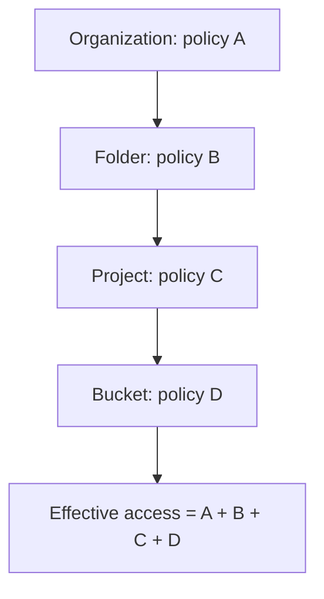

> [!info] Level: junior-middle | Time: about 7 h | You need: [[learn/gcp-foundations|GCP 01: Projects, regions, the gcloud CLI, Cloud Storage and billing]] | Lab: Lab C, the GCP sandbox project from [[learn/lab-setup|Start 01: Set up your lab]]

Almost every cloud security incident has the same shape: something had more permission than it needed, and someone found a way to use it. A leaked key, a service that could write when it only needed to read, a bucket open to the whole internet. The tool that prevents all three is **IAM**, Identity and Access Management. It answers one question for every request: _may this identity do this action on this resource?_

This lesson teaches the model, then the part of it that matters most for DevOps work: **service accounts**, the identities your code and pipelines use. You will read a real policy, give a service account read-only access to one bucket, prove that it cannot write, see why Google's access logic says yes or no, and learn why impersonation and attached identities beat downloaded keys.

> [!warning] Costs money
> The exercises create a Cloud Storage bucket and a service account. The bucket is billed while it exists, and the service account is free. The last exercise deletes both. Run the cleanup even if you stop part way.

## What you will learn

- The IAM model: a principal, a role and a resource joined by a binding in an allow policy, and how access flows down the hierarchy.
- The three kinds of roles (basic, predefined, custom), why basic roles are a trap, and how to find and shrink excess permission.
- What a service account is, the three kinds you will meet, and why a default service account with broad rights is a risk.
- How code gets credentials without a key file: attached identities, impersonation, and (in outline) Workload Identity Federation and GKE Workload Identity.
- Why keys are the main leak vector, how to block them, and how to retire a service account safely (disable before you delete).

## The IAM model

IAM has one sentence at its centre:

> **A principal has a role on a resource.**

That sentence is stored as a **binding** inside an **allow policy** that is attached to a resource.

| Part           | What it is                                                                                  | Example                                                                      |
| -------------- | ------------------------------------------------------------------------------------------- | ---------------------------------------------------------------------------- |
| **Principal**  | _Who_ is asking: a person, a group, a service account, or a whole set of people.            | `user:you@example.com`, `serviceAccount:app@PROJECT.iam.gserviceaccount.com` |
| **Role**       | _What_ they may do: a named bundle of permissions.                                          | `roles/storage.objectViewer`                                                 |
| **Resource**   | _Where_: the project, folder, organization, or a single bucket, topic, instance and so on.  | `gs://my-bucket`                                                             |
| **Permission** | One allowed API action. Roles are made of permissions; you rarely grant them one at a time. | `storage.objects.get`                                                        |

A permission is named `service.resource.verb`, so `storage.objects.get` means "read an object in Cloud Storage" and `storage.objects.create` means "write one". A role such as `roles/storage.objectViewer` is simply a list of permissions like `storage.objects.get` and `storage.objects.list`. You can see exactly which with:

```bash
gcloud iam roles describe roles/storage.objectViewer --format='value(includedPermissions)'
```

### Principals

| Principal                        | Written as                                            | Use                                                                                 |
| -------------------------------- | ----------------------------------------------------- | ----------------------------------------------------------------------------------- |
| A Google account                 | `user:name@example.com`                               | One person.                                                                         |
| A Google group                   | `group:team@example.com`                              | A team. **Prefer this for people.**                                                 |
| A service account                | `serviceAccount:NAME@PROJECT.iam.gserviceaccount.com` | Code, pipelines and machines.                                                       |
| A domain                         | `domain:example.com`                                  | Everyone in a Workspace or Cloud Identity domain. Broad; use rarely.                |
| **Everyone on the internet**     | `allUsers`                                            | **Public, no login.**                                                               |
| **Anyone with a Google account** | `allAuthenticatedUsers`                               | **Any Google account in the world**, not only your colleagues.                      |
| External identities              | Workload or workforce identity federation principals  | People or pipelines from outside Google Cloud, without a Google account. See below. |

Prefer **groups** for people, for three reasons. When someone joins or leaves a team you change one group, not a hundred bindings in a hundred places. A policy that names groups is readable: "the `payments-dev` group may deploy" tells a reviewer something, while a list of individual emails does not. And access reviews ([[compliance/access-reviews-gcp-and-gke]]) are possible: you review group membership in one place. In a personal lab with no groups you will use your own user; in a real organization you would not.

> [!danger] allUsers and allAuthenticatedUsers
> Granting a role to `allUsers` makes the resource readable (or writable) by the whole internet. Granting it to `allAuthenticatedUsers` is only slightly smaller: it means anyone who can sign in with any Google account, which includes strangers. Many cloud data leaks are one of these two lines. Treat them as a finding in every review, and use organization policy and public access prevention to make them impossible ([[compliance/gcp-organization-policy-guardrails]]).

### Roles: basic, predefined, custom

| Kind           | Examples                                               | What to know                                                                                                               |
| -------------- | ------------------------------------------------------ | -------------------------------------------------------------------------------------------------------------------------- |
| **Basic**      | `roles/owner`, `roles/editor`, `roles/viewer`          | Very broad, across almost every service. They predate the finer roles. **Avoid them for anything beyond a personal lab.**  |
| **Predefined** | `roles/storage.objectViewer`, `roles/pubsub.publisher` | Maintained by Google, scoped to one service and one job. **The default choice.**                                           |
| **Custom**     | `projects/PROJECT/roles/myDeployer`                    | A list of permissions you choose. Needed when no predefined role fits, but you now maintain it as Google adds permissions. |

Basic roles are a trap because their names sound harmless. `Editor` reads like "can edit things" and in fact it can change most resources in the project, including reading and writing all your data. A service account with `Editor` that is compromised gives the attacker a great deal. Use a predefined role scoped to one service, granted on the narrowest resource that works.

To see which roles can be granted on a resource:

```bash
gcloud iam list-grantable-roles //storage.googleapis.com/projects/_/buckets/BUCKET_NAME --format='value(name)'
```

This lists roles that can be granted on the resource; it does not find the roles that contain a given permission. For that, use the IAM "permissions reference" page, which lists the roles that contain each permission, and the role's own page in the IAM documentation.

### Inheritance: access flows down

Resources form the tree you saw in [[learn/gcp-foundations|GCP 01]]. An allow policy set on a node applies to everything under it.



The effective access of a principal on the bucket is the **union** of what every level grants. Two consequences:

1. **A grant high in the tree reaches everything below.** `roles/editor` for a user on the folder means `Editor` on every project in it. This is why granting at the organization or folder level is dangerous: the blast radius is everything under it, including projects created later.
2. **You cannot remove an inherited grant lower down.** Allow policies only add. If a group has a role on the folder, no policy on the project or bucket can take it away. To reduce access, change it where it is granted. (Google also offers separate deny policies, which are checked before allow policies; they are a different mechanism with their own rules, so verify them in the documentation before relying on one.)

Grant on the **lowest** resource that works, and to the **smallest** principal. A service account that needs to read one bucket gets `objectViewer` on that bucket, not on the project.

### Conditions, briefly

A binding can carry a **condition**: an expression that must be true for the binding to apply. The common uses are access that expires, or access limited to resources with a certain name or tag.

```yaml
bindings:
  - members:
      - user:you@example.com
    role: roles/storage.objectViewer
    condition:
      title: expires-2026-12-31
      expression: request.time < timestamp("2026-12-31T00:00:00Z")
```

Time-limited access is a good habit for temporary needs: it removes itself. Not every role and resource supports conditions (verify in the IAM Conditions documentation), and a policy that uses them is version 3.

### Reading an allow policy

You will read policies in YAML. This is the shape of `gcloud projects get-iam-policy`:

```yaml
bindings:
  - members:
      - user:you@example.com
    role: roles/owner
  - members:
      - serviceAccount:123456789012-compute@developer.gserviceaccount.com
      - serviceAccount:123456789012@cloudservices.gserviceaccount.com
    role: roles/editor
  - members:
      - serviceAccount:service-123456789012@compute-system.iam.gserviceaccount.com
    role: roles/compute.serviceAgent
etag: BwZxxxxxxxxx=
version: 1
```

Read it as sentences: "`you@example.com` is an Owner of this project", "the default Compute Engine service account and the Google APIs service agent are Editors". The `etag` is a version stamp: when you change a policy, the update fails if someone else changed it since you read it, which prevents two people from overwriting each other. Always change policies with the `add-iam-policy-binding` and `remove-iam-policy-binding` commands, which read, change and write safely, rather than editing a saved YAML file.

To pull out who holds the powerful roles, flatten the list so each member is a row:

```bash
gcloud projects get-iam-policy "$PROJECT_ID" \
  --flatten='bindings[].members' \
  --filter='bindings.role=roles/owner OR bindings.role=roles/editor' \
  --format='table(bindings.role,bindings.members)'
```

## Least privilege in practice

**Least privilege** means: each identity gets only the permissions it needs, on only the resources it needs, for only as long as it needs. The workflow that gets you there is short.

1. **Start from nothing.** A new service account has no rights. Add one role at a time.
2. **Pick the narrowest predefined role** on the narrowest resource.
3. **Test the negative.** Prove that the identity _cannot_ do something it should not. A test that only proves access works says nothing about the limit.
4. **Ask Google why.** When access is denied (or allowed and you do not know why), use **Policy Troubleshooter**. You give it a principal, a resource and a permission, and it explains which policies grant it or why none do:

   ```bash
   gcloud policy-troubleshoot iam \
     //storage.googleapis.com/projects/_/buckets/BUCKET_NAME \
     --principal-email=demo-reader@PROJECT_ID.iam.gserviceaccount.com \
     --permission=storage.objects.create
   ```

5. **Shrink over time.** The **IAM recommender** looks at the permissions a principal actually used over a period and suggests removing or replacing roles that were never needed. Review its suggestions regularly:

   ```bash
   gcloud recommender recommendations list \
     --project="$PROJECT_ID" --location=global \
     --recommender=google.iam.policy.Recommender
   ```

> [!warning] Check before relying on this
> Policy Troubleshooter and the recommender are separate APIs that must be enabled in the project, and the caller needs permission to use them. The recommender identifier `google.iam.policy.Recommender` and the output fields were not run for this page (verify). Run `gcloud recommender recommendations list --help` and the documentation to confirm. A recommendation is advice, not an order: check what a role is used for before you remove it.

Changes to IAM are **eventually consistent**. A new grant usually works within a couple of minutes, and the documentation says it can take longer in some cases (verify the current figure). If a command fails with a permission error right after a grant, wait and retry before you change anything else.

## Service accounts

A **service account** is an identity for software. Where a user has a password and a browser, a service account has an email address and gets short-lived tokens. You use one whenever a program needs to call Google Cloud: a CI job that deploys, a Pod that reads a bucket, a VM that writes logs.

A service account is two things at once. It is a **principal** (it can be granted roles on resources) and it is also a **resource** (other principals can be granted roles _on it_, such as the right to impersonate it). Keep both views in mind: much of the confusion about service accounts comes from mixing them up.

### The three kinds

| Kind              | Example email                                                   | Who creates and owns it                                                                                                             |
| ----------------- | --------------------------------------------------------------- | ----------------------------------------------------------------------------------------------------------------------------------- |
| **User-managed**  | `demo-reader@PROJECT.iam.gserviceaccount.com`                   | You. You choose the name and the roles. **Create these for your workloads.**                                                        |
| **Default**       | `PROJECT_NUMBER-compute@developer.gserviceaccount.com`          | Google creates it when you enable certain services (Compute Engine, App Engine). It is what a VM uses if you do not choose another. |
| **Service agent** | `service-PROJECT_NUMBER@compute-system.iam.gserviceaccount.com` | Google, for its own services to act in your project. Do not edit or delete them.                                                    |

### Why the default service accounts are a risk

The default Compute Engine service account has historically been granted the **Editor** basic role on the project automatically. Every VM that starts without an explicit service account gets that identity, and with it, broad write access to the whole project. A single vulnerable application on such a VM can become a project-wide problem.

Two controls fix this:

- **Do not use the default account.** Create one service account per workload and attach that.
- **Stop the automatic grant.** An organization policy constraint, `iam.automaticIamGrantsForDefaultServiceAccounts`, prevents default service accounts from being given the Editor role at creation. Google enforces this by default for some newer organizations (verify the default for your organization). You will meet organization policies in [[compliance/gcp-organization-policy-guardrails]].

### One purpose per service account

Give each workload its own service account, with a name that says what it is for: `web-reader`, `ci-deployer`, `backup-writer`. If one account is shared by the web app, the batch job and the pipeline, then a leak of any of them leaks all, and its roles must be the union of what all three need. With one account per purpose, you can read its policy, understand why each role is there, and remove the account when the workload goes away. Add a description when you create it so the next person knows who owns it.

A service account ID is 6 to 30 characters of lowercase letters, digits and hyphens, starting with a letter.

```bash
gcloud iam service-accounts create demo-reader \
  --project="$PROJECT_ID" \
  --display-name="Demo bucket reader" \
  --description="Reads one lab bucket. Created for the GCP 02 lesson."
```

### How code gets credentials without a key

There are four ways for code to act as a service account. The order below is the order of preference.

**1. Attached identity (the best for code that runs on Google Cloud).** You attach a service account to the VM, Cloud Run service, or other compute when you create it. The program then asks the **metadata server**, a local endpoint that is only reachable from that machine, for a short-lived token. Client libraries do this for you through Application Default Credentials. Nothing secret is stored anywhere.

```bash
# Run on a Compute Engine VM (you create one in GCP 03). Prints the identity the VM runs as.
curl -s -H 'Metadata-Flavor: Google' \
  'http://metadata.google.internal/computeMetadata/v1/instance/service-accounts/default/email'
```

**2. Impersonation (the best for people and pipelines running outside Google Cloud).** You, signed in as yourself, ask Google for a short-lived token _as_ the service account. You need the right to do that on the service account: the role **Service Account Token Creator** (`roles/iam.serviceAccountTokenCreator`) granted on it. No key file exists.

```bash
gcloud storage ls "gs://${BUCKET}" --impersonate-service-account="$SA_EMAIL"
```

The `--impersonate-service-account` flag works on any `gcloud` command. Client libraries and Terraform have an equivalent setting. You can make it the default for a configuration with `gcloud config set auth/impersonate_service_account`, but that is easy to forget about, so prefer the flag on the command.

Two roles sound alike and do different things.

| Role                              | Lets a principal                                                                  |
| --------------------------------- | --------------------------------------------------------------------------------- |
| **Service Account Token Creator** | Create short-lived tokens _as_ the service account (impersonate it).              |
| **Service Account User**          | _Attach_ the service account to a resource, such as a new VM that will run as it. |

**3. Workload Identity Federation (for software outside Google Cloud).** A pipeline that runs in GitLab CI, GitHub Actions or another cloud already has an identity there, usually an OIDC token. Workload Identity Federation lets Google trust that token and exchange it for a short-lived Google token, bound to a service account or directly to a principal. No key is stored in the CI variables. This is the right answer for CI that deploys to GCP. The pattern for GitLab CI and the group model behind it are in [[architecture/iam-groups-and-ci-workload-identity-federation]].

**4. Workload Identity on GKE (for Pods).** A Kubernetes service account in a cluster is mapped to a Google identity, so a Pod gets access to Google APIs without a key and without sharing the node's identity. You will build it in [[learn/gke-for-beginners|GCP 04]]; the production pattern is [[patterns/gke-workload-identity]]. This lesson only introduces the idea; the setup steps depend on cluster settings and are covered in GCP 04.

**Last resort: a service account key.** A key is a JSON file that contains a private key for the account. Anyone who has the file _is_ the service account, from anywhere, until the key is deleted. Keys do not expire unless you set a policy that makes them. They get copied into repositories, chat messages, Docker images and CI variables, and they leak. Most credential incidents in Google Cloud involve a key. Use the first three methods, and if a tool really cannot, treat the key as a secret with an owner, an expiry and a rotation date ([[runbooks/leaked-credential-rotation]] is what happens when one leaks).

You can make keys impossible. The organization policy constraint **`iam.disableServiceAccountKeyCreation`** stops anyone from creating user-managed keys in the places it is enforced. Turn it on, and allow exceptions only by name and with an expiry.

> [!note] Short-lived on purpose
> A token minted by the metadata server or by impersonation is valid for a short time (the default for an access token is one hour). If it leaks, the damage window is small, and it is not stored anywhere to be found later. That property, not any clever algorithm, is why these methods are safer than keys.

### Disable before you delete

Deleting a service account is hard to reverse, and things that depend on it fail in ways that are not obvious. The safe sequence is:

1. **Disable it:** `gcloud iam service-accounts disable SA_EMAIL`. Its tokens and keys stop working, but nothing is lost.
2. **Wait** a period you choose, for example a week or a full business cycle, and watch for failures and for alerts.
3. **Delete it** only when nothing has broken: `gcloud iam service-accounts delete SA_EMAIL`.
4. If something does break, re-enable it: `gcloud iam service-accounts enable SA_EMAIL`.

What deletion really does: the account has a **unique ID** (a long number) in addition to its email. If you delete the account and later create a new one with the _same name_, the email is identical, but the **unique ID is new**, so it is a different principal. Old bindings that pointed at the old ID do not apply to the new account; they show in policies as `deleted:serviceAccount:...?uid=...` and should be cleaned up. The new account starts with no roles. Google allows an undelete for a limited time using the numeric unique ID (`gcloud iam service-accounts undelete UNIQUE_ID`); check the documentation for the time window before you rely on it.

## Hands-on exercises

Work in the lab project, with the `lab` configuration active. Set the variables first. Change the ones marked.

```bash
PROJECT_ID="lab-yourname-123456"          # Change: your lab project ID.
REGION="europe-west1"                      # The region you chose in GCP 01.
BUCKET="${PROJECT_ID}-gcp02"               # Bucket names are global; the project ID prefix keeps it unique.
SA_NAME="demo-reader"
SA_EMAIL="${SA_NAME}@${PROJECT_ID}.iam.gserviceaccount.com"
MY_ACCOUNT="$(gcloud config get account)"
echo "project=$PROJECT_ID account=$MY_ACCOUNT"
```

Expected: your project ID and your email. If `account=` is empty, run `gcloud auth login`.

1. **Read the project policy and find the powerful roles.**

   ```bash
   gcloud projects get-iam-policy "$PROJECT_ID" --format=yaml
   gcloud projects get-iam-policy "$PROJECT_ID" \
     --flatten='bindings[].members' \
     --filter='bindings.role=roles/owner OR bindings.role=roles/editor' \
     --format='table(bindings.role,bindings.members)'
   ```

   Expected (illustrative; your members and account numbers will differ):

   ```text
   ROLE          MEMBERS
   roles/editor  serviceAccount:123456789012-compute@developer.gserviceaccount.com
   roles/editor  serviceAccount:123456789012@cloudservices.gserviceaccount.com
   roles/owner   user:you@example.com
   ```

   Find yourself as `roles/owner`. If the Compute Engine default service account is listed as `roles/editor`, you are looking at the risk from the section above: every VM that starts without its own service account would run with Editor on this project.
   If you see something else: if the default Compute Engine account is not listed, you did not enable the Compute Engine API in GCP 01, or your project has the organization constraint on; both are fine. A `PERMISSION_DENIED` means your account cannot read the project policy, which a project Owner can.

2. **Create a service account and a locked-down bucket with a file in it.**

   > [!warning] Costs money
   > The bucket is billed while it exists. Delete it with: `gcloud storage rm --recursive --all-versions "gs://${BUCKET}" && gcloud iam service-accounts delete "$SA_EMAIL" --project="$PROJECT_ID" --quiet`.

   ```bash
   gcloud iam service-accounts create "$SA_NAME" \
     --project="$PROJECT_ID" \
     --display-name="Demo bucket reader" \
     --description="Reads one lab bucket. Created for the GCP 02 lesson."
   gcloud storage buckets create "gs://${BUCKET}" \
     --project="$PROJECT_ID" --location="$REGION" \
     --uniform-bucket-level-access --public-access-prevention \
     --soft-delete-duration=0 # lab only: no retention of deleted objects (verify flag)
   printf 'hello\n' > hello.txt
   gcloud storage cp hello.txt "gs://${BUCKET}/hello.txt"
   ```

   Expected (illustrative):

   ```text
   Created service account [demo-reader].
   Creating gs://lab-yourname-123456-gcp02/...
   Copying file://hello.txt to gs://lab-yourname-123456-gcp02/hello.txt
     Completed files 1/1 | 6.0B/6.0B
   ```

   If you see something else: `already exists` for the service account means a previous attempt created it; carry on. A bucket-name conflict means change `BUCKET`. If the Cloud Storage API is not enabled, run `gcloud services enable storage.googleapis.com --project="$PROJECT_ID"`.

3. **Give the service account read access to this one bucket, and nothing else.** The role is bound on the bucket, not on the project.

   ```bash
   gcloud storage buckets add-iam-policy-binding "gs://${BUCKET}" \
     --member="serviceAccount:${SA_EMAIL}" \
     --role="roles/storage.objectViewer"
   gcloud storage buckets get-iam-policy "gs://${BUCKET}" --format=yaml
   ```

   Expected (illustrative; the bucket policy lists the new binding, along with any that Google adds for the project):

   ```text
   bindings:
   - members:
     - serviceAccount:demo-reader@lab-yourname-123456.iam.gserviceaccount.com
     role: roles/storage.objectViewer
   ...
   ```

   If you see something else: if `add-iam-policy-binding` reports that the service account does not exist, wait a few seconds and retry; a just-created account can take a moment to be visible to other APIs.

4. **Let yourself impersonate the account, then prove it can read and cannot write.** Granting yourself the Token Creator role _on the service account_ is what allows `--impersonate-service-account`.

   ```bash
   gcloud iam service-accounts add-iam-policy-binding "$SA_EMAIL" \
     --member="user:${MY_ACCOUNT}" \
     --role="roles/iam.serviceAccountTokenCreator" \
     --project="$PROJECT_ID"
   sleep 60   # IAM changes are eventually consistent
   gcloud storage ls "gs://${BUCKET}" --impersonate-service-account="$SA_EMAIL"
   gcloud storage cat "gs://${BUCKET}/hello.txt" --impersonate-service-account="$SA_EMAIL"
   echo write-test > write-test.txt
   gcloud storage cp write-test.txt "gs://${BUCKET}/write-test.txt" --impersonate-service-account="$SA_EMAIL"
   ```

   Expected (illustrative): the first two succeed and the last is refused.

   ```text
   gs://lab-yourname-123456-gcp02/hello.txt
   hello
   ERROR: ... HTTPError 403: demo-reader@lab-yourname-123456.iam.gserviceaccount.com does not have storage.objects.create access to the Google Cloud Storage object. Permission 'storage.objects.create' denied on resource (or it may not exist).
   ```

   That `403` is the point: the account has exactly the access you gave it. You proved the limit, not only the access.
   If you see something else: if the first command fails with a message that you lack `iam.serviceAccounts.getAccessToken`, the Token Creator grant has not taken effect yet (wait a minute and retry) or you passed the wrong `MY_ACCOUNT`. If the write _succeeds_, the account has a broader role somewhere (a project-level grant or Editor); read the project policy again and fix the grant. `gcloud` may print a warning that you are impersonating a service account; that is expected.

5. **Try to make the bucket public, and watch it be refused.** Public access prevention is enforced on this bucket.

   ```bash
   gcloud storage buckets add-iam-policy-binding "gs://${BUCKET}" \
     --member=allUsers --role=roles/storage.objectViewer
   ```

   Expected: an error that says the request failed, with a message that mentions public access prevention or a policy that does not allow it (the exact text varies).
   If you see something else: if the command _succeeds_, your bucket is public. Remove the binding at once with `gcloud storage buckets remove-iam-policy-binding "gs://${BUCKET}" --member=allUsers --role=roles/storage.objectViewer`, check that you created the bucket with `--public-access-prevention`, and read the section on `allUsers` again.

6. **Ask Policy Troubleshooter why the write was denied.** Enable the API once, then ask.

   ```bash
   gcloud services enable policytroubleshooter.googleapis.com --project="$PROJECT_ID"
   gcloud policy-troubleshoot iam \
     "//storage.googleapis.com/projects/_/buckets/${BUCKET}" \
     --principal-email="$SA_EMAIL" \
     --permission=storage.objects.create
   ```

   Expected (illustrative; field names differ by version): an `access` value such as `NOT_GRANTED`, and an explanation listing the bucket policy that was checked and that it contains `objectViewer`, which does not include `storage.objects.create`. Run it again with `--permission=storage.objects.get` and the result should show access granted through the `objectViewer` binding.
   If you see something else: a permission error means your account may not use Policy Troubleshooter on this resource, or the API is still enabling; wait and retry. An error about an unknown resource name means the `//storage.googleapis.com/projects/_/buckets/NAME` form is wrong for your version; check `gcloud policy-troubleshoot iam --help`.

7. **Check that the service account has no keys.**

   ```bash
   gcloud iam service-accounts keys list --iam-account="$SA_EMAIL" --managed-by=user
   ```

   Expected: `Listed 0 items.` The service account worked in step 4 without any key file, because you impersonated it.
   If you see something else: if a key is listed, someone created it. Without a reason, delete it with `gcloud iam service-accounts keys delete KEY_ID --iam-account="$SA_EMAIL"`. Without `--managed-by=user` you also see Google-managed (system) keys, which you cannot and need not delete.

8. **Disable the account and see what breaks.** This is the "disable before delete" step.

   ```bash
   gcloud iam service-accounts disable "$SA_EMAIL" --project="$PROJECT_ID"
   gcloud storage ls "gs://${BUCKET}" --impersonate-service-account="$SA_EMAIL"
   gcloud iam service-accounts enable "$SA_EMAIL" --project="$PROJECT_ID"
   gcloud storage ls "gs://${BUCKET}" --impersonate-service-account="$SA_EMAIL"
   ```

   Expected: the second command fails with an error that says the service account is disabled (the wording varies), and the last command lists the bucket again.
   If you see something else: if the call still works while the account is disabled, wait a minute and retry; the state change is also eventually consistent.

9. **Plan the account in Terraform, without creating it.** This shows how the same thing is written as code. It needs the Terraform CLI and Application Default Credentials: `gcloud auth application-default login` (see GCP 01). The account is named differently so it cannot clash with the one you made by hand.

   ```hcl title="main.tf"
   terraform {
     required_version = ">= 1.5" # Change: the Terraform version you installed.
     required_providers {
       google = {
         source  = "hashicorp/google"
         version = "~> 6.0" # Change: pin the current major version from the Terraform Registry.
       }
     }
   }

   variable "project_id" {
     type        = string
     description = "The GCP project to use."
   }

   provider "google" {
     project = var.project_id
   }

   resource "google_service_account" "demo_reader_tf" {
     account_id   = "demo-reader-tf"
     display_name = "Demo bucket reader (Terraform)"
     description  = "Planned only, in the GCP 02 lesson. Do not apply."
   }
   ```

   ```bash
   mkdir -p ~/lab/tf-iam && cd ~/lab/tf-iam
   # Save main.tf here, then:
   export TF_VAR_project_id="$PROJECT_ID"
   terraform init
   terraform plan
   ```

   Expected (illustrative; attribute lists differ by provider version):

   ```text
   Terraform will perform the following actions:

     # google_service_account.demo_reader_tf will be created
     + resource "google_service_account" "demo_reader_tf" {
         + account_id   = "demo-reader-tf"
         + description  = "Planned only, in the GCP 02 lesson. Do not apply."
         + disabled     = false
         + display_name = "Demo bucket reader (Terraform)"
         + email        = (known after apply)
         + id           = (known after apply)
         + name         = (known after apply)
         + project      = "lab-yourname-123456"
         + unique_id    = (known after apply)
       }

   Plan: 1 to add, 0 to change, 0 to destroy.
   ```

   `Plan: 1 to add` is the line to find. Do not run `terraform apply`; the next stage teaches the whole workflow in [[learn/terraform-basics-on-gcp|Terraform 01]].
   If you see something else: `Error: Invalid provider version` or an init error means the version constraint does not match a published release; look up the current major version on the Registry and change it. `could not find default credentials` means you did not run `gcloud auth application-default login`. A `403` on plan means the account lacks permission to read the project.

   > [!warning] Check before relying on this
   > The provider major version on this page (`~> 6.0`, the same as in the Terraform lessons) was not checked against the Terraform Registry. Pin the current major version shown there and read the provider's upgrade guide when you change majors. `terraform` was not run for this exercise.

10. **Clean up.** Remove the grant, the bucket, the service account and the local files.

    ```bash
    gcloud iam service-accounts remove-iam-policy-binding "$SA_EMAIL" \
      --member="user:${MY_ACCOUNT}" --role="roles/iam.serviceAccountTokenCreator" \
      --project="$PROJECT_ID"
    gcloud storage rm --recursive --all-versions "gs://${BUCKET}"
    gcloud iam service-accounts delete "$SA_EMAIL" --project="$PROJECT_ID" --quiet
    rm -f hello.txt write-test.txt
    rm -rf ~/lab/tf-iam
    gcloud iam service-accounts list --project="$PROJECT_ID" --format='value(email)'
    ```

    Expected: the final list does not include `demo-reader@...`. (In real work you would disable first and wait; here the lab is disposable. The `--quiet` flag skips the confirmation, so check the email before you run the delete.)
    If you see something else: if `delete` fails, make sure `SA_EMAIL` is set and correct. A binding left on a deleted account shows up as `deleted:serviceAccount:...`; remove it with `remove-iam-policy-binding` using the full `deleted:` member string. Do not forget the Terraform folder: nothing was created in the cloud, so there is no state worth keeping.

## Common mistakes

- **Granting a basic role "just to make it work".** Why it bites: `Editor` and `Owner` allow far more than any workload needs, and they are rarely removed afterwards. Fix: find the predefined role for the permission in the error message, grant that, on the narrowest resource.
- **Granting at the project or folder instead of the resource.** Why it bites: the grant is inherited by everything under it, including resources created later. Fix: bind on the bucket, topic or dataset itself.
- **Using the default service account.** Why it bites: it can carry the broad Editor role, shared by every VM that does not choose another account. Fix: one user-managed service account per workload, and the organization constraint that stops the automatic grant.
- **Sharing one service account between workloads.** Why it bites: a leak of any one of them leaks all, and the roles grow into the union of what they all need. Fix: one account per purpose, with a description and an owner.
- **Downloading a key because it is quicker.** Why it bites: the file is valid from anywhere, for ever, and ends up in Git or in a CI variable. Fix: attached identity, impersonation or Workload Identity Federation; block key creation with the organization constraint.
- **Granting to individuals instead of groups.** Why it bites: policies fill with emails of people who left, and reviews are impossible. Fix: `group:` principals, managed in one place.
- **Using `allUsers` or `allAuthenticatedUsers` without a plan.** Why it bites: the resource is public to the internet, or to every Google account. Fix: public access prevention and organization policy; for a deliberately public site, use a bucket made for it, with a recorded owner and reason.
- **Confusing Token Creator and Service Account User.** Why it bites: you grant the wrong one and impersonation (or attaching an account to a VM) fails with a permission error. Fix: Token Creator to mint tokens as the account, Service Account User to attach it to a resource.
- **Deleting a service account to clean up, then recreating it with the same name.** Why it bites: the new account has a new unique ID and none of the old roles, and old bindings turn into `deleted:` entries. Fix: disable first, wait, delete only when nothing broke, and re-grant deliberately.
- **Testing only the happy path.** Why it bites: access that works proves nothing about the limit, so a too-broad role goes unnoticed. Fix: always run one action that must fail, and read the policy.
- **Changing a grant and testing it immediately.** Why it bites: IAM is eventually consistent, so you "fix" a correct change. Fix: wait a minute or two and retry before you change anything else.

## Check your understanding

1. Why should a policy grant roles to a group instead of to each person?
2. A teammate grants `roles/editor` to a user on the organization "so they can work in the new project". Why is that dangerous, and what would you do instead?
3. Why is impersonating a service account better than downloading a key for it? Give two reasons.
4. A service account `report-job` is deleted by mistake and a new one with the same name is created. Does the new account have the old roles? What do you see in the old policies?
5. What is the difference between `roles/iam.serviceAccountTokenCreator` and `roles/iam.serviceAccountUser`?
6. You granted a role a minute ago and a command still fails with `403`. Before you change anything else, what do you check?

> [!question]- Answers
>
> 1. A group is managed in one place. When a person joins or leaves, you change one membership instead of editing every binding; the policy reads as "the payments team may deploy"; and access reviews can look at group membership. Policies that list individuals fill up with people who have left.
> 2. A grant on the organization is inherited by every folder and project under it, including projects created later, and `Editor` allows changes to most services. One compromised account then has write access to everything. Instead, grant the smallest predefined role on the one project (or resource) the person needs, ideally to a group, and add an expiry condition if the need is temporary.
> 3. Impersonation produces a short-lived token (about an hour by default), so a leak has a small window, while a key is valid until deleted. There is also no secret file to store, copy into a repository or find in a backup. Access is also controlled and logged through the Token Creator grant on the account, so you can revoke it in one place.
> 4. No. The new account has the same email but a different unique ID, so it is a different principal that starts with no roles. The old policies keep entries of the form `deleted:serviceAccount:...?uid=...`, which no longer apply to anything and should be removed. Access has to be granted again on purpose.
> 5. Token Creator lets a principal create tokens as the service account, which is impersonation. Service Account User lets a principal attach the service account to a resource, such as a VM or a Cloud Run service, so that the resource runs as it. They are granted on the service account and do different jobs.
> 6. Check the grant is on the right principal and resource with `get-iam-policy`, and use Policy Troubleshooter to see the decision. If the policy is right, wait a few minutes and retry, because IAM changes are eventually consistent. Also check that you are using the account you think (`gcloud auth list`) and the project you think.

## Next steps

Next lesson: [[learn/gcp-vpc-compute-and-cloud-sql|GCP 03: VPC, Compute Engine and Cloud SQL]]. Previous lesson: [[learn/gcp-foundations|GCP 01: Projects, regions, the gcloud CLI, Cloud Storage and billing]].

To go deeper:

- [[patterns/gke-workload-identity]] for giving Pods Google access without keys, the production pattern for what you meet in GCP 04.
- [[runbooks/leaked-credential-rotation]] for what to do the day a key or token leaks.
- [[architecture/iam-groups-and-ci-workload-identity-federation]] for the group model and Workload Identity Federation for CI.
- [[compliance/gcp-organization-policy-guardrails]] for the organization policies that make the safe choices the only choices.
- [[compliance/access-reviews-gcp-and-gke]] for reviewing who has access to what.
- The whole path is mapped in [[learn/index|the learning path]].

## Sources

- Google Cloud documentation, "IAM overview" (https://docs.cloud.google.com/iam/docs/overview), "Roles and permissions" (https://docs.cloud.google.com/iam/docs/roles-overview) and "Policies" (https://docs.cloud.google.com/iam/docs/policies).
- Google Cloud documentation, "IAM Conditions overview" (https://docs.cloud.google.com/iam/docs/conditions-overview) and "Policy Troubleshooter" (https://docs.cloud.google.com/policy-intelligence/docs/troubleshoot-access).
- Google Cloud documentation, "Role recommendations" (https://docs.cloud.google.com/iam/docs/recommender-overview).
- Google Cloud documentation, "Service accounts overview" (https://docs.cloud.google.com/iam/docs/service-account-overview), "Best practices for using and managing service accounts" (https://docs.cloud.google.com/iam/docs/best-practices-for-using-and-managing-service-accounts) and "Service account impersonation" (https://docs.cloud.google.com/iam/docs/service-account-impersonation).
- Google Cloud documentation, "Workload Identity Federation" (https://docs.cloud.google.com/iam/docs/workload-identity-federation) and "Create short-lived credentials for a service account" (https://docs.cloud.google.com/iam/docs/create-short-lived-credentials-direct).
- Google Cloud documentation, "Restricting service accounts" for the organization policy constraints `iam.disableServiceAccountKeyCreation` and `iam.automaticIamGrantsForDefaultServiceAccounts` (https://docs.cloud.google.com/resource-manager/docs/organization-policy/restricting-service-accounts).
- Checked in this environment: `gcloud` 570.0.0, offline, by reading `--help` for `iam service-accounts create`, `keys list` (including `--managed-by`), `delete`, `undelete`, `add-iam-policy-binding`, `storage buckets add-iam-policy-binding`, `policy-troubleshoot iam`, `recommender recommendations list`, `auth print-access-token` and `projects get-iam-policy`. Nothing was run against a real project, so every cloud output is illustrative.
- Not verified: the `docs.cloud.google.com` URLs (the host was not reachable from the writing environment, so the paths are unchecked); the default state of `iam.automaticIamGrantsForDefaultServiceAccounts` for new organizations; how long IAM changes take to propagate; the undelete window for service accounts; the Policy Troubleshooter and recommender output fields and the recommender ID; whether `allUsers` on a public-access-prevention bucket fails with the text described; the Terraform provider's current major version and the `terraform plan` attribute list; and that the default Compute Engine service account gets Editor in your project.
