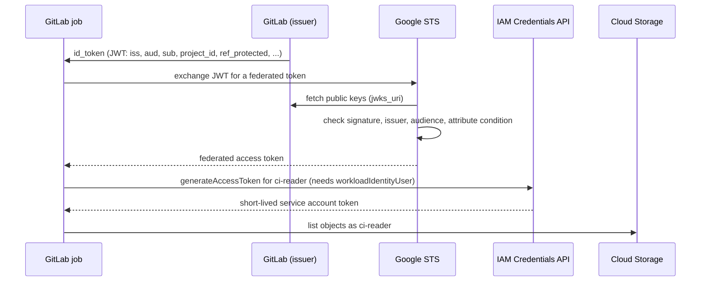

> [!info] Level: middle | Time: about 3 h | You need: [[learn/gcp-iam-and-service-accounts|GCP 02: IAM and service accounts]] and [[learn/first-pipeline-gitlab-ci-and-jenkins|Delivery 02: Your first pipeline in GitLab CI and Jenkins]] | Lab: Lab C, the GCP sandbox project from [[learn/lab-setup|Start 01: Set up your lab]], plus the `ci-lab` GitLab.com project from Delivery 02 (you need the Maintainer role to protect branches)

The classic way to let a pipeline deploy to Google Cloud is to create a service account key, paste the JSON into a CI/CD variable, and hope. That key never expires by itself, works from anywhere, and ends up in job logs, forks, laptops and old backups. It is the credential behind a large share of cloud leaks. **Workload Identity Federation** removes it: GitLab signs a short-lived token for each job that says exactly which project, branch and pipeline it is; Google checks the signature and your conditions, and hands back a short-lived Google credential. There is nothing to store, rotate or leak.

This lesson builds that path end to end in your sandbox: a GitLab job with an `id_tokens` token, a workload identity pool and provider with a condition that only accepts your project on protected branches, a service account the job may impersonate, and a bucket it may read. Then you prove that a job on an unprotected branch is refused. [[adr/0026-keyless-ci-auth-with-workload-identity-federation|ADR 0026]] records why this is the only way CI reaches GCP here, and [[architecture/iam-groups-and-ci-workload-identity-federation]] shows the production shape in Terraform.

> [!note] Nothing here was run against a live project for this page
> The `gcloud` flags were compared with the help text of Google Cloud SDK 570.0.0, and `create-cred-config` was run offline with placeholder values to show the file it writes. The GitLab keyword, claims and token lifetime follow the GitLab documentation source; the issuer value was checked against gitlab.com's public OIDC discovery document on 2026-10-21. Nothing was run against a real GitLab job or GCP project, so job logs and error messages are illustrative. Not checked against Google's Workload Identity Federation documentation for this page; points that depend on it are marked "check the current docs".

> [!warning] Costs money
> The pool, provider and service account are configuration. The lab bucket stores one small object, which Cloud Storage bills for (tiny, but not zero), and any job you extend to create resources bills for them. Cleanup is exercise 9: `gcloud storage rm --recursive "gs://$LAB_BUCKET"` deletes the bucket and its object, then the provider, pool and service account are deleted. If you lose track, `gcloud projects delete "$LAB_PROJECT_ID"` removes the whole sandbox.

## What you will learn

- Why long-lived keys in CI variables leak, and what a short-lived, audience-bound OIDC token changes.
- How GitLab's `id_tokens:` keyword issues a token per job, and which claims you can trust in a policy.
- How a workload identity pool, an OIDC provider, an attribute mapping and an attribute condition fit together, and why the condition is the real security boundary.
- How to grant access by service account impersonation (`roles/iam.workloadIdentityUser`) and use the result from `gcloud` and Terraform through a credential configuration file.
- How to prove the setup refuses what it should, and debug the usual audience, issuer, condition and role errors.

## Why keys in CI variables leak

A service account key is a private key for a robot account. Whoever holds the JSON file is that account, from any network, until someone deletes the key. In CI it leaks in predictable ways:

- **Job output.** `set -x`, a debug flag or a failing tool prints the variable. Masking helps only when the value matches the masking rules exactly.
- **Wide access.** Every job in the project, and often every branch, can read the variable. A merge request that changes `.gitlab-ci.yml` can send it anywhere unless the variable is protected.
- **Copies.** It is downloaded to "test locally", attached to a ticket, or left in a cache or artifact.
- **No expiry.** Keys stay valid until deleted, so a leak from last year still works. [[runbooks/leaked-credential-rotation]] and [[runbooks/service-account-key-expiry-recovery]] are what a leak or an expiry costs you.

Federation changes two things at once. The credential lives for minutes, not years, and it is **bound to a context**: Google accepts it only if it came from your GitLab project, on a protected branch, for your provider.

## OIDC in one page

OpenID Connect (OIDC) adds identity to OAuth 2.0. For CI the parts you need are:

- The **issuer** (`iss`) is the system that signs tokens, here your GitLab instance, `https://gitlab.com` for GitLab.com. It publishes its public keys at a well-known address, so anyone can verify a signature without a shared secret.
- The **token** is a JWT: three base64url parts (header, claims, signature). GitLab signs it with RS256.
- The **audience** (`aud`) says who the token is for. A verifier must reject tokens meant for someone else, so a token minted for Artifactory cannot be replayed to Google.
- The **subject** (`sub`) and the other **claims** describe the job: project, branch, whether the branch is protected, pipeline, user.
- **Expiry** (`exp`) makes it short-lived.

You can read the issuer's discovery document yourself:

```bash
curl -s https://gitlab.com/.well-known/openid-configuration | jq '{issuer, jwks_uri}'
```

```text
{
  "issuer": "https://gitlab.com",
  "jwks_uri": "https://gitlab.com/oauth/discovery/keys"
}
```

_Observed on 2026-10-21. A self-managed GitLab publishes its own at `https://<your-gitlab>/.well-known/openid-configuration`._

Note the issuer has **no trailing slash**. Google compares it exactly, so copy the value from the document or from a decoded token, never from memory.



## The GitLab side: `id_tokens`

A job asks for a token with the `id_tokens:` keyword. Each entry names a CI/CD variable and the audience; `aud` is required and may be a string, a list or a CI/CD variable.

```yaml
job:
  id_tokens:
    GCP_ID_TOKEN:
      aud: https://iam.googleapis.com/projects/123456789012/locations/global/workloadIdentityPools/gitlab-ci/providers/gitlab
```

Facts that shape the design:

- The token is only in that job's environment, as `$GCP_ID_TOKEN`. It expires when the job's timeout ends, or after 5 minutes if no timeout is set.
- A job-level `id_tokens` **replaces** `default: id_tokens`; the two are not merged.
- The old predefined `CI_JOB_JWT_V2` variable was removed in GitLab 17.0. Old tutorials that use it no longer work.
- The default `sub` is `project_path:<group>/<project>:ref_type:<branch|tag>:ref:<name>`. Newer GitLab versions let you change its format through the Projects API; check your version.

Claims you will use in policies (all values are **strings**, including `"true"` and `"false"`):

| Claim                                  | Example                  | Use it for                                                       |
| -------------------------------------- | ------------------------ | ---------------------------------------------------------------- |
| `project_id`, `namespace_id`           | `"45879213"`             | Pinning the project or group. Stable: survive renames and moves. |
| `project_path`, `namespace_path`       | `"example-group/ci-lab"` | Readable, but change when a project is renamed or moved.         |
| `ref`, `ref_type`, `ref_path`          | `"main"`, `"branch"`     | Which branch or tag ran the job.                                 |
| `ref_protected`                        | `"true"`                 | Only protected branches and tags, which only maintainers push.   |
| `environment`, `environment_protected` | `"production"`           | Deploy jobs bound to a protected environment.                    |
| `pipeline_source`                      | `"push"`                 | Telling push pipelines from merge request or scheduled ones.     |
| `user_login`, `user_email`             | (a person)               | Audit only: users can change them, so never trust them alone.    |

Two subtleties from the GitLab docs: in a merge request pipeline, `project_id` and the related claims describe the **source** project, which for a fork is someone else's project; and a branch called `main` can exist unprotected in any project, so trust `ref_protected`, not the branch name. Prefer the numeric IDs for anything that grants access.

To see what your job actually receives, decode the middle part of the token (never print the whole token: it is a credential until it expires):

```bash
# In a job, for debugging only. Prints the claims, not the signature.
python3 -c 'import base64, json, os; p = os.environ["GCP_ID_TOKEN"].split(".")[1]; print(json.dumps(json.loads(base64.urlsafe_b64decode(p + "=" * (-len(p) % 4))), indent=2))'
```

The often-quoted `cut -d. -f2 | base64 -d` fails on tokens whose base64url part has no padding, which is why the one-liner adds it.

> [!note] Two GitLab features with similar names
> GitLab also has a "Google Cloud IAM integration" (`identity: google_cloud`) with its own issuer and setup. That is a different feature. This lesson uses plain `id_tokens` with a pool you control, which works on GitLab.com and self-managed GitLab alike.

## The Google side: pool, provider, mapping and condition

Set variables once. `LAB_PROJECT_ID` is your sandbox from Start 01; `GITLAB_PROJECT_ID` is the numeric **Project ID** shown on the `ci-lab` project's overview page in GitLab (not its path).

```bash
export LAB_PROJECT_ID="lab-yourname-123456"   # change: your sandbox project id
export GITLAB_PROJECT_ID="<GITLAB_PROJECT_ID>" # change: the numeric id of ci-lab
export GITLAB_ISSUER="https://gitlab.com"      # change for self-managed; copy it from the discovery document
export POOL_ID="gitlab-ci"
export PROVIDER_ID="gitlab"
export SA_NAME="ci-reader"
export LAB_BUCKET="${LAB_PROJECT_ID}-wif-lab"
export REGION="europe-west1"                   # change if you prefer a region near you

gcloud config set project "$LAB_PROJECT_ID"
export PROJECT_NUMBER="$(gcloud projects describe "$LAB_PROJECT_ID" --format='value(projectNumber)')"
export SA_EMAIL="${SA_NAME}@${LAB_PROJECT_ID}.iam.gserviceaccount.com"
echo "$PROJECT_NUMBER $SA_EMAIL"
```

Federation identifiers use the project **number**, not the id. Mixing them up is the most common error in this lesson.

Enable the APIs the exchange uses (check the deployment pipelines guide for the current list):

```bash
gcloud services enable iam.googleapis.com iamcredentials.googleapis.com sts.googleapis.com cloudresourcemanager.googleapis.com
```

### The pool

A **workload identity pool** is a container for external identities. One pool per GitLab installation per Google project keeps things simple. Pool IDs are 4 to 32 characters of lowercase letters, digits and hyphens, and the `gcp-` prefix is reserved.

```bash
gcloud iam workload-identity-pools create "$POOL_ID" \
  --location=global \
  --display-name="GitLab CI"
```

### The provider

The **provider** says which issuer the pool trusts, how token claims map to Google attributes, and which tokens to accept at all:

```bash
gcloud iam workload-identity-pools providers create-oidc "$PROVIDER_ID" \
  --location=global \
  --workload-identity-pool="$POOL_ID" \
  --issuer-uri="$GITLAB_ISSUER" \
  --attribute-mapping="google.subject=assertion.sub,attribute.project_id=assertion.project_id,attribute.namespace_id=assertion.namespace_id,attribute.ref=assertion.ref,attribute.ref_protected=assertion.ref_protected" \
  --attribute-condition="assertion.project_id == '${GITLAB_PROJECT_ID}' && assertion.ref_protected == 'true'"
```

- **`--attribute-mapping`** (required) copies claims into attributes you can reference later. `google.subject` is the identity's name in audit logs and is limited to 127 bytes; GitLab's default `sub` with a long group path and branch name can exceed that, so keep paths short or map a shorter value. Map every attribute you will use in a binding.
- **`--attribute-condition`** is a CEL expression that must return true for the token to be accepted. If you leave it out, **every** validly signed token from the issuer is accepted, and on GitLab.com that means any project of any user. GitLab's documentation says Google requires a condition limiting GitLab.com tokens to your group; check Google's current page for the exact rule. Here it pins the project by its numeric id **and** requires a protected ref, so a feature branch is refused before any IAM check.
- **No `--allowed-audiences`** here. With an empty list, the token's `aud` must equal the provider's full resource name (`//iam.googleapis.com/projects/<number>/locations/global/workloadIdentityPools/<pool>/providers/<provider>`, with or without an `https:` prefix), which is what the job asks for below. If you set custom audiences instead (up to 10), the job's `aud` must match one of them exactly.

> [!warning] Issuer: trailing slash or not
> GitLab's GCP tutorial says the provider issuer must end in a trailing slash. The gitlab.com discovery document and the `iss` claim in GitLab's own examples have none, and an issuer match is exact. This was not verified against a live exchange. Decode a token from your job, copy its `iss` byte for byte into `--issuer-uri`, and if the exchange says the issuer does not match, this is the first thing to compare.

To change the condition later without recreating the provider, use `update-oidc` with the same flag:

```bash
gcloud iam workload-identity-pools providers update-oidc "$PROVIDER_ID" \
  --location=global --workload-identity-pool="$POOL_ID" \
  --attribute-condition="assertion.namespace_id == '<GITLAB_GROUP_ID>' && assertion.ref_protected == 'true'"
```

A pinned group (`namespace_id`) is what you want for a team with several projects; a pinned project is tighter for this lab.

## Granting access: impersonation or direct access

A federated identity is written as a **principal** (one subject) or a **principal set** (everyone with an attribute value):

```text
principal://iam.googleapis.com/projects/PROJECT_NUMBER/locations/global/workloadIdentityPools/POOL_ID/subject/SUBJECT
principalSet://iam.googleapis.com/projects/PROJECT_NUMBER/locations/global/workloadIdentityPools/POOL_ID/attribute.ATTRIBUTE/VALUE
principalSet://iam.googleapis.com/projects/PROJECT_NUMBER/locations/global/workloadIdentityPools/POOL_ID/*
```

The last form is the whole pool: never grant anything to it.

There are two ways to give that identity access:

- **Service account impersonation** (used here). The federated identity gets `roles/iam.workloadIdentityUser` on one service account; the service account holds the real roles. Works with every Google API and every client, and audit logs show both identities. GitLab's tutorial lists only `roles/iam.workloadIdentityUser` for this step.
- **Direct resource access.** Grant the role (for example `roles/storage.objectViewer`) straight to the `principalSet://` on the resource, with no service account. Fewer moving parts, but not every Google product supports federated principals directly; check Google's list for each product before relying on it.

Create the service account, the bucket, and the two bindings:

```bash
gcloud iam service-accounts create "$SA_NAME" --display-name="CI reader (WIF lab)"

gcloud storage buckets create "gs://$LAB_BUCKET" --location="$REGION" --uniform-bucket-level-access
echo "hello from the WIF lab" > hello.txt && gcloud storage cp hello.txt "gs://$LAB_BUCKET/hello.txt"

# The service account may read objects in this one bucket.
gcloud storage buckets add-iam-policy-binding "gs://$LAB_BUCKET" \
  --member="serviceAccount:$SA_EMAIL" --role=roles/storage.objectViewer

# Jobs from the GitLab project may impersonate the service account.
gcloud iam service-accounts add-iam-policy-binding "$SA_EMAIL" \
  --role=roles/iam.workloadIdentityUser \
  --member="principalSet://iam.googleapis.com/projects/${PROJECT_NUMBER}/locations/global/workloadIdentityPools/${POOL_ID}/attribute.project_id/${GITLAB_PROJECT_ID}"
```

The binding is scoped by the `project_id` attribute, so even if you later widen the provider condition to a group, only `ci-lab` can use this service account. That two-layer shape (provider condition for the group, binding per project, protected refs required for deploy accounts) is what [[architecture/iam-groups-and-ci-workload-identity-federation]] uses in production.

## The credential configuration file

Client libraries, Terraform and `gcloud` do not speak to STS themselves from a raw JWT; they read a **credential configuration file** that says where the token is and how to exchange it. It contains no secret.

```bash
gcloud iam workload-identity-pools create-cred-config \
  "projects/${PROJECT_NUMBER}/locations/global/workloadIdentityPools/${POOL_ID}/providers/${PROVIDER_ID}" \
  --service-account="$SA_EMAIL" \
  --credential-source-file=/tmp/oidc_token \
  --credential-source-type=text \
  --output-file=gcp-wif.json
cat gcp-wif.json
```

```json title="gcp-wif.json"
{
  "universe_domain": "googleapis.com",
  "type": "external_account",
  "audience": "//iam.googleapis.com/projects/123456789012/locations/global/workloadIdentityPools/gitlab-ci/providers/gitlab",
  "subject_token_type": "urn:ietf:params:oauth:token-type:jwt",
  "token_url": "https://sts.googleapis.com/v1/token",
  "credential_source": { "file": "/tmp/oidc_token", "format": { "type": "text" } },
  "service_account_impersonation_url": "https://iamcredentials.googleapis.com/v1/projects/-/serviceAccounts/ci-reader@example-project.iam.gserviceaccount.com:generateAccessToken"
}
```

_Produced offline with placeholder values; reformatted. Your file has your number, pool and account._

The impersonated token lasts one hour by default. The file tells the client to read the GitLab token from a **file**, so the job must write `$GCP_ID_TOKEN` to one first. You can generate this file once and commit it (it holds nothing secret), or generate it in the job as below.

## A complete job

```yaml title=".gitlab-ci.yml"
stages: [check]

variables:
  GCP_WIF_PROVIDER: "projects/123456789012/locations/global/workloadIdentityPools/gitlab-ci/providers/gitlab" # change: your number, pool, provider
  GCP_SA_EMAIL: "ci-reader@example-project.iam.gserviceaccount.com" # change
  LAB_BUCKET: "example-project-wif-lab" # change

gcp-read:
  stage: check
  image: gcr.io/google.com/cloudsdktool/google-cloud-cli:<PINNED_TAG> # change: a tag or digest from the image's release page
  id_tokens:
    GCP_ID_TOKEN:
      aud: "https://iam.googleapis.com/${GCP_WIF_PROVIDER}"
  rules:
    - if: $CI_COMMIT_BRANCH
  script:
    - umask 077
    - TOKEN_FILE="$(mktemp)"; CRED_FILE="$(mktemp)"
    - printf '%s' "$GCP_ID_TOKEN" > "$TOKEN_FILE"
    - >
      gcloud iam workload-identity-pools create-cred-config "$GCP_WIF_PROVIDER"
      --service-account="$GCP_SA_EMAIL"
      --credential-source-file="$TOKEN_FILE"
      --credential-source-type=text
      --output-file="$CRED_FILE"
    - gcloud auth login --cred-file="$CRED_FILE" --quiet
    - export GOOGLE_APPLICATION_CREDENTIALS="$CRED_FILE"
    - gcloud auth list
    - gcloud storage ls "gs://$LAB_BUCKET"
```

Why each detail:

- `umask 077` and `mktemp` put the token and the config under `/tmp` with mode 600, outside the project directory, so they can never be collected as artifacts or cached. They disappear with the job container.
- `gcloud auth login --cred-file` is the method the `gcloud` help recommends for external accounts. `GOOGLE_APPLICATION_CREDENTIALS` makes the same file available to Terraform and client libraries in later steps.
- No CI/CD variable holds anything secret. The values in `variables:` are identifiers.

```text
Credentialed Accounts
ACTIVE  ACCOUNT
*       ci-reader@example-project.iam.gserviceaccount.com
gs://example-project-wif-lab/hello.txt
```

_Illustrative._

### Terraform in the same job

The Google provider reads `GOOGLE_APPLICATION_CREDENTIALS` and understands `external_account` files, so a job that has run the steps above can run `terraform plan` with no extra configuration. The provider also has an `external_credentials` block (audience, service account email, identity token) that takes precedence over other credentials, but it cannot renew tokens, which expire after about an hour by default; prefer the file. Remember the GitLab token itself lives only until the job timeout (or 5 minutes without one): keep jobs that need fresh exchanges short. [[learn/terraform-state-modules-and-pipelines]] shows the plan and apply jobs this slots into.

## Proving the denial

A security control you have not seen fail is a hope. Push a branch that is **not** protected and let the same job run:

```bash
git switch -c feature/wif-denial
git commit --allow-empty -m "Test that an unprotected branch is refused"
git push -u origin feature/wif-denial
```

The token for this job has `"ref_protected": "false"`, so the attribute condition is false and STS refuses the exchange before IAM is consulted:

```text
ERROR: (gcloud.storage.ls) ... Error code invalid_grant: The given credential is rejected by the attribute condition.
```

_Illustrative: the exact text was not verified._ A refusal at this point is what you want. If the feature branch **succeeds**, your condition does not check `ref_protected`, or the branch is protected (check Settings > Repository > Protected branches).

## Troubleshooting

| Symptom (paraphrased)                                  | Likely cause                                                                                     | Check and fix                                                                                                           |
| ------------------------------------------------------ | ------------------------------------------------------------------------------------------------ | ----------------------------------------------------------------------------------------------------------------------- |
| Audience does not match / invalid audience             | Job `aud` is not the provider's full name, or not in `--allowed-audiences`.                      | Decode the token, compare `aud` with `gcloud iam workload-identity-pools providers describe`. Number, not id.           |
| Issuer does not match                                  | Trailing slash, `http` vs `https`, or a self-managed URL with a path.                            | Copy `iss` from a decoded token into `--issuer-uri`.                                                                    |
| Rejected by the attribute condition                    | Condition is false for this job: other project, unprotected ref, a string compared to a boolean. | Decode the claims; remember they are strings (`'true'`). Test the CEL logic against the decoded values.                 |
| Permission `iam.serviceAccounts.getAccessToken` denied | Exchange worked, impersonation did not: no `workloadIdentityUser` binding for this principal.    | `gcloud iam service-accounts get-iam-policy "$SA_EMAIL"`; check the `principalSet` uses the number and right attribute. |
| 403 on the bucket                                      | Impersonation worked, the service account lacks the resource role.                               | `gcloud storage buckets get-iam-policy "gs://$LAB_BUCKET"`.                                                             |
| `GCP_ID_TOKEN` is empty                                | `id_tokens` missing on this job, or replaced by a job-level block, or an old GitLab.             | Check the merged job config in the pipeline editor ("Full configuration").                                              |
| Token expired                                          | Job ran longer than the token's lifetime before the exchange or a re-exchange.                   | Exchange early; split long jobs; set a job timeout deliberately.                                                        |

New bindings and provider changes can take a short time to apply; Google documents IAM propagation, so check the current docs before concluding a correct binding is wrong. Cloud Audit Logs can record token exchanges and impersonation if the relevant log types are enabled (check the current docs for which ones); see [[compliance/access-reviews-gcp-and-gke]] for reviewing who can impersonate what.

## Hands-on exercises

Use the variables block from "The Google side". Output is illustrative.

1. **Read GitLab's discovery document.**

   ```bash
   curl -s https://gitlab.com/.well-known/openid-configuration | jq -r .issuer
   ```

   Expected: `https://gitlab.com`.
   If you see something else: a proxy error means your network blocks it; on self-managed GitLab use your own URL.

2. **Create the pool and provider.** Run the pool and provider commands, then:

   ```bash
   gcloud iam workload-identity-pools providers describe "$PROVIDER_ID" \
     --location=global --workload-identity-pool="$POOL_ID" \
     --format='yaml(name,state,oidc,attributeCondition,attributeMapping)'
   ```

   Expected: `state: ACTIVE`, your issuer, the condition with your project id and `ref_protected`.
   If you see something else: "invalid argument" on create usually means a pool ID outside the allowed characters or a CEL syntax error (quotes around the string values).

3. **Create the service account, bucket and bindings**, as in "Granting access". Check them:

   ```bash
   gcloud iam service-accounts get-iam-policy "$SA_EMAIL" --format=json | jq '.bindings'
   ```

   Expected: one binding, `roles/iam.workloadIdentityUser`, with a `principalSet://.../attribute.project_id/<id>` member that contains your project **number**.
   If you see something else: a member with your project id instead of the number will never match; remove it and add the right one.

4. **Protect `main` and run the job on it.** In `ci-lab`, confirm `main` is protected (Settings > Repository > Protected branches). Add the job from "A complete job" with your values, push to `main`, and open the job log.
   Expected: `gcloud auth list` shows `ci-reader@...` and `gcloud storage ls` lists `hello.txt`.
   If you see something else: use the troubleshooting table, starting with the claims. Add the decode one-liner from the GitLab section as a temporary step.

5. **Inspect the claims.** Add the decode one-liner to the job temporarily and rerun on `main`.
   Expected: `iss` equal to your issuer, `aud` equal to the provider URL, `project_id` your id, `ref_protected` `"true"`.
   If you see something else: if `ref_protected` is `"false"` on `main`, the branch is not protected. Remove the debug step afterwards.

6. **Prove the denial from an unprotected branch.** Push `feature/wif-denial` as in "Proving the denial".
   Expected: the job fails at the first `gcloud` call that needs credentials, with an attribute-condition error.
   If you see something else: if it succeeds, read the condition with exercise 2's command and look for a missing `ref_protected` check.

7. **Prove there is no key to leak.**

   ```bash
   gcloud iam service-accounts keys list --iam-account="$SA_EMAIL" --managed-by=user
   ```

   Expected: an empty list (`Listed 0 items.`). The job worked with no user-managed key.
   If you see something else: delete any key you find unless you know exactly what uses it, and consider the organisation policy that blocks key creation (see [[adr/0026-keyless-ci-auth-with-workload-identity-federation|ADR 0026]]).

8. **Break the audience on purpose.** Change the job's `aud` to `https://gitlab.com`, push to `main`, then restore it.
   Expected: the exchange fails with an audience error, because the provider has no `--allowed-audiences` and `aud` is not its resource name.
   If you see something else: if it still works, the provider has an allowed-audiences list containing that value; describe the provider and check.

9. **Clean up.**

   ```bash
   gcloud storage rm --recursive "gs://$LAB_BUCKET"
   gcloud iam service-accounts delete "$SA_EMAIL" --quiet
   gcloud iam workload-identity-pools providers delete "$PROVIDER_ID" --location=global --workload-identity-pool="$POOL_ID" --quiet
   gcloud iam workload-identity-pools delete "$POOL_ID" --location=global --quiet
   ```

   Expected: each command confirms the deletion. Remove the job from `.gitlab-ci.yml` and delete the `feature/wif-denial` branch.
   If you see something else: deleted pools and providers can be restored with `undelete` for a retention period; check the current docs for that period and for whether you can reuse the same IDs before it ends.

## Common mistakes

- **No attribute condition.** Any GitLab.com project can then present a valid token to your provider. Always pin a project or group by numeric id.
- **Trusting the branch name.** `ref == 'main'` matches an unprotected `main` in any project the condition admits. Require `ref_protected == 'true'` for anything that writes.
- **Comparing claims as booleans.** GitLab claims are strings, so `assertion.ref_protected == true` is never true. Compare with `'true'`.
- **Project id where the number belongs.** Pool, provider and principal paths use the project **number**. The `--project` flag and the service account email use the id.
- **Granting to the whole pool.** `principalSet://.../*` lets every identity in the pool impersonate the account. Scope by an attribute.
- **Giving merge request pipelines deploy rights.** In a fork's merge request, project claims describe the source project, and the pipeline runs code you have not reviewed. Plan-only access at most, from a separate account.
- **Printing the token.** It is a credential until it expires. Decode only the claims, and only while debugging.
- **Keeping the old key "just in case".** Delete it once the federated path works, or the leak risk you removed is still there.

## Check your understanding

1. What two properties of a GitLab ID token make it safer than a service account key?
2. Your provider has no attribute condition and you are on GitLab.com. What can happen?
3. Why does this lesson's job ask for an `aud` that is the provider's resource name, and what changes if you set `--allowed-audiences`?
4. A job on `main` is refused with an attribute-condition error, and the decoded token shows `"ref_protected": "false"`. What is wrong?
5. Why use `roles/iam.workloadIdentityUser` on a service account instead of granting the bucket role to the federated principal directly?
6. Exchange works, but `gcloud storage ls` returns 403. Where do you look?

> [!question]- Answers
>
> 1. It is short-lived (job timeout, or 5 minutes) and bound to an audience and a context (project, ref, protection) that the verifier checks. A key works from anywhere until it is deleted.
> 2. Any GitLab.com project, including one an attacker creates, can get a validly signed token and exchange it, and then use whatever the pool's identities are granted. The condition is the boundary.
> 3. With no allowed-audiences list, Google accepts only tokens whose `aud` is the provider's full resource name, which binds the token to this provider. With a list, `aud` must match one of its values exactly instead.
> 4. `main` is not a protected branch in that project, so the condition (correctly) refused it. Protect the branch; do not weaken the condition.
> 5. Impersonation works with every Google API and client, keeps the real roles on one auditable service account, and shows both identities in logs. Direct access has fewer parts but is not supported by every product; check per product.
> 6. Impersonation succeeded, so the service account lacks the role on the bucket. Check the bucket's IAM policy for `roles/storage.objectViewer` for that account.

## Next steps

Next lesson: [[learn/gitlab-ci-rules-dag-matrix-and-includes|Delivery 06: GitLab CI beyond the first pipeline]], or go back to the Delivery and Kubernetes lessons in [[learn/index|the learning path]]. Previous lesson: [[learn/gke-for-beginners|GCP 04: GKE for beginners]].

To go deeper:

- [[architecture/iam-groups-and-ci-workload-identity-federation]] for the production design in Terraform, with separate plan and apply accounts.
- [[adr/0026-keyless-ci-auth-with-workload-identity-federation]] for the decision and its consequences.
- [[patterns/artifactory-access-tokens-and-oidc-for-ci]] for the same `id_tokens` idea against Artifactory.
- [[patterns/gke-workload-identity]] for the in-cluster cousin: Pods on GKE reaching Google APIs without keys (a different feature with a similar name).
- [[learn/gitlab-ci-rules-dag-matrix-and-includes]] for running the deploy job only where it should run.
- [[patterns/secret-scanning-pre-commit-and-ci]] for catching the keys that are still out there.

## Sources

- Google Cloud documentation, Workload Identity Federation and "Configure Workload Identity Federation with deployment pipelines" (https://cloud.google.com/iam/docs/workload-identity-federation): the concepts, impersonation and direct access. Not checked against these pages for this page; verify there.
- Google Cloud SDK reference, `gcloud iam workload-identity-pools` (https://cloud.google.com/sdk/gcloud/reference/iam/workload-identity-pools): `create`, `providers create-oidc` and `update-oidc` flags, the pool ID rules, the `google.subject` limit, the empty-audience rule, principal formats and `create-cred-config`. Checked against the help text of SDK 570.0.0 on 2026-10-21; `create-cred-config` was run offline with placeholders.
- GitLab documentation, "OpenID Connect (OIDC) Authentication Using ID Tokens", the CI/CD YAML reference for `id_tokens`, and "Configure OpenID Connect with GCP Workload Identity Federation" (https://docs.gitlab.com/): the keyword, claims, token lifetime, the `CI_JOB_JWT_V2` removal and the tutorial flow. Read from the GitLab documentation source on 2026-10-21; it describes the latest GitLab, so check your version.
- gitlab.com OIDC discovery document (https://gitlab.com/.well-known/openid-configuration): the issuer and JWKS address, observed 2026-10-21.
- Terraform Google provider, "Provider configuration reference" (https://registry.terraform.io/providers/hashicorp/google/latest/docs): external-account credential files and the `external_credentials` block.
- Not verified: any run against a live GitLab job or GCP project; error message texts; the trailing-slash rule for the issuer; Google's exact wording of the GitLab.com condition requirement; which products accept federated principals directly; the undelete retention period; IAM propagation times; the Google Cloud CLI image name and tags; the `--managed-by` output. Check the current docs.
