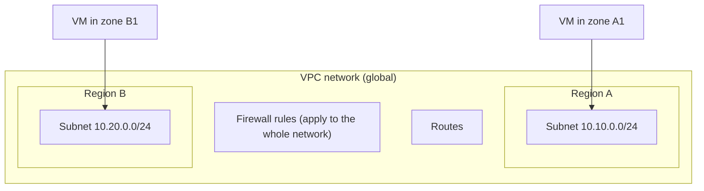

> [!info] Level: junior-middle | Time: about 6 h | You need: [[learn/gcp-iam-and-service-accounts|GCP 02: IAM and service accounts]] and [[learn/ip-addressing-and-subnets|Networking 02: IP addressing and subnets]] | Lab: Lab C, the GCP sandbox project from [[learn/lab-setup|Start 01: Set up your lab]] (Lab A tools for the SSH steps)

Every workload on Google Cloud lives on a network. If you get the network wrong, you either cannot reach your own machines, or everybody on the internet can. This lesson builds a small network from nothing, puts a virtual machine on it without a public address, connects to that machine through Identity-Aware Proxy (IAP), and then looks at how a managed database joins the same network through a private address.

You will create and delete real resources. Most of them are cheap for an hour, and some are not free. Read the cost callouts and run the cleanup at the end.

## What you will learn

- How a VPC network, its subnets, routes and firewall rules fit together, and why the `default` network is not for production.
- How to write firewall rules that are stateful, narrow and targeted at tags or service accounts, and how rule priority works.
- How a VM reaches the internet and Google APIs without a public IP (Cloud NAT, Private Google Access), and how you reach the VM (IAP and OS Login).
- What a VM is made of, what keeps costing money after you stop it, and which leftovers (orphan disks, reserved IPs) show up on bills.
- How Cloud SQL gets a private address, why the Auth Proxy exists, and why `0.0.0.0/0` is never the answer.

## A network on Google Cloud

On Google Cloud, a **VPC network** is a virtual network that spans the whole world as one object. It has no address range of its own. The ranges live in **subnets**, and each subnet belongs to one **region**.



Two things surprise people who come from other clouds or from a data centre:

- **One network can cover several regions.** A VM in region A and a VM in region B can use private addresses to talk to each other if the firewall allows it. You do not build a peering between regions.
- **Firewall rules belong to the network, not to a subnet.** A rule says who may talk to which VMs, wherever they are in the network.

You met the idea of subnets, CIDR blocks and reserved addresses in [[learn/ip-addressing-and-subnets|Networking 02]]. That lesson also lists how many addresses a subnet keeps for itself; take that figure from there and check it in the current documentation before you size a subnet tightly.

### Default mode versus custom mode

When you create a network you choose a **subnet mode**:

| Mode     | What it does                                                                     | When to use it                                                     |
| -------- | -------------------------------------------------------------------------------- | ------------------------------------------------------------------ |
| `auto`   | Creates one subnet in every region, with ranges Google picks from a fixed block. | Quick tests only. The ranges are predictable and can clash later.  |
| `custom` | Creates no subnets. You create each subnet with a range and a region you chose.  | Everything real. You plan ranges so networks can be joined safely. |

A new project can come with a network called `default`, which is in auto mode and has a few permissive firewall rules already attached (for example, one that allows SSH and ICMP from anywhere, and one that allows all traffic inside the network). Whether a project has it depends on organisation policy. For anything beyond a throwaway test, use a custom-mode network and write only the rules you need.

> [!warning] Check before relying on this
> Which rules the `default` network comes with, and whether new projects get it at all, can change and can be turned off by organisation policy. Run `gcloud compute networks list` and `gcloud compute firewall-rules list` in your project to see what is there, and read the "VPC networks" page of the documentation for the current behaviour.

If you plan to join networks later (peering, VPN, Shared VPC), overlapping ranges are expensive to fix. Choose ranges from the private blocks (`10.0.0.0/8`, `172.16.0.0/12`, `192.168.0.0/16`) and keep a written list of what you gave to whom. The lab below uses `10.10.0.0/24`. A GKE cluster also needs room for Pod and Service ranges: you will plan those in [[learn/gke-for-beginners|GCP 04]].

## Firewall rules

Google Cloud firewall rules are applied at the VM's network interface, so traffic is checked even between two VMs in the same subnet. The ideas to learn are these:

- **Stateful.** If a rule allows a connection in, the replies are allowed out without another rule, and the other way round. You write rules for the direction in which a connection starts.
- **Direction.** A rule is `INGRESS` (traffic coming to a VM) or `EGRESS` (traffic leaving it).
- **Action.** A rule either allows or denies, with a protocol and ports (`tcp:22`, `tcp:80,tcp:443`, `icmp`).
- **Priority.** A number from 0 to 65535. The **lower** number wins. If two matching rules disagree, the one with the lower number decides.
- **Implied rules.** Every network has two invisible rules at the lowest priority: deny all ingress, allow all egress. So a new VM accepts nothing from outside until you add an allow rule, and it can call out to anywhere unless you add an egress deny.
- **Targets.** Which VMs the rule applies to: all VMs in the network, VMs with a **network tag**, or VMs that run as a given **service account**.
- **Sources (for ingress) and destinations (for egress).** IP ranges, and for ingress also tags or service accounts.

Tags are plain strings that anyone who can edit a VM can add, so a tag is a convenience rather than a security boundary. A service account is an identity controlled through IAM, so a rule that targets a service account is harder to bypass. Use service accounts where the separation matters, and tags where it is a convenience.

The firewall rule for SSH from your own address looks like this (the command is explained step by step in the exercises):

```bash
gcloud compute firewall-rules create lab-allow-ssh-from-me \
  --network=lab-vpc \
  --direction=INGRESS \
  --action=ALLOW \
  --rules=tcp:22 \
  --source-ranges=203.0.113.10/32 \
  --target-tags=lab-ssh \
  --priority=1000
```

> [!warning] Change this value
> `203.0.113.10/32` is an address from the range reserved for documentation. Replace it with the public address you connect from, as a `/32` (exactly one address). If you leave it, the rule is harmless but useless.

Never allow SSH (`tcp:22`), RDP (`tcp:3389`) or a database port from `0.0.0.0/0`. Internet-wide scanners find an open port 22 within minutes, and every public SSH server collects a stream of password guesses. A rule that is "just for today" tends to stay for years. The better answer for administration is to have no public path at all, which is what IAP gives you in the next section.

> [!tip] Log the rules that matter
> Firewall rules have an option to log the connections they match (`--enable-logging`). Logs cost money to store, so turn them on for the rules you would want to investigate after an incident, not for every rule.

### Routes

A **route** says where traffic for a destination range goes next. You rarely write routes by hand at first, because the network has two kinds that Google creates for you:

- **Subnet routes**, one per subnet range, which make private addresses in the network reachable from each other.
- A **default route** for `0.0.0.0/0` whose next hop is the default internet gateway. A VM with an external address uses it to reach the internet. A VM without an external address has the route, but cannot use it, because there is nothing to translate its private source address into.

Custom routes (to a VPN tunnel, a firewall appliance, a peered network) appear later in the path. For now, you can look at the routes of your network with `gcloud compute routes list --filter="network:lab-vpc"`.

## Internal and external addresses

Every VM network interface has an **internal IP** from its subnet. It may also have an **external IP**, which is a public address. An external IP can be **ephemeral** (assigned when the VM starts, released when it stops) or **static** (reserved, and billed while it exists even if nothing uses it).

The rule for this path, and for most teams: **do not give VMs external IPs**. A VM with no public address cannot be reached directly from the internet, which removes a whole class of attacks. You then need to solve two problems, and Google Cloud has a standard answer to each.

### Reaching out: Private Google Access and Cloud NAT

| Need                                                                                       | Solution                                                                                                     |
| ------------------------------------------------------------------------------------------ | ------------------------------------------------------------------------------------------------------------ |
| The VM must call Google APIs (Cloud Storage, Artifact Registry, Secret Manager) privately. | **Private Google Access**, a setting on the subnet (`--enable-private-ip-google-access`).                    |
| The VM must reach the public internet (package mirrors, third-party APIs).                 | **Cloud NAT**, a managed gateway that translates private addresses to shared public ones, set up per region. |

Cloud NAT is configured on a **Cloud Router**. Both exist only to give a regional outbound path; neither lets anyone connect inwards. A sketch of the commands (you will use them in the optional Cloud SQL exercise):

```bash
gcloud compute routers create lab-router --network=lab-vpc --region=europe-west1
gcloud compute routers nats create lab-nat \
  --router=lab-router --region=europe-west1 \
  --auto-allocate-nat-external-ips --nat-all-subnet-ip-ranges
```

### Reaching in: IAP and OS Login

**Identity-Aware Proxy (IAP) TCP forwarding** lets you open an SSH session to a VM with no external IP. Your `gcloud` client connects to Google, Google checks who you are and whether IAM allows you, and then Google's proxy connects to the VM from a fixed range of addresses, `35.235.240.0/20`. Your firewall allows port 22 only from that range. Nobody else on the internet has a path to port 22.

**OS Login** links SSH access to IAM instead of to keys pasted into project metadata. A person with the right role on the project or instance can log in with their Google identity, and removing the role removes the access. Without it, you must manage SSH keys in metadata, and keys are easy to forget.

> [!warning] Check before relying on this
> The IAP source range, the IAM roles that allow tunnelling (`roles/iap.tunnelResourceAccessor`) and logging in with OS Login (`roles/compute.osLogin`, or `roles/compute.osAdminLogin` for sudo), and how OS Login interacts with your organisation policy are taken from the documentation as the author remembers it and were not re-checked for this page. Read "Using IAP for TCP forwarding" and "Set up OS Login" before you rely on them. In a sandbox project where you are the owner, you already hold enough permission.

For the full design of a locked-down network with controlled egress, see [[architecture/private-gke-and-controlled-egress]] and [[architecture/zero-trust-access-iap-and-vpc-service-controls]].

## Egress and what traffic costs

Network traffic is billed, and the bill depends on where the traffic goes. The pattern is roughly this (check the current network pricing page, because the details and the numbers change):

- Traffic between VMs in the same zone, using internal addresses, is usually free.
- Traffic between zones in a region, and between regions, is billed, and cross-region traffic costs more. This is the answer to "what makes cross-region traffic expensive": it travels over Google's backbone between distant sites, and Google charges per gigabyte for it.
- Traffic from the cloud out to the internet (egress) is billed per gigabyte. Inbound traffic is generally free.
- Load balancer data processing, Cloud NAT data processing and NAT gateway hours have their own charges.

The practical rules: keep chatty components in the same zone or region, send large datasets to users through a CDN rather than straight from a VM, and look at the network cost line when a bill grows.

> [!warning] Check before relying on this
> Which traffic is free and which is billed, and how much, was not verified for this page and changes over time. The pricing page of the current documentation is the only source to rely on.

### Shared VPC in one paragraph

In a **Shared VPC**, one project (the host project) owns the network and other projects (service projects) put their VMs and clusters into its subnets. A central network team controls the ranges and firewall rules, while application teams control their own workloads. You will not set it up in this lab. Know the term, and see [[architecture/shared-vpc-hub-and-spoke]] when your team's design uses it.

## Compute Engine: the anatomy of a VM

A Compute Engine **instance** (a VM) is a handful of pieces:

| Piece             | What it is                                                                                                                                    |
| ----------------- | --------------------------------------------------------------------------------------------------------------------------------------------- |
| Machine type      | How many vCPUs and how much memory, within a **machine family**.                                                                              |
| Boot disk         | A persistent disk created from an **image** (an operating system). It lives separately from the VM and keeps its data when the VM is stopped. |
| Network interface | The subnet, the internal IP, and optionally an external IP.                                                                                   |
| Service account   | The identity the software on the VM uses when it calls Google APIs. See [[learn/gcp-iam-and-service-accounts\|GCP 02]].                       |
| Metadata          | Key-value pairs the VM can read from its metadata server, including a startup script and the OS Login switch.                                 |
| Labels and tags   | Labels organise billing and inventory. Network tags select firewall rules.                                                                    |

**Machine families** group machine types by purpose: general-purpose shapes (the E2 series is a common low-cost starting point), compute-optimised, memory-optimised, accelerator-optimised and others. There are also shared-core shapes (such as `e2-micro`) that can burst but do not guarantee a full CPU. Names and generations change every year, so list what exists in your region before you choose:

```bash
gcloud compute machine-types list --zones=europe-west1-b --filter="name~'^e2-'"
```

> [!warning] Check before relying on this
> The current set of families, generations and shared-core types, and which ones are in your region, is not verified here. Use the command above and the "Machine families" page. Also check which image families are current: the exercises use the `debian-12` family from `debian-cloud`, and a newer Debian family may have replaced it.

**Disks** are separate objects. A persistent disk has a type (standard, balanced, SSD and others; check the list for your region), a size and a zone (or a region, for replicated disks). **Snapshots** are point-in-time copies of a disk, stored cheaply and incrementally, and **images** can be made from a disk. You can attach extra disks, and disks can outlive their VM. This matters for the next point.

A **startup script** is a metadata value (`startup-script`) that runs as root every time the VM boots. It is the simplest way to configure a VM without logging in. Keep it short and idempotent (safe to run twice), and never put secrets in it, because metadata can be read by anything that runs on the VM and by people with the right IAM role.

### Stop is not delete

| State after...               | VM compute (CPU, memory) | Boot disk and extra disks                                                                                     | Reserved static external IP | Ephemeral external IP |
| ---------------------------- | ------------------------ | ------------------------------------------------------------------------------------------------------------- | --------------------------- | --------------------- |
| `stop` (status `TERMINATED`) | Not billed               | **Still billed**                                                                                              | **Still billed**            | Released              |
| `delete`                     | Gone                     | Deleted with the VM only if the disk is set to auto-delete (the boot disk is by default; extra disks are not) | Billed until you release it | Gone                  |

So a stopped VM is not a free VM. The disk still stores data, and it is still charged. This is the single most common surprise in a first cloud bill.

> [!warning] Check before relying on this
> Which resources stop billing on `stop`, and the auto-delete defaults for attached disks, were not re-checked for this page. Confirm in the current Compute Engine and pricing documentation.

### Paying less

- **Spot VMs** use spare capacity at a large discount, and Google can stop them at any time. They fit work that can be interrupted and restarted: batch jobs, CI workers, test environments. They do not fit a database or a single instance that a customer needs.
- **Committed use discounts** give a lower price if you commit to a level of usage for one or three years. You commit only to what you will certainly run; a commitment you cannot use is still billed.
- **Right-sizing** is cheaper than discounts: look at actual CPU and memory use, and pick a smaller shape.
- **Labels** let you split a bill by team, service and environment. See [[architecture/finops-cost-allocation-and-guardrails]].

### The cost traps

1. **Orphan disks.** Delete a VM whose extra disk has auto-delete off, and the disk stays and keeps billing. Find them with a filter for disks with no users (exercise 8).
2. **Reserved but unused IPs.** A static external address that is not attached to anything is billed. List them with `gcloud compute addresses list`.
3. **Forgotten stopped VMs, old snapshots and old images.**
4. **NAT gateways, load balancers and Cloud SQL instances left running.** They bill by the hour.

## Cloud SQL in brief

**Cloud SQL** is Google's managed service for PostgreSQL, MySQL and SQL Server. Google runs the database server, patches it and takes backups. You choose the engine, the size, and the settings, and you own the data, the users and the schema. For the larger design, see [[architecture/backup-architecture-gke-cloud-sql-gcs]].

The points a junior or middle engineer needs:

- **Editions and sizes.** An instance has an edition (the command line lists `enterprise` and `enterprise-plus`) and a size (a machine tier, or custom CPU and memory). Which editions, tiers and database versions are offered, and what they cost, changes, so check the pricing page and `gcloud sql tiers list` before you create anything.
- **Backups and point-in-time recovery (PITR).** Automated backups restore the database to the time of the backup. PITR also keeps transaction logs, so you can restore to a chosen moment, for example just before a bad `DELETE`. It must be switched on before you need it, and it uses storage for the logs. A backup you have never restored is a hope, not a backup.
- **High availability (HA).** The `regional` availability type runs a standby in another zone and fails over automatically. It roughly doubles the compute cost, because you pay for the standby (verify the current pricing model). It protects against a zone failure, not against a bad query or a deleted table: that is what backups are for.
- **Private IP.** By default an instance can have a public IP. Give production databases a **private IP** only. This uses **private services access**: you reserve an address range in your VPC and create a peering with Google's service network, and Cloud SQL then gets an address from that range. The address is reachable from your VPC (and from connected networks, if routes are exchanged), and not from the internet.
- **The Cloud SQL Auth Proxy.** A small program that runs beside your application and opens an encrypted, IAM-authorised connection to the instance. The application connects to `localhost`. This removes the need to manage server certificates and IP allow-lists. The proxy uses IAM, so the identity that runs it needs the `roles/cloudsql.client` role.
- **Never open a database to `0.0.0.0/0`.** An "authorized network" of `0.0.0.0/0` makes the database reachable by anyone who can guess or leak a password. Use private IP plus the Auth Proxy.
- **Encryption in transit.** Set the instance to accept only encrypted connections (the `--ssl-mode=ENCRYPTED_ONLY` option on the create command; the stricter `TRUSTED_CLIENT_CERTIFICATE_REQUIRED` requires client certificates).
- **Deletion protection.** Keep it on for anything you cannot recreate. For the lab you turn it off so that you can clean up.

> [!warning] Check before relying on this
> Editions, tier names, supported database versions, minimum private-range size, how HA is billed and the exact Auth Proxy flags are all version-specific and were not confirmed for this page. The flags in this lesson were compared with `gcloud` help text for Google Cloud SDK 570.0.0 only, not run against a live project. Run every command with `--help` first.

## Hands-on exercises

> [!warning] Costs money
> These exercises create billable resources in your sandbox project: a VM and its disk, and, in the optional part, a Cloud SQL instance and a Cloud NAT gateway. A small VM for an hour is cheap. A Cloud SQL instance and a NAT gateway are not free, even idle. Do the exercises in one sitting and run the cleanup (exercise 14). Cleanup for everything: delete the VM, then the disks, firewall rules, NAT, router, subnet and network. If you lose track, `gcloud projects delete "$LAB_PROJECT_ID"` removes the whole sandbox.

All output below is illustrative: your names, dates and addresses will differ. These commands were checked against `gcloud` help for Google Cloud SDK 570.0.0 but not run against a live project for this page, so read each "If you see something else" line.

1. **Set the variables and the project.** Run this in every new terminal.

   ```bash
   export LAB_PROJECT_ID="lab-yourname-123456"   # Change: the id of your sandbox project from Start 01.
   export REGION="europe-west1"                  # Change if you prefer a region near you.
   export ZONE="europe-west1-b"                  # Change: must be a zone in REGION.
   export MY_IP="203.0.113.10"                   # Change: your public IP, from your network provider or a "what is my ip" check you trust.

   gcloud config set project "$LAB_PROJECT_ID"
   gcloud config get-value project
   gcloud services enable compute.googleapis.com iap.googleapis.com
   ```

   Expected: the project id printed, then (after some seconds) `Operation "operations/..." finished successfully.`
   If you see something else: a `PERMISSION_DENIED` means you are not on the sandbox project or not its owner; check `gcloud config configurations list` (see [[learn/lab-setup|Start 01]]). A message about billing means the project is not linked to a billing account.

2. **Create the network and the subnet.**

   ```bash
   gcloud compute networks create lab-vpc --subnet-mode=custom

   gcloud compute networks subnets create lab-subnet \
     --network=lab-vpc \
     --region="$REGION" \
     --range=10.10.0.0/24 \
     --enable-private-ip-google-access

   gcloud compute networks subnets list --network=lab-vpc
   ```

   Expected, illustrative:

   ```text
   NAME        REGION        NETWORK  RANGE         STACK_TYPE  IPV6_ACCESS_TYPE  INTERNAL_IPV6_PREFIX  EXTERNAL_IPV6_PREFIX
   lab-subnet  europe-west1  lab-vpc  10.10.0.0/24  IPV4_ONLY
   ```

   If you see something else: `The resource 'projects/.../networks/lab-vpc' already exists` means you did this earlier; carry on. An error about the range overlapping means another subnet in `lab-vpc` already uses it.

3. **See what the network has, then add a narrow SSH rule.** First look at the rules (a new custom network has none of its own), then create a rule that allows SSH only from your address to VMs tagged `lab-ssh`, and list it in table form.

   ```bash
   gcloud compute firewall-rules list --filter="network:lab-vpc"

   gcloud compute firewall-rules create lab-allow-ssh-from-me \
     --network=lab-vpc \
     --direction=INGRESS \
     --action=ALLOW \
     --rules=tcp:22 \
     --source-ranges="${MY_IP}/32" \
     --target-tags=lab-ssh \
     --priority=1000

   gcloud compute firewall-rules list --filter="network:lab-vpc" \
     --format="table(name,direction,priority,sourceRanges.list(),allowed[].map().firewall_rule().list(),targetTags.list())"
   ```

   Expected, illustrative: the first list prints nothing (or `Listed 0 items.`). The table then looks like this:

   ```text
   NAME                   DIRECTION  PRIORITY  SOURCE_RANGES   ALLOWED  TARGET_TAGS
   lab-allow-ssh-from-me  INGRESS    1000      203.0.113.10/32  tcp:22   lab-ssh
   ```

   If you see something else: if the first list shows rules, they came from an earlier lab or an organisation setup; read them before going on. If the table `--format` is rejected on your version, drop `--format` and read `gcloud compute firewall-rules describe lab-allow-ssh-from-me`.

4. **Create a service account and a VM with no external IP.** The VM runs as its own service account with no roles, not as the project's default account, so it can do nothing in the project unless you grant it something.

   ```bash
   cat > startup.sh <<'SCRIPT'
   #!/bin/bash
   echo "startup script ran at $(date -u)" > /var/tmp/startup-ran
   SCRIPT

   export VM_SA_NAME="lab-vm-sa"
   gcloud iam service-accounts create "$VM_SA_NAME" --display-name="Lab VM identity"
   export VM_SA="${VM_SA_NAME}@${LAB_PROJECT_ID}.iam.gserviceaccount.com"

   gcloud compute instances create lab-vm \
     --zone="$ZONE" \
     --machine-type=e2-micro \
     --subnet=lab-subnet \
     --no-address \
     --tags=lab-ssh \
     --image-family=debian-12 \
     --image-project=debian-cloud \
     --service-account="$VM_SA" \
     --scopes=cloud-platform \
     --shielded-secure-boot --shielded-vtpm --shielded-integrity-monitoring \
     --metadata=enable-oslogin=TRUE \
     --metadata-from-file=startup-script=startup.sh \
     --labels=env=lab,owner=yourname

   gcloud compute instances list
   ```

   Expected, illustrative:

   ```text
   NAME    ZONE            MACHINE_TYPE  PREEMPTIBLE  INTERNAL_IP  EXTERNAL_IP  STATUS
   lab-vm  europe-west1-b  e2-micro                   10.10.0.2                 RUNNING
   ```

   The `EXTERNAL_IP` column is empty, which is the point. The `cloud-platform` scope sets the widest access scope and lets IAM roles (which this account has none of yet) decide what the VM can do, the approach the documentation recommends for new VMs (verify for your version).
   If you see something else: `Invalid value for field 'resource.disks[0].initializeParams.sourceImage'` means the image family is gone or renamed; list families with `gcloud compute images list --filter="family~debian" --no-standard-images` and change `--image-family`. An error that the machine type is not available in the zone means you should choose another zone or another shape.

5. **Reach the VM through IAP.** Allow SSH from the IAP range, then connect with the tunnel flag.

   ```bash
   gcloud compute firewall-rules create lab-allow-iap-ssh \
     --network=lab-vpc \
     --direction=INGRESS \
     --action=ALLOW \
     --rules=tcp:22 \
     --source-ranges=35.235.240.0/20 \
     --target-tags=lab-ssh \
     --priority=1000

   gcloud compute ssh lab-vm --zone="$ZONE" --tunnel-through-iap \
     --command='hostname; ip -4 addr show scope global | grep inet; cat /var/tmp/startup-ran'
   ```

   Expected, illustrative:

   ```text
   lab-vm
       inet 10.10.0.2/32 metric 100 brd 10.10.0.2 scope global dynamic ens4
   startup script ran at Sat Oct 17 09:41:12 UTC 2026
   ```

   The first connection may ask to create an SSH key or to confirm the host key; accept. It can take a minute after VM creation before SSH works.
   If you see something else: an error that the connection through the tunnel failed or timed out, mentioning a code such as 4003 or 4033, usually means the firewall rule is missing, the VM has not finished booting, or your account lacks the IAP tunnel role (verify the codes in the IAP troubleshooting page). `Permission denied (publickey)` with OS Login means your account lacks an OS Login role on the project. If `startup-ran` is missing, the VM is still booting: wait and retry.

6. **Check that nothing reaches the VM except through IAP.** List the rules that allow port 22 and remove the "from my IP" rule, because the VM has no external IP and the rule only adds risk.

   ```bash
   gcloud compute firewall-rules delete lab-allow-ssh-from-me --quiet
   gcloud compute firewall-rules list --filter="network:lab-vpc" --format="table(name,sourceRanges.list(),targetTags.list())"
   ```

   Expected, illustrative:

   ```text
   NAME                SOURCE_RANGES      TARGET_TAGS
   lab-allow-iap-ssh   35.235.240.0/20    lab-ssh
   ```

   If you see something else: if the old rule is still listed, the delete was refused; read the error, which usually names a missing permission.

7. **Stop the VM and see that the disk is still there.**

   ```bash
   gcloud compute instances stop lab-vm --zone="$ZONE"
   gcloud compute instances list --format="table(name,status)"
   gcloud compute disks list
   ```

   Expected, illustrative:

   ```text
   NAME    STATUS
   lab-vm  TERMINATED

   NAME    LOCATION        LOCATION_SCOPE  SIZE_GB  TYPE         STATUS
   lab-vm  europe-west1-b  zone            10       pd-balanced  READY
   ```

   The VM is `TERMINATED`, so its compute is not billed, but the `lab-vm` disk is `READY` and is still billed. Your disk size and type may differ.
   If you see something else: if the status is `STOPPING`, wait a few seconds and list again.

8. **Create an orphan disk and find it with a filter.** A disk that no VM uses shows up with an empty `users` field. The filter `-users:*` means "no value in users".

   ```bash
   gcloud compute disks create lab-orphan --zone="$ZONE" --size=10GB --type=pd-balanced

   gcloud compute disks list --filter="-users:*" \
     --format="table(name,zone.basename(),sizeGb,type.basename(),users.list())"
   ```

   Expected, illustrative:

   ```text
   NAME        ZONE            SIZE_GB  TYPE         USERS
   lab-orphan  europe-west1-b  10       pd-balanced
   ```

   The stopped VM's boot disk does not appear, because it is still attached (its `users` field names the VM). If your filter shows nothing, remove it and read the `users` column.
   If you see something else: if both disks appear, your `gcloud` version may treat the filter differently; check `gcloud topic filters`.

9. **Delete the orphan disk and the VM.** Deleting the VM removes its boot disk if auto-delete is on (the default for boot disks).

   ```bash
   gcloud compute disks delete lab-orphan --zone="$ZONE" --quiet
   gcloud compute instances delete lab-vm --zone="$ZONE" --quiet
   gcloud compute disks list
   gcloud compute instances list
   ```

   Expected: both lists print `Listed 0 items.`
   If you see something else: if a disk remains, its auto-delete setting was off. Delete it with `gcloud compute disks delete <name> --zone="$ZONE"`. This is exactly how orphan disks are born.

Exercises 10 to 13 are optional. They are the part that costs most, because Cloud SQL and Cloud NAT bill by the hour. Read them first, and skip them if you only want the networking. Exercise 14, the cleanup, is not optional.

10. **Optional, costs money: allow a private range for Cloud SQL and create the instance.** Cloud SQL private IP needs a reserved range and a peering with Google's service network. The instance can take several minutes to create.

    ```bash
    gcloud services enable servicenetworking.googleapis.com sqladmin.googleapis.com

    gcloud compute addresses create lab-psa-range \
      --global --purpose=VPC_PEERING --prefix-length=24 --network=lab-vpc

    gcloud services vpc-peerings connect \
      --service=servicenetworking.googleapis.com \
      --ranges=lab-psa-range --network=lab-vpc

    gcloud sql instances create lab-pg \
      --database-version=POSTGRES_16 \
      --edition=enterprise \
      --tier=db-f1-micro \
      --region="$REGION" \
      --network=lab-vpc \
      --no-assign-ip \
      --ssl-mode=ENCRYPTED_ONLY \
      --availability-type=zonal \
      --no-deletion-protection

    gcloud sql users set-password postgres --instance=lab-pg --prompt-for-password
    gcloud sql instances list --format="table(name,databaseVersion,state,ipAddresses[].ipAddress,ipAddresses[].type)"
    ```

    Expected, illustrative:

    ```text
    NAME    DATABASE_VERSION  STATE     ADDRESS      TYPE
    lab-pg  POSTGRES_16       RUNNABLE  10.30.0.3    PRIVATE
    ```

    The address is from the range you reserved (Google picks it), and there is no `PRIMARY` public address. The password prompt takes input without echo; use a long random value from your password manager.
    If you see something else: errors about the version, edition or tier mean the value is not offered any more; run `gcloud sql tiers list` and check the supported versions, then change the flag. An error that the peering range is too small or invalid means the `--prefix-length=24` was not enough for your chosen options: check the minimum size in the private services access documentation. If the instance stays in a `PENDING_CREATE` state for a long time, wait, and read `gcloud sql operations list --instance=lab-pg`.

11. **Optional, costs money: create a NAT gateway so the VM can install software, and recreate the VM.** The VM has no external IP, so without NAT it cannot download the proxy or install a client.

    ```bash
    gcloud compute routers create lab-router --network=lab-vpc --region="$REGION"
    gcloud compute routers nats create lab-nat \
      --router=lab-router --region="$REGION" \
      --auto-allocate-nat-external-ips --nat-all-subnet-ip-ranges

    gcloud projects add-iam-policy-binding "$LAB_PROJECT_ID" \
      --member="serviceAccount:${VM_SA}" --role=roles/cloudsql.client

    gcloud compute instances create lab-vm \
      --zone="$ZONE" --machine-type=e2-small --subnet=lab-subnet --no-address \
      --tags=lab-ssh --image-family=debian-12 --image-project=debian-cloud \
      --service-account="$VM_SA" --scopes=cloud-platform \
      --shielded-secure-boot --shielded-vtpm --shielded-integrity-monitoring \
      --metadata=enable-oslogin=TRUE
    ```

    Expected: a router, a NAT config and a running VM with an internal IP only.
    If you see something else: if the role binding is refused, you are not an owner of the sandbox project.

12. **Optional, costs money: connect through the Auth Proxy.** Install a PostgreSQL client and the proxy on the VM, start the proxy, and connect to `localhost`.

    ```bash
    gcloud compute ssh lab-vm --zone="$ZONE" --tunnel-through-iap
    ```

    Then, on the VM (the lines starting with `#` are comments):

    ```bash
    sudo apt-get update && sudo apt-get install -y postgresql-client curl

    # Change PROXY_VERSION to the latest v2 release number shown on the Cloud SQL Auth Proxy
    # releases page (do not guess). Check the download URL pattern in the Auth Proxy documentation.
    PROXY_VERSION="X.Y.Z"
    curl -fsSL -o cloud-sql-proxy \
      "https://storage.googleapis.com/cloud-sql-connectors/cloud-sql-proxy/v${PROXY_VERSION}/cloud-sql-proxy.linux.amd64"
    chmod +x cloud-sql-proxy

    # Change LAB_PROJECT_ID and the region to your values.
    ./cloud-sql-proxy --private-ip "LAB_PROJECT_ID:europe-west1:lab-pg" &

    psql "host=127.0.0.1 port=5432 user=postgres dbname=postgres" -c "select version();"
    ```

    Expected, illustrative: the proxy logs that it is ready for new connections on `127.0.0.1:5432`, `psql` asks for the password you set, and then prints one row starting with `PostgreSQL 16`.
    If you see something else: `curl` returning 404 means the version or URL pattern is wrong; fix the variable from the releases page. `Permission denied` from the proxy about `cloudsql.instances.connect` means the VM's service account lacks `roles/cloudsql.client` (exercise 11) or the role has not propagated yet (wait a minute). A refused connection means the proxy is not running. If `--private-ip` is not recognised, run `./cloud-sql-proxy --help`; the flag names change between major versions.

13. **Optional: prove the database is not reachable from the internet.** Ask for the instance details and check that there is no public address.

    ```bash
    gcloud sql instances describe lab-pg --format="yaml(ipAddresses,settings.ipConfiguration.ipv4Enabled,settings.ipConfiguration.sslMode)"
    ```

    Expected, illustrative:

    ```text
    ipAddresses:
    - ipAddress: 10.30.0.3
      type: PRIVATE
    settings:
      ipConfiguration:
        ipv4Enabled: false
        sslMode: ENCRYPTED_ONLY
    ```

    If you see something else: `ipv4Enabled: true` or a `PRIMARY` address means the instance has a public IP; patch it off before it holds data.

14. **Clean up everything.** Delete in this order, because a network cannot be deleted while resources still use it.

    ```bash
    gcloud sql instances delete lab-pg --quiet
    gcloud compute instances delete lab-vm --zone="$ZONE" --quiet
    gcloud compute routers nats delete lab-nat --router=lab-router --region="$REGION" --quiet
    gcloud compute routers delete lab-router --region="$REGION" --quiet
    gcloud services vpc-peerings delete --network=lab-vpc --service=servicenetworking.googleapis.com --quiet
    gcloud compute addresses delete lab-psa-range --global --quiet
    gcloud compute firewall-rules delete lab-allow-iap-ssh --quiet
    gcloud compute networks subnets delete lab-subnet --region="$REGION" --quiet
    gcloud compute networks delete lab-vpc --quiet
    gcloud iam service-accounts delete "$VM_SA" --quiet

    gcloud compute instances list
    gcloud compute disks list
    gcloud compute addresses list
    gcloud sql instances list
    ```

    Expected: each final list shows nothing. If you skipped exercises 10 to 13, the lab-vm, SQL, NAT, router, peering and lab-psa-range lines report that the resource was not found, which is fine.
    If you see something else: deleting the peering can fail for some minutes after the Cloud SQL instance is gone; wait and retry. A network that cannot be deleted names the resource that still uses it. Remember the role binding from exercise 11 is removed when its service account is deleted, but check `gcloud projects get-iam-policy "$LAB_PROJECT_ID"` for a leftover `deleted:serviceAccount` member if you want a clean policy.

## Common mistakes

- **Opening port 22 (or a database port) to `0.0.0.0/0`.** Why it bites: the internet finds it within minutes, and one weak password or old key is a breach. Fix: use IAP and OS Login for administration, and private IP plus the Auth Proxy for databases.
- **Using the `default` network for real workloads.** Why it bites: it has broad rules you did not write and ranges you did not choose, and overlapping ranges block peering later. Fix: custom mode, planned ranges, rules written by you.
- **Giving every VM an external IP "so it works".** Why it bites: each one is an attack surface and a billing line. Fix: no external IPs; Cloud NAT for outbound, Private Google Access for Google APIs.
- **Running a VM as the default compute service account with wide scopes.** Why it bites: code on the VM inherits whatever that account can do. Fix: a dedicated service account with only the roles the workload needs.
- **Thinking `stop` stops the bill.** Why it bites: disks and reserved IPs keep billing. Fix: delete what you do not need, and snapshot first if you may need the data.
- **Leaving orphan disks, static IPs and snapshots behind.** Why it bites: they are invisible until the bill. Fix: filter for them regularly, and label resources with an owner and an expiry.
- **Using only tags to separate environments.** Why it bites: anyone who can edit a VM can add a tag. Fix: use service-account targets for rules that matter.
- **A secret in a startup script.** Why it bites: metadata is readable on the VM. Fix: use Secret Manager (see [[patterns/external-secrets-with-secret-manager]]).
- **Treating HA as a backup.** Why it bites: the standby replicates a mistake as fast as the primary. Fix: backups with PITR, and a tested restore.
- **Skipping deletion protection on a real database, or leaving it on in a lab.** Why it bites: one is a data-loss risk, the other blocks cleanup. Fix: on for production, off only for disposable instances.

## Check your understanding

1. Why should you not allow `tcp:22` from `0.0.0.0/0`, and what do you use instead?
2. Why use IAP instead of giving a VM a public IP, and what does the firewall rule for it look like?
3. A VM is `TERMINATED`. Name three things that can still cost money.
4. What makes cross-region traffic more expensive than traffic inside a zone?
5. Two firewall rules match the same traffic: priority 900 denies it and priority 1000 allows it. What happens, and why?
6. What does private services access do for Cloud SQL, and why connect through the Auth Proxy instead of opening an authorized network?

> [!question]- Answers
>
> 1. Because anyone on the internet can then try to log in to every VM that carries the tag, and scanners find open SSH ports in minutes. Use IAP TCP forwarding with a rule that allows port 22 only from the IAP range (`35.235.240.0/20`), plus OS Login so access follows IAM.
> 2. IAP lets you reach a VM that has no external IP, after Google has checked your identity and IAM permission. The rule allows `tcp:22` from `35.235.240.0/20` to the VMs it should reach (by tag or service account). Nobody else has a network path to port 22.
> 3. Its disks (boot and extra), a reserved static external IP, snapshots and images made from it, and shared resources around it such as a Cloud NAT gateway or a load balancer. The compute (CPU and memory) stops billing.
> 4. The traffic crosses Google's backbone between distant locations, and Google bills network egress by volume with higher rates between regions than within one. Inside a zone on internal addresses it is usually free. Check the current pricing page for the rates.
> 5. The traffic is denied. The rule with the lower priority number is evaluated first and wins, so 900 beats 1000.
> 6. It gives Cloud SQL an address from a range you reserved in your VPC, reached over a peering, so the database has no public address. The Auth Proxy opens an encrypted connection authorised by IAM, so you do not manage certificates or IP allow-lists, and you never need an authorised network such as `0.0.0.0/0`.

## Next steps

Next lesson: [[learn/gke-for-beginners|GCP 04: GKE for beginners]]. Previous lesson: [[learn/gcp-iam-and-service-accounts|GCP 02: IAM and service accounts]].

To go deeper:

- [[patterns/terraform-module-and-state-layout]] shows how to keep a VPC like this as code; the Terraform basics come in [[learn/terraform-basics-on-gcp|Delivery 04: Terraform basics with a first GCP project]] and Delivery 05.
- [[architecture/shared-vpc-hub-and-spoke]], [[architecture/private-gke-and-controlled-egress]] and [[architecture/environment-separation-on-gcp]] cover the network designs that grow out of this lesson.
- [[architecture/finops-cost-allocation-and-guardrails]] covers labels, budgets and reports for the cost traps above.
- [[learn/load-balancers-firewalls-and-network-troubleshooting|Networking 05]] for firewall thinking and troubleshooting in general.
- The whole path is mapped in [[learn/index|the learning path]].

## Sources

Not checked against a live project for this page. Commands were compared only with the `gcloud` help text of Google Cloud SDK 570.0.0. Check each page for your version.

- Google Cloud documentation, "VPC networks" and "Subnets" (https://cloud.google.com/vpc/docs). Not verified: the `default` network's rules, subnet reserved addresses.
- Google Cloud documentation, "VPC firewall rules" (https://cloud.google.com/firewall/docs/firewalls), including implied rules and priority.
- Google Cloud documentation, "Routes overview" (https://cloud.google.com/vpc/docs/routes).
- Google Cloud documentation, "Private Google Access" and "Cloud NAT overview" (https://cloud.google.com/nat/docs/overview).
- Google Cloud documentation, "Compute Engine instances", "Machine families resource and comparison guide" and "Persistent Disk" (https://cloud.google.com/compute/docs). Not verified: current families and image families.
- Google Cloud documentation, "Use IAP for TCP forwarding" (https://cloud.google.com/iap/docs/using-tcp-forwarding) and "About OS Login" (https://cloud.google.com/compute/docs/oslogin). Not verified: the exact roles and the error codes.
- Google Cloud documentation, "Spot VMs" and "Committed use discounts" (https://cloud.google.com/compute/docs/instances/spot).
- Google Cloud documentation, "Network pricing" (https://cloud.google.com/vpc/network-pricing) and "Compute Engine pricing". Not verified: which traffic is free, and rates.
- Google Cloud documentation, Cloud SQL: "Introduction", "Cloud SQL editions", "About private services access", "About the Cloud SQL Auth Proxy", "High availability" and "Backups and point-in-time recovery" (https://cloud.google.com/sql/docs). Not verified: editions, tiers, versions, HA billing, proxy flags.
