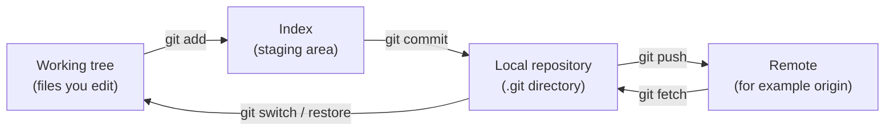
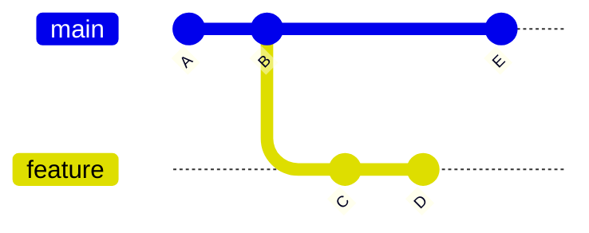

> [!info] Level: junior | Time: about 4 h | You need: [[learn/lab-setup|Start 01: Set up your lab]] and the shell basics from [[learn/linux-shell-and-filesystem|Linux 01: The shell and the filesystem]] | Lab: Option A, the Ubuntu LTS VM (or the container from Option B) from [[learn/lab-setup|Start 01]]

Most people who are afraid of Git are afraid because they have a wrong picture of it. They think a commit is a "change" that can be lost, and that a wrong command can destroy their work. Git is closer to a small database of snapshots. Once you can see what is stored and what each command moves, most "disasters" turn out to be a pointer in the wrong place, and a pointer can be moved back.

> [!note] What was run
> Every command in the exercises was run on Ubuntu 24.04.5 LTS with Git 2.43.0 on 2026-10-17, in throwaway repositories with a local bare repository standing in for the remote. Commit IDs, timestamps and temporary paths differ on your machine, so the IDs in the sample output are illustrative. Compare the shape, not the characters. The remote in the exercises is a local directory, so no hosting service or account is needed.

## What you will learn

- The four places your work can live: the working tree, the index (staging area), the local repository and the remote.
- What Git stores: blobs, trees, commits and tags, and why a commit is a snapshot and not a diff.
- That a branch is a small file holding one commit ID, and what `HEAD` means when it is attached and when it is detached.
- How to read the state of a repository with `status`, `log`, `show` and `diff`.
- How to make good commits: one logical change, a clear message, `git add -p`, and `--amend` only before you push.
- How to park work with `stash`, and the difference between `fetch` and `pull`.

## Why a model first

Git has hundreds of options, but the daily work uses a handful of commands. The commands are easy to learn. The trouble starts when something unexpected happens: a "detached HEAD" warning, a file that shows as both staged and modified, a push that is rejected. Without a model, you guess. With a model, you ask one question: which pointer is where?

This lesson builds the model first and then the workflow on top of it. The next lesson, [[learn/git-merge-rebase-and-undo|Git 02: Merge, rebase, conflicts and undoing mistakes]], uses the same model to explain how to recover from mistakes.

## The four places your work lives

Your work can be in four places. Almost every Git command copies data from one place to another.



| Place            | What it holds                                                 | Where it is                          |
| ---------------- | ------------------------------------------------------------- | ------------------------------------ |
| Working tree     | The files you see and edit.                                   | The project folder.                  |
| Index            | The exact content of your _next_ commit.                      | `.git/index` (a binary file).        |
| Local repository | All commits, trees and files you have fetched or made.        | `.git/objects` and `.git/refs`.      |
| Remote           | Another copy of the repository, usually on a hosting service. | A URL such as `git@example.com:...`. |

The index is the part people skip, and it is the part that confuses them later. When you run `git add`, Git does not "mark the file". It copies the file's current content into the index. When you run `git commit`, Git builds the commit from the index, not from the working tree. That is why you can edit a file after `git add` and see the file listed twice in `git status`: the staged version is in the index and the newer edits are only in the working tree.

## What Git stores: objects

Inside `.git/objects` Git keeps four kinds of object. Each one is stored under the SHA-1 hash of its content (`sha256` is available as an alternative in recent versions, but SHA-1 is what you will meet almost everywhere). This is **content addressing**: the name of an object is computed from what it contains.

| Object | What it is                                                                |
| ------ | ------------------------------------------------------------------------- |
| blob   | The content of one file. No file name, no permissions.                    |
| tree   | A directory listing: names, modes and the IDs of blobs or other trees.    |
| commit | A pointer to one tree, plus parent commit(s), author, committer, message. |
| tag    | A named, optionally signed pointer to another object (usually a commit).  |

Two consequences matter every day:

1. **The same content has the same ID.** If two files have identical content, Git stores one blob. If you change one byte, you get a new blob with a different ID.
2. **You cannot change an object, only make a new one.** If a commit's content changes (a different message, a different parent), its ID changes. This is why "rewriting history" really means creating new commits and moving a pointer to them. It is also why old commits usually still exist after you "lose" them, which is the basis of recovery in the next lesson.

### A commit is a snapshot, not a diff

A frequent wrong picture: "a commit is the set of changes I made". A commit points to a **tree**, which describes the full state of the project at that moment. When you run `git show`, Git _computes_ a diff by comparing that tree with the parent's tree. The diff is a view, not what is stored.

This explains behaviour that otherwise looks magic. Moving a branch to another commit gives you that commit's whole project state. Reverting a commit means computing the opposite diff and committing it as new work.

### Commits form a graph

Each commit stores the ID of its parent (a merge commit has two). Following parents backwards gives the history. Because parents point only backwards and never form a loop, the structure is a **directed acyclic graph** (DAG).



Here `E` and `D` share the parent chain `A <- B`. Nothing in `A` or `B` knows about the branches. The branches are only labels, which is the next topic.

## Branches, HEAD and remote-tracking branches

A **branch is a file** that contains one commit ID. That is all. Creating a branch writes 41 bytes. Making a commit on a branch moves that one pointer forward to the new commit.

`HEAD` is another file. It says where you are now. Normally it holds the name of a branch, which means "I am on that branch, and the next commit moves that branch".

```bash
cat .git/HEAD
cat .git/refs/heads/main
```

```text
ref: refs/heads/main
bde72847767833f2fd65cb330c212a8429b4ecee
```

_Illustrative: the commit ID is different in every repository._

When `HEAD` holds a commit ID instead of a branch name, you are in **detached HEAD** state. New commits then move only `HEAD`, and no branch label follows them. Git warns you when you leave such commits behind (you will do this on purpose in exercise 5, and recover them).

`origin/main` is a **remote-tracking branch**. It is a local, read-only bookmark that remembers where `main` was on the remote the last time you talked to it (with `fetch`, `pull` or `push`). It is not live. `main` is your branch. `origin/main` is your last known copy of theirs. Many "my branch is behind" questions are answered by remembering that difference.

> [!note] The default branch name is a setting
> New repositories get the branch name from the `init.defaultBranch` setting. Older Git versions default to `master`, newer ones can be configured. The exercises set it to `main` on the first command, so the sample output matches. If your repository says `master`, nothing is wrong: use that name in the commands.

## Reading the state

Four commands tell you nearly everything. Learn to read them before you learn to change things.

```bash
git status                      # what is staged, modified, untracked, and the branch
git status -sb                  # the same in two columns, plus ahead/behind
git log --oneline --graph --all # the shape of history, all branches
git show                        # the last commit with its diff
git diff                        # working tree vs index (unstaged changes)
git diff --staged               # index vs last commit (what you would commit)
```

`git status -s` shows two columns. The left column is the index versus the last commit. The right column is the working tree versus the index. So `M ` means staged, ` M` means modified but not staged, and `MM` means staged and then modified again.

## Making good commits

A good commit is easy to review, easy to revert and easy to find later with `git log`. Three habits get you most of the way.

1. **One logical change per commit.** "Fix the retry bug" and "rename a variable everywhere" are two commits, even if you did them in the same hour. Mixed commits cannot be reverted alone.
2. **Every commit builds and passes the tests.** Then `git bisect` (see the next lesson) can walk through history safely.
3. **Review what you stage.** `git diff --staged` before every commit catches debug prints, accidental files and secrets before they enter history. A secret that is committed is exposed even if you delete it in the next commit. See [[patterns/secret-scanning-pre-commit-and-ci]] for tooling that catches it, and [[learn/security-basics-for-devops|Security 01]] for what to do if it happens.

### Stage part of a file with `git add -p`

`git add -p` (patch mode) shows each changed chunk, called a hunk, and asks what to do. Answers: `y` stage it, `n` skip it, `s` split it into smaller hunks, `e` edit it by hand, `q` quit. It is the tool for splitting a messy hour of work into clean commits.

### Commit messages

A message has a **subject**, a blank line and an optional **body**.

```text
Add health endpoint note

The load balancer needs a cheap URL to probe. Document it in
app.txt so the next change can add the route.
```

- Keep the subject to 72 characters or fewer, so tools such as `git log --oneline` and the hosting UI do not cut it. Many teams use about 50.
- Write the subject in the imperative: "Add health endpoint note", not "Added" or "Adds". A useful test is whether it completes the sentence "If applied, this commit will ...".
- Use the body to say **why**, not what. The diff already shows what.
- Conventional Commits (`feat: ...`, `fix: ...`) is an optional convention. It matters if tooling reads your messages to build changelogs or version numbers. Follow your team's rule. See [[patterns/release-versioning-and-changelog-automation]] for the senior view.

### Amending

`git commit --amend` replaces the last commit with a new one. Because commits are immutable, the result has a **new ID** with the same parent. Amend freely while the commit exists only on your machine. Do not amend a commit you have already pushed and others may have pulled: they hold the old commit and your history now disagrees with theirs. The next lesson covers what to do then.

## Branches in daily use

```bash
git switch -c fix/retry-timeout   # create a branch and move to it
git switch main                   # move back
git branch -d fix/retry-timeout   # delete a branch that is fully merged
```

Prefer `git switch` for moving between branches and `git restore` for files. The older `git checkout` does both jobs and works, but it is easy to misuse. Both new commands have been available since Git 2.23 and are marked experimental in the manual page of some versions (see the callout below).

> [!warning] Check before relying on this
> `git switch` and `git restore` were introduced in Git 2.23 (2019). Check `git --version` and the manual page for your version; the manual of some releases still describes them as experimental. Everything in this lesson also works with `git checkout`.

`git branch -d` refuses to delete a branch whose commits are not reachable from your current branch, which protects you. `git branch -D` forces it. The commits are not erased immediately, which the next lesson uses.

## Stash: park work you are not ready to commit

You are halfway through a change and need to switch branches. `git stash push -m "wip retry"` saves your tracked, modified files (and staged changes) and cleans the working tree. `git stash list` shows the stack. `git stash pop` re-applies the most recent entry and drops it. By default untracked files are not stashed; add `-u` to include them.

A stash is a pair of commits Git keeps under `refs/stash`. It is local to your machine and easy to forget, so do not use it as a long-term store: make a work-in-progress commit on a branch instead.

## Remotes: fetch, pull and push

- `git fetch` downloads new commits and moves your `origin/*` bookmarks. It never touches your branches or working tree, so it is always safe.
- `git pull` is `fetch` followed by an integration step: a merge, or a rebase if you configured `pull.rebase`. It can change your branch and can stop on a conflict.
- `git push` uploads your commits and moves the branch on the remote. The remote refuses it if that would lose commits (a non-fast-forward push).
- `git push -u origin <branch>` pushes and sets the **upstream**, so later `git status`, `git pull` and `git push` know which remote branch to use.

A safe habit is to `fetch`, look at what changed with `git log main..origin/main`, and then integrate. You will do that in exercise 9.

## Identity

Git writes your name and email into every commit. Set them once:

```bash
git config --global user.name "Your Name"
git config --global user.email "you@example.com"
git config --global init.defaultBranch main
git config --global --list
```

Use the email your hosting service associates with your account, or the "no-reply" address it offers, if you do not want to publish a personal one. These values are only labels. Anyone can write any name into a commit, so a name in `git log` proves nothing. A cryptographic signature shows that a commit was signed with a key you trust, and it comes in [[learn/security-basics-for-devops|Security 01]].

## Hands-on exercises

Run these in your lab VM. They create a directory called `git-lab` and a bare repository called `remote.git` in a temporary folder, so nothing touches real projects. Install Git first if needed: `sudo apt install -y git`.

Start with these lines, which keep every exercise away from your real Git settings (the `HOME` override means your real `~/.gitconfig` is not used or changed in this shell):

```bash
export LAB_HOME="$(mktemp -d)"   # a throwaway home directory for this lesson
export HOME="$LAB_HOME"
export LAB_WORK="$(mktemp -d)"   # where git-lab, remote.git and teammate live
cd "$LAB_WORK"
git config --global user.name "Lab User"
git config --global user.email "lab@example.com"
git config --global init.defaultBranch main
```

Expected: no output. If you see something else: an error from `mktemp` means `/tmp` is not writable, so use `mkdir ~/git-scratch && cd ~/git-scratch` instead (and still set `HOME` as above). If you close the terminal, repeat these lines and the commands below that you still need.

1. **Create a repository and look inside.**

   ```bash
   git init git-lab
   cd git-lab
   cat .git/HEAD
   ls .git
   ```

   Expected: `Initialized empty Git repository in .../git-lab/.git/`, then `ref: refs/heads/main`, then a list that contains `HEAD`, `config`, `hooks`, `objects` and `refs` (and a few more).
   If you see something else: `ref: refs/heads/master` means your Git ignored the setting. Use `master` wherever this lesson says `main`.

2. **Make a commit and read the objects.**

   ```bash
   printf 'line one\nline two\nline three\n' > app.txt
   seq 1 40 > nums.txt
   git add app.txt nums.txt
   git commit -m "Add app.txt and nums.txt"
   git cat-file -t HEAD
   git cat-file -p HEAD
   git cat-file -p 'HEAD^{tree}'
   git cat-file -p HEAD:app.txt
   cat .git/refs/heads/main
   git rev-parse HEAD
   ```

   Expected (illustrative IDs): the commit line `[main (root-commit) 5554426] Add app.txt and nums.txt`; then `commit`; then the commit object with a `tree` line, `author`, `committer` and the message; then a tree listing with two `100644 blob ...` lines for `app.txt` and `nums.txt`; then the three lines of `app.txt`. The last two commands print the same 40-character ID.
   If you see something else: if `git commit` says `Please tell me who you are`, the identity lines above did not run in this shell. If the last two IDs differ, you changed `HOME` after the commit and are in a different repository; check `pwd`.

3. **Watch the three areas.** Edit a file, stage it, then edit it again.

   ```bash
   printf 'line one\nline two\nline three\nline four\n' > app.txt
   git status -s
   git diff
   git add app.txt
   git diff
   git diff --staged
   printf 'line five\n' >> app.txt
   git status -s
   git diff
   git diff --staged
   ```

   Expected: first ` M app.txt` (the space is the left column) and a diff adding `line four`. After `git add`, the plain `git diff` prints nothing and `git diff --staged` shows `+line four`. After the second edit, the status is `MM app.txt`, `git diff` shows only `+line five`, and `git diff --staged` still shows only `+line four`.
   If you see something else: if `git diff` stays empty after the first edit, check that you saved the file with `cat app.txt`. If you see `warning: in the working copy of ... LF will be replaced by CRLF`, your line-ending settings differ; it is harmless for this lesson.

   Now commit only what is staged, then look at what is left:

   ```bash
   git commit -m "Add line four"
   git status -s
   ```

   Expected: `1 file changed, 1 insertion(+)` and then ` M app.txt`. The `line five` edit was never staged, so it is not in the commit.
   If you see something else: `nothing to commit` means nothing was staged; repeat `git add app.txt`.

4. **Stage one hunk with `git add -p`.** Change the first and last line of `nums.txt`, which are far apart and so make two hunks. Discard the `app.txt` edit first so it does not interfere.

   ```bash
   git restore app.txt
   sed -i '1s/.*/one/; 40s/.*/forty/' nums.txt
   git diff --stat
   printf 'y\nn\n' | git add -p nums.txt
   git diff --staged --stat
   git diff --stat
   git commit -m "Spell out the first number"
   git restore nums.txt
   git status -s
   ```

   Expected: `git diff --stat` shows `nums.txt | 4 ++--`. The `add -p` run prints two hunks with the prompt `Stage this hunk [y,n,q,a,d,j,J,g,/,e,?]?` for the first and a shorter list for the second, and your two answers (`y`, `n`) stage the first only. Then the staged stat is `nums.txt | 2 +-`, and the unstaged stat is also `nums.txt | 2 +-`. After the commit and the restore, `git status -s` prints nothing.
   If you see something else: if you see only one hunk, the two edited lines are close together or the `sed` did not match. Run `git diff` and check lines 1 and 40. You can answer `s` to split a hunk. `git restore` throws the unstaged edit away for good, because it was never committed, so only use it on edits you do not want.

5. **Lose a commit in detached HEAD, then find it again.**

   ```bash
   git switch --detach HEAD~1
   echo detached > try.txt
   git add try.txt
   git commit -m "Try an idea"
   git switch main
   git log --oneline --all --graph
   git reflog -4
   ```

   Expected (illustrative IDs): `HEAD is now at f4b15c4 Add line four`, then `[detached HEAD 74c04c8] Try an idea`, then a long warning that starts `Warning: you are leaving 1 commit behind, not connected to any of your branches:` and names `Try an idea`. The graph shows only the three commits on `main`: the idea is "lost". The reflog shows it as `HEAD@{1}: commit: Try an idea`.
   If you see something else: if there is no warning, you committed on a branch instead of detached; check that the first command printed `HEAD is now at`.

   Now rescue it. Read the ID from the reflog line (here it is `74c04c8`, yours differs):

   ```bash
   git switch -c rescued-idea 74c04c8
   git log --oneline --all --graph
   ```

   Expected: `Switched to a new branch 'rescued-idea'` and a graph in which `Try an idea` branches off `Add line four`. The commit never left the repository. It just had no label.
   If you see something else: `fatal: invalid reference` means you mistyped the ID; copy it from `git reflog`.

6. **Write a message with a body.** Go back to `main`, change a file and commit with a body. Using `-F -` reads the whole message from standard input, so the blank line is kept.

   ```bash
   git switch main
   echo "x" >> app.txt
   git add app.txt
   git commit -F - <<'EOF'
   Add health endpoint note

   The load balancer needs a cheap URL to probe. Document it in
   app.txt so the next change can add the route.
   EOF
   git log -1 --format=%B
   git log -1 --format=%s
   ```

   Expected: the full message (subject, blank line, body) and then only the subject `Add health endpoint note`. `%B` is the raw body; `%s` is the subject.
   If you see something else: if the body is missing, the heredoc lines were indented. The closing `EOF` must start at the beginning of the line.

7. **Stash and restore.**

   ```bash
   echo wip >> app.txt
   git stash push -m "wip retry"
   git stash list
   git status -s
   git stash pop
   git stash list
   git restore app.txt
   ```

   Expected: `Saved working directory and index state On main: wip retry`, then `stash@{0}: On main: wip retry`, then an empty `git status -s`. After `pop`, git shows `modified: app.txt` and `Dropped refs/stash@{0} (...)`, and the last `git stash list` prints nothing. The final `git restore` throws away the `wip` line so the next exercise starts clean.
   If you see something else: `No local changes to save` means the `echo` did not run. If `pop` reports a conflict, the stash touched lines you changed since; the next lesson shows how to resolve conflicts.

8. **Amend, and watch the ID change.**

   ```bash
   git log --oneline -2
   git rev-parse HEAD HEAD~1
   echo y >> app.txt
   git add app.txt
   git commit --amend -m "Add health endpoint note and sample"
   git rev-parse HEAD HEAD~1
   git log --oneline -3
   ```

   Expected: the commit `HEAD` has a new ID after the amend, while `HEAD~1` (its parent) is unchanged. The log shows the new message in place of the old one, with the same two older commits below it. There is no extra commit.
   If you see something else: if the log shows four commits, you ran `git commit` without `--amend`. Fix it with `git reset --soft HEAD~1`, and commit again (explained in the next lesson).

9. **Push with `-u`, then fetch and pull.** Make a bare repository to act as the remote, push to it, let a "teammate" push a change, and fetch it.

   ```bash
   cd ..
   git init --bare -q remote.git
   cd git-lab
   git remote add origin ../remote.git
   git push -u origin main
   git status -sb
   git branch -vv

   cd ..
   git clone -q remote.git teammate
   cd teammate
   git config user.name "Mate"
   git config user.email "mate@example.com"
   echo team >> team.txt
   git add team.txt
   git commit -m "Teammate change"
   git push -q origin main

   cd ../git-lab
   git status -sb
   git fetch
   git status -sb
   git log --oneline main..origin/main
   git pull
   git log --oneline --graph --all
   ```

   Expected: `branch 'main' set up to track 'origin/main'.` after the first push; `## main...origin/main` (in sync); `git branch -vv` shows `[origin/main]` next to `main`. Before the fetch, `git status -sb` still says in sync, because your bookmark is stale. After `git fetch`, it says `## main...origin/main [behind 1]`, and the `main..origin/main` log lists `Teammate change`. `git pull` prints `Fast-forward` and the new file, and `main` and `origin/main` now point at `Teammate change` on one straight line (the `rescued-idea` branch from exercise 5 still branches off `Add line four`, so `--all` shows that side line).
   If you see something else: `fatal: 'origin' does not appear to be a git repository` means the relative path is wrong, so run `pwd` and `ls ..`. If `git pull` asks how to reconcile divergent branches, you made a local commit that the remote lacks; the next lesson explains merge versus rebase.

10. **Check your identity.**

    ```bash
    git config --get-regexp '^user\.'
    git log -2 --format='%h %an <%ae> %s'
    ```

    Expected: `user.name Lab User` and `user.email lab@example.com`, then two lines: the teammate's commit (`Mate <mate@example.com> Teammate change`) on top and yours (`Lab User <lab@example.com> Add health endpoint note and sample`) below it. Each commit carries the identity of whoever made it.
    If you see something else: if the output is empty, the identity was not set in this shell (see the setup block). In your real environment, set it once with `git config --global`.

Cleanup: close the terminal, or run `cd / && rm -rf "$LAB_WORK" "$LAB_HOME"` and then close the terminal so `HOME` is restored.

## Common mistakes

- **Treating a commit as a diff.** Why it bites: you expect "undo" to subtract lines, then are surprised when other changes appear. Fix: remember a commit is a snapshot; use `git show` to see the computed diff.
- **Committing with `git commit -a` without looking.** Why it bites: it stages every tracked change, including debug code and files you did not mean to include. Fix: run `git status` and `git diff --staged` first, or use `git add -p`.
- **Committing secrets, then deleting them in the next commit.** Why it bites: the secret stays in history and in every clone. Fix: treat it as leaked. Rotate it first, then clean history if needed. See [[runbooks/leaked-credential-rotation]].
- **Amending or force-pushing a commit others already have.** Why it bites: your branch and theirs now disagree, and their next pull produces confusing conflicts. Fix: amend only local commits. If it is pushed, add a new commit.
- **Working in detached HEAD without noticing.** Why it bites: commits have no branch and look lost after you switch away. Fix: read the `HEAD detached at` line in `git status`, run `git switch -c <name>` before you commit, and if it is too late, use `git reflog` as in exercise 5.
- **Using `git pull` without knowing what it will do.** Why it bites: it can merge, rebase or stop on a conflict while you were not ready. Fix: `git fetch` first, look with `git log main..origin/main`, then integrate on purpose.
- **Huge, vague commits.** Why it bites: they cannot be reviewed or reverted alone. Fix: commit small and often on a branch, and tidy before you push (next lesson).
- **Forgetting that `origin/main` is not live.** Why it bites: `git status` says you are up to date while the remote has moved on. Fix: `git fetch` before you decide.

## Check your understanding

1. Is a commit a set of changes (a diff)? What does it contain?
2. What is a branch on disk, and what does `HEAD` contain when you are on a branch and when you are detached?
3. You ran `git add file.txt` and then edited `file.txt` again. What will `git commit` record, and how do you see the difference?
4. When is `git commit --amend` unsafe, and what do you do instead?
5. What is the difference between `git fetch` and `git pull`?
6. You switched away from a detached HEAD and a warning mentioned a commit. Is the work gone, and how do you get it back?

> [!question]- Answers
>
> 1. No. A commit points to a tree (a full snapshot of the project), to its parent commit(s), and records author, committer, time and message. Tools compute the diff by comparing the commit's tree with its parent's.
> 2. A branch is a small file under `.git/refs/heads/` that holds one commit ID. `HEAD` holds `ref: refs/heads/<branch>` when you are on a branch, and a bare commit ID when detached.
> 3. It records the content that was in the index when you ran `git add`, without the later edit. `git diff` shows the later edit (working tree against index) and `git diff --staged` shows what will be committed.
> 4. It is unsafe once the commit is pushed and others may have pulled it, because amending makes a new commit with a new ID and your history then differs from theirs. Add a new commit on top, or revert (next lesson).
> 5. `fetch` only downloads and updates the `origin/*` bookmarks and never changes your branches. `pull` is `fetch` plus a merge or rebase into your current branch, so it changes your branch and working tree and can stop on conflicts.
> 6. It is not gone. The commit still exists and is listed in `git reflog`. Create a branch at its ID with `git switch -c <name> <id>`. Git removes unreachable commits only after the reflog entries expire, which takes at least weeks by default.

## Next steps

Next lesson: [[learn/git-merge-rebase-and-undo|Git 02: Merge, rebase, conflicts and undoing mistakes]]. Previous lesson: [[learn/load-balancers-firewalls-and-network-troubleshooting|Networking 05: Load balancers, firewalls and network troubleshooting]].

For going deeper as a senior engineer:

- [[standards/code-review]] for how teams review changes, which depends on small, clean commits.
- [[patterns/secret-scanning-pre-commit-and-ci]] to catch secrets before they enter history.
- [[patterns/release-versioning-and-changelog-automation]] for commit conventions that drive releases.
- [[standards/production-change-checklist]] for how changes reach production.
- The whole path is mapped in [[learn/index|the learning path]].

## Sources

- Pro Git, Scott Chacon and Ben Straub, chapter 2 "Git Basics" and chapter 10 "Git Internals" (https://git-scm.com/book/en/v2).
- Git documentation: `git-add`, `git-commit`, `git-status`, `git-log`, `git-diff`, `git-stash`, `git-fetch`, `git-pull`, `git-push`, `git-switch`, `git-restore`, `git-cat-file`, `git-config` (https://git-scm.com/docs).
- Git documentation, `gitglossary` and `gitrevisions` for the terms `HEAD`, `ref` and the `HEAD~1` and `HEAD^{tree}` syntax (https://git-scm.com/docs).
- Versions checked: Git 2.43.0 on Ubuntu 24.04.5 LTS, on 2026-10-17. The behaviour of `init.defaultBranch`, `git switch` and `git restore` depends on the version, so check them against the manual of the version you run. Not verified: SHA-256 repository support in your hosting service.
