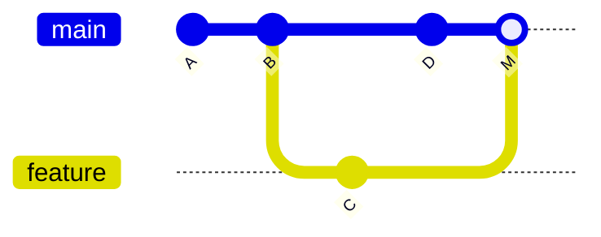
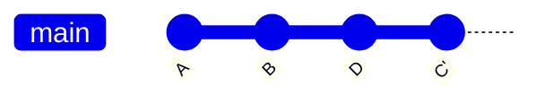

> [!info] Level: junior-middle | Time: about 5 h | You need: [[learn/git-mental-model-and-daily-workflow|Git 01: The mental model and the daily workflow]] | Lab: Option A, the Ubuntu LTS VM (or the container from Option B) from [[learn/lab-setup|Start 01: Set up your lab]]

Two things separate a comfortable Git user from a nervous one. The first is knowing how branches are combined and what a conflict really is. The second is knowing that almost every mistake can be undone, if you can tell where the mistake is. This lesson covers both, using the model from Git 01: commits are immutable snapshots, and branches and `HEAD` are pointers.

> [!note] What was run
> The commands in the exercises were run on Ubuntu 24.04.5 LTS with Git 2.43.0 on 2026-10-17, in throwaway repositories with a local bare repository as the remote. IDs, dates and temporary paths in the sample output are illustrative: yours will differ. Wording of messages can differ between Git versions. Where this lesson depends on a Git version, it says so.

## What you will learn

- How `merge` and `rebase` differ in what they do to history, and when to use each.
- What a conflict is, how to read the markers, and a procedure to resolve one (and to abort).
- How to tidy local commits with interactive rebase, and how to push the result safely with `--force-with-lease`.
- How to decide where a mistake is (working tree, index, local commit, pushed commit) and pick the right undo.
- The differences between `restore`, `reset --soft`, `--mixed` and `--hard`, and `revert`.
- How to use the reflog to recover lost commits and deleted branches, and `git bisect` to find the commit that broke something.

## Two ways to combine work

You have a feature branch and `main` has moved on. You want your work on top of the latest `main`. Git offers two methods that end in the same file contents but leave different history.

### Merge

`git merge` creates a commit with **two parents**, the tips of both lines of work. History keeps its true shape.



Merge never changes existing commits, so it is safe on shared branches. The cost is a history with many branches and merge commits, which some people find noisy.

If `main` has not moved since you branched, there is nothing to combine: Git can simply move the `main` pointer forward to your tip. That is a **fast-forward**, and it creates no commit. If you want a merge commit anyway (for example to keep a feature visible as a unit), use `git merge --no-ff`.

### Rebase

`git rebase main` takes the commits that exist only on your branch, and **replays** them one by one on top of the tip of `main`. The new commits have the same changes but different parents, so they get **new IDs**. The old commits are left behind, unreferenced.



The result is a straight line, which is easy to read and to bisect. The cost is that you have rewritten history for the commits you moved.

### The golden rule

> [!warning] Never rebase history that others have built on
> Rebase only commits that exist on your machine, or on a branch only you use. If you rebase commits that teammates have pulled, their copy still has the old commits, yours has new ones with the same changes, and the next integration duplicates or conflicts. Shared branches such as `main` are merged into, never rebased.

A practical split that most teams use: rebase your own feature branch onto the target branch before you open or update a pull request (to get a clean history), and merge it into the shared branch through the pull request. Your team's rule on squash, merge commits and linear history decides the exact flow (see [[learn/pull-requests-and-code-review|Git 03]]).

### What `git pull` does

`git pull` runs `git fetch` and then merges (the default) or rebases. If your local `main` has a commit that the remote lacks and the remote has one you lack, plain `pull` creates a merge commit. Modern Git can stop and ask you to choose. Make the choice explicit once:

```bash
git config --global pull.rebase true   # pull replays your local commits on top
# or refuse anything but a fast-forward, and decide by hand when it fails:
git config --global pull.ff only
```

Choose one of the two and follow your team's convention. With `pull.ff only`, a `git pull` that cannot fast-forward fails instead of surprising you.

## Conflicts

Git combines changes automatically when the two sides changed different parts of a file. A **conflict** happens when both sides changed the same lines (or one deleted what the other edited) and Git cannot tell which to keep. Git does not guess. It stops and asks you.

### Anatomy of a conflict

Git writes both versions into the file between markers:

```text
service: web
replicas: 3
<<<<<<< HEAD
log_level: warn
=======
log_level: debug
>>>>>>> feature/debug
```

- Between `<<<<<<<` and `=======` is your side (the branch you are on, `HEAD`).
- Between `=======` and `>>>>>>>` is the other side (the branch being merged).
- You delete the markers and leave the content that should be there. It may be one side, the other, or a combination.

The default style shows only two sides. The `zdiff3` style adds a third section with the **common ancestor**, which often makes the right answer obvious:

```bash
git config --global merge.conflictStyle zdiff3
```

```text
<<<<<<< HEAD
log_level: warn
||||||| 373e199
log_level: info
=======
log_level: debug
>>>>>>> feature/debug
```

Reading it: the original was `info`. One side changed it to `warn`, the other to `debug`. Now the question is not "which line is right", but "what level do we want?" That question you can ask a human.

> [!warning] Check before relying on this
> `zdiff3` was added in Git 2.35 (verify for your version with `git help config` and search for `merge.conflictStyle`). On older versions use `diff3`, which shows the same base section with less trimming of identical lines.

### The resolution procedure

1. **Do not panic and do not guess.** Run `git status`. Files listed under `Unmerged paths` (`UU` in short form) are in conflict.
2. **Understand both sides.** Look at the markers. If the intent is unclear, read the commit messages (`git log --merge -p -- <file>` shows the commits involved) or ask the author.
3. **Edit the file** to the final content. Remove all markers.
4. **Check** that nothing is left: `git diff --check` reports leftover conflict markers.
5. **Mark it resolved:** `git add <file>`.
6. **Finish:** `git commit` for a merge, or `git rebase --continue` for a rebase (or `git revert --continue` and `git cherry-pick --continue` for those commands).
7. **Test.** A conflict resolution is new code that nobody reviewed. Run the tests or the app.

If you are not sure, **abort**. `git merge --abort` returns to the state before the merge. `git rebase --abort` does the same for a rebase. Nothing is lost.

### rerere: remember how you resolved it

`rerere` ("reuse recorded resolution") stores how you resolved a conflict. If the same conflict appears again (for example when you rebase a long branch repeatedly), Git applies your resolution for you. Turn it on with `git config --global rerere.enabled true`. Always check the result before you continue.

## Tidying commits: interactive rebase

`git rebase -i <base>` opens a list of the commits since `<base>` and lets you rewrite them before they are replayed. For example `git rebase -i main` lists the commits on your branch that are not on `main`, oldest first:

```text
pick 6370d3c WIP health
pick 307a03b WIP probe
pick e5561b0 fix typo
```

Change the word at the start of a line to change what happens:

| Command  | Effect                                                                |
| -------- | --------------------------------------------------------------------- |
| `pick`   | Keep the commit as is.                                                |
| `reword` | Keep the changes, stop to edit the message.                           |
| `squash` | Fold into the previous commit and combine both messages in an editor. |
| `fixup`  | Fold into the previous commit and discard this commit's message.      |
| `drop`   | Remove the commit (also: delete the line).                            |

You can also reorder commits by moving lines. Interactive rebase opens the editor from `core.editor` or `$EDITOR`. In a terminal where you are not sure how to leave the editor, set a simple one first, for example `git config --global core.editor nano`.

### fixup commits and autosquash

When you notice a mistake in an earlier commit of your branch, commit the fix as a "fixup" of it, and let Git put it in place later:

```bash
git commit -a --fixup <commit-id>        # creates a commit named "fixup! <subject>"
git rebase -i --autosquash main          # the list arrives already arranged
```

`--autosquash` moves each `fixup!` commit under its target and marks it `fixup`. You only save and close the list. (`git config --global rebase.autoSquash true` turns it on by default.)

### Pushing a rewritten branch

After a rebase or an amend, your local branch no longer contains the commit that is on the remote, so a normal push is rejected as non-fast-forward. You must force the push, because you really mean to replace the remote branch. Use the safer form:

```bash
git push --force-with-lease origin feature/ports
```

`--force-with-lease` forces the push **only if** the remote branch is still where your remote-tracking branch says it is. If someone pushed in the meantime, it fails with `stale info` and nothing is overwritten. A plain `--force` overwrites whatever is there.

> [!warning] The lease is only as good as your last fetch
> The lease compares against `origin/<branch>` as you last knew it. If you run `git fetch` (or an editor does it in the background), your bookmark moves to include the other person's commit, and the next `--force-with-lease` then succeeds and **overwrites that commit**. In exercise 7 you will see this happen. Before you force, look at what is on the remote with `git log --oneline HEAD..origin/<branch>`. To pin the exact commit you expect, use `--force-with-lease=<branch>:<expected-commit-id>`. Newer Git versions also offer `--force-if-includes` as a further guard (check `git push --help` for your version). Only ever force on a branch that you own.

## Undoing mistakes: first find where the mistake is

"Undo" means different things depending on how far the mistake has travelled. Work out which of these places it is in, and the right tool follows.

| Where the mistake is                      | Example                     | Tool                                           |
| ----------------------------------------- | --------------------------- | ---------------------------------------------- |
| Working tree only (not staged)            | A file edited by mistake    | `git restore <file>`                           |
| Index (staged, not committed)             | Staged the wrong file       | `git restore --staged <file>`                  |
| Last commit, not pushed                   | Forgot a file, bad message  | `git commit --amend`                           |
| Several local commits, not pushed         | Commits to redo or squash   | `git reset --soft/--mixed <commit>`, or rebase |
| Pushed to a branch only you use           | Cleaned up a feature branch | Rebase, then `git push --force-with-lease`     |
| Pushed to a shared branch                 | A bad commit on `main`      | `git revert <commit>`                          |
| Lost: branch deleted, bad reset or rebase | "My commits are gone"       | `git reflog`, then a branch at the old commit  |

### restore: discard or unstage

`git restore <file>` replaces the file in the working tree with the version in the index. **This discards your uncommitted edits for good**, because Git never saved them. `git restore --staged <file>` takes the file out of the index but keeps your edits in the working tree. Use `git diff` to be sure what you are about to lose.

### reset: move the branch pointer

`git reset <commit>` moves the current branch to `<commit>`. What happens to the other two areas depends on the mode:

| Mode      | Branch pointer | Index (staging) | Working tree   |
| --------- | -------------- | --------------- | -------------- |
| `--soft`  | moves          | unchanged       | unchanged      |
| `--mixed` | moves          | reset to match  | unchanged      |
| `--hard`  | moves          | reset to match  | reset to match |

`--mixed` is the default. So `--soft` undoes commits but leaves all their changes staged (good for "redo the last two commits as one"), `--mixed` undoes commits and leaves the changes unstaged, and `--hard` throws the changes away too.

> [!danger] reset --hard destroys uncommitted work
> `git reset --hard` overwrites your working tree and index. Uncommitted changes are gone and the reflog cannot bring them back, since they were never committed. Commits that you "lose" this way can be recovered (see the reflog below), uncommitted edits cannot. Run `git status` and `git stash` first if you are unsure.

`git reset` rewrites **your** branch. Do not use it to undo commits that you have already pushed to a shared branch.

### revert: undo by adding a new commit

`git revert <commit>` creates a new commit that applies the opposite of that commit's changes. History is not rewritten, so it is the correct tool for a bad commit on a shared branch: everyone gets the undo through a normal pull.

For a **merge commit**, Git needs to know which parent is the "mainline" that you want to return to. Use `-m 1`, which means the first parent (the branch you merged _into_):

```bash
git revert -m 1 <merge-commit-id>
```

A caveat on reverting a merge: Git now believes the branch's changes were deliberately removed. Merging the same branch again later will not bring those changes back until you revert the revert. This is documented in the Git howto "revert a faulty merge", and is a good reason to prefer a new fixing commit when the branch will continue.

For production incidents, a `git revert` undoes the code in the repository. It does not undo what is already running. Rolling back a deployment is a separate action. See [[runbooks/helm-release-rollback]] and [[patterns/zero-downtime-deployments-kubernetes]]; the delivery lessons later in the path cover it.

### clean: remove untracked files

`git clean` deletes files that Git does not track. Always preview first: `git clean -n` lists what would go. Only then `git clean -f` (add `-d` for directories). Deleted untracked files cannot be recovered by Git.

## The reflog: the safety net

Every time `HEAD` or a branch moves, Git records it in the **reflog**, a local log of where each pointer used to be. Because Git does not delete objects when pointers move, a commit that no branch points to is still in the repository until it is garbage collected.

```bash
git reflog          # where HEAD has been, newest first
git reflog show feature/lost
```

```text
33f46b0 HEAD@{0}: reset: moving to HEAD~1
9f478d4 HEAD@{1}: commit: Changes 2 and 3 together
33f46b0 HEAD@{2}: reset: moving to HEAD~2
7edbb04 HEAD@{3}: commit: Change 3
```

_Illustrative IDs._ To recover, find the entry from before the mistake and create a branch, or reset to it: `git branch rescue 9f478d4` or `git reset --hard 'HEAD@{1}'`. Quote `HEAD@{n}` so the shell does not interpret the braces. The number `n` counts every move of `HEAD`, so it changes after each command: read the reflog again before using it.

Limits to know:

- The reflog is **local**. It is not pushed. A fresh clone has no history of your old pointers, and a teammate's reflog cannot help you.
- Entries expire. By default, entries reachable from the current branch are kept for about 90 days and unreachable ones for about 30 days (`gc.reflogExpire` and `gc.reflogExpireUnreachable`). Unreferenced objects are removed later by `git gc` after a further grace period.

> [!warning] Check before relying on this
> The expiry defaults come from the Git configuration manual. They can differ by version or be changed by your setup, and some tools run `git gc` or expire the reflog earlier. Check with `git help config` for your version and `git config --get gc.reflogExpire` (no output means the built-in default). Do not treat the reflog as a backup. Push work you care about.

### Recover a deleted branch

`git branch -d` refuses to delete a branch that has commits not merged anywhere. `git branch -D` forces it. The commits stay in the repository, and the reflog shows where the branch tip was, so you can create the branch again.

## Finding a bad commit: bisect

When something broke and you do not know which commit did it, `git bisect` does a binary search through history. You mark one commit good and one bad; Git checks out the one in the middle; you say whether it is good or bad; repeat. With 8 commits, three checks are enough. With 1,000, about ten. If you can write a command that exits `0` when the code is good and non-zero when bad, `git bisect run` does it all for you.

```bash
git bisect start
git bisect bad HEAD
git bisect good <known-good-commit>
git bisect run sh ../check.sh      # a script kept outside the repository
git bisect reset                   # always finish with this
```

Bisect works best when each commit builds and passes tests, which is one reason for small, clean commits.

## Which tool when: a decision table

| Situation                                                       | Use                                                       |
| --------------------------------------------------------------- | --------------------------------------------------------- |
| Update my feature branch with new `main` work, branch only mine | `git rebase main`                                         |
| Bring a finished feature into `main`                            | A pull request with a merge (or squash), per team rule    |
| Keep a record that a feature landed as one unit                 | `git merge --no-ff`                                       |
| Several messy local commits before review                       | Interactive rebase (`fixup` or `squash`)                  |
| Undo a bad commit already on `main`                             | `git revert`                                              |
| Undo local commits and redo them                                | `git reset --soft` (or `--mixed`)                         |
| Throw away all local experiments                                | `git reset --hard <commit>` (after checking `git status`) |
| "I lost my commits"                                             | `git reflog`, then `git branch <name> <id>`               |
| "Which commit broke it?"                                        | `git bisect`                                              |

## Hands-on exercises

Run these in your lab VM, in the order given. The exercises use scratch repositories in a temporary folder, so they cannot touch real work. The sample output is from the run described at the top. Start with the setup, which gives every exercise a throwaway Git home (your real `~/.gitconfig` is not read in this shell):

```bash
export HOME="$(mktemp -d)"
cd "$(mktemp -d)"
git config --global user.name "Lab User"
git config --global user.email "lab@example.com"
git config --global init.defaultBranch main
git init -q merge-lab
cd merge-lab
```

Expected: no output. If you see something else: an error mentioning `mktemp` means `/tmp` is not writable, so use a folder under your home directory and set `HOME` there. If you close the terminal, you start again from this block.

1. **Fast-forward and `--no-ff`.** Make a base commit and a feature branch, then merge it two ways.

   ```bash
   printf 'service: web\nreplicas: 2\nlog_level: info\n' > config.txt
   echo "# Web service" > README.md
   git add .
   git commit -m "Add config and README"
   git switch -c feature/port
   echo "port: 8080" >> config.txt
   git commit -am "Add port"
   git switch main
   git merge feature/port
   git log --oneline --graph
   git reset --hard HEAD~1
   git merge --no-ff feature/port -m "Merge feature/port"
   git log --oneline --graph
   git cat-file -p HEAD
   ```

   Expected: the first merge prints `Updating ... Fast-forward` and the graph is a single line. After the reset and the second merge, you see `Merge made by the 'ort' strategy.` and a graph with a merge commit that joins two lines. `git cat-file -p HEAD` shows **two** `parent` lines. (The `reset --hard` is there only to rewind the first merge so you can compare. It is explained above.)
   If you see something else: on Git older than 2.34 the strategy may be named `recursive`. If the second merge says `Already up to date`, the reset did not run; check `git log --oneline`.

2. **A merge without a conflict.** Change different files on two branches.

   ```bash
   git switch -c feature/docs
   echo "See config.txt." >> README.md
   git commit -am "Document the config"
   git switch main
   sed -i 's/replicas: 2/replicas: 3/' config.txt
   git commit -am "Scale to 3 replicas"
   git merge feature/docs -m "Merge feature/docs"
   git log --oneline --graph
   ```

   Expected: `Merge made by the 'ort' strategy.` and ` README.md | 1 +`. The graph shows the two lines joining.
   If you see something else: a `CONFLICT` message means both branches changed the same lines. Run `git merge --abort` and re-check that you edited `README.md` on one branch and `config.txt` on the other.

3. **Create and resolve a conflict, and abort one.** Two branches change the same line.

   ```bash
   git switch -c feature/debug
   sed -i 's/log_level: info/log_level: debug/' config.txt
   git commit -am "Use debug logging"
   git switch main
   sed -i 's/log_level: info/log_level: warn/' config.txt
   git commit -am "Use warn logging"
   git merge feature/debug
   git status -sb
   cat config.txt
   git merge --abort
   git status -sb
   ```

   Expected: `CONFLICT (content): Merge conflict in config.txt` and `Automatic merge failed; fix conflicts and then commit the result.` Then `UU config.txt` in the status, the file with `<<<<<<< HEAD`, `log_level: warn`, `=======`, `log_level: debug` and `>>>>>>> feature/debug` lines. After the abort, the status is clean (`## main`) and the file is back to `warn`.
   If you see something else: if there is no conflict, check that both `sed` commands changed the line (`grep log_level config.txt` on each branch).

   Now turn on the three-section style, merge again, and resolve it properly:

   ```bash
   git config merge.conflictStyle zdiff3
   git merge feature/debug
   cat config.txt
   printf 'service: web\nreplicas: 3\nlog_level: warn\nport: 8080\n' > config.txt
   git diff --check
   git add config.txt
   git commit --no-edit
   git log --oneline --graph -6
   ```

   Expected: the file now has an extra `|||||||` section showing `log_level: info`, the original. After you replace the file, `git diff --check` prints nothing, the commit succeeds with `Merge branch 'feature/debug'`, and the graph shows the merge.
   If you see something else: if `git diff --check` prints `leftover conflict marker`, a marker line is still in the file. If the merge is rejected for an unmerged file, run `git add config.txt` first. If your Git rejects `zdiff3`, use `diff3` instead (see the callout above).

4. **Rebase a feature branch, then fast-forward.** `main` and the feature branch each get one new commit; the rebase replays yours.

   ```bash
   git switch -c feature/metrics
   echo "metrics: on" >> config.txt
   git commit -am "Enable metrics"
   git switch main
   echo "# Notes" >> README.md
   git commit -am "Add notes heading"
   git switch feature/metrics
   git log --oneline -1
   git rebase main
   git log --oneline --graph -4
   git switch main
   git merge feature/metrics
   ```

   Expected: before the rebase, `Enable metrics` has one ID; after it, the same message has a **different** ID and sits on top of `Add notes heading`. The rebase says `Successfully rebased and updated refs/heads/feature/metrics.` The final merge is a `Fast-forward` and the history of `main` stays a straight line at the top.
   If you see something else: if the rebase stops with a conflict, resolve it as in exercise 3 and run `git rebase --continue` (or `git rebase --abort` to give up).

5. **Squash three messy commits into one with a rebase.** Use a fresh repository with a remote, which you will also use for exercises 6 and 7. To keep the exercise scriptable, `GIT_SEQUENCE_EDITOR` edits the list for you. Normally you edit it by hand in your editor.

   ```bash
   cd ..
   git init -q --bare remote.git
   git clone -q remote.git rebase-lab
   cd rebase-lab
   printf 'service: web\nreplicas: 3\n' > config.txt
   git add .
   git commit -m "Add config"
   git push -q -u origin main
   git switch -c feature/health
   echo "health: /healthz" >> config.txt
   git commit -am "Add health check settings"
   echo "probe: 5s" >> config.txt
   git commit -am "WIP probe"
   echo "timeout: 2s" >> config.txt
   git commit -am "fix typo"
   git log --oneline
   GIT_SEQUENCE_EDITOR="sed -i -e '2s/^pick/fixup/' -e '3s/^pick/fixup/'" git rebase -i main
   git log --oneline
   cat config.txt
   ```

   Expected: four commits before (three on the branch plus `Add config`), then two after: `Add health check settings` on top of `Add config`. The file still contains all three added lines, because `fixup` folds the changes in and drops only the messages.
   If you see something else: if `git clone` warns `You appear to have cloned an empty repository`, that is normal for a bare repository. If the rebase asks for an editor, `GIT_SEQUENCE_EDITOR` was not applied; set it on the same line as `git rebase`. If you do it by hand: change `pick` to `fixup` on lines 2 and 3 of the list, save, and close.

6. **Fixup and autosquash.** Fix an earlier commit without editing the list.

   ```bash
   git switch -c feature/ports main
   echo "port: 8080" > port.txt
   git add port.txt
   git commit -m "Add port"
   echo "metrics: on" > metrics.txt
   git add metrics.txt
   git commit -m "Enable metrics"
   sed -i 's/8080/8081/' port.txt
   git commit -a --fixup HEAD~1
   git log --oneline
   GIT_SEQUENCE_EDITOR=true git rebase -i --autosquash main
   git log --oneline
   cat port.txt
   ```

   Expected: the first log has a commit named `fixup! Add port` on top. After the rebase there are two commits (`Enable metrics` on `Add port`) and `port.txt` contains `port: 8081`. Setting `GIT_SEQUENCE_EDITOR=true` accepts the pre-arranged list without opening an editor.
   If you see something else: `nothing to commit` from `--fixup` means the `sed` changed nothing or there is no change to commit; check `cat port.txt`. A conflict means the fixup touched lines that the later commit also touched; resolve it as in exercise 3.

7. **Push a rewritten branch, and see `--force-with-lease` protect, then fail you.**

   ```bash
   git push -u origin feature/ports
   git commit --amend -m "Enable metrics (reworded)"
   git push origin feature/ports
   ```

   Expected: the first push creates the branch. After the amend, the plain push fails with `[rejected] ... (non-fast-forward)`, because your local commit is no longer a descendant of the remote's.
   If you see something else: if the second push succeeds, the amend did not happen: run `git log --oneline -1`.

   A teammate now pushes to the same branch, and you try to force:

   ```bash
   cd ..
   git clone -q remote.git mate
   cd mate
   git config user.name "Mate"
   git config user.email "mate@example.com"
   git switch feature/ports
   echo "mate: 1" >> port.txt
   git commit -am "Mate adds a line"
   git push -q origin feature/ports
   cd ../rebase-lab
   git push --force-with-lease origin feature/ports
   ```

   Expected: `! [rejected] feature/ports -> feature/ports (stale info)`. The lease protected Mate's commit.
   If you see something else: if the push succeeds, the teammate's push did not reach `remote.git`; check the earlier output.

   Now do the thing the warning describes:

   ```bash
   git fetch
   git push --force-with-lease origin feature/ports
   ```

   Expected: after the fetch, the same push succeeds with `+ <old>...<new> feature/ports -> feature/ports (forced update)`. **Mate's commit is now gone from the remote branch.** The lease only checked that you had seen it, and the fetch told Git you had. The lesson: fetch, then read `git log HEAD..origin/feature/ports`, and integrate their commit (rebase onto it) before forcing.
   If you see something else: if you get `stale info` again, another push happened; fetch and look again.

8. **Undo at each stage: restore.** Start a new repository for the undo exercises.

   ```bash
   cd ..
   git init -q undo-lab
   cd undo-lab
   printf 'service: web\nreplicas: 3\n' > config.txt
   git add .
   git commit -m "Add config"
   echo "oops: true" >> config.txt
   git status -s
   git restore config.txt
   cat config.txt
   echo "oops: true" >> config.txt
   git add config.txt
   git status -s
   git restore --staged config.txt
   git status -s
   git restore config.txt
   ```

   Expected: ` M config.txt`, then the file is back to two lines. Then `M  config.txt` (staged; the `M` is in the first column), and after `restore --staged`, ` M config.txt` (not staged, edit kept). The last `restore` discards the edit.
   If you see something else: if `git restore` is not found, your Git is older than 2.23; use `git checkout -- config.txt` and `git reset HEAD config.txt`.

9. **reset --soft, then recover a commit with the reflog.**

   ```bash
   for n in 1 2 3; do echo "key$n: v" >> config.txt; git commit -qam "Change $n"; done
   git log --oneline
   git reset --soft HEAD~2
   git status -s
   git commit -m "Changes 2 and 3 together"
   git log --oneline
   git reset --hard HEAD~1
   git reflog -6
   ```

   Expected: four commits, then after `reset --soft HEAD~2` the status is `M  config.txt` (the changes are staged, not lost) and the log has two commits. The new commit combines changes 2 and 3. After `reset --hard HEAD~1`, that combined commit disappears from the log, but the reflog lists it as `HEAD@{1}: commit: Changes 2 and 3 together`.
   If you see something else: if `git reset --soft` leaves nothing staged, check that you counted `HEAD~2` from the right commit with `git log --oneline`.

   Recover it. Read the position from your own reflog, since the number may differ:

   ```bash
   git reset --hard 'HEAD@{1}'
   git log --oneline
   cat config.txt
   ```

   Expected: `HEAD is now at 9f478d4 Changes 2 and 3 together` (your ID will differ), the log shows the combined commit again, and `config.txt` has `key1: v`, `key2: v` and `key3: v`.
   If you see something else: if `HEAD@{1}` is not the commit you want, run `git reflog` again and use the number next to the line you want. The reflog counts every move.

10. **`clean`, and what `reset --hard` does to work in progress.**

    ```bash
    echo "scratch" > scratch.txt
    echo "temp: 1" >> config.txt
    git reset --mixed HEAD
    git status -s
    git clean -n
    git clean -f
    git status -s
    git reset --hard
    git status -s
    ```

    Expected: after `--mixed`, `git status -s` shows ` M config.txt` and `?? scratch.txt`. `git clean -n` prints `Would remove scratch.txt`, `git clean -f` prints `Removing scratch.txt`. After `git reset --hard` the status is empty: the `temp: 1` line is gone for good.
    If you see something else: `git clean -f` can refuse with `clean.requireForce` set; that is a safety setting, and `-f` is already the override. Pause before running `-f` in a real repository.

11. **Revert a commit and a merge commit.** Use commits that touch separate files.

    ```bash
    echo "a" > a.txt; git add a.txt; git commit -m "Add a.txt"
    echo "b" > b.txt; git add b.txt; git commit -m "Add b.txt"
    git revert --no-edit HEAD~1
    git log --oneline -4
    git ls-files
    ```

    Expected: `[main 7e84278] Revert "Add a.txt"` and `delete mode 100644 a.txt`. The log has a new top commit named `Revert "Add a.txt"`, none of the earlier commits are gone, and `git ls-files` lists `b.txt` and `config.txt` but not `a.txt`.
    If you see something else: a conflict means a later commit changed the same lines. Resolve it, run `git add`, then `git revert --continue`, or give up with `git revert --abort`.

    Now a merge:

    ```bash
    git switch -c feature/x
    echo "x: 1" > x.txt; git add x.txt; git commit -m "Add x"
    git switch main
    git merge --no-ff feature/x -m "Merge feature/x"
    git revert --no-edit HEAD
    git revert -m 1 --no-edit HEAD
    git ls-files
    ```

    Expected: the plain revert fails with `error: commit ... is a merge but no -m option was given.` The `-m 1` version succeeds with `Revert "Merge feature/x"` and `delete mode 100644 x.txt`, and `x.txt` is no longer listed.
    If you see something else: if the first revert somehow succeeds, `HEAD` was not the merge commit: check `git log --oneline -3`.

12. **Delete a branch, then get it back.**

    ```bash
    git switch -c feature/lost
    echo l > lost.txt; git add lost.txt; git commit -m "Lost work"
    git switch main
    git branch -d feature/lost
    git branch -D feature/lost
    git reflog -4
    ```

    Expected: `-d` refuses with `error: the branch 'feature/lost' is not fully merged.` and suggests `-D`. The forced delete prints `Deleted branch feature/lost (was 895d9fc).` (your ID will differ). The reflog shows `commit: Lost work` on the second line.
    If you see something else: if `-d` succeeds, the branch was already merged and nothing was at risk.

    Recreate the branch from the ID in the delete message, or from the reflog. Replace `895d9fc` with your own ID:

    ```bash
    git branch feature/lost 895d9fc
    git log --oneline -1 feature/lost
    ```

    Expected: `895d9fc Lost work`. The commit was never deleted; only its label was.
    If you see something else: `fatal: not a valid object name` means the ID is wrong. Copy it from the `Deleted branch` message or from `git reflog`.

13. **Find a bad commit with `bisect run`.** Build eight commits where commit 5 breaks a setting, and let Git find it. The test script lives outside the repository, so it does not appear as an untracked file.

    ```bash
    cd ..
    git init -q bisect-lab
    cat > check.sh <<'EOF'
    #!/bin/sh
    # exit 0 = good, non-zero = bad
    grep -q 'timeout: 30' settings.txt
    EOF
    cd bisect-lab
    echo "timeout: 30" > settings.txt; git add settings.txt; git commit -qm "Commit 1: add settings"
    for n in 2 3 4; do echo "note $n" >> notes.txt; git add notes.txt; git commit -qm "Commit $n: notes"; done
    echo "timeout: 3" > settings.txt; git commit -qam "Commit 5: tune settings"
    for n in 6 7 8; do echo "note $n" >> notes.txt; git commit -qam "Commit $n: notes"; done
    git bisect start
    git bisect bad HEAD
    git bisect good HEAD~7
    git bisect run sh ../check.sh
    git bisect reset
    ```

    Expected: Git checks out commits in the middle (`Bisecting: 3 revisions left to test after this (roughly 2 steps)`), runs the script, and ends with `<id> is the first bad commit` and the line `Commit 5: tune settings`. `git bisect reset` returns you to `main`.
    If you see something else: if the script is not found, you are in the wrong folder; `ls ../check.sh` should work from inside `bisect-lab`. If the heredoc did not work, create `check.sh` in an editor with the three lines. If Git says the "good" commit is not an ancestor, you passed the arguments the wrong way round.

14. **Optional: rerere.** See Git apply an earlier resolution on its own.

    ```bash
    cd ..
    git init -q rerere-lab
    cd rerere-lab
    git config rerere.enabled true
    echo "log: info" > l.txt; git add l.txt; git commit -m "Add l.txt"
    git switch -c one
    echo "log: debug" > l.txt; git commit -am "debug"
    git switch main
    echo "log: warn" > l.txt; git commit -am "warn"
    git merge one
    echo "log: warn" > l.txt
    git add l.txt
    git commit --no-edit
    git reset --hard HEAD~1
    git merge one
    cat l.txt
    ```

    Expected: the first merge says `Recorded preimage for 'l.txt'` and, after you commit, a resolution is recorded. After the reset, the second merge still reports a `CONFLICT` but also says `Resolved 'l.txt' using previous resolution.` and the file already holds `log: warn`. You still have to `git add` and commit.
    If you see something else: no "Resolved" line means `rerere.enabled` was not set before the first merge.

Cleanup: nothing to remove beyond the temporary folder. Close the terminal, or delete the folder printed by `pwd` from the first command.

## Common mistakes

- **Rebasing a shared branch.** Why it bites: teammates' copies diverge and their next pull makes duplicates or conflicts. Fix: rebase only your own branches. If it is already done, tell the team and agree who resets what, before anyone pushes.
- **Using plain `--force`.** Why it bites: it overwrites whatever is on the remote, including someone else's commits. Fix: use `--force-with-lease`, and look at `git log HEAD..origin/<branch>` first.
- **Trusting the lease after a fetch.** Why it bites: the fetch resets what the lease compares against (exercise 7). Fix: read what is on the remote before you force, and pin the expected commit with `--force-with-lease=<branch>:<id>`.
- **Resolving a conflict by taking one side without reading.** Why it bites: you silently drop the other person's change. Fix: read both sides and the base (`zdiff3`), run the tests, and ask the author when unsure.
- **Committing conflict markers.** Why it bites: the build breaks on `<<<<<<<`. Fix: run `git diff --check` before `git add`.
- **Running `git reset --hard` or `git clean -f` to "tidy up".** Why it bites: uncommitted work cannot be recovered. Fix: `git status` and `git stash` first; `git clean -n` before `-f`.
- **Using `reset` on a pushed shared branch.** Why it bites: it rewrites history others have. Fix: use `git revert`.
- **Treating the reflog as a backup.** Why it bites: it is local and expires, and a deleted clone takes it along. Fix: push branches you care about.
- **Reverting a merge and later re-merging the branch.** Why it bites: the branch's changes do not come back, because Git thinks they were removed on purpose. Fix: revert the revert, or add the fix on a new branch.

## Check your understanding

1. When would you merge, and when would you rebase?
2. Why is `git revert` the right undo for a bad commit on `main`, and `git reset` the wrong one?
3. What exactly does `git reset --hard` destroy, and what can the reflog still recover?
4. Why does the reflog not help a teammate who has your repository cloned?
5. You rebased your feature branch, and your push was rejected. What do you run, and what do you check first?
6. A merge shows `UU config.txt`. List the steps from there to a finished merge.

> [!question]- Answers
>
> 1. Merge when you integrate work into a shared branch or want to keep the true history (it never rewrites commits). Rebase when you update your own unpublished or private branch so that it sits on top of the target and the history is a straight line. Never rebase commits that others have pulled.
> 2. `revert` adds a new commit that cancels the old one, so history is only extended and every clone can pull it. `reset` moves the branch back and removes commits from it, so anyone who already has them ends up with a history that disagrees with yours.
> 3. It overwrites the index and working tree with the target commit, so uncommitted changes are destroyed and cannot be recovered. Commits that were reachable before the reset can still be recovered, because the reflog records where the branch was.
> 4. The reflog is a local log that records the movements of your own pointers. It is not part of the data that `push` and `clone` transfer.
> 5. `git push --force-with-lease`, because a rebase makes new commits that are not descendants of the remote ones. First check that you own the branch and that nobody else pushed to it: fetch and read `git log HEAD..origin/<branch>`, since a fetch turns the lease off in effect.
> 6. Open the file and read both sides (and the base with `zdiff3`), edit it to the final content with no markers, run `git diff --check`, `git add` the file, then `git commit` (or `git rebase --continue` in a rebase), then test. If it goes wrong, `git merge --abort` or `git rebase --abort`.

## Next steps

Next lesson: [[learn/pull-requests-and-code-review|Git 03: Pull requests and code review]]. Previous lesson: [[learn/git-mental-model-and-daily-workflow|Git 01: The mental model and the daily workflow]].

For going deeper as a senior engineer:

- [[runbooks/helm-release-rollback]] and [[patterns/zero-downtime-deployments-kubernetes]]: a `git revert` is not a deployment rollback. These notes cover rolling back what is running, and the delivery lessons later in the path (see [[learn/environments-releases-and-rollbacks|the lesson on environments, releases and rollbacks]]) teach it step by step.
- [[standards/production-change-checklist]] for what to check before changes reach production.
- [[standards/code-review]] for how teams review rewritten branches.
- The whole path is mapped in [[learn/index|the learning path]].

## Sources

- Git documentation: `git-merge`, `git-rebase`, `git-reset`, `git-revert`, `git-restore`, `git-clean`, `git-reflog`, `git-bisect`, `git-rerere`, `git-push`, `git-config` (https://git-scm.com/docs).
- Pro Git, Scott Chacon and Ben Straub: "Git Branching - Basic Branching and Merging", "Git Branching - Rebasing", "Git Tools - Reset Demystified", "Git Tools - Rerere", "Git Tools - Debugging with Git" (https://git-scm.com/book/en/v2).
- Git howto: "How to revert a faulty merge" (https://git-scm.com/docs/howto/revert-a-faulty-merge).
- Versions checked: Git 2.43.0 on Ubuntu 24.04.5 LTS, on 2026-10-17. Not verified against other versions: the introduction of `merge.conflictStyle zdiff3` (Git 2.35), `--force-if-includes`, the name of the merge strategy (`ort`, the default since Git 2.34), and the reflog expiry defaults (about 90 and 30 days).
