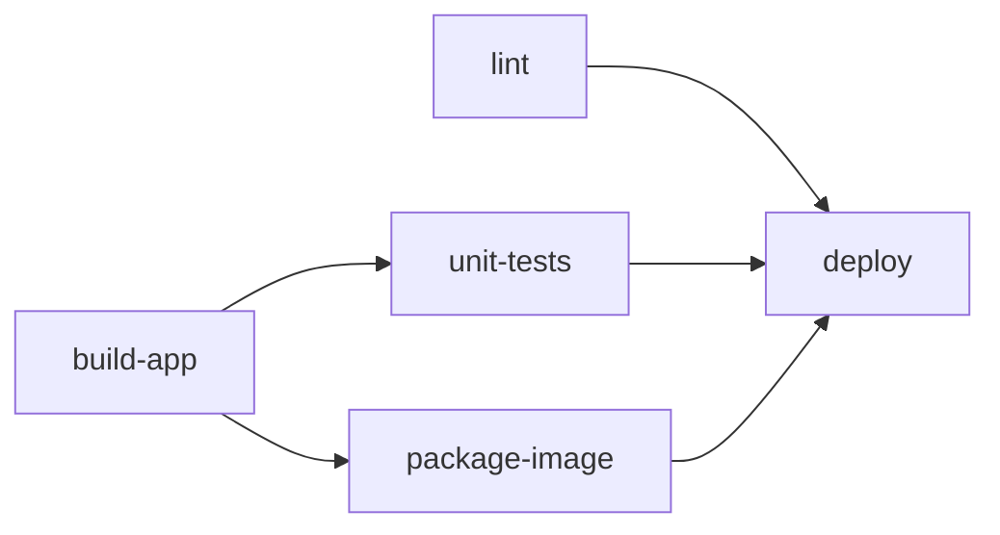

> [!info] Level: junior-middle | Time: about 4 h | You need: [[learn/first-pipeline-gitlab-ci-and-jenkins|Delivery 02: Your first pipeline in GitLab CI and Jenkins]] | Lab: the `ci-lab` project from Delivery 02

Your first pipeline ran every job on every push, one stage after another. That is fine for a toy project and expensive for a real one: a documentation fix triggers a ten-minute build, a slow stage waits for a fast one it does not need, and the same twenty lines are copied into forty repositories. This lesson fixes those three problems with `rules:changes`, the `needs` graph, `parallel:matrix`, and the reuse tools `extends`, `!reference` and `include`. It also treats `include` as a supply-chain decision, because pipeline code you include runs with your project's secrets.

> [!note] Nothing here was run for this page
> The YAML and commands follow the GitLab documentation and are not verified. Pipeline pages are illustrative. GitLab changes CI/CD keywords between versions; items marked "check the current docs" are version-dependent.

## What you will learn

- How `rules` are evaluated (first match wins), and how to use `changes`, `exists` and `variables` in them.
- Why a manual job set in `rules` blocks the pipeline by default.
- How `needs` turns stages into a graph and shortens a pipeline, and the risk it introduces.
- How `parallel:matrix` creates many jobs from one definition.
- How to reuse YAML with `extends`, `!reference` and `include`, why you pin what you include, and how to run a child pipeline.
- How to check a file before you push it.

## How rules are evaluated

Delivery 02 introduced `workflow:rules` (does the pipeline exist at all) and job-level `rules` (does this job exist). If you need the recap of `workflow:rules` and merge request pipelines, go back to [[learn/first-pipeline-gitlab-ci-and-jenkins|the anatomy section of Delivery 02]]; it is not repeated here.

What matters for this lesson is the evaluation order of job `rules`:

1. GitLab reads the rules **top to bottom**.
2. The **first rule that matches wins**. Later rules are not looked at.
3. If it matches, the job is added, with that rule's `when`, `allow_failure` and `variables`. If no rule matches, the job is **not** added. A rule with no condition (`- when: always`) matches everything, so put it last as a default.

```yaml title=".gitlab-ci.yml (excerpt)"
test-api:
  stage: test
  script: ["./scripts/test-api.sh"]
  rules:
    - if: $CI_PIPELINE_SOURCE == "merge_request_event"
      changes:
        - api/**/*
        - requirements.txt
    - if: $CI_COMMIT_BRANCH == $CI_DEFAULT_BRANCH
      when: always
    - when: never
```

Order is logic here. The default-branch rule runs the job on every push to `main` regardless of files, while a merge request runs it only when API files changed. The last rule is explicit about what happens otherwise.

### rules:changes

`changes` matches when at least one file in the list was modified. The important question is **compared with what**:

- In a **merge request pipeline**, GitLab compares the merge request's branch with its target branch. That is what you usually want.
- In a **branch pipeline**, it compares with the previous commit on that branch (the push). For a new branch with no previous commit, or a push to a default branch, the behaviour is easy to misjudge: a rule that depends on `changes` may then always match or never match. Check the current docs for the exact rules of your version.
- In **scheduled and manual pipelines**, there is no meaningful diff, so `changes` is treated as true (check the current docs).

When the default comparison is wrong, set it with `changes:compare_to`:

```yaml title=".gitlab-ci.yml (excerpt)"
build-docs:
  script: ["./scripts/build-docs.sh"]
  rules:
    - changes:
        paths:
          - docs/**/*
        compare_to: refs/heads/main
```

`compare_to` takes a branch, tag or commit SHA to compare against. It is version-dependent (it appeared in a relatively recent GitLab release, and the accepted forms have changed): check the current docs before you rely on it.

Practical notes for `changes`:

- Globs: `docs/**/*` matches recursively; a bare directory name does not. A path with no wildcard must match a file exactly.
- It is a performance optimisation, not a security control. Do not skip a test on the basis that "the files did not change" if another part of the system can break it. A shared library change can break a service whose directory did not change.
- A job skipped by `changes` can still be required by a `needs` or a merge rule. See the DAG section.

### rules:exists and rules:variables

`exists` matches when the listed files **exist** in the repository: run the Python jobs only if `pyproject.toml` exists.

```yaml title=".gitlab-ci.yml (excerpt)"
lint-python:
  script: ["ruff check ."]
  rules:
    - exists:
        - pyproject.toml
```

`rules:variables` sets variables **for the job** when a rule matches, so one job can behave differently by context:

```yaml title=".gitlab-ci.yml (excerpt)"
deploy:
  script: ['./scripts/deploy.sh "$TARGET"']
  rules:
    - if: $CI_COMMIT_BRANCH == $CI_DEFAULT_BRANCH
      variables:
        TARGET: staging
    - if: $CI_COMMIT_TAG
      variables:
        TARGET: production
```

### Manual jobs in rules are blocking by default

A manual job (a human clicks "run") defined with `when: manual` at **job level** is **not blocking**: the pipeline continues past it (`allow_failure: true` is the default for that form). But `when: manual` set **inside a `rules` entry** is **blocking** by default: `allow_failure` defaults to `false`, so the pipeline stops there and its status stays "blocked" or "running" until someone clicks the job.

```yaml title=".gitlab-ci.yml (excerpt)"
deploy-production:
  stage: deploy
  script: ["./scripts/deploy.sh production"]
  rules:
    - if: $CI_COMMIT_TAG
      when: manual
      allow_failure: false # the default for manual in rules: blocks the pipeline until clicked
    - if: $CI_COMMIT_BRANCH == $CI_DEFAULT_BRANCH
      when: manual
      allow_failure: true # optional: the pipeline carries on and can be green without the click
```

Choose deliberately. A production deploy that should block the release pipeline is blocking; an optional "deploy a preview" is not. Releases and environments are in [[learn/environments-releases-and-rollbacks]]. Both forms are documented under `when` and `allow_failure`; check the current docs for the combination you use.

## The needs DAG

Stages run in order, and **no job in a stage starts before all jobs of the previous stage finish**. A slow `test` job therefore delays a quick `package` job that only needs `build`. `needs` replaces the stage barrier with explicit dependencies, turning the pipeline into a **directed acyclic graph** (DAG): a job starts as soon as the jobs it needs have finished.

```yaml title=".gitlab-ci.yml (excerpt)"
stages: [build, test, package, deploy]

build-app:
  stage: build
  script: ["./scripts/build.sh"]
  artifacts:
    paths: [dist/]

unit-tests:
  stage: test
  needs: [build-app]
  script: ["./scripts/unit.sh"]

lint:
  stage: test
  needs: [] # starts immediately, at pipeline start
  script: ["./scripts/lint.sh"]

package-image:
  stage: package
  needs:
    - job: build-app
      artifacts: true
  script: ["./scripts/package.sh"]
```



What to know:

- **`needs: []`** means "no dependencies": the job starts immediately, regardless of its stage. Good for lint and static checks.
- **`needs: [job]`** waits only for that job, and by default downloads its artifacts. Use `artifacts: false` to skip the download, and `artifacts: true` to say so explicitly.
- **`needs:optional`** marks a dependency that may not exist (because a `rules` condition removed it): `needs: [{ job: build-docs, optional: true }]`. Without `optional`, a `needs` entry pointing to a job that is not in the pipeline makes the pipeline invalid.
- **`stage` still matters** for display and for jobs that have no `needs`; a job with `needs` may run before a job of an earlier stage.

> [!warning] `needs` removes the safety net of stages
> Once a job has `needs`, it no longer waits for the whole earlier stage. If you list only `build-app` for the deploy, the deploy can start before `unit-tests` finish. **List every gating job** (tests, scans, approvals) that must pass before you ship, or the speed-up becomes a way to deploy untested code. Review `needs` of release jobs like permissions. The pipeline structure patterns are in [[patterns/gitlab-ci-pipeline-structure]], and splitting slow test jobs is in [[patterns/test-sharding-flaky-tests]].

## parallel:matrix

`parallel:matrix` creates one job per combination of the values you list, from one definition:

```yaml title=".gitlab-ci.yml (excerpt)"
test:
  stage: test
  image: python:$PYTHON_VERSION-slim
  parallel:
    matrix:
      - PYTHON_VERSION: ["3.11", "3.12"]
        DB: [postgres, sqlite]
  script:
    - python --version
    - ./scripts/test.sh "$DB"
```

This yields four jobs (`test: [3.11, postgres]`, and so on), each with its own variables. The limit on the number of jobs a matrix may create is set by GitLab (and its administrator), so check the current docs; the value changes between versions and instances.

Use a matrix for **independent combinations** such as language versions or target environments. Do not use it to hide serial work, and keep it small: ten dimensions multiply fast, and each job costs runner minutes. A downstream job can `needs` a specific combination or the whole matrix; the syntax is in the `needs:parallel:matrix` section of the reference (check the current docs). Do not confuse `parallel: 4` (four identical copies, each knowing `CI_NODE_INDEX`, for sharding a test suite) with `matrix`.

## Reuse: extends, !reference and include

### extends

`extends` lets a job inherit from a hidden job (a name starting with a dot, which GitLab never runs):

```yaml title=".gitlab-ci.yml (excerpt)"
.python-base:
  image: python:3.12-slim
  before_script:
    - pip install --no-cache-dir -r requirements.txt
  cache:
    key: pip-$CI_COMMIT_REF_SLUG
    paths: [.cache/pip]

lint:
  extends: .python-base
  script: ["ruff check ."]

unit:
  extends: .python-base
  script: ["pytest -q"]
```

The merge is a deep merge for hashes and a **replacement** for lists: if the child defines `script`, it replaces the parent's `script`, it does not append to it. That is the usual surprise.

### !reference

`!reference` reuses a **part** of another job, including list items, which `extends` cannot merge:

```yaml title=".gitlab-ci.yml (excerpt)"
.setup:
  script:
    - echo "set up"

deploy:
  script:
    - !reference [.setup, script]
    - ./scripts/deploy.sh
```

Use `!reference` when you need to combine pieces (a shared setup, then job-specific steps).

### include

`include` pulls YAML from other files into the pipeline configuration. The main forms:

```yaml title=".gitlab-ci.yml (excerpt)"
include:
  # a file in this repository
  - local: ci/build.yml

  # a file in another project on the same GitLab, pinned to a tag
  - project: platform/ci-templates
    ref: v1.4.0 # a tag or a full commit SHA, not a moving branch
    file: /templates/python.yml

  # a file from any URL (HTTPS)
  - remote: https://ci.example.com/shared/security.yml

  # a template that ships with GitLab
  - template: Security/SAST.gitlab-ci.yml

  # a CI/CD component from a catalogue
  - component: gitlab.example.com/platform/components/python-test@1.2.0
    inputs:
      python_version: "3.12"
```

- **`local`** is a path from the repository root, resolved in the same commit.
- **`project`** reads another project. `ref` selects the version. Without `ref`, GitLab uses the default branch of that project, which is a moving target.
- **`remote`** fetches a public URL. There is no authentication and no pinning: if the content changes, your pipeline changes. Avoid it for anything that touches secrets.
- **`template`** uses GitLab's built-in templates, which change with the GitLab version.
- **`component`** includes a versioned CI/CD component that takes typed `inputs`. The syntax, the catalogue and the way versions are written (`@1.2.0`, `@~latest`, a SHA) are still evolving: check the current docs. The detailed pattern for components is in [[patterns/gitlab-ci-components-and-includes]].

Included files are merged into the pipeline configuration before it is created. Keys in your `.gitlab-ci.yml` override included ones with the same name, which is how you adjust a shared job locally.

### Pinning is a supply-chain control

An included file is **code that runs in your pipeline with your project's variables and, on protected branches, your secrets**. If `include: project: platform/ci-templates` follows `main`, then anyone with push access to that project can change what runs in every repository that includes it, at the next pipeline, without a review in your repository.

- Pin `ref` to a **tag or a full commit SHA**. A tag is readable (`v1.4.0`) but a tag can be moved; a SHA cannot be moved. Choose by how much you trust the owners of the template project.
- Protect the template project: protected tags, required reviews, and a short list of maintainers.
- Never include `remote` URLs you do not control.
- Update pins on purpose, through a merge request that shows the diff of the template change ([[patterns/automated-dependency-updates]] can propose it).
- Treat a pipeline-wide `include` for security scanning the same way: pin the version so the scan does not change under you and so a breaking change is a reviewed change.

## Child pipelines, interruptible and resource_group

A **child pipeline** runs a separate pipeline from a trigger job. It is useful to split a monorepo (one child per component) or to run a generated configuration:

```yaml title=".gitlab-ci.yml (excerpt)"
trigger-api:
  stage: test
  trigger:
    include: api/.gitlab-ci.yml
    strategy: depend # this job waits for the child and takes its status
  rules:
    - changes:
        - api/**/*
```

- **`strategy: depend`** makes the trigger job succeed or fail with the child. Without it, the trigger job succeeds as soon as the child is created and the parent can go green while the child fails.
- For multi-project pipelines, `trigger: project: group/other-project`. `strategy: mirror` is a newer variant of the same idea; its availability and exact behaviour are version-dependent, so check the current docs.
- The child gets its own jobs, rules and artifacts. Passing variables and artifacts between parent and child has rules of its own in the downstream pipelines documentation.

Two job keywords that save money and prevent accidents:

- **`interruptible: true`** marks a job as safe to cancel when a newer pipeline starts on the same branch. Set it on tests and builds, never on deploys. Combined with the project setting "Auto-cancel redundant pipelines", old pipelines stop when you push again.
- **`resource_group: production`** makes jobs with the same resource group run **one at a time**. Two deploys to the same environment queue instead of racing:

```yaml title=".gitlab-ci.yml (excerpt)"
deploy-production:
  stage: deploy
  resource_group: production
  interruptible: false
  script: ["./scripts/deploy.sh production"]
```

## Checking a file before you push

Do not discover a YAML mistake by pushing and waiting for a failed pipeline.

- **The pipeline editor** in the GitLab UI (Build, Pipeline editor) validates syntax as you type, shows the merged configuration after includes and `extends`, and has a visualisation of the `needs` graph.
- **CI Lint** checks a configuration, and can run a simulation of a pipeline creation for a branch ("Validate pipeline creation") so you see which jobs the rules would create.
- **From the terminal**, the GitLab CLI has a lint command: `glab ci lint` (reads `.gitlab-ci.yml` by default). Command names and flags are version-dependent: run `glab ci --help` and check the current docs. It needs authentication to your GitLab host, so use a token with the least scope and do not paste it into scripts.
- **A merged view** helps to debug `extends` and `include`: the editor tab "Full configuration" shows what GitLab will actually run.

Linting checks that the file is valid, not that it does what you want. Test rules changes in a branch with a merge request and read the pipeline page.

## Hands-on exercises

You need the `ci-lab` project from Delivery 02, a runner (shared runners on GitLab.com are fine), and `git`. Example hostnames use `example.com`; replace them only where a step says so. Pipeline pages and timings are illustrative.

1. **Add a source layout and a baseline.** In `ci-lab` create `api/`, `docs/` and `scripts/` with a tiny `README` in each, and a `.gitlab-ci.yml` with two jobs, `api-test` and `docs-build`, each `script: ["echo ok"]`, no rules. Push to a branch and open a merge request.
   Expected: both jobs run.
   If you see something else: if no pipeline starts, your `workflow:rules` from Delivery 02 may not match; reuse the working version from there.

2. **Run a job only when its files change.** Add to each job:

   ```yaml
   rules:
     - if: $CI_PIPELINE_SOURCE == "merge_request_event"
       changes: ["api/**/*"] # use ["docs/**/*"] on docs-build
   ```

   Push a change that touches only `docs/README`.
   Expected: in the merge request pipeline only `docs-build` runs.
   If you see something else: if both or neither run, check you are looking at the merge request pipeline (not a branch pipeline) and that the glob matches the changed path. Read the pipeline page's job list.

3. **Add a default for the default branch.** Add as the second rule `- if: $CI_COMMIT_BRANCH == $CI_DEFAULT_BRANCH` and merge.
   Expected: on `main` both jobs run, whatever changed.
   If you see something else: remember the first match wins; make sure the merge request rule comes first and is not catching the push to `main`.

4. **Experience a blocking manual job.** Add a `deploy-demo` job with `script: ["echo deploy"]` and `rules: [{ if: '$CI_COMMIT_BRANCH == $CI_DEFAULT_BRANCH', when: manual }]`. Push to `main`.
   Expected: the pipeline shows as blocked or running until you click the job. Now add `allow_failure: true` to the rule and push again.
   Expected: the pipeline passes without the click.
   If you see something else: the status wording differs by GitLab version; look for the play button on the job.

5. **Build a DAG.** Define stages `build`, `test`, `deploy`. Add `build-app` (sleep 20), `slow-test` (sleep 60, `needs: [build-app]`), `lint` (sleep 5, `needs: []`) and `quick-check` (sleep 5, `needs: [build-app]`, in stage `deploy`). Open the pipeline graph and switch to the `needs` view.
   Expected: `lint` starts at once, and `quick-check` runs while `slow-test` is still running.
   If you see something else: if `quick-check` waits for `slow-test`, it has no `needs`; stage order applies to jobs without `needs`.

6. **Spot the danger.** Add a `ship` job in stage `deploy` with `needs: [build-app]` only.
   Expected: `ship` starts before `slow-test` finishes. Fix it with `needs: [build-app, slow-test, lint]`.
   If you see something else: this is the point of the exercise: `needs` listing fewer jobs than the stage would have waited for.

7. **Use a matrix.** Add a `test` job with `parallel: matrix: [{ NAME: ["a", "b"], MODE: ["fast", "slow"] }]` and `script: ["echo $NAME $MODE"]`.
   Expected: four jobs named like `test: [a, fast]`.
   If you see something else: a validation error about the matrix means a value is not a list of strings.

8. **Share code with `extends` and `!reference`.** Move the common keys of two jobs to a hidden job `.base` and extend it. Then try overriding `script` in a child and notice that it replaces the parent's list. Use `!reference [.base, script]` to run the parent's steps first.
   Expected: the merged configuration (pipeline editor, "Full configuration") shows what you intended.
   If you see something else: a missing reference gives an error naming the hidden job; check spelling and the leading dot.

9. **Include a pinned file.** Create a second project `ci-templates` with `templates/python.yml` containing one hidden job, tag it `v0.1.0`, then include it from `ci-lab`:

   ```yaml
   include:
     - project: your-group/ci-templates # Change: the path of your own templates project
       ref: v0.1.0
       file: /templates/python.yml
   ```

   Then change the template on that project's `main` and confirm that `ci-lab` still uses the tagged version.
   Expected: no change in `ci-lab` until you change `ref`.
   If you see something else: "project not found or access denied" means the include needs access: in a private setup, the pipeline user must be able to read the template project. Check the project's settings for allowed access.

10. **Add a child pipeline with `strategy: depend`.** Put a failing job (`exit 1`) in `api/.gitlab-ci.yml`, trigger it with `strategy: depend`, then without it.
    Expected: with `depend` the parent fails; without it the parent can be green while the child is red.
    If you see something else: if the child never starts, its `rules` or the file path is wrong; the trigger job's log says so.

11. **Lint locally.** Run `glab ci lint` in the repository (after `glab auth login` for your host), or paste the file into the CI Lint tool.
    Expected: a "valid" result, and an error with a line for a deliberate mistake (a misspelt `stages`).
    If you see something else: if the command is unknown, check `glab --help` for your version, or use the editor.

Clean up: delete the lab branches and the `ci-templates` project if you do not need them. Keep `ci-lab` for later lessons.

## Common mistakes

- **Expecting rules to combine.** Why it bites: the first match wins, so a later, broader rule never applies. Fix: order from specific to general and end with an explicit default.
- **Trusting `changes` in branch pipelines.** Why it bites: the comparison base is the previous commit, so results surprise you on new branches. Fix: use merge request pipelines, or `compare_to`, and check the docs for your version.
- **Skipping a test because "that directory did not change".** Why it bites: shared code breaks other components. Fix: include shared paths in `changes`, and always run everything on the default branch.
- **A blocking manual job nobody notices.** Why it bites: a manual job in `rules` blocks the pipeline until someone clicks. Fix: set `allow_failure` on purpose.
- **Giving a deploy `needs` for one job.** Why it bites: it can start before tests or scans finish. Fix: list every gating job.
- **A `needs` on a job a rule removed.** Why it bites: the pipeline fails to create. Fix: `needs:optional`.
- **Expecting `extends` to append to lists.** Why it bites: the child's `script` replaces the parent's. Fix: `!reference`.
- **Including a template from a moving branch or a `remote` URL.** Why it bites: someone else changes what runs with your secrets. Fix: pin a tag or a SHA, and protect the template project.
- **A child pipeline without `strategy: depend`.** Why it bites: the parent is green while the child fails. Fix: `strategy: depend` (or mirror, if your version has it).
- **A huge matrix.** Why it bites: it multiplies runner time and queue. Fix: only the combinations you really support.
- **Marking deploy jobs `interruptible`.** Why it bites: a half-finished deploy gets cancelled. Fix: `interruptible` only for tests and builds, and a `resource_group` for deploys.

## Check your understanding

1. A job has three `rules`. The first two do not match and the third has only `when: never`. What happens, and what if there is no third rule?
2. In which way does the comparison for `rules:changes` differ between a merge request pipeline and a branch pipeline?
3. Why does `when: manual` inside `rules` behave differently from `when: manual` on the job?
4. You add `needs: [build]` to a `deploy` job. What could go wrong, and what do you do?
5. What is the difference between `extends` and `!reference` when both parent and child define `script`?
6. Why is `include: project: ... ref: main` a supply-chain risk, and what do you use instead?

> [!question]- Answers
>
> 1. The third rule matches (it has no condition), and `when: never` removes the job. With no third rule, a job whose rules did not match is simply not added to the pipeline.
> 2. A merge request pipeline compares the branch with its target branch; a branch pipeline compares with the previous commit on the branch (and has special cases for new branches and the default branch). Use merge request pipelines or `compare_to`, and check the docs for your version.
> 3. In `rules`, a manual job is blocking by default (`allow_failure: false`), so the pipeline waits for it. A manual job set with `when: manual` at job level is non-blocking by default (`allow_failure: true`).
> 4. The deploy no longer waits for jobs outside its `needs`, such as tests and scans, so it can run before they pass. List every gating job in `needs`.
> 5. `extends` replaces the parent's `script` with the child's list. `!reference [parent, script]` lets you insert the parent's items into the child's list, so both run.
> 6. Anyone who can push to that branch changes what every including pipeline runs, with your project's secrets and no review in your repository. Pin `ref` to a tag or a full commit SHA, protect the template project, and update the pin through a reviewed change.

## Next steps

Next lesson: [[learn/jenkins-agents-configuration-as-code-and-shared-libraries|Delivery 07: Jenkins beyond the first pipeline]] for the Jenkins equivalent of reuse and scale, or go back to [[learn/environments-releases-and-rollbacks|Delivery 03: environments, releases and rollbacks]] to connect rules to promotion. Previous lesson: [[learn/first-pipeline-gitlab-ci-and-jenkins|Delivery 02]].

To go deeper:

- [[patterns/gitlab-ci-pipeline-structure]] for stage layout, caching and artifacts at team scale.
- [[patterns/gitlab-ci-components-and-includes]] for versioning and governing shared pipeline code.
- [[patterns/gitlab-runners-on-gke]] for the runners that run these jobs.
- [[patterns/test-sharding-flaky-tests]] for splitting slow suites and handling flaky tests.
- [[tools/gitlab-ci-vs-jenkins]] for choosing between the two systems.

## Sources

- GitLab documentation, "CI/CD YAML syntax reference" (https://docs.gitlab.com/ci/yaml/), for `rules`, `changes`, `exists`, `when`, `allow_failure`, `parallel:matrix`, `extends`, `!reference`, `trigger`, `interruptible` and `resource_group`. Check the page for the keywords on your GitLab version, including `compare_to` and `strategy: mirror`.
- GitLab documentation, "Specify when jobs run with `rules`" (https://docs.gitlab.com/ci/jobs/job_rules/). Check the path; GitLab reorganises these pages.
- GitLab documentation, the `needs` keyword and "Needs" pipeline graphs (https://docs.gitlab.com/ci/yaml/needs/). Check the path.
- GitLab documentation, "Use CI/CD configuration from other files" (https://docs.gitlab.com/ci/yaml/includes/), for `local`, `project`, `remote`, `template`, `component` and `inputs`.
- GitLab documentation, "CI/CD components" (https://docs.gitlab.com/ci/components/). The syntax and catalogue are version-dependent.
- GitLab documentation, "Downstream pipelines" (https://docs.gitlab.com/ci/pipelines/downstream_pipelines/), for parent-child and multi-project pipelines and `strategy`.
- Not verified: all pipeline output (illustrative), the exact `changes` comparison rules and `compare_to` on your version, the matrix job limit, CI component syntax, `strategy: mirror`, and the `glab ci lint` command name and flags. Check the current docs.
