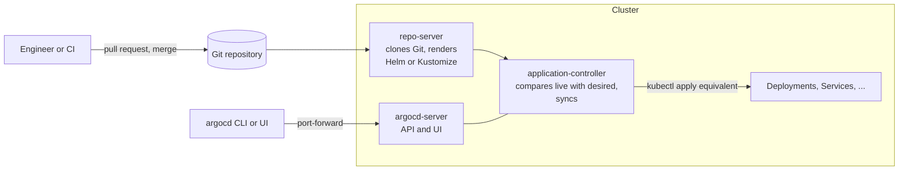

> [!info] Level: middle | Time: about 4 h | You need: [[learn/helm-basics-and-capstone|Kubernetes 06: Helm basics and the stage capstone]] and [[learn/environments-releases-and-rollbacks|Delivery 03: Environments, releases, approvals and rollbacks]] | Lab: the kind cluster `lab`, the `argocd` CLI, and a Git repository you can push to that the cluster can read (a public lab repository with nothing secret in it is simplest)

In the pipelines you have built so far, CI **pushes** changes into the cluster: a job holds cluster credentials and runs `kubectl apply` or `helm upgrade`. GitOps turns that around. The desired state of the cluster lives in Git, and an agent **inside** the cluster pulls it and keeps the cluster matching it, all the time. The site made this the only way to deliver workloads in [[adr/0001-gitops-with-argocd|ADR 0001]], with **Argo CD** as the agent.

This lesson installs Argo CD into your kind cluster, deploys an application from your own Git repository, and walks through the everyday loop: change Git, see `OutOfSync`, sync, see `Synced` and `Healthy`. Then the parts that matter in production: what happens when someone edits the cluster by hand (drift), why automated sync is off by default and how to turn it on safely, and why the rollback is a `git revert`.

> [!note] Nothing here was run for this page
> The commands and sample output follow the Argo CD documentation (the `stable` docs, read for this page) and the OpenGitOps principles, and are not verified on a running cluster. Output is illustrative. Argo CD changes quickly: check the documentation for the version you install.

## What you will learn

- The difference between push-based and pull-based delivery, and the four OpenGitOps principles.
- What the Argo CD components do, and how to install a pinned version and log in without exposing the UI.
- How an `Application` maps a path in Git to a namespace in a cluster, and how to read sync status versus health status.
- Manual versus automated sync, and what `prune` and `selfHeal` change, including how drift is detected and reverted.
- How to roll back the GitOps way, and where Helm charts, AppProjects and CI fit in.

## Push versus pull

| Question                        | Push (CI applies)                               | Pull (GitOps agent)                                                           |
| ------------------------------- | ----------------------------------------------- | ----------------------------------------------------------------------------- |
| Who holds cluster credentials?  | The CI system, for every cluster it deploys to. | Only the agent in the cluster. CI needs write access to Git, not the cluster. |
| What is the source of truth?    | Whatever the last job applied.                  | The Git repository, at a branch or tag.                                       |
| A manual `kubectl edit` in prod | Stays until the next deploy, unnoticed.         | Detected as drift; reverted if self-heal is on.                               |
| Audit trail                     | Pipeline logs.                                  | Git history: who changed what, reviewed in a pull request.                    |
| Rollback                        | Rerun an old pipeline.                          | Revert the commit.                                                            |

The [OpenGitOps](https://opengitops.dev/) project defines four principles:

1. **Declarative**: the desired state is expressed declaratively (manifests, not scripts).
2. **Versioned and immutable**: it is stored in a way that keeps every version, with a full history (Git).
3. **Pulled automatically**: agents pull the desired state from the source.
4. **Continuously reconciled**: agents keep observing the actual state and work to make it match the desired state.

Pull does not remove CI. CI still builds, tests, scans and pushes the image. Its last step changes **Git**, not the cluster: it commits the new image digest into the configuration repository (below).

## Argo CD in one diagram



- **argocd-server**: the API and web UI, used by the CLI and by people.
- **argocd-repo-server**: clones repositories and renders manifests (plain YAML, Kustomize, `helm template`).
- **argocd-application-controller**: compares the live state with the rendered desired state, sets sync and health status, and syncs (including hooks).
- The standard install also runs Redis (a cache), Dex (for SSO), the ApplicationSet controller and the notifications controller. List them with `kubectl -n argocd get pods`.

Argo CD checks Git periodically (about every three minutes by default: a 120-second reconciliation interval plus jitter, per the FAQ for the version read) and can be told immediately with a webhook or `argocd app get --refresh`.

## Install, pinned, and log in

The Getting Started guide installs from the `stable` branch and recommends a pinned version for production. Pin it in the lab too, so the lesson and your cluster agree:

```bash
ARGOCD_VERSION="vX.Y.Z" # Change: a release tag you picked from https://github.com/argoproj/argo-cd/releases
INSTALL_URL="https://raw.githubusercontent.com/argoproj/argo-cd/${ARGOCD_VERSION}/manifests/install.yaml"
kubectl create namespace argocd
kubectl apply -n argocd --server-side --force-conflicts -f "$INSTALL_URL"
kubectl -n argocd rollout status deployment/argocd-server --timeout=300s
```

- `--server-side` is required, because some Argo CD CRDs (ApplicationSet) are too big for the annotation that client-side `kubectl apply` writes.
- The manifests contain ClusterRoleBindings that reference the `argocd` namespace. Install into another namespace only if you edit them.
- Download the `argocd` CLI of the **same version** from the release page (or your package manager), and check it with `argocd version --client`.

The server is not exposed outside the cluster by default, and it should stay that way in the lab:

> [!warning] Do not expose the Argo CD UI
> Argo CD can deploy anything to the cluster it manages, so its API is a cluster-admin entry point. In the lab, reach it only through `kubectl port-forward` on localhost. Never change the `argocd-server` Service to `LoadBalancer` or add an Ingress for it without TLS, SSO and RBAC designed for it.

```bash
# In a second terminal, and leave it running:
kubectl port-forward svc/argocd-server -n argocd 8080:443

# Back in the first terminal:
argocd admin initial-password -n argocd
argocd login localhost:8080 --username admin --insecure
argocd account update-password
kubectl -n argocd delete secret argocd-initial-admin-secret
```

The default install uses a self-signed certificate, which is why the lab login uses `--insecure`; in production you configure a real certificate instead. The initial admin password is stored in clear text in the Secret `argocd-initial-admin-secret`; the docs say to delete that Secret once you have changed the password. In production, disable the local `admin` account and use SSO.

## The Application

An `Application` is a custom resource, in the `argocd` namespace, that says "render **this path** of **this repository** at **this revision**, and keep it applied to **this namespace** of **this cluster**":

```yaml title="application.yaml"
apiVersion: argoproj.io/v1alpha1
kind: Application
metadata:
  name: gitops-demo
  namespace: argocd
  finalizers:
    - resources-finalizer.argocd.argoproj.io # deleting the Application deletes what it deployed
spec:
  project: default
  source:
    repoURL: https://git.example.com/you/argocd-lab.git # your lab repository
    targetRevision: main # a branch, tag or commit
    path: apps/gitops-demo
  destination:
    server: https://kubernetes.default.svc # the cluster Argo CD runs in
    namespace: gitops-demo
  syncPolicy:
    syncOptions:
      - CreateNamespace=true # without it, a missing namespace fails the sync
    # no "automated" block: manual sync, the default
```

Two statuses, and they answer different questions:

| Status          | Question                             | Values                                                                  |
| --------------- | ------------------------------------ | ----------------------------------------------------------------------- |
| **Sync status** | Does the live state match Git?       | `Synced`, `OutOfSync`                                                   |
| **Health**      | Is what is running actually working? | `Healthy`, `Progressing`, `Degraded`, `Suspended`, `Missing`, `Unknown` |

An app can be `Synced` and `Degraded` (Git was applied faithfully, and the new version crash-loops) or `OutOfSync` and `Healthy` (someone scaled it by hand; it works, but it is not what Git says). A freshly created Application with manual sync shows `OutOfSync` and `Missing`: nothing has been applied yet.

Without the finalizer, deleting the Application leaves its resources running in the cluster. With it, deletion cascades. Know which one you have before you delete.

## Sync policies: manual, automated, prune and self-heal

```yaml
spec:
  syncPolicy:
    automated:
      prune: true # delete resources that were removed from Git
      selfHeal: true # revert changes made directly in the cluster
    syncOptions:
      - CreateNamespace=true
```

| Setting              | Default | What it does                                                                                                                                                                                   |
| -------------------- | ------- | ---------------------------------------------------------------------------------------------------------------------------------------------------------------------------------------------- |
| `automated`          | off     | Sync automatically when **Git** changes (a new commit or parameters). One attempt per commit; a failed sync is not retried on the same commit unless you configure `retry` or self-heal is on. |
| `automated.prune`    | off     | Delete live resources that are no longer in Git. Off by default "as a safety mechanism": a bad commit or a wrong path could otherwise delete everything.                                       |
| `automated.selfHeal` | off     | Also sync when the **cluster** drifts from Git (a `kubectl edit`, a manual scale). Without it, drift is only reported as `OutOfSync`.                                                          |

Automated sync with `prune` also refuses to sync an app to **zero** resources unless you set `allowEmpty: true`, which protects against an empty or wrong path wiping the app. The CLI equivalents are `argocd app set APP --sync-policy automated`, `--auto-prune` and `--self-heal`; `--sync-policy none` turns automation off again (check `argocd app set --help` for your version).

Turn these on deliberately: automated sync plus self-heal is what makes Git the real source of truth, and prune is what makes deletions in Git real. Many teams start with manual sync in a new environment, then enable automation once the app syncs cleanly.

Other sync options you will meet: `ServerSideApply=true`, `PruneLast=true`, `ApplyOutOfSyncOnly=true`, and per-resource annotations to exclude something from pruning. The full list is on the "Sync Options" page.

## Drift, and rolling back

**Drift** is any difference between the live state and Git. Argo CD shows it in `argocd app diff` and as `OutOfSync`. Some drift is expected (a controller writes defaults, an autoscaler changes `replicas`); you tell Argo CD to ignore those fields with `ignoreDifferences` rather than fighting them. The rest is a person or a tool changing the cluster behind Git's back, and self-heal reverts it.

Argo CD has an `argocd app rollback APP [HISTORY_ID]` command that re-applies an earlier synced revision from `argocd app history`. The docs state that **rollback cannot be performed against an application with automated sync enabled**, and after a CLI rollback the cluster no longer matches Git, which is drift you created on purpose. The GitOps rollback is:

```bash
git revert --no-edit <bad-commit-sha>
git push origin main
argocd app get gitops-demo --refresh
```

The revert is reviewed, recorded and repeatable, and automated sync applies it like any other change. That is the site's rule in [[adr/0048-rollback-by-redeploying-previous-digest|ADR 0048]]: roll back by reverting the GitOps commit to the previous known-good image digest. Database schemas are the exception; they only move forward. When a sync fails or drift keeps coming back in production, follow [[runbooks/argocd-sync-failure-and-drift]].

## Helm charts as a source

An Application can point at a Helm chart, in a Helm repository (`chart` and a chart version in `targetRevision`) or in Git (`path`):

```yaml title="application-helm.yaml"
spec:
  source:
    repoURL: https://charts.example.com # a Helm repository
    chart: web
    targetRevision: 1.4.2 # the chart version
    helm:
      releaseName: web
      valuesObject:
        replicaCount: 3
        image:
          repository: registry.example.com/web
          digest: sha256:0000000000000000000000000000000000000000000000000000000000000000 # illustrative
```

Argo CD uses Helm **only to render** (`helm template`) and then applies the result itself. Helm's release machinery is not used, so `helm ls` does not show the app and `helm rollback` does not apply. Values come from `valueFiles`, `values`, `valuesObject` and `parameters`, with `parameters` winning, then `valuesObject`, `values`, `valueFiles` and the chart's own `values.yaml`. Keep environment differences in values files in Git, not in CLI parameters, so they are reviewed. [[tools/helm-vs-kustomize]] compares the two renderers.

## Guard rails: AppProjects

Every Application belongs to a **project**. The `default` project allows any repository, any destination and any resource kind, which is fine for a lab and wrong for a shared Argo CD. An `AppProject` restricts what its Applications may do:

```yaml title="appproject.yaml"
apiVersion: argoproj.io/v1alpha1
kind: AppProject
metadata:
  name: team-web
  namespace: argocd
spec:
  description: Web team applications
  sourceRepos:
    - https://git.example.com/web/deploy-config.git
  destinations:
    - server: https://kubernetes.default.svc
      namespace: web-*
  clusterResourceWhitelist: [] # no cluster-scoped resources at all
  namespaceResourceBlacklist:
    - group: ""
      kind: ResourceQuota
    - group: networking.k8s.io
      kind: NetworkPolicy
```

> [!warning] A project that can deploy into the Argo CD namespace is an admin project
> The Argo CD docs warn that if a project's `destinations` allow the namespace Argo CD runs in, its Applications effectively get admin-level access to Argo CD. Never allow that for application teams, and limit who can push to the allowed `sourceRepos`.

## Where CI fits: commit the digest

The image tag problem from [[adr/0010-deploy-images-by-digest|ADR 0010]] matters even more with GitOps: if Git says `image: web:latest`, Git does not describe what runs. The flow the site uses:

1. CI builds, tests, scans and pushes the image, and reads its **digest** from the registry.
2. CI opens a pull request (or, for lower environments, commits) to the configuration repository that changes `image: registry.example.com/web@sha256:...`.
3. After review and merge, Argo CD syncs it. Promotion to the next environment is another commit with the same digest.

How to lay out the configuration repositories and promote between environments is in [[architecture/gitops-repo-topology-and-promotion]]. For many apps and clusters, Argo CD offers the **app of apps** pattern (an Application that creates Applications) and **ApplicationSets** (a controller that generates Applications from a list, the cluster list or a Git directory layout); the cluster bootstrapping page recommends ApplicationSets. Canary and blue-green releases on top of Argo CD are [[patterns/progressive-delivery-argo-rollouts]].

## Hands-on exercises

> [!warning] Exercises are not verified
> The commands and outputs were written from the Argo CD documentation and were not run for this page. Output is illustrative and the exact columns of `argocd app get` differ between versions. Read the "If you see something else" lines first.

You need two terminals: one for the port-forward, one for the work. The lab repository needs nothing secret in it; if you make it private, add read access with `argocd repo add` as the "Private Repositories" page describes.

1. **Prepare the Git repository.**

   ```bash
   REPO_URL="https://git.example.com/you/argocd-lab.git" # Change: the HTTPS clone URL of your own lab repository
   git clone "$REPO_URL" ~/argocd-lab && cd ~/argocd-lab
   mkdir -p apps/gitops-demo
   cat > apps/gitops-demo/deployment.yaml <<'EOF'
   apiVersion: apps/v1
   kind: Deployment
   metadata:
     name: web
   spec:
     replicas: 1
     selector:
       matchLabels:
         app: web
     template:
       metadata:
         labels:
           app: web
       spec:
         containers:
           - name: web
             image: nginxinc/nginx-unprivileged:1.27-alpine # example tag; in production, a digest
             ports:
               - containerPort: 8080
             resources:
               requests:
                 cpu: 20m
                 memory: 32Mi
               limits:
                 memory: 64Mi
   EOF
   cat > apps/gitops-demo/service.yaml <<'EOF'
   apiVersion: v1
   kind: Service
   metadata:
     name: web
   spec:
     selector:
       app: web
     ports:
       - port: 80
         targetPort: 8080
   EOF
   git add apps && git commit -m "Add gitops-demo app" && git push origin main
   ```

   Expected: the push succeeds and the two files are in the repository on the `main` branch.
   If you see something else: if your default branch is not `main`, use its name everywhere below.

2. **Install Argo CD and log in.** Run the commands from "Install, pinned, and log in" above, with a real release tag in `ARGOCD_VERSION`. Then:

   ```bash
   kubectl -n argocd get pods
   argocd version
   ```

   Expected: all Pods `Running` (server, repo-server, application-controller, redis, dex, applicationset and notifications controllers; names illustrative), and `argocd version` prints both the client and the server version, the same release.
   If you see something else: if `kubectl apply` reports that an annotation is too long, you left out `--server-side`. If login fails with a certificate error, add `--insecure` (lab only). If `argocd version` cannot reach the server, check the port-forward terminal.

3. **Create the Application and sync it by hand.**

   ```bash
   cd ~/argocd-lab
   sed "s#https://git.example.com/you/argocd-lab.git#${REPO_URL}#" > /tmp/gitops-demo-app.yaml <<'EOF'
   apiVersion: argoproj.io/v1alpha1
   kind: Application
   metadata:
     name: gitops-demo
     namespace: argocd
     finalizers:
       - resources-finalizer.argocd.argoproj.io
   spec:
     project: default
     source:
       repoURL: https://git.example.com/you/argocd-lab.git
       targetRevision: main
       path: apps/gitops-demo
     destination:
       server: https://kubernetes.default.svc
       namespace: gitops-demo
     syncPolicy:
       syncOptions:
         - CreateNamespace=true
   EOF
   kubectl apply -f /tmp/gitops-demo-app.yaml
   argocd app get gitops-demo
   argocd app sync gitops-demo
   argocd app wait gitops-demo --health --timeout 120
   kubectl -n gitops-demo get deploy,svc
   ```

   Expected: before the sync, `Sync Status: OutOfSync` and `Health Status: Missing`; after it, `Synced` and `Healthy`, and one `web` Deployment and Service in the new `gitops-demo` namespace.
   If you see something else: `repository not found` or an authentication error means the repository URL is wrong or private without credentials. `namespaces "gitops-demo" not found` means `CreateNamespace=true` is missing.

4. **Change Git, see `OutOfSync`, sync.**

   ```bash
   sed -i.bak 's/replicas: 1/replicas: 3/' apps/gitops-demo/deployment.yaml && rm apps/gitops-demo/deployment.yaml.bak
   git commit -am "Scale web to 3" && git push origin main
   argocd app get gitops-demo --refresh
   argocd app diff gitops-demo
   argocd app sync gitops-demo
   kubectl -n gitops-demo get deploy web
   ```

   Expected: after the refresh the app is `OutOfSync`; the diff shows `replicas: 1` changing to `3`; after the sync the Deployment shows `3/3`. With manual sync, nothing changed in the cluster until you ran `sync`.
   If you see something else: if it still says `Synced` after the refresh, check that the push went to the branch in `targetRevision`.

5. **Drift: automated sync without, then with, self-heal.**

   ```bash
   argocd app set gitops-demo --sync-policy automated
   kubectl -n gitops-demo scale deployment web --replicas=5
   sleep 20
   argocd app get gitops-demo | grep -E 'Sync Status|Health Status'
   kubectl -n gitops-demo get deploy web
   argocd app set gitops-demo --self-heal
   sleep 20
   kubectl -n gitops-demo get deploy web
   ```

   Expected: with automation but no self-heal, the app is `OutOfSync` and the Deployment **stays at 5**: automated sync reacts to Git changes, not to cluster changes. After enabling self-heal, the Deployment returns to **3** within seconds.
   If you see something else: if it went back to 3 before you enabled self-heal, the application already had `selfHeal: true`; check `kubectl -n argocd get application gitops-demo -o jsonpath='{.spec.syncPolicy}'`.

6. **Prune: delete a resource in Git.**

   ```bash
   git rm apps/gitops-demo/service.yaml && git commit -m "Remove web Service" && git push origin main
   argocd app get gitops-demo --refresh
   kubectl -n gitops-demo get svc web
   argocd app set gitops-demo --auto-prune
   sleep 20
   kubectl -n gitops-demo get svc web
   ```

   Expected: without prune, the Service is still in the cluster and the app shows it as needing pruning (`OutOfSync`). After `--auto-prune`, the Service is deleted. Restore it with `git revert --no-edit HEAD && git push origin main`.
   If you see something else: if the Service disappeared before you enabled prune, the Application already had `prune: true`.

7. **A broken commit, and the GitOps rollback.**

   ```bash
   sed -i.bak 's/replicas: 3/replicas: three/' apps/gitops-demo/deployment.yaml && rm apps/gitops-demo/deployment.yaml.bak
   git commit -am "Break the Deployment" && git push origin main
   BAD_SHA=$(git rev-parse HEAD)
   argocd app get gitops-demo --refresh
   sleep 20
   argocd app get gitops-demo
   argocd app rollback gitops-demo || true
   git revert --no-edit "$BAD_SHA" && git push origin main
   argocd app get gitops-demo --refresh
   argocd app wait gitops-demo --sync --health --timeout 120
   ```

   Expected: after the broken commit, the app reports an error (a comparison or sync error saying the manifest is invalid; wording illustrative) and the running Deployment keeps its last good state. `argocd app rollback` is refused because automated sync is on. After the revert, the app returns to `Synced` and `Healthy`, and `git log` shows who broke it and who fixed it.
   If you see something else: if Argo CD applied the bad value, your version validated differently; the revert still fixes it.

8. **Clean up.**

   ```bash
   kubectl -n argocd delete application gitops-demo
   kubectl get namespace gitops-demo
   kubectl delete -n argocd -f "$INSTALL_URL"
   kubectl delete namespace argocd
   ```

   Expected: deleting the Application also deletes the `web` resources (the finalizer); the `gitops-demo` namespace itself was created by the sync option and may stay, delete it with `kubectl delete namespace gitops-demo`. Then Argo CD and its CRDs are removed. Stop the port-forward with Ctrl-C.
   If you see something else: an Application stuck in deletion means its finalizer is waiting on resources; delete the Application **before** uninstalling Argo CD, never the other way round.

## Common mistakes

- **Exposing the Argo CD server.** Why it bites: it can deploy anything to the cluster, and the default admin account has a known name. Fix: port-forward in the lab; SSO, RBAC and a private ingress in production.
- **Installing from `stable` or `latest` without a pin.** Why it bites: the next apply upgrades Argo CD unexpectedly. Fix: pin a release tag and upgrade on purpose.
- **Turning on `prune` without reviewing the path.** Why it bites: a wrong `path` or an accidental mass deletion in Git deletes live resources. Fix: enable prune after the app syncs cleanly, keep `allowEmpty` off, and review deletions in pull requests.
- **Expecting automated sync to fix manual changes.** Why it bites: without `selfHeal`, drift stays and is only reported. Fix: `selfHeal: true` for environments where Git must win.
- **Rolling back with `argocd app rollback` or `kubectl`.** Why it bites: Git still says the bad version, so the next sync re-applies it, and with auto-sync the rollback is refused anyway. Fix: `git revert` and push.
- **Mutable image tags in Git.** Why it bites: Git does not change when the tag moves, so Argo CD cannot see or revert the change. Fix: digests, written by CI.
- **Everything in the `default` project.** Why it bites: any Application can deploy any repository to any namespace, including cluster-scoped resources. Fix: one AppProject per team with tight `sourceRepos`, `destinations` and resource lists.
- **Deleting an Application without knowing its finalizer.** Why it bites: with the finalizer the whole app is deleted; without it, everything keeps running unmanaged. Fix: check `metadata.finalizers` first.

## Check your understanding

1. What changes for credentials and audit when you move from push-based CI deployment to Argo CD?
2. An app shows `Synced` and `Degraded`. What does that tell you, and where do you look next?
3. Automated sync is on, `selfHeal` is off, and someone scales a Deployment by hand. What does Argo CD do?
4. Why is `prune` off by default, and what extra protection does automated sync with prune keep?
5. Why is `git revert` the preferred rollback, and when does `argocd app rollback` not work at all?
6. Your Application uses a Helm chart. A colleague runs `helm ls` and sees nothing. Is something wrong?

> [!question]- Answers
>
> 1. CI no longer needs credentials for the cluster, only write access to the configuration repository; the cluster credentials stay with the agent inside the cluster. Every change to the cluster is a Git commit, reviewed in a pull request, so the audit trail is the Git history rather than pipeline logs.
> 2. The live state matches Git exactly, but what Git describes is not working (for example Pods crash-looping or not Ready). Look at the resource health in `argocd app get`, then at the workload itself: `kubectl describe` and logs for the failing Pods, as in Kubernetes 05.
> 3. It reports the app as `OutOfSync` (drift) but does not change the cluster, because automated sync reacts to changes in Git. With `selfHeal: true` it would revert the change within seconds.
> 4. Pruning deletes live resources that are not in Git, so a wrong path, a broken render or an accidental deletion in Git could delete a working application. Even with prune on, automated sync refuses to sync an app down to zero resources unless `allowEmpty` is set.
> 5. A revert is a reviewed, recorded change to the source of truth, and automation applies it like any other commit; the cluster and Git stay in agreement. `argocd app rollback` is refused while automated sync is enabled, and when it does work it leaves the cluster different from Git until someone fixes Git.
> 6. No. Argo CD uses Helm only to render the chart with `helm template` and applies the result itself, so there is no Helm release to list. Manage it through Argo CD and Git, not `helm` commands.

## Next steps

Next lesson: [[learn/spinnaker-basics-applications-pipelines-and-judgment|Delivery 12: Spinnaker basics]]. Previous lesson: [[learn/terraform-for-each-lifecycle-and-tests|Delivery 10: Terraform for_each, count, dynamic blocks, lifecycle rules and a first terraform test]].

To go deeper:

- [[adr/0001-gitops-with-argocd]] and [[tools/argocd-vs-flux]] for why Argo CD.
- [[architecture/gitops-repo-topology-and-promotion]] for repository layout and promotion between environments.
- [[runbooks/argocd-sync-failure-and-drift]] for sync failures and recurring drift in production.
- [[patterns/progressive-delivery-argo-rollouts]] for canary and blue-green on top of Argo CD.
- [[patterns/external-secrets-with-secret-manager]] for keeping secrets out of the Git repository.
- [[runbooks/helm-release-rollback]] for the contrast with Helm-managed releases.
- The whole path is mapped in [[learn/index|the learning path]].

## Sources

- Argo CD documentation, "Getting Started" (https://argo-cd.readthedocs.io/en/stable/getting_started/), for the install command and `--server-side`, the self-signed certificate, port-forwarding, `argocd admin initial-password`, the initial admin Secret and the recommendation to pin a version.
- Argo CD documentation, "Architecture" (https://argo-cd.readthedocs.io/en/stable/operator-manual/architecture/) and "Core Concepts" (https://argo-cd.readthedocs.io/en/stable/core_concepts/), for the components and the sync and health vocabulary.
- Argo CD documentation, "Declarative Setup" (https://argo-cd.readthedocs.io/en/stable/operator-manual/declarative-setup/), for the Application and AppProject fields, the deletion finalizer and the project warning.
- Argo CD documentation, "Automated Sync Policy" (https://argo-cd.readthedocs.io/en/stable/user-guide/auto_sync/), for automated sync, prune, self-heal, `allowEmpty`, the one-attempt-per-commit rule and the rollback restriction.
- Argo CD documentation, "Sync Options" (https://argo-cd.readthedocs.io/en/stable/user-guide/sync-options/), "Resource Health" (https://argo-cd.readthedocs.io/en/stable/operator-manual/health/), "Helm" (https://argo-cd.readthedocs.io/en/stable/user-guide/helm/), "Cluster Bootstrapping" (https://argo-cd.readthedocs.io/en/stable/operator-manual/cluster-bootstrapping/) and the `argocd app rollback` reference (https://argo-cd.readthedocs.io/en/stable/user-guide/commands/argocd_app_rollback/).
- OpenGitOps, "Principles" (https://opengitops.dev/), for the four principles.
- Checked against the documentation of the Argo CD `stable` branch on 2026-10-21; not checked against a running cluster for this page. Not verified: all output and error wording; the Pod names in your version; the reconciliation interval and jitter in your version; the exact CLI flags (check `--help`); which Kubernetes versions your Argo CD release supports (see its release notes). Check the current docs.
