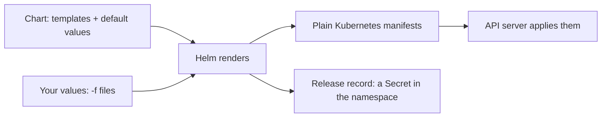

> [!info] Level: middle | Time: about 8 h | You need: [[learn/kubernetes-probes-resources-and-debugging|Kubernetes 05: Probes, resources and a pod debugging playbook]] and [[learn/kubernetes-config-secrets-and-namespaces|Kubernetes 04: ConfigMaps, Secrets and Namespaces]] | Lab: Lab B, the kind cluster `lab` from [[learn/lab-setup|Start 01: Set up your lab]]

Over the last five lessons you wrote Kubernetes YAML by hand: a Deployment, a Service, a ConfigMap, a Secret. That works for one app in one place. It stops working the moment you need the same app in three environments with different replica counts, a different image tag and a different greeting. You end up copying files and editing them, and the copies drift apart.

**Helm** solves this by turning a set of YAML files into a package called a **chart**, with a small set of **values** you change per environment. Installing a chart creates a **release**, which Helm tracks, so you can ask "what is deployed?", "what changed?" and "go back to the last good version". This lesson teaches the parts you need on day one, then closes the Kubernetes stage with a capstone: one chart that deploys a complete app (ConfigMap, Secret, Deployment with probes and resources, Service), which you upgrade, break on purpose and roll back.

> [!warning] Check before relying on this
> Two major versions of Helm exist as of this lesson, Helm 3 and Helm 4, and which one your team runs matters for a few flags. The support dates of Helm 3 and Helm 4 were not confirmed for this page. The commands in this lesson (`create`, `lint`, `template`, `install`, `upgrade --install`, `list`, `history`, `rollback`, `uninstall`) work in both. The flags that differ are called out where they appear: in Helm 3 `--atomic` rolls back a failed upgrade, while Helm 4 calls it `--rollback-on-failure` and prints a deprecation warning for `--atomic`; Helm 4 also renames `--force` to `--force-replace` and changes what `--wait` does. Run `helm version --short` and `helm upgrade --help` on your machine and trust them over this page.

## What you will learn

- What Helm adds on top of plain manifests: templating, releases, history, rollback and dependencies.
- The anatomy of a chart (`Chart.yaml`, `values.yaml`, `templates/`, `_helpers.tpl`) and the template functions you use every day.
- The release commands: `helm template`, `lint`, `install`, `upgrade --install`, `list`, `history`, `rollback` and `uninstall`, and what `--wait` and `--atomic` change.
- How to layer values per environment without `--set`, and how to keep a Secret out of Git.
- How to build, upgrade, break and roll back a complete app as one chart (the stage capstone), and how to check it with a checklist.

## Why Helm

Plain manifests have three problems at scale.

1. **No variables.** The replica count, the image tag, the hostname and the memory limit are hard-coded in the YAML. To change one for staging you copy the file.
2. **No unit of deployment.** An app is five or ten objects. `kubectl apply -f` applies them, but nothing remembers they belong together, so deleting the app means remembering every object.
3. **No history.** After `kubectl apply`, the previous state is only in your Git log, and going back means re-applying an old commit.

Helm answers each of these.

| Need                 | What Helm gives you                                                                                                                    |
| -------------------- | -------------------------------------------------------------------------------------------------------------------------------------- |
| Variables            | **Templates** (Go templates) filled from **values**                                                                                    |
| A unit of deployment | A **chart**: a directory or `.tgz` with templates, defaults and metadata, versioned                                                    |
| One name per install | A **release**: a named installation of a chart in a namespace                                                                          |
| History and rollback | Every install and upgrade is a numbered **revision** stored in the cluster; `helm rollback` returns to one                             |
| Reuse                | Charts can depend on other charts (**dependencies**, also called subcharts) and be shared through chart repositories or OCI registries |

Helm is not magic. It renders text into Kubernetes YAML, sends that YAML to the API server, and records what it sent. Everything else in this lesson follows from that.



### Where Helm sits among other tools

Helm and Kustomize both produce Kubernetes manifests, in opposite ways. Helm is a package manager with a template language: you write YAML with holes and fill them from values. Kustomize has no templates: it takes plain, valid YAML and applies patches in layers. Helm tracks releases and has rollback; Kustomize leaves history to Git. Third-party software almost always ships as a chart, and your own apps are often a chart too. Many teams use both. The comparison, including how Argo CD treats each, is in [[tools/helm-vs-kustomize]].

## Chart anatomy

A chart is a directory with a fixed layout. Create the scaffold Helm generates and look at it.

```bash
mkdir -p ~/lab/helm && cd ~/lab/helm
helm create scratch
find scratch | sort
```

```text
scratch
scratch/.helmignore
scratch/Chart.yaml
scratch/charts
scratch/templates
scratch/templates/NOTES.txt
scratch/templates/_helpers.tpl
scratch/templates/deployment.yaml
scratch/templates/hpa.yaml
scratch/templates/httproute.yaml
scratch/templates/ingress.yaml
scratch/templates/service.yaml
scratch/templates/serviceaccount.yaml
scratch/templates/tests
scratch/templates/tests/test-connection.yaml
scratch/values.yaml
```

The output is illustrative: the exact set of generated templates differs between Helm versions (this one includes an `httproute.yaml` for the Gateway API, which older versions do not).

| File or folder        | What it is                                                                                                                                         |
| --------------------- | -------------------------------------------------------------------------------------------------------------------------------------------------- |
| `Chart.yaml`          | The chart's metadata: `name`, `version` (the chart's own version), `appVersion` (the version of the app it deploys, informational), `description`. |
| `values.yaml`         | The default values. Every setting a user may change lives here, with a comment saying what it does.                                                |
| `templates/`          | Template files that become Kubernetes manifests. Files starting with `_` (such as `_helpers.tpl`) hold reusable snippets and produce no output.    |
| `templates/NOTES.txt` | Text printed after `helm install`, also a template. Use it to say how to reach the app.                                                            |
| `templates/tests/`    | Pods that `helm test` runs against an installed release.                                                                                           |
| `charts/`             | Dependencies (subcharts), after `helm dependency update`.                                                                                          |
| `.helmignore`         | Files left out when the chart is packaged.                                                                                                         |

The scaffold is a fine starting point and a poor teacher: it is long and full of options you do not need yet. In this lesson you write a small chart by hand, so you understand every line. Delete the scaffold when you are done looking.

```bash
rm -rf scratch
```

Two version fields are easy to confuse. `version` in `Chart.yaml` is the **chart** version: bump it when you change the chart itself. `appVersion` is the version of the **application** the chart deploys. They move independently. The conventions for versioning and structure that a team standardises on are in [[patterns/helm-chart-conventions]].

## Template basics

Helm templates use the Go template language. Anything between `{{` and `}}` is code; everything else is copied as it is. The code runs over a set of objects Helm gives you.

| Object                                               | Holds                                                                      |
| ---------------------------------------------------- | -------------------------------------------------------------------------- |
| `.Values`                                            | The merged values: chart defaults, then your `-f` files, then any `--set`. |
| `.Release.Name`                                      | The release name you passed to `helm install`.                             |
| `.Release.Namespace`                                 | The namespace of the release.                                              |
| `.Release.Service`                                   | Always `Helm`; used in the `managed-by` label.                             |
| `.Chart.Name`, `.Chart.Version`, `.Chart.AppVersion` | The fields of `Chart.yaml`.                                                |
| `.Template.BasePath`                                 | The path of the `templates/` directory, used to read another template.     |

The few functions and keywords you need first:

| Syntax                                         | What it does                                                                                                           |
| ---------------------------------------------- | ---------------------------------------------------------------------------------------------------------------------- |
| `{{ .Values.replicaCount }}`                   | Prints a value.                                                                                                        |
| `{{ .Values.config.greeting \| quote }}`       | Pipes a value through a function. `quote` wraps it in double quotes.                                                   |
| `{{ default "info" .Values.logLevel }}`        | Uses a fallback when the value is empty.                                                                               |
| `{{ include "web.labels" . \| nindent 4 }}`    | Runs a named snippet from `_helpers.tpl` and indents the result by 4 spaces, starting on a new line.                   |
| `{{ toYaml .Values.resources \| nindent 12 }}` | Turns a value (a map or list) into YAML text, then indents it. The standard way to pass a block through.               |
| `{{- if .Values.x }} ... {{- end }}`           | Renders the block only when the value is set (not empty, not `false`, not `0`).                                        |
| `{{- with .Values.extraEnv }} ... {{- end }}`  | Like `if`, and inside the block `.` means that value.                                                                  |
| `{{- range $k, $v := .Values.extraEnv }}`      | Repeats a block for every item of a map or list, in key order for a map.                                               |
| `{{ required "message" .Values.x }}`           | Stops the render with your message if the value is empty. Use it for values that have no safe default.                 |
| `{{- ... -}}`                                  | A dash trims the whitespace and newlines on that side. Without it, YAML gets stray blank lines and indentation breaks. |

Three habits will save you hours.

- **`include` with `nindent`, not `template`.** `template` cannot be piped into a function, so it cannot be indented. Use `include`.
- **Mind the dot.** Inside `with` and `range`, `.` is no longer the root. To reach the root again, use `$`, as in `$.Release.Name`. Putting `$` in front of root references from the start is a safe habit.
- **Quote strings that look like other things.** The YAML value `1.20` is a number, and `1.20` read as a number is `1.2`. An image tag, a version or a port-like string should be quoted in `values.yaml`.

You will see all of these in the chart below.

## The capstone chart

You are going to build one chart for a small web app. The app is the unprivileged nginx image used in earlier lessons, configured through a ConfigMap so that it answers three paths: `/healthz` (liveness), `/ready` (readiness) and `/` (a greeting you set in values). Everything the Kubernetes stage taught is in it:

- a **ConfigMap** holding the nginx configuration (lesson 04),
- a **Secret** that comes from a file you never commit (lesson 04),
- a **Deployment** with startup, readiness and liveness probes, resource requests and limits, and a hardened security context (lesson 05),
- a **Service** that selects the Pods by label (lesson 03).

Make the directory and the chart files. Every file is shown in full.

```bash
mkdir -p ~/lab/helm/web/templates && cd ~/lab/helm
```

```yaml title="web/Chart.yaml"
apiVersion: v2
name: web
description: A small web app for the learning path
type: application
version: 0.1.0 # the chart's own version: bump it when the chart changes
appVersion: "1.0.0" # the version of the app it deploys; informational
```

```yaml title="web/values.yaml"
# Default values for the web chart. Override them per environment
# with a values file (see values-lab.yaml), not with --set.
replicaCount: 1

image:
  repository: nginxinc/nginx-unprivileged
  tag: "1.27-alpine" # example tag; pin the one you use. Quote it: 1.27 would be read as a number.
  pullPolicy: IfNotPresent

config:
  greeting: hello from the chart

# Extra environment variables for the container, as a map.
extraEnv: {}

service:
  port: 80

# Fail a stalled rollout after 60 s instead of the 600 s default.
progressDeadlineSeconds: 60

resources:
  requests:
    cpu: 50m
    memory: 32Mi
  limits:
    memory: 64Mi

# Secret values. Leave empty to create no Secret.
# Never commit real values: put them in an uncommitted file and pass it with -f.
secret:
  existingSecret: "" # name of a Secret that already exists; the chart then creates none
  values: {}
```

```text title="web/templates/_helpers.tpl"
{{/* A name for every object: the release name, unless it already contains the chart name. */}}
{{- define "web.fullname" -}}
{{- if contains .Chart.Name .Release.Name -}}
{{- .Release.Name | trunc 63 | trimSuffix "-" -}}
{{- else -}}
{{- printf "%s-%s" .Release.Name .Chart.Name | trunc 63 | trimSuffix "-" -}}
{{- end -}}
{{- end -}}

{{/* Labels that never change after the first install. They go into the Deployment selector. */}}
{{- define "web.selectorLabels" -}}
app.kubernetes.io/name: {{ .Chart.Name }}
app.kubernetes.io/instance: {{ .Release.Name }}
{{- end -}}

{{/* All labels: the selector labels plus labels that may change on upgrade. */}}
{{- define "web.labels" -}}
{{ include "web.selectorLabels" . }}
app.kubernetes.io/version: {{ .Chart.AppVersion | quote }}
app.kubernetes.io/managed-by: {{ .Release.Service }}
helm.sh/chart: {{ printf "%s-%s" .Chart.Name .Chart.Version | replace "+" "_" }}
{{- end -}}

{{/* The Secret the Pod uses: an existing one, the one this chart creates, or empty for none. */}}
{{- define "web.secretName" -}}
{{- if .Values.secret.existingSecret -}}
{{- .Values.secret.existingSecret -}}
{{- else if .Values.secret.values -}}
{{- include "web.fullname" . -}}
{{- end -}}
{{- end -}}
```

The selector labels are kept apart from the other labels on purpose. A Deployment's `spec.selector` cannot be changed after it is created, so it must only contain labels that never change. The version label does change on every release, so it goes in `web.labels` and never in the selector.

```yaml title="web/templates/configmap.yaml"
apiVersion: v1
kind: ConfigMap
metadata:
  name: {{ include "web.fullname" . }}
  labels:
    {{- include "web.labels" . | nindent 4 }}
data:
  default.conf: |
    server {
      listen 8080;
      default_type text/plain;

      location = /healthz {
        access_log off;
        return 200 "ok";
      }

      location = /ready {
        access_log off;
        return 200 "ready";
      }

      location / {
        return 200 {{ .Values.config.greeting | quote }};
      }
    }
```

The greeting is placed inside an nginx string. `quote` escapes quotes for Go, which is close to, but not the same as, nginx's rules, so keep the greeting plain text. This is fine for a lab and a reason not to build real configuration this way.

```yaml title="web/templates/secret.yaml"
{{- if and .Values.secret.values (not .Values.secret.existingSecret) }}
apiVersion: v1
kind: Secret
metadata:
  name: {{ include "web.fullname" . }}
  labels:
    {{- include "web.labels" . | nindent 4 }}
type: Opaque
stringData:
  {{- toYaml .Values.secret.values | nindent 2 }}
{{- end }}
```

The whole file is wrapped in an `if`: with no secret values, nothing is rendered, so the chart installs without a Secret. `stringData` lets you write plain text and have the API server store it base64-encoded, as lesson 04 explained.

```yaml title="web/templates/service.yaml"
apiVersion: v1
kind: Service
metadata:
  name: {{ include "web.fullname" . }}
  labels:
    {{- include "web.labels" . | nindent 4 }}
spec:
  type: ClusterIP
  selector:
    {{- include "web.selectorLabels" . | nindent 4 }}
  ports:
    - name: http
      port: {{ .Values.service.port }}
      targetPort: http
```

```yaml title="web/templates/deployment.yaml"
{{- $secretName := include "web.secretName" . }}
apiVersion: apps/v1
kind: Deployment
metadata:
  name: {{ include "web.fullname" . }}
  labels:
    {{- include "web.labels" . | nindent 4 }}
spec:
  replicas: {{ .Values.replicaCount }}
  progressDeadlineSeconds: {{ .Values.progressDeadlineSeconds }}
  selector:
    matchLabels:
      {{- include "web.selectorLabels" . | nindent 6 }}
  template:
    metadata:
      labels:
        {{- include "web.selectorLabels" . | nindent 8 }}
      annotations:
        # A new hash rolls the Pods when the ConfigMap or the chart-created Secret changes.
        checksum/config: {{ include (print $.Template.BasePath "/configmap.yaml") . | sha256sum }}
        {{- if .Values.secret.values }}
        checksum/secret: {{ include (print $.Template.BasePath "/secret.yaml") . | sha256sum }}
        {{- end }}
    spec:
      automountServiceAccountToken: false
      securityContext:
        runAsNonRoot: true
        seccompProfile:
          type: RuntimeDefault
      containers:
        - name: web
          image: "{{ .Values.image.repository }}:{{ required "image.tag must be set; pin a tag, never latest" .Values.image.tag }}"
          imagePullPolicy: {{ .Values.image.pullPolicy }}
          ports:
            - name: http
              containerPort: 8080
          {{- with .Values.extraEnv }}
          env:
            {{- range $name, $value := . }}
            - name: {{ $name }}
              value: {{ $value | quote }}
            {{- end }}
          {{- end }}
          startupProbe:
            httpGet:
              path: /healthz
              port: http
            periodSeconds: 2
            failureThreshold: 30
          readinessProbe:
            httpGet:
              path: /ready
              port: http
            periodSeconds: 5
            timeoutSeconds: 2
            failureThreshold: 3
          livenessProbe:
            httpGet:
              path: /healthz
              port: http
            periodSeconds: 10
            timeoutSeconds: 2
            failureThreshold: 3
          resources:
            {{- toYaml .Values.resources | nindent 12 }}
          securityContext:
            runAsUser: 101 # the user the example image runs as; change it with the image
            allowPrivilegeEscalation: false
            capabilities:
              drop: ["ALL"]
          volumeMounts:
            - name: nginx-conf
              mountPath: /etc/nginx/conf.d
              readOnly: true
            {{- if $secretName }}
            - name: app-secret
              mountPath: /etc/web/secret
              readOnly: true
            {{- end }}
      volumes:
        - name: nginx-conf
          configMap:
            name: {{ include "web.fullname" . }}
        {{- if $secretName }}
        - name: app-secret
          secret:
            secretName: {{ $secretName }}
        {{- end }}
```

Four things in this template deserve a second look.

- **The checksum annotation.** Lesson 04 said that a changed ConfigMap does not restart the Pods that use it. The annotation fixes that: it holds a hash of the rendered ConfigMap, so when the config changes, the Pod template changes, and the Deployment rolls out new Pods. It is a standard Helm idiom.
- **`required`.** An empty `image.tag` stops the render with your message. A tag you forgot to set can never silently become `latest`.
- **`with` and `range`.** The `env:` block exists only when `extraEnv` has entries. Inside it, `.` is the map and `range` walks its keys.
- **`progressDeadlineSeconds: 60`.** The Kubernetes default is 600 seconds. With the default, the "bad image" exercise below would take ten minutes to report a stalled rollout.

> [!note] Hardening is partial on purpose
> The Pod runs as a non-root user with all capabilities dropped and the default seccomp profile. It does not set `readOnlyRootFilesystem`, because nginx needs writable directories for temporary files and you would have to add `emptyDir` mounts for them. A production chart should do that; see [[patterns/helm-chart-conventions]] and [[patterns/pod-security-admission]].

```text title="web/templates/NOTES.txt"
Release {{ .Release.Name }} is installed in the {{ .Release.Namespace }} namespace.

To try it from your machine:
  kubectl --namespace {{ .Release.Namespace }} port-forward service/{{ include "web.fullname" . }} 8080:{{ .Values.service.port }}
  curl -i http://127.0.0.1:8080/ready
```

Now the per-environment values file and the uncommitted secret file. The first is committed with the chart; the second never is.

```yaml title="values-lab.yaml"
replicaCount: 3
config:
  greeting: hello from the lab
extraEnv:
  APP_ENV: lab
```

```yaml title="secret.local.yaml"
secret:
  values:
    api-token: lab-token-not-real
```

```bash
printf 'secret.local.yaml\n*.local.yaml\n' > .gitignore
```

If you keep this folder in Git, the `.gitignore` lines are what keep the file out of a commit. The value is a made-up lab string. Never put a real credential in a lab file either; the habit matters more than the value.

## The release commands

With the chart written, these are the commands you use, in the order you meet them. Set the variables first.

```bash
NS=helm-lab      # the namespace for the release
REL=web          # the release name
CHART=./web      # the chart directory
```

### Check the chart without a cluster

| Command                                                   | What it does                                                                                     |
| --------------------------------------------------------- | ------------------------------------------------------------------------------------------------ |
| `helm lint "$CHART"`                                      | Checks the chart for errors and style problems. Needs no cluster.                                |
| `helm template "$REL" "$CHART" -n "$NS"`                  | Renders the templates to YAML on your screen. **No cluster is contacted**; nothing is installed. |
| `helm template ... --show-only templates/deployment.yaml` | Prints one rendered file.                                                                        |
| `helm show values "$CHART"`                               | Prints the chart's default `values.yaml`.                                                        |

`helm template` is the most useful command for learning and for review: it shows exactly what Helm would send. Because it works without a cluster, it also runs in CI. One limit: it cannot know what your cluster has. Functions like `lookup` return nothing, and it does not check the output against the cluster's API. To do that, add a server-side dry run: `helm template ... | kubectl apply --dry-run=server -f -`.

### Install, upgrade, inspect

| Command                                                          | What it does                                                                                                                                |
| ---------------------------------------------------------------- | ------------------------------------------------------------------------------------------------------------------------------------------- |
| `helm install "$REL" "$CHART" -n "$NS" --create-namespace`       | Creates release revision 1.                                                                                                                 |
| `helm upgrade --install "$REL" "$CHART" -n "$NS" -f values.yaml` | Installs if the release does not exist, upgrades if it does. **The form to use in scripts and pipelines**, because it is safe to run twice. |
| `helm list -n "$NS"`                                             | Lists the releases in a namespace with their revision and status.                                                                           |
| `helm status "$REL" -n "$NS"`                                    | Shows the state of one release and its notes.                                                                                               |
| `helm history "$REL" -n "$NS"`                                   | Lists every revision with its status and a description.                                                                                     |
| `helm get values "$REL" -n "$NS"`                                | Shows the values you supplied. Add `--all` to include the chart defaults.                                                                   |
| `helm get manifest "$REL" -n "$NS"`                              | Shows the YAML Helm sent for the current revision.                                                                                          |
| `helm rollback "$REL" REVISION -n "$NS"`                         | Returns to an earlier revision.                                                                                                             |
| `helm uninstall "$REL" -n "$NS"`                                 | Deletes the release and the objects it created.                                                                                             |

### What a release is, and where it lives

Helm does not keep a database outside the cluster. Each revision is stored **in the cluster, in the release's namespace, as a Secret** of type `helm.sh/release.v1`, named `sh.helm.release.v1.<release>.v<revision>`. The Secret holds the chart, the values you supplied and the rendered manifest, compressed. That is how `helm history` and `helm rollback` work from any machine that can reach the cluster.

Two consequences matter.

1. **By default Helm keeps the last 10 revisions** of a release (`--history-max`, default 10). Older revisions disappear, so you cannot roll back past them.
2. **Anyone who can read Secrets in that namespace can read your release data**, including values you passed and any Secret your chart rendered. `helm get values` and `helm get manifest` print them. Treat access to release Secrets as access to your secrets.

> [!warning] A Secret rendered by a chart is stored in the release
> The capstone passes a Secret value through a values file so you can see the mechanics. The value ends up in the release record and in `helm get values`. For real credentials, do not make the chart create the Secret: set `secret.existingSecret` to a Secret that something else manages, such as the External Secrets Operator ([[patterns/external-secrets-with-secret-manager]]). The chart then only references the name and the value never enters the release.

### `--wait`, `--timeout` and atomic upgrades

By default `helm upgrade` returns as soon as the API server has accepted the objects. It prints `STATUS: deployed` even if the new Pods can never start. Kubernetes then rolls out in the background and you find out later.

Two options change that.

- **`--wait`** makes Helm wait until the resources are ready (Pods and Deployments ready, PVCs bound, Services with an IP, and a load balancer address for type LoadBalancer) or `--timeout` passes (default 5 minutes). If the wait fails, the revision is marked `failed`.
- **An atomic upgrade** adds an automatic rollback: if the upgrade fails or times out, Helm returns to the last good revision. In Helm 3 the flag is `--atomic` (it implies `--wait`). In Helm 4 it is `--rollback-on-failure`, and `--atomic` still works but is reported as deprecated.

```bash
# Helm 3
helm upgrade --install "$REL" "$CHART" -n "$NS" -f values-lab.yaml --atomic --timeout 2m
# Helm 4
helm upgrade --install "$REL" "$CHART" -n "$NS" -f values-lab.yaml --rollback-on-failure --timeout 2m
```

Use `--wait --timeout` (or the atomic form) in every pipeline. Without it a pipeline goes green on a release that is already broken.

> [!warning] Check before relying on this
> In Helm 4, `--wait` takes a strategy (`watcher`, `hookOnly` or `legacy`), and the default when you omit the flag is `hookOnly`. The behaviour of `--wait` and the rollback flag differs between versions. Read `helm upgrade --help` for the version you use before you copy a pipeline step.

## Layering values

Values come from several places, and later ones override earlier ones:

1. The chart's `values.yaml` (defaults).
2. Each `-f file`, in the order you list them.
3. `--set` and `--set-string` on the command line (highest priority).

```bash
helm upgrade --install web ./web -n helm-lab -f values-lab.yaml -f secret.local.yaml
```

Here `values-lab.yaml` overrides the chart defaults, and `secret.local.yaml` is merged on top. Maps merge key by key; **lists are replaced whole**, so overriding one item of a list means writing the entire list.

The practice that follows: one committed values file per environment (`values-lab.yaml`, `values-stage.yaml`, `values-prod.yaml`), plus an uncommitted file or an external secret for credentials. The release is then reproducible from Git: chart version plus values files equals the deployed state.

**Avoid `--set` in pipelines.** It is fine for a quick experiment at your terminal and wrong for anything repeatable, for four reasons:

- It is not in Git. The next person who runs the command without the same `--set` flags gets a different release.
- It is easy to mistype a path. `--set replicaCnt=3` is accepted without a word and does nothing, because Helm cannot know the key does not exist.
- Types are guessed. `--set` turns `true` into a boolean, `1234` into a number and `null` into "delete this key"; `--set-string` exists to force a string.
- Anything in a command line shows up in shell history, process lists and CI logs, and secrets get leaked this way.

Two related traps. `--reuse-values` reuses the last release's values and ignores new defaults added to the chart, so a chart upgrade can silently miss new settings. Prefer to pass the same `-f` files on every upgrade. And a misspelled key in a values file behaves like `--set`: nothing complains. A `values.schema.json` file next to `values.yaml` makes Helm validate the values on `lint`, `template`, `install` and `upgrade`; see [[patterns/helm-chart-ci-quality-gates]].

## What this lesson leaves out

Helm has more features than a first lesson needs. You will meet them when you need them:

- **Dependencies.** `Chart.yaml` can list other charts under `dependencies`, and `helm dependency update` downloads them into `charts/`.
- **Hooks.** Annotated Jobs that run at points such as before an upgrade (database migrations are the usual case).
- **`helm test`.** Runs the Pods in `templates/tests/` against a release.
- **Sharing charts.** Chart repositories and OCI registries, with `helm package` and `helm push`.
- **CRDs.** Files in a chart's `crds/` directory are installed once and are not upgraded or deleted by Helm. Treat CRDs as their own lifecycle.

When Argo CD or Flux deploys your chart, the GitOps controller usually renders the chart itself instead of running `helm install`, so the Helm release history may not exist. Rollback then becomes a Git revert of the values or chart version. The reasoning is in [[adr/0001-gitops-with-argocd]] and [[tools/argocd-vs-flux]], and the Helm-side procedure is [[runbooks/helm-release-rollback]].

## Hands-on exercises

Work in the kind cluster `lab`, in a namespace that is only for this lesson. Check the context before you start.

```bash
kubectl config current-context
```

Expected: `kind-lab`. If you see something else, run `kubectl config use-context kind-lab`, or create the cluster again with the steps in [[learn/lab-setup|Start 01: Set up your lab]].

Set the variables once per shell session.

```bash
NS=helm-lab
cd ~/lab/helm
```

1. **Render the chart with no cluster.** Lint it, render it with the defaults, then with the lab values and the secret file.

   ```bash
   helm version --short
   helm lint ./web
   helm template web ./web -n "$NS" | grep -E '^kind:|replicas:|image:'
   helm template web ./web -n "$NS" -f values-lab.yaml -f secret.local.yaml | grep -E '^kind:|replicas:|greeting|hello|api-token'
   ```

   Expected (illustrative; your Helm version string will differ):

   ```text
   v3.22
   ==> Linting ./web
   [INFO] Chart.yaml: icon is recommended

   1 chart(s) linted, 0 chart(s) failed
   kind: ConfigMap
   kind: Service
   kind: Deployment
     replicas: 1
             image: "nginxinc/nginx-unprivileged:1.27-alpine"
   kind: Secret
     api-token: lab-token-not-real
   kind: ConfigMap
           return 200 "hello from the lab";
   kind: Service
   kind: Deployment
     replicas: 3
   ```

   The first render has no Secret, because `secret.values` is empty. The second has one, 3 replicas and the lab greeting. Helm renders objects in a fixed kind order (Secret and ConfigMap before Service and Deployment), not in file order. Now check the `required` guard and a deliberate error:

   ```bash
   helm template web ./web --set image.tag=
   ```

   Expected: `Error: execution error at (web/templates/deployment.yaml:32:52): image.tag must be set; pin a tag, never latest` (the line and column numbers are illustrative).
   If you see something else: if `helm: command not found`, install Helm as described in [[learn/lab-setup|Start 01: Set up your lab]]. If the lint reports `[ERROR]`, read the file and line it names; the usual cause is a missing `}}` or a wrong indent, and `helm template --debug` prints the broken output. If `helm template` prints nothing for `Secret`, check that `secret.local.yaml` is in your current directory and that you passed it with `-f`.

2. **Install the release: REVISION 1.** Install with the chart defaults only and wait for it to be ready.

   ```bash
   helm install web ./web -n "$NS" --create-namespace --wait --timeout 2m
   helm list -n "$NS"
   helm history web -n "$NS"
   kubectl get all -n "$NS"
   ```

   Expected (illustrative; dates, ages and Pod name suffixes differ):

   ```text
   NAME: web
   LAST DEPLOYED: Sat Oct 17 10:12:01 2026
   NAMESPACE: helm-lab
   STATUS: deployed
   REVISION: 1
   TEST SUITE: None
   NOTES:
   Release web is installed in the helm-lab namespace.
   ...
   NAME   NAMESPACE   REVISION   UPDATED                                  STATUS     CHART       APP VERSION
   web    helm-lab    1          2026-10-17 10:12:01.123456 +0000 UTC     deployed   web-0.1.0   1.0.0

   REVISION   UPDATED                    STATUS     CHART       APP VERSION   DESCRIPTION
   1          Sat Oct 17 10:12:01 2026   deployed   web-0.1.0   1.0.0         Install complete

   NAME                       READY   STATUS    RESTARTS   AGE
   pod/web-6c9d7b8f5d-x7k2p   1/1     Running   0          20s

   NAME          TYPE        CLUSTER-IP     EXTERNAL-IP   PORT(S)   AGE
   service/web   ClusterIP   10.96.12.34    <none>        80/TCP    20s

   NAME                  READY   UP-TO-DATE   AVAILABLE   AGE
   deployment.apps/web   1/1     1            1           20s

   NAME                             DESIRED   CURRENT   READY   AGE
   replicaset.apps/web-6c9d7b8f5d   1         1         1       20s
   ```

   Now look at where Helm stored the release:

   ```bash
   kubectl get secret -n "$NS" -l owner=helm
   ```

   Expected: one Secret named `sh.helm.release.v1.web.v1` with type `helm.sh/release.v1`.
   If you see something else: if the install waits and then fails with `context deadline exceeded` or `timed out waiting for the condition`, the Pod is not becoming ready. Run `kubectl get pods -n "$NS"` and `kubectl describe pod -n "$NS" -l app.kubernetes.io/name=web`; the usual causes are an image that cannot be pulled (no network in the cluster) or a typo in the template. Use [[learn/kubernetes-probes-resources-and-debugging|the Pod debugging playbook]]. If it fails with `cannot re-use a name that is still in use`, an old release named `web` exists: run `helm uninstall web -n "$NS"` and try again.

3. **Upgrade with values: REVISION 2.** Change the replica count and the greeting with the committed values file, not with `--set`.

   ```bash
   helm upgrade web ./web -n "$NS" -f values-lab.yaml --wait --timeout 2m
   helm history web -n "$NS"
   kubectl get pods -n "$NS"
   helm get values web -n "$NS"
   ```

   Expected (illustrative):

   ```text
   Release "web" has been upgraded. Happy Helming!
   NAME: web
   ...
   STATUS: deployed
   REVISION: 2

   REVISION   UPDATED                    STATUS       CHART       APP VERSION   DESCRIPTION
   1          Sat Oct 17 10:12:01 2026   superseded   web-0.1.0   1.0.0         Install complete
   2          Sat Oct 17 10:20:45 2026   deployed     web-0.1.0   1.0.0         Upgrade complete

   NAME                   READY   STATUS    RESTARTS   AGE
   web-7f5c9b6d84-4hq9m   1/1     Running   0          25s
   web-7f5c9b6d84-9wz6t   1/1     Running   0          25s
   web-7f5c9b6d84-lm2xs   1/1     Running   0          25s

   USER-SUPPLIED VALUES:
   config:
     greeting: hello from the lab
   extraEnv:
     APP_ENV: lab
   replicaCount: 3
   ```

   All three Pods are new, not only the two added. The greeting changed, so the rendered ConfigMap changed, so the `checksum/config` annotation changed, and the Deployment rolled every Pod. That is the annotation doing its job.
   If you see something else: if you still see one Pod, check that you passed `-f values-lab.yaml` and that the file is in the current directory (`helm get values` shows what Helm received). If `helm get values` shows `null`, no values were supplied.

4. **Break it, watch the rollout stall, roll back.** Upgrade to an image tag that does not exist. This time leave out `--wait`, to see what Helm reports by default.

   ```bash
   helm upgrade web ./web -n "$NS" -f values-lab.yaml --set image.tag=does-not-exist
   kubectl rollout status deployment/web -n "$NS" --timeout=90s
   kubectl get pods -n "$NS"
   helm history web -n "$NS"
   ```

   Expected (illustrative):

   ```text
   Release "web" has been upgraded. Happy Helming!
   ...
   STATUS: deployed
   REVISION: 3
   Waiting for deployment "web" rollout to finish: 1 out of 3 new replicas have been updated...
   error: deployment "web" exceeded its progress deadline

   NAME                   READY   STATUS             RESTARTS   AGE
   web-7f5c9b6d84-4hq9m   1/1     Running            0          3m
   web-7f5c9b6d84-9wz6t   1/1     Running            0          3m
   web-7f5c9b6d84-lm2xs   1/1     Running            0          3m
   web-5d8b6c7f9c-r2n8v   0/1     ErrImagePull       0          70s

   REVISION   UPDATED                    STATUS       CHART       APP VERSION   DESCRIPTION
   2          Sat Oct 17 10:20:45 2026   superseded   web-0.1.0   1.0.0         Upgrade complete
   3          Sat Oct 17 10:24:10 2026   deployed     web-0.1.0   1.0.0         Upgrade complete
   ```

   Read this carefully. Helm said `deployed` for a release that cannot start. The three old Pods are still serving, because a rolling update does not remove old Pods until the new ones are ready. The `error: ... progress deadline` line appears after 60 seconds because the chart sets `progressDeadlineSeconds: 60`. The Pod status moves between `ErrImagePull` and `ImagePullBackOff`.

   Now roll back to revision 2, the last good one.

   ```bash
   helm rollback web 2 -n "$NS" --wait --timeout 2m
   helm history web -n "$NS"
   kubectl get pods -n "$NS"
   ```

   Expected (illustrative):

   ```text
   Rollback was a success! Happy Helming!

   REVISION   UPDATED                    STATUS       CHART       APP VERSION   DESCRIPTION
   1          Sat Oct 17 10:12:01 2026   superseded   web-0.1.0   1.0.0         Install complete
   2          Sat Oct 17 10:20:45 2026   superseded   web-0.1.0   1.0.0         Upgrade complete
   3          Sat Oct 17 10:24:10 2026   superseded   web-0.1.0   1.0.0         Upgrade complete
   4          Sat Oct 17 10:27:30 2026   deployed     web-0.1.0   1.0.0         Rollback to 2

   NAME                   READY   STATUS    RESTARTS   AGE
   web-7f5c9b6d84-4hq9m   1/1     Running   0          6m
   web-7f5c9b6d84-9wz6t   1/1     Running   0          6m
   web-7f5c9b6d84-lm2xs   1/1     Running   0          6m
   ```

   A rollback does not rewind history: it creates **revision 4**, whose content is revision 2. History only moves forward, which is also why you can roll back a rollback.

   Optional, and it advances the revision numbers: try the safer form of the same mistake. In Helm 3 use `--atomic`, in Helm 4 use `--rollback-on-failure`.

   ```bash
   helm upgrade web ./web -n "$NS" -f values-lab.yaml --set image.tag=does-not-exist --atomic --timeout 90s
   ```

   Expected: after about 90 seconds an error such as `Error: UPGRADE FAILED: release web failed, and has been rolled back due to atomic being set: context deadline exceeded` (wording differs between versions). `helm history` then shows the failed revision and a rollback revision, and the Pods never changed.
   If you see something else: if Helm 4 prints `Flag --atomic has been deprecated, use --rollback-on-failure instead`, switch to the new flag. If the bad Pod shows `Running`, your cluster already has an image with that tag cached; pick a different obviously invalid tag. If `rollback` reports that the revision does not exist, run `helm history` and use a revision number that is listed; remember that only the last 10 are kept.

5. **The capstone: add the Secret, probe the app, and write the summary.** Upgrade with the secret file, verify the whole stack with the checklist below, and call the app.

   ```bash
   helm upgrade web ./web -n "$NS" -f values-lab.yaml -f secret.local.yaml --wait --timeout 2m
   kubectl get secret web -n "$NS"
   kubectl exec -n "$NS" deploy/web -- wc -c /etc/web/secret/api-token
   kubectl get pod -n "$NS" -l app.kubernetes.io/name=web -o jsonpath='{.items[0].status.qosClass}{"\n"}'
   kubectl get endpointslices -n "$NS" -l kubernetes.io/service-name=web
   kubectl port-forward -n "$NS" service/web 8080:80 &
   PF_PID=$!
   sleep 2
   curl -s -o /dev/null -w '%{http_code}\n' http://127.0.0.1:8080/ready
   curl -s http://127.0.0.1:8080/; echo
   kill "$PF_PID"
   ```

   Expected (illustrative):

   ```text
   NAME   TYPE     DATA   AGE
   web    Opaque   1      15s
   18 /etc/web/secret/api-token
   Burstable
   NAME        ADDRESSTYPE   PORTS   ENDPOINTS                          AGE
   web-xxxxx   IPv4          8080    10.244.0.12,10.244.0.13,...        20s
   Forwarding from 127.0.0.1:8080 -> 8080
   200
   hello from the lab
   ```

   The `18` is the length of the lab token (`lab-token-not-real`), so the Secret reached the Pod as a file. `Burstable` is the QoS class: the Pod has requests and a memory limit but no CPU limit and requests that differ from limits, and lesson 05 explained that Guaranteed needs requests equal to limits for CPU and memory on every container. `200` is the readiness path answering through the Service.

   Walk the verification checklist and tick each line yourself:

   | Check                               | Command                                                                                                         | Good result                           |
   | ----------------------------------- | --------------------------------------------------------------------------------------------------------------- | ------------------------------------- |
   | Release is deployed                 | `helm list -n "$NS"`                                                                                            | `STATUS deployed`                     |
   | All Pods ready                      | `kubectl get deploy web -n "$NS"`                                                                               | `READY 3/3`                           |
   | ConfigMap is what you rendered      | `kubectl get cm web -n "$NS" -o jsonpath='{.data.default\.conf}'`                                               | the config with the lab greeting      |
   | Secret is mounted, not in the image | `kubectl exec -n "$NS" deploy/web -- ls /etc/web/secret`                                                        | `api-token`                           |
   | Probes are set                      | `kubectl get deploy web -n "$NS" -o jsonpath='{.spec.template.spec.containers[0].readinessProbe.httpGet.path}'` | `/ready`                              |
   | Requests and limits are set         | `kubectl get deploy web -n "$NS" -o jsonpath='{.spec.template.spec.containers[0].resources}'`                   | JSON with requests and a memory limit |
   | Service has endpoints               | `kubectl get endpointslices -n "$NS" -l kubernetes.io/service-name=web`                                         | three addresses                       |
   | App answers through the Service     | `curl` via port-forward as above                                                                                | `200` on `/ready`                     |
   | Rollback works                      | exercise 4                                                                                                      | `Rollback was a success!`             |

   Finally, write a one-page `helm-vs-kubectl.md` in your lab notes comparing how you would do each job with `helm` and with `kubectl apply`. A good answer has at least these rows:

   | Job                        | `kubectl apply -f`                    | `helm`                                          |
   | -------------------------- | ------------------------------------- | ----------------------------------------------- |
   | Per-environment settings   | Copy and edit files, or add Kustomize | `-f values-<env>.yaml`                          |
   | See what will be sent      | `kubectl diff -f`                     | `helm template`                                 |
   | Know what is deployed      | Read objects one by one               | `helm list`, `helm get manifest`                |
   | Go back                    | Re-apply an old commit                | `helm rollback` (or revert Git under GitOps)    |
   | Remove everything          | Delete each object or label           | `helm uninstall`                                |
   | Roll Pods on config change | Add an annotation by hand             | The checksum annotation in the chart            |
   | Failure on a bad rollout   | `kubectl rollout status` (you wait)   | `--wait` / `--atomic` (Helm waits and can undo) |

   If you see something else: if `kubectl exec` says `unable to upgrade connection` or `container not found`, wait until the new Pods are `Ready` and run it again. If the `wc` command says `No such file or directory`, the Secret is not mounted: run `helm get values web -n "$NS"` and check that `secret.values` is present, which means you passed `-f secret.local.yaml`. If `curl` says `Connection refused`, the port-forward is not up yet or the local port 8080 is in use; change `8080` in both commands. If `kubectl get endpointslices` is empty, the Service selector does not match the Pod labels (lesson 03), so compare `kubectl get svc web -o yaml` with `kubectl get pods --show-labels`.

6. **Clean up.** Remove the release, the namespace and the secret file.

   ```bash
   helm uninstall web -n "$NS"
   kubectl delete namespace "$NS"
   rm -f secret.local.yaml
   helm list -A
   ```

   Expected: `release "web" uninstalled`, `namespace "helm-lab" deleted`, and no `web` in the list.
   If you see something else: `helm uninstall` also deletes the release history; if you want to keep it for inspection use `--keep-history`. A namespace that stays in `Terminating` is waiting for a finalizer; check `kubectl get all -n "$NS"`.

## Common mistakes

- **Putting a changing label in the Deployment selector.** Why it bites: `spec.selector` is immutable, so the next upgrade fails with `field is immutable`. Fix: only labels that never change (name and instance) in the selector; put version and chart labels in the object labels only.
- **Quoting nothing in `values.yaml`.** Why it bites: `tag: 1.20` becomes the number `1.2` and the image `nginx:1.2` is pulled, or not found. Fix: quote versions, tags and anything that could parse as a number or a boolean (`"on"`, `"no"`).
- **Believing `helm lint` catches wrong value names.** Why it bites: a misspelled key such as `.Values.replicacount` lints clean and renders an empty `replicas:`, which Kubernetes treats as 1. Fix: read the output of `helm template`, add a `values.schema.json`, and run the render in CI ([[patterns/helm-chart-ci-quality-gates]]).
- **Using `--set` for everything.** Why it bites: the release can no longer be reproduced from Git and a typo does nothing. Fix: a committed values file per environment; `--set` only for a quick experiment.
- **Upgrading without `--wait`.** Why it bites: Helm reports `deployed` for a release whose Pods never start, and a pipeline goes green. Fix: `--wait --timeout`, or the atomic form, in every pipeline.
- **Passing real secrets through values.** Why it bites: they end up in the release Secret, in `helm get values`, in shell history and in CI logs. Fix: `secret.existingSecret` and a secret manager.
- **Editing an object by hand that Helm owns.** Why it bites: `kubectl edit` changes drift from the release, and the next `helm upgrade` may overwrite it or conflict. Fix: change values or templates and upgrade; use `helm get manifest` to compare.
- **Forgetting the config checksum.** Why it bites: a changed ConfigMap does not restart the Pods, so the old configuration keeps running. Fix: the `checksum/config` annotation, or a restart step in the pipeline.
- **Assuming a rollback rewinds history.** Why it bites: after `helm rollback web 2` the current revision is a new number, so scripts that compare revision numbers break. Fix: read the `DESCRIPTION` column (`Rollback to 2`) and use `helm history`.
- **Treating `helm template` as a full check.** Why it bites: it does not talk to the cluster, so a missing CRD or a rejected admission policy shows up only at install. Fix: add `kubectl apply --dry-run=server` or `helm install --dry-run=server` in CI (the exact flag form differs by Helm version, so check `--help`).

## Check your understanding

1. What does `helm template` do, and why can it run without a cluster?
2. Why is `--set` a poor choice in a CI pipeline? Name at least three reasons.
3. What does Helm store for a release, where, and what does that mean for who can read your values?
4. Why does the chart put a `checksum/config` annotation on the Pod template?
5. After `helm rollback web 2`, `helm history` shows a new revision 4. Why is there a new revision instead of the history going back to 2?
6. A teammate misspells `replicaCount` as `replicacount` in the template. `helm lint` passes. What happens, and how do you catch it?

> [!question]- Answers
>
> 1. It renders the chart's templates with the merged values and prints the resulting Kubernetes YAML. It only runs the template engine on your machine and does not send anything to the API server, so no cluster is needed. It cannot see cluster state, so functions such as `lookup` return nothing and the output is not validated against the cluster.
> 2. The flags are not in Git, so the release cannot be reproduced; a mistyped key is accepted and silently ignored; types are guessed (`1.20`, `true`, `null`), so values change meaning; and the command line, with any secret in it, lands in shell history, process lists and CI logs. A committed values file per environment avoids all four.
> 3. Each revision is stored as a Secret of type `helm.sh/release.v1` in the release's namespace, holding the chart, the supplied values and the rendered manifest. Anyone who can read Secrets in that namespace can read the values and any Secret the chart rendered, so treat release Secrets as sensitive and keep credentials out of values.
> 4. A changed ConfigMap does not restart running Pods. The annotation holds a hash of the rendered ConfigMap, so a config change changes the Pod template and the Deployment rolls out new Pods that read the new configuration.
> 5. A rollback is itself a change: Helm applies the old revision's manifests as a new revision with the description `Rollback to 2`. History only moves forward, so nothing is lost, and you can roll back a rollback.
> 6. The template renders `replicas:` with no value, and Kubernetes defaults to 1 replica, with no error. Catch it by reading `helm template` output, by adding a `values.schema.json` with required keys, and by checking the rendered replica count in CI.

## Next steps

Next lesson: [[learn/gcp-foundations|GCP 01: Projects, regions, the gcloud CLI, Cloud Storage and billing]]. Previous lesson: [[learn/kubernetes-probes-resources-and-debugging|Kubernetes 05: Probes, resources and a pod debugging playbook]]. In [[learn/gke-for-beginners|GCP 04: GKE for beginners]] you redeploy this same chart to a managed cluster. The homelab project P3 in [[learn/lab-setup|Start 01]] builds on this chart too: add an Ingress or Gateway from lesson 03 and keep your `helm history` output as evidence for milestone M2.

To go deeper:

- [[patterns/helm-chart-conventions]] for how a team standardises structure, naming and values.
- [[patterns/helm-chart-ci-quality-gates]] for linting, schema validation and install tests in CI.
- [[runbooks/helm-release-rollback]] for the on-call procedure for a failed release.
- [[tools/helm-vs-kustomize]] for choosing between templates and patches.
- [[adr/0001-gitops-with-argocd]] and [[tools/argocd-vs-flux]] for how GitOps changes rollout and rollback.
- The whole path is mapped in [[learn/index|the learning path]].

## Sources

- Helm documentation, "Chart Template Guide" (https://helm.sh/docs/chart_template_guide/), including "Getting Started", "Values Files", "Template Functions and Pipelines" and "Flow Control".
- Helm documentation, "Charts" (https://helm.sh/docs/topics/charts/) and "Chart Best Practices" (https://helm.sh/docs/chart_best_practices/).
- Helm documentation, command reference (https://helm.sh/docs/helm/helm/), including `helm template`, `helm upgrade`, `helm rollback` and `helm history`.
- Kubernetes documentation, "Deployments" (https://kubernetes.io/docs/concepts/workloads/controllers/deployment/), for `progressDeadlineSeconds` and rolling updates.
- What was run for this lesson: on a Linux container with no cluster, Helm built from the module proxy (reported as `v3.22` and `v4.3` by `helm version --short`) ran `helm create`, `helm lint`, `helm template` and `--help` for the chart and the flag differences above, and produced the render output and the `required`, lint and `1.20` results shown. The commands that need a cluster (`install`, `upgrade`, `rollback`, `uninstall`, `kubectl` output, QoS class, `wc` result) were not run, so their output is illustrative.
- Not verified: the current Helm major and the support dates of Helm 3 and Helm 4, the exact wording of install, upgrade and rollback messages and the atomic failure message, the default of 10 stored revisions and the release Secret naming on your version, the `nginxinc/nginx-unprivileged:1.27-alpine` tag, Pod name suffixes, and how Argo CD renders charts on your version.
