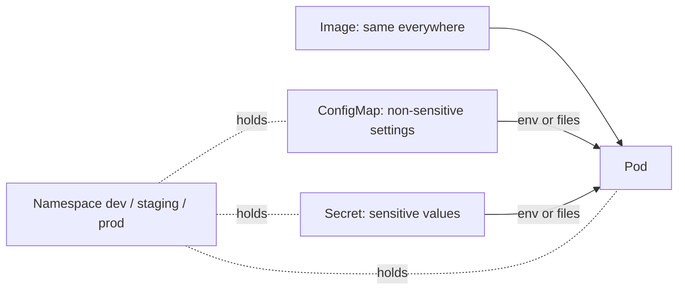

> [!info] Level: junior-middle | Time: about 5 h | You need: [[learn/kubernetes-services-and-ingress|Kubernetes 03: Services, DNS and Ingress]] | Lab: Lab B, the kind cluster `lab` from [[learn/lab-setup|Start 01: Set up your lab]]

An image should be the same in every environment. What changes between your laptop, staging and production is configuration: a log level, a database host, a feature flag, a password. Kubernetes gives you two objects for that, the **ConfigMap** and the **Secret**, and one way to divide a cluster between teams and environments, the **namespace**.

All three are easy to use and easy to misunderstand. The most expensive misunderstandings are believing that a Secret is encrypted (it is only encoded), believing that a changed ConfigMap reaches running Pods (usually it does not), and believing that a namespace is a security boundary (it is a naming and permission scope). This lesson takes each in turn.

## What you will learn

- Why configuration lives outside the image, and how to create a ConfigMap from literals, files and YAML.
- The two ways to give configuration to a Pod, environment variables and mounted files, and which one updates when the ConfigMap changes.
- What a Secret is, which types exist, and why base64 is an encoding and not protection.
- How Secrets are (and are not) protected: encryption at rest, RBAC and keeping them out of Git.
- What a namespace scopes and what it does not, how to work across namespaces, and how to write a minimal read-only Role and RoleBinding.

## Same image, different config

The twelve-factor app method says to keep configuration in the environment, strictly separated from code. In practice: build one image, tag it once, and promote that same image through environments. If you rebuild for each environment, the thing you tested is not the thing you run.

In Kubernetes the image comes from the Deployment's `image:` field, and the configuration comes from objects the Pod references:



Rule of thumb: if you would be unhappy to see the value in a screenshot of a pull request, it goes in a Secret (or better, in a secret manager, see below). Everything else goes in a ConfigMap.

## ConfigMaps

A ConfigMap is a named set of key-value pairs. Values are strings. It can hold short settings like `LOG_LEVEL=info`, or whole files such as `nginx.conf`. A ConfigMap is limited in size (about 1 MiB of data; check the documentation for your version), so it is for configuration, not for data.

### Three ways to create one

```bash
# 1. From literals
kubectl create configmap app-config --from-literal=LOG_LEVEL=info --from-literal=FEATURE_X=off

# 2. From a file (the file name becomes the key, the contents the value)
echo 'worker_processes 1;' > nginx.conf
kubectl create configmap nginx-config --from-file=nginx.conf

# 3. From YAML, which is what you keep in Git
cat <<'EOF' > app-config.yaml
apiVersion: v1
kind: ConfigMap
metadata:
  name: app-config
data:
  LOG_LEVEL: "info"
  FEATURE_X: "off"
EOF
kubectl apply -f app-config.yaml
```

Quote values in YAML (`"off"`, `"8080"`): unquoted `off`, `yes` and numbers can be read as booleans or integers, and `data` values must be strings. Reading one back:

```bash
kubectl get configmap app-config -o yaml
```

```text
apiVersion: v1
data:
  FEATURE_X: "off"
  LOG_LEVEL: info
kind: ConfigMap
metadata:
  name: app-config
  namespace: default
```

_Illustrative: the real output also has `creationTimestamp` and a `resourceVersion`._

### Environment variables or files

A Pod can take ConfigMap data in two forms, and they behave differently.

**As environment variables.** Either all keys at once with `envFrom`, or single keys with `valueFrom`:

```yaml
containers:
  - name: app
    image: busybox:1.36
    envFrom:
      - configMapRef:
          name: app-config # every key becomes an environment variable
    env:
      - name: GREETING
        valueFrom:
          configMapKeyRef:
            name: app-config
            key: FEATURE_X # one key, under a name you choose
```

**As files.** The ConfigMap is mounted as a volume. Each key becomes a file named after the key in the mount directory:

```yaml
containers:
  - name: app
    volumeMounts:
      - name: config
        mountPath: /etc/app # /etc/app/LOG_LEVEL and /etc/app/FEATURE_X
        readOnly: true
volumes:
  - name: config
    configMap:
      name: app-config
```

The key difference is what happens when the ConfigMap changes:

| Delivered as           | After you edit the ConfigMap                                                                                                                        |
| ---------------------- | --------------------------------------------------------------------------------------------------------------------------------------------------- |
| Environment variable   | **Never changes** in a running container. Environment is fixed when the container starts.                                                           |
| Mounted file           | The file **eventually** changes, after a delay of up to about a minute or so (the kubelet sync period plus cache). The application must re-read it. |
| Mounted with `subPath` | **Never changes.** `subPath` mounts do not get updates.                                                                                             |

So for a running Pod, a ConfigMap edit changes nothing by itself. To make Pods pick up a changed value, restart them:

```bash
kubectl rollout restart deployment/app
```

This replaces the Pods one by one, the same way a normal rollout does, so it is safe with a proper readiness probe. Many teams make this automatic by putting a hash of the ConfigMap in a Pod template annotation, so that any change to the config changes the template and triggers a rollout. Helm charts do this with a `checksum/config` annotation (see [[patterns/helm-chart-conventions]]).

> [!warning] Check before relying on this
> The exact delay before a mounted ConfigMap updates depends on the kubelet's configuration (sync period and ConfigMap cache setting) and your Kubernetes version. Treat "eventually, not instantly" as the contract and never write code that expects a mounted file to change within a second.

### Immutable ConfigMaps

Setting `immutable: true` on a ConfigMap (or a Secret) makes its data read-only: it can only be deleted and re-created. That protects against an accidental edit breaking every Pod that mounts it, and it reduces load on the API server because the kubelet stops watching it. The usual pattern is to give each version its own name (`app-config-v7`) and update the Deployment to point at the new one. That makes a config change a normal, revertible rollout.

```yaml
apiVersion: v1
kind: ConfigMap
metadata:
  name: app-config-v7
immutable: true
data:
  LOG_LEVEL: "info"
```

## Secrets

A Secret looks almost the same as a ConfigMap, and the same mechanisms (env vars and mounted files) deliver it to a Pod. It exists to carry sensitive data such as passwords, tokens and keys, and Kubernetes treats it a little more carefully: it is not printed by `kubectl describe`, it can be encrypted at rest, and its access can be controlled separately with RBAC.

Secrets have a `type` that tells Kubernetes (and tools) what keys to expect:

| Type                                  | Used for                                                                          |
| ------------------------------------- | --------------------------------------------------------------------------------- |
| `Opaque`                              | The default: arbitrary key-value data you define.                                 |
| `kubernetes.io/tls`                   | A certificate and key: keys `tls.crt` and `tls.key`. Used by Ingress and Gateway. |
| `kubernetes.io/dockerconfigjson`      | Credentials for pulling images from a private registry (`imagePullSecrets`).      |
| `kubernetes.io/basic-auth`            | A username and password.                                                          |
| `kubernetes.io/ssh-auth`              | An SSH private key.                                                               |
| `kubernetes.io/service-account-token` | A long-lived ServiceAccount token (legacy; prefer short-lived tokens).            |

```bash
kubectl create secret generic db-creds \
  --from-literal=username=app \
  --from-literal=password=s3cret
```

> [!warning] Never put a real secret in a command line
> `s3cret` is a fake value for practice. A real password typed on the command line lands in your shell history and process list. For real secrets read from a file or a prompt, or better, use a secret manager (below). Do not paste real credentials into the exercises in this lesson.

### Base64 is not encryption

Look at what is stored:

```bash
kubectl get secret db-creds -o yaml
```

```text
apiVersion: v1
data:
  password: czNjcmV0
  username: YXBw
kind: Secret
metadata:
  name: db-creds
  namespace: default
type: Opaque
```

The values are **base64-encoded**. Base64 is a way to write arbitrary bytes as text. It has no key and gives no secrecy. Anyone who can read the Secret can decode it in one command:

```bash
echo 'czNjcmV0' | base64 -d
```

```text
s3cret
```

The encoding is there because Secret data can be binary (a certificate, a key file) and the API must carry it inside JSON. Treat a Secret manifest with the same care as a plain-text password file. In particular:

- **A Secret YAML file never goes into Git**, not even a private repository. Git history is permanent, forks and clones copy it, and anyone who has ever read the repository has the value. If one was committed, treat the secret as leaked and rotate it (see [[runbooks/leaked-credential-rotation]]).
- Passing the value through `kubectl create secret --from-literal` or a CI variable avoids the file, but the secret still has to come from somewhere. The right source is a secret manager, not a human's clipboard.

### How Secrets are actually protected

Protection comes from layers around the object, not from the base64:

1. **Encryption at rest.** Cluster state, including Secrets, is stored in `etcd`. In a self-managed cluster, you have to turn on encryption of Secrets at rest with an `EncryptionConfiguration` for the API server, and manage its keys. In managed clusters the provider usually encrypts the underlying storage for you, and some offer a further layer using a key you control in a key management service.
2. **RBAC.** Who may `get`, `list` or `watch` Secrets. Note that `list` and `watch` return the full values too, not just names. Giving someone "read access to everything in the namespace" gives them every password in it.
3. **Least exposure in the Pod.** Prefer mounting a Secret as a file with a restrictive mode over putting it in an environment variable: environment variables are inherited by child processes, appear in crash dumps and diagnostic endpoints, and are easy to print by accident. Mount it `readOnly` and set a restrictive `defaultMode` on the volume (Secret files are owned by root, so a non-root container also needs `fsGroup`, as in the example below).
4. **Keeping them out of Git** with a tool that syncs from a secret manager.

> [!warning] Check before relying on this
> What GKE encrypts by default, which keys protect it and whether application-layer Secret encryption with Cloud KMS is available on your cluster mode and version were not confirmed for this page. Read the GKE documentation for your cluster, and see [[patterns/cloud-kms-key-management]] for the key side.

### Secrets without Git: a preview

The standard answer to "how do I deploy a Secret if the YAML cannot be in Git?" is to keep only a **reference** in Git and let an operator fetch the real value from a secret manager at runtime. On Google Cloud that manager is Secret Manager, and the External Secrets Operator can create a Kubernetes Secret from it. The manifest in Git then says which secret to fetch, never what it contains. The full design is in [[patterns/external-secrets-with-secret-manager]]. Other approaches exist (encrypting the manifest before committing it, or mounting from the secret manager directly); they all share the same rule: the plain value is never committed.

A Pod mounting the Secret as files looks like this:

```yaml title="secret-volume-example.yaml"
apiVersion: v1
kind: Pod
metadata:
  name: reads-secret
spec:
  securityContext:
    fsGroup: 65534 # lets the non-root user below read the mounted files via group permissions
  containers:
    - name: app
      image: busybox:1.36 # example tag; pin the one you use
      command: ["sh", "-c", "ls -l /etc/db && sleep 3600"]
      volumeMounts:
        - name: db
          mountPath: /etc/db
          readOnly: true
      securityContext:
        runAsNonRoot: true
        runAsUser: 65534
        allowPrivilegeEscalation: false
        capabilities:
          drop: ["ALL"]
        seccompProfile:
          type: RuntimeDefault
  volumes:
    - name: db
      secret:
        secretName: db-creds
        defaultMode: 0440 # owner and group read only; no write, no access for others
```

## Namespaces

A **namespace** is a named scope inside one cluster. Most objects live in exactly one namespace, and many rules are applied per namespace. A new cluster has four:

| Namespace         | Contents                                                                   |
| ----------------- | -------------------------------------------------------------------------- |
| `default`         | Where objects go if you name no namespace. Do not put real workloads here. |
| `kube-system`     | Cluster components: DNS, the proxy, the network plugin, metrics.           |
| `kube-public`     | Readable by everyone, including unauthenticated users. Rarely used.        |
| `kube-node-lease` | One heartbeat object per node. Leave it alone.                             |

### What a namespace scopes

- **Names.** Two teams can each have a Deployment called `web` in different namespaces. Within one namespace a name is unique per kind.
- **Access (RBAC).** A Role and RoleBinding grant permissions inside one namespace.
- **Resource totals.** A `ResourceQuota` caps the CPU, memory and number of objects a namespace may use (see [[learn/kubernetes-probes-resources-and-debugging|Kubernetes 05]]).
- **Network rules.** A `NetworkPolicy` applies to Pods in its namespace and can select other namespaces ([[patterns/kubernetes-network-policies]]).
- **Pod security standards.** Pod Security Admission is configured by labels on a namespace ([[patterns/pod-security-admission]]).
- **DNS.** The namespace is part of every Service name, as you saw in the last lesson.

### What a namespace does not isolate

This is the part to remember. A namespace is a **label with rules attached**. It is not a wall.

- **Nodes.** Pods from every namespace share the same nodes and the same kernel. A container escape or a noisy neighbour crosses namespaces. Separating teams on hardware needs separate node pools or clusters.
- **Network, by default.** Without a NetworkPolicy, any Pod can reach any other Pod and any Service in the cluster, in any namespace.
- **Cluster-scoped objects.** Nodes, PersistentVolumes, StorageClasses, CustomResourceDefinitions, ClusterRoles and the namespaces themselves belong to no namespace. List them with `kubectl api-resources --namespaced=false`.
- **Identity beyond RBAC.** A powerful ClusterRole bound to a ServiceAccount, or a node's cloud permissions, ignore namespace borders.

Namespaces are the right tool to divide a cluster for convenience and to apply per-team policy. For strong isolation between tenants who do not trust each other, use separate clusters or projects.

> [!danger] Deleting a namespace deletes everything in it
> `kubectl delete namespace team-a` removes every Deployment, Service, ConfigMap, Secret and volume claim in it, with no confirmation. Check `kubectl config current-context` and the namespace name before you press Enter, and never run it on a shared cluster without a second pair of eyes.

### Working across namespaces

Most `kubectl` commands take `-n NAMESPACE` or `--all-namespaces` (`-A`):

```bash
kubectl get pods -n kube-system
kubectl get deployments -A
```

To avoid typing `-n` all day, set a default namespace for your current context. Do this carefully, because it changes where the next `kubectl apply` goes:

```bash
kubectl config set-context --current --namespace=team-a
kubectl config view --minify --output 'jsonpath={..namespace}'
```

```text
team-a
```

Many people show the context and namespace in their shell prompt for exactly this reason.

### A minimal read-only Role and RoleBinding

RBAC answers "may this identity do this verb on this resource, here?". Permissions are additive: there are no deny rules, so an identity can do nothing until a rule grants it. A **Role** lists rules for one namespace; a **RoleBinding** attaches a Role to a user, group or ServiceAccount.

```yaml title="rbac-viewer.yaml"
apiVersion: v1
kind: ServiceAccount
metadata:
  name: viewer
  namespace: team-a
---
apiVersion: rbac.authorization.k8s.io/v1
kind: Role
metadata:
  name: config-reader
  namespace: team-a
rules:
  - apiGroups: [""] # "" is the core API group
    resources: ["pods", "pods/log", "configmaps", "services"]
    verbs: ["get", "list", "watch"] # read-only; Secrets are deliberately absent
---
apiVersion: rbac.authorization.k8s.io/v1
kind: RoleBinding
metadata:
  name: viewer-config-reader
  namespace: team-a
subjects:
  - kind: ServiceAccount
    name: viewer
    namespace: team-a
roleRef:
  apiGroup: rbac.authorization.k8s.io
  kind: Role
  name: config-reader
```

Two habits keep RBAC safe. Grant the **verbs and resources** that are needed rather than `*`. And remember that every Pod gets a ServiceAccount (`default` if none is set), so a rule you grant to the `default` account is granted to every Pod in the namespace that has not chosen another. The `kubectl auth can-i` command tests a permission without trying the action.

## Hands-on exercises

Do these in the kind cluster `lab`. Check `kubectl config current-context` prints `kind-lab` first.

> [!warning] Exercises are not verified
> The commands and outputs were written from the Kubernetes documentation and not run for this page (no `verified` date). Output is illustrative. Image tags are examples. Read the "If you see something else" lines first.

1. **Give a Pod config with `envFrom` and a mounted file.** Save this as `app.yaml`. It has a ConfigMap and a Deployment that prints its settings, and it has no namespace, so you can apply it twice later.

   ```yaml title="app.yaml"
   apiVersion: v1
   kind: ConfigMap
   metadata:
     name: app-config
   data:
     LOG_LEVEL: "info"
   ---
   apiVersion: apps/v1
   kind: Deployment
   metadata:
     name: app
   spec:
     replicas: 1
     selector:
       matchLabels:
         app: app
     template:
       metadata:
         labels:
           app: app
       spec:
         containers:
           - name: app
             image: busybox:1.36 # example tag; pin the one you use
             command: ["sh", "-c", "while true; do sleep 30; done"]
             envFrom:
               - configMapRef:
                   name: app-config
             volumeMounts:
               - name: config
                 mountPath: /etc/app
                 readOnly: true
             resources:
               requests:
                 cpu: 10m
                 memory: 16Mi
               limits:
                 memory: 32Mi
             securityContext:
               runAsNonRoot: true
               runAsUser: 65534
               allowPrivilegeEscalation: false
               capabilities:
                 drop: ["ALL"]
               seccompProfile:
                 type: RuntimeDefault
         volumes:
           - name: config
             configMap:
               name: app-config
   ```

   ```bash
   kubectl apply -f app.yaml
   kubectl rollout status deployment/app --timeout=60s
   kubectl exec deploy/app -- printenv LOG_LEVEL
   kubectl exec deploy/app -- cat /etc/app/LOG_LEVEL; echo
   ```

   Expected: both print `info`.
   If you see something else: `printenv` printing nothing means `envFrom` is missing or the ConfigMap name is wrong (`kubectl describe pod` shows a `CreateContainerConfigError` event for a missing ConfigMap). A `No such file` on the mount means the volume mount path or volume name has a typo.

2. **Change the ConfigMap and watch what updates.**

   ```bash
   kubectl create configmap app-config --from-literal=LOG_LEVEL=debug \
     --dry-run=client -o yaml | kubectl apply -f -
   kubectl exec deploy/app -- printenv LOG_LEVEL
   sleep 90
   kubectl exec deploy/app -- cat /etc/app/LOG_LEVEL; echo
   ```

   Expected: `configmap/app-config configured`, then `info` for the environment variable (still the old value, because env is fixed at start), and after the wait `debug` from the mounted file.
   If you see something else: if the file still says `info`, wait another minute and repeat; the delay is not exact. If the env var already says `debug`, the Pod was restarted in between.

3. **Roll out so that the environment variable changes too.**

   ```bash
   kubectl rollout restart deployment/app
   kubectl rollout status deployment/app --timeout=60s
   kubectl exec deploy/app -- printenv LOG_LEVEL
   ```

   Expected: `deployment.apps/app restarted`, a successful rollout, and `debug`.
   If you see something else: if you still see `info`, `kubectl exec deploy/app` may have picked an old Pod that is terminating; check `kubectl get pods -l app=app` and repeat once only one Pod remains.

4. **Create a Secret and decode it, to see that base64 is encoding and not protection.**

   ```bash
   kubectl create secret generic db-creds \
     --from-literal=username=app --from-literal=password=s3cret
   kubectl get secret db-creds -o jsonpath='{.data.password}'; echo
   kubectl get secret db-creds -o jsonpath='{.data.password}' | base64 -d; echo
   kubectl describe secret db-creds
   ```

   Expected: `secret/db-creds created`, then `czNjcmV0`, then `s3cret`. The `describe` output shows the keys and their sizes (`password: 6 bytes`) but not the values.
   If you see something else: on macOS, `base64 -D` may be needed instead of `-d` on older systems. If `password` is missing from `.data`, you used a different key name.

5. **Create a namespace and a second copy of the app.** The same file is applied in a different namespace, which shows that names are scoped.

   ```bash
   kubectl create namespace team-a
   kubectl apply -f app.yaml -n team-a
   kubectl rollout status deployment/app -n team-a --timeout=60s
   kubectl get deployments --all-namespaces | grep -E 'NAMESPACE|app'
   kubectl -n team-a exec deploy/app -- printenv LOG_LEVEL
   ```

   Expected: two Deployments called `app`, one in `default` and one in `team-a`. In `team-a`, `printenv LOG_LEVEL` prints `info`, because that namespace has its own ConfigMap from the file, not the changed one in `default`:

   ```text
   NAMESPACE   NAME   READY   UP-TO-DATE   AVAILABLE   AGE
   default     app    1/1     1            1           8m
   team-a      app    1/1     1            1           30s
   ```

   If you see something else: if `apply` printed `configmap/app-config configured` and `deployment.apps/app unchanged`, you forgot `-n team-a` and reset the default namespace's ConfigMap. If the Deployment is `0/1`, read `kubectl -n team-a describe pod`.

6. **Switch your default namespace and switch back.**

   ```bash
   kubectl config set-context --current --namespace=team-a
   kubectl get pods
   kubectl config view --minify --output 'jsonpath={..namespace}'; echo
   kubectl config set-context --current --namespace=default
   ```

   Expected: `Context "kind-lab" modified.`, a list with only the `team-a` Pod, `team-a`, and then the context modified again.
   If you see something else: if `get pods` shows the other Pod, the first command did not run against `kind-lab`; check `kubectl config current-context`. Always switch back, or tomorrow's `apply` lands in the wrong place.

7. **Test RBAC with `can-i`.** First save the ServiceAccount, Role and RoleBinding from the RBAC section as `rbac-viewer.yaml`.

   ```bash
   kubectl auth can-i get secrets -n team-a --as=system:serviceaccount:team-a:default
   kubectl apply -f rbac-viewer.yaml
   kubectl auth can-i get configmaps -n team-a --as=system:serviceaccount:team-a:viewer
   kubectl auth can-i get secrets -n team-a --as=system:serviceaccount:team-a:viewer
   kubectl auth can-i delete pods -n team-a --as=system:serviceaccount:team-a:viewer
   ```

   Expected: `no` for the `default` account on secrets (it has no permissions in a new namespace), then `yes` for `viewer` reading ConfigMaps, `no` for `viewer` reading Secrets and `no` for deleting Pods.
   If you see something else: `Error from server (Forbidden): ... cannot impersonate` means your own user may not impersonate ServiceAccounts; the kind admin user can. A `yes` for secrets means some other Role or ClusterRoleBinding grants it; find it with `kubectl get rolebindings,clusterrolebindings -A -o wide | grep viewer`.

8. **Clean up.**

   ```bash
   kubectl delete -f app.yaml --ignore-not-found
   kubectl delete secret db-creds --ignore-not-found
   kubectl delete namespace team-a --ignore-not-found
   ```

   Expected: the objects in `default` and the whole `team-a` namespace are removed.
   If you see something else: if the namespace stays in `Terminating`, list what is left with `kubectl get all -n team-a` and look for a finalizer.

## Common mistakes

- **Expecting Pods to see a ConfigMap change.** Why it bites: environment variables never change in a running container, and mounted files change late and the app must reload. People "fix" a setting, see nothing change and edit it again. Fix: `kubectl rollout restart`, or a config hash annotation, so a config change is a rollout.
- **Treating base64 as security.** Why it bites: a Secret looks scrambled, so people paste it into chat, tickets or Git. Fix: assume anyone who sees the YAML has the value, and keep it out of every place a password should not be.
- **Committing a Secret manifest to Git.** Why it bites: history keeps it forever. Fix: store only references (External Secrets) in Git, and if it already happened, rotate the credential ([[runbooks/leaked-credential-rotation]]).
- **Granting `get`, `list` or `watch` on Secrets broadly.** Why it bites: `list` returns full values, so a "viewer" role can read every password in the namespace. Fix: leave Secrets out of read-only roles and grant them by name where needed (`resourceNames`).
- **Passing secrets as environment variables by default.** Why it bites: they leak into logs, crash reports and child processes. Fix: mount as read-only files and read them in the app.
- **Using `default` for real work.** Why it bites: no separation, no quota, and the `default` ServiceAccount is shared by everything. Fix: create namespaces per team or environment, and a dedicated ServiceAccount per workload.
- **Treating a namespace as a security boundary.** Why it bites: Pods share nodes and, without NetworkPolicy, the network. Fix: add NetworkPolicies, Pod Security Admission and quotas, and use separate clusters where trust is low.
- **Leaving a changed default namespace in your context.** Why it bites: a later `apply` or `delete` hits the wrong namespace. Fix: show the namespace in your prompt, and prefer an explicit `-n`.
- **Unquoted values in a ConfigMap.** `"off"`, `"0123"` and `"true"` should be quoted strings. Why it bites: YAML turns some into booleans or numbers and the API rejects or mangles them. Fix: quote every value.

## Check your understanding

1. You change a ConfigMap that a running Deployment reads through `envFrom`. Why does the application still use the old value, and what is the fix?
2. A colleague says "the Secret is safe, it is base64." What do you answer, and what actually protects a Secret?
3. What does a namespace not isolate?
4. Why can a Role that allows `list` on Secrets be as dangerous as one that allows `get`?
5. Which of these are namespaced, and which are cluster-scoped: Deployment, Node, ConfigMap, PersistentVolume, ClusterRole?
6. How do you ask Kubernetes whether a ServiceAccount may read Secrets in a namespace, without trying it?

> [!question]- Answers
>
> 1. Environment variables are set when the container starts and never updated while it runs. The Pods have to be replaced: `kubectl rollout restart deployment/NAME`. A hash of the config in a Pod template annotation makes this happen automatically on every change.
> 2. Base64 is an encoding that anyone can reverse with `base64 -d`; it protects nothing. A Secret is protected by encryption at rest in `etcd` (and the provider's storage encryption), by RBAC that limits who can read it, by mounting it with tight file permissions, and by keeping the plain value out of Git by fetching it from a secret manager.
> 3. Nodes and the kernel they share, the default network (without NetworkPolicy any Pod can reach any other), and cluster-scoped objects such as ClusterRoles, PersistentVolumes and CRDs. A namespace scopes names, RBAC, quotas, policies and DNS, but it is not a security boundary against a determined tenant.
> 4. `list` (and `watch`) returns the full objects, including the data of every Secret, not only their names. Both verbs reveal the values.
> 5. Namespaced: Deployment, ConfigMap. Cluster-scoped: Node, PersistentVolume, ClusterRole. `kubectl api-resources --namespaced=false` lists the cluster-scoped kinds.
> 6. `kubectl auth can-i get secrets -n NAMESPACE --as=system:serviceaccount:NAMESPACE:NAME`. It answers `yes` or `no`.

## Next steps

Next lesson: [[learn/kubernetes-probes-resources-and-debugging|Kubernetes 05: Probes, resources and a pod debugging playbook]]. Previous lesson: [[learn/kubernetes-services-and-ingress|Kubernetes 03: Services, DNS and Ingress]].

To go deeper:

- [[patterns/external-secrets-with-secret-manager]] for getting Secrets into the cluster without committing them.
- [[patterns/pod-security-admission]] for the namespace labels that enforce safe Pod settings.
- [[patterns/kubernetes-network-policies]] for the network isolation that namespaces do not give you.
- [[patterns/cloud-kms-key-management]] for the key-management side of encryption at rest, and [[runbooks/leaked-credential-rotation]] for what to do when a secret escapes.
- The whole path is mapped in [[learn/index|the learning path]].

## Sources

- Kubernetes documentation, "ConfigMaps" (https://kubernetes.io/docs/concepts/configuration/configmap/) and "Secrets" (https://kubernetes.io/docs/concepts/configuration/secret/).
- Kubernetes documentation, "Encrypting Confidential Data at Rest" (https://kubernetes.io/docs/tasks/administer-cluster/encrypt-data/) and "Good practices for Kubernetes Secrets" (https://kubernetes.io/docs/concepts/security/secrets-good-practices/).
- Kubernetes documentation, "Namespaces" (https://kubernetes.io/docs/concepts/overview/working-with-objects/namespaces/).
- Kubernetes documentation, "Using RBAC Authorization" (https://kubernetes.io/docs/reference/access-authn-authz/rbac/).
- The Twelve-Factor App, "III. Config" (https://12factor.net/config).
- Not checked against a running cluster for this page. The ConfigMap size limit, the mounted-file update delay, the GKE encryption defaults and the image tag `busybox:1.36` are not verified.
